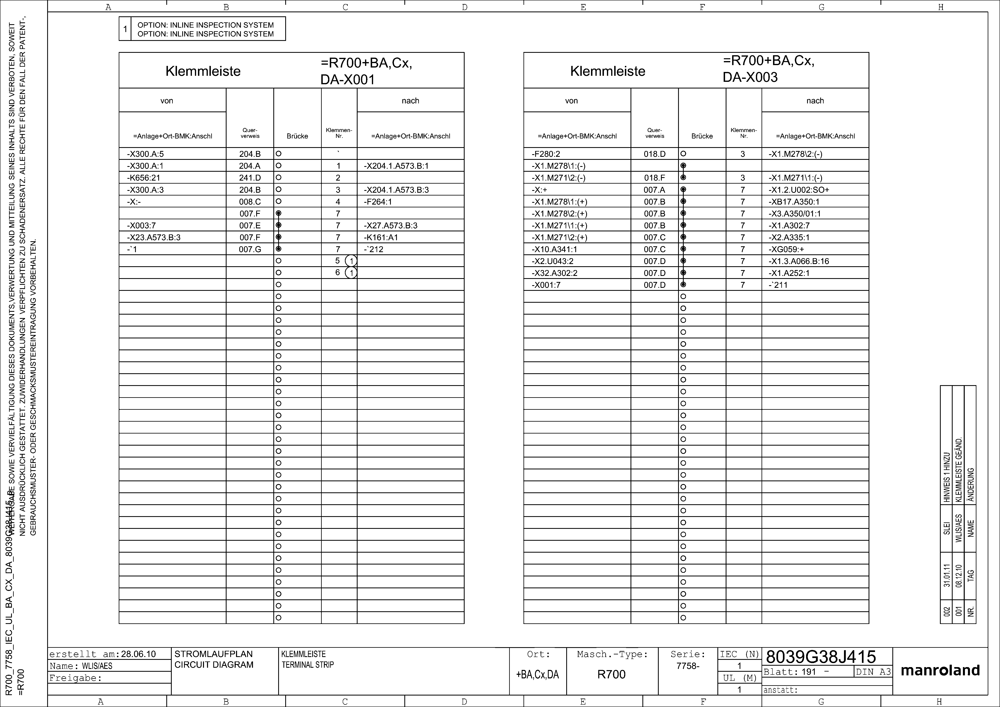

# +BA_Cx_DA — Sheet 191 of 247 — KLEMMLEISTE

**TERMINAL STRIP**

> Part of the manroland **R700** printing press IEC/UL circuit diagrams.
> Drawing class: **Stromlaufplan / Circuit diagram** (DIN A3).
> Document `+BA_Cx_DA` covers the **Printing units / main switch cabinet** machine section.

## At a glance

| Field | Value |
|---|---|
| Document | `+BA_Cx_DA`  (8039G38J415) |
| Sheet | **191** of 247 |
| Section (DE) | KLEMMLEISTE |
| Section (EN) | TERMINAL STRIP |
| Section type | TERMINALS — Terminal strip |
| Machine type | `R700` |
| Series | `7758` |
| Created | 28.06.10 |
| Replaces | — |
| Columns used | A, B, C, D, E, F, G, H |
| Path numbers | — |
| Labels on sheet | 120 |
| Cross-refs out | 0 |
| Cross-refs in | 0 |

**Previous:** [+BA_Cx_DA sheet 190](SHEET_0190.md) · **Next:** [+BA_Cx_DA sheet 192](SHEET_0192.md) · **Document TOC:** [_TOC.md](_TOC.md)  (+BA_Cx_DA) · **Master TOC:** [all sheets](../_MASTER_TOC.md)

## Sheet image (300 DPI, exact vector render)



_Rendered directly from the PDF vector layer at 300 DPI (1-bit), no OCR and no resampling. Use it to confirm anything ambiguous in the text below._

## Cross-references on this sheet

Each entry is a wire leaving this sheet. The printed token is `/sheet.column`; the link resolves to that sheet inside the same document.

_No outgoing cross-references on this sheet._

## Devices on this sheet

| Tag | Class | Class meaning (IEC) | Col | Sub | Terminal | Sign |
|---|---|---|---|---|---|---|
| `F280:2` | F | Schutz / protection device (fuse, circuit breaker) | E | — | 2 | — |
| `X001:7` | X | Klemme / terminal, plug connector | E | — | 7 | — |
| `K656:21` | K | Relais / relay, contactor | A | — | 21 | — |
| `F264:1` | F | Schutz / protection device (fuse, circuit breaker) | C | — | 1 | — |
| `X003:7` | X | Klemme / terminal, plug connector | A | — | 7 | — |
| `K161:A1` | K | Relais / relay, contactor | C | — | A1 | — |
| `NR.` | — | cross-device reference | H | — | — | — |
| `08.12.10` | — | cross-device reference | H | — | — | — |
| `31.01.11` | — | cross-device reference | H | — | — | — |
| `Nr.` | — | cross-device reference | F | — | — | — |
| `018.D` | — | cross-device reference | F | — | — | — |
| `X1.M278\2:( )` | — | cross-device reference | G | — | — | — |
| `X1.M278\1:( )` | — | cross-device reference | E | — | — | — |
| `018.F` | — | cross-device reference | F | — | — | — |
| `X1.M271\2:( )` | — | cross-device reference | E | — | — | — |
| `X1.M271\1:( )` | — | cross-device reference | G | — | — | — |
| `007.A` | — | cross-device reference | F | — | — | — |
| `007.B` | — | cross-device reference | F | — | — | — |
| `X1.M278\1:(+)` | — | cross-device reference | E | — | — | — |
| `XB17.A350:1` | — | cross-device reference | G | — | 1 | — |
| `007.B` | — | cross-device reference | F | — | — | — |
| `X1.M278\2:(+)` | — | cross-device reference | E | — | — | — |
| `007.B` | — | cross-device reference | F | — | — | — |
| `X1.M271\1:(+)` | — | cross-device reference | E | — | — | — |
| `X1.A302:7` | — | cross-device reference | G | — | 7 | — |
| `007.C` | — | cross-device reference | F | — | — | — |
| `X1.M271\2:(+)` | — | cross-device reference | E | — | — | — |
| `X2.A335:1` | — | cross-device reference | G | — | 1 | — |
| `007.C` | — | cross-device reference | F | — | — | — |
| `X10.A341:1` | — | cross-device reference | E | — | 1 | — |
| `007.D` | — | cross-device reference | F | — | — | — |
| `X2.U043:2` | — | cross-device reference | E | — | 2 | — |
| `X1.3.A066.B:16` | — | cross-device reference | G | — | 16 | — |
| `007.D` | — | cross-device reference | F | — | — | — |
| `X32.A302:2` | — | cross-device reference | E | — | 2 | — |
| `X1.A252:1` | — | cross-device reference | G | — | 1 | — |
| `007.D` | — | cross-device reference | F | — | — | — |
| `Nr.` | — | cross-device reference | C | — | — | — |
| `204.B` | — | cross-device reference | B | — | — | — |
| `X300.A:5` | — | cross-device reference | A | — | 5 | — |
| `204.A` | — | cross-device reference | B | — | — | — |
| `X300.A:1` | — | cross-device reference | A | — | 1 | — |
| `X204.1.A573.B:1` | — | cross-device reference | C | — | 1 | — |
| `241.D` | — | cross-device reference | B | — | — | — |
| `204.B` | — | cross-device reference | B | — | — | — |
| `X300.A:3` | — | cross-device reference | A | — | 3 | — |
| `X204.1.A573.B:3` | — | cross-device reference | C | — | 3 | — |
| `008.C` | — | cross-device reference | B | — | — | — |
| `007.F` | — | cross-device reference | B | — | — | — |
| `007.E` | — | cross-device reference | B | — | — | — |
| `X27.A573.B:3` | — | cross-device reference | C | — | 3 | — |
| `007.F` | — | cross-device reference | B | — | — | — |
| `X23.A573.B:3` | — | cross-device reference | A | — | 3 | — |
| `007.G` | — | cross-device reference | B | — | — | — |

## Potentials / nets

_No named potentials on this sheet._

## Wire-end annotations (grouped as printed)

A wire that continues elsewhere is annotated with a small cluster: the destination description, the path/line number `#NN`, and the `/sheet.column` cross reference. Each row below is one such cluster exactly as it is grouped on the drawing.

| Col | Y | Path | Cross-ref | Text on the wire |
|---|---|---|---|---|
| B | 26.0 | — | — | `1 OPTION: INLINE INSPECTION SYSTEM OPTION: INLINE INSPECTION SYSTEM` |
| G | 64.8 | — | — | `DA X003 =R700+BA,Cx,` |
| C | 67.6 | — | — | `DA X001 =R700+BA,Cx,` |
| B | 77.5 | — | — | `Klemmleiste` |
| E | 77.5 | — | — | `Klemmleiste` |
| A | 115.5 | — | — | `von` |
| D | 115.5 | — | — | `nach` |
| E | 115.5 | — | — | `von` |
| G | 115.5 | — | — | `nach` |
| B | 151.9 | — | — | `Quer` |
| C | 151.9 | — | — | `Klemmen =Anlage+Ort BMK:Anschl` |
| F | 151.9 | — | — | `Quer` |
| G | 151.9 | — | — | `Klemmen =Anlage+Ort BMK:Anschl` |
| B | 158.5 | — | — | `=Anlage+Ort BMK:Anschl` |
| C | 158.5 | — | — | `Brücke Nr.` |
| E | 158.5 | — | — | `=Anlage+Ort BMK:Anschl` |
| F | 158.5 | — | — | `Brücke Nr.` |
| B | 159.1 | — | — | `verweis` |
| F | 159.1 | — | — | `verweis` |
| B | 179.0 | — | — | `X300.A:5 204.B '` |
| F | 179.2 | — | — | `F280:2 X1.M278\1:( ) 018.D 3 X1.M278\2:( )` |
| B | 193.4 | — | — | `X300.A:1 K656:21 204.A 241.D 2 1 X204.1.A573.B:1` |
| F | 207.5 | — | — | `X1.M271\2:( ) X:+ X1.M278\1:(+) X1.M278\2:(+) X1.M271\1:(+) X1.M271\2:(+) X10.A341:1 X2.U043:2 X32.A302:2 X001:7 007.A 007.C 007.C 007.D 007.D 007.D 007.B 007.B 007.B 018.F 3 7 7 7 7 7 7 7 7 7 X1.M271\1:( ) X1.2.U002:SO+ XB17.A350:1 X3.A350/01:1 X1.A302:7 X2.A335:1 XG059:+ X1.3.A066.B:16 X1.A252:1 '211` |
| B | 221.7 | — | — | `X300.A:3 X: X003:7 X23.A573.B:3 '1 007.G 008.C 204.B 007.E 007.F 007.F 3 4 7 7 7 7 X204.1.A573.B:3 F264:1 X27.A573.B:3 K161:A1 '212` |
| C | 306.1 | — | — | `5 6 1` |
| C | 321.5 | — | — | `1` |
| H | 520.4 | — | — | `001 WLIS/AES KLEMMLEISTE GEÄND. 08.12.10` |
| H | 538.6 | — | — | `31.01.11 HINWEIS 1 HINZU SLEI 002` |
| H | 557.2 | — | — | `NR. NAME TAG ÄNDERUNG` |


## Reconstructed tables

This sheet carries tabular content (pin map / terminal assignment / index). The grid below was rebuilt from the drawing's own rule lines, so each row is exactly one physical row of the table.

### Table 1 — 11 data rows × 3 columns (at x=269.3, y=62.4) — **DA X001**

| Quer verweis | Brücke | Klemmen Nr. |
|---|---|---|
| `204.B` |  | `'` |
| `204.A` |  | `1` |
| `241.D` |  | `2` |
| `204.B` |  | `3` |
| `008.C` |  | `4` |
| `007.F` |  | `7` |
| `007.E` |  | `7` |
| `007.F` |  | `7` |
| `007.G` |  | `7` |
|  |  | `5 1` |
|  |  | `6 1` |


### Table 2 — 11 data rows × 3 columns (at x=751.2, y=62.4) — **DA X003**

| Quer verweis | Brücke | Klemmen Nr. |
|---|---|---|
| `018.D` |  | `3` |
| `018.F` |  | `3` |
| `007.A` |  | `7` |
| `007.B` |  | `7` |
| `007.B` |  | `7` |
| `007.B` |  | `7` |
| `007.C` |  | `7` |
| `007.C` |  | `7` |
| `007.D` |  | `7` |
| `007.D` |  | `7` |
| `007.D` |  | `7` |


## Notes and free text on this sheet

| Text | Col | Y (pt) |
|---|---|---|
| `TAG` | H | 678.58 |
| `NAME` | H | 619.16 |
| `ÄNDERUNG` | H | 557.19 |
| `WLIS/AES` | H | 612.22 |
| `KLEMMLEISTE GEÄND.` | H | 520.4 |
| `SLEI` | H | 621.5 |
| `HINWEIS 1 HINZU` | H | 538.59 |
| `von` | E | 115.53 |
| `=Anlage+Ort BMK:Anschl` | E | 158.52 |
| `Quer` | F | 151.93 |
| `Klemmleiste` | E | 77.49 |
| `verweis` | F | 159.12 |
| `nach` | G | 115.46 |
| `=Anlage+Ort BMK:Anschl` | G | 158.52 |
| `Klemmen` | F | 151.94 |
| `Brücke` | F | 158.53 |
| `X:+` | E | 221.68 |
| `X1.2.U002:SO+` | G | 221.71 |
| `X3.A350/01:1` | G | 250.06 |
| `XG059:+` | G | 292.58 |
| `=R700+BA,Cx,` | G | 64.77 |
| `DA X003` | F | 84.71 |
| `von` | A | 115.53 |
| `=Anlage+Ort BMK:Anschl` | B | 158.52 |
| `Quer` | B | 151.93 |
| `Klemmleiste` | B | 77.49 |
| `verweis` | B | 159.12 |
| `nach` | D | 115.46 |
| `=Anlage+Ort BMK:Anschl` | D | 158.52 |
| `Klemmen` | C | 151.94 |
| `Brücke` | C | 158.53 |
| `X:` | A | 235.8 |
| `=R700+BA,Cx,` | C | 67.6 |
| `DA X001` | C | 87.55 |
| `OPTION: INLINE INSPECTION SYSTEM` | B | 26.03 |

## Complete label inventory (exact text from the drawing)

Every text object inside the drawing area of this sheet, in DIN reading order (column A→H, then top→bottom). This is the authoritative list: if a string is not here it is not printed on this sheet.

| Col | Y | X | Dir | Type | Text |
|---|---|---|---|---|---|
| A | 30.0 | 146.3 | → | number | `1` |
| A | 115.5 | 191.1 | → | text | `von` |
| A | 179.2 | 151.4 | → | device ref | `X300.A:5` |
| A | 193.4 | 151.4 | → | device ref | `X300.A:1` |
| A | 207.5 | 151.4 | → | device tag | `K656:21` |
| A | 221.7 | 151.4 | → | device ref | `X300.A:3` |
| A | 235.8 | 151.4 | → | text | `X:` |
| A | 264.2 | 151.4 | → | device tag | `X003:7` |
| A | 278.4 | 151.4 | → | device ref | `X23.A573.B:3` |
| A | 292.5 | 151.4 | → | other | `'1` |
| B | 26.0 | 163.7 | → | text | `OPTION: INLINE INSPECTION SYSTEM` |
| B | 36.7 | 163.7 | → | text | `OPTION: INLINE INSPECTION SYSTEM` |
| B | 77.5 | 197.0 | → | text | `Klemmleiste` |
| B | 151.9 | 288.9 | → | text | `Quer` |
| B | 158.5 | 158.6 | → | text | `=Anlage+Ort BMK:Anschl` |
| B | 159.1 | 286.7 | → | text | `verweis` |
| B | 179.2 | 285.0 | → | device ref | `204.B` |
| B | 193.4 | 284.6 | → | device ref | `204.A` |
| B | 207.5 | 284.7 | → | device ref | `241.D` |
| B | 221.7 | 285.0 | → | device ref | `204.B` |
| B | 235.9 | 284.7 | → | device ref | `008.C` |
| B | 250.1 | 285.3 | → | device ref | `007.F` |
| B | 264.2 | 285.0 | → | device ref | `007.E` |
| B | 278.4 | 285.3 | → | device ref | `007.F` |
| B | 292.6 | 284.5 | → | device ref | `007.G` |
| C | 67.6 | 381.8 | → | text | `=R700+BA,Cx,` |
| C | 87.5 | 381.3 | → | text | `DA X001` |
| C | 151.9 | 388.2 | → | text | `Klemmen` |
| C | 158.5 | 341.4 | → | text | `Brücke` |
| C | 159.0 | 399.5 | → | device ref | `Nr.` |
| C | 179.0 | 401.4 | → | other | `'` |
| C | 193.4 | 400.4 | → | number | `1` |
| C | 193.4 | 433.4 | → | device ref | `X204.1.A573.B:1` |
| C | 207.6 | 399.8 | → | number | `2` |
| C | 221.7 | 433.4 | → | device ref | `X204.1.A573.B:3` |
| C | 221.8 | 399.8 | → | number | `3` |
| C | 235.9 | 399.8 | → | number | `4` |
| C | 235.9 | 433.4 | → | device tag | `F264:1` |
| C | 250.1 | 399.8 | → | number | `7` |
| C | 264.2 | 433.4 | → | device ref | `X27.A573.B:3` |
| C | 264.3 | 399.8 | → | number | `7` |
| C | 278.4 | 433.4 | → | device tag | `K161:A1` |
| C | 278.5 | 399.8 | → | number | `7` |
| C | 292.6 | 399.8 | → | number | `7` |
| C | 292.6 | 433.4 | → | other | `'212` |
| C | 306.1 | 399.1 | → | number | `5` |
| C | 307.3 | 416.4 | → | number | `1` |
| C | 320.0 | 399.3 | → | number | `6` |
| C | 321.5 | 416.4 | → | number | `1` |
| D | 115.5 | 478.5 | → | text | `nach` |
| D | 158.5 | 442.1 | → | text | `=Anlage+Ort BMK:Anschl` |
| E | 77.5 | 678.9 | → | text | `Klemmleiste` |
| E | 115.5 | 672.9 | → | text | `von` |
| E | 158.5 | 640.5 | → | text | `=Anlage+Ort BMK:Anschl` |
| E | 179.2 | 633.3 | → | device tag | `F280:2` |
| E | 193.3 | 633.3 | → | device ref | `X1.M278\1:( )` |
| E | 207.5 | 633.3 | → | device ref | `X1.M271\2:( )` |
| E | 221.7 | 633.3 | → | text | `X:+` |
| E | 235.9 | 633.3 | → | device ref | `X1.M278\1:(+)` |
| E | 250.0 | 633.3 | → | device ref | `X1.M278\2:(+)` |
| E | 264.2 | 633.3 | → | device ref | `X1.M271\1:(+)` |
| E | 278.4 | 633.3 | → | device ref | `X1.M271\2:(+)` |
| E | 292.6 | 633.3 | → | device ref | `X10.A341:1` |
| E | 306.7 | 633.3 | → | device ref | `X2.U043:2` |
| E | 320.9 | 633.3 | → | device ref | `X32.A302:2` |
| E | 335.1 | 633.3 | → | device tag | `X001:7` |
| F | 84.7 | 860.3 | → | text | `DA X003` |
| F | 151.9 | 770.7 | → | text | `Quer` |
| F | 151.9 | 870.1 | → | text | `Klemmen` |
| F | 158.5 | 823.3 | → | text | `Brücke` |
| F | 159.0 | 881.4 | → | device ref | `Nr.` |
| F | 159.1 | 768.6 | → | text | `verweis` |
| F | 179.2 | 766.6 | → | device ref | `018.D` |
| F | 179.2 | 881.7 | → | number | `3` |
| F | 207.6 | 767.2 | → | device ref | `018.F` |
| F | 207.6 | 881.7 | → | number | `3` |
| F | 221.7 | 766.5 | → | device ref | `007.A` |
| F | 221.8 | 881.7 | → | number | `7` |
| F | 235.9 | 766.9 | → | device ref | `007.B` |
| F | 235.9 | 881.7 | → | number | `7` |
| F | 250.1 | 766.9 | → | device ref | `007.B` |
| F | 250.1 | 881.7 | → | number | `7` |
| F | 264.2 | 766.9 | → | device ref | `007.B` |
| F | 264.3 | 881.7 | → | number | `7` |
| F | 278.4 | 766.6 | → | device ref | `007.C` |
| F | 278.5 | 881.7 | → | number | `7` |
| F | 292.6 | 766.6 | → | device ref | `007.C` |
| F | 292.6 | 881.7 | → | number | `7` |
| F | 306.8 | 766.6 | → | device ref | `007.D` |
| F | 306.8 | 881.7 | → | number | `7` |
| F | 320.9 | 766.6 | → | device ref | `007.D` |
| F | 321.0 | 881.7 | → | number | `7` |
| F | 335.1 | 766.6 | → | device ref | `007.D` |
| F | 335.1 | 881.7 | → | number | `7` |
| G | 64.8 | 860.9 | → | text | `=R700+BA,Cx,` |
| G | 115.5 | 960.4 | → | text | `nach` |
| G | 158.5 | 924.0 | → | text | `=Anlage+Ort BMK:Anschl` |
| G | 179.2 | 915.3 | → | device ref | `X1.M278\2:( )` |
| G | 207.5 | 915.3 | → | device ref | `X1.M271\1:( )` |
| G | 221.7 | 915.3 | → | text | `X1.2.U002:SO+` |
| G | 235.9 | 915.3 | → | device ref | `XB17.A350:1` |
| G | 250.1 | 915.3 | → | text | `X3.A350/01:1` |
| G | 264.2 | 915.3 | → | device ref | `X1.A302:7` |
| G | 278.4 | 915.3 | → | device ref | `X2.A335:1` |
| G | 292.6 | 915.3 | → | text | `XG059:+` |
| G | 306.7 | 915.3 | → | device ref | `X1.3.A066.B:16` |
| G | 320.9 | 915.3 | → | device ref | `X1.A252:1` |
| G | 335.1 | 915.3 | → | other | `'211` |
| H | 520.4 | 1138.5 | ↕ | text | `KLEMMLEISTE GEÄND.` |
| H | 538.6 | 1124.3 | ↕ | text | `HINWEIS 1 HINZU` |
| H | 557.2 | 1152.7 | ↕ | text | `ÄNDERUNG` |
| H | 612.2 | 1138.4 | ↕ | text | `WLIS/AES` |
| H | 619.2 | 1152.6 | ↕ | text | `NAME` |
| H | 621.5 | 1124.3 | ↕ | text | `SLEI` |
| H | 671.3 | 1124.3 | ↕ | device ref | `31.01.11` |
| H | 672.4 | 1138.5 | ↕ | device ref | `08.12.10` |
| H | 678.6 | 1152.6 | ↕ | text | `TAG` |
| H | 721.6 | 1138.4 | ↕ | number | `001` |
| H | 722.0 | 1152.5 | ↕ | device ref | `NR.` |
| H | 722.7 | 1124.3 | ↕ | number | `002` |

## Reading-order text block

The same content as a plain block, grouped by DIN column — convenient to paste or to match against a visual description.

```text
=== Column A ===
  30.0  146.3  numeric      1
 115.5  191.1  text         von
 179.2  151.4  devref       X300.A:5
 193.4  151.4  devref       X300.A:1
 207.5  151.4  devtag       K656:21
 221.7  151.4  devref       X300.A:3
 235.8  151.4  text         X:
 264.2  151.4  devtag       X003:7
 278.4  151.4  devref       X23.A573.B:3
 292.5  151.4  other        `1
=== Column B ===
  26.0  163.7  text         OPTION: INLINE INSPECTION SYSTEM
  36.7  163.7  text         OPTION: INLINE INSPECTION SYSTEM
  77.5  197.0  text         Klemmleiste
 151.9  288.9  text         Quer
 158.5  158.6  text         =Anlage+Ort BMK:Anschl
 159.1  286.7  text         verweis
 179.2  285.0  devref       204.B
 193.4  284.6  devref       204.A
 207.5  284.7  devref       241.D
 221.7  285.0  devref       204.B
 235.9  284.7  devref       008.C
 250.1  285.3  devref       007.F
 264.2  285.0  devref       007.E
 278.4  285.3  devref       007.F
 292.6  284.5  devref       007.G
=== Column C ===
  67.6  381.8  text         =R700+BA,Cx,
  87.5  381.3  text         DA X001
 151.9  388.2  text         Klemmen
 158.5  341.4  text         Brücke
 159.0  399.5  devref       Nr.
 179.0  401.4  other        `
 193.4  400.4  numeric      1
 193.4  433.4  devref       X204.1.A573.B:1
 207.6  399.8  numeric      2
 221.7  433.4  devref       X204.1.A573.B:3
 221.8  399.8  numeric      3
 235.9  399.8  numeric      4
 235.9  433.4  devtag       F264:1
 250.1  399.8  numeric      7
 264.2  433.4  devref       X27.A573.B:3
 264.3  399.8  numeric      7
 278.4  433.4  devtag       K161:A1
 278.5  399.8  numeric      7
 292.6  399.8  numeric      7
 292.6  433.4  other        `212
 306.1  399.1  numeric      5
 307.3  416.4  numeric      1
 320.0  399.3  numeric      6
 321.5  416.4  numeric      1
=== Column D ===
 115.5  478.5  text         nach
 158.5  442.1  text         =Anlage+Ort BMK:Anschl
=== Column E ===
  77.5  678.9  text         Klemmleiste
 115.5  672.9  text         von
 158.5  640.5  text         =Anlage+Ort BMK:Anschl
 179.2  633.3  devtag       F280:2
 193.3  633.3  devref       X1.M278\1:( )
 207.5  633.3  devref       X1.M271\2:( )
 221.7  633.3  text         X:+
 235.9  633.3  devref       X1.M278\1:(+)
 250.0  633.3  devref       X1.M278\2:(+)
 264.2  633.3  devref       X1.M271\1:(+)
 278.4  633.3  devref       X1.M271\2:(+)
 292.6  633.3  devref       X10.A341:1
 306.7  633.3  devref       X2.U043:2
 320.9  633.3  devref       X32.A302:2
 335.1  633.3  devtag       X001:7
=== Column F ===
  84.7  860.3  text         DA X003
 151.9  770.7  text         Quer
 151.9  870.1  text         Klemmen
 158.5  823.3  text         Brücke
 159.0  881.4  devref       Nr.
 159.1  768.6  text         verweis
 179.2  766.6  devref       018.D
 179.2  881.7  numeric      3
 207.6  767.2  devref       018.F
 207.6  881.7  numeric      3
 221.7  766.5  devref       007.A
 221.8  881.7  numeric      7
 235.9  766.9  devref       007.B
 235.9  881.7  numeric      7
 250.1  766.9  devref       007.B
 250.1  881.7  numeric      7
 264.2  766.9  devref       007.B
 264.3  881.7  numeric      7
 278.4  766.6  devref       007.C
 278.5  881.7  numeric      7
 292.6  766.6  devref       007.C
 292.6  881.7  numeric      7
 306.8  766.6  devref       007.D
 306.8  881.7  numeric      7
 320.9  766.6  devref       007.D
 321.0  881.7  numeric      7
 335.1  766.6  devref       007.D
 335.1  881.7  numeric      7
=== Column G ===
  64.8  860.9  text         =R700+BA,Cx,
 115.5  960.4  text         nach
 158.5  924.0  text         =Anlage+Ort BMK:Anschl
 179.2  915.3  devref       X1.M278\2:( )
 207.5  915.3  devref       X1.M271\1:( )
 221.7  915.3  text         X1.2.U002:SO+
 235.9  915.3  devref       XB17.A350:1
 250.1  915.3  text         X3.A350/01:1
 264.2  915.3  devref       X1.A302:7
 278.4  915.3  devref       X2.A335:1
 292.6  915.3  text         XG059:+
 306.7  915.3  devref       X1.3.A066.B:16
 320.9  915.3  devref       X1.A252:1
 335.1  915.3  other        `211
=== Column H ===
 520.4 1138.5  text         KLEMMLEISTE GEÄND.
 538.6 1124.3  text         HINWEIS 1 HINZU
 557.2 1152.7  text         ÄNDERUNG
 612.2 1138.4  text         WLIS/AES
 619.2 1152.6  text         NAME
 621.5 1124.3  text         SLEI
 671.3 1124.3  devref       31.01.11
 672.4 1138.5  devref       08.12.10
 678.6 1152.6  text         TAG
 721.6 1138.4  numeric      001
 722.0 1152.5  devref       NR.
 722.7 1124.3  numeric      002
```

---
_Generated from the PDF vector text layer; no OCR. Source: `R700_7758_IEC_UL_BA_CX_DA_8039G38J415_p`, sheet 191._
