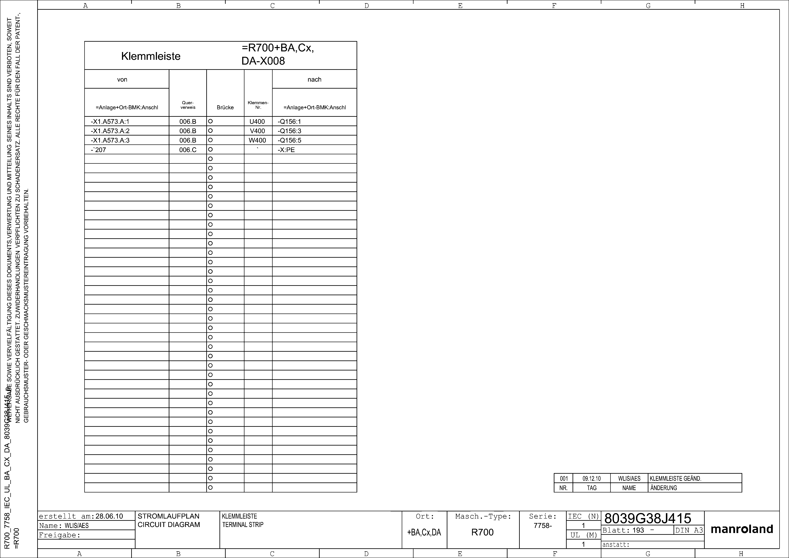

# +BA_Cx_DA — Sheet 193 of 247 — KLEMMLEISTE

**TERMINAL STRIP**

> Part of the manroland **R700** printing press IEC/UL circuit diagrams.
> Drawing class: **Stromlaufplan / Circuit diagram** (DIN A3).
> Document `+BA_Cx_DA` covers the **Printing units / main switch cabinet** machine section.

## At a glance

| Field | Value |
|---|---|
| Document | `+BA_Cx_DA`  (8039G38J415) |
| Sheet | **193** of 247 |
| Section (DE) | KLEMMLEISTE |
| Section (EN) | TERMINAL STRIP |
| Section type | TERMINALS — Terminal strip |
| Machine type | `R700` |
| Series | `7758` |
| Created | 28.06.10 |
| Replaces | — |
| Columns used | A, B, C, F, G |
| Path numbers | — |
| Labels on sheet | 36 |
| Cross-refs out | 0 |
| Cross-refs in | 0 |

**Previous:** [+BA_Cx_DA sheet 192](SHEET_0192.md) · **Next:** [+BA_Cx_DA sheet 194](SHEET_0194.md) · **Document TOC:** [_TOC.md](_TOC.md)  (+BA_Cx_DA) · **Master TOC:** [all sheets](../_MASTER_TOC.md)

## Sheet image (300 DPI, exact vector render)



_Rendered directly from the PDF vector layer at 300 DPI (1-bit), no OCR and no resampling. Use it to confirm anything ambiguous in the text below._

## Cross-references on this sheet

Each entry is a wire leaving this sheet. The printed token is `/sheet.column`; the link resolves to that sheet inside the same document.

_No outgoing cross-references on this sheet._

## Devices on this sheet

| Tag | Class | Class meaning (IEC) | Col | Sub | Terminal | Sign |
|---|---|---|---|---|---|---|
| `U400` | U | Umrichter / frequency converter | C | — | — | — |
| `Q156:1` | Q | Leistungsschalter / power switching device | C | — | 1 | — |
| `V400` | V | Diode / semiconductor valve | C | — | — | — |
| `Q156:3` | Q | Leistungsschalter / power switching device | C | — | 3 | — |
| `W400` | W | Kabel / cable, line, bus | C | — | — | — |
| `Q156:5` | Q | Leistungsschalter / power switching device | C | — | 5 | — |
| `NR.` | — | cross-device reference | F | — | — | — |
| `09.12.10` | — | cross-device reference | F | — | — | — |
| `Nr.` | — | cross-device reference | C | — | — | — |
| `006.B` | — | cross-device reference | B | — | — | — |
| `X1.A573.A:1` | — | cross-device reference | A | — | 1 | — |
| `006.B` | — | cross-device reference | B | — | — | — |
| `X1.A573.A:2` | — | cross-device reference | A | — | 2 | — |
| `006.B` | — | cross-device reference | B | — | — | — |
| `X1.A573.A:3` | — | cross-device reference | A | — | 3 | — |
| `006.C` | — | cross-device reference | B | — | — | — |

## Potentials / nets

_No named potentials on this sheet._

## Wire-end annotations (grouped as printed)

A wire that continues elsewhere is annotated with a small cluster: the destination description, the path/line number `#NN`, and the `/sheet.column` cross reference. Each row below is one such cluster exactly as it is grouped on the drawing.

| Col | Y | Path | Cross-ref | Text on the wire |
|---|---|---|---|---|
| C | 64.8 | — | — | `DA X008 =R700+BA,Cx,` |
| B | 77.5 | — | — | `Klemmleiste` |
| A | 115.5 | — | — | `von` |
| C | 115.5 | — | — | `nach` |
| B | 151.9 | — | — | `Quer` |
| C | 151.9 | — | — | `Klemmen =Anlage+Ort BMK:Anschl` |
| A | 158.5 | — | — | `=Anlage+Ort BMK:Anschl` |
| C | 158.5 | — | — | `Brücke Nr.` |
| B | 159.1 | — | — | `verweis` |
| B | 179.2 | — | — | `X1.A573.A:1 X1.A573.A:2 X1.A573.A:3 '207 006.C 006.B 006.B 006.B W400 U400 V400 ' Q156:1 Q156:3 Q156:5 X:PE` |
| G | 718.8 | — | — | `001 09.12.10 WLIS/AES KLEMMLEISTE GEÄND.` |
| G | 733.0 | — | — | `NR. TAG NAME ÄNDERUNG` |


## Reconstructed tables

This sheet carries tabular content (pin map / terminal assignment / index). The grid below was rebuilt from the drawing's own rule lines, so each row is exactly one physical row of the table.

### Table 1 — 4 data rows × 3 columns (at x=255.1, y=62.4) — **DA X008**

| Quer verweis | Brücke | Klemmen Nr. |
|---|---|---|
| `006.B` |  | `U400` |
| `006.B` |  | `V400` |
| `006.B` |  | `W400` |
| `006.C` |  | `'` |


## Notes and free text on this sheet

| Text | Col | Y (pt) |
|---|---|---|
| `TAG` | F | 733.1 |
| `NAME` | G | 733.08 |
| `ÄNDERUNG` | G | 733.14 |
| `WLIS/AES` | G | 718.91 |
| `KLEMMLEISTE GEÄND.` | G | 718.95 |
| `von` | A | 115.53 |
| `=Anlage+Ort BMK:Anschl` | A | 158.52 |
| `Quer` | B | 151.93 |
| `Klemmleiste` | B | 77.49 |
| `verweis` | B | 159.12 |
| `nach` | C | 115.46 |
| `=Anlage+Ort BMK:Anschl` | C | 158.52 |
| `Klemmen` | C | 151.94 |
| `Brücke` | B | 158.53 |
| `X:PE` | C | 221.68 |
| `=R700+BA,Cx,` | C | 64.77 |
| `DA X008` | C | 84.71 |

## Complete label inventory (exact text from the drawing)

Every text object inside the drawing area of this sheet, in DIN reading order (column A→H, then top→bottom). This is the authoritative list: if a string is not here it is not printed on this sheet.

| Col | Y | X | Dir | Type | Text |
|---|---|---|---|---|---|
| A | 115.5 | 176.9 | → | text | `von` |
| A | 158.5 | 144.4 | → | text | `=Anlage+Ort BMK:Anschl` |
| A | 179.2 | 137.2 | → | device ref | `X1.A573.A:1` |
| A | 193.4 | 137.2 | → | device ref | `X1.A573.A:2` |
| A | 207.5 | 137.2 | → | device ref | `X1.A573.A:3` |
| A | 221.7 | 137.2 | → | other | `'207` |
| B | 77.5 | 182.8 | → | text | `Klemmleiste` |
| B | 151.9 | 274.7 | → | text | `Quer` |
| B | 158.5 | 327.3 | → | text | `Brücke` |
| B | 159.1 | 272.6 | → | text | `verweis` |
| B | 179.2 | 270.9 | → | device ref | `006.B` |
| B | 193.4 | 270.9 | → | device ref | `006.B` |
| B | 207.6 | 270.9 | → | device ref | `006.B` |
| B | 221.7 | 270.6 | → | device ref | `006.C` |
| C | 64.8 | 364.8 | → | text | `=R700+BA,Cx,` |
| C | 84.7 | 364.3 | → | text | `DA X008` |
| C | 115.5 | 464.3 | → | text | `nach` |
| C | 151.9 | 374.0 | → | text | `Klemmen` |
| C | 158.5 | 427.9 | → | text | `=Anlage+Ort BMK:Anschl` |
| C | 159.0 | 385.4 | → | device ref | `Nr.` |
| C | 179.2 | 376.4 | → | device tag | `U400` |
| C | 179.2 | 419.2 | → | device tag | `Q156:1` |
| C | 193.4 | 377.3 | → | device tag | `V400` |
| C | 193.4 | 419.2 | → | device tag | `Q156:3` |
| C | 207.4 | 375.3 | → | device tag | `W400` |
| C | 207.5 | 419.2 | → | device tag | `Q156:5` |
| C | 221.6 | 387.2 | → | other | `'` |
| C | 221.7 | 419.2 | → | text | `X:PE` |
| F | 718.8 | 845.2 | → | number | `001` |
| F | 719.0 | 879.3 | → | device ref | `09.12.10` |
| F | 733.0 | 844.2 | → | device ref | `NR.` |
| F | 733.1 | 885.8 | → | text | `TAG` |
| G | 718.9 | 933.1 | → | text | `WLIS/AES` |
| G | 719.0 | 980.6 | → | text | `KLEMMLEISTE GEÄND.` |
| G | 733.1 | 939.2 | → | text | `NAME` |
| G | 733.1 | 981.8 | → | text | `ÄNDERUNG` |

## Reading-order text block

The same content as a plain block, grouped by DIN column — convenient to paste or to match against a visual description.

```text
=== Column A ===
 115.5  176.9  text         von
 158.5  144.4  text         =Anlage+Ort BMK:Anschl
 179.2  137.2  devref       X1.A573.A:1
 193.4  137.2  devref       X1.A573.A:2
 207.5  137.2  devref       X1.A573.A:3
 221.7  137.2  other        `207
=== Column B ===
  77.5  182.8  text         Klemmleiste
 151.9  274.7  text         Quer
 158.5  327.3  text         Brücke
 159.1  272.6  text         verweis
 179.2  270.9  devref       006.B
 193.4  270.9  devref       006.B
 207.6  270.9  devref       006.B
 221.7  270.6  devref       006.C
=== Column C ===
  64.8  364.8  text         =R700+BA,Cx,
  84.7  364.3  text         DA X008
 115.5  464.3  text         nach
 151.9  374.0  text         Klemmen
 158.5  427.9  text         =Anlage+Ort BMK:Anschl
 159.0  385.4  devref       Nr.
 179.2  376.4  devtag       U400
 179.2  419.2  devtag       Q156:1
 193.4  377.3  devtag       V400
 193.4  419.2  devtag       Q156:3
 207.4  375.3  devtag       W400
 207.5  419.2  devtag       Q156:5
 221.6  387.2  other        `
 221.7  419.2  text         X:PE
=== Column F ===
 718.8  845.2  numeric      001
 719.0  879.3  devref       09.12.10
 733.0  844.2  devref       NR.
 733.1  885.8  text         TAG
=== Column G ===
 718.9  933.1  text         WLIS/AES
 719.0  980.6  text         KLEMMLEISTE GEÄND.
 733.1  939.2  text         NAME
 733.1  981.8  text         ÄNDERUNG
```

---
_Generated from the PDF vector text layer; no OCR. Source: `R700_7758_IEC_UL_BA_CX_DA_8039G38J415_p`, sheet 193._
