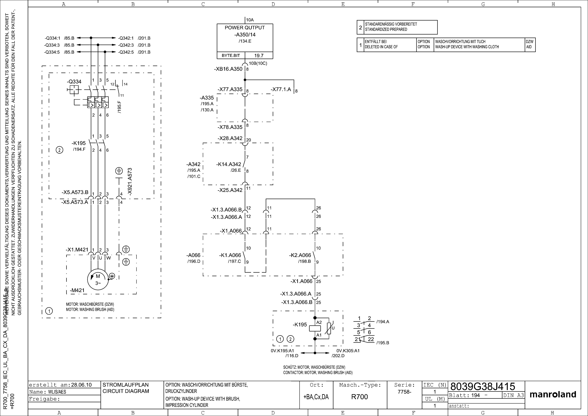

# +BA_Cx_DA — Sheet 194 of 247 — OPTION: WASCHVORRICHTUNG MIT BÜRSTE

**DRUCKZYLINDER**

> Part of the manroland **R700** printing press IEC/UL circuit diagrams.
> Drawing class: **Stromlaufplan / Circuit diagram** (DIN A3).
> Document `+BA_Cx_DA` covers the **Printing units / main switch cabinet** machine section.

## At a glance

| Field | Value |
|---|---|
| Document | `+BA_Cx_DA`  (8039G38J415) |
| Sheet | **194** of 247 |
| Section (DE) | OPTION: WASCHVORRICHTUNG MIT BÜRSTE |
| Section (EN) | DRUCKZYLINDER |
| Section type | CIRCUIT — Circuit diagram |
| Machine type | `R700` |
| Series | `7758` |
| Created | 28.06.10 |
| Replaces | — |
| Columns used | A, B, C, D, E, F, G, H |
| Path numbers | — |
| Labels on sheet | 147 |
| Cross-refs out | 21 |
| Cross-refs in | 51 |

**Previous:** [+BA_Cx_DA sheet 193](SHEET_0193.md) · **Next:** [+BA_Cx_DA sheet 195](SHEET_0195.md) · **Document TOC:** [_TOC.md](_TOC.md)  (+BA_Cx_DA) · **Master TOC:** [all sheets](../_MASTER_TOC.md)

## Sheet image (300 DPI, exact vector render)



_Rendered directly from the PDF vector layer at 300 DPI (1-bit), no OCR and no resampling. Use it to confirm anything ambiguous in the text below._

## Cross-references on this sheet

Each entry is a wire leaving this sheet. The printed token is `/sheet.column`; the link resolves to that sheet inside the same document.

| Ref | Target sheet | Col | Path | Destination on target | Target section | From col |
|---|---|---|---|---|---|---|
| `/85.B` | [+BA_Cx_DA sheet 85](SHEET_0085.md) | B | — | Q334:1 | WASCHVORRICHTUNG | A |
| `/201.B` | [+BA_Cx_DA sheet 201](SHEET_0201.md) | B | — | Q342:1 | OPTION: | B |
| `/134.E` | [+BA_Cx_DA sheet 134](SHEET_0134.md) | E | — | — | REFERENZMODUL | D |
| `/85.B` | [+BA_Cx_DA sheet 85](SHEET_0085.md) | B | — | Q334:3 | WASCHVORRICHTUNG | A |
| `/201.B` | [+BA_Cx_DA sheet 201](SHEET_0201.md) | B | — | Q342:3 | OPTION: | B |
| `/85.B` | [+BA_Cx_DA sheet 85](SHEET_0085.md) | B | — | Q334:5 Q342:5 | WASCHVORRICHTUNG | A |
| `/201.B` | [+BA_Cx_DA sheet 201](SHEET_0201.md) | B | — | Q334:5 Q342:5 | OPTION: | A |
| `/195.F` | [+BA_Cx_DA sheet 195](SHEET_0195.md) | F | — | — | OPTION: WASCHVORRICHTUNG MIT BÜRSTE | B |
| `/195.A` | [+BA_Cx_DA sheet 195](SHEET_0195.md) | A | — | — | OPTION: WASCHVORRICHTUNG MIT BÜRSTE | C |
| `/130.A` | [+BA_Cx_DA sheet 130](SHEET_0130.md) | A | — | — | RESERVE: SPS STATION (OUTPUT) | C |
| `/194.F` | [+BA_Cx_DA sheet 194](SHEET_0194.md) | F | — | — | OPTION: WASCHVORRICHTUNG MIT BÜRSTE | A |
| `/26.E` | [+BA_Cx_DA sheet 26](SHEET_0026.md) | E | — | A342 | BUSVERBINDUNGEN: NOT AUS | C |
| `/195.A` | [+BA_Cx_DA sheet 195](SHEET_0195.md) | A | — | — | OPTION: WASCHVORRICHTUNG MIT BÜRSTE | C |
| `/101.C` | [+BA_Cx_DA sheet 101](SHEET_0101.md) | C | — | — | FEHLBOGENKONTROLLE | C |
| `/198.B` | [+BA_Cx_DA sheet 198](SHEET_0198.md) | B | — | — | OPTION: WASCHVORRICHTUNG MIT BÜRSTE | D |
| `/196.D` | [+BA_Cx_DA sheet 196](SHEET_0196.md) | D | — | — | OPTION: WASCHVORRICHTUNG MIT BÜRSTE | C |
| `/197.C` | [+BA_Cx_DA sheet 197](SHEET_0197.md) | C | — | — | OPTION: WASCHVORRICHTUNG MIT BÜRSTE | C |
| `/194.A` | [+BA_Cx_DA sheet 194](SHEET_0194.md) | A | — | — | OPTION: WASCHVORRICHTUNG MIT BÜRSTE | F |
| `/195.B` | [+BA_Cx_DA sheet 195](SHEET_0195.md) | B | — | — | OPTION: WASCHVORRICHTUNG MIT BÜRSTE | F |
| `/116.D` | [+BA_Cx_DA sheet 116](SHEET_0116.md) | D | — | 0V.K195:A1 | PPL 2 | D |
| `/202.D` | [+BA_Cx_DA sheet 202](SHEET_0202.md) | D | — | — | OPTION: | E |

### Incoming references (sheets that point here)

Every other sheet that sends a wire to this one. `Back-ref` is the token printed on *that* sheet; `Path` is its line number.

| From sheet | Cols | Back-ref | Path | Refs | What continues there |
|---|---|---|---|---|---|
| [+BA_Cx_DA#26](SHEET_0026.md) | E | `/26.E` | — | 1 | — |
| [+BA_Cx_DA#85](SHEET_0085.md) | B | `/85.B` | — | 3 | Q334:1; Q334:3; Q334:5 |
| [+BA_Cx_DA#101](SHEET_0101.md) | C | `/101.C` | — | 1 | — |
| [+BA_Cx_DA#116](SHEET_0116.md) | D | `/116.D` | — | 1 | — |
| [+BA_Cx_DA#130](SHEET_0130.md) | A | `/130.A` | — | 1 | — |
| [+BA_Cx_DA#134](SHEET_0134.md) | E | `/134.E` | — | 1 | — |
| [+BA_Cx_DA#138](SHEET_0138.md) | B, C | `/138.B`, `/138.C` | — | 4 | — |
| [+BA_Cx_DA#139](SHEET_0139.md) | A, B | `/139.A`, `/139.B` | — | 8 | — |
| [+BA_Cx_DA#148](SHEET_0148.md) | H | `/148.H` | — | 4 | — |
| [+BA_Cx_DA#161](SHEET_0161.md) | G | `/161.G` | — | 8 | — |
| [+BA_Cx_DA#172](SHEET_0172.md) | F | `/172.F` | — | 1 | — |
| [+BA_Cx_DA#175](SHEET_0175.md) | F | `/175.F` | — | 1 | — |
| [+BA_Cx_DA#178](SHEET_0178.md) | F | `/178.F` | — | 1 | — |
| [+BA_Cx_DA#185](SHEET_0185.md) | E, G | `/185.E`, `/185.G` | — | 2 | — |
| [+BA_Cx_DA#186](SHEET_0186.md) | B | `/186.B` | — | 1 | — |
| [+BA_Cx_DA#194](SHEET_0194.md) | A, F | `/194.A`, `/194.F` | — | 2 | — |
| [+BA_Cx_DA#195](SHEET_0195.md) | A, B, E | `/195.A`, `/195.B`, `/195.E` | — | 4 | — |
| [+BA_Cx_DA#196](SHEET_0196.md) | D | `/196.D` | — | 1 | — |
| [+BA_Cx_DA#197](SHEET_0197.md) | C | `/197.C` | — | 1 | — |
| [+BA_Cx_DA#198](SHEET_0198.md) | B | `/198.B` | — | 1 | — |
| [+BA_Cx_DA#201](SHEET_0201.md) | B | `/201.B` | — | 3 | Q342:1; Q342:3; Q342:5 |
| [+BA_Cx_DA#202](SHEET_0202.md) | E | `/202.E` | — | 1 | 0V.K305:A1 0V.K273:A1 |


## Devices on this sheet

| Tag | Class | Class meaning (IEC) | Col | Sub | Terminal | Sign |
|---|---|---|---|---|---|---|
| `A350/14` | A | Baugruppe / assembly, module, PC board | D | 14 | — | — |
| `A335` | A | Baugruppe / assembly, module, PC board | C | — | — | — |
| `A342` | A | Baugruppe / assembly, module, PC board | C | — | — | — |
| `A066` | A | Baugruppe / assembly, module, PC board | C | — | — | — |
| `A2` | A | Baugruppe / assembly, module, PC board | E | — | — | — |
| `A1` | A | Baugruppe / assembly, module, PC board | E | — | — | — |
| `K195` | K | Relais / relay, contactor | D | — | — | — |
| `K195` | K | Relais / relay, contactor | A | — | — | — |
| `Q334` | Q | Leistungsschalter / power switching device | A | — | — | — |
| `Q334:1` | Q | Leistungsschalter / power switching device | A | — | 1 | — |
| `Q334:3` | Q | Leistungsschalter / power switching device | A | — | 3 | — |
| `Q334:5` | Q | Leistungsschalter / power switching device | A | — | 5 | — |
| `Q342:5` | Q | Leistungsschalter / power switching device | B | — | 5 | — |
| `Q342:1` | Q | Leistungsschalter / power switching device | B | — | 1 | — |
| `Q342:3` | Q | Leistungsschalter / power switching device | B | — | 3 | — |
| `X1.M421` | — | cross-device reference | A | — | — | — |
| `19.7` | — | cross-device reference | D | — | — | — |
| `XB16.A350` | — | cross-device reference | C | — | — | — |
| `X77.A335` | — | cross-device reference | C | — | — | — |
| `X78.A335` | — | cross-device reference | C | — | — | — |
| `X28.A342` | — | cross-device reference | C | — | — | — |
| `X25.A342` | — | cross-device reference | C | — | — | — |
| `K14.A342` | — | cross-device reference | C | — | — | — |
| `X77.1.A` | — | cross-device reference | D | — | — | — |
| `X1.3.A066.B` | — | cross-device reference | C | — | — | — |
| `X1.3.A066.A` | — | cross-device reference | C | — | — | — |
| `X1.A066` | — | cross-device reference | C | — | — | — |
| `K1.A066` | — | cross-device reference | C | — | — | — |
| `K2.A066` | — | cross-device reference | D | — | — | — |
| `X1.A066` | — | cross-device reference | D | — | — | — |
| `X1.3.A066.B` | — | cross-device reference | D | — | — | — |
| `X1.3.A066.A` | — | cross-device reference | D | — | — | — |
| `X5.A573.B` | — | cross-device reference | A | — | — | — |
| `X5.A573.A` | — | cross-device reference | A | — | — | — |
| `X921.A573` | — | cross-device reference | B | — | — | — |

## Potentials / nets

| Potential | Count | Columns | Attached devices | Terminals |
|---|---|---|---|---|
| `0V` | 2 | D, E | `K195`, `K305` | `A1` |
| `M421` | 1 | A | — | — |


A potential such as `L24+/4` or `M24+` is a named supply/return rail; every place it appears on this sheet is electrically common.

## Wire-end annotations (grouped as printed)

A wire that continues elsewhere is annotated with a small cluster: the destination description, the path/line number `#NN`, and the `/sheet.column` cross reference. Each row below is one such cluster exactly as it is grouped on the drawing.

| Col | Y | Path | Cross-ref | Text on the wire |
|---|---|---|---|---|
| D | 36.4 | — | — | `10A` |
| F | 46.0 | — | — | `2 STANDARDMÄSSIG VORBEREITET STANDARDIZED PREPARED` |
| D | 51.6 | — | — | `POWER QUTPUT` |
| D | 65.5 | — | — | `A350/14` |
| A | 73.2 | — | `/85.B` | `Q334:1` |
| B | 73.3 | — | `/201.B` | `Q342:1` |
| D | 79.3 | — | `/134.E` | — |
| H | 81.3 | — | — | `DZW` |
| F | 81.4 | — | — | `1 ENTFÄLLT BEI DELETED IN CASE OF` |
| F | 81.4 | — | — | `OPTION OPTION` |
| G | 81.4 | — | — | `WASCHVORRICHTUNG MIT TUCH WASH UP DEVICE WITH WASHING CLOTH` |
| A | 87.4 | — | `/85.B` | `Q334:3` |
| B | 87.4 | — | `/201.B` | `Q342:3` |
| H | 92.0 | — | — | `AID` |
| A | 101.6 | — | `/85.B`, `/201.B` | `Q334:5 Q342:5` |
| D | 108.3 | — | — | `BYTE.BIT 19.7` |
| D | 124.3 | — | — | `10B(10C)` |
| C | 134.9 | — | — | `XB16.A350 8` |
| A | 158.4 | — | — | `1` |
| B | 158.4 | — | — | `3` |
| B | 158.4 | — | — | `5` |
| A | 160.5 | — | — | `Q334` |
| B | 167.4 | — | — | `12 14` |
| C | 176.1 | — | — | `X77.A335 8` |
| D | 176.1 | — | — | `X77.1.A 8` |
| B | 190.1 | — | — | `11` |
| C | 193.1 | — | — | `A335` |
| B | 203.8 | — | `/195.F` | — |
| C | 206.1 | — | `/195.A`, `/130.A` | — |
| A | 229.2 | — | — | `2` |
| B | 229.2 | — | — | `4` |
| B | 229.2 | — | — | `6` |
| C | 249.8 | — | — | `X78.A335 8` |
| A | 271.7 | — | — | `1` |
| B | 271.7 | — | — | `3` |
| B | 271.7 | — | — | `5` |
| C | 275.3 | — | — | `X28.A342 20` |
| A | 285.2 | — | — | `K195 6` |
| A | 298.3 | — | `/194.F` | — |
| A | 300.1 | — | — | `2` |
| B | 300.1 | — | — | `4` |
| A | 300.8 | — | — | `2` |
| C | 314.3 | — | — | `K14.A342 7` |
| C | 327.7 | — | `/26.E` | `A342` |
| B | 339.6 | — | — | `X921.A573` |
| C | 340.8 | — | `/195.A`, `/101.C` | — |
| D | 342.6 | — | — | `8` |
| C | 377.3 | — | — | `X25.A342 11` |
| A | 384.4 | — | — | `X5.A573.B 1 2 3` |
| B | 388.7 | — | — | `4` |
| A | 404.2 | — | — | `X5.A573.A 1 2 3` |
| B | 405.7 | — | — | `4` |
| C | 417.0 | — | — | `X1.3.A066.B 12` |
| D | 417.0 | — | — | `11` |
| E | 417.0 | — | — | `26` |
| C | 434.0 | — | — | `X1.3.A066.A 12` |
| D | 434.0 | — | — | `11` |
| E | 434.0 | — | — | `26` |
| C | 459.5 | — | — | `X1.A066 12` |
| D | 459.5 | — | — | `11 26` |
| D | 498.5 | — | — | `10` |
| E | 498.5 | — | — | `10` |
| A | 500.6 | — | — | `X1.M421 1 2 3` |
| C | 512.0 | — | — | `A066` |
| C | 512.0 | — | — | `K1.A066 9` |
| D | 512.0 | — | — | `K2.A066 9` |
| B | 518.0 | — | — | `V U W` |
| C | 525.0 | — | `/196.D` | — |
| C | 525.0 | — | `/197.C` | — |
| D | 525.0 | — | `/198.B` | — |
| A | 554.8 | — | — | `M421 3~ M` |
| D | 564.4 | — | — | `X1.A066 25` |
| D | 589.9 | — | — | `X1.3.A066.A 25` |
| D | 606.9 | — | — | `X1.3.A066.B 25` |
| A | 612.9 | — | — | `MOTOR: WASCHBÜRSTE (DZW) MOTOR: WASHING BRUSH (AID)` |
| A | 626.2 | — | — | `1` |
| E | 639.5 | — | — | `21 3 5 1` |
| E | 639.5 | — | — | `2 4 6 22` |
| F | 647.3 | — | `/194.A` | — |
| E | 648.7 | — | — | `A2` |
| E | 652.3 | — | — | `K195 U` |
| E | 674.2 | — | — | `A1` |
| D | 682.9 | — | — | `1 2` |
| F | 689.8 | — | `/195.B` | — |
| D | 706.1 | — | `/116.D` | `0V.K195:A1` |
| E | 706.1 | — | — | `0V.K305:A1` |
| E | 716.0 | — | `/202.D` | — |
| E | 740.5 | — | — | `SCHÜTZ: MOTOR, WASCHBÜRSTE (DZW) CONTACTOR: MOTOR, WASHING BRUSH (AID)` |


## Reconstructed tables

This sheet carries tabular content (pin map / terminal assignment / index). The grid below was rebuilt from the drawing's own rule lines, so each row is exactly one physical row of the table.

### Table 1 — 1 data rows × 2 columns (at x=150.2, y=104.9) — **Q334**

| X5.A573.B X5.A573.A X1.M421 | K195 /194.F |
|---|---|
| `M421` |  |


### Table 2 — 3 data rows × 1 columns (at x=184.3, y=104.9)

| C1 |
|---|
| `1` |
| `2 1 2 1 1 1` |
| `V` |


### Table 3 — 3 data rows × 1 columns (at x=198.4, y=104.9)

| C1 |
|---|
| `3` |
| `4 3 4 2 2 2` |
| `U M 3~` |


### Table 4 — 4 data rows × 3 columns (at x=212.6, y=104.9)

| 5 | 12 | Q342:5 14 |
|---|---|---|
|  |  | `11` |
|  |  | `/195.F` |
| `6 5 6 3 3 3` |  | `X921.A573 4 4` |
|  | `W` |  |


### Table 5 — 4 data rows × 5 columns (at x=439.4, y=48.2)

| POWER | QUTPUT A350/14 /134.E |  |  |  |
|---|---|---|---|---|
| `BYTE.BIT` | `19.7` |  |  |  |
| `XB16.A350` | `10B(10C) 8` |  |  |  |
| `X77.A335 X78.A335 X28.A342 K14.A342 /26.E X25.A342` | `8 8 20 7 8 11` |  | `X77.1.A 8` |  |
| `X1.3.A066.B X1.3.A066.A X1.A066 K1.A066 /197.C` | `12 12 12 10 9` | `11 11 11` | `K2.A066 /198.B` | `26 26 26 10 9` |


## Notes and free text on this sheet

| Text | Col | Y (pt) |
|---|---|---|
| `V` | A | 518.26 |
| `U` | B | 518.37 |
| `W` | B | 518 |
| `M` | A | 554.76 |
| `MOTOR: WASCHBÜRSTE (DZW)` | A | 612.89 |
| `MOTOR: WASHING BRUSH (AID)` | A | 623.53 |
| `10A` | D | 36.43 |
| `10B(10C)` | D | 124.34 |
| `POWER QUTPUT` | D | 51.59 |
| `BYTE.BIT` | C | 108.91 |
| `U` | E | 660.24 |
| `SCHÜTZ: MOTOR, WASCHBÜRSTE (DZW)` | E | 740.46 |
| `CONTACTOR: MOTOR, WASHING BRUSH (AID)` | E | 751.1 |
| `ENTFÄLLT BEI` | E | 81.38 |
| `DELETED IN CASE OF` | F | 92.03 |
| `OPTION` | F | 81.38 |
| `WASCHVORRICHTUNG MIT TUCH` | G | 81.42 |
| `WASH UP DEVICE WITH WASHING CLOTH` | G | 92.01 |
| `DZW` | H | 81.27 |
| `AID` | H | 92.02 |
| `STANDARDMÄSSIG VORBEREITET` | F | 45.98 |
| `STANDARDIZED PREPARED` | F | 56.62 |

## Complete label inventory (exact text from the drawing)

Every text object inside the drawing area of this sheet, in DIN reading order (column A→H, then top→bottom). This is the authoritative list: if a string is not here it is not printed on this sheet.

| Col | Y | X | Dir | Type | Text |
|---|---|---|---|---|---|
| A | 73.2 | 129.8 | → | cross-reference | `/85.B` |
| A | 73.3 | 90.7 | → | device tag | `Q334:1` |
| A | 87.4 | 129.8 | → | cross-reference | `/85.B` |
| A | 87.5 | 89.3 | → | device tag | `Q334:3` |
| A | 101.6 | 89.3 | → | device tag | `Q334:5` |
| A | 101.6 | 129.8 | → | cross-reference | `/85.B` |
| A | 158.4 | 186.2 | → | number | `1` |
| A | 160.5 | 135.5 | → | device tag | `Q334` |
| A | 229.2 | 186.8 | → | number | `2` |
| A | 271.7 | 186.2 | → | number | `1` |
| A | 285.2 | 145.1 | → | device tag | `K195` |
| A | 298.3 | 148.3 | → | cross-reference | `/194.F` |
| A | 300.1 | 186.8 | → | number | `2` |
| A | 300.8 | 118.5 | → | number | `2` |
| A | 384.4 | 125.0 | → | device ref | `X5.A573.B` |
| A | 388.7 | 186.2 | → | number | `1` |
| A | 404.3 | 124.2 | → | device ref | `X5.A573.A` |
| A | 405.7 | 186.2 | → | number | `1` |
| A | 500.6 | 133.2 | → | device ref | `X1.M421` |
| A | 502.1 | 186.2 | → | number | `1` |
| A | 518.3 | 187.1 | → | text | `V` |
| A | 554.8 | 194.3 | → | text | `M` |
| A | 569.0 | 193.0 | → | other | `3~` |
| A | 582.8 | 141.4 | → | potential | `M421` |
| A | 612.9 | 134.1 | → | text | `MOTOR: WASCHBÜRSTE (DZW)` |
| A | 623.5 | 134.1 | → | text | `MOTOR: WASHING BRUSH (AID)` |
| A | 626.2 | 97.5 | → | number | `1` |
| B | 73.3 | 239.2 | → | device tag | `Q342:1` |
| B | 73.3 | 279.2 | → | cross-reference | `/201.B` |
| B | 87.4 | 279.2 | → | cross-reference | `/201.B` |
| B | 87.5 | 239.2 | → | device tag | `Q342:3` |
| B | 101.6 | 239.2 | → | device tag | `Q342:5` |
| B | 101.6 | 279.2 | → | cross-reference | `/201.B` |
| B | 158.4 | 201.0 | → | number | `3` |
| B | 158.4 | 215.1 | → | number | `5` |
| B | 167.4 | 223.4 | → | number | `12` |
| B | 167.4 | 250.3 | → | number | `14` |
| B | 190.1 | 243.2 | → | number | `11` |
| B | 203.8 | 237.7 | ↕ | cross-reference | `/195.F` |
| B | 229.2 | 201.0 | → | number | `4` |
| B | 229.2 | 215.1 | → | number | `6` |
| B | 271.7 | 201.0 | → | number | `3` |
| B | 271.7 | 215.1 | → | number | `5` |
| B | 300.1 | 201.0 | → | number | `4` |
| B | 300.1 | 215.1 | → | number | `6` |
| B | 339.6 | 258.3 | ↕ | device ref | `X921.A573` |
| B | 388.7 | 201.0 | → | number | `2` |
| B | 388.7 | 215.1 | → | number | `3` |
| B | 388.7 | 243.5 | → | number | `4` |
| B | 405.7 | 201.0 | → | number | `2` |
| B | 405.7 | 215.1 | → | number | `3` |
| B | 405.7 | 243.5 | → | number | `4` |
| B | 502.1 | 201.0 | → | number | `2` |
| B | 502.1 | 215.1 | → | number | `3` |
| B | 518.0 | 215.4 | → | text | `W` |
| B | 518.4 | 200.4 | → | text | `U` |
| C | 108.9 | 449.3 | → | text | `BYTE.BIT` |
| C | 134.9 | 433.7 | → | device ref | `XB16.A350` |
| C | 176.1 | 440.8 | → | device ref | `X77.A335` |
| C | 193.1 | 404.5 | → | device tag | `A335` |
| C | 206.1 | 406.8 | → | cross-reference | `/195.A` |
| C | 218.5 | 406.8 | → | cross-reference | `/130.A` |
| C | 252.6 | 440.8 | → | device ref | `X78.A335` |
| C | 275.3 | 440.8 | → | device ref | `X28.A342` |
| C | 327.7 | 377.6 | → | device tag | `A342` |
| C | 327.7 | 438.0 | → | device ref | `K14.A342` |
| C | 340.8 | 379.8 | → | cross-reference | `/195.A` |
| C | 340.8 | 467.4 | → | cross-reference | `/26.E` |
| C | 353.2 | 379.8 | → | cross-reference | `/101.C` |
| C | 380.1 | 440.8 | → | device ref | `X25.A342` |
| C | 419.8 | 426.6 | → | device ref | `X1.3.A066.B` |
| C | 434.7 | 427.2 | → | device ref | `X1.3.A066.A` |
| C | 462.4 | 445.3 | → | device ref | `X1.A066` |
| C | 512.0 | 377.6 | → | device tag | `A066` |
| C | 512.0 | 443.9 | → | device ref | `K1.A066` |
| C | 525.1 | 379.8 | → | cross-reference | `/196.D` |
| C | 525.1 | 462.0 | → | cross-reference | `/197.C` |
| D | 36.4 | 498.0 | → | text | `10A` |
| D | 51.6 | 455.2 | → | text | `POWER QUTPUT` |
| D | 65.5 | 474.7 | → | device tag | `A350/14` |
| D | 79.3 | 483.6 | → | cross-reference | `/134.E` |
| D | 108.3 | 514.6 | → | device ref | `19.7` |
| D | 124.3 | 503.7 | → | text | `10B(10C)` |
| D | 136.4 | 498.6 | → | number | `8` |
| D | 176.1 | 548.2 | → | device ref | `X77.1.A` |
| D | 180.3 | 498.6 | → | number | `8` |
| D | 180.3 | 597.8 | → | number | `8` |
| D | 249.8 | 498.6 | → | number | `8` |
| D | 279.5 | 498.6 | → | number | `20` |
| D | 314.3 | 498.6 | → | number | `7` |
| D | 342.6 | 498.6 | → | number | `8` |
| D | 377.3 | 498.0 | → | number | `11` |
| D | 417.0 | 498.0 | → | number | `12` |
| D | 417.0 | 540.6 | → | number | `11` |
| D | 434.0 | 498.0 | → | number | `12` |
| D | 434.0 | 540.6 | → | number | `11` |
| D | 459.5 | 498.0 | → | number | `12` |
| D | 459.5 | 540.6 | → | number | `11` |
| D | 498.5 | 498.0 | → | number | `10` |
| D | 512.0 | 585.6 | → | device ref | `K2.A066` |
| D | 525.0 | 604.1 | → | cross-reference | `/198.B` |
| D | 526.9 | 498.6 | → | number | `9` |
| D | 564.4 | 588.5 | → | device ref | `X1.A066` |
| D | 589.9 | 567.5 | → | device ref | `X1.3.A066.A` |
| D | 606.9 | 569.8 | → | device ref | `X1.3.A066.B` |
| D | 652.3 | 593.0 | → | device tag | `K195` |
| D | 682.9 | 565.2 | → | number | `1` |
| D | 683.4 | 586.2 | → | number | `2` |
| D | 706.1 | 548.5 | → | potential | `0V.K195:A1` |
| D | 716.0 | 578.3 | → | cross-reference | `/116.D` |
| E | 51.3 | 727.1 | → | number | `2` |
| E | 81.4 | 739.0 | → | text | `ENTFÄLLT BEI` |
| E | 86.7 | 727.4 | → | number | `1` |
| E | 417.0 | 640.3 | → | number | `26` |
| E | 434.0 | 640.3 | → | number | `26` |
| E | 459.5 | 640.3 | → | number | `26` |
| E | 498.5 | 639.8 | → | number | `10` |
| E | 526.9 | 640.3 | → | number | `9` |
| E | 565.8 | 640.3 | → | number | `25` |
| E | 591.3 | 640.3 | → | number | `25` |
| E | 608.4 | 640.3 | → | number | `25` |
| E | 639.5 | 724.5 | → | number | `1` |
| E | 639.5 | 745.2 | → | number | `2` |
| E | 648.7 | 640.6 | → | device tag | `A2` |
| E | 653.7 | 723.1 | → | number | `3` |
| E | 653.7 | 745.2 | → | number | `4` |
| E | 660.2 | 671.7 | → | text | `U` |
| E | 667.8 | 723.1 | → | number | `5` |
| E | 667.8 | 745.2 | → | number | `6` |
| E | 674.2 | 640.6 | → | device tag | `A1` |
| E | 682.0 | 718.6 | → | number | `21` |
| E | 682.0 | 745.2 | → | number | `22` |
| E | 706.1 | 681.4 | → | potential | `0V.K305:A1` |
| E | 716.0 | 671.8 | → | cross-reference | `/202.D` |
| E | 740.5 | 573.7 | → | text | `SCHÜTZ: MOTOR, WASCHBÜRSTE (DZW)` |
| E | 751.1 | 573.7 | → | text | `CONTACTOR: MOTOR, WASHING BRUSH (AID)` |
| F | 46.0 | 739.6 | → | text | `STANDARDMÄSSIG VORBEREITET` |
| F | 56.6 | 739.6 | → | text | `STANDARDIZED PREPARED` |
| F | 81.4 | 845.9 | → | text | `OPTION` |
| F | 92.0 | 739.0 | → | text | `DELETED IN CASE OF` |
| F | 92.0 | 845.9 | → | text | `OPTION` |
| F | 647.3 | 762.5 | → | cross-reference | `/194.A` |
| F | 689.8 | 762.5 | → | cross-reference | `/195.B` |
| G | 81.4 | 881.6 | → | text | `WASCHVORRICHTUNG MIT TUCH` |
| G | 92.0 | 881.6 | → | text | `WASH UP DEVICE WITH WASHING CLOTH` |
| H | 81.3 | 1065.0 | → | text | `DZW` |
| H | 92.0 | 1065.8 | → | text | `AID` |

## Reading-order text block

The same content as a plain block, grouped by DIN column — convenient to paste or to match against a visual description.

```text
=== Column A ===
  73.2  129.8  xref         /85.B
  73.3   90.7  devtag       Q334:1
  87.4  129.8  xref         /85.B
  87.5   89.3  devtag       Q334:3
 101.6   89.3  devtag       Q334:5
 101.6  129.8  xref         /85.B
 158.4  186.2  numeric      1
 160.5  135.5  devtag       Q334
 229.2  186.8  numeric      2
 271.7  186.2  numeric      1
 285.2  145.1  devtag       K195
 298.3  148.3  xref         /194.F
 300.1  186.8  numeric      2
 300.8  118.5  numeric      2
 384.4  125.0  devref       X5.A573.B
 388.7  186.2  numeric      1
 404.3  124.2  devref       X5.A573.A
 405.7  186.2  numeric      1
 500.6  133.2  devref       X1.M421
 502.1  186.2  numeric      1
 518.3  187.1  text         V
 554.8  194.3  text         M
 569.0  193.0  other        3~
 582.8  141.4  net          M421
 612.9  134.1  text         MOTOR: WASCHBÜRSTE (DZW)
 623.5  134.1  text         MOTOR: WASHING BRUSH (AID)
 626.2   97.5  numeric      1
=== Column B ===
  73.3  239.2  devtag       Q342:1
  73.3  279.2  xref         /201.B
  87.4  279.2  xref         /201.B
  87.5  239.2  devtag       Q342:3
 101.6  239.2  devtag       Q342:5
 101.6  279.2  xref         /201.B
 158.4  201.0  numeric      3
 158.4  215.1  numeric      5
 167.4  223.4  numeric      12
 167.4  250.3  numeric      14
 190.1  243.2  numeric      11
 203.8  237.7  xref         /195.F
 229.2  201.0  numeric      4
 229.2  215.1  numeric      6
 271.7  201.0  numeric      3
 271.7  215.1  numeric      5
 300.1  201.0  numeric      4
 300.1  215.1  numeric      6
 339.6  258.3  devref       X921.A573
 388.7  201.0  numeric      2
 388.7  215.1  numeric      3
 388.7  243.5  numeric      4
 405.7  201.0  numeric      2
 405.7  215.1  numeric      3
 405.7  243.5  numeric      4
 502.1  201.0  numeric      2
 502.1  215.1  numeric      3
 518.0  215.4  text         W
 518.4  200.4  text         U
=== Column C ===
 108.9  449.3  text         BYTE.BIT
 134.9  433.7  devref       XB16.A350
 176.1  440.8  devref       X77.A335
 193.1  404.5  devtag       A335
 206.1  406.8  xref         /195.A
 218.5  406.8  xref         /130.A
 252.6  440.8  devref       X78.A335
 275.3  440.8  devref       X28.A342
 327.7  377.6  devtag       A342
 327.7  438.0  devref       K14.A342
 340.8  379.8  xref         /195.A
 340.8  467.4  xref         /26.E
 353.2  379.8  xref         /101.C
 380.1  440.8  devref       X25.A342
 419.8  426.6  devref       X1.3.A066.B
 434.7  427.2  devref       X1.3.A066.A
 462.4  445.3  devref       X1.A066
 512.0  377.6  devtag       A066
 512.0  443.9  devref       K1.A066
 525.1  379.8  xref         /196.D
 525.1  462.0  xref         /197.C
=== Column D ===
  36.4  498.0  text         10A
  51.6  455.2  text         POWER QUTPUT
  65.5  474.7  devtag       A350/14
  79.3  483.6  xref         /134.E
 108.3  514.6  devref       19.7
 124.3  503.7  text         10B(10C)
 136.4  498.6  numeric      8
 176.1  548.2  devref       X77.1.A
 180.3  498.6  numeric      8
 180.3  597.8  numeric      8
 249.8  498.6  numeric      8
 279.5  498.6  numeric      20
 314.3  498.6  numeric      7
 342.6  498.6  numeric      8
 377.3  498.0  numeric      11
 417.0  498.0  numeric      12
 417.0  540.6  numeric      11
 434.0  498.0  numeric      12
 434.0  540.6  numeric      11
 459.5  498.0  numeric      12
 459.5  540.6  numeric      11
 498.5  498.0  numeric      10
 512.0  585.6  devref       K2.A066
 525.0  604.1  xref         /198.B
 526.9  498.6  numeric      9
 564.4  588.5  devref       X1.A066
 589.9  567.5  devref       X1.3.A066.A
 606.9  569.8  devref       X1.3.A066.B
 652.3  593.0  devtag       K195
 682.9  565.2  numeric      1
 683.4  586.2  numeric      2
 706.1  548.5  net          0V.K195:A1
 716.0  578.3  xref         /116.D
=== Column E ===
  51.3  727.1  numeric      2
  81.4  739.0  text         ENTFÄLLT BEI
  86.7  727.4  numeric      1
 417.0  640.3  numeric      26
 434.0  640.3  numeric      26
 459.5  640.3  numeric      26
 498.5  639.8  numeric      10
 526.9  640.3  numeric      9
 565.8  640.3  numeric      25
 591.3  640.3  numeric      25
 608.4  640.3  numeric      25
 639.5  724.5  numeric      1
 639.5  745.2  numeric      2
 648.7  640.6  devtag       A2
 653.7  723.1  numeric      3
 653.7  745.2  numeric      4
 660.2  671.7  text         U
 667.8  723.1  numeric      5
 667.8  745.2  numeric      6
 674.2  640.6  devtag       A1
 682.0  718.6  numeric      21
 682.0  745.2  numeric      22
 706.1  681.4  net          0V.K305:A1
 716.0  671.8  xref         /202.D
 740.5  573.7  text         SCHÜTZ: MOTOR, WASCHBÜRSTE (DZW)
 751.1  573.7  text         CONTACTOR: MOTOR, WASHING BRUSH (AID)
=== Column F ===
  46.0  739.6  text         STANDARDMÄSSIG VORBEREITET
  56.6  739.6  text         STANDARDIZED PREPARED
  81.4  845.9  text         OPTION
  92.0  739.0  text         DELETED IN CASE OF
  92.0  845.9  text         OPTION
 647.3  762.5  xref         /194.A
 689.8  762.5  xref         /195.B
=== Column G ===
  81.4  881.6  text         WASCHVORRICHTUNG MIT TUCH
  92.0  881.6  text         WASH UP DEVICE WITH WASHING CLOTH
=== Column H ===
  81.3 1065.0  text         DZW
  92.0 1065.8  text         AID
```

---
_Generated from the PDF vector text layer; no OCR. Source: `R700_7758_IEC_UL_BA_CX_DA_8039G38J415_p`, sheet 194._
