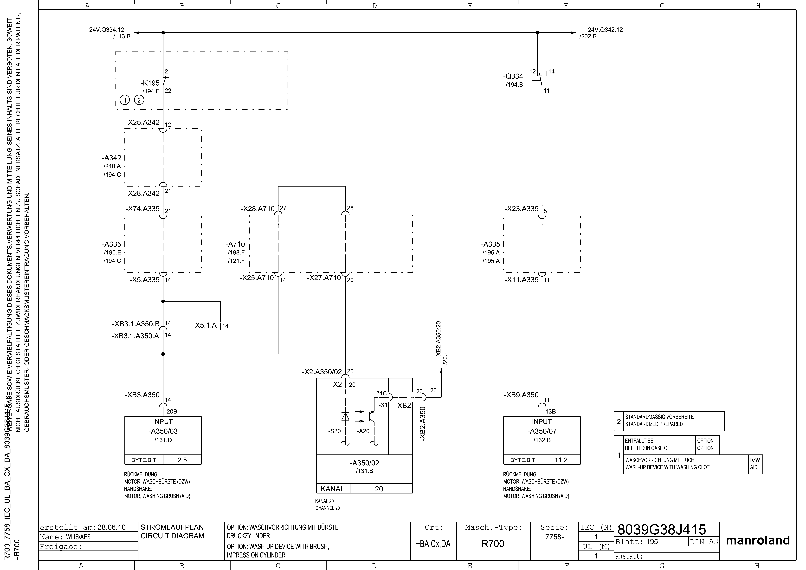

# +BA_Cx_DA — Sheet 195 of 247 — OPTION: WASCHVORRICHTUNG MIT BÜRSTE

**DRUCKZYLINDER**

> Part of the manroland **R700** printing press IEC/UL circuit diagrams.
> Drawing class: **Stromlaufplan / Circuit diagram** (DIN A3).
> Document `+BA_Cx_DA` covers the **Printing units / main switch cabinet** machine section.

## At a glance

| Field | Value |
|---|---|
| Document | `+BA_Cx_DA`  (8039G38J415) |
| Sheet | **195** of 247 |
| Section (DE) | OPTION: WASCHVORRICHTUNG MIT BÜRSTE |
| Section (EN) | DRUCKZYLINDER |
| Section type | CIRCUIT — Circuit diagram |
| Machine type | `R700` |
| Series | `7758` |
| Created | 28.06.10 |
| Replaces | — |
| Columns used | A, B, C, D, E, F, G, H |
| Path numbers | — |
| Labels on sheet | 108 |
| Cross-refs out | 16 |
| Cross-refs in | 33 |

**Previous:** [+BA_Cx_DA sheet 194](SHEET_0194.md) · **Next:** [+BA_Cx_DA sheet 196](SHEET_0196.md) · **Document TOC:** [_TOC.md](_TOC.md)  (+BA_Cx_DA) · **Master TOC:** [all sheets](../_MASTER_TOC.md)

## Sheet image (300 DPI, exact vector render)



_Rendered directly from the PDF vector layer at 300 DPI (1-bit), no OCR and no resampling. Use it to confirm anything ambiguous in the text below._

## Cross-references on this sheet

Each entry is a wire leaving this sheet. The printed token is `/sheet.column`; the link resolves to that sheet inside the same document.

| Ref | Target sheet | Col | Path | Destination on target | Target section | From col |
|---|---|---|---|---|---|---|
| `/113.B` | [+BA_Cx_DA sheet 113](SHEET_0113.md) | B | — | 24V.Q334:12 24V.Q342:12 | PPL 2 | D |
| `/202.B` | [+BA_Cx_DA sheet 202](SHEET_0202.md) | B | — | — | OPTION: | F |
| `/194.B` | [+BA_Cx_DA sheet 194](SHEET_0194.md) | B | — | — | OPTION: WASCHVORRICHTUNG MIT BÜRSTE | E |
| `/194.F` | [+BA_Cx_DA sheet 194](SHEET_0194.md) | F | — | — | OPTION: WASCHVORRICHTUNG MIT BÜRSTE | B |
| `/240.A` | [+BA_Cx_DA sheet 240](SHEET_0240.md) | A | — | — | OPTION: WASCHVORRICHTUNG MIT TUCH | A |
| `/194.C` | [+BA_Cx_DA sheet 194](SHEET_0194.md) | C | — | — | OPTION: WASCHVORRICHTUNG MIT BÜRSTE | A |
| `/195.E` | [+BA_Cx_DA sheet 195](SHEET_0195.md) | E | — | — | OPTION: WASCHVORRICHTUNG MIT BÜRSTE | A |
| `/194.C` | [+BA_Cx_DA sheet 194](SHEET_0194.md) | C | — | — | OPTION: WASCHVORRICHTUNG MIT BÜRSTE | A |
| `/196.A` | [+BA_Cx_DA sheet 196](SHEET_0196.md) | A | — | — | OPTION: WASCHVORRICHTUNG MIT BÜRSTE | E |
| `/195.A` | [+BA_Cx_DA sheet 195](SHEET_0195.md) | A | — | — | OPTION: WASCHVORRICHTUNG MIT BÜRSTE | E |
| `/198.F` | [+BA_Cx_DA sheet 198](SHEET_0198.md) | F | — | — | OPTION: WASCHVORRICHTUNG MIT BÜRSTE | C |
| `/121.F` | [+BA_Cx_DA sheet 121](SHEET_0121.md) | F | — | — | RESERVE: SPS STATION (INPUT) | C |
| `/20.E` | [+BA_Cx_DA sheet 20](SHEET_0020.md) | E | — | XB2.A350:20 | BUSVERBINDUNGEN: SICHERHEITSBUS | E |
| `/132.B` | [+BA_Cx_DA sheet 132](SHEET_0132.md) | B | — | — | REFERENZMODUL | F |
| `/131.D` | [+BA_Cx_DA sheet 131](SHEET_0131.md) | D | — | — | REFERENZMODUL | B |
| `/131.B` | [+BA_Cx_DA sheet 131](SHEET_0131.md) | B | — | — | REFERENZMODUL | D |

### Incoming references (sheets that point here)

Every other sheet that sends a wire to this one. `Back-ref` is the token printed on *that* sheet; `Path` is its line number.

| From sheet | Cols | Back-ref | Path | Refs | What continues there |
|---|---|---|---|---|---|
| [+BA_Cx_DA#20](SHEET_0020.md) | E | `/20.E` | — | 1 | XB2.A350:20 |
| [+BA_Cx_DA#113](SHEET_0113.md) | B | `/113.B` | — | 1 | — |
| [+BA_Cx_DA#121](SHEET_0121.md) | F | `/121.F` | — | 1 | — |
| [+BA_Cx_DA#131](SHEET_0131.md) | B, D | `/131.B`, `/131.D` | — | 2 | — |
| [+BA_Cx_DA#132](SHEET_0132.md) | B | `/132.B` | — | 1 | — |
| [+BA_Cx_DA#153](SHEET_0153.md) | G | `/153.G` | — | 2 | — |
| [+BA_Cx_DA#157](SHEET_0157.md) | C, D, F | `/157.C`, `/157.D`, `/157.F` | — | 3 | — |
| [+BA_Cx_DA#160](SHEET_0160.md) | C | `/160.C` | — | 1 | — |
| [+BA_Cx_DA#161](SHEET_0161.md) | A | `/161.A` | — | 1 | — |
| [+BA_Cx_DA#166](SHEET_0166.md) | G | `/166.G` | — | 1 | — |
| [+BA_Cx_DA#168](SHEET_0168.md) | G | `/168.G` | — | 1 | — |
| [+BA_Cx_DA#174](SHEET_0174.md) | G | `/174.G` | — | 1 | — |
| [+BA_Cx_DA#175](SHEET_0175.md) | F, H | `/175.F`, `/175.H` | — | 2 | — |
| [+BA_Cx_DA#177](SHEET_0177.md) | F | `/177.F` | — | 1 | — |
| [+BA_Cx_DA#178](SHEET_0178.md) | F, H | `/178.F`, `/178.H` | — | 3 | — |
| [+BA_Cx_DA#184](SHEET_0184.md) | F | `/184.F` | — | 1 | — |
| [+BA_Cx_DA#194](SHEET_0194.md) | B, C, F | `/194.B`, `/194.C`, `/194.F` | — | 4 | — |
| [+BA_Cx_DA#195](SHEET_0195.md) | A, E | `/195.A`, `/195.E` | — | 2 | — |
| [+BA_Cx_DA#196](SHEET_0196.md) | A | `/196.A` | — | 1 | — |
| [+BA_Cx_DA#198](SHEET_0198.md) | F | `/198.F` | — | 1 | — |
| [+BA_Cx_DA#202](SHEET_0202.md) | A | `/202.A` | — | 1 | 24V.Q342:12 |
| [+BA_Cx_DA#240](SHEET_0240.md) | A | `/240.A` | — | 1 | — |


## Devices on this sheet

| Tag | Class | Class meaning (IEC) | Col | Sub | Terminal | Sign |
|---|---|---|---|---|---|---|
| `A342` | A | Baugruppe / assembly, module, PC board | A | — | — | — |
| `K195` | K | Relais / relay, contactor | B | — | — | — |
| `A350/03` | A | Baugruppe / assembly, module, PC board | B | 03 | — | — |
| `A335` | A | Baugruppe / assembly, module, PC board | A | — | — | — |
| `A710` | A | Baugruppe / assembly, module, PC board | C | — | — | — |
| `S20` | S | Schalter / switch | D | — | — | — |
| `A20` | A | Baugruppe / assembly, module, PC board | D | — | — | — |
| `X1` | X | Klemme / terminal, plug connector | D | — | — | — |
| `X2` | X | Klemme / terminal, plug connector | D | — | — | — |
| `XB2` | XB |  | D | — | — | — |
| `A350/02` | A | Baugruppe / assembly, module, PC board | D | 02 | — | — |
| `Q334` | Q | Leistungsschalter / power switching device | E | — | — | — |
| `A350/07` | A | Baugruppe / assembly, module, PC board | F | 07 | — | — |
| `A335` | A | Baugruppe / assembly, module, PC board | E | — | — | — |
| `X25.A342` | — | cross-device reference | B | — | — | — |
| `X28.A342` | — | cross-device reference | B | — | — | — |
| `2.5` | — | cross-device reference | B | — | — | — |
| `XB3.A350` | — | cross-device reference | B | — | — | — |
| `X5.A335` | — | cross-device reference | B | — | — | — |
| `X74.A335` | — | cross-device reference | B | — | — | — |
| `X25.A710` | — | cross-device reference | C | — | — | — |
| `X28.A710` | — | cross-device reference | C | — | — | — |
| `X27.A710` | — | cross-device reference | C | — | — | — |
| `XB2.A350` | — | cross-device reference | E | — | — | — |
| `XB3.1.A350.B` | — | cross-device reference | B | — | — | — |
| `XB3.1.A350.A` | — | cross-device reference | B | — | — | — |
| `11.2` | — | cross-device reference | F | — | — | — |
| `XB9.A350` | — | cross-device reference | F | — | — | — |
| `X11.A335` | — | cross-device reference | F | — | — | — |
| `X23.A335` | — | cross-device reference | F | — | — | — |
| `X5.1.A` | — | cross-device reference | B | — | — | — |
| `XB2.A350:20` | — | cross-device reference | E | — | 20 | — |

## Potentials / nets

| Potential | Count | Columns | Attached devices | Terminals |
|---|---|---|---|---|
| `24V` | 2 | A, F | `Q334`, `Q342` | `12` |


A potential such as `L24+/4` or `M24+` is a named supply/return rail; every place it appears on this sheet is electrically common.

## Wire-end annotations (grouped as printed)

A wire that continues elsewhere is annotated with a small cluster: the destination description, the path/line number `#NN`, and the `/sheet.column` cross reference. Each row below is one such cluster exactly as it is grouped on the drawing.

| Col | Y | Path | Cross-ref | Text on the wire |
|---|---|---|---|---|
| D | 40.0 | — | `/113.B` | `24V.Q334:12 24V.Q342:12` |
| F | 49.9 | — | `/202.B` | — |
| B | 101.7 | — | — | `21` |
| F | 101.7 | — | — | `Q334 14` |
| F | 101.7 | — | — | `12` |
| B | 117.9 | — | — | `K195 22` |
| E | 121.1 | — | `/194.B` | — |
| F | 130.0 | — | — | `11` |
| B | 131.0 | — | `/194.F` | — |
| A | 144.3 | — | — | `1 2` |
| B | 176.1 | — | — | `X25.A342 12` |
| A | 228.5 | — | — | `A342` |
| A | 241.6 | — | `/240.A`, `/194.C` | — |
| B | 278.1 | — | — | `X28.A342 21` |
| B | 303.6 | — | — | `X74.A335 21` |
| C | 303.6 | — | — | `X28.A710 27` |
| D | 303.6 | — | — | `28` |
| F | 303.6 | — | — | `X23.A335 5` |
| A | 356.1 | — | — | `A335` |
| C | 356.1 | — | — | `A710` |
| E | 356.1 | — | — | `A335` |
| A | 369.1 | — | `/195.E`, `/194.C` | — |
| C | 369.1 | — | `/198.F`, `/121.F` | — |
| E | 369.1 | — | `/196.A`, `/195.A` | — |
| C | 405.7 | — | — | `X25.A710 14` |
| D | 405.7 | — | — | `X27.A710 20` |
| B | 408.5 | — | — | `X5.A335 14` |
| F | 408.5 | — | — | `X11.A335 11` |
| B | 473.7 | — | — | `XB3.1.A350.B 14` |
| E | 474.2 | — | `/20.E` | `XB2.A350:20` |
| B | 475.9 | — | — | `X5.1.A 14` |
| B | 490.7 | — | — | `XB3.1.A350.A 14` |
| D | 544.6 | — | — | `X2.A350/02 20` |
| D | 563.0 | — | — | `X2` |
| D | 564.4 | — | — | `20 20` |
| E | 572.9 | — | — | `20` |
| D | 577.2 | — | — | `24C` |
| B | 578.6 | — | — | `XB3.A350 14` |
| F | 578.6 | — | — | `XB9.A350 11` |
| D | 594.1 | — | — | `X1` |
| D | 594.2 | — | — | `XB2` |
| E | 600.4 | — | — | `XB2.A350` |
| B | 604.1 | — | — | `20B` |
| F | 604.1 | — | — | `13B` |
| G | 612.9 | — | — | `2 STANDARDMÄSSIG VORBEREITET STANDARDIZED PREPARED` |
| B | 618.6 | — | — | `INPUT` |
| F | 618.6 | — | — | `INPUT` |
| B | 632.4 | — | — | `A350/03` |
| F | 632.4 | — | — | `A350/07` |
| D | 633.1 | — | — | `S20 A20` |
| B | 646.2 | — | `/131.D` | — |
| F | 646.2 | — | `/132.B` | — |
| G | 648.3 | — | — | `ENTFÄLLT BEI DELETED IN CASE OF` |
| G | 648.3 | — | — | `OPTION OPTION` |
| G | 667.8 | — | — | `1` |
| B | 675.3 | — | — | `BYTE.BIT 2.5` |
| F | 675.3 | — | — | `BYTE.BIT 11.2` |
| H | 676.5 | — | — | `DZW` |
| G | 676.7 | — | — | `WASCHVORRICHTUNG MIT TUCH WASH UP DEVICE WITH WASHING CLOTH` |
| D | 679.2 | — | — | `A350/02` |
| H | 687.3 | — | — | `AID` |
| D | 691.6 | — | `/131.B` | — |
| B | 698.0 | — | — | `RÜCKMELDUNG: HANDSHAKE: MOTOR, WASCHBÜRSTE (DZW) MOTOR, WASHING BRUSH (AID)` |
| F | 698.0 | — | — | `RÜCKMELDUNG: HANDSHAKE: MOTOR, WASCHBÜRSTE (DZW) MOTOR, WASHING BRUSH (AID)` |
| D | 717.4 | — | — | `KANAL 20` |
| D | 737.8 | — | — | `KANAL 20 CHANNEL 20` |


## Reconstructed tables

This sheet carries tabular content (pin map / terminal assignment / index). The grid below was rebuilt from the drawing's own rule lines, so each row is exactly one physical row of the table.

### Table 1 — 8 data rows × 14 columns (at x=184.3, y=48.2)

| K195 /194.F 1 2 X25.A342 | 21 22 12 |  |  |  |  |  |  |  |  |  | 12 Q334 /194.B |  | 14 11 |
|---|---|---|---|---|---|---|---|---|---|---|---|---|---|
| `X28.A342 X74.A335 X5.A335` | `21 21 14` |  | `X28.A710 A710 /198.F /121.F X25.A710` | `27 14` | `X27.A710` | `28 20` |  |  |  | `A335 /196.A /195.A` | `X23.A335 X11.A335` |  | `5 11` |
| `XB3.1.A350.B XB3.1.A350.A` | `14 14` | `X5.1.A` | `14` |  |  |  |  |  | `XB2.A350:20` |  |  |  |  |
|  |  |  |  |  | `X2.A350/02` | `20` |  |  |  | `/20.E` |  |  |  |
| `XB3.A350` | `14 20B` |  |  |  | `X2` | `20` | `24C X1` | `XB2` | `20 20` |  | `XB9.A350` |  | `11 13B` |
| `INPUT` | `A350/03 /131.D` |  |  |  | `S20` | `A20` |  |  | `XB2.A350` |  |  | `INPUT` | `A350/07 /132.B` |
| `BYTE.BIT` | `2.5` |  |  |  |  | `A350/02` |  |  |  |  | `BYTE.BIT` |  | `11.2` |
| `RÜCKMELDUNG: MOTOR, WASCHBÜRSTE` | `(DZW)` |  |  |  |  | `/131.B` |  |  |  |  | `RÜCKMELDUNG: MOTOR,` | `WASCHBÜRSTE` | `(DZW)` |
| `HANDSHAKE:` |  |  |  |  | `KANAL` |  | `20` |  |  |  | `HANDSHAKE:` |  |  |


## Notes and free text on this sheet

| Text | Col | Y (pt) |
|---|---|---|
| `20B` | B | 604.07 |
| `INPUT` | B | 618.59 |
| `BYTE.BIT` | B | 675.84 |
| `RÜCKMELDUNG:` | B | 697.96 |
| `MOTOR, WASCHBÜRSTE (DZW)` | B | 708.56 |
| `HANDSHAKE:` | B | 719.19 |
| `MOTOR, WASHING BRUSH (AID)` | B | 729.84 |
| `KANAL 20` | C | 737.79 |
| `CHANNEL 20` | D | 747.74 |
| `24C` | D | 577.18 |
| `KANAL` | D | 717.46 |
| `X2.A350/02` | C | 544.56 |
| `13B` | F | 604.07 |
| `INPUT` | F | 618.59 |
| `BYTE.BIT` | F | 675.84 |
| `RÜCKMELDUNG:` | F | 697.96 |
| `MOTOR, WASCHBÜRSTE (DZW)` | F | 708.56 |
| `HANDSHAKE:` | E | 719.19 |
| `MOTOR, WASHING BRUSH (AID)` | F | 729.84 |
| `ENTFÄLLT BEI` | G | 648.31 |
| `DELETED IN CASE OF` | G | 658.96 |
| `OPTION` | G | 648.31 |
| `STANDARDMÄSSIG VORBEREITET` | G | 612.91 |
| `STANDARDIZED PREPARED` | G | 623.55 |
| `WASCHVORRICHTUNG MIT TUCH` | G | 676.7 |
| `WASH UP DEVICE WITH WASHING CLOTH` | G | 687.29 |
| `DZW` | H | 676.54 |
| `AID` | H | 687.3 |

## Complete label inventory (exact text from the drawing)

Every text object inside the drawing area of this sheet, in DIN reading order (column A→H, then top→bottom). This is the authoritative list: if a string is not here it is not printed on this sheet.

| Col | Y | X | Dir | Type | Text |
|---|---|---|---|---|---|
| A | 40.0 | 129.0 | → | potential | `24V.Q334:12` |
| A | 49.9 | 167.5 | → | cross-reference | `/113.B` |
| A | 144.3 | 182.5 | → | number | `1` |
| A | 228.5 | 150.8 | → | device tag | `A342` |
| A | 241.6 | 153.1 | → | cross-reference | `/240.A` |
| A | 254.0 | 153.1 | → | cross-reference | `/194.C` |
| A | 356.1 | 150.8 | → | device tag | `A335` |
| A | 369.1 | 153.6 | → | cross-reference | `/195.E` |
| A | 381.5 | 153.1 | → | cross-reference | `/194.C` |
| B | 101.7 | 243.5 | → | number | `21` |
| B | 117.9 | 207.5 | → | device tag | `K195` |
| B | 130.0 | 243.5 | → | number | `22` |
| B | 131.0 | 210.6 | → | cross-reference | `/194.F` |
| B | 144.9 | 203.5 | → | number | `2` |
| B | 176.1 | 185.7 | → | device ref | `X25.A342` |
| B | 180.3 | 242.9 | → | number | `12` |
| B | 278.1 | 243.5 | → | number | `21` |
| B | 280.9 | 185.7 | → | device ref | `X28.A342` |
| B | 303.6 | 185.7 | → | device ref | `X74.A335` |
| B | 307.9 | 243.5 | → | number | `21` |
| B | 408.5 | 191.6 | → | device ref | `X5.A335` |
| B | 409.9 | 242.9 | → | number | `14` |
| B | 473.7 | 165.8 | → | device ref | `XB3.1.A350.B` |
| B | 473.7 | 242.9 | → | number | `14` |
| B | 475.8 | 284.9 | → | device ref | `X5.1.A` |
| B | 478.0 | 328.0 | → | number | `14` |
| B | 490.7 | 242.9 | → | number | `14` |
| B | 491.4 | 165.0 | → | device ref | `XB3.1.A350.A` |
| B | 578.6 | 184.5 | → | device ref | `XB3.A350` |
| B | 587.1 | 242.9 | → | number | `14` |
| B | 604.1 | 246.3 | → | text | `20B` |
| B | 618.6 | 226.1 | → | text | `INPUT` |
| B | 632.4 | 219.5 | → | device tag | `A350/03` |
| B | 646.2 | 228.2 | → | cross-reference | `/131.D` |
| B | 675.3 | 262.5 | → | device ref | `2.5` |
| B | 675.8 | 194.2 | → | text | `BYTE.BIT` |
| B | 698.0 | 183.4 | → | text | `RÜCKMELDUNG:` |
| B | 708.6 | 183.7 | → | text | `MOTOR, WASCHBÜRSTE (DZW)` |
| B | 719.2 | 183.4 | → | text | `HANDSHAKE:` |
| B | 729.8 | 183.7 | → | text | `MOTOR, WASHING BRUSH (AID)` |
| C | 303.6 | 355.7 | → | device ref | `X28.A710` |
| C | 303.6 | 413.6 | → | number | `27` |
| C | 356.1 | 333.6 | → | device tag | `A710` |
| C | 369.1 | 336.8 | → | cross-reference | `/198.F` |
| C | 381.5 | 336.8 | → | cross-reference | `/121.F` |
| C | 405.7 | 354.3 | → | device ref | `X25.A710` |
| C | 405.7 | 453.5 | → | device ref | `X27.A710` |
| C | 409.9 | 413.0 | → | number | `14` |
| C | 544.6 | 446.2 | → | text | `X2.A350/02` |
| C | 737.8 | 465.7 | → | text | `KANAL 20` |
| D | 303.6 | 512.8 | → | number | `28` |
| D | 409.9 | 512.8 | → | number | `20` |
| D | 544.6 | 512.8 | → | number | `20` |
| D | 563.0 | 488.7 | → | device tag | `X2` |
| D | 564.4 | 515.6 | → | number | `20` |
| D | 574.3 | 614.8 | → | number | `20` |
| D | 577.2 | 555.6 | → | text | `24C` |
| D | 594.2 | 559.3 | → | device tag | `X1` |
| D | 594.2 | 583.7 | → | device tag | `XB2` |
| D | 633.1 | 485.0 | → | device tag | `S20` |
| D | 633.1 | 527.5 | → | device tag | `A20` |
| D | 679.2 | 517.2 | → | device tag | `A350/02` |
| D | 691.6 | 526.0 | → | cross-reference | `/131.B` |
| D | 717.4 | 554.0 | → | number | `20` |
| D | 717.5 | 474.0 | → | text | `KANAL` |
| D | 747.7 | 466.0 | → | text | `CHANNEL 20` |
| E | 108.0 | 743.5 | → | device tag | `Q334` |
| E | 121.1 | 747.2 | → | cross-reference | `/194.B` |
| E | 356.1 | 710.6 | → | device tag | `A335` |
| E | 369.1 | 712.9 | → | cross-reference | `/196.A` |
| E | 381.5 | 712.9 | → | cross-reference | `/195.A` |
| E | 474.2 | 643.7 | ↕ | device ref | `XB2.A350:20` |
| E | 517.9 | 653.6 | ↕ | cross-reference | `/20.E` |
| E | 572.9 | 635.5 | → | number | `20` |
| E | 600.4 | 619.7 | ↕ | device ref | `XB2.A350` |
| E | 719.2 | 743.2 | → | text | `HANDSHAKE:` |
| F | 40.0 | 865.7 | → | potential | `24V.Q342:12` |
| F | 49.9 | 856.1 | → | cross-reference | `/202.B` |
| F | 101.7 | 781.8 | → | number | `12` |
| F | 101.7 | 809.9 | → | number | `14` |
| F | 130.0 | 802.8 | → | number | `11` |
| F | 303.6 | 745.5 | → | device ref | `X23.A335` |
| F | 307.9 | 803.3 | → | number | `5` |
| F | 408.5 | 745.5 | → | device ref | `X11.A335` |
| F | 409.9 | 802.8 | → | number | `11` |
| F | 578.6 | 744.4 | → | device ref | `XB9.A350` |
| F | 587.1 | 802.8 | → | number | `11` |
| F | 604.1 | 805.6 | → | text | `13B` |
| F | 618.6 | 785.9 | → | text | `INPUT` |
| F | 632.4 | 779.4 | → | device tag | `A350/07` |
| F | 646.2 | 788.2 | → | cross-reference | `/132.B` |
| F | 675.3 | 819.4 | → | device ref | `11.2` |
| F | 675.8 | 754.0 | → | text | `BYTE.BIT` |
| F | 698.0 | 743.2 | → | text | `RÜCKMELDUNG:` |
| F | 708.6 | 743.5 | → | text | `MOTOR, WASCHBÜRSTE (DZW)` |
| F | 729.8 | 743.5 | → | text | `MOTOR, WASHING BRUSH (AID)` |
| G | 612.9 | 923.8 | → | text | `STANDARDMÄSSIG VORBEREITET` |
| G | 618.2 | 911.3 | → | number | `2` |
| G | 623.5 | 923.8 | → | text | `STANDARDIZED PREPARED` |
| G | 648.3 | 923.2 | → | text | `ENTFÄLLT BEI` |
| G | 648.3 | 1030.1 | → | text | `OPTION` |
| G | 658.9 | 1030.1 | → | text | `OPTION` |
| G | 659.0 | 923.2 | → | text | `DELETED IN CASE OF` |
| G | 667.8 | 911.6 | → | number | `1` |
| G | 676.7 | 924.1 | → | text | `WASCHVORRICHTUNG MIT TUCH` |
| G | 687.3 | 924.1 | → | text | `WASH UP DEVICE WITH WASHING CLOTH` |
| H | 676.5 | 1107.5 | → | text | `DZW` |
| H | 687.3 | 1108.3 | → | text | `AID` |

## Reading-order text block

The same content as a plain block, grouped by DIN column — convenient to paste or to match against a visual description.

```text
=== Column A ===
  40.0  129.0  net          24V.Q334:12
  49.9  167.5  xref         /113.B
 144.3  182.5  numeric      1
 228.5  150.8  devtag       A342
 241.6  153.1  xref         /240.A
 254.0  153.1  xref         /194.C
 356.1  150.8  devtag       A335
 369.1  153.6  xref         /195.E
 381.5  153.1  xref         /194.C
=== Column B ===
 101.7  243.5  numeric      21
 117.9  207.5  devtag       K195
 130.0  243.5  numeric      22
 131.0  210.6  xref         /194.F
 144.9  203.5  numeric      2
 176.1  185.7  devref       X25.A342
 180.3  242.9  numeric      12
 278.1  243.5  numeric      21
 280.9  185.7  devref       X28.A342
 303.6  185.7  devref       X74.A335
 307.9  243.5  numeric      21
 408.5  191.6  devref       X5.A335
 409.9  242.9  numeric      14
 473.7  165.8  devref       XB3.1.A350.B
 473.7  242.9  numeric      14
 475.8  284.9  devref       X5.1.A
 478.0  328.0  numeric      14
 490.7  242.9  numeric      14
 491.4  165.0  devref       XB3.1.A350.A
 578.6  184.5  devref       XB3.A350
 587.1  242.9  numeric      14
 604.1  246.3  text         20B
 618.6  226.1  text         INPUT
 632.4  219.5  devtag       A350/03
 646.2  228.2  xref         /131.D
 675.3  262.5  devref       2.5
 675.8  194.2  text         BYTE.BIT
 698.0  183.4  text         RÜCKMELDUNG:
 708.6  183.7  text         MOTOR, WASCHBÜRSTE (DZW)
 719.2  183.4  text         HANDSHAKE:
 729.8  183.7  text         MOTOR, WASHING BRUSH (AID)
=== Column C ===
 303.6  355.7  devref       X28.A710
 303.6  413.6  numeric      27
 356.1  333.6  devtag       A710
 369.1  336.8  xref         /198.F
 381.5  336.8  xref         /121.F
 405.7  354.3  devref       X25.A710
 405.7  453.5  devref       X27.A710
 409.9  413.0  numeric      14
 544.6  446.2  text         X2.A350/02
 737.8  465.7  text         KANAL 20
=== Column D ===
 303.6  512.8  numeric      28
 409.9  512.8  numeric      20
 544.6  512.8  numeric      20
 563.0  488.7  devtag       X2
 564.4  515.6  numeric      20
 574.3  614.8  numeric      20
 577.2  555.6  text         24C
 594.2  559.3  devtag       X1
 594.2  583.7  devtag       XB2
 633.1  485.0  devtag       S20
 633.1  527.5  devtag       A20
 679.2  517.2  devtag       A350/02
 691.6  526.0  xref         /131.B
 717.4  554.0  numeric      20
 717.5  474.0  text         KANAL
 747.7  466.0  text         CHANNEL 20
=== Column E ===
 108.0  743.5  devtag       Q334
 121.1  747.2  xref         /194.B
 356.1  710.6  devtag       A335
 369.1  712.9  xref         /196.A
 381.5  712.9  xref         /195.A
 474.2  643.7  devref       XB2.A350:20
 517.9  653.6  xref         /20.E
 572.9  635.5  numeric      20
 600.4  619.7  devref       XB2.A350
 719.2  743.2  text         HANDSHAKE:
=== Column F ===
  40.0  865.7  net          24V.Q342:12
  49.9  856.1  xref         /202.B
 101.7  781.8  numeric      12
 101.7  809.9  numeric      14
 130.0  802.8  numeric      11
 303.6  745.5  devref       X23.A335
 307.9  803.3  numeric      5
 408.5  745.5  devref       X11.A335
 409.9  802.8  numeric      11
 578.6  744.4  devref       XB9.A350
 587.1  802.8  numeric      11
 604.1  805.6  text         13B
 618.6  785.9  text         INPUT
 632.4  779.4  devtag       A350/07
 646.2  788.2  xref         /132.B
 675.3  819.4  devref       11.2
 675.8  754.0  text         BYTE.BIT
 698.0  743.2  text         RÜCKMELDUNG:
 708.6  743.5  text         MOTOR, WASCHBÜRSTE (DZW)
 729.8  743.5  text         MOTOR, WASHING BRUSH (AID)
=== Column G ===
 612.9  923.8  text         STANDARDMÄSSIG VORBEREITET
 618.2  911.3  numeric      2
 623.5  923.8  text         STANDARDIZED PREPARED
 648.3  923.2  text         ENTFÄLLT BEI
 648.3 1030.1  text         OPTION
 658.9 1030.1  text         OPTION
 659.0  923.2  text         DELETED IN CASE OF
 667.8  911.6  numeric      1
 676.7  924.1  text         WASCHVORRICHTUNG MIT TUCH
 687.3  924.1  text         WASH UP DEVICE WITH WASHING CLOTH
=== Column H ===
 676.5 1107.5  text         DZW
 687.3 1108.3  text         AID
```

---
_Generated from the PDF vector text layer; no OCR. Source: `R700_7758_IEC_UL_BA_CX_DA_8039G38J415_p`, sheet 195._
