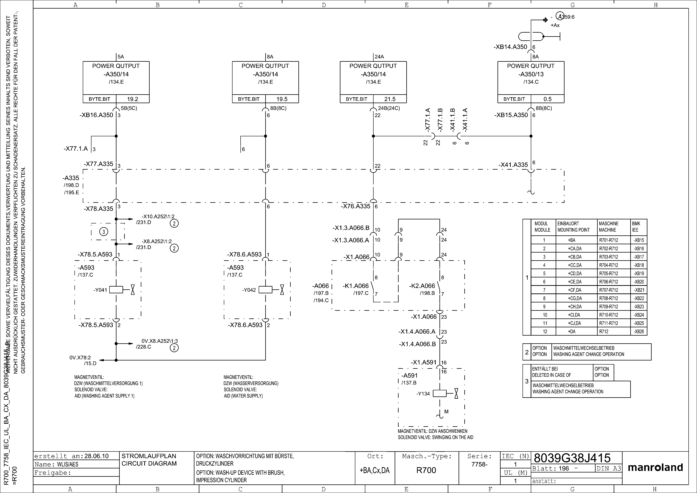

# +BA_Cx_DA — Sheet 196 of 247 — OPTION: WASCHVORRICHTUNG MIT BÜRSTE

**DRUCKZYLINDER**

> Part of the manroland **R700** printing press IEC/UL circuit diagrams.
> Drawing class: **Stromlaufplan / Circuit diagram** (DIN A3).
> Document `+BA_Cx_DA` covers the **Printing units / main switch cabinet** machine section.

## At a glance

| Field | Value |
|---|---|
| Document | `+BA_Cx_DA`  (8039G38J415) |
| Sheet | **196** of 247 |
| Section (DE) | OPTION: WASCHVORRICHTUNG MIT BÜRSTE |
| Section (EN) | DRUCKZYLINDER |
| Section type | CIRCUIT — Circuit diagram |
| Machine type | `R700` |
| Series | `7758` |
| Created | 28.06.10 |
| Replaces | — |
| Columns used | A, B, C, D, E, F, G, H |
| Path numbers | — |
| Labels on sheet | 205 |
| Cross-refs out | 17 |
| Cross-refs in | 52 |

**Previous:** [+BA_Cx_DA sheet 195](SHEET_0195.md) · **Next:** [+BA_Cx_DA sheet 197](SHEET_0197.md) · **Document TOC:** [_TOC.md](_TOC.md)  (+BA_Cx_DA) · **Master TOC:** [all sheets](../_MASTER_TOC.md)

## Sheet image (300 DPI, exact vector render)



_Rendered directly from the PDF vector layer at 300 DPI (1-bit), no OCR and no resampling. Use it to confirm anything ambiguous in the text below._

## Cross-references on this sheet

Each entry is a wire leaving this sheet. The printed token is `/sheet.column`; the link resolves to that sheet inside the same document.

| Ref | Target sheet | Col | Path | Destination on target | Target section | From col |
|---|---|---|---|---|---|---|
| `/134.E` | [+BA_Cx_DA sheet 134](SHEET_0134.md) | E | — | — | REFERENZMODUL | A |
| `/134.E` | [+BA_Cx_DA sheet 134](SHEET_0134.md) | E | — | — | REFERENZMODUL | C |
| `/134.E` | [+BA_Cx_DA sheet 134](SHEET_0134.md) | E | — | — | REFERENZMODUL | E |
| `/134.C` | [+BA_Cx_DA sheet 134](SHEET_0134.md) | C | — | — | REFERENZMODUL | G |
| `/198.D` | [+BA_Cx_DA sheet 198](SHEET_0198.md) | D | — | — | OPTION: WASCHVORRICHTUNG MIT BÜRSTE | A |
| `/195.E` | [+BA_Cx_DA sheet 195](SHEET_0195.md) | E | — | — | OPTION: WASCHVORRICHTUNG MIT BÜRSTE | A |
| `/231.D` | [+BA_Cx_DA sheet 231](SHEET_0231.md) | D | — | — | OPTION: WASCHMITTELWECHSELBETRIEB | B |
| `/231.D` | [+BA_Cx_DA sheet 231](SHEET_0231.md) | D | — | — | OPTION: WASCHMITTELWECHSELBETRIEB | B |
| `/137.C` | [+BA_Cx_DA sheet 137](SHEET_0137.md) | C | — | A593 | REFERENZMODUL | A |
| `/137.C` | [+BA_Cx_DA sheet 137](SHEET_0137.md) | C | — | A593 | REFERENZMODUL | C |
| `/197.C` | [+BA_Cx_DA sheet 197](SHEET_0197.md) | C | — | A066 | OPTION: WASCHVORRICHTUNG MIT BÜRSTE | D |
| `/197.B` | [+BA_Cx_DA sheet 197](SHEET_0197.md) | B | — | — | OPTION: WASCHVORRICHTUNG MIT BÜRSTE | D |
| `/194.C` | [+BA_Cx_DA sheet 194](SHEET_0194.md) | C | — | — | OPTION: WASCHVORRICHTUNG MIT BÜRSTE | D |
| `/198.B` | [+BA_Cx_DA sheet 198](SHEET_0198.md) | B | — | — | OPTION: WASCHVORRICHTUNG MIT BÜRSTE | E |
| `/228.C` | [+BA_Cx_DA sheet 228](SHEET_0228.md) | C | — | — | OPTION: WASCHMITTELWECHSELBETRIEB | B |
| `/15.D` | [+BA_Cx_DA sheet 15](SHEET_0015.md) | D | — | 0V.X78:2 | SPANNUNGSVERSORGUNG, SCHALTSCHRANKBELÜFTUNG | A |
| `/137.B` | [+BA_Cx_DA sheet 137](SHEET_0137.md) | B | — | A591 | REFERENZMODUL | E |

### Incoming references (sheets that point here)

Every other sheet that sends a wire to this one. `Back-ref` is the token printed on *that* sheet; `Path` is its line number.

| From sheet | Cols | Back-ref | Path | Refs | What continues there |
|---|---|---|---|---|---|
| [+BA_Cx_DA#15](SHEET_0015.md) | D | `/15.D` | — | 1 | 0V.X78:2 |
| [+BA_Cx_DA#134](SHEET_0134.md) | C, E | `/134.C`, `/134.E` | — | 4 | — |
| [+BA_Cx_DA#137](SHEET_0137.md) | B, C | `/137.B`, `/137.C` | — | 3 | — |
| [+BA_Cx_DA#138](SHEET_0138.md) | B, C | `/138.B`, `/138.C` | — | 4 | — |
| [+BA_Cx_DA#139](SHEET_0139.md) | A, B, D | `/139.A`, `/139.B`, `/139.D` | — | 8 | — |
| [+BA_Cx_DA#142](SHEET_0142.md) | B | `/142.B` | — | 1 | — |
| [+BA_Cx_DA#171](SHEET_0171.md) | B, G | `/171.B`, `/171.G` | — | 2 | — |
| [+BA_Cx_DA#172](SHEET_0172.md) | F | `/172.F` | — | 3 | — |
| [+BA_Cx_DA#181](SHEET_0181.md) | B, C, F | `/181.B`, `/181.C`, `/181.F` | — | 3 | — |
| [+BA_Cx_DA#185](SHEET_0185.md) | C, E, F, G | `/185.C`, `/185.E`, `/185.F`, `/185.G` | — | 8 | — |
| [+BA_Cx_DA#186](SHEET_0186.md) | A, B | `/186.A`, `/186.B` | — | 6 | — |
| [+BA_Cx_DA#194](SHEET_0194.md) | C | `/194.C` | — | 1 | — |
| [+BA_Cx_DA#195](SHEET_0195.md) | E | `/195.E` | — | 1 | — |
| [+BA_Cx_DA#197](SHEET_0197.md) | B, C | `/197.B`, `/197.C` | — | 2 | — |
| [+BA_Cx_DA#198](SHEET_0198.md) | B, D | `/198.B`, `/198.D` | — | 2 | — |
| [+BA_Cx_DA#228](SHEET_0228.md) | C | `/228.C` | — | 1 | — |
| [+BA_Cx_DA#231](SHEET_0231.md) | D | `/231.D` | — | 2 | X10.A252\1:2; X8.A252\1:2 |


## Devices on this sheet

| Tag | Class | Class meaning (IEC) | Col | Sub | Terminal | Sign |
|---|---|---|---|---|---|---|
| `Y042` | Y | Magnetventil / solenoid valve, actuator | C | — | — | — |
| `A593` | A | Baugruppe / assembly, module, PC board | C | — | — | — |
| `Y041` | Y | Magnetventil / solenoid valve, actuator | A | — | — | — |
| `A593` | A | Baugruppe / assembly, module, PC board | A | — | — | — |
| `A066` | A | Baugruppe / assembly, module, PC board | D | — | — | — |
| `A350/13` | A | Baugruppe / assembly, module, PC board | G | 13 | — | — |
| `A350/14` | A | Baugruppe / assembly, module, PC board | A | 14 | — | — |
| `A350/14` | A | Baugruppe / assembly, module, PC board | C | 14 | — | — |
| `A350/14` | A | Baugruppe / assembly, module, PC board | E | 14 | — | — |
| `A335` | A | Baugruppe / assembly, module, PC board | A | — | — | — |
| `Y134` | Y | Magnetventil / solenoid valve, actuator | E | — | — | — |
| `A591` | A | Baugruppe / assembly, module, PC board | E | — | — | — |
| `XB15` | XB |  | H | — | — | — |
| `XB16` | XB |  | H | — | — | — |
| `XB17` | XB |  | H | — | — | — |
| `XB18` | XB |  | H | — | — | — |
| `XB19` | XB |  | H | — | — | — |
| `XB20` | XB |  | H | — | — | — |
| `XB21` | XB |  | H | — | — | — |
| `XB22` | XB |  | H | — | — | — |
| `XB23` | XB |  | H | — | — | — |
| `XB24` | XB |  | H | — | — | — |
| `XB25` | XB |  | H | — | — | — |
| `XB26` | XB |  | H | — | — | — |
| `R712` | R | Widerstand / resistor | G | — | — | — |
| `X78.A335` | — | cross-device reference | A | — | — | — |
| `X78.6.A593` | — | cross-device reference | C | — | — | — |
| `X78.6.A593` | — | cross-device reference | C | — | — | — |
| `X78.5.A593` | — | cross-device reference | A | — | — | — |
| `X78.5.A593` | — | cross-device reference | A | — | — | — |
| `X76.A335` | — | cross-device reference | D | — | — | — |
| `X1.3.A066.B` | — | cross-device reference | D | — | — | — |
| `X1.3.A066.A` | — | cross-device reference | D | — | — | — |
| `X1.A066` | — | cross-device reference | D | — | — | — |
| `K1.A066` | — | cross-device reference | D | — | — | — |
| `K2.A066` | — | cross-device reference | E | — | — | — |
| `X1.A066` | — | cross-device reference | E | — | — | — |
| `X1.4.A066.B` | — | cross-device reference | E | — | — | — |
| `X1.4.A066.A` | — | cross-device reference | E | — | — | — |
| `X1.A591` | — | cross-device reference | E | — | — | — |
| `0.5` | — | cross-device reference | G | — | — | — |
| `XB14.A350` | — | cross-device reference | F | — | — | — |
| `XB15.A350` | — | cross-device reference | F | — | — | — |
| `X77.1.B` | — | cross-device reference | E | — | — | — |
| `X77.1.A` | — | cross-device reference | E | — | — | — |
| `X41.1.B` | — | cross-device reference | F | — | — | — |
| `X41.1.A` | — | cross-device reference | F | — | — | — |
| `19.2` | — | cross-device reference | B | — | — | — |
| `XB16.A350` | — | cross-device reference | A | — | — | — |
| `19.5` | — | cross-device reference | C | — | — | — |
| `21.5` | — | cross-device reference | E | — | — | — |
| `X77.1.A` | — | cross-device reference | A | — | — | — |
| `X77.A335` | — | cross-device reference | A | — | — | — |
| `X41.A335` | — | cross-device reference | F | — | — | — |
| `X10.A252\1:2` | — | cross-device reference | B | — | 2 | — |
| `X8.A252\1:2` | — | cross-device reference | B | — | 2 | — |

## Potentials / nets

| Potential | Count | Columns | Attached devices | Terminals |
|---|---|---|---|---|
| `0V` | 2 | A, B | `A252\1`, `X78`, `X8` | `2`, `3` |


A potential such as `L24+/4` or `M24+` is a named supply/return rail; every place it appears on this sheet is electrically common.

## Wire-end annotations (grouped as printed)

A wire that continues elsewhere is annotated with a small cluster: the destination description, the path/line number `#NN`, and the `/sheet.column` cross reference. Each row below is one such cluster exactly as it is grouped on the drawing.

| Col | Y | Path | Cross-ref | Text on the wire |
|---|---|---|---|---|
| G | 23.9 | — | — | `1` |
| G | 25.1 | — | — | `.A359:6` |
| G | 39.3 | — | — | `+Ax` |
| F | 75.4 | — | — | `XB14.A350 6` |
| B | 93.1 | — | — | `5A` |
| C | 93.1 | — | — | `8A` |
| E | 93.1 | — | — | `24A` |
| G | 93.1 | — | — | `8A` |
| A | 108.3 | — | — | `POWER QUTPUT` |
| C | 108.3 | — | — | `POWER QUTPUT` |
| E | 108.3 | — | — | `POWER QUTPUT` |
| F | 108.3 | — | — | `POWER QUTPUT` |
| A | 122.2 | — | — | `A350/14` |
| C | 122.2 | — | — | `A350/14` |
| E | 122.2 | — | — | `A350/14` |
| G | 122.2 | — | — | `A350/13` |
| A | 136.0 | — | `/134.E` | — |
| C | 136.0 | — | `/134.E` | — |
| E | 136.0 | — | `/134.E` | — |
| G | 136.0 | — | `/134.C` | — |
| A | 165.0 | — | — | `BYTE.BIT 19.2` |
| C | 165.0 | — | — | `BYTE.BIT 19.5` |
| E | 165.0 | — | — | `BYTE.BIT 21.5` |
| F | 165.0 | — | — | `BYTE.BIT 0.5` |
| B | 181.0 | — | — | `5B(5C)` |
| C | 181.0 | — | — | `8B(8C)` |
| E | 181.0 | — | — | `24B(24C)` |
| G | 181.0 | — | — | `8B(8C)` |
| E | 184.5 | — | — | `22 X77.1.A` |
| E | 184.5 | — | — | `22 X77.1.B` |
| F | 184.5 | — | — | `X41.1.B 6` |
| F | 184.5 | — | — | `X41.1.A 6` |
| A | 191.6 | — | — | `XB16.A350 3` |
| F | 191.6 | — | — | `XB15.A350 6` |
| C | 193.1 | — | — | `6` |
| E | 193.1 | — | — | `22` |
| B | 249.1 | — | — | `X77.1.A 3 6` |
| E | 273.9 | — | — | `6 22 X41.A335 6` |
| A | 275.3 | — | — | `X77.A335 3` |
| A | 299.4 | — | — | `A335` |
| A | 312.5 | — | `/198.D` | — |
| A | 324.8 | — | `/195.E` | — |
| D | 347.6 | — | — | `X76.A335 6` |
| B | 349.0 | — | — | `X78.A335 3 6` |
| B | 365.9 | — | — | `X10.A252\1:2` |
| B | 375.9 | — | `/231.D` | — |
| B | 378.7 | — | — | `2` |
| G | 379.0 | — | — | `EINBAUORT MOUNTING POINT` |
| H | 379.0 | — | — | `BMK IEE` |
| G | 379.1 | — | — | `MODUL MODULE` |
| G | 379.1 | — | — | `MASCHINE MACHINE` |
| D | 384.4 | — | — | `X1.3.A066.B 10` |
| E | 388.7 | — | — | `9` |
| E | 388.7 | — | — | `24` |
| A | 392.9 | — | — | `3` |
| D | 405.7 | — | — | `X1.3.A066.A 10` |
| E | 405.7 | — | — | `9` |
| E | 405.7 | — | — | `24` |
| G | 406.9 | — | — | `1` |
| G | 407.4 | — | — | `+BA` |
| G | 407.4 | — | — | `R701 R712` |
| H | 407.4 | — | — | `XB15` |
| B | 408.5 | — | — | `X8.A252\1:2` |
| B | 418.4 | — | `/231.D` | — |
| B | 421.2 | — | — | `2` |
| G | 421.4 | — | — | `2` |
| G | 421.6 | — | — | `+CA,DA` |
| G | 421.6 | — | — | `R702 R712` |
| H | 421.6 | — | — | `XB16` |
| A | 429.8 | — | — | `X78.5.A593 1` |
| C | 429.8 | — | — | `X78.6.A593 1` |
| D | 431.2 | — | — | `X1.A066 10` |
| E | 431.2 | — | — | `9 24` |
| G | 435.7 | — | — | `3` |
| G | 435.7 | — | — | `+CB,DA` |
| H | 435.7 | — | — | `XB17` |
| G | 435.8 | — | — | `R703 R712` |
| G | 449.8 | — | — | `4` |
| G | 449.9 | — | — | `+CC,DA` |
| G | 449.9 | — | — | `R704 R712` |
| H | 449.9 | — | — | `XB18` |
| A | 452.4 | — | `/137.C` | `A593` |
| C | 452.4 | — | `/137.C` | `A593` |
| G | 464.0 | — | — | `5` |
| G | 464.1 | — | — | `+CD,DA` |
| G | 464.1 | — | — | `R705 R712` |
| H | 464.1 | — | — | `XB19` |
| F | 469.4 | — | — | `1` |
| E | 470.2 | — | — | `8` |
| E | 470.2 | — | — | `8` |
| G | 478.2 | — | — | `6` |
| G | 478.3 | — | — | `+CE,DA` |
| G | 478.3 | — | — | `R706 R712` |
| H | 478.3 | — | — | `XB20` |
| D | 483.6 | — | `/197.C` | `A066` |
| D | 483.6 | — | — | `K1.A066 7` |
| E | 483.6 | — | — | `K2.A066 7` |
| A | 491.4 | — | — | `Y041` |
| C | 491.4 | — | — | `Y042` |
| G | 492.4 | — | — | `7` |
| G | 492.4 | — | — | `+CF,DA` |
| H | 492.4 | — | — | `XB21` |
| G | 492.5 | — | — | `R707 R712` |
| D | 496.7 | — | `/197.B`, `/194.C` | — |
| E | 496.7 | — | `/198.B` | — |
| G | 506.5 | — | — | `8` |
| G | 506.6 | — | — | `+CG,DA` |
| G | 506.6 | — | — | `R708 R712` |
| H | 506.6 | — | — | `XB22` |
| G | 520.7 | — | — | `9` |
| G | 520.8 | — | — | `+CH,DA` |
| G | 520.8 | — | — | `R709 R712` |
| H | 520.8 | — | — | `XB23` |
| G | 534.9 | — | — | `10` |
| G | 535.0 | — | — | `+CI,DA` |
| G | 535.0 | — | — | `R710 R712` |
| H | 535.0 | — | — | `XB24` |
| E | 536.1 | — | — | `X1.A066 23` |
| G | 548.9 | — | — | `11` |
| G | 549.1 | — | — | `+CJ,DA` |
| G | 549.1 | — | — | `R711 R712` |
| H | 549.1 | — | — | `XB25` |
| A | 550.2 | — | — | `X78.5.A593 2` |
| C | 550.2 | — | — | `X78.6.A593 2` |
| E | 561.6 | — | — | `X1.4.A066.A 23` |
| G | 563.2 | — | — | `12` |
| G | 563.3 | — | — | `+DA` |
| G | 563.3 | — | — | `R712` |
| H | 563.3 | — | — | `XB26` |
| B | 578.5 | — | — | `0V.X8.A252\1:3` |
| E | 580.0 | — | — | `X1.4.A066.B 23` |
| B | 588.5 | — | `/228.C` | — |
| E | 591.3 | — | — | `2 2 OPTION OPTION WASCHMITTELWECHSELBETRIEB WASHING AGENT CHANGE OPERATION` |
| A | 606.9 | — | `/15.D` | `0V.X78:2` |
| E | 614.0 | — | — | `X1.A591 16` |
| G | 627.0 | — | — | `ENTFÄLLT BEI DELETED IN CASE OF` |
| G | 627.0 | — | — | `OPTION OPTION` |
| E | 631.0 | — | — | `16` |
| E | 636.7 | — | `/137.B` | `A591` |
| A | 641.2 | — | — | `DZW (WASCHMITTELVERSORGUNG 1) MAGNETVENTIL:` |
| C | 641.2 | — | — | `DZW (WASSERVERSORGUNG) MAGNETVENTIL:` |
| F | 646.6 | — | — | `3` |
| G | 655.4 | — | — | `WASCHMITTELWECHSELBETRIEB WASHING AGENT CHANGE OPERATION` |
| A | 662.5 | — | — | `SOLENOID VALVE: AID (WASHING AGENT SUPPLY 1)` |
| C | 662.5 | — | — | `SOLENOID VALVE: AID (WATER SUPPLY)` |
| E | 668.6 | — | — | `Y134` |
| E | 699.1 | — | — | `M` |
| E | 733.4 | — | — | `MAGNETVENTIL: DZW ANSCHWENKEN SOLENOID VALVE: SWINGING ON THE AID` |


## Reconstructed tables

This sheet carries tabular content (pin map / terminal assignment / index). The grid below was rebuilt from the drawing's own rule lines, so each row is exactly one physical row of the table.

### Table 1 — 3 data rows × 2 columns (at x=141.7, y=104.9)

| POWER | QUTPUT A350/14 /134.E |
|---|---|
| `BYTE.BIT` | `19.2` |
| `XB16.A350` | `5B(5C) 3` |
| `3 X77.A335 X78.A335 3 X78.5.A593 A593 /137.C Y041 X78.5.A593` | `3 3 /231.D /231.D 1 2 /228.C` |


### Table 2 — 5 data rows × 10 columns (at x=396.9, y=104.9)

| POWER | QUTPUT A350/14 /134.E |  | POWER | QUTPUT A350/14 /134.E |  |  |  | POWER | QUTPUT A350/13 /134.C |
|---|---|---|---|---|---|---|---|---|---|
| `BYTE.BIT` | `19.5` |  | `BYTE.BIT` | `21.5` |  |  |  | `BYTE.BIT` | `0.5` |
|  | `8B(8C) 6` |  |  | `24B(24C) 22` |  | `X77.1.A` | `X77.1.B X41.1.B X41.1.A` | `XB15.A350` | `8B(8C) 6` |
| `6` | `6 6` |  | `X76.A335` | `22 6` |  | `22 22` | `6 6` | `X41.A335` | `6` |
| `X78.6.A593 A593 /137.C Y042` | `1` | `A066 /197.B /194.C` | `X1.3.A066.B X1.3.A066.A X1.A066 K1.A066 /197.C` | `10 10 10 8 7` | `9 9 9` | `K2.A066 /198.B` | `24 24 24 8 7` | `1` | `MODUL MODULE 1 2 3 4 5 6 7 8` |
| `X78.6.A593` | `2` |  |  |  |  | `X1.A066 X1.4.A066.A X1.4.A066.B` | `23 23 23` | `2` | `9 10 11 12 OPTION OPTION WASHING` |


## Notes and free text on this sheet

| Text | Col | Y (pt) |
|---|---|---|
| `MAGNETVENTIL:` | C | 641.24 |
| `DZW (WASSERVERSORGUNG)` | C | 651.86 |
| `SOLENOID VALVE:` | C | 662.5 |
| `AID (WATER SUPPLY)` | C | 673.12 |
| `MAGNETVENTIL:` | A | 641.24 |
| `DZW (WASCHMITTELVERSORGUNG 1)` | A | 651.87 |
| `SOLENOID VALVE:` | A | 662.5 |
| `AID (WASHING AGENT SUPPLY 1)` | A | 673.14 |
| `8A` | G | 93.1 |
| `8B(8C)` | G | 181.03 |
| `POWER QUTPUT` | F | 108.28 |
| `BYTE.BIT` | F | 165.6 |
| `.A359:6` | G | 25.06 |
| `+Ax` | G | 39.33 |
| `5A` | B | 93.1 |
| `5B(5C)` | B | 181.03 |
| `POWER QUTPUT` | A | 108.28 |
| `BYTE.BIT` | A | 165.6 |
| `8A` | C | 93.1 |
| `8B(8C)` | C | 181.03 |
| `POWER QUTPUT` | C | 108.28 |
| `BYTE.BIT` | C | 165.6 |
| `24A` | E | 93.12 |
| `24B(24C)` | E | 181.03 |
| `POWER QUTPUT` | E | 108.28 |
| `BYTE.BIT` | D | 165.6 |
| `MAGNETVENTIL: DZW ANSCHWENKEN` | E | 733.36 |
| `SOLENOID VALVE: SWINGING ON THE AID` | E | 744 |
| `M` | E | 699.13 |
| `OPTION` | G | 591.62 |
| `WASCHMITTELWECHSELBETRIEB` | G | 591.63 |
| `WASHING AGENT CHANGE OPERATION` | G | 602.27 |
| `MODUL` | G | 379.08 |
| `MODULE` | G | 389.7 |
| `EINBAUORT` | G | 379.04 |
| `MOUNTING POINT` | G | 389.7 |
| `MASCHINE` | G | 379.05 |
| `MACHINE` | G | 389.68 |
| `BMK` | H | 379.02 |
| `IEE` | H | 389.52 |
| `R701 R712` | G | 407.42 |
| `R702 R712` | G | 421.59 |
| `R703 R712` | G | 435.77 |
| `R704 R712` | G | 449.94 |
| `R705 R712` | G | 464.11 |
| `R706 R712` | G | 478.29 |
| `R707 R712` | G | 492.46 |
| `R708 R712` | G | 506.63 |
| `R709 R712` | G | 520.81 |
| `R710 R712` | G | 534.98 |
| `R711 R712` | G | 549.15 |
| `+BA` | G | 407.37 |
| `+CA,DA` | G | 421.57 |
| `+CB,DA` | G | 435.74 |
| `+CC,DA` | G | 449.94 |
| `+CD,DA` | G | 464.11 |
| `+CE,DA` | G | 478.26 |
| `+CF,DA` | G | 492.44 |
| `+CG,DA` | G | 506.62 |
| `+CH,DA` | G | 520.8 |
| `+CI,DA` | G | 534.95 |
| `+CJ,DA` | G | 549.12 |
| `+DA` | G | 563.31 |
| `ENTFÄLLT BEI` | G | 627.05 |
| `DELETED IN CASE OF` | G | 637.7 |

## Complete label inventory (exact text from the drawing)

Every text object inside the drawing area of this sheet, in DIN reading order (column A→H, then top→bottom). This is the authoritative list: if a string is not here it is not printed on this sheet.

| Col | Y | X | Dir | Type | Text |
|---|---|---|---|---|---|
| A | 108.3 | 157.6 | → | text | `POWER QUTPUT` |
| A | 122.2 | 177.0 | → | device tag | `A350/14` |
| A | 136.0 | 186.0 | → | cross-reference | `/134.E` |
| A | 165.6 | 151.7 | → | text | `BYTE.BIT` |
| A | 191.6 | 136.1 | → | device ref | `XB16.A350` |
| A | 249.1 | 108.9 | → | device ref | `X77.1.A` |
| A | 251.2 | 158.5 | → | number | `3` |
| A | 275.3 | 143.1 | → | device ref | `X77.A335` |
| A | 299.4 | 106.9 | → | device tag | `A335` |
| A | 312.5 | 109.1 | → | cross-reference | `/198.D` |
| A | 324.8 | 109.7 | → | cross-reference | `/195.E` |
| A | 351.8 | 143.1 | → | device ref | `X78.A335` |
| A | 392.9 | 175.2 | → | number | `3` |
| A | 429.8 | 132.9 | → | device ref | `X78.5.A593` |
| A | 452.4 | 132.9 | → | device tag | `A593` |
| A | 465.5 | 133.2 | → | cross-reference | `/137.C` |
| A | 491.4 | 159.9 | → | device tag | `Y041` |
| A | 550.2 | 134.4 | → | device ref | `X78.5.A593` |
| A | 606.9 | 118.8 | → | potential | `0V.X78:2` |
| A | 616.8 | 143.7 | → | cross-reference | `/15.D` |
| A | 641.2 | 127.0 | → | text | `MAGNETVENTIL:` |
| A | 651.9 | 126.7 | → | text | `DZW (WASCHMITTELVERSORGUNG 1)` |
| A | 662.5 | 127.3 | → | text | `SOLENOID VALVE:` |
| A | 673.1 | 127.6 | → | text | `AID (WASHING AGENT SUPPLY 1)` |
| B | 93.1 | 201.0 | → | text | `5A` |
| B | 165.0 | 217.0 | → | device ref | `19.2` |
| B | 181.0 | 206.6 | → | text | `5B(5C)` |
| B | 193.1 | 201.0 | → | number | `3` |
| B | 279.5 | 201.0 | → | number | `3` |
| B | 349.0 | 201.0 | → | number | `3` |
| B | 365.9 | 242.1 | → | device ref | `X10.A252\1:2` |
| B | 375.9 | 232.4 | → | cross-reference | `/231.D` |
| B | 378.7 | 295.6 | → | number | `2` |
| B | 408.5 | 242.1 | → | device ref | `X8.A252\1:2` |
| B | 418.4 | 232.4 | → | cross-reference | `/231.D` |
| B | 421.2 | 295.6 | → | number | `2` |
| B | 431.2 | 200.4 | → | number | `1` |
| B | 551.7 | 201.0 | → | number | `2` |
| B | 578.5 | 242.1 | → | potential | `0V.X8.A252\1:3` |
| B | 588.5 | 232.4 | → | cross-reference | `/228.C` |
| B | 591.3 | 295.6 | → | number | `2` |
| C | 93.1 | 456.1 | → | text | `8A` |
| C | 108.3 | 412.7 | → | text | `POWER QUTPUT` |
| C | 122.2 | 432.1 | → | device tag | `A350/14` |
| C | 136.0 | 441.1 | → | cross-reference | `/134.E` |
| C | 165.0 | 472.1 | → | device ref | `19.5` |
| C | 165.6 | 406.8 | → | text | `BYTE.BIT` |
| C | 181.0 | 461.8 | → | text | `8B(8C)` |
| C | 193.1 | 456.1 | → | number | `6` |
| C | 251.2 | 413.6 | → | number | `6` |
| C | 279.5 | 456.1 | → | number | `6` |
| C | 349.0 | 456.1 | → | number | `6` |
| C | 429.8 | 388.1 | → | device ref | `X78.6.A593` |
| C | 431.2 | 455.5 | → | number | `1` |
| C | 452.4 | 388.1 | → | device tag | `A593` |
| C | 465.5 | 388.3 | → | cross-reference | `/137.C` |
| C | 491.4 | 413.9 | → | device tag | `Y042` |
| C | 550.2 | 389.5 | → | device ref | `X78.6.A593` |
| C | 551.7 | 456.1 | → | number | `2` |
| C | 641.2 | 382.1 | → | text | `MAGNETVENTIL:` |
| C | 651.9 | 381.8 | → | text | `DZW (WASSERVERSORGUNG)` |
| C | 662.5 | 382.4 | → | text | `SOLENOID VALVE:` |
| C | 673.1 | 382.7 | → | text | `AID (WATER SUPPLY)` |
| D | 165.6 | 591.0 | → | text | `BYTE.BIT` |
| D | 347.5 | 582.5 | → | device ref | `X76.A335` |
| D | 384.4 | 568.3 | → | device ref | `X1.3.A066.B` |
| D | 405.7 | 567.5 | → | device ref | `X1.3.A066.A` |
| D | 434.0 | 587.1 | → | device ref | `X1.A066` |
| D | 483.6 | 533.5 | → | device tag | `A066` |
| D | 483.6 | 585.6 | → | device ref | `K1.A066` |
| D | 496.7 | 536.0 | → | cross-reference | `/197.B` |
| D | 496.7 | 603.8 | → | cross-reference | `/197.C` |
| D | 509.1 | 535.7 | → | cross-reference | `/194.C` |
| E | 93.1 | 640.3 | → | text | `24A` |
| E | 108.3 | 597.0 | → | text | `POWER QUTPUT` |
| E | 122.2 | 616.4 | → | device tag | `A350/14` |
| E | 136.0 | 625.3 | → | cross-reference | `/134.E` |
| E | 165.0 | 656.6 | → | device ref | `21.5` |
| E | 181.0 | 646.0 | → | text | `24B(24C)` |
| E | 184.5 | 726.0 | ↕ | device ref | `X77.1.A` |
| E | 184.5 | 747.3 | ↕ | device ref | `X77.1.B` |
| E | 193.1 | 640.3 | → | number | `22` |
| E | 239.0 | 723.2 | ↕ | number | `22` |
| E | 239.0 | 744.4 | ↕ | number | `22` |
| E | 279.5 | 640.3 | → | number | `22` |
| E | 349.0 | 640.3 | → | number | `6` |
| E | 388.7 | 639.8 | → | number | `10` |
| E | 388.7 | 682.9 | → | number | `9` |
| E | 388.7 | 753.7 | → | number | `24` |
| E | 405.7 | 639.8 | → | number | `10` |
| E | 405.7 | 682.9 | → | number | `9` |
| E | 405.7 | 753.7 | → | number | `24` |
| E | 431.2 | 639.8 | → | number | `10` |
| E | 431.2 | 682.9 | → | number | `9` |
| E | 431.2 | 753.7 | → | number | `24` |
| E | 470.2 | 640.3 | → | number | `8` |
| E | 470.2 | 753.7 | → | number | `8` |
| E | 483.6 | 699.0 | → | device ref | `K2.A066` |
| E | 496.7 | 717.4 | → | cross-reference | `/198.B` |
| E | 498.5 | 640.3 | → | number | `7` |
| E | 498.5 | 753.7 | → | number | `7` |
| E | 536.1 | 701.9 | → | device ref | `X1.A066` |
| E | 537.5 | 753.7 | → | number | `23` |
| E | 561.6 | 680.9 | → | device ref | `X1.4.A066.A` |
| E | 563.0 | 753.7 | → | number | `23` |
| E | 580.0 | 753.7 | → | number | `23` |
| E | 582.8 | 681.7 | → | device ref | `X1.4.A066.B` |
| E | 614.0 | 701.9 | → | device ref | `X1.A591` |
| E | 615.4 | 753.2 | → | number | `16` |
| E | 631.0 | 753.2 | → | number | `16` |
| E | 636.7 | 685.7 | → | device tag | `A591` |
| E | 649.8 | 686.0 | → | cross-reference | `/137.B` |
| E | 668.6 | 711.2 | → | device tag | `Y134` |
| E | 699.1 | 759.1 | → | text | `M` |
| E | 733.4 | 679.7 | → | text | `MAGNETVENTIL: DZW ANSCHWENKEN` |
| E | 744.0 | 680.0 | → | text | `SOLENOID VALVE: SWINGING ON THE AID` |
| F | 75.4 | 843.3 | → | device ref | `XB14.A350` |
| F | 108.3 | 866.3 | → | text | `POWER QUTPUT` |
| F | 165.6 | 860.3 | → | text | `BYTE.BIT` |
| F | 184.5 | 768.5 | ↕ | device ref | `X41.1.B` |
| F | 184.5 | 789.8 | ↕ | device ref | `X41.1.A` |
| F | 191.6 | 844.7 | → | device ref | `XB15.A350` |
| F | 242.1 | 772.8 | ↕ | number | `6` |
| F | 242.1 | 794.0 | ↕ | number | `6` |
| F | 276.7 | 851.8 | → | device ref | `X41.A335` |
| F | 469.4 | 897.4 | → | number | `1` |
| F | 597.0 | 897.2 | → | number | `2` |
| F | 646.6 | 897.0 | → | number | `3` |
| G | 23.9 | 954.9 | → | number | `1` |
| G | 25.1 | 940.8 | → | text | `.A359:6` |
| G | 39.3 | 940.8 | → | text | `+Ax` |
| G | 76.9 | 909.6 | → | number | `6` |
| G | 93.1 | 909.6 | → | text | `8A` |
| G | 122.2 | 885.7 | → | device tag | `A350/13` |
| G | 136.0 | 894.3 | → | cross-reference | `/134.C` |
| G | 165.0 | 928.6 | → | device ref | `0.5` |
| G | 181.0 | 915.3 | → | text | `8B(8C)` |
| G | 193.1 | 909.6 | → | number | `6` |
| G | 273.9 | 909.6 | → | number | `6` |
| G | 379.0 | 952.3 | → | text | `EINBAUORT` |
| G | 379.0 | 1023.4 | → | text | `MASCHINE` |
| G | 379.1 | 913.6 | → | text | `MODUL` |
| G | 389.7 | 913.6 | → | text | `MODULE` |
| G | 389.7 | 952.6 | → | text | `MOUNTING POINT` |
| G | 389.7 | 1023.4 | → | text | `MACHINE` |
| G | 406.9 | 927.5 | → | number | `1` |
| G | 407.4 | 970.6 | → | text | `+BA` |
| G | 407.4 | 1023.9 | → | text | `R701 R712` |
| G | 421.4 | 928.1 | → | number | `2` |
| G | 421.6 | 970.6 | → | text | `+CA,DA` |
| G | 421.6 | 1023.9 | → | text | `R702 R712` |
| G | 435.7 | 928.1 | → | number | `3` |
| G | 435.7 | 970.6 | → | text | `+CB,DA` |
| G | 435.8 | 1023.9 | → | text | `R703 R712` |
| G | 449.8 | 928.1 | → | number | `4` |
| G | 449.9 | 970.6 | → | text | `+CC,DA` |
| G | 449.9 | 1023.9 | → | text | `R704 R712` |
| G | 464.0 | 928.1 | → | number | `5` |
| G | 464.1 | 970.6 | → | text | `+CD,DA` |
| G | 464.1 | 1023.9 | → | text | `R705 R712` |
| G | 478.2 | 928.1 | → | number | `6` |
| G | 478.3 | 970.6 | → | text | `+CE,DA` |
| G | 478.3 | 1023.9 | → | text | `R706 R712` |
| G | 492.4 | 928.1 | → | number | `7` |
| G | 492.4 | 970.6 | → | text | `+CF,DA` |
| G | 492.5 | 1023.9 | → | text | `R707 R712` |
| G | 506.5 | 928.1 | → | number | `8` |
| G | 506.6 | 970.6 | → | text | `+CG,DA` |
| G | 506.6 | 1023.9 | → | text | `R708 R712` |
| G | 520.7 | 928.1 | → | number | `9` |
| G | 520.8 | 970.6 | → | text | `+CH,DA` |
| G | 520.8 | 1023.9 | → | text | `R709 R712` |
| G | 534.9 | 927.5 | → | number | `10` |
| G | 535.0 | 970.6 | → | text | `+CI,DA` |
| G | 535.0 | 1023.9 | → | text | `R710 R712` |
| G | 548.9 | 927.5 | → | number | `11` |
| G | 549.1 | 970.6 | → | text | `+CJ,DA` |
| G | 549.2 | 1023.9 | → | text | `R711 R712` |
| G | 563.2 | 927.5 | → | number | `12` |
| G | 563.3 | 970.6 | → | text | `+DA` |
| G | 563.3 | 1023.9 | → | device tag | `R712` |
| G | 591.6 | 909.6 | → | text | `OPTION` |
| G | 591.6 | 945.4 | → | text | `WASCHMITTELWECHSELBETRIEB` |
| G | 602.3 | 909.6 | → | text | `OPTION` |
| G | 602.3 | 945.4 | → | text | `WASHING AGENT CHANGE OPERATION` |
| G | 627.0 | 909.1 | → | text | `ENTFÄLLT BEI` |
| G | 627.1 | 1015.9 | → | text | `OPTION` |
| G | 637.7 | 909.1 | → | text | `DELETED IN CASE OF` |
| G | 637.7 | 1015.9 | → | text | `OPTION` |
| G | 655.4 | 909.9 | → | text | `WASCHMITTELWECHSELBETRIEB` |
| G | 666.1 | 909.9 | → | text | `WASHING AGENT CHANGE OPERATION` |
| H | 379.0 | 1079.9 | → | text | `BMK` |
| H | 389.5 | 1079.9 | → | text | `IEE` |
| H | 407.4 | 1082.6 | → | device tag | `XB15` |
| H | 421.6 | 1082.6 | → | device tag | `XB16` |
| H | 435.7 | 1082.6 | → | device tag | `XB17` |
| H | 449.9 | 1082.6 | → | device tag | `XB18` |
| H | 464.1 | 1082.6 | → | device tag | `XB19` |
| H | 478.3 | 1082.6 | → | device tag | `XB20` |
| H | 492.4 | 1083.1 | → | device tag | `XB21` |
| H | 506.6 | 1082.7 | → | device tag | `XB22` |
| H | 520.8 | 1082.6 | → | device tag | `XB23` |
| H | 534.9 | 1082.6 | → | device tag | `XB24` |
| H | 549.1 | 1082.6 | → | device tag | `XB25` |
| H | 563.3 | 1082.6 | → | device tag | `XB26` |

## Reading-order text block

The same content as a plain block, grouped by DIN column — convenient to paste or to match against a visual description.

```text
=== Column A ===
 108.3  157.6  text         POWER QUTPUT
 122.2  177.0  devtag       A350/14
 136.0  186.0  xref         /134.E
 165.6  151.7  text         BYTE.BIT
 191.6  136.1  devref       XB16.A350
 249.1  108.9  devref       X77.1.A
 251.2  158.5  numeric      3
 275.3  143.1  devref       X77.A335
 299.4  106.9  devtag       A335
 312.5  109.1  xref         /198.D
 324.8  109.7  xref         /195.E
 351.8  143.1  devref       X78.A335
 392.9  175.2  numeric      3
 429.8  132.9  devref       X78.5.A593
 452.4  132.9  devtag       A593
 465.5  133.2  xref         /137.C
 491.4  159.9  devtag       Y041
 550.2  134.4  devref       X78.5.A593
 606.9  118.8  net          0V.X78:2
 616.8  143.7  xref         /15.D
 641.2  127.0  text         MAGNETVENTIL:
 651.9  126.7  text         DZW (WASCHMITTELVERSORGUNG 1)
 662.5  127.3  text         SOLENOID VALVE:
 673.1  127.6  text         AID (WASHING AGENT SUPPLY 1)
=== Column B ===
  93.1  201.0  text         5A
 165.0  217.0  devref       19.2
 181.0  206.6  text         5B(5C)
 193.1  201.0  numeric      3
 279.5  201.0  numeric      3
 349.0  201.0  numeric      3
 365.9  242.1  devref       X10.A252\1:2
 375.9  232.4  xref         /231.D
 378.7  295.6  numeric      2
 408.5  242.1  devref       X8.A252\1:2
 418.4  232.4  xref         /231.D
 421.2  295.6  numeric      2
 431.2  200.4  numeric      1
 551.7  201.0  numeric      2
 578.5  242.1  net          0V.X8.A252\1:3
 588.5  232.4  xref         /228.C
 591.3  295.6  numeric      2
=== Column C ===
  93.1  456.1  text         8A
 108.3  412.7  text         POWER QUTPUT
 122.2  432.1  devtag       A350/14
 136.0  441.1  xref         /134.E
 165.0  472.1  devref       19.5
 165.6  406.8  text         BYTE.BIT
 181.0  461.8  text         8B(8C)
 193.1  456.1  numeric      6
 251.2  413.6  numeric      6
 279.5  456.1  numeric      6
 349.0  456.1  numeric      6
 429.8  388.1  devref       X78.6.A593
 431.2  455.5  numeric      1
 452.4  388.1  devtag       A593
 465.5  388.3  xref         /137.C
 491.4  413.9  devtag       Y042
 550.2  389.5  devref       X78.6.A593
 551.7  456.1  numeric      2
 641.2  382.1  text         MAGNETVENTIL:
 651.9  381.8  text         DZW (WASSERVERSORGUNG)
 662.5  382.4  text         SOLENOID VALVE:
 673.1  382.7  text         AID (WATER SUPPLY)
=== Column D ===
 165.6  591.0  text         BYTE.BIT
 347.5  582.5  devref       X76.A335
 384.4  568.3  devref       X1.3.A066.B
 405.7  567.5  devref       X1.3.A066.A
 434.0  587.1  devref       X1.A066
 483.6  533.5  devtag       A066
 483.6  585.6  devref       K1.A066
 496.7  536.0  xref         /197.B
 496.7  603.8  xref         /197.C
 509.1  535.7  xref         /194.C
=== Column E ===
  93.1  640.3  text         24A
 108.3  597.0  text         POWER QUTPUT
 122.2  616.4  devtag       A350/14
 136.0  625.3  xref         /134.E
 165.0  656.6  devref       21.5
 181.0  646.0  text         24B(24C)
 184.5  726.0  devref       X77.1.A
 184.5  747.3  devref       X77.1.B
 193.1  640.3  numeric      22
 239.0  723.2  numeric      22
 239.0  744.4  numeric      22
 279.5  640.3  numeric      22
 349.0  640.3  numeric      6
 388.7  639.8  numeric      10
 388.7  682.9  numeric      9
 388.7  753.7  numeric      24
 405.7  639.8  numeric      10
 405.7  682.9  numeric      9
 405.7  753.7  numeric      24
 431.2  639.8  numeric      10
 431.2  682.9  numeric      9
 431.2  753.7  numeric      24
 470.2  640.3  numeric      8
 470.2  753.7  numeric      8
 483.6  699.0  devref       K2.A066
 496.7  717.4  xref         /198.B
 498.5  640.3  numeric      7
 498.5  753.7  numeric      7
 536.1  701.9  devref       X1.A066
 537.5  753.7  numeric      23
 561.6  680.9  devref       X1.4.A066.A
 563.0  753.7  numeric      23
 580.0  753.7  numeric      23
 582.8  681.7  devref       X1.4.A066.B
 614.0  701.9  devref       X1.A591
 615.4  753.2  numeric      16
 631.0  753.2  numeric      16
 636.7  685.7  devtag       A591
 649.8  686.0  xref         /137.B
 668.6  711.2  devtag       Y134
 699.1  759.1  text         M
 733.4  679.7  text         MAGNETVENTIL: DZW ANSCHWENKEN
 744.0  680.0  text         SOLENOID VALVE: SWINGING ON THE AID
=== Column F ===
  75.4  843.3  devref       XB14.A350
 108.3  866.3  text         POWER QUTPUT
 165.6  860.3  text         BYTE.BIT
 184.5  768.5  devref       X41.1.B
 184.5  789.8  devref       X41.1.A
 191.6  844.7  devref       XB15.A350
 242.1  772.8  numeric      6
 242.1  794.0  numeric      6
 276.7  851.8  devref       X41.A335
 469.4  897.4  numeric      1
 597.0  897.2  numeric      2
 646.6  897.0  numeric      3
=== Column G ===
  23.9  954.9  numeric      1
  25.1  940.8  text         .A359:6
  39.3  940.8  text         +Ax
  76.9  909.6  numeric      6
  93.1  909.6  text         8A
 122.2  885.7  devtag       A350/13
 136.0  894.3  xref         /134.C
 165.0  928.6  devref       0.5
 181.0  915.3  text         8B(8C)
 193.1  909.6  numeric      6
 273.9  909.6  numeric      6
 379.0  952.3  text         EINBAUORT
 379.0 1023.4  text         MASCHINE
 379.1  913.6  text         MODUL
 389.7  913.6  text         MODULE
 389.7  952.6  text         MOUNTING POINT
 389.7 1023.4  text         MACHINE
 406.9  927.5  numeric      1
 407.4  970.6  text         +BA
 407.4 1023.9  text         R701 R712
 421.4  928.1  numeric      2
 421.6  970.6  text         +CA,DA
 421.6 1023.9  text         R702 R712
 435.7  928.1  numeric      3
 435.7  970.6  text         +CB,DA
 435.8 1023.9  text         R703 R712
 449.8  928.1  numeric      4
 449.9  970.6  text         +CC,DA
 449.9 1023.9  text         R704 R712
 464.0  928.1  numeric      5
 464.1  970.6  text         +CD,DA
 464.1 1023.9  text         R705 R712
 478.2  928.1  numeric      6
 478.3  970.6  text         +CE,DA
 478.3 1023.9  text         R706 R712
 492.4  928.1  numeric      7
 492.4  970.6  text         +CF,DA
 492.5 1023.9  text         R707 R712
 506.5  928.1  numeric      8
 506.6  970.6  text         +CG,DA
 506.6 1023.9  text         R708 R712
 520.7  928.1  numeric      9
 520.8  970.6  text         +CH,DA
 520.8 1023.9  text         R709 R712
 534.9  927.5  numeric      10
 535.0  970.6  text         +CI,DA
 535.0 1023.9  text         R710 R712
 548.9  927.5  numeric      11
 549.1  970.6  text         +CJ,DA
 549.2 1023.9  text         R711 R712
 563.2  927.5  numeric      12
 563.3  970.6  text         +DA
 563.3 1023.9  devtag       R712
 591.6  909.6  text         OPTION
 591.6  945.4  text         WASCHMITTELWECHSELBETRIEB
 602.3  909.6  text         OPTION
 602.3  945.4  text         WASHING AGENT CHANGE OPERATION
 627.0  909.1  text         ENTFÄLLT BEI
 627.1 1015.9  text         OPTION
 637.7  909.1  text         DELETED IN CASE OF
 637.7 1015.9  text         OPTION
 655.4  909.9  text         WASCHMITTELWECHSELBETRIEB
 666.1  909.9  text         WASHING AGENT CHANGE OPERATION
=== Column H ===
 379.0 1079.9  text         BMK
 389.5 1079.9  text         IEE
 407.4 1082.6  devtag       XB15
 421.6 1082.6  devtag       XB16
 435.7 1082.6  devtag       XB17
 449.9 1082.6  devtag       XB18
 464.1 1082.6  devtag       XB19
 478.3 1082.6  devtag       XB20
 492.4 1083.1  devtag       XB21
 506.6 1082.7  devtag       XB22
 520.8 1082.6  devtag       XB23
 534.9 1082.6  devtag       XB24
 549.1 1082.6  devtag       XB25
 563.3 1082.6  devtag       XB26
```

---
_Generated from the PDF vector text layer; no OCR. Source: `R700_7758_IEC_UL_BA_CX_DA_8039G38J415_p`, sheet 196._
