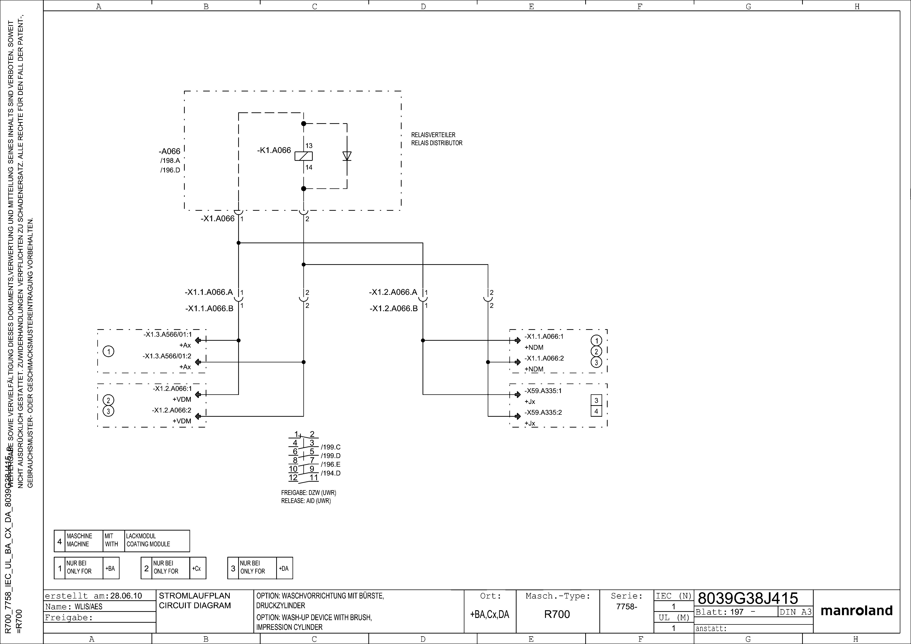

# +BA_Cx_DA — Sheet 197 of 247 — OPTION: WASCHVORRICHTUNG MIT BÜRSTE

**DRUCKZYLINDER**

> Part of the manroland **R700** printing press IEC/UL circuit diagrams.
> Drawing class: **Stromlaufplan / Circuit diagram** (DIN A3).
> Document `+BA_Cx_DA` covers the **Printing units / main switch cabinet** machine section.

## At a glance

| Field | Value |
|---|---|
| Document | `+BA_Cx_DA`  (8039G38J415) |
| Sheet | **197** of 247 |
| Section (DE) | OPTION: WASCHVORRICHTUNG MIT BÜRSTE |
| Section (EN) | DRUCKZYLINDER |
| Section type | CIRCUIT — Circuit diagram |
| Machine type | `R700` |
| Series | `7758` |
| Created | 28.06.10 |
| Replaces | — |
| Columns used | A, B, C, D, E, F |
| Path numbers | — |
| Labels on sheet | 84 |
| Cross-refs out | 6 |
| Cross-refs in | 16 |

**Previous:** [+BA_Cx_DA sheet 196](SHEET_0196.md) · **Next:** [+BA_Cx_DA sheet 198](SHEET_0198.md) · **Document TOC:** [_TOC.md](_TOC.md)  (+BA_Cx_DA) · **Master TOC:** [all sheets](../_MASTER_TOC.md)

## Sheet image (300 DPI, exact vector render)



_Rendered directly from the PDF vector layer at 300 DPI (1-bit), no OCR and no resampling. Use it to confirm anything ambiguous in the text below._

## Cross-references on this sheet

Each entry is a wire leaving this sheet. The printed token is `/sheet.column`; the link resolves to that sheet inside the same document.

| Ref | Target sheet | Col | Path | Destination on target | Target section | From col |
|---|---|---|---|---|---|---|
| `/198.A` | [+BA_Cx_DA sheet 198](SHEET_0198.md) | A | — | — | OPTION: WASCHVORRICHTUNG MIT BÜRSTE | B |
| `/196.D` | [+BA_Cx_DA sheet 196](SHEET_0196.md) | D | — | — | OPTION: WASCHVORRICHTUNG MIT BÜRSTE | B |
| `/199.C` | [+BA_Cx_DA sheet 199](SHEET_0199.md) | C | — | — | OPTION: WASCHVORRICHTUNG MIT BÜRSTE | C |
| `/199.D` | [+BA_Cx_DA sheet 199](SHEET_0199.md) | D | — | — | OPTION: WASCHVORRICHTUNG MIT BÜRSTE | C |
| `/196.E` | [+BA_Cx_DA sheet 196](SHEET_0196.md) | E | — | — | OPTION: WASCHVORRICHTUNG MIT BÜRSTE | C |
| `/194.D` | [+BA_Cx_DA sheet 194](SHEET_0194.md) | D | — | — | OPTION: WASCHVORRICHTUNG MIT BÜRSTE | C |

### Incoming references (sheets that point here)

Every other sheet that sends a wire to this one. `Back-ref` is the token printed on *that* sheet; `Path` is its line number.

| From sheet | Cols | Back-ref | Path | Refs | What continues there |
|---|---|---|---|---|---|
| [+BA_Cx_DA#138](SHEET_0138.md) | B, E, G | `/138.B`, `/138.E`, `/138.G` | — | 10 | — |
| [+BA_Cx_DA#194](SHEET_0194.md) | C | `/194.C` | — | 1 | — |
| [+BA_Cx_DA#196](SHEET_0196.md) | D | `/196.D` | — | 2 | A066 |
| [+BA_Cx_DA#198](SHEET_0198.md) | A | `/198.A` | — | 1 | — |
| [+BA_Cx_DA#199](SHEET_0199.md) | C, D | `/199.C`, `/199.D` | — | 2 | — |


## Devices on this sheet

| Tag | Class | Class meaning (IEC) | Col | Sub | Terminal | Sign |
|---|---|---|---|---|---|---|
| `A066` | A | Baugruppe / assembly, module, PC board | B | — | — | — |
| `X1.1.A066.A` | — | cross-device reference | B | — | — | — |
| `X1.1.A066.B` | — | cross-device reference | B | — | — | — |
| `K1.A066` | — | cross-device reference | C | — | — | — |
| `X1.A066` | — | cross-device reference | B | — | — | — |
| `X1.2.A066.A` | — | cross-device reference | D | — | — | — |
| `X1.2.A066.B` | — | cross-device reference | D | — | — | — |
| `X1.2.A066:1` | — | cross-device reference | B | — | 1 | — |
| `X1.2.A066:2` | — | cross-device reference | B | — | 2 | — |
| `X1.1.A066:1` | — | cross-device reference | E | — | 1 | — |
| `X1.1.A066:2` | — | cross-device reference | E | — | 2 | — |
| `X59.A335:1` | — | cross-device reference | E | — | 1 | — |
| `X59.A335:2` | — | cross-device reference | E | — | 2 | — |

## Potentials / nets

_No named potentials on this sheet._

## Wire-end annotations (grouped as printed)

A wire that continues elsewhere is annotated with a small cluster: the destination description, the path/line number `#NN`, and the `/sheet.column` cross reference. Each row below is one such cluster exactly as it is grouped on the drawing.

| Col | Y | Path | Cross-ref | Text on the wire |
|---|---|---|---|---|
| D | 173.5 | — | — | `RELAISVERTEILER RELAIS DISTRIBUTOR` |
| C | 186.7 | — | — | `13` |
| C | 191.7 | — | — | `K1.A066` |
| B | 193.1 | — | — | `A066` |
| B | 206.1 | — | `/198.A`, `/196.D` | — |
| C | 215.1 | — | — | `14` |
| B | 280.9 | — | — | `X1.A066 1 2` |
| B | 377.3 | — | — | `X1.1.A066.A 1` |
| D | 377.3 | — | — | `X1.2.A066.A 1` |
| C | 378.8 | — | — | `2` |
| E | 378.8 | — | — | `2` |
| B | 395.8 | — | — | `X1.1.A066.B 1` |
| C | 395.8 | — | — | `2` |
| D | 395.8 | — | — | `X1.2.A066.B 1` |
| E | 395.8 | — | — | `2` |
| B | 433.3 | — | — | `X1.3.A566/01:1` |
| E | 436.1 | — | — | `X1.1.A066:1` |
| F | 442.0 | — | — | `1` |
| B | 447.5 | — | — | `+Ax` |
| E | 450.3 | — | — | `+NDM` |
| A | 456.1 | — | — | `1` |
| F | 456.7 | — | — | `2` |
| B | 461.6 | — | — | `X1.3.A566/01:2` |
| E | 464.4 | — | — | `X1.1.A066:2` |
| F | 470.8 | — | — | `3` |
| B | 475.9 | — | — | `+Ax` |
| E | 478.7 | — | — | `+NDM` |
| B | 504.1 | — | — | `X1.2.A066:1` |
| E | 507.0 | — | — | `X59.A335:1` |
| B | 518.4 | — | — | `+VDM` |
| F | 519.8 | — | — | `3` |
| A | 520.5 | — | — | `2` |
| E | 521.2 | — | — | `+Jx` |
| B | 532.5 | — | — | `X1.2.A066:2` |
| F | 534.0 | — | — | `4` |
| A | 534.6 | — | — | `3` |
| E | 535.3 | — | — | `X59.A335:2` |
| B | 546.7 | — | — | `+VDM` |
| E | 549.6 | — | — | `+Jx` |
| C | 563.0 | — | — | `1 2` |
| C | 574.3 | — | — | `4 6 3 5` |
| C | 580.7 | — | `/199.C`, `/199.D`, `/196.E`, `/194.D` | — |
| C | 597.0 | — | — | `8` |
| C | 597.0 | — | — | `7` |
| C | 608.3 | — | — | `10 12 11 9` |
| C | 641.2 | — | — | `FREIGABE: DZW (UWR) RELEASE: AID (UWR)` |
| A | 697.9 | — | — | `MIT` |
| A | 698.0 | — | — | `4 MASCHINE MACHINE` |
| A | 698.0 | — | — | `LACKMODUL` |
| A | 708.5 | — | — | `WITH` |
| A | 708.6 | — | — | `COATING MODULE` |
| A | 733.3 | — | — | `1 NUR BEI` |
| A | 733.3 | — | — | `ONLY FOR +BA 2 NUR BEI` |
| B | 733.3 | — | — | `+Cx 3 NUR BEI` |
| C | 740.5 | — | — | `ONLY FOR +DA` |
| B | 744.0 | — | — | `ONLY FOR` |


## Reconstructed tables

This sheet carries tabular content (pin map / terminal assignment / index). The grid below was rebuilt from the drawing's own rule lines, so each row is exactly one physical row of the table.

### Table 1 — 2 data rows × 4 columns (at x=311.8, y=147.4)

| K1.A066 | 13 14 | RELAIS | RELAISVERTEILER DISTRIBUTOR |
|---|---|---|---|
| `1` | `2` |  |  |
| `1 1` | `2 2` | `X1.2.A066.A X1.2.A066.B` | `1 1` |


## Notes and free text on this sheet

| Text | Col | Y (pt) |
|---|---|---|
| `X1.3.A566/01:1` | B | 433.27 |
| `+Ax` | B | 447.52 |
| `X1.3.A566/01:2` | B | 461.62 |
| `FREIGABE: DZW (UWR)` | C | 641.2 |
| `RELEASE: AID (UWR)` | C | 651.85 |
| `RELAISVERTEILER` | D | 173.52 |
| `RELAIS DISTRIBUTOR` | D | 184.16 |
| `+VDM` | B | 518.35 |
| `+NDM` | E | 450.34 |
| `+Jx` | E | 521.22 |
| `NUR BEI` | A | 733.33 |
| `ONLY FOR` | A | 744.02 |
| `+BA` | A | 740.44 |
| `NUR BEI` | B | 733.33 |
| `ONLY FOR` | B | 744.02 |
| `MASCHINE` | A | 697.95 |
| `MACHINE` | A | 708.58 |
| `MIT` | A | 697.92 |
| `WITH` | A | 708.45 |
| `LACKMODUL` | A | 697.97 |
| `COATING MODULE` | A | 708.6 |
| `+Cx` | B | 740.56 |
| `+DA` | C | 740.47 |

## Complete label inventory (exact text from the drawing)

Every text object inside the drawing area of this sheet, in DIN reading order (column A→H, then top→bottom). This is the authoritative list: if a string is not here it is not printed on this sheet.

| Col | Y | X | Dir | Type | Text |
|---|---|---|---|---|---|
| A | 456.2 | 140.0 | → | number | `1` |
| A | 520.5 | 139.7 | → | number | `2` |
| A | 534.6 | 139.7 | → | number | `3` |
| A | 697.9 | 87.3 | → | text | `MASCHINE` |
| A | 697.9 | 136.9 | → | text | `MIT` |
| A | 698.0 | 165.0 | → | text | `LACKMODUL` |
| A | 703.3 | 75.1 | → | number | `4` |
| A | 708.5 | 137.5 | → | text | `WITH` |
| A | 708.6 | 87.3 | → | text | `MACHINE` |
| A | 708.6 | 165.5 | → | text | `COATING MODULE` |
| A | 733.3 | 87.0 | → | text | `NUR BEI` |
| A | 738.7 | 75.4 | → | number | `1` |
| A | 738.7 | 188.5 | → | number | `2` |
| A | 740.4 | 137.9 | → | text | `+BA` |
| A | 744.0 | 87.6 | → | text | `ONLY FOR` |
| B | 193.1 | 207.5 | → | device tag | `A066` |
| B | 206.1 | 209.8 | → | cross-reference | `/198.A` |
| B | 218.6 | 209.8 | → | cross-reference | `/196.D` |
| B | 280.9 | 262.5 | → | device ref | `X1.A066` |
| B | 282.4 | 313.8 | → | number | `1` |
| B | 377.3 | 241.5 | → | device ref | `X1.1.A066.A` |
| B | 378.7 | 313.8 | → | number | `1` |
| B | 395.8 | 313.8 | → | number | `1` |
| B | 398.6 | 242.4 | → | device ref | `X1.1.A066.B` |
| B | 433.3 | 187.7 | → | text | `X1.3.A566/01:1` |
| B | 447.5 | 234.4 | → | text | `+Ax` |
| B | 461.6 | 186.5 | → | text | `X1.3.A566/01:2` |
| B | 475.9 | 234.4 | → | text | `+Ax` |
| B | 504.1 | 199.8 | → | device ref | `X1.2.A066:1` |
| B | 518.3 | 225.6 | → | text | `+VDM` |
| B | 532.5 | 198.7 | → | device ref | `X1.2.A066:2` |
| B | 546.7 | 225.6 | → | text | `+VDM` |
| B | 733.3 | 200.4 | → | text | `NUR BEI` |
| B | 733.3 | 313.8 | → | text | `NUR BEI` |
| B | 738.7 | 301.7 | → | number | `3` |
| B | 740.6 | 251.3 | → | text | `+Cx` |
| B | 744.0 | 201.0 | → | text | `ONLY FOR` |
| B | 744.0 | 314.4 | → | text | `ONLY FOR` |
| C | 186.7 | 398.8 | → | number | `13` |
| C | 191.6 | 336.2 | → | device ref | `K1.A066` |
| C | 215.0 | 398.8 | → | number | `14` |
| C | 282.4 | 399.4 | → | number | `2` |
| C | 378.7 | 399.4 | → | number | `2` |
| C | 395.8 | 399.4 | → | number | `2` |
| C | 562.9 | 384.4 | → | number | `1` |
| C | 562.9 | 405.1 | → | number | `2` |
| C | 574.3 | 383.0 | → | number | `4` |
| C | 574.3 | 404.8 | → | number | `3` |
| C | 580.7 | 419.5 | → | cross-reference | `/199.C` |
| C | 585.6 | 383.0 | → | number | `6` |
| C | 585.6 | 404.8 | → | number | `5` |
| C | 592.0 | 419.5 | → | cross-reference | `/199.D` |
| C | 597.0 | 383.0 | → | number | `8` |
| C | 597.0 | 405.1 | → | number | `7` |
| C | 603.3 | 419.5 | → | cross-reference | `/196.E` |
| C | 608.3 | 377.0 | → | number | `10` |
| C | 608.3 | 404.8 | → | number | `9` |
| C | 614.7 | 419.5 | → | cross-reference | `/194.D` |
| C | 619.6 | 377.0 | → | number | `12` |
| C | 619.6 | 404.2 | → | number | `11` |
| C | 641.2 | 367.7 | → | text | `FREIGABE: DZW (UWR)` |
| C | 651.9 | 367.7 | → | text | `RELEASE: AID (UWR)` |
| C | 740.5 | 364.7 | → | text | `+DA` |
| D | 173.5 | 537.7 | → | text | `RELAISVERTEILER` |
| D | 184.2 | 537.7 | → | text | `RELAIS DISTRIBUTOR` |
| D | 377.3 | 482.5 | → | device ref | `X1.2.A066.A` |
| D | 378.7 | 554.7 | → | number | `1` |
| D | 395.8 | 554.7 | → | number | `1` |
| D | 398.6 | 483.3 | → | device ref | `X1.2.A066.B` |
| E | 378.7 | 640.3 | → | number | `2` |
| E | 395.8 | 640.3 | → | number | `2` |
| E | 436.1 | 685.7 | → | device ref | `X1.1.A066:1` |
| E | 450.3 | 685.7 | → | text | `+NDM` |
| E | 464.4 | 685.7 | → | device ref | `X1.1.A066:2` |
| E | 478.7 | 685.7 | → | text | `+NDM` |
| E | 507.0 | 685.7 | → | device ref | `X59.A335:1` |
| E | 521.2 | 685.7 | → | text | `+Jx` |
| E | 535.3 | 685.7 | → | device ref | `X59.A335:2` |
| E | 549.6 | 685.7 | → | text | `+Jx` |
| F | 442.0 | 777.8 | → | number | `1` |
| F | 456.7 | 777.5 | → | number | `2` |
| F | 470.8 | 777.5 | → | number | `3` |
| F | 519.8 | 777.1 | → | number | `3` |
| F | 533.9 | 777.1 | → | number | `4` |

## Reading-order text block

The same content as a plain block, grouped by DIN column — convenient to paste or to match against a visual description.

```text
=== Column A ===
 456.2  140.0  numeric      1
 520.5  139.7  numeric      2
 534.6  139.7  numeric      3
 697.9   87.3  text         MASCHINE
 697.9  136.9  text         MIT
 698.0  165.0  text         LACKMODUL
 703.3   75.1  numeric      4
 708.5  137.5  text         WITH
 708.6   87.3  text         MACHINE
 708.6  165.5  text         COATING MODULE
 733.3   87.0  text         NUR BEI
 738.7   75.4  numeric      1
 738.7  188.5  numeric      2
 740.4  137.9  text         +BA
 744.0   87.6  text         ONLY FOR
=== Column B ===
 193.1  207.5  devtag       A066
 206.1  209.8  xref         /198.A
 218.6  209.8  xref         /196.D
 280.9  262.5  devref       X1.A066
 282.4  313.8  numeric      1
 377.3  241.5  devref       X1.1.A066.A
 378.7  313.8  numeric      1
 395.8  313.8  numeric      1
 398.6  242.4  devref       X1.1.A066.B
 433.3  187.7  text         X1.3.A566/01:1
 447.5  234.4  text         +Ax
 461.6  186.5  text         X1.3.A566/01:2
 475.9  234.4  text         +Ax
 504.1  199.8  devref       X1.2.A066:1
 518.3  225.6  text         +VDM
 532.5  198.7  devref       X1.2.A066:2
 546.7  225.6  text         +VDM
 733.3  200.4  text         NUR BEI
 733.3  313.8  text         NUR BEI
 738.7  301.7  numeric      3
 740.6  251.3  text         +Cx
 744.0  201.0  text         ONLY FOR
 744.0  314.4  text         ONLY FOR
=== Column C ===
 186.7  398.8  numeric      13
 191.6  336.2  devref       K1.A066
 215.0  398.8  numeric      14
 282.4  399.4  numeric      2
 378.7  399.4  numeric      2
 395.8  399.4  numeric      2
 562.9  384.4  numeric      1
 562.9  405.1  numeric      2
 574.3  383.0  numeric      4
 574.3  404.8  numeric      3
 580.7  419.5  xref         /199.C
 585.6  383.0  numeric      6
 585.6  404.8  numeric      5
 592.0  419.5  xref         /199.D
 597.0  383.0  numeric      8
 597.0  405.1  numeric      7
 603.3  419.5  xref         /196.E
 608.3  377.0  numeric      10
 608.3  404.8  numeric      9
 614.7  419.5  xref         /194.D
 619.6  377.0  numeric      12
 619.6  404.2  numeric      11
 641.2  367.7  text         FREIGABE: DZW (UWR)
 651.9  367.7  text         RELEASE: AID (UWR)
 740.5  364.7  text         +DA
=== Column D ===
 173.5  537.7  text         RELAISVERTEILER
 184.2  537.7  text         RELAIS DISTRIBUTOR
 377.3  482.5  devref       X1.2.A066.A
 378.7  554.7  numeric      1
 395.8  554.7  numeric      1
 398.6  483.3  devref       X1.2.A066.B
=== Column E ===
 378.7  640.3  numeric      2
 395.8  640.3  numeric      2
 436.1  685.7  devref       X1.1.A066:1
 450.3  685.7  text         +NDM
 464.4  685.7  devref       X1.1.A066:2
 478.7  685.7  text         +NDM
 507.0  685.7  devref       X59.A335:1
 521.2  685.7  text         +Jx
 535.3  685.7  devref       X59.A335:2
 549.6  685.7  text         +Jx
=== Column F ===
 442.0  777.8  numeric      1
 456.7  777.5  numeric      2
 470.8  777.5  numeric      3
 519.8  777.1  numeric      3
 533.9  777.1  numeric      4
```

---
_Generated from the PDF vector text layer; no OCR. Source: `R700_7758_IEC_UL_BA_CX_DA_8039G38J415_p`, sheet 197._
