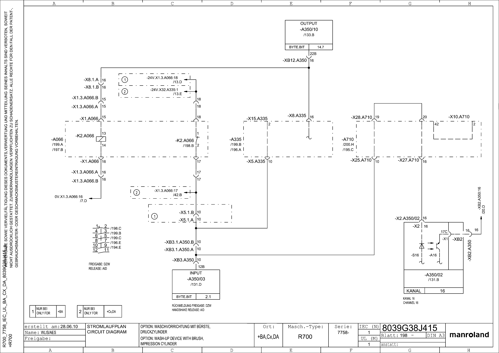

# +BA_Cx_DA — Sheet 198 of 247 — OPTION: WASCHVORRICHTUNG MIT BÜRSTE

**DRUCKZYLINDER**

> Part of the manroland **R700** printing press IEC/UL circuit diagrams.
> Drawing class: **Stromlaufplan / Circuit diagram** (DIN A3).
> Document `+BA_Cx_DA` covers the **Printing units / main switch cabinet** machine section.

## At a glance

| Field | Value |
|---|---|
| Document | `+BA_Cx_DA`  (8039G38J415) |
| Sheet | **198** of 247 |
| Section (DE) | OPTION: WASCHVORRICHTUNG MIT BÜRSTE |
| Section (EN) | DRUCKZYLINDER |
| Section type | CIRCUIT — Circuit diagram |
| Machine type | `R700` |
| Series | `7758` |
| Created | 28.06.10 |
| Replaces | — |
| Columns used | A, B, C, D, E, F, G, H |
| Path numbers | — |
| Labels on sheet | 139 |
| Cross-refs out | 20 |
| Cross-refs in | 49 |

**Previous:** [+BA_Cx_DA sheet 197](SHEET_0197.md) · **Next:** [+BA_Cx_DA sheet 199](SHEET_0199.md) · **Document TOC:** [_TOC.md](_TOC.md)  (+BA_Cx_DA) · **Master TOC:** [all sheets](../_MASTER_TOC.md)

## Sheet image (300 DPI, exact vector render)



_Rendered directly from the PDF vector layer at 300 DPI (1-bit), no OCR and no resampling. Use it to confirm anything ambiguous in the text below._

## Cross-references on this sheet

Each entry is a wire leaving this sheet. The printed token is `/sheet.column`; the link resolves to that sheet inside the same document.

| Ref | Target sheet | Col | Path | Destination on target | Target section | From col |
|---|---|---|---|---|---|---|
| `/133.B` | [+BA_Cx_DA sheet 133](SHEET_0133.md) | B | — | — | REFERENZMODUL | E |
| `/13.D` | [+BA_Cx_DA sheet 13](SHEET_0013.md) | D | — | 24V.X1.3.A066:18 | SPANNUNGSVERSORGUNG, SCHALTSCHRANKBELÜFTUNG | C |
| `/13.E` | [+BA_Cx_DA sheet 13](SHEET_0013.md) | E | — | 24V.X32.A335:1 | SPANNUNGSVERSORGUNG, SCHALTSCHRANKBELÜFTUNG | C |
| `/199.A` | [+BA_Cx_DA sheet 199](SHEET_0199.md) | A | — | — | OPTION: WASCHVORRICHTUNG MIT BÜRSTE | A |
| `/197.B` | [+BA_Cx_DA sheet 197](SHEET_0197.md) | B | — | — | OPTION: WASCHVORRICHTUNG MIT BÜRSTE | A |
| `/199.B` | [+BA_Cx_DA sheet 199](SHEET_0199.md) | B | — | — | OPTION: WASCHVORRICHTUNG MIT BÜRSTE | D |
| `/196.A` | [+BA_Cx_DA sheet 196](SHEET_0196.md) | A | — | — | OPTION: WASCHVORRICHTUNG MIT BÜRSTE | D |
| `/200.H` | [+BA_Cx_DA sheet 200](SHEET_0200.md) | H | — | — | OPTION: APL | F |
| `/195.C` | [+BA_Cx_DA sheet 195](SHEET_0195.md) | C | — | — | OPTION: WASCHVORRICHTUNG MIT BÜRSTE | F |
| `/198.B` | [+BA_Cx_DA sheet 198](SHEET_0198.md) | B | — | — | OPTION: WASCHVORRICHTUNG MIT BÜRSTE | C |
| `/20.D` | [+BA_Cx_DA sheet 20](SHEET_0020.md) | D | — | XB2.A350:16 | BUSVERBINDUNGEN: SICHERHEITSBUS | H |
| `/42.B` | [+BA_Cx_DA sheet 42](SHEET_0042.md) | B | — | X1.3.A066:17 | SCHUTZEINRICHTUNGEN | C |
| `/7.D` | [+BA_Cx_DA sheet 7](SHEET_0007.md) | D | — | 2 0V.X1.3.A066:16 | SPANNUNGSVERSORGUNG, SCHALTSCHRANKBELÜFTUNG | B |
| `/198.C` | [+BA_Cx_DA sheet 198](SHEET_0198.md) | C | — | — | OPTION: WASCHVORRICHTUNG MIT BÜRSTE | B |
| `/199.B` | [+BA_Cx_DA sheet 199](SHEET_0199.md) | B | — | — | OPTION: WASCHVORRICHTUNG MIT BÜRSTE | B |
| `/199.C` | [+BA_Cx_DA sheet 199](SHEET_0199.md) | C | — | — | OPTION: WASCHVORRICHTUNG MIT BÜRSTE | B |
| `/196.E` | [+BA_Cx_DA sheet 196](SHEET_0196.md) | E | — | — | OPTION: WASCHVORRICHTUNG MIT BÜRSTE | B |
| `/194.E` | [+BA_Cx_DA sheet 194](SHEET_0194.md) | E | — | — | OPTION: WASCHVORRICHTUNG MIT BÜRSTE | B |
| `/131.B` | [+BA_Cx_DA sheet 131](SHEET_0131.md) | B | — | — | REFERENZMODUL | G |
| `/131.D` | [+BA_Cx_DA sheet 131](SHEET_0131.md) | D | — | — | REFERENZMODUL | C |

### Incoming references (sheets that point here)

Every other sheet that sends a wire to this one. `Back-ref` is the token printed on *that* sheet; `Path` is its line number.

| From sheet | Cols | Back-ref | Path | Refs | What continues there |
|---|---|---|---|---|---|
| [+BA_Cx_DA#7](SHEET_0007.md) | C | `/7.C` | — | 1 | — |
| [+BA_Cx_DA#13](SHEET_0013.md) | D, E | `/13.D`, `/13.E` | — | 2 | 24V.X1.3.A066:18 |
| [+BA_Cx_DA#20](SHEET_0020.md) | D | `/20.D` | — | 1 | XB2.A350:16 |
| [+BA_Cx_DA#42](SHEET_0042.md) | B | `/42.B` | — | 1 | — |
| [+BA_Cx_DA#131](SHEET_0131.md) | B, D | `/131.B`, `/131.D` | — | 2 | — |
| [+BA_Cx_DA#133](SHEET_0133.md) | B | `/133.B` | — | 1 | — |
| [+BA_Cx_DA#138](SHEET_0138.md) | B, C | `/138.B`, `/138.C` | — | 4 | — |
| [+BA_Cx_DA#139](SHEET_0139.md) | A, B | `/139.A`, `/139.B` | — | 8 | — |
| [+BA_Cx_DA#153](SHEET_0153.md) | F | `/153.F` | — | 2 | — |
| [+BA_Cx_DA#157](SHEET_0157.md) | C, D, F | `/157.C`, `/157.D`, `/157.F` | — | 3 | — |
| [+BA_Cx_DA#160](SHEET_0160.md) | C, E | `/160.C`, `/160.E` | — | 2 | — |
| [+BA_Cx_DA#161](SHEET_0161.md) | A | `/161.A` | — | 1 | — |
| [+BA_Cx_DA#164](SHEET_0164.md) | E, F | `/164.E`, `/164.F` | — | 2 | — |
| [+BA_Cx_DA#165](SHEET_0165.md) | E | `/165.E` | — | 1 | — |
| [+BA_Cx_DA#169](SHEET_0169.md) | G | `/169.G` | — | 1 | — |
| [+BA_Cx_DA#171](SHEET_0171.md) | E | `/171.E` | — | 1 | — |
| [+BA_Cx_DA#175](SHEET_0175.md) | H | `/175.H` | — | 1 | — |
| [+BA_Cx_DA#177](SHEET_0177.md) | E | `/177.E` | — | 1 | — |
| [+BA_Cx_DA#178](SHEET_0178.md) | G | `/178.G` | — | 2 | — |
| [+BA_Cx_DA#194](SHEET_0194.md) | D | `/194.D` | — | 1 | — |
| [+BA_Cx_DA#195](SHEET_0195.md) | C | `/195.C` | — | 1 | — |
| [+BA_Cx_DA#196](SHEET_0196.md) | A, E | `/196.A`, `/196.E` | — | 2 | — |
| [+BA_Cx_DA#197](SHEET_0197.md) | B | `/197.B` | — | 1 | — |
| [+BA_Cx_DA#198](SHEET_0198.md) | B, C | `/198.B`, `/198.C` | — | 2 | — |
| [+BA_Cx_DA#199](SHEET_0199.md) | A, B, C | `/199.A`, `/199.B`, `/199.C` | — | 4 | — |
| [+BA_Cx_DA#200](SHEET_0200.md) | H | `/200.H` | — | 1 | — |


## Devices on this sheet

| Tag | Class | Class meaning (IEC) | Col | Sub | Terminal | Sign |
|---|---|---|---|---|---|---|
| `A066` | A | Baugruppe / assembly, module, PC board | A | — | — | — |
| `A350/03` | A | Baugruppe / assembly, module, PC board | C | 03 | — | — |
| `A710` | A | Baugruppe / assembly, module, PC board | F | — | — | — |
| `A350/10` | A | Baugruppe / assembly, module, PC board | E | 10 | — | — |
| `A335` | A | Baugruppe / assembly, module, PC board | D | — | — | — |
| `S16` | S | Schalter / switch | G | — | — | — |
| `A16` | A | Baugruppe / assembly, module, PC board | G | — | — | — |
| `X1` | X | Klemme / terminal, plug connector | H | — | — | — |
| `X2` | X | Klemme / terminal, plug connector | G | — | — | — |
| `XB2` | XB |  | H | — | — | — |
| `A350/02` | A | Baugruppe / assembly, module, PC board | G | 02 | — | — |
| `X1.A066` | — | cross-device reference | B | — | — | — |
| `K2.A066` | — | cross-device reference | B | — | — | — |
| `X1.A066` | — | cross-device reference | B | — | — | — |
| `X1.3.A066.B` | — | cross-device reference | B | — | — | — |
| `X1.3.A066.A` | — | cross-device reference | B | — | — | — |
| `X8.1.B` | — | cross-device reference | B | — | — | — |
| `X8.1.A` | — | cross-device reference | B | — | — | — |
| `X1.3.A066.B` | — | cross-device reference | B | — | — | — |
| `X1.3.A066.A` | — | cross-device reference | B | — | — | — |
| `K2.A066` | — | cross-device reference | C | — | — | — |
| `X5.1.A` | — | cross-device reference | C | — | — | — |
| `X5.1.B` | — | cross-device reference | C | — | — | — |
| `2.1` | — | cross-device reference | D | — | — | — |
| `XB3.A350` | — | cross-device reference | C | — | — | — |
| `X25.A710` | — | cross-device reference | F | — | — | — |
| `X28.A710` | — | cross-device reference | F | — | — | — |
| `14.7` | — | cross-device reference | E | — | — | — |
| `XB12.A350` | — | cross-device reference | E | — | — | — |
| `X8.A335` | — | cross-device reference | E | — | — | — |
| `X5.A335` | — | cross-device reference | D | — | — | — |
| `XB3.1.A350.B` | — | cross-device reference | C | — | — | — |
| `XB3.1.A350.A` | — | cross-device reference | C | — | — | — |
| `X27.A710` | — | cross-device reference | G | — | — | — |
| `XB2.A350` | — | cross-device reference | H | — | — | — |
| `X1.3.A066:17` | — | cross-device reference | C | — | 17 | — |
| `XB2.A350:16` | — | cross-device reference | H | — | 16 | — |
| `X15.A335` | — | cross-device reference | D | — | — | — |
| `X10.A710` | — | cross-device reference | H | — | — | — |

## Potentials / nets

| Potential | Count | Columns | Attached devices | Terminals |
|---|---|---|---|---|
| `0V` | 1 | A | `3`, `A066`, `X1` | `16` |
| `24V` | 2 | C | `3`, `A066`, `A335`, `X1`, `X32` | `1`, `18` |


A potential such as `L24+/4` or `M24+` is a named supply/return rail; every place it appears on this sheet is electrically common.

## Wire-end annotations (grouped as printed)

A wire that continues elsewhere is annotated with a small cluster: the destination description, the path/line number `#NN`, and the `/sheet.column` cross reference. Each row below is one such cluster exactly as it is grouped on the drawing.

| Col | Y | Path | Cross-ref | Text on the wire |
|---|---|---|---|---|
| E | 51.6 | — | — | `OUTPUT` |
| E | 65.5 | — | — | `A350/10` |
| E | 79.3 | — | `/133.B` | — |
| E | 108.9 | — | — | `BYTE.BIT 14.7` |
| E | 124.3 | — | — | `22B` |
| E | 139.2 | — | — | `XB12.A350 16` |
| C | 181.7 | — | `/13.D` | `24V.X1.3.A066:18` |
| B | 185.3 | — | — | `X8.1.A 16` |
| B | 186.9 | — | — | `1` |
| B | 203.0 | — | — | `X8.1.B 16` |
| C | 210.0 | — | `/13.E` | `24V.X32.A335:1` |
| B | 215.7 | — | — | `2` |
| B | 228.5 | — | — | `X1.3.A066.B 15` |
| C | 232.8 | — | — | `18` |
| B | 249.8 | — | — | `X1.3.A066.A 15` |
| C | 249.8 | — | — | `18` |
| E | 271.0 | — | — | `X8.A335 16` |
| F | 273.9 | — | — | `X15.A335 X10.A710` |
| B | 275.3 | — | — | `X1.A066 15` |
| C | 275.3 | — | — | `18` |
| F | 275.3 | — | — | `X28.A710 19` |
| G | 275.3 | — | — | `20` |
| E | 292.3 | — | — | `2` |
| H | 292.3 | — | — | `42 2` |
| B | 314.3 | — | — | `13` |
| C | 314.3 | — | — | `1` |
| B | 319.2 | — | — | `K2.A066` |
| A | 327.7 | — | — | `A066` |
| D | 327.7 | — | — | `A335` |
| F | 327.7 | — | — | `A710` |
| C | 330.6 | — | — | `K2.A066 2` |
| A | 340.8 | — | `/199.A`, `/197.B` | — |
| D | 340.8 | — | `/199.B`, `/196.A` | — |
| F | 340.8 | — | `/200.H`, `/195.C` | — |
| B | 342.6 | — | — | `14` |
| C | 343.6 | — | `/198.B` | — |
| F | 377.3 | — | — | `X25.A710 10` |
| G | 377.3 | — | — | `X27.A710 16` |
| B | 380.1 | — | — | `X1.A066 16` |
| D | 380.1 | — | — | `X5.A335 10` |
| C | 381.6 | — | — | `17` |
| B | 405.7 | — | — | `X1.3.A066.A 16` |
| C | 407.1 | — | — | `17` |
| B | 424.1 | — | — | `X1.3.A066.B 16` |
| C | 424.1 | — | — | `17` |
| H | 445.9 | — | `/20.D` | `XB2.A350:16` |
| C | 451.0 | — | `/42.B` | `X1.3.A066:17` |
| B | 456.7 | — | `/7.D` | `0V.X1.3.A066:16 2` |
| C | 502.1 | — | — | `X5.1.B 10` |
| C | 512.9 | — | — | `1` |
| G | 516.2 | — | — | `X2.A350/02 16` |
| C | 519.1 | — | — | `X5.1.A 10` |
| B | 534.6 | — | — | `1 2` |
| G | 534.7 | — | — | `X2` |
| H | 536.1 | — | — | `16 16` |
| B | 541.0 | — | `/198.C`, `/199.B`, `/199.C`, `/196.E`, `/194.E` | — |
| H | 544.6 | — | — | `16` |
| B | 545.9 | — | — | `4 6 3 5` |
| H | 548.8 | — | — | `17C` |
| H | 565.8 | — | — | `X1` |
| H | 565.8 | — | — | `XB2` |
| B | 568.6 | — | — | `8` |
| B | 568.6 | — | — | `7` |
| H | 572.0 | — | — | `XB2.A350` |
| C | 572.9 | — | — | `XB3.1.A350.B 10` |
| B | 580.0 | — | — | `10 12 11 9` |
| C | 589.9 | — | — | `XB3.1.A350.A 10` |
| G | 604.8 | — | — | `S16 A16` |
| C | 615.4 | — | — | `XB3.A350 10` |
| B | 627.0 | — | — | `FREIGABE: DZW RELEASE: AID` |
| C | 632.4 | — | — | `12B` |
| C | 646.9 | — | — | `INPUT` |
| G | 650.9 | — | — | `A350/02` |
| C | 660.8 | — | — | `A350/03` |
| G | 663.2 | — | `/131.B` | — |
| C | 674.6 | — | `/131.D` | — |
| G | 689.1 | — | — | `KANAL 16` |
| C | 703.6 | — | — | `BYTE.BIT 2.1` |
| G | 709.5 | — | — | `KANAL 16 CHANNEL 16` |
| C | 726.4 | — | — | `RÜCKMELDUNG FREIGABE: DZW HANDSHAKE RELEASE: AID` |
| A | 733.3 | — | — | `1 NUR BEI` |
| A | 733.3 | — | — | `ONLY FOR +BA 2 NUR BEI` |
| B | 740.5 | — | — | `ONLY FOR +Cx,DA` |


## Reconstructed tables

This sheet carries tabular content (pin map / terminal assignment / index). The grid below was rebuilt from the drawing's own rule lines, so each row is exactly one physical row of the table.

### Table 1 — 4 data rows × 2 columns (at x=411.0, y=161.6) — **/13.D**

| /13.E K2.A066 /198.B /42.B X5.1.B X5.1.A | 18 18 18 1 2 17 17 17 10 10 |
|---|---|
| `XB3.1.A350.B XB3.1.A350.A` | `10 10` |
| `XB3.A350` | `10 12B` |
| `INPUT` | `A350/03 /131.D` |
| `BYTE.BIT` | `2.1` |


### Table 2 — 9 data rows × 12 columns (at x=637.8, y=48.2)

|  | OUTPUT | A350/10 /133.B |  |  |  |  |  |  |  |  |  |
|---|---|---|---|---|---|---|---|---|---|---|---|
|  | `BYTE.BIT` | `14.7` |  |  |  |  |  |  |  |  |  |
|  | `XB12.A350` | `22B 16` |  |  |  |  |  |  |  |  |  |
| `2` | `X8.A335` | `16` | `X28.A710` | `19` |  | `20` | `42` |  | `X10.A710` |  | `2` |
| `10` |  |  | `A710 /200.H /195.C X25.A710` | `10` | `X27.A710 X2.A350/02` | `16 16` |  |  |  |  | `XB2.A350:16` |
|  |  |  |  |  | `X2` | `16` |  |  |  |  |  |
|  |  |  |  |  |  |  |  | `17C X1` | `XB2` | `16 XB2.A350` | `16` |
|  |  |  |  |  | `S16` | `A16` |  |  |  |  |  |
|  |  |  |  |  |  |  | `A350/02 /131.B` |  |  |  |  |
|  |  |  |  |  | `KANAL` |  |  | `16` |  |  |  |


## Notes and free text on this sheet

| Text | Col | Y (pt) |
|---|---|---|
| `FREIGABE: DZW` | B | 627.03 |
| `RELEASE: AID` | B | 637.68 |
| `12B` | C | 632.41 |
| `INPUT` | C | 646.94 |
| `BYTE.BIT` | C | 704.19 |
| `RÜCKMELDUNG FREIGABE: DZW` | C | 726.44 |
| `HANDSHAKE RELEASE: AID` | C | 736.42 |
| `22B` | E | 124.3 |
| `OUTPUT` | E | 51.64 |
| `BYTE.BIT` | E | 108.91 |
| `KANAL 16` | G | 709.45 |
| `CHANNEL 16` | G | 719.39 |
| `17C` | H | 548.83 |
| `KANAL` | G | 689.12 |
| `X2.A350/02` | G | 516.21 |
| `NUR BEI` | A | 733.33 |
| `ONLY FOR` | A | 744.02 |
| `+BA` | A | 740.44 |
| `NUR BEI` | B | 733.33 |
| `ONLY FOR` | B | 744.02 |
| `+Cx,DA` | B | 740.52 |

## Complete label inventory (exact text from the drawing)

Every text object inside the drawing area of this sheet, in DIN reading order (column A→H, then top→bottom). This is the authoritative list: if a string is not here it is not printed on this sheet.

| Col | Y | X | Dir | Type | Text |
|---|---|---|---|---|---|
| A | 327.7 | 122.5 | → | device tag | `A066` |
| A | 340.8 | 124.7 | → | cross-reference | `/199.A` |
| A | 353.2 | 125.0 | → | cross-reference | `/197.B` |
| A | 465.2 | 130.7 | → | potential | `0V.X1.3.A066:16` |
| A | 475.1 | 191.1 | → | cross-reference | `/7.D` |
| A | 733.3 | 87.0 | → | text | `NUR BEI` |
| A | 738.7 | 75.4 | → | number | `1` |
| A | 738.7 | 188.5 | → | number | `2` |
| A | 740.4 | 137.9 | → | text | `+BA` |
| A | 744.0 | 87.6 | → | text | `ONLY FOR` |
| B | 185.3 | 199.8 | → | device ref | `X8.1.A` |
| B | 186.9 | 295.9 | → | number | `1` |
| B | 187.4 | 242.9 | → | number | `16` |
| B | 203.0 | 200.7 | → | device ref | `X8.1.B` |
| B | 204.4 | 242.9 | → | number | `16` |
| B | 215.7 | 295.6 | → | number | `2` |
| B | 228.5 | 171.5 | → | device ref | `X1.3.A066.B` |
| B | 232.8 | 242.9 | → | number | `15` |
| B | 249.8 | 170.6 | → | device ref | `X1.3.A066.A` |
| B | 249.8 | 242.9 | → | number | `15` |
| B | 275.3 | 242.9 | → | number | `15` |
| B | 278.1 | 190.2 | → | device ref | `X1.A066` |
| B | 314.3 | 242.9 | → | number | `13` |
| B | 319.2 | 180.3 | → | device ref | `K2.A066` |
| B | 342.6 | 242.9 | → | number | `14` |
| B | 380.2 | 191.6 | → | device ref | `X1.A066` |
| B | 381.6 | 242.9 | → | number | `16` |
| B | 405.7 | 170.6 | → | device ref | `X1.3.A066.A` |
| B | 407.1 | 242.9 | → | number | `16` |
| B | 424.1 | 242.9 | → | number | `16` |
| B | 426.9 | 171.5 | → | device ref | `X1.3.A066.B` |
| B | 456.7 | 324.0 | → | number | `2` |
| B | 534.6 | 228.5 | → | number | `1` |
| B | 534.6 | 249.2 | → | number | `2` |
| B | 541.0 | 263.6 | → | cross-reference | `/198.C` |
| B | 545.9 | 227.1 | → | number | `4` |
| B | 545.9 | 248.9 | → | number | `3` |
| B | 552.3 | 263.6 | → | cross-reference | `/199.B` |
| B | 557.3 | 227.1 | → | number | `6` |
| B | 557.3 | 248.9 | → | number | `5` |
| B | 563.7 | 263.6 | → | cross-reference | `/199.C` |
| B | 568.6 | 227.1 | → | number | `8` |
| B | 568.6 | 249.2 | → | number | `7` |
| B | 575.0 | 263.6 | → | cross-reference | `/196.E` |
| B | 580.0 | 221.1 | → | number | `10` |
| B | 580.0 | 248.9 | → | number | `9` |
| B | 586.3 | 263.6 | → | cross-reference | `/194.E` |
| B | 591.3 | 221.1 | → | number | `12` |
| B | 591.3 | 248.3 | → | number | `11` |
| B | 627.0 | 211.7 | → | text | `FREIGABE: DZW` |
| B | 637.7 | 211.7 | → | text | `RELEASE: AID` |
| B | 733.3 | 200.4 | → | text | `NUR BEI` |
| B | 740.5 | 254.8 | → | text | `+Cx,DA` |
| B | 744.0 | 201.0 | → | text | `ONLY FOR` |
| C | 181.7 | 349.8 | → | potential | `24V.X1.3.A066:18` |
| C | 191.6 | 413.0 | → | cross-reference | `/13.D` |
| C | 210.0 | 358.6 | → | potential | `24V.X32.A335:1` |
| C | 219.9 | 413.6 | → | cross-reference | `/13.E` |
| C | 232.8 | 469.7 | → | number | `18` |
| C | 249.8 | 469.7 | → | number | `18` |
| C | 275.3 | 469.7 | → | number | `18` |
| C | 314.3 | 469.7 | → | number | `1` |
| C | 330.5 | 418.4 | → | device ref | `K2.A066` |
| C | 342.6 | 470.3 | → | number | `2` |
| C | 343.6 | 436.8 | → | cross-reference | `/198.B` |
| C | 381.6 | 469.7 | → | number | `17` |
| C | 407.1 | 469.7 | → | number | `17` |
| C | 424.1 | 469.7 | → | number | `17` |
| C | 451.0 | 367.9 | → | device ref | `X1.3.A066:17` |
| C | 460.9 | 413.3 | → | cross-reference | `/42.B` |
| C | 502.1 | 427.5 | → | device ref | `X5.1.B` |
| C | 502.1 | 469.7 | → | number | `10` |
| C | 512.8 | 366.7 | → | number | `1` |
| C | 519.1 | 469.7 | → | number | `10` |
| C | 519.8 | 426.6 | → | device ref | `X5.1.A` |
| C | 572.9 | 392.6 | → | device ref | `XB3.1.A350.B` |
| C | 572.9 | 469.7 | → | number | `10` |
| C | 589.9 | 469.7 | → | number | `10` |
| C | 590.6 | 391.7 | → | device ref | `XB3.1.A350.A` |
| C | 615.4 | 411.3 | → | device ref | `XB3.A350` |
| C | 615.4 | 469.7 | → | number | `10` |
| C | 632.4 | 472.5 | → | text | `12B` |
| C | 646.9 | 452.8 | → | text | `INPUT` |
| C | 660.8 | 446.3 | → | device tag | `A350/03` |
| C | 674.6 | 455.0 | → | cross-reference | `/131.D` |
| C | 704.2 | 420.9 | → | text | `BYTE.BIT` |
| C | 726.4 | 410.5 | → | text | `RÜCKMELDUNG FREIGABE: DZW` |
| C | 736.4 | 410.5 | → | text | `HANDSHAKE RELEASE: AID` |
| D | 278.1 | 588.2 | → | device ref | `X15.A335` |
| D | 327.7 | 547.7 | → | device tag | `A335` |
| D | 340.8 | 550.2 | → | cross-reference | `/199.B` |
| D | 353.2 | 549.9 | → | cross-reference | `/196.A` |
| D | 380.2 | 588.5 | → | device ref | `X5.A335` |
| D | 703.6 | 490.1 | → | device ref | `2.1` |
| E | 51.6 | 716.7 | → | text | `OUTPUT` |
| E | 65.5 | 715.6 | → | device tag | `A350/10` |
| E | 79.3 | 724.4 | → | cross-reference | `/133.B` |
| E | 108.9 | 690.2 | → | text | `BYTE.BIT` |
| E | 108.9 | 757.1 | → | device ref | `14.7` |
| E | 124.3 | 739.6 | → | text | `22B` |
| E | 139.2 | 674.6 | → | device ref | `XB12.A350` |
| E | 140.6 | 739.0 | → | number | `16` |
| E | 271.0 | 686.3 | → | device ref | `X8.A335` |
| E | 275.3 | 739.0 | → | number | `16` |
| E | 292.3 | 640.3 | → | number | `2` |
| E | 381.6 | 639.8 | → | number | `10` |
| F | 275.3 | 837.6 | → | device ref | `X28.A710` |
| F | 275.3 | 894.9 | → | number | `19` |
| F | 327.7 | 815.5 | → | device tag | `A710` |
| F | 340.8 | 818.4 | → | cross-reference | `/200.H` |
| F | 353.2 | 817.8 | → | cross-reference | `/195.C` |
| F | 377.3 | 836.2 | → | device ref | `X25.A710` |
| F | 381.6 | 894.9 | → | number | `10` |
| G | 275.3 | 1008.9 | → | number | `20` |
| G | 292.3 | 1037.2 | → | number | `42` |
| G | 377.3 | 949.6 | → | device ref | `X27.A710` |
| G | 381.6 | 1008.3 | → | number | `16` |
| G | 516.2 | 942.2 | → | text | `X2.A350/02` |
| G | 516.2 | 1008.3 | → | number | `16` |
| G | 534.7 | 984.8 | → | device tag | `X2` |
| G | 536.1 | 1011.1 | → | number | `16` |
| G | 604.8 | 981.1 | → | device tag | `S16` |
| G | 604.8 | 1023.6 | → | device tag | `A16` |
| G | 650.9 | 1013.2 | → | device tag | `A350/02` |
| G | 663.2 | 1022.0 | → | cross-reference | `/131.B` |
| G | 689.1 | 970.0 | → | text | `KANAL` |
| G | 709.4 | 961.8 | → | text | `KANAL 16` |
| G | 719.4 | 962.1 | → | text | `CHANNEL 16` |
| H | 273.8 | 1070.1 | → | device ref | `X10.A710` |
| H | 292.3 | 1129.3 | → | number | `2` |
| H | 445.9 | 1139.8 | ↕ | device ref | `XB2.A350:16` |
| H | 489.3 | 1149.7 | ↕ | cross-reference | `/20.D` |
| H | 544.6 | 1131.6 | → | number | `16` |
| H | 546.0 | 1110.3 | → | number | `16` |
| H | 548.8 | 1051.7 | → | text | `17C` |
| H | 565.8 | 1055.3 | → | device tag | `X1` |
| H | 565.8 | 1079.7 | → | device tag | `XB2` |
| H | 572.0 | 1115.7 | ↕ | device ref | `XB2.A350` |
| H | 689.1 | 1049.7 | → | number | `16` |

## Reading-order text block

The same content as a plain block, grouped by DIN column — convenient to paste or to match against a visual description.

```text
=== Column A ===
 327.7  122.5  devtag       A066
 340.8  124.7  xref         /199.A
 353.2  125.0  xref         /197.B
 465.2  130.7  net          0V.X1.3.A066:16
 475.1  191.1  xref         /7.D
 733.3   87.0  text         NUR BEI
 738.7   75.4  numeric      1
 738.7  188.5  numeric      2
 740.4  137.9  text         +BA
 744.0   87.6  text         ONLY FOR
=== Column B ===
 185.3  199.8  devref       X8.1.A
 186.9  295.9  numeric      1
 187.4  242.9  numeric      16
 203.0  200.7  devref       X8.1.B
 204.4  242.9  numeric      16
 215.7  295.6  numeric      2
 228.5  171.5  devref       X1.3.A066.B
 232.8  242.9  numeric      15
 249.8  170.6  devref       X1.3.A066.A
 249.8  242.9  numeric      15
 275.3  242.9  numeric      15
 278.1  190.2  devref       X1.A066
 314.3  242.9  numeric      13
 319.2  180.3  devref       K2.A066
 342.6  242.9  numeric      14
 380.2  191.6  devref       X1.A066
 381.6  242.9  numeric      16
 405.7  170.6  devref       X1.3.A066.A
 407.1  242.9  numeric      16
 424.1  242.9  numeric      16
 426.9  171.5  devref       X1.3.A066.B
 456.7  324.0  numeric      2
 534.6  228.5  numeric      1
 534.6  249.2  numeric      2
 541.0  263.6  xref         /198.C
 545.9  227.1  numeric      4
 545.9  248.9  numeric      3
 552.3  263.6  xref         /199.B
 557.3  227.1  numeric      6
 557.3  248.9  numeric      5
 563.7  263.6  xref         /199.C
 568.6  227.1  numeric      8
 568.6  249.2  numeric      7
 575.0  263.6  xref         /196.E
 580.0  221.1  numeric      10
 580.0  248.9  numeric      9
 586.3  263.6  xref         /194.E
 591.3  221.1  numeric      12
 591.3  248.3  numeric      11
 627.0  211.7  text         FREIGABE: DZW
 637.7  211.7  text         RELEASE: AID
 733.3  200.4  text         NUR BEI
 740.5  254.8  text         +Cx,DA
 744.0  201.0  text         ONLY FOR
=== Column C ===
 181.7  349.8  net          24V.X1.3.A066:18
 191.6  413.0  xref         /13.D
 210.0  358.6  net          24V.X32.A335:1
 219.9  413.6  xref         /13.E
 232.8  469.7  numeric      18
 249.8  469.7  numeric      18
 275.3  469.7  numeric      18
 314.3  469.7  numeric      1
 330.5  418.4  devref       K2.A066
 342.6  470.3  numeric      2
 343.6  436.8  xref         /198.B
 381.6  469.7  numeric      17
 407.1  469.7  numeric      17
 424.1  469.7  numeric      17
 451.0  367.9  devref       X1.3.A066:17
 460.9  413.3  xref         /42.B
 502.1  427.5  devref       X5.1.B
 502.1  469.7  numeric      10
 512.8  366.7  numeric      1
 519.1  469.7  numeric      10
 519.8  426.6  devref       X5.1.A
 572.9  392.6  devref       XB3.1.A350.B
 572.9  469.7  numeric      10
 589.9  469.7  numeric      10
 590.6  391.7  devref       XB3.1.A350.A
 615.4  411.3  devref       XB3.A350
 615.4  469.7  numeric      10
 632.4  472.5  text         12B
 646.9  452.8  text         INPUT
 660.8  446.3  devtag       A350/03
 674.6  455.0  xref         /131.D
 704.2  420.9  text         BYTE.BIT
 726.4  410.5  text         RÜCKMELDUNG FREIGABE: DZW
 736.4  410.5  text         HANDSHAKE RELEASE: AID
=== Column D ===
 278.1  588.2  devref       X15.A335
 327.7  547.7  devtag       A335
 340.8  550.2  xref         /199.B
 353.2  549.9  xref         /196.A
 380.2  588.5  devref       X5.A335
 703.6  490.1  devref       2.1
=== Column E ===
  51.6  716.7  text         OUTPUT
  65.5  715.6  devtag       A350/10
  79.3  724.4  xref         /133.B
 108.9  690.2  text         BYTE.BIT
 108.9  757.1  devref       14.7
 124.3  739.6  text         22B
 139.2  674.6  devref       XB12.A350
 140.6  739.0  numeric      16
 271.0  686.3  devref       X8.A335
 275.3  739.0  numeric      16
 292.3  640.3  numeric      2
 381.6  639.8  numeric      10
=== Column F ===
 275.3  837.6  devref       X28.A710
 275.3  894.9  numeric      19
 327.7  815.5  devtag       A710
 340.8  818.4  xref         /200.H
 353.2  817.8  xref         /195.C
 377.3  836.2  devref       X25.A710
 381.6  894.9  numeric      10
=== Column G ===
 275.3 1008.9  numeric      20
 292.3 1037.2  numeric      42
 377.3  949.6  devref       X27.A710
 381.6 1008.3  numeric      16
 516.2  942.2  text         X2.A350/02
 516.2 1008.3  numeric      16
 534.7  984.8  devtag       X2
 536.1 1011.1  numeric      16
 604.8  981.1  devtag       S16
 604.8 1023.6  devtag       A16
 650.9 1013.2  devtag       A350/02
 663.2 1022.0  xref         /131.B
 689.1  970.0  text         KANAL
 709.4  961.8  text         KANAL 16
 719.4  962.1  text         CHANNEL 16
=== Column H ===
 273.8 1070.1  devref       X10.A710
 292.3 1129.3  numeric      2
 445.9 1139.8  devref       XB2.A350:16
 489.3 1149.7  xref         /20.D
 544.6 1131.6  numeric      16
 546.0 1110.3  numeric      16
 548.8 1051.7  text         17C
 565.8 1055.3  devtag       X1
 565.8 1079.7  devtag       XB2
 572.0 1115.7  devref       XB2.A350
 689.1 1049.7  numeric      16
```

---
_Generated from the PDF vector text layer; no OCR. Source: `R700_7758_IEC_UL_BA_CX_DA_8039G38J415_p`, sheet 198._
