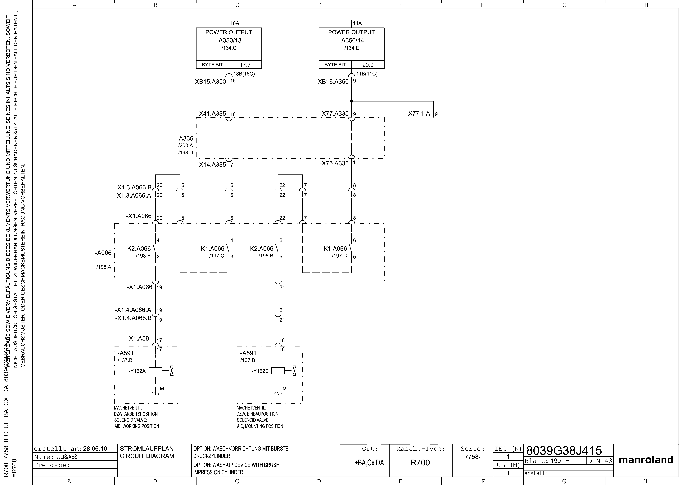

# +BA_Cx_DA — Sheet 199 of 247 — OPTION: WASCHVORRICHTUNG MIT BÜRSTE

**DRUCKZYLINDER**

> Part of the manroland **R700** printing press IEC/UL circuit diagrams.
> Drawing class: **Stromlaufplan / Circuit diagram** (DIN A3).
> Document `+BA_Cx_DA` covers the **Printing units / main switch cabinet** machine section.

## At a glance

| Field | Value |
|---|---|
| Document | `+BA_Cx_DA`  (8039G38J415) |
| Sheet | **199** of 247 |
| Section (DE) | OPTION: WASCHVORRICHTUNG MIT BÜRSTE |
| Section (EN) | DRUCKZYLINDER |
| Section type | CIRCUIT — Circuit diagram |
| Machine type | `R700` |
| Series | `7758` |
| Created | 28.06.10 |
| Replaces | — |
| Columns used | A, B, C, D, E |
| Path numbers | — |
| Labels on sheet | 100 |
| Cross-refs out | 11 |
| Cross-refs in | 44 |

**Previous:** [+BA_Cx_DA sheet 198](SHEET_0198.md) · **Next:** [+BA_Cx_DA sheet 200](SHEET_0200.md) · **Document TOC:** [_TOC.md](_TOC.md)  (+BA_Cx_DA) · **Master TOC:** [all sheets](../_MASTER_TOC.md)

## Sheet image (300 DPI, exact vector render)



_Rendered directly from the PDF vector layer at 300 DPI (1-bit), no OCR and no resampling. Use it to confirm anything ambiguous in the text below._

## Cross-references on this sheet

Each entry is a wire leaving this sheet. The printed token is `/sheet.column`; the link resolves to that sheet inside the same document.

| Ref | Target sheet | Col | Path | Destination on target | Target section | From col |
|---|---|---|---|---|---|---|
| `/134.E` | [+BA_Cx_DA sheet 134](SHEET_0134.md) | E | — | — | REFERENZMODUL | D |
| `/134.C` | [+BA_Cx_DA sheet 134](SHEET_0134.md) | C | — | — | REFERENZMODUL | C |
| `/200.A` | [+BA_Cx_DA sheet 200](SHEET_0200.md) | A | — | — | OPTION: APL | B |
| `/198.D` | [+BA_Cx_DA sheet 198](SHEET_0198.md) | D | — | — | OPTION: WASCHVORRICHTUNG MIT BÜRSTE | B |
| `/198.B` | [+BA_Cx_DA sheet 198](SHEET_0198.md) | B | — | — | OPTION: WASCHVORRICHTUNG MIT BÜRSTE | B |
| `/198.B` | [+BA_Cx_DA sheet 198](SHEET_0198.md) | B | — | — | OPTION: WASCHVORRICHTUNG MIT BÜRSTE | C |
| `/197.C` | [+BA_Cx_DA sheet 197](SHEET_0197.md) | C | — | — | OPTION: WASCHVORRICHTUNG MIT BÜRSTE | C |
| `/197.C` | [+BA_Cx_DA sheet 197](SHEET_0197.md) | C | — | — | OPTION: WASCHVORRICHTUNG MIT BÜRSTE | D |
| `/198.A` | [+BA_Cx_DA sheet 198](SHEET_0198.md) | A | — | — | OPTION: WASCHVORRICHTUNG MIT BÜRSTE | A |
| `/137.B` | [+BA_Cx_DA sheet 137](SHEET_0137.md) | B | — | A591 | REFERENZMODUL | B |
| `/137.B` | [+BA_Cx_DA sheet 137](SHEET_0137.md) | B | — | A591 | REFERENZMODUL | C |

### Incoming references (sheets that point here)

Every other sheet that sends a wire to this one. `Back-ref` is the token printed on *that* sheet; `Path` is its line number.

| From sheet | Cols | Back-ref | Path | Refs | What continues there |
|---|---|---|---|---|---|
| [+BA_Cx_DA#134](SHEET_0134.md) | C, E | `/134.C`, `/134.E` | — | 2 | — |
| [+BA_Cx_DA#137](SHEET_0137.md) | B | `/137.B` | — | 2 | — |
| [+BA_Cx_DA#138](SHEET_0138.md) | B, C | `/138.B`, `/138.C` | — | 8 | — |
| [+BA_Cx_DA#139](SHEET_0139.md) | A, B, D | `/139.A`, `/139.B`, `/139.D` | — | 16 | — |
| [+BA_Cx_DA#142](SHEET_0142.md) | B | `/142.B` | — | 2 | — |
| [+BA_Cx_DA#170](SHEET_0170.md) | H | `/170.H` | — | 1 | — |
| [+BA_Cx_DA#171](SHEET_0171.md) | G | `/171.G` | — | 1 | — |
| [+BA_Cx_DA#172](SHEET_0172.md) | F | `/172.F` | — | 1 | — |
| [+BA_Cx_DA#181](SHEET_0181.md) | F | `/181.F` | — | 1 | — |
| [+BA_Cx_DA#184](SHEET_0184.md) | G | `/184.G` | — | 1 | — |
| [+BA_Cx_DA#185](SHEET_0185.md) | E, G | `/185.E`, `/185.G` | — | 2 | — |
| [+BA_Cx_DA#197](SHEET_0197.md) | C | `/197.C` | — | 2 | — |
| [+BA_Cx_DA#198](SHEET_0198.md) | A, B, D | `/198.A`, `/198.B`, `/198.D` | — | 4 | — |
| [+BA_Cx_DA#200](SHEET_0200.md) | A | `/200.A` | — | 1 | — |


## Devices on this sheet

| Tag | Class | Class meaning (IEC) | Col | Sub | Terminal | Sign |
|---|---|---|---|---|---|---|
| `A350/13` | A | Baugruppe / assembly, module, PC board | C | 13 | — | — |
| `A350/14` | A | Baugruppe / assembly, module, PC board | D | 14 | — | — |
| `A066` | A | Baugruppe / assembly, module, PC board | A | — | — | — |
| `A335` | A | Baugruppe / assembly, module, PC board | B | — | — | — |
| `A591` | A | Baugruppe / assembly, module, PC board | B | — | — | — |
| `A591` | A | Baugruppe / assembly, module, PC board | C | — | — | — |
| `X1.A591` | — | cross-device reference | B | — | — | — |
| `17.7` | — | cross-device reference | C | — | — | — |
| `XB15.A350` | — | cross-device reference | C | — | — | — |
| `20.0` | — | cross-device reference | E | — | — | — |
| `XB16.A350` | — | cross-device reference | D | — | — | — |
| `X1.4.A066.B` | — | cross-device reference | B | — | — | — |
| `X1.4.A066.A` | — | cross-device reference | B | — | — | — |
| `X1.A066` | — | cross-device reference | B | — | — | — |
| `K2.A066` | — | cross-device reference | B | — | — | — |
| `K2.A066` | — | cross-device reference | C | — | — | — |
| `K1.A066` | — | cross-device reference | C | — | — | — |
| `K1.A066` | — | cross-device reference | D | — | — | — |
| `X1.A066` | — | cross-device reference | B | — | — | — |
| `X1.3.A066.B` | — | cross-device reference | B | — | — | — |
| `X1.3.A066.A` | — | cross-device reference | B | — | — | — |
| `X41.A335` | — | cross-device reference | C | — | — | — |
| `X77.A335` | — | cross-device reference | D | — | — | — |
| `X14.A335` | — | cross-device reference | C | — | — | — |
| `X75.A335` | — | cross-device reference | D | — | — | — |
| `X77.1.A` | — | cross-device reference | E | — | — | — |

## Potentials / nets

_No named potentials on this sheet._

## Wire-end annotations (grouped as printed)

A wire that continues elsewhere is annotated with a small cluster: the destination description, the path/line number `#NN`, and the `/sheet.column` cross reference. Each row below is one such cluster exactly as it is grouped on the drawing.

| Col | Y | Path | Cross-ref | Text on the wire |
|---|---|---|---|---|
| C | 36.4 | — | — | `18A` |
| D | 36.4 | — | — | `11A` |
| C | 51.6 | — | — | `POWER OUTPUT` |
| D | 51.6 | — | — | `POWER OUTPUT` |
| C | 65.5 | — | — | `A350/13` |
| D | 65.5 | — | — | `A350/14` |
| C | 79.3 | — | `/134.C` | — |
| D | 79.3 | — | `/134.E` | — |
| C | 108.3 | — | — | `BYTE.BIT 17.7` |
| D | 108.3 | — | — | `BYTE.BIT 20.0` |
| C | 124.3 | — | — | `18B(18C)` |
| E | 124.3 | — | — | `11B(11C)` |
| C | 136.4 | — | — | `XB15.A350 16` |
| D | 136.4 | — | — | `XB16.A350 9` |
| C | 192.3 | — | — | `X41.A335 16 X77.A335 9` |
| E | 192.4 | — | — | `X77.1.A 9` |
| B | 235.6 | — | — | `A335` |
| B | 248.7 | — | `/200.A`, `/198.D` | — |
| C | 278.1 | — | — | `X14.A335 7 X75.A335 1` |
| B | 317.8 | — | — | `X1.3.A066.B 20` |
| B | 317.8 | — | — | `5` |
| C | 317.8 | — | — | `6` |
| D | 317.8 | — | — | `22` |
| D | 317.8 | — | — | `7` |
| D | 317.8 | — | — | `8` |
| B | 334.8 | — | — | `X1.3.A066.A 20` |
| B | 334.8 | — | — | `5` |
| C | 334.8 | — | — | `6` |
| D | 334.8 | — | — | `22` |
| D | 334.8 | — | — | `7` |
| D | 334.8 | — | — | `8` |
| B | 370.2 | — | — | `X1.A066 20` |
| C | 374.5 | — | — | `5 8` |
| C | 374.5 | — | — | `6` |
| D | 374.5 | — | — | `22` |
| D | 374.5 | — | — | `7` |
| B | 413.5 | — | — | `4` |
| C | 413.5 | — | — | `4` |
| D | 413.5 | — | — | `6` |
| D | 413.5 | — | — | `6` |
| B | 426.9 | — | — | `K2.A066 3` |
| C | 426.9 | — | — | `K1.A066 3` |
| C | 426.9 | — | — | `K2.A066 5` |
| D | 426.9 | — | — | `K1.A066 5` |
| A | 434.0 | — | — | `A066` |
| B | 440.0 | — | `/198.B` | — |
| C | 440.0 | — | `/197.C` | — |
| C | 440.0 | — | `/198.B` | — |
| D | 440.0 | — | `/197.C` | — |
| A | 459.5 | — | `/198.A` | — |
| C | 493.5 | — | — | `X1.A066 19 21` |
| B | 533.2 | — | — | `X1.4.A066.A 19` |
| D | 534.7 | — | — | `21` |
| B | 547.4 | — | — | `X1.4.A066.B 19` |
| D | 551.7 | — | — | `21` |
| B | 582.8 | — | — | `X1.A591 17` |
| D | 587.1 | — | — | `18` |
| B | 602.7 | — | — | `17` |
| D | 602.7 | — | — | `18` |
| B | 608.3 | — | `/137.B` | `A591` |
| C | 608.3 | — | `/137.B` | `A591` |
| B | 640.2 | — | — | `Y162A` |
| C | 640.2 | — | — | `Y162E` |
| B | 670.8 | — | — | `M` |
| D | 670.8 | — | — | `M` |
| B | 705.0 | — | — | `DZW, ARBEITSPOSITION MAGNETVENTIL:` |
| C | 705.0 | — | — | `DZW, EINBAUPOSITION MAGNETVENTIL:` |
| B | 726.3 | — | — | `SOLENOID VALVE: AID, WORKING POSITION` |
| C | 726.3 | — | — | `SOLENOID VALVE: AID, MOUNTING POSITION` |


## Reconstructed tables

This sheet carries tabular content (pin map / terminal assignment / index). The grid below was rebuilt from the drawing's own rule lines, so each row is exactly one physical row of the table.

### Table 1 — 4 data rows × 9 columns (at x=269.3, y=48.2)

|  |  | POWER | OUTPUT A350/13 /134.C |  |  |  | POWER | OUTPUT A350/14 /134.E |
|---|---|---|---|---|---|---|---|---|
|  |  | `BYTE.BIT` | `17.7` |  |  |  | `BYTE.BIT` | `20.0` |
|  |  | `XB15.A350` | `18B(18C) 16` |  |  |  | `XB16.A350` | `11B(11C) 9` |
|  | `A335 /200.A /198.D` | `X41.A335 X14.A335` | `16 7` |  |  |  | `X77.A335 X75.A335` | `9 1` |
| `20 20 20 4 3` | `5 5 5` | `K1.A066 /197.C` | `6 6 6 4 K2.A066 3` | `/198.B` | `22 22 22 6 5` | `7 7 7` | `K1.A066 /197.C` | `8 8 8 6 5` |


## Notes and free text on this sheet

| Text | Col | Y (pt) |
|---|---|---|
| `18A` | C | 36.43 |
| `18B(18C)` | C | 124.34 |
| `POWER OUTPUT` | C | 51.59 |
| `BYTE.BIT` | C | 108.91 |
| `11A` | D | 36.43 |
| `11B(11C)` | E | 124.34 |
| `POWER OUTPUT` | D | 51.59 |
| `BYTE.BIT` | D | 108.91 |
| `MAGNETVENTIL:` | B | 705.02 |
| `DZW, ARBEITSPOSITION` | B | 715.62 |
| `SOLENOID VALVE:` | B | 726.28 |
| `AID, WORKING POSITION` | B | 736.9 |
| `M` | B | 670.78 |
| `Y162A` | B | 640.21 |
| `MAGNETVENTIL:` | C | 705.02 |
| `DZW, EINBAUPOSITION` | C | 715.63 |
| `SOLENOID VALVE:` | C | 726.28 |
| `AID, MOUNTING POSITION` | C | 736.94 |
| `M` | D | 670.78 |
| `Y162E` | C | 640.21 |

## Complete label inventory (exact text from the drawing)

Every text object inside the drawing area of this sheet, in DIN reading order (column A→H, then top→bottom). This is the authoritative list: if a string is not here it is not printed on this sheet.

| Col | Y | X | Dir | Type | Text |
|---|---|---|---|---|---|
| A | 434.0 | 165.0 | → | device tag | `A066` |
| A | 459.5 | 167.2 | → | cross-reference | `/198.A` |
| B | 235.6 | 306.7 | → | device tag | `A335` |
| B | 248.6 | 309.0 | → | cross-reference | `/200.A` |
| B | 261.1 | 309.0 | → | cross-reference | `/198.D` |
| B | 317.8 | 271.8 | → | number | `20` |
| B | 317.8 | 314.4 | → | number | `5` |
| B | 320.6 | 199.8 | → | device ref | `X1.3.A066.B` |
| B | 334.8 | 199.0 | → | device ref | `X1.3.A066.A` |
| B | 334.8 | 271.8 | → | number | `20` |
| B | 334.8 | 314.4 | → | number | `5` |
| B | 370.2 | 218.6 | → | device ref | `X1.A066` |
| B | 374.5 | 271.8 | → | number | `20` |
| B | 374.5 | 314.4 | → | number | `5` |
| B | 413.5 | 271.8 | → | number | `4` |
| B | 426.9 | 217.1 | → | device ref | `K2.A066` |
| B | 440.0 | 235.6 | → | cross-reference | `/198.B` |
| B | 441.8 | 271.8 | → | number | `3` |
| B | 493.5 | 220.0 | → | device ref | `X1.A066` |
| B | 495.0 | 271.3 | → | number | `19` |
| B | 533.2 | 199.0 | → | device ref | `X1.4.A066.A` |
| B | 534.7 | 271.3 | → | number | `19` |
| B | 547.4 | 199.8 | → | device ref | `X1.4.A066.B` |
| B | 551.7 | 271.3 | → | number | `19` |
| B | 582.8 | 220.0 | → | device ref | `X1.A591` |
| B | 587.1 | 271.3 | → | number | `17` |
| B | 602.7 | 271.3 | → | number | `17` |
| B | 608.3 | 203.8 | → | device tag | `A591` |
| B | 621.4 | 204.1 | → | cross-reference | `/137.B` |
| B | 640.2 | 223.1 | → | text | `Y162A` |
| B | 670.8 | 277.2 | → | text | `M` |
| B | 705.0 | 197.9 | → | text | `MAGNETVENTIL:` |
| B | 715.6 | 197.6 | → | text | `DZW, ARBEITSPOSITION` |
| B | 726.3 | 198.1 | → | text | `SOLENOID VALVE:` |
| B | 736.9 | 198.4 | → | text | `AID, WORKING POSITION` |
| C | 36.4 | 398.8 | → | text | `18A` |
| C | 51.6 | 356.0 | → | text | `POWER OUTPUT` |
| C | 65.5 | 375.4 | → | device tag | `A350/13` |
| C | 79.3 | 384.1 | → | cross-reference | `/134.C` |
| C | 108.3 | 415.4 | → | device ref | `17.7` |
| C | 108.9 | 350.1 | → | text | `BYTE.BIT` |
| C | 124.3 | 404.5 | → | text | `18B(18C)` |
| C | 136.4 | 398.8 | → | number | `16` |
| C | 137.1 | 334.5 | → | device ref | `XB15.A350` |
| C | 192.4 | 341.6 | → | device ref | `X41.A335` |
| C | 194.5 | 398.8 | → | number | `16` |
| C | 280.9 | 341.6 | → | device ref | `X14.A335` |
| C | 282.4 | 399.4 | → | number | `7` |
| C | 317.8 | 399.4 | → | number | `6` |
| C | 334.8 | 399.4 | → | number | `6` |
| C | 374.5 | 399.4 | → | number | `6` |
| C | 413.5 | 399.4 | → | number | `4` |
| C | 426.9 | 344.7 | → | device ref | `K1.A066` |
| C | 426.9 | 429.7 | → | device ref | `K2.A066` |
| C | 440.0 | 362.8 | → | cross-reference | `/197.C` |
| C | 440.0 | 448.2 | → | cross-reference | `/198.B` |
| C | 441.8 | 399.4 | → | number | `3` |
| C | 608.3 | 416.4 | → | device tag | `A591` |
| C | 621.4 | 416.7 | → | cross-reference | `/137.B` |
| C | 640.2 | 436.3 | → | text | `Y162E` |
| C | 705.0 | 410.5 | → | text | `MAGNETVENTIL:` |
| C | 715.6 | 410.2 | → | text | `DZW, EINBAUPOSITION` |
| C | 726.3 | 410.7 | → | text | `SOLENOID VALVE:` |
| C | 736.9 | 411.0 | → | text | `AID, MOUNTING POSITION` |
| D | 36.4 | 611.4 | → | text | `11A` |
| D | 51.6 | 568.6 | → | text | `POWER OUTPUT` |
| D | 65.5 | 588.0 | → | device tag | `A350/14` |
| D | 79.3 | 597.0 | → | cross-reference | `/134.E` |
| D | 108.9 | 562.7 | → | text | `BYTE.BIT` |
| D | 136.4 | 612.0 | → | number | `9` |
| D | 137.1 | 547.1 | → | device ref | `XB16.A350` |
| D | 192.4 | 554.2 | → | device ref | `X77.A335` |
| D | 194.5 | 612.0 | → | number | `9` |
| D | 278.1 | 611.4 | → | number | `1` |
| D | 278.8 | 554.2 | → | device ref | `X75.A335` |
| D | 317.8 | 484.4 | → | number | `22` |
| D | 317.8 | 527.0 | → | number | `7` |
| D | 317.8 | 612.0 | → | number | `8` |
| D | 334.8 | 484.4 | → | number | `22` |
| D | 334.8 | 527.0 | → | number | `7` |
| D | 334.8 | 612.0 | → | number | `8` |
| D | 374.5 | 484.4 | → | number | `22` |
| D | 374.5 | 527.0 | → | number | `7` |
| D | 374.5 | 612.0 | → | number | `8` |
| D | 413.5 | 484.4 | → | number | `6` |
| D | 413.5 | 612.0 | → | number | `6` |
| D | 426.9 | 557.3 | → | device ref | `K1.A066` |
| D | 440.0 | 575.4 | → | cross-reference | `/197.C` |
| D | 441.8 | 484.4 | → | number | `5` |
| D | 441.8 | 612.0 | → | number | `5` |
| D | 495.0 | 484.4 | → | number | `21` |
| D | 534.7 | 484.4 | → | number | `21` |
| D | 551.7 | 484.4 | → | number | `21` |
| D | 587.1 | 483.9 | → | number | `18` |
| D | 602.7 | 483.9 | → | number | `18` |
| D | 670.8 | 489.8 | → | text | `M` |
| E | 108.3 | 628.3 | → | device ref | `20.0` |
| E | 124.3 | 617.1 | → | text | `11B(11C)` |
| E | 192.4 | 704.1 | → | device ref | `X77.1.A` |
| E | 194.5 | 753.7 | → | number | `9` |

## Reading-order text block

The same content as a plain block, grouped by DIN column — convenient to paste or to match against a visual description.

```text
=== Column A ===
 434.0  165.0  devtag       A066
 459.5  167.2  xref         /198.A
=== Column B ===
 235.6  306.7  devtag       A335
 248.6  309.0  xref         /200.A
 261.1  309.0  xref         /198.D
 317.8  271.8  numeric      20
 317.8  314.4  numeric      5
 320.6  199.8  devref       X1.3.A066.B
 334.8  199.0  devref       X1.3.A066.A
 334.8  271.8  numeric      20
 334.8  314.4  numeric      5
 370.2  218.6  devref       X1.A066
 374.5  271.8  numeric      20
 374.5  314.4  numeric      5
 413.5  271.8  numeric      4
 426.9  217.1  devref       K2.A066
 440.0  235.6  xref         /198.B
 441.8  271.8  numeric      3
 493.5  220.0  devref       X1.A066
 495.0  271.3  numeric      19
 533.2  199.0  devref       X1.4.A066.A
 534.7  271.3  numeric      19
 547.4  199.8  devref       X1.4.A066.B
 551.7  271.3  numeric      19
 582.8  220.0  devref       X1.A591
 587.1  271.3  numeric      17
 602.7  271.3  numeric      17
 608.3  203.8  devtag       A591
 621.4  204.1  xref         /137.B
 640.2  223.1  text         Y162A
 670.8  277.2  text         M
 705.0  197.9  text         MAGNETVENTIL:
 715.6  197.6  text         DZW, ARBEITSPOSITION
 726.3  198.1  text         SOLENOID VALVE:
 736.9  198.4  text         AID, WORKING POSITION
=== Column C ===
  36.4  398.8  text         18A
  51.6  356.0  text         POWER OUTPUT
  65.5  375.4  devtag       A350/13
  79.3  384.1  xref         /134.C
 108.3  415.4  devref       17.7
 108.9  350.1  text         BYTE.BIT
 124.3  404.5  text         18B(18C)
 136.4  398.8  numeric      16
 137.1  334.5  devref       XB15.A350
 192.4  341.6  devref       X41.A335
 194.5  398.8  numeric      16
 280.9  341.6  devref       X14.A335
 282.4  399.4  numeric      7
 317.8  399.4  numeric      6
 334.8  399.4  numeric      6
 374.5  399.4  numeric      6
 413.5  399.4  numeric      4
 426.9  344.7  devref       K1.A066
 426.9  429.7  devref       K2.A066
 440.0  362.8  xref         /197.C
 440.0  448.2  xref         /198.B
 441.8  399.4  numeric      3
 608.3  416.4  devtag       A591
 621.4  416.7  xref         /137.B
 640.2  436.3  text         Y162E
 705.0  410.5  text         MAGNETVENTIL:
 715.6  410.2  text         DZW, EINBAUPOSITION
 726.3  410.7  text         SOLENOID VALVE:
 736.9  411.0  text         AID, MOUNTING POSITION
=== Column D ===
  36.4  611.4  text         11A
  51.6  568.6  text         POWER OUTPUT
  65.5  588.0  devtag       A350/14
  79.3  597.0  xref         /134.E
 108.9  562.7  text         BYTE.BIT
 136.4  612.0  numeric      9
 137.1  547.1  devref       XB16.A350
 192.4  554.2  devref       X77.A335
 194.5  612.0  numeric      9
 278.1  611.4  numeric      1
 278.8  554.2  devref       X75.A335
 317.8  484.4  numeric      22
 317.8  527.0  numeric      7
 317.8  612.0  numeric      8
 334.8  484.4  numeric      22
 334.8  527.0  numeric      7
 334.8  612.0  numeric      8
 374.5  484.4  numeric      22
 374.5  527.0  numeric      7
 374.5  612.0  numeric      8
 413.5  484.4  numeric      6
 413.5  612.0  numeric      6
 426.9  557.3  devref       K1.A066
 440.0  575.4  xref         /197.C
 441.8  484.4  numeric      5
 441.8  612.0  numeric      5
 495.0  484.4  numeric      21
 534.7  484.4  numeric      21
 551.7  484.4  numeric      21
 587.1  483.9  numeric      18
 602.7  483.9  numeric      18
 670.8  489.8  text         M
=== Column E ===
 108.3  628.3  devref       20.0
 124.3  617.1  text         11B(11C)
 192.4  704.1  devref       X77.1.A
 194.5  753.7  numeric      9
```

---
_Generated from the PDF vector text layer; no OCR. Source: `R700_7758_IEC_UL_BA_CX_DA_8039G38J415_p`, sheet 199._
