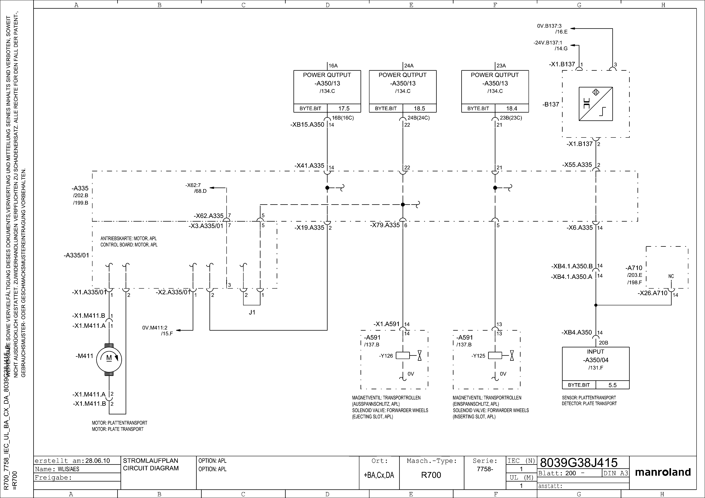

# +BA_Cx_DA — Sheet 200 of 247 — OPTION: APL

**OPTION: APL**

> Part of the manroland **R700** printing press IEC/UL circuit diagrams.
> Drawing class: **Stromlaufplan / Circuit diagram** (DIN A3).
> Document `+BA_Cx_DA` covers the **Printing units / main switch cabinet** machine section.

## At a glance

| Field | Value |
|---|---|
| Document | `+BA_Cx_DA`  (8039G38J415) |
| Sheet | **200** of 247 |
| Section (DE) | OPTION: APL |
| Section (EN) | OPTION: APL |
| Section type | CIRCUIT — Circuit diagram |
| Machine type | `R700` |
| Series | `7758` |
| Created | 28.06.10 |
| Replaces | — |
| Columns used | A, B, C, D, E, F, G, H |
| Path numbers | — |
| Labels on sheet | 127 |
| Cross-refs out | 14 |
| Cross-refs in | 61 |

**Previous:** [+BA_Cx_DA sheet 199](SHEET_0199.md) · **Next:** [+BA_Cx_DA sheet 201](SHEET_0201.md) · **Document TOC:** [_TOC.md](_TOC.md)  (+BA_Cx_DA) · **Master TOC:** [all sheets](../_MASTER_TOC.md)

## Sheet image (300 DPI, exact vector render)



_Rendered directly from the PDF vector layer at 300 DPI (1-bit), no OCR and no resampling. Use it to confirm anything ambiguous in the text below._

## Cross-references on this sheet

Each entry is a wire leaving this sheet. The printed token is `/sheet.column`; the link resolves to that sheet inside the same document.

| Ref | Target sheet | Col | Path | Destination on target | Target section | From col |
|---|---|---|---|---|---|---|
| `/16.E` | [+BA_Cx_DA sheet 16](SHEET_0016.md) | E | — | 0V.B137:3 | SPANNUNGSVERSORGUNG, SCHALTSCHRANKBELÜFTUNG | G |
| `/14.G` | [+BA_Cx_DA sheet 14](SHEET_0014.md) | G | — | 24V.B137:1 | SPANNUNGSVERSORGUNG, SCHALTSCHRANKBELÜFTUNG | G |
| `/134.C` | [+BA_Cx_DA sheet 134](SHEET_0134.md) | C | — | — | REFERENZMODUL | D |
| `/134.C` | [+BA_Cx_DA sheet 134](SHEET_0134.md) | C | — | — | REFERENZMODUL | E |
| `/134.C` | [+BA_Cx_DA sheet 134](SHEET_0134.md) | C | — | — | REFERENZMODUL | F |
| `/68.D` | [+BA_Cx_DA sheet 68](SHEET_0068.md) | D | — | X62:7 | SEITENMARKEN: ZIEHEN | B |
| `/202.B` | [+BA_Cx_DA sheet 202](SHEET_0202.md) | B | — | — | OPTION: | A |
| `/199.B` | [+BA_Cx_DA sheet 199](SHEET_0199.md) | B | — | — | OPTION: WASCHVORRICHTUNG MIT BÜRSTE | A |
| `/203.E` | [+BA_Cx_DA sheet 203](SHEET_0203.md) | E | — | — | OPTION: | H |
| `/198.F` | [+BA_Cx_DA sheet 198](SHEET_0198.md) | F | — | — | OPTION: WASCHVORRICHTUNG MIT BÜRSTE | H |
| `/15.F` | [+BA_Cx_DA sheet 15](SHEET_0015.md) | F | — | 0V.M411:2 | SPANNUNGSVERSORGUNG, SCHALTSCHRANKBELÜFTUNG | B |
| `/137.B` | [+BA_Cx_DA sheet 137](SHEET_0137.md) | B | — | A591 | REFERENZMODUL | E |
| `/137.B` | [+BA_Cx_DA sheet 137](SHEET_0137.md) | B | — | A591 | REFERENZMODUL | F |
| `/131.F` | [+BA_Cx_DA sheet 131](SHEET_0131.md) | F | — | — | REFERENZMODUL | G |

### Incoming references (sheets that point here)

Every other sheet that sends a wire to this one. `Back-ref` is the token printed on *that* sheet; `Path` is its line number.

| From sheet | Cols | Back-ref | Path | Refs | What continues there |
|---|---|---|---|---|---|
| [+BA_Cx_DA#14](SHEET_0014.md) | G | `/14.G` | — | 1 | 24V.B137:1 |
| [+BA_Cx_DA#15](SHEET_0015.md) | F | `/15.F` | — | 1 | 0V.M411:2 |
| [+BA_Cx_DA#16](SHEET_0016.md) | E | `/16.E` | — | 1 | 0V.B137:3 |
| [+BA_Cx_DA#68](SHEET_0068.md) | D | `/68.D` | — | 1 | — |
| [+BA_Cx_DA#131](SHEET_0131.md) | F | `/131.F` | — | 1 | — |
| [+BA_Cx_DA#134](SHEET_0134.md) | C | `/134.C` | — | 3 | — |
| [+BA_Cx_DA#137](SHEET_0137.md) | B | `/137.B` | — | 2 | — |
| [+BA_Cx_DA#141](SHEET_0141.md) | D | `/141.D` | — | 2 | — |
| [+BA_Cx_DA#142](SHEET_0142.md) | B | `/142.B` | — | 2 | — |
| [+BA_Cx_DA#145](SHEET_0145.md) | F | `/145.F` | — | 3 | — |
| [+BA_Cx_DA#148](SHEET_0148.md) | G | `/148.G` | — | 4 | — |
| [+BA_Cx_DA#153](SHEET_0153.md) | A | `/153.A` | — | 3 | — |
| [+BA_Cx_DA#156](SHEET_0156.md) | H | `/156.H` | — | 9 | — |
| [+BA_Cx_DA#159](SHEET_0159.md) | F, G, H | `/159.F`, `/159.G`, `/159.H` | — | 3 | — |
| [+BA_Cx_DA#162](SHEET_0162.md) | D | `/162.D` | — | 1 | — |
| [+BA_Cx_DA#171](SHEET_0171.md) | G | `/171.G` | — | 3 | — |
| [+BA_Cx_DA#173](SHEET_0173.md) | H | `/173.H` | — | 1 | — |
| [+BA_Cx_DA#176](SHEET_0176.md) | E | `/176.E` | — | 1 | — |
| [+BA_Cx_DA#181](SHEET_0181.md) | F | `/181.F` | — | 3 | — |
| [+BA_Cx_DA#182](SHEET_0182.md) | H | `/182.H` | — | 1 | — |
| [+BA_Cx_DA#183](SHEET_0183.md) | E | `/183.E` | — | 9 | — |
| [+BA_Cx_DA#186](SHEET_0186.md) | C | `/186.C` | — | 2 | — |
| [+BA_Cx_DA#198](SHEET_0198.md) | F | `/198.F` | — | 1 | — |
| [+BA_Cx_DA#199](SHEET_0199.md) | B | `/199.B` | — | 1 | — |
| [+BA_Cx_DA#202](SHEET_0202.md) | A | `/202.A` | — | 1 | — |
| [+BA_Cx_DA#203](SHEET_0203.md) | D | `/203.D` | — | 1 | — |


## Devices on this sheet

| Tag | Class | Class meaning (IEC) | Col | Sub | Terminal | Sign |
|---|---|---|---|---|---|---|
| `A335` | A | Baugruppe / assembly, module, PC board | A | — | — | — |
| `A335/01` | A | Baugruppe / assembly, module, PC board | A | 01 | — | — |
| `A350/13` | A | Baugruppe / assembly, module, PC board | D | 13 | — | — |
| `A350/13` | A | Baugruppe / assembly, module, PC board | E | 13 | — | — |
| `A350/13` | A | Baugruppe / assembly, module, PC board | F | 13 | — | — |
| `Y126` | Y | Magnetventil / solenoid valve, actuator | E | — | — | — |
| `A591` | A | Baugruppe / assembly, module, PC board | E | — | — | — |
| `Y125` | Y | Magnetventil / solenoid valve, actuator | F | — | — | — |
| `A591` | A | Baugruppe / assembly, module, PC board | F | — | — | — |
| `B137` | B | Umformer / transducer, sensor | G | — | — | — |
| `A350/04` | A | Baugruppe / assembly, module, PC board | G | 04 | — | — |
| `A710` | A | Baugruppe / assembly, module, PC board | H | — | — | — |
| `X62:7` | X | Klemme / terminal, plug connector | B | — | 7 | — |
| `J1` | J |  | C | — | — | — |
| `X41.A335` | — | cross-device reference | D | — | — | — |
| `X19.A335` | — | cross-device reference | D | — | — | — |
| `X79.A335` | — | cross-device reference | E | — | — | — |
| `X62.A335` | — | cross-device reference | C | — | — | — |
| `X1.M411.B` | — | cross-device reference | A | — | — | — |
| `X1.M411.A` | — | cross-device reference | A | — | — | — |
| `X1.M411.A` | — | cross-device reference | A | — | — | — |
| `X1.M411.B` | — | cross-device reference | A | — | — | — |
| `17.5` | — | cross-device reference | D | — | — | — |
| `XB15.A350` | — | cross-device reference | D | — | — | — |
| `18.5` | — | cross-device reference | E | — | — | — |
| `18.4` | — | cross-device reference | F | — | — | — |
| `X1.A591` | — | cross-device reference | E | — | — | — |
| `X6.A335` | — | cross-device reference | G | — | — | — |
| `X55.A335` | — | cross-device reference | G | — | — | — |
| `X1.B137` | — | cross-device reference | G | — | — | — |
| `X1.B137` | — | cross-device reference | G | — | — | — |
| `5.5` | — | cross-device reference | G | — | — | — |
| `XB4.A350` | — | cross-device reference | G | — | — | — |
| `X26.A710` | — | cross-device reference | H | — | — | — |
| `XB4.1.A350.B` | — | cross-device reference | G | — | — | — |
| `XB4.1.A350.A` | — | cross-device reference | G | — | — | — |

## Potentials / nets

| Potential | Count | Columns | Attached devices | Terminals |
|---|---|---|---|---|
| `0V` | 4 | B, E, F, G | `B137`, `M411` | `2`, `3` |
| `24V` | 1 | G | `B137` | `1` |
| `M411` | 1 | A | — | — |


A potential such as `L24+/4` or `M24+` is a named supply/return rail; every place it appears on this sheet is electrically common.

## Wire-end annotations (grouped as printed)

A wire that continues elsewhere is annotated with a small cluster: the destination description, the path/line number `#NN`, and the `/sheet.column` cross reference. Each row below is one such cluster exactly as it is grouped on the drawing.

| Col | Y | Path | Cross-ref | Text on the wire |
|---|---|---|---|---|
| G | 40.0 | — | `/16.E` | `0V.B137:3` |
| G | 68.3 | — | `/14.G` | `24V.B137:1` |
| G | 103.8 | — | — | `X1.B137 1 3` |
| D | 107.3 | — | — | `16A` |
| E | 107.3 | — | — | `24A` |
| F | 107.3 | — | — | `23A` |
| D | 122.5 | — | — | `POWER QUTPUT` |
| E | 122.5 | — | — | `POWER QUTPUT` |
| F | 122.5 | — | — | `POWER QUTPUT` |
| D | 136.4 | — | — | `A350/13` |
| E | 136.4 | — | — | `A350/13` |
| F | 136.4 | — | — | `A350/13` |
| D | 150.2 | — | `/134.C` | — |
| E | 150.2 | — | `/134.C` | — |
| F | 150.2 | — | `/134.C` | — |
| G | 171.8 | — | — | `B137` |
| D | 179.2 | — | — | `BYTE.BIT 17.5` |
| E | 179.2 | — | — | `BYTE.BIT 18.5` |
| F | 179.2 | — | — | `BYTE.BIT 18.4` |
| D | 195.2 | — | — | `16B(16C)` |
| E | 195.2 | — | — | `24B(24C)` |
| F | 195.2 | — | — | `23B(23C)` |
| D | 205.8 | — | — | `XB15.A350 14` |
| E | 207.2 | — | — | `22` |
| F | 207.2 | — | — | `21` |
| G | 238.4 | — | — | `X1.B137 2` |
| G | 273.9 | — | — | `X55.A335 2` |
| D | 275.3 | — | — | `X41.A335 14` |
| E | 279.5 | — | — | `22` |
| F | 279.5 | — | — | `21` |
| B | 309.3 | — | `/68.D` | `X62:7` |
| A | 313.5 | — | — | `A335` |
| A | 326.6 | — | `/202.B`, `/199.B` | — |
| C | 360.3 | — | — | `X62.A335 7` |
| C | 360.3 | — | — | `5` |
| E | 375.9 | — | — | `X79.A335 6` |
| C | 377.3 | — | — | `X3.A335/01 7` |
| C | 377.3 | — | — | `5` |
| F | 377.3 | — | — | `5` |
| D | 380.1 | — | — | `X19.A335 2` |
| G | 380.1 | — | — | `X6.A335 14` |
| B | 400.3 | — | — | `CONTROL BOARD: MOTOR, APL ANTRIEBSKARTE: MOTOR, APL` |
| A | 426.9 | — | — | `A335/01` |
| G | 445.4 | — | — | `XB4.1.A350.B 14` |
| H | 448.2 | — | — | `A710` |
| H | 461.2 | — | `/203.E`, `/198.F` | — |
| G | 462.4 | — | — | `XB4.1.A350.A 14` |
| H | 464.1 | — | — | `NC` |
| C | 478.0 | — | — | `3` |
| A | 489.3 | — | — | `X1.A335/01 1 2` |
| C | 489.3 | — | — | `X2.A335/01 1 2 1` |
| H | 490.7 | — | — | `X26.A710 14` |
| C | 495.0 | — | — | `2` |
| C | 523.2 | — | — | `J1` |
| A | 529.0 | — | — | `X1.M411.B 1` |
| E | 543.1 | — | — | `X1.A591 14` |
| F | 544.6 | — | — | `13` |
| A | 546.0 | — | — | `X1.M411.A 1` |
| B | 550.2 | — | `/15.F` | `0V.M411:2` |
| G | 557.3 | — | — | `XB4.A350 14` |
| E | 560.2 | — | — | `14` |
| F | 560.2 | — | — | `13` |
| E | 565.8 | — | `/137.B` | `A591` |
| F | 565.8 | — | `/137.B` | `A591` |
| G | 575.7 | — | — | `20B` |
| G | 590.2 | — | — | `INPUT` |
| A | 597.0 | — | — | `M411 M` |
| E | 597.7 | — | — | `Y126` |
| F | 597.7 | — | — | `Y125` |
| G | 604.1 | — | — | `A350/04` |
| G | 617.9 | — | `/131.F` | — |
| E | 628.1 | — | — | `0V` |
| F | 628.1 | — | — | `0V` |
| G | 646.9 | — | — | `BYTE.BIT 5.5` |
| A | 662.2 | — | — | `X1.M411.A 2` |
| E | 669.6 | — | — | `MAGNETVENTIL: TRANSPORTROLLEN (AUSSPANNSCHLITZ, APL) (EJECTING SLOT, APL) SOLENOID VALVE: FORWARDER WHEELS` |
| F | 669.6 | — | — | `MAGNETVENTIL: TRANSPORTROLLEN (EINSPANNSCHLITZ, APL) (INSERTING SLOT, APL) SOLENOID VALVE: FORWARDER WHEELS` |
| G | 669.7 | — | — | `DETECTOR: PLATE TRANSPORT SENSOR: PLATTENTRANSPORT` |
| A | 677.8 | — | — | `X1.M411.B 2` |
| B | 712.1 | — | — | `MOTOR: PLATTENTRANSPORT MOTOR: PLATE TRANSPORT` |


## Reconstructed tables

This sheet carries tabular content (pin map / terminal assignment / index). The grid below was rebuilt from the drawing's own rule lines, so each row is exactly one physical row of the table.

### Table 1 — 6 data rows × 6 columns (at x=326.0, y=48.2) — **16A**

|  |  |  |  | POWER | QUTPUT A350/13 |
|---|---|---|---|---|---|
|  |  |  |  |  | `/134.C` |
|  |  |  |  | `BYTE.BIT` | `17.5` |
|  |  |  |  |  | `16B(16C)` |
| `X62:7 /68.D` |  |  |  | `XB15.A350 X41.A335` | `14 14` |
| `X62.A335 X3.A335/01 1` | `2` | `7 7 3 2` | `5 5 1` | `X19.A335` | `2` |
|  |  | `J1` |  |  |  |


### Table 2 — 8 data rows × 2 columns (at x=623.6, y=48.2) — **24A**

| POWER | QUTPUT A350/13 |
|---|---|
|  | `/134.C` |
| `BYTE.BIT` | `18.5` |
|  | `24B(24C)` |
|  | `22 22` |
| `X79.A335` | `6` |
| `X1.A591` | `14` |
| `A591 /137.B` | `14` |
| `Y126` | `0V` |


### Table 3 — 10 data rows × 7 columns (at x=779.5, y=48.2)

|  | 23A | /16.E 24V.B137:1 /14.G X1.B137 |  | 1 |  | 3 |
|---|---|---|---|---|---|---|
| `POWER` | `QUTPUT A350/13` |  |  |  |  |  |
|  | `/134.C` |  |  |  |  |  |
| `BYTE.BIT` | `18.4` | `B137` |  |  |  |  |
|  | `23B(23C)` |  |  |  |  |  |
|  | `21 21` |  | `X55.A335` | `X1.B137` | `2 2` |  |
|  | `5` |  | `XB4.1.A350.B XB4.1.A350.A` | `X6.A335` | `14 14 14` |  |
|  | `13` |  |  |  |  |  |
| `A591 /137.B` | `13` |  | `XB4.A350` |  | `14 20B` |  |
| `Y125` | `0V` |  |  | `INPUT` | `A350/04 /131.F` |  |
|  |  |  | `BYTE.BIT` |  |  | `5.5` |


## Notes and free text on this sheet

| Text | Col | Y (pt) |
|---|---|---|
| `X3.A335/01` | C | 377.32 |
| `X2.A335/01` | B | 489.29 |
| `ANTRIEBSKARTE: MOTOR, APL` | B | 400.31 |
| `CONTROL BOARD: MOTOR, APL` | B | 410.96 |
| `X1.A335/01` | A | 489.29 |
| `M` | A | 599.61 |
| `MOTOR: PLATTENTRANSPORT` | B | 712.13 |
| `MOTOR: PLATE TRANSPORT` | A | 722.76 |
| `16A` | D | 107.29 |
| `16B(16C)` | D | 195.2 |
| `POWER QUTPUT` | D | 122.45 |
| `BYTE.BIT` | D | 179.78 |
| `24A` | E | 107.29 |
| `24B(24C)` | E | 195.2 |
| `POWER QUTPUT` | E | 122.45 |
| `BYTE.BIT` | E | 179.78 |
| `23A` | F | 107.29 |
| `23B(23C)` | F | 195.2 |
| `POWER QUTPUT` | F | 122.45 |
| `BYTE.BIT` | F | 179.78 |
| `MAGNETVENTIL: TRANSPORTROLLEN` | E | 669.61 |
| `(AUSSPANNSCHLITZ, APL)` | E | 680.23 |
| `SOLENOID VALVE: FORWARDER WHEELS` | E | 690.84 |
| `(EJECTING SLOT, APL)` | E | 701.49 |
| `MAGNETVENTIL: TRANSPORTROLLEN` | F | 669.61 |
| `(EINSPANNSCHLITZ, APL)` | F | 680.23 |
| `SOLENOID VALVE: FORWARDER WHEELS` | F | 690.84 |
| `(INSERTING SLOT, APL)` | F | 701.49 |
| `20B` | G | 575.72 |
| `INPUT` | G | 590.24 |
| `BYTE.BIT` | G | 647.49 |
| `SENSOR: PLATTENTRANSPORT` | G | 669.73 |
| `DETECTOR: PLATE TRANSPORT` | G | 679.67 |
| `NC` | H | 464.05 |

## Complete label inventory (exact text from the drawing)

Every text object inside the drawing area of this sheet, in DIN reading order (column A→H, then top→bottom). This is the authoritative list: if a string is not here it is not printed on this sheet.

| Col | Y | X | Dir | Type | Text |
|---|---|---|---|---|---|
| A | 313.5 | 121.0 | → | device tag | `A335` |
| A | 326.6 | 123.6 | → | cross-reference | `/202.B` |
| A | 339.0 | 123.6 | → | cross-reference | `/199.B` |
| A | 426.9 | 107.7 | → | device tag | `A335/01` |
| A | 489.3 | 121.6 | → | text | `X1.A335/01` |
| A | 495.0 | 186.2 | → | number | `1` |
| A | 529.0 | 121.9 | → | device ref | `X1.M411.B` |
| A | 530.4 | 186.2 | → | number | `1` |
| A | 546.0 | 122.5 | → | device ref | `X1.M411.A` |
| A | 547.4 | 186.2 | → | number | `1` |
| A | 597.0 | 127.8 | → | potential | `M411` |
| A | 599.6 | 179.6 | → | text | `M` |
| A | 662.2 | 122.5 | → | device ref | `X1.M411.A` |
| A | 662.2 | 186.8 | → | number | `2` |
| A | 677.8 | 123.3 | → | device ref | `X1.M411.B` |
| A | 679.2 | 186.8 | → | number | `2` |
| A | 722.8 | 155.3 | → | text | `MOTOR: PLATE TRANSPORT` |
| B | 309.3 | 313.2 | → | device tag | `X62:7` |
| B | 319.2 | 328.0 | → | cross-reference | `/68.D` |
| B | 400.3 | 170.1 | → | text | `ANTRIEBSKARTE: MOTOR, APL` |
| B | 411.0 | 169.8 | → | text | `CONTROL BOARD: MOTOR, APL` |
| B | 489.3 | 263.3 | → | text | `X2.A335/01` |
| B | 495.0 | 215.1 | → | number | `2` |
| B | 495.0 | 328.0 | → | number | `1` |
| B | 550.2 | 240.4 | → | potential | `0V.M411:2` |
| B | 560.1 | 272.1 | → | cross-reference | `/15.F` |
| B | 712.1 | 155.3 | → | text | `MOTOR: PLATTENTRANSPORT` |
| C | 360.3 | 327.4 | → | device ref | `X62.A335` |
| C | 360.3 | 385.2 | → | number | `7` |
| C | 360.3 | 441.9 | → | number | `5` |
| C | 377.3 | 318.6 | → | text | `X3.A335/01` |
| C | 377.3 | 385.2 | → | number | `7` |
| C | 377.3 | 441.9 | → | number | `5` |
| C | 478.0 | 385.2 | → | number | `3` |
| C | 495.0 | 356.9 | → | number | `2` |
| C | 495.0 | 413.6 | → | number | `2` |
| C | 495.0 | 441.4 | → | number | `1` |
| C | 523.3 | 420.4 | → | device tag | `J1` |
| D | 107.3 | 554.7 | → | text | `16A` |
| D | 122.5 | 511.9 | → | text | `POWER QUTPUT` |
| D | 136.4 | 531.4 | → | device tag | `A350/13` |
| D | 150.2 | 540.0 | → | cross-reference | `/134.C` |
| D | 179.2 | 571.3 | → | device ref | `17.5` |
| D | 179.8 | 506.0 | → | text | `BYTE.BIT` |
| D | 195.2 | 560.4 | → | text | `16B(16C)` |
| D | 205.8 | 490.4 | → | device ref | `XB15.A350` |
| D | 207.3 | 554.7 | → | number | `14` |
| D | 275.3 | 497.5 | → | device ref | `X41.A335` |
| D | 279.5 | 554.7 | → | number | `14` |
| D | 380.1 | 497.5 | → | device ref | `X19.A335` |
| D | 381.6 | 555.3 | → | number | `2` |
| E | 107.3 | 682.9 | → | text | `24A` |
| E | 122.5 | 639.5 | → | text | `POWER QUTPUT` |
| E | 136.4 | 658.9 | → | device tag | `A350/13` |
| E | 150.2 | 667.6 | → | cross-reference | `/134.C` |
| E | 179.2 | 698.9 | → | device ref | `18.5` |
| E | 179.8 | 633.5 | → | text | `BYTE.BIT` |
| E | 195.2 | 688.5 | → | text | `24B(24C)` |
| E | 207.3 | 682.9 | → | number | `22` |
| E | 279.5 | 682.9 | → | number | `22` |
| E | 375.9 | 625.0 | → | device ref | `X79.A335` |
| E | 377.3 | 682.9 | → | number | `6` |
| E | 543.1 | 631.0 | → | device ref | `X1.A591` |
| E | 544.6 | 682.3 | → | number | `14` |
| E | 560.2 | 682.3 | → | number | `14` |
| E | 565.8 | 614.8 | → | device tag | `A591` |
| E | 578.9 | 615.1 | → | cross-reference | `/137.B` |
| E | 597.7 | 640.3 | → | device tag | `Y126` |
| E | 628.1 | 688.5 | → | potential | `0V` |
| E | 669.6 | 594.7 | → | text | `MAGNETVENTIL: TRANSPORTROLLEN` |
| E | 680.2 | 594.7 | → | text | `(AUSSPANNSCHLITZ, APL)` |
| E | 690.8 | 595.0 | → | text | `SOLENOID VALVE: FORWARDER WHEELS` |
| E | 701.5 | 594.7 | → | text | `(EJECTING SLOT, APL)` |
| F | 107.3 | 838.8 | → | text | `23A` |
| F | 122.5 | 795.4 | → | text | `POWER QUTPUT` |
| F | 136.4 | 814.8 | → | device tag | `A350/13` |
| F | 150.2 | 823.5 | → | cross-reference | `/134.C` |
| F | 179.2 | 854.8 | → | device ref | `18.4` |
| F | 179.8 | 789.4 | → | text | `BYTE.BIT` |
| F | 195.2 | 844.4 | → | text | `23B(23C)` |
| F | 207.3 | 838.8 | → | number | `21` |
| F | 279.5 | 838.8 | → | number | `21` |
| F | 377.3 | 838.8 | → | number | `5` |
| F | 544.6 | 838.2 | → | number | `13` |
| F | 560.2 | 838.2 | → | number | `13` |
| F | 565.8 | 770.7 | → | device tag | `A591` |
| F | 578.9 | 771.0 | → | cross-reference | `/137.B` |
| F | 597.7 | 796.3 | → | device tag | `Y125` |
| F | 628.1 | 844.4 | → | potential | `0V` |
| F | 669.6 | 764.8 | → | text | `MAGNETVENTIL: TRANSPORTROLLEN` |
| F | 680.2 | 764.8 | → | text | `(EINSPANNSCHLITZ, APL)` |
| F | 690.8 | 765.1 | → | text | `SOLENOID VALVE: FORWARDER WHEELS` |
| F | 701.5 | 764.8 | → | text | `(INSERTING SLOT, APL)` |
| G | 40.0 | 907.4 | → | potential | `0V.B137:3` |
| G | 49.9 | 938.0 | → | cross-reference | `/16.E` |
| G | 68.3 | 901.1 | → | potential | `24V.B137:1` |
| G | 78.2 | 937.1 | → | cross-reference | `/14.G` |
| G | 103.8 | 927.2 | → | device ref | `X1.B137` |
| G | 105.2 | 979.9 | → | number | `1` |
| G | 105.2 | 1037.2 | → | number | `3` |
| G | 171.8 | 916.2 | → | device tag | `B137` |
| G | 238.4 | 957.0 | → | device ref | `X1.B137` |
| G | 239.9 | 1008.9 | → | number | `2` |
| G | 273.8 | 949.6 | → | device ref | `X55.A335` |
| G | 275.3 | 1008.9 | → | number | `2` |
| G | 380.2 | 957.0 | → | device ref | `X6.A335` |
| G | 381.6 | 1008.3 | → | number | `14` |
| G | 445.4 | 931.2 | → | device ref | `XB4.1.A350.B` |
| G | 445.4 | 1008.3 | → | number | `14` |
| G | 462.4 | 1008.3 | → | number | `14` |
| G | 463.1 | 930.3 | → | device ref | `XB4.1.A350.A` |
| G | 557.3 | 948.5 | → | device ref | `XB4.A350` |
| G | 558.7 | 1008.3 | → | number | `14` |
| G | 575.7 | 1011.7 | → | text | `20B` |
| G | 590.2 | 991.4 | → | text | `INPUT` |
| G | 604.1 | 984.9 | → | device tag | `A350/04` |
| G | 617.9 | 994.0 | → | cross-reference | `/131.F` |
| G | 646.9 | 1027.8 | → | device ref | `5.5` |
| G | 647.5 | 959.5 | → | text | `BYTE.BIT` |
| G | 669.7 | 949.3 | → | text | `SENSOR: PLATTENTRANSPORT` |
| G | 679.7 | 949.0 | → | text | `DETECTOR: PLATE TRANSPORT` |
| H | 448.2 | 1056.5 | → | device tag | `A710` |
| H | 461.2 | 1059.3 | → | cross-reference | `/203.E` |
| H | 464.0 | 1129.0 | → | text | `NC` |
| H | 473.7 | 1059.6 | → | cross-reference | `/198.F` |
| H | 490.7 | 1077.2 | → | device ref | `X26.A710` |
| H | 495.0 | 1135.8 | → | number | `14` |

## Reading-order text block

The same content as a plain block, grouped by DIN column — convenient to paste or to match against a visual description.

```text
=== Column A ===
 313.5  121.0  devtag       A335
 326.6  123.6  xref         /202.B
 339.0  123.6  xref         /199.B
 426.9  107.7  devtag       A335/01
 489.3  121.6  text         X1.A335/01
 495.0  186.2  numeric      1
 529.0  121.9  devref       X1.M411.B
 530.4  186.2  numeric      1
 546.0  122.5  devref       X1.M411.A
 547.4  186.2  numeric      1
 597.0  127.8  net          M411
 599.6  179.6  text         M
 662.2  122.5  devref       X1.M411.A
 662.2  186.8  numeric      2
 677.8  123.3  devref       X1.M411.B
 679.2  186.8  numeric      2
 722.8  155.3  text         MOTOR: PLATE TRANSPORT
=== Column B ===
 309.3  313.2  devtag       X62:7
 319.2  328.0  xref         /68.D
 400.3  170.1  text         ANTRIEBSKARTE: MOTOR, APL
 411.0  169.8  text         CONTROL BOARD: MOTOR, APL
 489.3  263.3  text         X2.A335/01
 495.0  215.1  numeric      2
 495.0  328.0  numeric      1
 550.2  240.4  net          0V.M411:2
 560.1  272.1  xref         /15.F
 712.1  155.3  text         MOTOR: PLATTENTRANSPORT
=== Column C ===
 360.3  327.4  devref       X62.A335
 360.3  385.2  numeric      7
 360.3  441.9  numeric      5
 377.3  318.6  text         X3.A335/01
 377.3  385.2  numeric      7
 377.3  441.9  numeric      5
 478.0  385.2  numeric      3
 495.0  356.9  numeric      2
 495.0  413.6  numeric      2
 495.0  441.4  numeric      1
 523.3  420.4  devtag       J1
=== Column D ===
 107.3  554.7  text         16A
 122.5  511.9  text         POWER QUTPUT
 136.4  531.4  devtag       A350/13
 150.2  540.0  xref         /134.C
 179.2  571.3  devref       17.5
 179.8  506.0  text         BYTE.BIT
 195.2  560.4  text         16B(16C)
 205.8  490.4  devref       XB15.A350
 207.3  554.7  numeric      14
 275.3  497.5  devref       X41.A335
 279.5  554.7  numeric      14
 380.1  497.5  devref       X19.A335
 381.6  555.3  numeric      2
=== Column E ===
 107.3  682.9  text         24A
 122.5  639.5  text         POWER QUTPUT
 136.4  658.9  devtag       A350/13
 150.2  667.6  xref         /134.C
 179.2  698.9  devref       18.5
 179.8  633.5  text         BYTE.BIT
 195.2  688.5  text         24B(24C)
 207.3  682.9  numeric      22
 279.5  682.9  numeric      22
 375.9  625.0  devref       X79.A335
 377.3  682.9  numeric      6
 543.1  631.0  devref       X1.A591
 544.6  682.3  numeric      14
 560.2  682.3  numeric      14
 565.8  614.8  devtag       A591
 578.9  615.1  xref         /137.B
 597.7  640.3  devtag       Y126
 628.1  688.5  net          0V
 669.6  594.7  text         MAGNETVENTIL: TRANSPORTROLLEN
 680.2  594.7  text         (AUSSPANNSCHLITZ, APL)
 690.8  595.0  text         SOLENOID VALVE: FORWARDER WHEELS
 701.5  594.7  text         (EJECTING SLOT, APL)
=== Column F ===
 107.3  838.8  text         23A
 122.5  795.4  text         POWER QUTPUT
 136.4  814.8  devtag       A350/13
 150.2  823.5  xref         /134.C
 179.2  854.8  devref       18.4
 179.8  789.4  text         BYTE.BIT
 195.2  844.4  text         23B(23C)
 207.3  838.8  numeric      21
 279.5  838.8  numeric      21
 377.3  838.8  numeric      5
 544.6  838.2  numeric      13
 560.2  838.2  numeric      13
 565.8  770.7  devtag       A591
 578.9  771.0  xref         /137.B
 597.7  796.3  devtag       Y125
 628.1  844.4  net          0V
 669.6  764.8  text         MAGNETVENTIL: TRANSPORTROLLEN
 680.2  764.8  text         (EINSPANNSCHLITZ, APL)
 690.8  765.1  text         SOLENOID VALVE: FORWARDER WHEELS
 701.5  764.8  text         (INSERTING SLOT, APL)
=== Column G ===
  40.0  907.4  net          0V.B137:3
  49.9  938.0  xref         /16.E
  68.3  901.1  net          24V.B137:1
  78.2  937.1  xref         /14.G
 103.8  927.2  devref       X1.B137
 105.2  979.9  numeric      1
 105.2 1037.2  numeric      3
 171.8  916.2  devtag       B137
 238.4  957.0  devref       X1.B137
 239.9 1008.9  numeric      2
 273.8  949.6  devref       X55.A335
 275.3 1008.9  numeric      2
 380.2  957.0  devref       X6.A335
 381.6 1008.3  numeric      14
 445.4  931.2  devref       XB4.1.A350.B
 445.4 1008.3  numeric      14
 462.4 1008.3  numeric      14
 463.1  930.3  devref       XB4.1.A350.A
 557.3  948.5  devref       XB4.A350
 558.7 1008.3  numeric      14
 575.7 1011.7  text         20B
 590.2  991.4  text         INPUT
 604.1  984.9  devtag       A350/04
 617.9  994.0  xref         /131.F
 646.9 1027.8  devref       5.5
 647.5  959.5  text         BYTE.BIT
 669.7  949.3  text         SENSOR: PLATTENTRANSPORT
 679.7  949.0  text         DETECTOR: PLATE TRANSPORT
=== Column H ===
 448.2 1056.5  devtag       A710
 461.2 1059.3  xref         /203.E
 464.0 1129.0  text         NC
 473.7 1059.6  xref         /198.F
 490.7 1077.2  devref       X26.A710
 495.0 1135.8  numeric      14
```

---
_Generated from the PDF vector text layer; no OCR. Source: `R700_7758_IEC_UL_BA_CX_DA_8039G38J415_p`, sheet 200._
