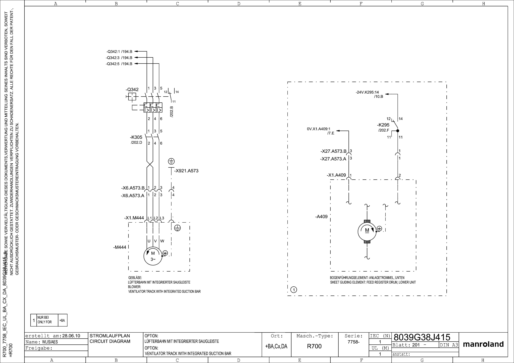

# +BA_Cx_DA — Sheet 201 of 247 — OPTION:

**LÜFTERBAHN MIT INTEGRIERTER SAUGLEISTE**

> Part of the manroland **R700** printing press IEC/UL circuit diagrams.
> Drawing class: **Stromlaufplan / Circuit diagram** (DIN A3).
> Document `+BA_Cx_DA` covers the **Printing units / main switch cabinet** machine section.

## At a glance

| Field | Value |
|---|---|
| Document | `+BA_Cx_DA`  (8039G38J415) |
| Sheet | **201** of 247 |
| Section (DE) | OPTION: |
| Section (EN) | LÜFTERBAHN MIT INTEGRIERTER SAUGLEISTE |
| Section type | CIRCUIT — Circuit diagram |
| Machine type | `R700` |
| Series | `7758` |
| Created | 28.06.10 |
| Replaces | — |
| Columns used | A, B, C, E, F, G |
| Path numbers | — |
| Labels on sheet | 78 |
| Cross-refs out | 8 |
| Cross-refs in | 25 |

**Previous:** [+BA_Cx_DA sheet 200](SHEET_0200.md) · **Next:** [+BA_Cx_DA sheet 202](SHEET_0202.md) · **Document TOC:** [_TOC.md](_TOC.md)  (+BA_Cx_DA) · **Master TOC:** [all sheets](../_MASTER_TOC.md)

## Sheet image (300 DPI, exact vector render)



_Rendered directly from the PDF vector layer at 300 DPI (1-bit), no OCR and no resampling. Use it to confirm anything ambiguous in the text below._

## Cross-references on this sheet

Each entry is a wire leaving this sheet. The printed token is `/sheet.column`; the link resolves to that sheet inside the same document.

| Ref | Target sheet | Col | Path | Destination on target | Target section | From col |
|---|---|---|---|---|---|---|
| `/194.B` | [+BA_Cx_DA sheet 194](SHEET_0194.md) | B | — | Q342:1 | OPTION: WASCHVORRICHTUNG MIT BÜRSTE | B |
| `/194.B` | [+BA_Cx_DA sheet 194](SHEET_0194.md) | B | — | Q342:3 | OPTION: WASCHVORRICHTUNG MIT BÜRSTE | B |
| `/194.B` | [+BA_Cx_DA sheet 194](SHEET_0194.md) | B | — | Q342:5 | OPTION: WASCHVORRICHTUNG MIT BÜRSTE | B |
| `/10.B` | [+BA_Cx_DA sheet 10](SHEET_0010.md) | B | — | 24V.K295:14 | SPANNUNGSVERSORGUNG, SCHALTSCHRANKBELÜFTUNG | F |
| `/202.B` | [+BA_Cx_DA sheet 202](SHEET_0202.md) | B | — | — | OPTION: | C |
| `/7.E` | [+BA_Cx_DA sheet 7](SHEET_0007.md) | E | — | 0V.X1.A409:1 | SPANNUNGSVERSORGUNG, SCHALTSCHRANKBELÜFTUNG | E |
| `/202.F` | [+BA_Cx_DA sheet 202](SHEET_0202.md) | F | — | — | OPTION: | F |
| `/202.D` | [+BA_Cx_DA sheet 202](SHEET_0202.md) | D | — | — | OPTION: | B |

### Incoming references (sheets that point here)

Every other sheet that sends a wire to this one. `Back-ref` is the token printed on *that* sheet; `Path` is its line number.

| From sheet | Cols | Back-ref | Path | Refs | What continues there |
|---|---|---|---|---|---|
| [+BA_Cx_DA#7](SHEET_0007.md) | E | `/7.E` | — | 1 | — |
| [+BA_Cx_DA#10](SHEET_0010.md) | A | `/10.A` | — | 1 | 24V.K295:14 |
| [+BA_Cx_DA#141](SHEET_0141.md) | G | `/141.G` | — | 2 | — |
| [+BA_Cx_DA#148](SHEET_0148.md) | H | `/148.H` | — | 4 | — |
| [+BA_Cx_DA#162](SHEET_0162.md) | H | `/162.H` | — | 8 | — |
| [+BA_Cx_DA#177](SHEET_0177.md) | C | `/177.C` | — | 4 | — |
| [+BA_Cx_DA#194](SHEET_0194.md) | A, B | `/194.A`, `/194.B` | — | 3 | Q334:5 Q342:5; Q342:1; Q342:3 |
| [+BA_Cx_DA#202](SHEET_0202.md) | B, D | `/202.B`, `/202.D` | — | 2 | — |


## Devices on this sheet

| Tag | Class | Class meaning (IEC) | Col | Sub | Terminal | Sign |
|---|---|---|---|---|---|---|
| `A409` | A | Baugruppe / assembly, module, PC board | E | — | — | — |
| `K305` | K | Relais / relay, contactor | B | — | — | — |
| `Q342` | Q | Leistungsschalter / power switching device | B | — | — | — |
| `K295` | K | Relais / relay, contactor | F | — | — | — |
| `Q342:1` | Q | Leistungsschalter / power switching device | B | — | 1 | — |
| `Q342:3` | Q | Leistungsschalter / power switching device | B | — | 3 | — |
| `Q342:5` | Q | Leistungsschalter / power switching device | B | — | 5 | — |
| `X1.A409` | — | cross-device reference | F | — | — | — |
| `X1.M444` | — | cross-device reference | B | — | — | — |
| `X6.A573.B` | — | cross-device reference | B | — | — | — |
| `X6.A573.A` | — | cross-device reference | B | — | — | — |
| `X27.A573.B` | — | cross-device reference | F | — | — | — |
| `X27.A573.A` | — | cross-device reference | F | — | — | — |
| `X921.A573` | — | cross-device reference | C | — | — | — |

## Potentials / nets

| Potential | Count | Columns | Attached devices | Terminals |
|---|---|---|---|---|
| `0V` | 1 | E | `A409`, `X1` | `1` |
| `24V` | 1 | F | `K295` | `14` |
| `L1` | 1 | C | — | — |
| `M444` | 1 | B | — | — |


A potential such as `L24+/4` or `M24+` is a named supply/return rail; every place it appears on this sheet is electrically common.

## Wire-end annotations (grouped as printed)

A wire that continues elsewhere is annotated with a small cluster: the destination description, the path/line number `#NN`, and the `/sheet.column` cross reference. Each row below is one such cluster exactly as it is grouped on the drawing.

| Col | Y | Path | Cross-ref | Text on the wire |
|---|---|---|---|---|
| B | 115.8 | — | `/194.B` | `Q342:1` |
| B | 129.9 | — | `/194.B` | `Q342:3` |
| B | 144.1 | — | `/194.B` | `Q342:5` |
| C | 200.9 | — | — | `1` |
| C | 200.9 | — | — | `3` |
| C | 200.9 | — | — | `5` |
| B | 203.0 | — | — | `Q342` |
| C | 209.9 | — | — | `12 14` |
| F | 210.1 | — | `/10.B` | `24V.K295:14` |
| C | 232.6 | — | — | `11` |
| C | 246.3 | — | `/202.B` | — |
| C | 271.7 | — | — | `2` |
| C | 271.7 | — | — | `4` |
| C | 271.7 | — | — | `6` |
| F | 271.7 | — | — | `K295 14` |
| F | 271.7 | — | — | `12` |
| E | 295.1 | — | `/7.E` | `0V.X1.A409:1` |
| F | 298.3 | — | `/202.F` | — |
| C | 300.1 | — | — | `1` |
| C | 300.1 | — | — | `3` |
| C | 300.1 | — | — | `5` |
| B | 313.5 | — | — | `K305 6` |
| G | 314.3 | — | — | `11 11` |
| B | 326.6 | — | `/202.D` | — |
| C | 328.4 | — | — | `2` |
| C | 328.4 | — | — | `4` |
| F | 346.1 | — | — | `X27.A573.B 3` |
| G | 346.1 | — | — | `1` |
| F | 363.2 | — | — | `X27.A573.A 3` |
| G | 363.2 | — | — | `1` |
| C | 391.5 | — | — | `X921.A573` |
| F | 401.4 | — | — | `X1.A409 1 2` |
| B | 431.2 | — | — | `X6.A573.B 1` |
| C | 431.2 | — | — | `2` |
| C | 431.2 | — | — | `3` |
| C | 431.2 | — | — | `4` |
| B | 448.2 | — | — | `X6.A573.A 1` |
| C | 448.2 | — | — | `2` |
| C | 448.2 | — | — | `3` |
| C | 448.2 | — | — | `4` |
| E | 497.8 | — | — | `A409` |
| C | 500.6 | — | — | `X1.M444 L1 L2 L3 '` |
| F | 528.7 | — | — | `M` |
| C | 554.9 | — | — | `U V W` |
| B | 568.7 | — | — | `M444` |
| C | 583.1 | — | — | `3~ M` |
| C | 641.2 | — | — | `LÜFTERBAHN MIT INTEGRIERTER SAUGLEISTE BLOWER: GEBLÄSE:` |
| F | 641.3 | — | — | `BOGENFÜHRUNGSELEMENT: ANLAGETROMMEL, UNTEN` |
| F | 651.9 | — | — | `SHEET GUIDING ELEMENT: FEED REGISTER DRUM, LOWER UNIT` |
| E | 668.8 | — | — | `1` |
| C | 673.1 | — | — | `VENTILATOR TRACK WITH INTEGRATED SUCTION BAR` |
| A | 733.3 | — | — | `1 NUR BEI` |
| A | 740.4 | — | — | `ONLY FOR +BA` |


## Notes and free text on this sheet

| Text | Col | Y (pt) |
|---|---|---|
| `M` | F | 528.74 |
| `BOGENFÜHRUNGSELEMENT: ANLAGETROMMEL, UNTEN` | F | 641.27 |
| `SHEET GUIDING ELEMENT: FEED REGISTER DRUM, LOWER UNIT` | F | 651.89 |
| `L2 L3` | C | 502.06 |
| `GEBLÄSE:` | B | 641.21 |
| `LÜFTERBAHN MIT INTEGRIERTER SAUGLEISTE` | C | 651.89 |
| `BLOWER:` | B | 662.43 |
| `VENTILATOR TRACK WITH INTEGRATED SUCTION BAR` | C | 673.15 |
| `U` | C | 555.22 |
| `V` | C | 555.11 |
| `W` | C | 554.85 |
| `M` | C | 583.1 |
| `NUR BEI` | A | 733.33 |
| `ONLY FOR` | A | 744.02 |
| `+BA` | A | 740.44 |

## Complete label inventory (exact text from the drawing)

Every text object inside the drawing area of this sheet, in DIN reading order (column A→H, then top→bottom). This is the authoritative list: if a string is not here it is not printed on this sheet.

| Col | Y | X | Dir | Type | Text |
|---|---|---|---|---|---|
| A | 733.3 | 87.0 | → | text | `NUR BEI` |
| A | 738.7 | 75.4 | → | number | `1` |
| A | 740.4 | 137.9 | → | text | `+BA` |
| A | 744.0 | 87.6 | → | text | `ONLY FOR` |
| B | 115.8 | 246.6 | → | device tag | `Q342:1` |
| B | 115.8 | 280.9 | → | cross-reference | `/194.B` |
| B | 129.9 | 280.9 | → | cross-reference | `/194.B` |
| B | 130.0 | 245.2 | → | device tag | `Q342:3` |
| B | 144.1 | 280.9 | → | cross-reference | `/194.B` |
| B | 144.2 | 245.2 | → | device tag | `Q342:5` |
| B | 203.0 | 291.4 | → | device tag | `Q342` |
| B | 313.5 | 301.0 | → | device tag | `K305` |
| B | 326.6 | 303.3 | → | cross-reference | `/202.D` |
| B | 431.2 | 280.9 | → | device ref | `X6.A573.B` |
| B | 448.9 | 280.1 | → | device ref | `X6.A573.A` |
| B | 500.6 | 287.7 | → | device ref | `X1.M444` |
| B | 568.7 | 262.5 | → | potential | `M444` |
| B | 641.2 | 297.4 | → | text | `GEBLÄSE:` |
| B | 662.4 | 296.8 | → | text | `BLOWER:` |
| C | 200.9 | 342.1 | → | number | `1` |
| C | 200.9 | 356.9 | → | number | `3` |
| C | 200.9 | 371.1 | → | number | `5` |
| C | 209.9 | 379.3 | → | number | `12` |
| C | 209.9 | 406.2 | → | number | `14` |
| C | 232.6 | 399.1 | → | number | `11` |
| C | 246.3 | 393.6 | ↕ | cross-reference | `/202.B` |
| C | 271.7 | 342.7 | → | number | `2` |
| C | 271.7 | 356.9 | → | number | `4` |
| C | 271.7 | 371.1 | → | number | `6` |
| C | 300.1 | 342.1 | → | number | `1` |
| C | 300.1 | 356.9 | → | number | `3` |
| C | 300.1 | 371.1 | → | number | `5` |
| C | 328.4 | 342.7 | → | number | `2` |
| C | 328.4 | 356.9 | → | number | `4` |
| C | 328.4 | 371.1 | → | number | `6` |
| C | 391.5 | 403.7 | → | device ref | `X921.A573` |
| C | 431.2 | 342.1 | → | number | `1` |
| C | 431.2 | 356.9 | → | number | `2` |
| C | 431.2 | 371.1 | → | number | `3` |
| C | 431.2 | 399.4 | → | number | `4` |
| C | 448.2 | 342.1 | → | number | `1` |
| C | 448.2 | 356.9 | → | number | `2` |
| C | 448.2 | 371.1 | → | number | `3` |
| C | 448.2 | 399.4 | → | number | `4` |
| C | 502.1 | 342.1 | → | potential | `L1` |
| C | 502.1 | 356.3 | → | text | `L2 L3` |
| C | 502.1 | 399.4 | → | other | `'` |
| C | 554.8 | 371.3 | → | text | `W` |
| C | 555.1 | 357.2 | → | text | `V` |
| C | 555.2 | 342.1 | → | text | `U` |
| C | 583.1 | 350.2 | → | text | `M` |
| C | 597.3 | 348.9 | → | other | `3~` |
| C | 651.9 | 296.8 | → | text | `LÜFTERBAHN MIT INTEGRIERTER SAUGLEISTE` |
| C | 673.2 | 297.6 | → | text | `VENTILATOR TRACK WITH INTEGRATED SUCTION BAR` |
| E | 295.1 | 711.2 | → | potential | `0V.X1.A409:1` |
| E | 497.8 | 730.5 | → | device tag | `A409` |
| E | 668.8 | 678.6 | → | number | `1` |
| F | 210.1 | 824.0 | → | potential | `24V.K295:14` |
| F | 219.9 | 866.8 | → | cross-reference | `/10.B` |
| F | 271.7 | 895.2 | → | number | `12` |
| F | 285.2 | 873.6 | → | device tag | `K295` |
| F | 298.3 | 876.8 | → | cross-reference | `/202.F` |
| F | 304.9 | 758.6 | → | cross-reference | `/7.E` |
| F | 314.3 | 896.3 | → | number | `11` |
| F | 346.1 | 742.7 | → | device ref | `X27.A573.B` |
| F | 346.2 | 810.4 | → | number | `3` |
| F | 363.2 | 810.4 | → | number | `3` |
| F | 363.9 | 741.8 | → | device ref | `X27.A573.A` |
| F | 401.4 | 757.1 | → | device ref | `X1.A409` |
| F | 402.8 | 809.9 | → | number | `1` |
| F | 528.7 | 845.7 | → | text | `M` |
| F | 641.3 | 764.5 | → | text | `BOGENFÜHRUNGSELEMENT: ANLAGETROMMEL, UNTEN` |
| F | 651.9 | 765.1 | → | text | `SHEET GUIDING ELEMENT: FEED REGISTER DRUM, LOWER UNIT` |
| G | 271.7 | 923.2 | → | number | `14` |
| G | 314.3 | 923.2 | → | number | `11` |
| G | 346.2 | 923.2 | → | number | `1` |
| G | 363.2 | 923.2 | → | number | `1` |
| G | 402.8 | 923.8 | → | number | `2` |

## Reading-order text block

The same content as a plain block, grouped by DIN column — convenient to paste or to match against a visual description.

```text
=== Column A ===
 733.3   87.0  text         NUR BEI
 738.7   75.4  numeric      1
 740.4  137.9  text         +BA
 744.0   87.6  text         ONLY FOR
=== Column B ===
 115.8  246.6  devtag       Q342:1
 115.8  280.9  xref         /194.B
 129.9  280.9  xref         /194.B
 130.0  245.2  devtag       Q342:3
 144.1  280.9  xref         /194.B
 144.2  245.2  devtag       Q342:5
 203.0  291.4  devtag       Q342
 313.5  301.0  devtag       K305
 326.6  303.3  xref         /202.D
 431.2  280.9  devref       X6.A573.B
 448.9  280.1  devref       X6.A573.A
 500.6  287.7  devref       X1.M444
 568.7  262.5  net          M444
 641.2  297.4  text         GEBLÄSE:
 662.4  296.8  text         BLOWER:
=== Column C ===
 200.9  342.1  numeric      1
 200.9  356.9  numeric      3
 200.9  371.1  numeric      5
 209.9  379.3  numeric      12
 209.9  406.2  numeric      14
 232.6  399.1  numeric      11
 246.3  393.6  xref         /202.B
 271.7  342.7  numeric      2
 271.7  356.9  numeric      4
 271.7  371.1  numeric      6
 300.1  342.1  numeric      1
 300.1  356.9  numeric      3
 300.1  371.1  numeric      5
 328.4  342.7  numeric      2
 328.4  356.9  numeric      4
 328.4  371.1  numeric      6
 391.5  403.7  devref       X921.A573
 431.2  342.1  numeric      1
 431.2  356.9  numeric      2
 431.2  371.1  numeric      3
 431.2  399.4  numeric      4
 448.2  342.1  numeric      1
 448.2  356.9  numeric      2
 448.2  371.1  numeric      3
 448.2  399.4  numeric      4
 502.1  342.1  net          L1
 502.1  356.3  text         L2 L3
 502.1  399.4  other        `
 554.8  371.3  text         W
 555.1  357.2  text         V
 555.2  342.1  text         U
 583.1  350.2  text         M
 597.3  348.9  other        3~
 651.9  296.8  text         LÜFTERBAHN MIT INTEGRIERTER SAUGLEISTE
 673.2  297.6  text         VENTILATOR TRACK WITH INTEGRATED SUCTION BAR
=== Column E ===
 295.1  711.2  net          0V.X1.A409:1
 497.8  730.5  devtag       A409
 668.8  678.6  numeric      1
=== Column F ===
 210.1  824.0  net          24V.K295:14
 219.9  866.8  xref         /10.B
 271.7  895.2  numeric      12
 285.2  873.6  devtag       K295
 298.3  876.8  xref         /202.F
 304.9  758.6  xref         /7.E
 314.3  896.3  numeric      11
 346.1  742.7  devref       X27.A573.B
 346.2  810.4  numeric      3
 363.2  810.4  numeric      3
 363.9  741.8  devref       X27.A573.A
 401.4  757.1  devref       X1.A409
 402.8  809.9  numeric      1
 528.7  845.7  text         M
 641.3  764.5  text         BOGENFÜHRUNGSELEMENT: ANLAGETROMMEL, UNTEN
 651.9  765.1  text         SHEET GUIDING ELEMENT: FEED REGISTER DRUM, LOWER UNIT
=== Column G ===
 271.7  923.2  numeric      14
 314.3  923.2  numeric      11
 346.2  923.2  numeric      1
 363.2  923.2  numeric      1
 402.8  923.8  numeric      2
```

---
_Generated from the PDF vector text layer; no OCR. Source: `R700_7758_IEC_UL_BA_CX_DA_8039G38J415_p`, sheet 201._
