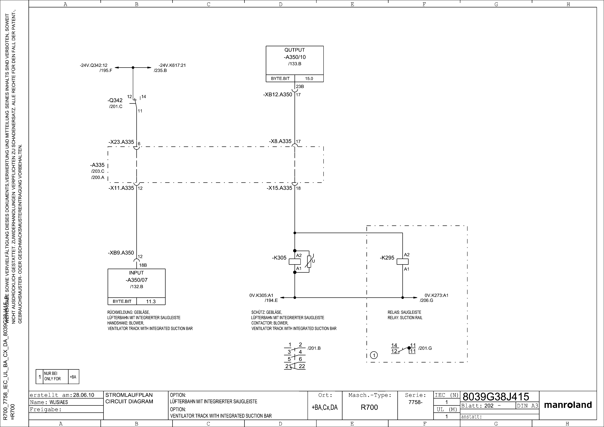

# +BA_Cx_DA — Sheet 202 of 247 — OPTION:

**LÜFTERBAHN MIT INTEGRIERTER SAUGLEISTE**

> Part of the manroland **R700** printing press IEC/UL circuit diagrams.
> Drawing class: **Stromlaufplan / Circuit diagram** (DIN A3).
> Document `+BA_Cx_DA` covers the **Printing units / main switch cabinet** machine section.

## At a glance

| Field | Value |
|---|---|
| Document | `+BA_Cx_DA`  (8039G38J415) |
| Sheet | **202** of 247 |
| Section (DE) | OPTION: |
| Section (EN) | LÜFTERBAHN MIT INTEGRIERTER SAUGLEISTE |
| Section type | CIRCUIT — Circuit diagram |
| Machine type | `R700` |
| Series | `7758` |
| Created | 28.06.10 |
| Replaces | — |
| Columns used | A, B, D, E, F |
| Path numbers | — |
| Labels on sheet | 75 |
| Cross-refs out | 10 |
| Cross-refs in | 17 |

**Previous:** [+BA_Cx_DA sheet 201](SHEET_0201.md) · **Next:** [+BA_Cx_DA sheet 203](SHEET_0203.md) · **Document TOC:** [_TOC.md](_TOC.md)  (+BA_Cx_DA) · **Master TOC:** [all sheets](../_MASTER_TOC.md)

## Sheet image (300 DPI, exact vector render)



_Rendered directly from the PDF vector layer at 300 DPI (1-bit), no OCR and no resampling. Use it to confirm anything ambiguous in the text below._

## Cross-references on this sheet

Each entry is a wire leaving this sheet. The printed token is `/sheet.column`; the link resolves to that sheet inside the same document.

| Ref | Target sheet | Col | Path | Destination on target | Target section | From col |
|---|---|---|---|---|---|---|
| `/133.B` | [+BA_Cx_DA sheet 133](SHEET_0133.md) | B | — | — | REFERENZMODUL | D |
| `/195.F` | [+BA_Cx_DA sheet 195](SHEET_0195.md) | F | — | 24V.Q342:12 | OPTION: WASCHVORRICHTUNG MIT BÜRSTE | A |
| `/235.B` | [+BA_Cx_DA sheet 235](SHEET_0235.md) | B | — | — | OPTION: INLINECOATER SMART | B |
| `/201.C` | [+BA_Cx_DA sheet 201](SHEET_0201.md) | C | — | — | OPTION: | B |
| `/203.C` | [+BA_Cx_DA sheet 203](SHEET_0203.md) | C | — | — | OPTION: | A |
| `/200.A` | [+BA_Cx_DA sheet 200](SHEET_0200.md) | A | — | — | OPTION: APL | A |
| `/132.B` | [+BA_Cx_DA sheet 132](SHEET_0132.md) | B | — | — | REFERENZMODUL | B |
| `/194.E` | [+BA_Cx_DA sheet 194](SHEET_0194.md) | E | — | 0V.K305:A1 0V.K273:A1 | OPTION: WASCHVORRICHTUNG MIT BÜRSTE | E |
| `/206.G` | [+BA_Cx_DA sheet 206](SHEET_0206.md) | G | — | — | OPTION: AUTOMATISCHE FARBZUFÜHRUNG | F |
| `/201.B` | [+BA_Cx_DA sheet 201](SHEET_0201.md) | B | — | — | OPTION: | D |

### Incoming references (sheets that point here)

Every other sheet that sends a wire to this one. `Back-ref` is the token printed on *that* sheet; `Path` is its line number.

| From sheet | Cols | Back-ref | Path | Refs | What continues there |
|---|---|---|---|---|---|
| [+BA_Cx_DA#132](SHEET_0132.md) | B | `/132.B` | — | 1 | — |
| [+BA_Cx_DA#133](SHEET_0133.md) | B | `/133.B` | — | 1 | — |
| [+BA_Cx_DA#165](SHEET_0165.md) | E | `/165.E` | — | 1 | — |
| [+BA_Cx_DA#166](SHEET_0166.md) | G | `/166.G` | — | 1 | — |
| [+BA_Cx_DA#168](SHEET_0168.md) | G | `/168.G` | — | 1 | — |
| [+BA_Cx_DA#169](SHEET_0169.md) | G | `/169.G` | — | 1 | — |
| [+BA_Cx_DA#171](SHEET_0171.md) | E | `/171.E` | — | 1 | — |
| [+BA_Cx_DA#174](SHEET_0174.md) | G | `/174.G` | — | 1 | — |
| [+BA_Cx_DA#194](SHEET_0194.md) | E | `/194.E` | — | 1 | — |
| [+BA_Cx_DA#195](SHEET_0195.md) | F | `/195.F` | — | 1 | — |
| [+BA_Cx_DA#200](SHEET_0200.md) | A | `/200.A` | — | 1 | — |
| [+BA_Cx_DA#201](SHEET_0201.md) | B, C, F | `/201.B`, `/201.C`, `/201.F` | — | 3 | — |
| [+BA_Cx_DA#203](SHEET_0203.md) | B | `/203.B` | — | 1 | — |
| [+BA_Cx_DA#206](SHEET_0206.md) | G | `/206.G` | — | 1 | 0V.K273:A1 |
| [+BA_Cx_DA#235](SHEET_0235.md) | A | `/235.A` | — | 1 | 24V.K617:21 |


## Devices on this sheet

| Tag | Class | Class meaning (IEC) | Col | Sub | Terminal | Sign |
|---|---|---|---|---|---|---|
| `A335` | A | Baugruppe / assembly, module, PC board | A | — | — | — |
| `A350/07` | A | Baugruppe / assembly, module, PC board | B | 07 | — | — |
| `A350/10` | A | Baugruppe / assembly, module, PC board | D | 10 | — | — |
| `Q342` | Q | Leistungsschalter / power switching device | B | — | — | — |
| `A2` | A | Baugruppe / assembly, module, PC board | F | — | — | — |
| `A1` | A | Baugruppe / assembly, module, PC board | F | — | — | — |
| `K295` | K | Relais / relay, contactor | E | — | — | — |
| `A2` | A | Baugruppe / assembly, module, PC board | D | — | — | — |
| `A1` | A | Baugruppe / assembly, module, PC board | D | — | — | — |
| `K305` | K | Relais / relay, contactor | D | — | — | — |
| `X23.A335` | — | cross-device reference | B | — | — | — |
| `X11.A335` | — | cross-device reference | B | — | — | — |
| `X8.A335` | — | cross-device reference | D | — | — | — |
| `X15.A335` | — | cross-device reference | D | — | — | — |
| `11.3` | — | cross-device reference | B | — | — | — |
| `XB9.A350` | — | cross-device reference | B | — | — | — |
| `15.0` | — | cross-device reference | D | — | — | — |
| `XB12.A350` | — | cross-device reference | D | — | — | — |

## Potentials / nets

| Potential | Count | Columns | Attached devices | Terminals |
|---|---|---|---|---|
| `0V` | 2 | D, F | `K273`, `K305` | `A1` |
| `24V` | 2 | A, B | `K617`, `Q342` | `12`, `21` |


A potential such as `L24+/4` or `M24+` is a named supply/return rail; every place it appears on this sheet is electrically common.

## Wire-end annotations (grouped as printed)

A wire that continues elsewhere is annotated with a small cluster: the destination description, the path/line number `#NN`, and the `/sheet.column` cross reference. Each row below is one such cluster exactly as it is grouped on the drawing.

| Col | Y | Path | Cross-ref | Text on the wire |
|---|---|---|---|---|
| D | 94.2 | — | — | `QUTPUT` |
| D | 108.0 | — | — | `A350/10` |
| D | 121.8 | — | `/133.B` | — |
| A | 125.0 | — | `/195.F` | `24V.Q342:12` |
| B | 125.0 | — | — | `24V.K617:21` |
| B | 134.9 | — | `/235.B` | — |
| D | 151.4 | — | — | `BYTE.BIT 15.0` |
| D | 166.8 | — | — | `23B` |
| C | 181.7 | — | — | `12 XB12.A350 17` |
| B | 186.7 | — | — | `Q342 14` |
| B | 206.2 | — | `/201.C` | — |
| B | 215.1 | — | — | `11` |
| D | 273.9 | — | — | `X8.A335 17` |
| B | 275.3 | — | — | `X23.A335 6` |
| A | 320.6 | — | — | `A335` |
| A | 333.7 | — | `/203.C`, `/200.A` | — |
| B | 366.0 | — | — | `X11.A335 12` |
| D | 366.0 | — | — | `X15.A335 18` |
| B | 493.5 | — | — | `XB9.A350 12` |
| F | 498.5 | — | — | `A2` |
| D | 499.9 | — | — | `A2` |
| D | 503.4 | — | — | `K305 U` |
| E | 503.4 | — | — | `K295` |
| B | 519.0 | — | — | `18B` |
| D | 525.4 | — | — | `A1` |
| F | 526.8 | — | — | `A1` |
| B | 533.5 | — | — | `INPUT` |
| B | 547.4 | — | — | `A350/07` |
| B | 561.2 | — | `/132.B` | — |
| E | 578.5 | — | `/194.E` | `0V.K305:A1 0V.K273:A1` |
| F | 588.5 | — | `/206.G` | — |
| B | 590.2 | — | — | `BYTE.BIT 11.3` |
| B | 612.9 | — | — | `RÜCKMELDUNG: GEBLÄSE, LÜFTERBAHN MIT INTEGRIERTER SAUGLEISTE HANDSHAKE: BLOWER,` |
| D | 612.9 | — | — | `LÜFTERBAHN MIT INTEGRIERTER SAUGLEISTE SCHÜTZ: GEBLÄSE,` |
| F | 612.9 | — | — | `RELAIS: SAUGLEISTE RELAY: SUCTION RAIL` |
| D | 634.2 | — | — | `CONTACTOR: BLOWER, VENTILATOR TRACK WITH INTEGRATED SUCTION BAR` |
| B | 644.8 | — | — | `VENTILATOR TRACK WITH INTEGRATED SUCTION BAR` |
| D | 674.9 | — | — | `21 3 5 1` |
| D | 674.9 | — | — | `2 4 6 22` |
| F | 676.3 | — | — | `14 12 11 11 /201.G` |
| D | 682.7 | — | `/201.B` | — |
| E | 697.1 | — | — | `1` |
| A | 733.3 | — | — | `1 NUR BEI` |
| A | 740.4 | — | — | `ONLY FOR +BA` |


## Reconstructed tables

This sheet carries tabular content (pin map / terminal assignment / index). The grid below was rebuilt from the drawing's own rule lines, so each row is exactly one physical row of the table.

### Table 1 — 1 data rows × 3 columns (at x=212.6, y=530.1)

|  | INPUT | A350/07 /132.B |
|---|---|---|
| `BYTE.BIT` |  | `11.3` |


### Table 2 — 3 data rows × 4 columns (at x=524.4, y=90.7)

| QUTPUT | A350/10 /133.B |  |  |
|---|---|---|---|
| `BYTE.BIT` |  | `15.0` |  |
| `XB12.A350 X8.A335 X15.A335` | `23B 17 17 18` |  |  |
| `K305` | `A2 A1` |  | `U` |


## Notes and free text on this sheet

| Text | Col | Y (pt) |
|---|---|---|
| `18B` | B | 519.03 |
| `INPUT` | B | 533.55 |
| `BYTE.BIT` | B | 590.8 |
| `RÜCKMELDUNG: GEBLÄSE,` | B | 612.91 |
| `LÜFTERBAHN MIT INTEGRIERTER SAUGLEISTE` | B | 623.54 |
| `HANDSHAKE: BLOWER,` | B | 634.14 |
| `VENTILATOR TRACK WITH INTEGRATED SUCTION BAR` | B | 644.8 |
| `23B` | D | 166.82 |
| `QUTPUT` | D | 94.16 |
| `BYTE.BIT` | D | 151.43 |
| `11 /201.G` | F | 682.72 |
| `RELAIS: SAUGLEISTE` | F | 612.88 |
| `RELAY: SUCTION RAIL` | F | 623.53 |
| `U` | D | 511.42 |
| `SCHÜTZ: GEBLÄSE,` | D | 612.89 |
| `LÜFTERBAHN MIT INTEGRIERTER SAUGLEISTE` | D | 623.54 |
| `CONTACTOR: BLOWER,` | D | 634.16 |
| `VENTILATOR TRACK WITH INTEGRATED SUCTION BAR` | D | 644.8 |
| `NUR BEI` | A | 733.33 |
| `ONLY FOR` | A | 744.02 |
| `+BA` | A | 740.44 |

## Complete label inventory (exact text from the drawing)

Every text object inside the drawing area of this sheet, in DIN reading order (column A→H, then top→bottom). This is the authoritative list: if a string is not here it is not printed on this sheet.

| Col | Y | X | Dir | Type | Text |
|---|---|---|---|---|---|
| A | 125.0 | 157.3 | → | potential | `24V.Q342:12` |
| A | 320.6 | 177.7 | → | device tag | `A335` |
| A | 333.7 | 180.0 | → | cross-reference | `/203.C` |
| A | 346.1 | 180.0 | → | cross-reference | `/200.A` |
| A | 733.3 | 87.0 | → | text | `NUR BEI` |
| A | 738.7 | 75.4 | → | number | `1` |
| A | 740.4 | 137.9 | → | text | `+BA` |
| A | 744.0 | 87.6 | → | text | `ONLY FOR` |
| B | 125.0 | 312.9 | → | potential | `24V.K617:21` |
| B | 134.9 | 196.4 | → | cross-reference | `/195.F` |
| B | 134.9 | 303.3 | → | cross-reference | `/235.B` |
| B | 186.7 | 250.3 | → | number | `12` |
| B | 186.7 | 278.4 | → | number | `14` |
| B | 193.1 | 212.0 | → | device tag | `Q342` |
| B | 206.2 | 215.4 | → | cross-reference | `/201.C` |
| B | 215.0 | 271.3 | → | number | `11` |
| B | 275.3 | 214.0 | → | device ref | `X23.A335` |
| B | 279.5 | 271.8 | → | number | `6` |
| B | 366.0 | 214.0 | → | device ref | `X11.A335` |
| B | 367.4 | 271.3 | → | number | `12` |
| B | 493.5 | 212.9 | → | device ref | `XB9.A350` |
| B | 502.1 | 271.3 | → | number | `12` |
| B | 519.0 | 274.1 | → | text | `18B` |
| B | 533.6 | 254.4 | → | text | `INPUT` |
| B | 547.4 | 247.9 | → | device tag | `A350/07` |
| B | 561.2 | 256.7 | → | cross-reference | `/132.B` |
| B | 590.2 | 287.9 | → | device ref | `11.3` |
| B | 590.8 | 222.5 | → | text | `BYTE.BIT` |
| B | 612.9 | 211.7 | → | text | `RÜCKMELDUNG: GEBLÄSE,` |
| B | 623.5 | 211.7 | → | text | `LÜFTERBAHN MIT INTEGRIERTER SAUGLEISTE` |
| B | 634.1 | 211.7 | → | text | `HANDSHAKE: BLOWER,` |
| B | 644.8 | 212.6 | → | text | `VENTILATOR TRACK WITH INTEGRATED SUCTION BAR` |
| D | 94.2 | 560.8 | → | text | `QUTPUT` |
| D | 108.0 | 559.7 | → | device tag | `A350/10` |
| D | 121.8 | 568.5 | → | cross-reference | `/133.B` |
| D | 151.4 | 534.3 | → | text | `BYTE.BIT` |
| D | 151.5 | 601.2 | → | device ref | `15.0` |
| D | 166.8 | 583.7 | → | text | `23B` |
| D | 181.7 | 518.7 | → | device ref | `XB12.A350` |
| D | 183.2 | 583.1 | → | number | `17` |
| D | 273.9 | 530.4 | → | device ref | `X8.A335` |
| D | 275.3 | 583.1 | → | number | `17` |
| D | 366.0 | 525.8 | → | device ref | `X15.A335` |
| D | 367.4 | 583.1 | → | number | `18` |
| D | 499.9 | 583.9 | → | device tag | `A2` |
| D | 503.5 | 536.3 | → | device tag | `K305` |
| D | 511.4 | 615.0 | → | text | `U` |
| D | 525.4 | 583.9 | → | device tag | `A1` |
| D | 578.5 | 491.8 | → | potential | `0V.K305:A1` |
| D | 588.5 | 522.1 | → | cross-reference | `/194.E` |
| D | 612.9 | 495.8 | → | text | `SCHÜTZ: GEBLÄSE,` |
| D | 623.5 | 495.2 | → | text | `LÜFTERBAHN MIT INTEGRIERTER SAUGLEISTE` |
| D | 634.2 | 495.8 | → | text | `CONTACTOR: BLOWER,` |
| D | 644.8 | 496.1 | → | text | `VENTILATOR TRACK WITH INTEGRATED SUCTION BAR` |
| D | 674.9 | 568.6 | → | number | `1` |
| D | 674.9 | 589.3 | → | number | `2` |
| D | 682.7 | 606.6 | → | cross-reference | `/201.B` |
| D | 689.1 | 567.2 | → | number | `3` |
| D | 689.1 | 589.3 | → | number | `4` |
| D | 703.3 | 567.2 | → | number | `5` |
| D | 703.3 | 589.3 | → | number | `6` |
| D | 717.4 | 562.7 | → | number | `21` |
| D | 717.4 | 589.3 | → | number | `22` |
| E | 503.5 | 748.9 | → | device tag | `K295` |
| E | 697.1 | 735.3 | → | number | `1` |
| F | 498.5 | 796.5 | → | device tag | `A2` |
| F | 526.8 | 796.5 | → | device tag | `A1` |
| F | 578.5 | 837.4 | → | potential | `0V.K273:A1` |
| F | 588.5 | 827.7 | → | cross-reference | `/206.G` |
| F | 612.9 | 764.5 | → | text | `RELAIS: SAUGLEISTE` |
| F | 623.5 | 764.5 | → | text | `RELAY: SUCTION RAIL` |
| F | 676.3 | 771.0 | → | number | `14` |
| F | 676.3 | 808.2 | → | number | `11` |
| F | 682.7 | 808.2 | → | text | `11 /201.G` |
| F | 687.7 | 771.0 | → | number | `12` |

## Reading-order text block

The same content as a plain block, grouped by DIN column — convenient to paste or to match against a visual description.

```text
=== Column A ===
 125.0  157.3  net          24V.Q342:12
 320.6  177.7  devtag       A335
 333.7  180.0  xref         /203.C
 346.1  180.0  xref         /200.A
 733.3   87.0  text         NUR BEI
 738.7   75.4  numeric      1
 740.4  137.9  text         +BA
 744.0   87.6  text         ONLY FOR
=== Column B ===
 125.0  312.9  net          24V.K617:21
 134.9  196.4  xref         /195.F
 134.9  303.3  xref         /235.B
 186.7  250.3  numeric      12
 186.7  278.4  numeric      14
 193.1  212.0  devtag       Q342
 206.2  215.4  xref         /201.C
 215.0  271.3  numeric      11
 275.3  214.0  devref       X23.A335
 279.5  271.8  numeric      6
 366.0  214.0  devref       X11.A335
 367.4  271.3  numeric      12
 493.5  212.9  devref       XB9.A350
 502.1  271.3  numeric      12
 519.0  274.1  text         18B
 533.6  254.4  text         INPUT
 547.4  247.9  devtag       A350/07
 561.2  256.7  xref         /132.B
 590.2  287.9  devref       11.3
 590.8  222.5  text         BYTE.BIT
 612.9  211.7  text         RÜCKMELDUNG: GEBLÄSE,
 623.5  211.7  text         LÜFTERBAHN MIT INTEGRIERTER SAUGLEISTE
 634.1  211.7  text         HANDSHAKE: BLOWER,
 644.8  212.6  text         VENTILATOR TRACK WITH INTEGRATED SUCTION BAR
=== Column D ===
  94.2  560.8  text         QUTPUT
 108.0  559.7  devtag       A350/10
 121.8  568.5  xref         /133.B
 151.4  534.3  text         BYTE.BIT
 151.5  601.2  devref       15.0
 166.8  583.7  text         23B
 181.7  518.7  devref       XB12.A350
 183.2  583.1  numeric      17
 273.9  530.4  devref       X8.A335
 275.3  583.1  numeric      17
 366.0  525.8  devref       X15.A335
 367.4  583.1  numeric      18
 499.9  583.9  devtag       A2
 503.5  536.3  devtag       K305
 511.4  615.0  text         U
 525.4  583.9  devtag       A1
 578.5  491.8  net          0V.K305:A1
 588.5  522.1  xref         /194.E
 612.9  495.8  text         SCHÜTZ: GEBLÄSE,
 623.5  495.2  text         LÜFTERBAHN MIT INTEGRIERTER SAUGLEISTE
 634.2  495.8  text         CONTACTOR: BLOWER,
 644.8  496.1  text         VENTILATOR TRACK WITH INTEGRATED SUCTION BAR
 674.9  568.6  numeric      1
 674.9  589.3  numeric      2
 682.7  606.6  xref         /201.B
 689.1  567.2  numeric      3
 689.1  589.3  numeric      4
 703.3  567.2  numeric      5
 703.3  589.3  numeric      6
 717.4  562.7  numeric      21
 717.4  589.3  numeric      22
=== Column E ===
 503.5  748.9  devtag       K295
 697.1  735.3  numeric      1
=== Column F ===
 498.5  796.5  devtag       A2
 526.8  796.5  devtag       A1
 578.5  837.4  net          0V.K273:A1
 588.5  827.7  xref         /206.G
 612.9  764.5  text         RELAIS: SAUGLEISTE
 623.5  764.5  text         RELAY: SUCTION RAIL
 676.3  771.0  numeric      14
 676.3  808.2  numeric      11
 682.7  808.2  text         11 /201.G
 687.7  771.0  numeric      12
```

---
_Generated from the PDF vector text layer; no OCR. Source: `R700_7758_IEC_UL_BA_CX_DA_8039G38J415_p`, sheet 202._
