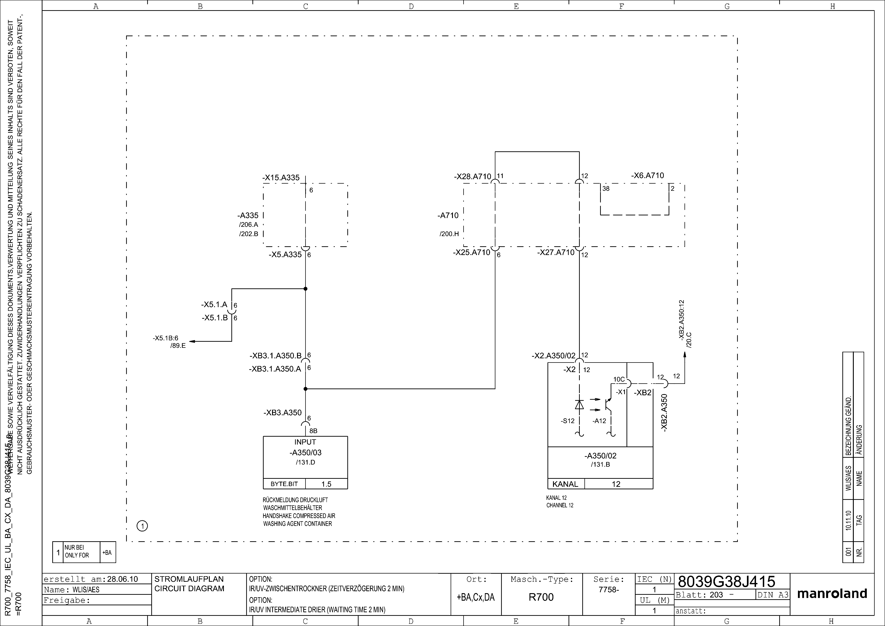

# +BA_Cx_DA — Sheet 203 of 247 — OPTION:

**IR/UV ZWISCHENTROCKNER (ZEITVERZÖGERUNG 2 MIN)**

> Part of the manroland **R700** printing press IEC/UL circuit diagrams.
> Drawing class: **Stromlaufplan / Circuit diagram** (DIN A3).
> Document `+BA_Cx_DA` covers the **Printing units / main switch cabinet** machine section.

## At a glance

| Field | Value |
|---|---|
| Document | `+BA_Cx_DA`  (8039G38J415) |
| Sheet | **203** of 247 |
| Section (DE) | OPTION: |
| Section (EN) | IR/UV ZWISCHENTROCKNER (ZEITVERZÖGERUNG 2 MIN) |
| Section type | CIRCUIT — Circuit diagram |
| Machine type | `R700` |
| Series | `7758` |
| Created | 28.06.10 |
| Replaces | — |
| Columns used | A, B, C, D, E, F, G, H |
| Path numbers | — |
| Labels on sheet | 74 |
| Cross-refs out | 7 |
| Cross-refs in | 22 |

**Previous:** [+BA_Cx_DA sheet 202](SHEET_0202.md) · **Next:** [+BA_Cx_DA sheet 204](SHEET_0204.md) · **Document TOC:** [_TOC.md](_TOC.md)  (+BA_Cx_DA) · **Master TOC:** [all sheets](../_MASTER_TOC.md)

## Sheet image (300 DPI, exact vector render)



_Rendered directly from the PDF vector layer at 300 DPI (1-bit), no OCR and no resampling. Use it to confirm anything ambiguous in the text below._

## Cross-references on this sheet

Each entry is a wire leaving this sheet. The printed token is `/sheet.column`; the link resolves to that sheet inside the same document.

| Ref | Target sheet | Col | Path | Destination on target | Target section | From col |
|---|---|---|---|---|---|---|
| `/206.A` | [+BA_Cx_DA sheet 206](SHEET_0206.md) | A | — | — | OPTION: AUTOMATISCHE FARBZUFÜHRUNG | B |
| `/202.B` | [+BA_Cx_DA sheet 202](SHEET_0202.md) | B | — | — | OPTION: | B |
| `/200.H` | [+BA_Cx_DA sheet 200](SHEET_0200.md) | H | — | — | OPTION: APL | D |
| `/20.C` | [+BA_Cx_DA sheet 20](SHEET_0020.md) | C | — | XB2.A350:12 | BUSVERBINDUNGEN: SICHERHEITSBUS | G |
| `/89.E` | [+BA_Cx_DA sheet 89](SHEET_0089.md) | E | — | X5.1B:6 | WASCHVORRICHTUNG | B |
| `/131.D` | [+BA_Cx_DA sheet 131](SHEET_0131.md) | D | — | — | REFERENZMODUL | C |
| `/131.B` | [+BA_Cx_DA sheet 131](SHEET_0131.md) | B | — | — | REFERENZMODUL | F |

### Incoming references (sheets that point here)

Every other sheet that sends a wire to this one. `Back-ref` is the token printed on *that* sheet; `Path` is its line number.

| From sheet | Cols | Back-ref | Path | Refs | What continues there |
|---|---|---|---|---|---|
| [+BA_Cx_DA#20](SHEET_0020.md) | C | `/20.C` | — | 1 | XB2.A350:12 |
| [+BA_Cx_DA#89](SHEET_0089.md) | E | `/89.E` | — | 1 | — |
| [+BA_Cx_DA#131](SHEET_0131.md) | B, D | `/131.B`, `/131.D` | — | 2 | — |
| [+BA_Cx_DA#153](SHEET_0153.md) | F | `/153.F` | — | 2 | — |
| [+BA_Cx_DA#157](SHEET_0157.md) | C, D, F | `/157.C`, `/157.D`, `/157.F` | — | 3 | — |
| [+BA_Cx_DA#160](SHEET_0160.md) | C, E | `/160.C`, `/160.E` | — | 2 | — |
| [+BA_Cx_DA#161](SHEET_0161.md) | A | `/161.A` | — | 1 | — |
| [+BA_Cx_DA#162](SHEET_0162.md) | H | `/162.H` | — | 1 | — |
| [+BA_Cx_DA#171](SHEET_0171.md) | E | `/171.E` | — | 1 | — |
| [+BA_Cx_DA#175](SHEET_0175.md) | H | `/175.H` | — | 1 | — |
| [+BA_Cx_DA#177](SHEET_0177.md) | E | `/177.E` | — | 1 | — |
| [+BA_Cx_DA#178](SHEET_0178.md) | G, H | `/178.G`, `/178.H` | — | 3 | — |
| [+BA_Cx_DA#200](SHEET_0200.md) | H | `/200.H` | — | 1 | — |
| [+BA_Cx_DA#202](SHEET_0202.md) | A | `/202.A` | — | 1 | — |
| [+BA_Cx_DA#206](SHEET_0206.md) | A | `/206.A` | — | 1 | — |


## Devices on this sheet

| Tag | Class | Class meaning (IEC) | Col | Sub | Terminal | Sign |
|---|---|---|---|---|---|---|
| `A350/03` | A | Baugruppe / assembly, module, PC board | C | 03 | — | — |
| `S12` | S | Schalter / switch | E | — | — | — |
| `A12` | A | Baugruppe / assembly, module, PC board | F | — | — | — |
| `X1` | X | Klemme / terminal, plug connector | F | — | — | — |
| `X2` | X | Klemme / terminal, plug connector | F | — | — | — |
| `XB2` | XB |  | F | — | — | — |
| `A350/02` | A | Baugruppe / assembly, module, PC board | F | 02 | — | — |
| `A710` | A | Baugruppe / assembly, module, PC board | D | — | — | — |
| `A335` | A | Baugruppe / assembly, module, PC board | B | — | — | — |
| `1.5` | — | cross-device reference | C | — | — | — |
| `XB3.A350` | — | cross-device reference | C | — | — | — |
| `X27.A710` | — | cross-device reference | E | — | — | — |
| `XB2.A350` | — | cross-device reference | F | — | — | — |
| `X5.A335` | — | cross-device reference | C | — | — | — |
| `X5.1.A` | — | cross-device reference | B | — | — | — |
| `X5.1.B` | — | cross-device reference | B | — | — | — |
| `XB3.1.A350.B` | — | cross-device reference | C | — | — | — |
| `XB3.1.A350.A` | — | cross-device reference | C | — | — | — |
| `X25.A710` | — | cross-device reference | E | — | — | — |
| `X28.A710` | — | cross-device reference | E | — | — | — |
| `NR.` | — | cross-device reference | H | — | — | — |
| `10.11.10` | — | cross-device reference | H | — | — | — |
| `XB2.A350:12` | — | cross-device reference | G | — | 12 | — |
| `X6.A710` | — | cross-device reference | F | — | — | — |
| `X15.A335` | — | cross-device reference | C | — | — | — |

## Potentials / nets

_No named potentials on this sheet._

## Wire-end annotations (grouped as printed)

A wire that continues elsewhere is annotated with a small cluster: the destination description, the path/line number `#NN`, and the `/sheet.column` cross reference. Each row below is one such cluster exactly as it is grouped on the drawing.

| Col | Y | Path | Cross-ref | Text on the wire |
|---|---|---|---|---|
| F | 231.3 | — | — | `X6.A710` |
| E | 232.8 | — | — | `X28.A710 11` |
| F | 232.8 | — | — | `12` |
| C | 234.2 | — | — | `X15.A335` |
| F | 249.8 | — | — | `38 2` |
| C | 251.9 | — | — | `6` |
| B | 285.2 | — | — | `A335` |
| D | 285.2 | — | — | `A710` |
| B | 298.3 | — | `/206.A`, `/202.B` | — |
| D | 310.7 | — | `/200.H` | — |
| E | 334.8 | — | — | `X25.A710 6` |
| E | 334.8 | — | — | `X27.A710 12` |
| C | 337.6 | — | — | `X5.A335 6` |
| G | 403.4 | — | `/20.C` | `XB2.A350:12` |
| B | 405.0 | — | — | `X5.1.A 6` |
| B | 422.7 | — | — | `X5.1.B 6` |
| B | 451.0 | — | `/89.E` | `X5.1B:6` |
| C | 473.7 | — | — | `XB3.1.A350.B 6` |
| E | 473.7 | — | — | `X2.A350/02 12` |
| C | 490.7 | — | — | `XB3.1.A350.A 6` |
| F | 492.1 | — | — | `X2` |
| F | 493.6 | — | — | `12 12` |
| G | 502.1 | — | — | `12` |
| F | 506.3 | — | — | `10C` |
| F | 523.3 | — | — | `X1` |
| F | 523.3 | — | — | `XB2` |
| F | 529.5 | — | — | `XB2.A350` |
| H | 532.5 | — | — | `001 WLIS/AES 10.11.10 BEZEICHNUNG GEÄND.` |
| C | 550.2 | — | — | `XB3.A350 6` |
| F | 562.3 | — | — | `S12 A12` |
| H | 571.4 | — | — | `NR. NAME TAG ÄNDERUNG` |
| C | 575.7 | — | — | `8B` |
| C | 590.2 | — | — | `INPUT` |
| C | 604.1 | — | — | `A350/03` |
| F | 608.3 | — | — | `A350/02` |
| C | 617.9 | — | `/131.D` | — |
| F | 620.7 | — | `/131.B` | — |
| F | 646.6 | — | — | `KANAL 12` |
| C | 646.9 | — | — | `BYTE.BIT 1.5` |
| E | 666.9 | — | — | `KANAL 12 CHANNEL 12` |
| C | 669.6 | — | — | `RÜCKMELDUNG DRUCKLUFT` |
| C | 680.2 | — | — | `HANDSHAKE COMPRESSED AIR WASCHMITTELBEHÄLTER` |
| C | 701.5 | — | — | `WASHING AGENT CONTAINER` |
| A | 704.2 | — | — | `1` |
| A | 733.3 | — | — | `1 NUR BEI` |
| A | 740.4 | — | — | `ONLY FOR +BA` |


## Reconstructed tables

This sheet carries tabular content (pin map / terminal assignment / index). The grid below was rebuilt from the drawing's own rule lines, so each row is exactly one physical row of the table.

### Table 1 — 3 data rows × 3 columns (at x=311.8, y=388.3) — **6 6**

|  | XB3.1.A350.B XB3.1.A350.A | 6 6 |
|---|---|---|
|  | `XB3.A350` | `6 8B` |
|  | `INPUT` | `A350/03 /131.D` |
|  | `BYTE.BIT` | `1.5` |


### Table 2 — 5 data rows × 8 columns (at x=666.1, y=204.1)

| 11 |  | 12 | 38 |  | X6.A710 |  | 2 |
|---|---|---|---|---|---|---|---|
| `6` | `X27.A710 X2.A350/02` | `12 12` |  |  |  |  | `XB2.A350:12` |
|  | `X2` | `12` |  | `10C` |  | `12` | `12` |
|  | `S12` | `A12` |  | `X1` | `XB2` | `XB2.A350` |  |
|  |  |  | `A350/02 /131.B` |  |  |  |  |
|  | `KANAL` |  |  | `12` |  |  |  |


## Notes and free text on this sheet

| Text | Col | Y (pt) |
|---|---|---|
| `8B` | C | 575.7 |
| `INPUT` | C | 590.24 |
| `BYTE.BIT` | C | 647.49 |
| `RÜCKMELDUNG DRUCKLUFT` | C | 669.63 |
| `WASCHMITTELBEHÄLTER` | C | 680.23 |
| `HANDSHAKE COMPRESSED AIR` | C | 690.87 |
| `WASHING AGENT CONTAINER` | C | 701.49 |
| `KANAL 12` | E | 666.92 |
| `CHANNEL 12` | E | 676.86 |
| `10C` | F | 506.31 |
| `KANAL` | E | 646.6 |
| `X2.A350/02` | E | 473.7 |
| `TAG` | H | 692.75 |
| `NAME` | H | 633.34 |
| `ÄNDERUNG` | H | 571.36 |
| `WLIS/AES` | H | 626.4 |
| `BEZEICHNUNG GEÄND.` | H | 532.55 |
| `X5.1B:6` | B | 450.98 |
| `NUR BEI` | A | 733.33 |
| `ONLY FOR` | A | 744.02 |
| `+BA` | A | 740.44 |

## Complete label inventory (exact text from the drawing)

Every text object inside the drawing area of this sheet, in DIN reading order (column A→H, then top→bottom). This is the authoritative list: if a string is not here it is not printed on this sheet.

| Col | Y | X | Dir | Type | Text |
|---|---|---|---|---|---|
| A | 704.2 | 189.6 | → | number | `1` |
| A | 733.3 | 87.0 | → | text | `NUR BEI` |
| A | 738.7 | 75.4 | → | number | `1` |
| A | 740.4 | 137.9 | → | text | `+BA` |
| A | 744.0 | 87.6 | → | text | `ONLY FOR` |
| B | 285.2 | 319.5 | → | device tag | `A335` |
| B | 298.3 | 321.7 | → | cross-reference | `/206.A` |
| B | 310.7 | 322.0 | → | cross-reference | `/202.B` |
| B | 405.0 | 270.7 | → | device ref | `X5.1.A` |
| B | 407.1 | 314.4 | → | number | `6` |
| B | 422.7 | 271.6 | → | device ref | `X5.1.B` |
| B | 424.1 | 314.4 | → | number | `6` |
| B | 451.0 | 205.5 | → | text | `X5.1B:6` |
| B | 460.9 | 229.3 | → | cross-reference | `/89.E` |
| C | 234.2 | 352.9 | → | device ref | `X15.A335` |
| C | 251.9 | 416.4 | → | number | `6` |
| C | 337.6 | 361.7 | → | device ref | `X5.A335` |
| C | 339.1 | 413.6 | → | number | `6` |
| C | 473.7 | 335.9 | → | device ref | `XB3.1.A350.B` |
| C | 473.7 | 413.6 | → | number | `6` |
| C | 490.7 | 413.6 | → | number | `6` |
| C | 491.4 | 335.1 | → | device ref | `XB3.1.A350.A` |
| C | 550.2 | 354.6 | → | device ref | `XB3.A350` |
| C | 558.7 | 413.6 | → | number | `6` |
| C | 575.7 | 416.4 | → | text | `8B` |
| C | 590.2 | 396.1 | → | text | `INPUT` |
| C | 604.1 | 389.6 | → | device tag | `A350/03` |
| C | 617.9 | 398.3 | → | cross-reference | `/131.D` |
| C | 646.9 | 432.3 | → | device ref | `1.5` |
| C | 647.5 | 364.3 | → | text | `BYTE.BIT` |
| C | 669.6 | 353.5 | → | text | `RÜCKMELDUNG DRUCKLUFT` |
| C | 680.2 | 354.3 | → | text | `WASCHMITTELBEHÄLTER` |
| C | 690.9 | 353.5 | → | text | `HANDSHAKE COMPRESSED AIR` |
| C | 701.5 | 354.3 | → | text | `WASHING AGENT CONTAINER` |
| D | 285.2 | 588.8 | → | device tag | `A710` |
| D | 310.7 | 591.6 | → | cross-reference | `/200.H` |
| E | 232.7 | 610.9 | → | device ref | `X28.A710` |
| E | 232.8 | 668.1 | → | number | `11` |
| E | 334.8 | 609.4 | → | device ref | `X25.A710` |
| E | 334.8 | 722.8 | → | device ref | `X27.A710` |
| E | 339.1 | 668.7 | → | number | `6` |
| E | 473.7 | 715.5 | → | text | `X2.A350/02` |
| E | 562.3 | 754.6 | → | device tag | `S12` |
| E | 646.6 | 743.2 | → | text | `KANAL` |
| E | 666.9 | 735.0 | → | text | `KANAL 12` |
| E | 676.9 | 735.3 | → | text | `CHANNEL 12` |
| F | 231.3 | 849.3 | → | device ref | `X6.A710` |
| F | 232.8 | 781.5 | → | number | `12` |
| F | 249.8 | 810.4 | → | number | `38` |
| F | 249.8 | 902.6 | → | number | `2` |
| F | 339.1 | 781.5 | → | number | `12` |
| F | 473.7 | 781.5 | → | number | `12` |
| F | 492.1 | 758.0 | → | device tag | `X2` |
| F | 493.6 | 784.3 | → | number | `12` |
| F | 503.5 | 883.6 | → | number | `12` |
| F | 506.3 | 824.9 | → | text | `10C` |
| F | 523.3 | 828.6 | → | device tag | `X1` |
| F | 523.3 | 852.9 | → | device tag | `XB2` |
| F | 529.5 | 889.0 | ↕ | device ref | `XB2.A350` |
| F | 562.3 | 797.1 | → | device tag | `A12` |
| F | 608.3 | 786.5 | → | device tag | `A350/02` |
| F | 620.7 | 795.3 | → | cross-reference | `/131.B` |
| F | 646.6 | 822.9 | → | number | `12` |
| G | 403.4 | 913.0 | ↕ | device ref | `XB2.A350:12` |
| G | 446.7 | 923.0 | ↕ | cross-reference | `/20.C` |
| G | 502.1 | 905.1 | → | number | `12` |
| H | 532.6 | 1138.5 | ↕ | text | `BEZEICHNUNG GEÄND.` |
| H | 571.4 | 1152.7 | ↕ | text | `ÄNDERUNG` |
| H | 626.4 | 1138.4 | ↕ | text | `WLIS/AES` |
| H | 633.3 | 1152.6 | ↕ | text | `NAME` |
| H | 686.8 | 1138.5 | ↕ | device ref | `10.11.10` |
| H | 692.7 | 1152.6 | ↕ | text | `TAG` |
| H | 735.8 | 1138.4 | ↕ | number | `001` |
| H | 736.2 | 1152.5 | ↕ | device ref | `NR.` |

## Reading-order text block

The same content as a plain block, grouped by DIN column — convenient to paste or to match against a visual description.

```text
=== Column A ===
 704.2  189.6  numeric      1
 733.3   87.0  text         NUR BEI
 738.7   75.4  numeric      1
 740.4  137.9  text         +BA
 744.0   87.6  text         ONLY FOR
=== Column B ===
 285.2  319.5  devtag       A335
 298.3  321.7  xref         /206.A
 310.7  322.0  xref         /202.B
 405.0  270.7  devref       X5.1.A
 407.1  314.4  numeric      6
 422.7  271.6  devref       X5.1.B
 424.1  314.4  numeric      6
 451.0  205.5  text         X5.1B:6
 460.9  229.3  xref         /89.E
=== Column C ===
 234.2  352.9  devref       X15.A335
 251.9  416.4  numeric      6
 337.6  361.7  devref       X5.A335
 339.1  413.6  numeric      6
 473.7  335.9  devref       XB3.1.A350.B
 473.7  413.6  numeric      6
 490.7  413.6  numeric      6
 491.4  335.1  devref       XB3.1.A350.A
 550.2  354.6  devref       XB3.A350
 558.7  413.6  numeric      6
 575.7  416.4  text         8B
 590.2  396.1  text         INPUT
 604.1  389.6  devtag       A350/03
 617.9  398.3  xref         /131.D
 646.9  432.3  devref       1.5
 647.5  364.3  text         BYTE.BIT
 669.6  353.5  text         RÜCKMELDUNG DRUCKLUFT
 680.2  354.3  text         WASCHMITTELBEHÄLTER
 690.9  353.5  text         HANDSHAKE COMPRESSED AIR
 701.5  354.3  text         WASHING AGENT CONTAINER
=== Column D ===
 285.2  588.8  devtag       A710
 310.7  591.6  xref         /200.H
=== Column E ===
 232.7  610.9  devref       X28.A710
 232.8  668.1  numeric      11
 334.8  609.4  devref       X25.A710
 334.8  722.8  devref       X27.A710
 339.1  668.7  numeric      6
 473.7  715.5  text         X2.A350/02
 562.3  754.6  devtag       S12
 646.6  743.2  text         KANAL
 666.9  735.0  text         KANAL 12
 676.9  735.3  text         CHANNEL 12
=== Column F ===
 231.3  849.3  devref       X6.A710
 232.8  781.5  numeric      12
 249.8  810.4  numeric      38
 249.8  902.6  numeric      2
 339.1  781.5  numeric      12
 473.7  781.5  numeric      12
 492.1  758.0  devtag       X2
 493.6  784.3  numeric      12
 503.5  883.6  numeric      12
 506.3  824.9  text         10C
 523.3  828.6  devtag       X1
 523.3  852.9  devtag       XB2
 529.5  889.0  devref       XB2.A350
 562.3  797.1  devtag       A12
 608.3  786.5  devtag       A350/02
 620.7  795.3  xref         /131.B
 646.6  822.9  numeric      12
=== Column G ===
 403.4  913.0  devref       XB2.A350:12
 446.7  923.0  xref         /20.C
 502.1  905.1  numeric      12
=== Column H ===
 532.6 1138.5  text         BEZEICHNUNG GEÄND.
 571.4 1152.7  text         ÄNDERUNG
 626.4 1138.4  text         WLIS/AES
 633.3 1152.6  text         NAME
 686.8 1138.5  devref       10.11.10
 692.7 1152.6  text         TAG
 735.8 1138.4  numeric      001
 736.2 1152.5  devref       NR.
```

---
_Generated from the PDF vector text layer; no OCR. Source: `R700_7758_IEC_UL_BA_CX_DA_8039G38J415_p`, sheet 203._
