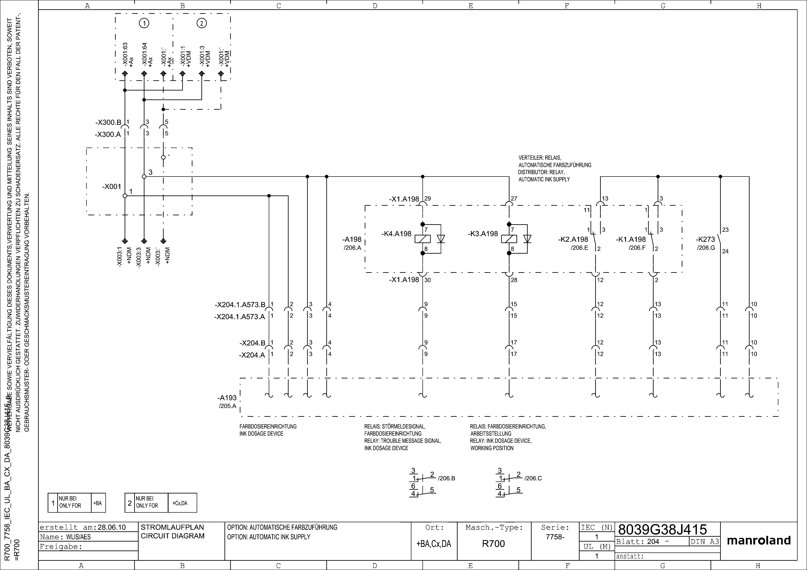

# +BA_Cx_DA — Sheet 204 of 247 — OPTION: AUTOMATISCHE FARBZUFÜHRUNG

**OPTION: AUTOMATIC INK SUPPLY**

> Part of the manroland **R700** printing press IEC/UL circuit diagrams.
> Drawing class: **Stromlaufplan / Circuit diagram** (DIN A3).
> Document `+BA_Cx_DA` covers the **Printing units / main switch cabinet** machine section.

## At a glance

| Field | Value |
|---|---|
| Document | `+BA_Cx_DA`  (8039G38J415) |
| Sheet | **204** of 247 |
| Section (DE) | OPTION: AUTOMATISCHE FARBZUFÜHRUNG |
| Section (EN) | OPTION: AUTOMATIC INK SUPPLY |
| Section type | CIRCUIT — Circuit diagram |
| Machine type | `R700` |
| Series | `7758` |
| Created | 28.06.10 |
| Replaces | — |
| Columns used | A, B, C, D, E, F, G, H |
| Path numbers | — |
| Labels on sheet | 148 |
| Cross-refs out | 7 |
| Cross-refs in | 63 |

**Previous:** [+BA_Cx_DA sheet 203](SHEET_0203.md) · **Next:** [+BA_Cx_DA sheet 205](SHEET_0205.md) · **Document TOC:** [_TOC.md](_TOC.md)  (+BA_Cx_DA) · **Master TOC:** [all sheets](../_MASTER_TOC.md)

## Sheet image (300 DPI, exact vector render)



_Rendered directly from the PDF vector layer at 300 DPI (1-bit), no OCR and no resampling. Use it to confirm anything ambiguous in the text below._

## Cross-references on this sheet

Each entry is a wire leaving this sheet. The printed token is `/sheet.column`; the link resolves to that sheet inside the same document.

| Ref | Target sheet | Col | Path | Destination on target | Target section | From col |
|---|---|---|---|---|---|---|
| `/206.A` | [+BA_Cx_DA sheet 206](SHEET_0206.md) | A | — | — | OPTION: AUTOMATISCHE FARBZUFÜHRUNG | D |
| `/206.E` | [+BA_Cx_DA sheet 206](SHEET_0206.md) | E | — | — | OPTION: AUTOMATISCHE FARBZUFÜHRUNG | F |
| `/206.F` | [+BA_Cx_DA sheet 206](SHEET_0206.md) | F | — | — | OPTION: AUTOMATISCHE FARBZUFÜHRUNG | G |
| `/206.G` | [+BA_Cx_DA sheet 206](SHEET_0206.md) | G | — | — | OPTION: AUTOMATISCHE FARBZUFÜHRUNG | G |
| `/205.A` | [+BA_Cx_DA sheet 205](SHEET_0205.md) | A | — | — | OPTION: AUTOMATISCHE FARBZUFÜHRUNG | B |
| `/206.B` | [+BA_Cx_DA sheet 206](SHEET_0206.md) | B | — | — | OPTION: AUTOMATISCHE FARBZUFÜHRUNG | E |
| `/206.C` | [+BA_Cx_DA sheet 206](SHEET_0206.md) | C | — | — | OPTION: AUTOMATISCHE FARBZUFÜHRUNG | F |

### Incoming references (sheets that point here)

Every other sheet that sends a wire to this one. `Back-ref` is the token printed on *that* sheet; `Path` is its line number.

| From sheet | Cols | Back-ref | Path | Refs | What continues there |
|---|---|---|---|---|---|
| [+BA_Cx_DA#140](SHEET_0140.md) | G, H | `/140.G`, `/140.H` | — | 10 | — |
| [+BA_Cx_DA#189](SHEET_0189.md) | A, B, F, G | `/189.A`, `/189.B`, `/189.F`, `/189.G` | — | 40 | — |
| [+BA_Cx_DA#190](SHEET_0190.md) | C | `/190.C` | — | 6 | — |
| [+BA_Cx_DA#205](SHEET_0205.md) | A | `/205.A` | — | 1 | — |
| [+BA_Cx_DA#206](SHEET_0206.md) | A, B, C, E, F, G | `/206.A`, `/206.B`, `/206.C`, `/206.E`, `/206.F`, `/206.G` | — | 6 | — |


## Devices on this sheet

| Tag | Class | Class meaning (IEC) | Col | Sub | Terminal | Sign |
|---|---|---|---|---|---|---|
| `X001` | X | Klemme / terminal, plug connector | A | — | — | — |
| `A198` | A | Baugruppe / assembly, module, PC board | D | — | — | — |
| `K273` | K | Relais / relay, contactor | G | — | — | — |
| `A193` | A | Baugruppe / assembly, module, PC board | B | — | — | — |
| `X003:1` | X | Klemme / terminal, plug connector | A | — | 1 | — |
| `X003:3` | X | Klemme / terminal, plug connector | B | — | 3 | — |
| `X001:63` | X | Klemme / terminal, plug connector | A | — | 63 | — |
| `X001:64` | X | Klemme / terminal, plug connector | B | — | 64 | — |
| `X001:1` | X | Klemme / terminal, plug connector | B | — | 1 | — |
| `X001:3` | X | Klemme / terminal, plug connector | B | — | 3 | — |
| `X1.A198` | — | cross-device reference | D | — | — | — |
| `K4.A198` | — | cross-device reference | D | — | — | — |
| `K3.A198` | — | cross-device reference | E | — | — | — |
| `K2.A198` | — | cross-device reference | F | — | — | — |
| `K1.A198` | — | cross-device reference | G | — | — | — |
| `X1.A198` | — | cross-device reference | D | — | — | — |
| `X204.B` | — | cross-device reference | C | — | — | — |
| `X204.A` | — | cross-device reference | C | — | — | — |
| `X204.1.A573.B` | — | cross-device reference | C | — | — | — |
| `X204.1.A573.A` | — | cross-device reference | C | — | — | — |
| `X300.B` | — | cross-device reference | A | — | — | — |
| `X300.A` | — | cross-device reference | A | — | — | — |

## Potentials / nets

_No named potentials on this sheet._

## Wire-end annotations (grouped as printed)

A wire that continues elsewhere is annotated with a small cluster: the destination description, the path/line number `#NN`, and the `/sheet.column` cross reference. Each row below is one such cluster exactly as it is grouped on the drawing.

| Col | Y | Path | Cross-ref | Text on the wire |
|---|---|---|---|---|
| B | 31.0 | — | — | `1 2` |
| A | 62.6 | — | — | `X001:63` |
| B | 62.6 | — | — | `X001:64` |
| B | 67.5 | — | — | `X001:1` |
| B | 67.5 | — | — | `X001:3` |
| B | 69.5 | — | — | `X001:'` |
| B | 69.5 | — | — | `X001:'` |
| B | 75.1 | — | — | `+VDM` |
| B | 75.1 | — | — | `+VDM` |
| B | 75.1 | — | — | `+VDM` |
| A | 84.5 | — | — | `+Ax` |
| B | 84.5 | — | — | `+Ax` |
| B | 84.5 | — | — | `+Ax` |
| A | 176.1 | — | — | `X300.B 1` |
| B | 176.1 | — | — | `3` |
| B | 176.1 | — | — | `5` |
| A | 193.1 | — | — | `X300.A 1` |
| B | 193.1 | — | — | `3` |
| B | 193.1 | — | — | `5` |
| B | 228.0 | — | — | `'` |
| F | 230.2 | — | — | `DISTRIBUTOR: RELAY, VERTEILER: RELAIS, AUTOMATISCHE FARBZUFÜHRUNG` |
| B | 249.7 | — | — | `3` |
| F | 262.1 | — | — | `AUTOMATIC INK SUPPLY` |
| A | 271.0 | — | — | `X001 1` |
| E | 289.4 | — | — | `X1.A198 29 27` |
| F | 289.5 | — | — | `13` |
| G | 289.5 | — | — | `3` |
| F | 306.5 | — | — | `11` |
| G | 306.5 | — | — | `1` |
| E | 335.5 | — | — | `7` |
| E | 335.5 | — | — | `7` |
| F | 335.5 | — | — | `K2.A198 3` |
| F | 335.5 | — | — | `1` |
| G | 335.5 | — | — | `K1.A198 3` |
| G | 335.5 | — | — | `1` |
| H | 335.5 | — | — | `23` |
| D | 340.5 | — | — | `K4.A198` |
| E | 340.5 | — | — | `K3.A198` |
| D | 349.0 | — | — | `A198` |
| G | 349.0 | — | — | `K273` |
| D | 362.0 | — | `/206.A` | — |
| F | 362.0 | — | `/206.E` | — |
| G | 362.0 | — | `/206.F` | — |
| G | 362.1 | — | `/206.G` | — |
| E | 363.9 | — | — | `8` |
| E | 363.9 | — | — | `8` |
| F | 363.9 | — | — | `2` |
| G | 363.9 | — | — | `2` |
| A | 364.0 | — | — | `X003:1` |
| B | 364.8 | — | — | `X003:'` |
| A | 365.1 | — | — | `+NDM` |
| B | 365.1 | — | — | `+NDM` |
| B | 365.1 | — | — | `+NDM` |
| B | 365.4 | — | — | `X003:3` |
| H | 367.4 | — | — | `24` |
| F | 408.5 | — | — | `X1.A198 30 28 12 2` |
| E | 445.4 | — | — | `X204.1.A573.B 1 2 3 4 9 15 12 13 11 10` |
| E | 462.4 | — | — | `X204.1.A573.A 1 2 3 4 9 15 12 13 11 10` |
| C | 502.1 | — | — | `X204.B 1` |
| C | 502.1 | — | — | `2` |
| C | 502.1 | — | — | `3` |
| D | 502.1 | — | — | `4` |
| E | 502.1 | — | — | `9` |
| E | 502.1 | — | — | `17` |
| F | 502.1 | — | — | `12` |
| G | 502.1 | — | — | `13` |
| H | 502.1 | — | — | `11` |
| H | 502.1 | — | — | `10` |
| C | 519.1 | — | — | `X204.A 1` |
| C | 519.1 | — | — | `2` |
| C | 519.1 | — | — | `3` |
| D | 519.1 | — | — | `4` |
| E | 519.1 | — | — | `9` |
| E | 519.1 | — | — | `17` |
| F | 519.1 | — | — | `12` |
| G | 519.1 | — | — | `13` |
| H | 519.1 | — | — | `11` |
| H | 519.1 | — | — | `10` |
| B | 582.8 | — | — | `A193` |
| B | 595.9 | — | `/205.A` | — |
| C | 627.1 | — | — | `FARBDOSIEREINRICHTUNG INK DOSAGE DEVICE` |
| D | 627.1 | — | — | `RELAIS: STÖRMELDESIGNAL, FARBDOSIEREINRICHTUNG RELAY: TROUBLE MESSAGE SIGNAL, INK DOSAGE DEVICE` |
| E | 627.1 | — | — | `RELAIS: FARBDOSIEREINRICHTUNG,` |
| E | 637.7 | — | — | `RELAY: INK DOSAGE DEVICE, ARBEITSSTELLUNG` |
| E | 659.0 | — | — | `WORKING POSITION` |
| D | 690.5 | — | — | `3 6 4 1` |
| E | 690.5 | — | — | `3 6 4 1` |
| E | 696.2 | — | — | `2` |
| E | 696.2 | — | — | `2` |
| E | 702.5 | — | `/206.B` | — |
| F | 702.6 | — | `/206.C` | — |
| E | 718.9 | — | — | `5` |
| E | 718.9 | — | — | `5` |
| A | 733.3 | — | — | `1 NUR BEI` |
| A | 733.3 | — | — | `ONLY FOR +BA 2 NUR BEI` |
| B | 740.5 | — | — | `ONLY FOR +Cx,DA` |


## Reconstructed tables

This sheet carries tabular content (pin map / terminal assignment / index). The grid below was rebuilt from the drawing's own rule lines, so each row is exactly one physical row of the table.

### Table 1 — 1 data rows × 3 columns (at x=184.3, y=133.2)

| 1 1 | 3 3 3 | 5 5 ` |
|---|---|---|
| `1` |  |  |


## Notes and free text on this sheet

| Text | Col | Y (pt) |
|---|---|---|
| `VERTEILER: RELAIS,` | F | 230.21 |
| `AUTOMATISCHE FARBZUFÜHRUNG` | F | 240.89 |
| `DISTRIBUTOR: RELAY,` | F | 251.48 |
| `AUTOMATIC INK SUPPLY` | F | 262.14 |
| `RELAIS: STÖRMELDESIGNAL,` | D | 627.07 |
| `FARBDOSIEREINRICHTUNG` | D | 637.72 |
| `RELAY: TROUBLE MESSAGE SIGNAL,` | D | 648.34 |
| `INK DOSAGE DEVICE` | D | 658.96 |
| `RELAIS: FARBDOSIEREINRICHTUNG,` | E | 627.08 |
| `ARBEITSSTELLUNG` | E | 637.72 |
| `RELAY: INK DOSAGE DEVICE,` | E | 648.32 |
| `WORKING POSITION` | E | 658.95 |
| `FARBDOSIEREINRICHTUNG` | C | 627.09 |
| `INK DOSAGE DEVICE` | C | 637.69 |
| `+NDM` | A | 365.1 |
| `+NDM` | B | 365.1 |
| `X003:'` | B | 364.82 |
| `+Ax` | A | 84.47 |
| `+Ax` | B | 84.47 |
| `X001:'` | B | 69.45 |
| `+VDM` | B | 75.12 |
| `NUR BEI` | A | 733.33 |
| `ONLY FOR` | A | 744.02 |
| `+BA` | A | 740.44 |
| `NUR BEI` | B | 733.33 |
| `ONLY FOR` | B | 744.02 |
| `+Cx,DA` | B | 740.52 |

## Complete label inventory (exact text from the drawing)

Every text object inside the drawing area of this sheet, in DIN reading order (column A→H, then top→bottom). This is the authoritative list: if a string is not here it is not printed on this sheet.

| Col | Y | X | Dir | Type | Text |
|---|---|---|---|---|---|
| A | 62.6 | 181.0 | ↕ | device tag | `X001:63` |
| A | 84.5 | 189.6 | ↕ | text | `+Ax` |
| A | 176.1 | 140.9 | → | device ref | `X300.B` |
| A | 176.1 | 186.2 | → | number | `1` |
| A | 193.1 | 186.2 | → | number | `1` |
| A | 193.8 | 140.0 | → | device ref | `X300.A` |
| A | 271.0 | 150.8 | → | device tag | `X001` |
| A | 278.1 | 190.2 | → | number | `1` |
| A | 364.0 | 172.5 | ↕ | device tag | `X003:1` |
| A | 365.1 | 186.7 | ↕ | text | `+NDM` |
| A | 733.3 | 87.0 | → | text | `NUR BEI` |
| A | 738.7 | 75.4 | → | number | `1` |
| A | 738.7 | 188.5 | → | number | `2` |
| A | 740.4 | 137.9 | → | text | `+BA` |
| A | 744.0 | 87.6 | → | text | `ONLY FOR` |
| B | 31.0 | 210.8 | → | number | `1` |
| B | 31.5 | 295.6 | → | number | `2` |
| B | 62.6 | 209.4 | ↕ | device tag | `X001:64` |
| B | 67.5 | 266.0 | ↕ | device tag | `X001:1` |
| B | 67.5 | 294.4 | ↕ | device tag | `X001:3` |
| B | 69.5 | 237.7 | ↕ | text | `X001:'` |
| B | 69.5 | 322.7 | ↕ | text | `X001:'` |
| B | 75.1 | 274.6 | ↕ | text | `+VDM` |
| B | 75.1 | 302.9 | ↕ | text | `+VDM` |
| B | 75.1 | 331.3 | ↕ | text | `+VDM` |
| B | 84.5 | 217.9 | ↕ | text | `+Ax` |
| B | 84.5 | 246.3 | ↕ | text | `+Ax` |
| B | 176.1 | 215.1 | → | number | `3` |
| B | 176.1 | 243.5 | → | number | `5` |
| B | 193.1 | 215.1 | → | number | `3` |
| B | 193.1 | 243.5 | → | number | `5` |
| B | 228.0 | 247.5 | → | other | `'` |
| B | 249.7 | 219.1 | → | number | `3` |
| B | 364.8 | 229.2 | ↕ | text | `X003:'` |
| B | 365.1 | 215.1 | ↕ | text | `+NDM` |
| B | 365.1 | 243.4 | ↕ | text | `+NDM` |
| B | 365.4 | 200.8 | ↕ | device tag | `X003:3` |
| B | 582.8 | 320.9 | → | device tag | `A193` |
| B | 595.9 | 323.1 | → | cross-reference | `/205.A` |
| B | 733.3 | 200.4 | → | text | `NUR BEI` |
| B | 740.5 | 254.8 | → | text | `+Cx,DA` |
| B | 744.0 | 201.0 | → | text | `ONLY FOR` |
| C | 445.4 | 316.9 | → | device ref | `X204.1.A573.B` |
| C | 445.4 | 398.8 | → | number | `1` |
| C | 445.4 | 427.7 | → | number | `2` |
| C | 445.4 | 456.1 | → | number | `3` |
| C | 462.4 | 398.8 | → | number | `1` |
| C | 462.4 | 427.7 | → | number | `2` |
| C | 462.4 | 456.1 | → | number | `3` |
| C | 463.1 | 316.1 | → | device ref | `X204.1.A573.A` |
| C | 502.0 | 353.5 | → | device ref | `X204.B` |
| C | 502.1 | 398.8 | → | number | `1` |
| C | 502.1 | 427.7 | → | number | `2` |
| C | 502.1 | 456.1 | → | number | `3` |
| C | 519.1 | 398.8 | → | number | `1` |
| C | 519.1 | 427.7 | → | number | `2` |
| C | 519.1 | 456.1 | → | number | `3` |
| C | 519.8 | 352.6 | → | device ref | `X204.A` |
| C | 627.1 | 353.5 | → | text | `FARBDOSIEREINRICHTUNG` |
| C | 637.7 | 353.5 | → | text | `INK DOSAGE DEVICE` |
| D | 289.4 | 574.3 | → | device ref | `X1.A198` |
| D | 340.5 | 563.0 | → | device ref | `K4.A198` |
| D | 349.0 | 505.1 | → | device tag | `A198` |
| D | 362.0 | 507.4 | → | cross-reference | `/206.A` |
| D | 408.5 | 574.3 | → | device ref | `X1.A198` |
| D | 445.4 | 484.4 | → | number | `4` |
| D | 462.4 | 484.4 | → | number | `4` |
| D | 502.1 | 484.4 | → | number | `4` |
| D | 519.1 | 484.4 | → | number | `4` |
| D | 627.1 | 537.7 | → | text | `RELAIS: STÖRMELDESIGNAL,` |
| D | 637.7 | 537.7 | → | text | `FARBDOSIEREINRICHTUNG` |
| D | 648.3 | 537.7 | → | text | `RELAY: TROUBLE MESSAGE SIGNAL,` |
| D | 659.0 | 537.7 | → | text | `INK DOSAGE DEVICE` |
| D | 690.5 | 606.9 | → | number | `3` |
| D | 701.8 | 608.3 | → | number | `1` |
| D | 713.2 | 606.9 | → | number | `6` |
| D | 724.5 | 606.9 | → | number | `4` |
| E | 289.5 | 626.2 | → | number | `29` |
| E | 289.5 | 753.7 | → | number | `27` |
| E | 335.5 | 626.2 | → | number | `7` |
| E | 335.5 | 753.7 | → | number | `7` |
| E | 340.5 | 690.5 | → | device ref | `K3.A198` |
| E | 363.9 | 626.2 | → | number | `8` |
| E | 363.9 | 753.7 | → | number | `8` |
| E | 409.9 | 626.2 | → | number | `30` |
| E | 409.9 | 753.7 | → | number | `28` |
| E | 445.4 | 626.2 | → | number | `9` |
| E | 445.4 | 753.2 | → | number | `15` |
| E | 462.4 | 626.2 | → | number | `9` |
| E | 462.4 | 753.2 | → | number | `15` |
| E | 502.1 | 626.2 | → | number | `9` |
| E | 502.1 | 753.2 | → | number | `17` |
| E | 519.1 | 626.2 | → | number | `9` |
| E | 519.1 | 753.2 | → | number | `17` |
| E | 627.1 | 693.6 | → | text | `RELAIS: FARBDOSIEREINRICHTUNG,` |
| E | 637.7 | 694.5 | → | text | `ARBEITSSTELLUNG` |
| E | 648.3 | 693.6 | → | text | `RELAY: INK DOSAGE DEVICE,` |
| E | 658.9 | 694.5 | → | text | `WORKING POSITION` |
| E | 690.5 | 734.5 | → | number | `3` |
| E | 696.2 | 634.7 | → | number | `2` |
| E | 696.2 | 762.2 | → | number | `2` |
| E | 701.8 | 735.9 | → | number | `1` |
| E | 702.5 | 646.3 | → | cross-reference | `/206.B` |
| E | 713.2 | 734.5 | → | number | `6` |
| E | 718.9 | 634.4 | → | number | `5` |
| E | 718.9 | 762.0 | → | number | `5` |
| E | 724.5 | 734.5 | → | number | `4` |
| F | 230.2 | 765.4 | → | text | `VERTEILER: RELAIS,` |
| F | 240.9 | 765.4 | → | text | `AUTOMATISCHE FARBZUFÜHRUNG` |
| F | 251.5 | 764.5 | → | text | `DISTRIBUTOR: RELAY,` |
| F | 262.1 | 765.4 | → | text | `AUTOMATIC INK SUPPLY` |
| F | 289.5 | 887.8 | → | number | `13` |
| F | 306.5 | 860.9 | → | number | `11` |
| F | 335.5 | 865.7 | → | number | `1` |
| F | 335.5 | 888.4 | → | number | `3` |
| F | 349.0 | 823.7 | → | device ref | `K2.A198` |
| F | 362.0 | 842.5 | → | cross-reference | `/206.E` |
| F | 363.9 | 881.3 | → | number | `2` |
| F | 409.9 | 880.7 | → | number | `12` |
| F | 445.4 | 880.7 | → | number | `12` |
| F | 462.4 | 880.7 | → | number | `12` |
| F | 502.1 | 880.7 | → | number | `12` |
| F | 519.1 | 880.7 | → | number | `12` |
| F | 702.6 | 773.9 | → | cross-reference | `/206.C` |
| G | 289.5 | 973.4 | → | number | `3` |
| G | 306.5 | 950.7 | → | number | `1` |
| G | 335.5 | 950.7 | → | number | `1` |
| G | 335.5 | 973.4 | → | number | `3` |
| G | 349.0 | 908.8 | → | device ref | `K1.A198` |
| G | 349.0 | 1026.7 | → | device tag | `K273` |
| G | 362.0 | 927.8 | → | cross-reference | `/206.F` |
| G | 362.1 | 1028.7 | → | cross-reference | `/206.G` |
| G | 363.9 | 966.3 | → | number | `2` |
| G | 409.9 | 966.3 | → | number | `2` |
| G | 445.4 | 965.8 | → | number | `13` |
| G | 462.4 | 965.8 | → | number | `13` |
| G | 502.1 | 965.8 | → | number | `13` |
| G | 519.1 | 965.8 | → | number | `13` |
| H | 335.5 | 1065.5 | → | number | `23` |
| H | 367.4 | 1065.5 | → | number | `24` |
| H | 445.4 | 1065.0 | → | number | `11` |
| H | 445.4 | 1107.5 | → | number | `10` |
| H | 462.4 | 1065.0 | → | number | `11` |
| H | 462.4 | 1107.5 | → | number | `10` |
| H | 502.1 | 1065.0 | → | number | `11` |
| H | 502.1 | 1107.5 | → | number | `10` |
| H | 519.1 | 1065.0 | → | number | `11` |
| H | 519.1 | 1107.5 | → | number | `10` |

## Reading-order text block

The same content as a plain block, grouped by DIN column — convenient to paste or to match against a visual description.

```text
=== Column A ===
  62.6  181.0  devtag       X001:63
  84.5  189.6  text         +Ax
 176.1  140.9  devref       X300.B
 176.1  186.2  numeric      1
 193.1  186.2  numeric      1
 193.8  140.0  devref       X300.A
 271.0  150.8  devtag       X001
 278.1  190.2  numeric      1
 364.0  172.5  devtag       X003:1
 365.1  186.7  text         +NDM
 733.3   87.0  text         NUR BEI
 738.7   75.4  numeric      1
 738.7  188.5  numeric      2
 740.4  137.9  text         +BA
 744.0   87.6  text         ONLY FOR
=== Column B ===
  31.0  210.8  numeric      1
  31.5  295.6  numeric      2
  62.6  209.4  devtag       X001:64
  67.5  266.0  devtag       X001:1
  67.5  294.4  devtag       X001:3
  69.5  237.7  text         X001:`
  69.5  322.7  text         X001:`
  75.1  274.6  text         +VDM
  75.1  302.9  text         +VDM
  75.1  331.3  text         +VDM
  84.5  217.9  text         +Ax
  84.5  246.3  text         +Ax
 176.1  215.1  numeric      3
 176.1  243.5  numeric      5
 193.1  215.1  numeric      3
 193.1  243.5  numeric      5
 228.0  247.5  other        `
 249.7  219.1  numeric      3
 364.8  229.2  text         X003:`
 365.1  215.1  text         +NDM
 365.1  243.4  text         +NDM
 365.4  200.8  devtag       X003:3
 582.8  320.9  devtag       A193
 595.9  323.1  xref         /205.A
 733.3  200.4  text         NUR BEI
 740.5  254.8  text         +Cx,DA
 744.0  201.0  text         ONLY FOR
=== Column C ===
 445.4  316.9  devref       X204.1.A573.B
 445.4  398.8  numeric      1
 445.4  427.7  numeric      2
 445.4  456.1  numeric      3
 462.4  398.8  numeric      1
 462.4  427.7  numeric      2
 462.4  456.1  numeric      3
 463.1  316.1  devref       X204.1.A573.A
 502.0  353.5  devref       X204.B
 502.1  398.8  numeric      1
 502.1  427.7  numeric      2
 502.1  456.1  numeric      3
 519.1  398.8  numeric      1
 519.1  427.7  numeric      2
 519.1  456.1  numeric      3
 519.8  352.6  devref       X204.A
 627.1  353.5  text         FARBDOSIEREINRICHTUNG
 637.7  353.5  text         INK DOSAGE DEVICE
=== Column D ===
 289.4  574.3  devref       X1.A198
 340.5  563.0  devref       K4.A198
 349.0  505.1  devtag       A198
 362.0  507.4  xref         /206.A
 408.5  574.3  devref       X1.A198
 445.4  484.4  numeric      4
 462.4  484.4  numeric      4
 502.1  484.4  numeric      4
 519.1  484.4  numeric      4
 627.1  537.7  text         RELAIS: STÖRMELDESIGNAL,
 637.7  537.7  text         FARBDOSIEREINRICHTUNG
 648.3  537.7  text         RELAY: TROUBLE MESSAGE SIGNAL,
 659.0  537.7  text         INK DOSAGE DEVICE
 690.5  606.9  numeric      3
 701.8  608.3  numeric      1
 713.2  606.9  numeric      6
 724.5  606.9  numeric      4
=== Column E ===
 289.5  626.2  numeric      29
 289.5  753.7  numeric      27
 335.5  626.2  numeric      7
 335.5  753.7  numeric      7
 340.5  690.5  devref       K3.A198
 363.9  626.2  numeric      8
 363.9  753.7  numeric      8
 409.9  626.2  numeric      30
 409.9  753.7  numeric      28
 445.4  626.2  numeric      9
 445.4  753.2  numeric      15
 462.4  626.2  numeric      9
 462.4  753.2  numeric      15
 502.1  626.2  numeric      9
 502.1  753.2  numeric      17
 519.1  626.2  numeric      9
 519.1  753.2  numeric      17
 627.1  693.6  text         RELAIS: FARBDOSIEREINRICHTUNG,
 637.7  694.5  text         ARBEITSSTELLUNG
 648.3  693.6  text         RELAY: INK DOSAGE DEVICE,
 658.9  694.5  text         WORKING POSITION
 690.5  734.5  numeric      3
 696.2  634.7  numeric      2
 696.2  762.2  numeric      2
 701.8  735.9  numeric      1
 702.5  646.3  xref         /206.B
 713.2  734.5  numeric      6
 718.9  634.4  numeric      5
 718.9  762.0  numeric      5
 724.5  734.5  numeric      4
=== Column F ===
 230.2  765.4  text         VERTEILER: RELAIS,
 240.9  765.4  text         AUTOMATISCHE FARBZUFÜHRUNG
 251.5  764.5  text         DISTRIBUTOR: RELAY,
 262.1  765.4  text         AUTOMATIC INK SUPPLY
 289.5  887.8  numeric      13
 306.5  860.9  numeric      11
 335.5  865.7  numeric      1
 335.5  888.4  numeric      3
 349.0  823.7  devref       K2.A198
 362.0  842.5  xref         /206.E
 363.9  881.3  numeric      2
 409.9  880.7  numeric      12
 445.4  880.7  numeric      12
 462.4  880.7  numeric      12
 502.1  880.7  numeric      12
 519.1  880.7  numeric      12
 702.6  773.9  xref         /206.C
=== Column G ===
 289.5  973.4  numeric      3
 306.5  950.7  numeric      1
 335.5  950.7  numeric      1
 335.5  973.4  numeric      3
 349.0  908.8  devref       K1.A198
 349.0 1026.7  devtag       K273
 362.0  927.8  xref         /206.F
 362.1 1028.7  xref         /206.G
 363.9  966.3  numeric      2
 409.9  966.3  numeric      2
 445.4  965.8  numeric      13
 462.4  965.8  numeric      13
 502.1  965.8  numeric      13
 519.1  965.8  numeric      13
=== Column H ===
 335.5 1065.5  numeric      23
 367.4 1065.5  numeric      24
 445.4 1065.0  numeric      11
 445.4 1107.5  numeric      10
 462.4 1065.0  numeric      11
 462.4 1107.5  numeric      10
 502.1 1065.0  numeric      11
 502.1 1107.5  numeric      10
 519.1 1065.0  numeric      11
 519.1 1107.5  numeric      10
```

---
_Generated from the PDF vector text layer; no OCR. Source: `R700_7758_IEC_UL_BA_CX_DA_8039G38J415_p`, sheet 204._
