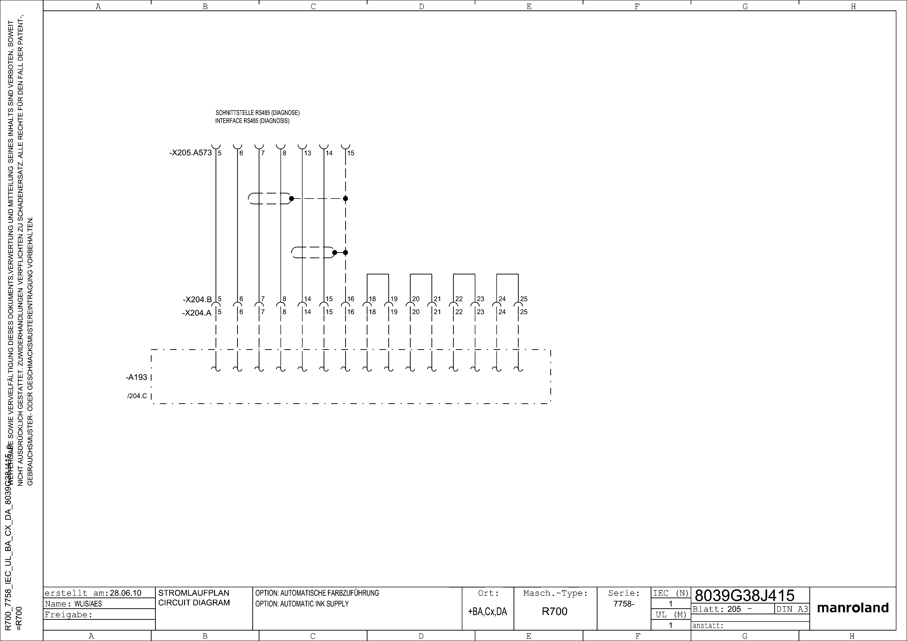

# +BA_Cx_DA — Sheet 205 of 247 — OPTION: AUTOMATISCHE FARBZUFÜHRUNG

**OPTION: AUTOMATIC INK SUPPLY**

> Part of the manroland **R700** printing press IEC/UL circuit diagrams.
> Drawing class: **Stromlaufplan / Circuit diagram** (DIN A3).
> Document `+BA_Cx_DA` covers the **Printing units / main switch cabinet** machine section.

## At a glance

| Field | Value |
|---|---|
| Document | `+BA_Cx_DA`  (8039G38J415) |
| Sheet | **205** of 247 |
| Section (DE) | OPTION: AUTOMATISCHE FARBZUFÜHRUNG |
| Section (EN) | OPTION: AUTOMATIC INK SUPPLY |
| Section type | CIRCUIT — Circuit diagram |
| Machine type | `R700` |
| Series | `7758` |
| Created | 28.06.10 |
| Replaces | — |
| Columns used | A, B, C, D, E |
| Path numbers | — |
| Labels on sheet | 44 |
| Cross-refs out | 1 |
| Cross-refs in | 38 |

**Previous:** [+BA_Cx_DA sheet 204](SHEET_0204.md) · **Next:** [+BA_Cx_DA sheet 206](SHEET_0206.md) · **Document TOC:** [_TOC.md](_TOC.md)  (+BA_Cx_DA) · **Master TOC:** [all sheets](../_MASTER_TOC.md)

## Sheet image (300 DPI, exact vector render)



_Rendered directly from the PDF vector layer at 300 DPI (1-bit), no OCR and no resampling. Use it to confirm anything ambiguous in the text below._

## Cross-references on this sheet

Each entry is a wire leaving this sheet. The printed token is `/sheet.column`; the link resolves to that sheet inside the same document.

| Ref | Target sheet | Col | Path | Destination on target | Target section | From col |
|---|---|---|---|---|---|---|
| `/204.C` | [+BA_Cx_DA sheet 204](SHEET_0204.md) | C | — | — | OPTION: AUTOMATISCHE FARBZUFÜHRUNG | A |

### Incoming references (sheets that point here)

Every other sheet that sends a wire to this one. `Back-ref` is the token printed on *that* sheet; `Path` is its line number.

| From sheet | Cols | Back-ref | Path | Refs | What continues there |
|---|---|---|---|---|---|
| [+BA_Cx_DA#189](SHEET_0189.md) | A, B | `/189.A`, `/189.B` | — | 30 | — |
| [+BA_Cx_DA#190](SHEET_0190.md) | A | `/190.A` | — | 7 | — |
| [+BA_Cx_DA#204](SHEET_0204.md) | B | `/204.B` | — | 1 | — |


## Devices on this sheet

| Tag | Class | Class meaning (IEC) | Col | Sub | Terminal | Sign |
|---|---|---|---|---|---|---|
| `A193` | A | Baugruppe / assembly, module, PC board | A | — | — | — |
| `X204.B` | — | cross-device reference | B | — | — | — |
| `X204.A` | — | cross-device reference | B | — | — | — |
| `X205.A573` | — | cross-device reference | B | — | — | — |

## Potentials / nets

_No named potentials on this sheet._

## Wire-end annotations (grouped as printed)

A wire that continues elsewhere is annotated with a small cluster: the destination description, the path/line number `#NN`, and the `/sheet.column` cross reference. Each row below is one such cluster exactly as it is grouped on the drawing.

| Col | Y | Path | Cross-ref | Text on the wire |
|---|---|---|---|---|
| B | 145.2 | — | — | `INTERFACE RS485 (DIAGNOSIS) SCHNITTSTELLE RS485 (DIAGNOSE)` |
| C | 195.9 | — | — | `X205.A573 5 6 7 8 13 14 15` |
| B | 388.7 | — | — | `X204.B 5` |
| B | 388.7 | — | — | `6` |
| C | 388.7 | — | — | `7` |
| C | 388.7 | — | — | `8 14 15 16` |
| D | 388.7 | — | — | `18 19 20 21 22 23 24 25` |
| B | 405.7 | — | — | `X204.A 5` |
| B | 405.7 | — | — | `6` |
| C | 405.7 | — | — | `7` |
| C | 405.7 | — | — | `8 14 15 16` |
| D | 405.7 | — | — | `18 19 20 21 22 23 24 25` |
| A | 490.7 | — | — | `A193` |
| A | 516.2 | — | `/204.C` | — |


## Notes and free text on this sheet

| Text | Col | Y (pt) |
|---|---|---|
| `SCHNITTSTELLE RS485 (DIAGNOSE)` | B | 145.2 |
| `INTERFACE RS485 (DIAGNOSIS)` | B | 155.83 |

## Complete label inventory (exact text from the drawing)

Every text object inside the drawing area of this sheet, in DIN reading order (column A→H, then top→bottom). This is the authoritative list: if a string is not here it is not printed on this sheet.

| Col | Y | X | Dir | Type | Text |
|---|---|---|---|---|---|
| A | 490.7 | 165.0 | → | device tag | `A193` |
| A | 516.2 | 167.2 | → | cross-reference | `/204.C` |
| B | 145.2 | 283.2 | → | text | `SCHNITTSTELLE RS485 (DIAGNOSE)` |
| B | 155.8 | 282.6 | → | text | `INTERFACE RS485 (DIAGNOSIS)` |
| B | 195.9 | 222.2 | → | device ref | `X205.A573` |
| B | 197.3 | 286.0 | → | number | `5` |
| B | 197.3 | 314.4 | → | number | `6` |
| B | 388.7 | 240.1 | → | device ref | `X204.B` |
| B | 388.7 | 286.0 | → | number | `5` |
| B | 388.7 | 314.4 | → | number | `6` |
| B | 405.7 | 286.0 | → | number | `5` |
| B | 405.7 | 314.4 | → | number | `6` |
| B | 406.4 | 239.2 | → | device ref | `X204.A` |
| C | 197.3 | 342.7 | → | number | `7` |
| C | 197.3 | 371.1 | → | number | `8` |
| C | 197.3 | 398.8 | → | number | `13` |
| C | 197.3 | 427.2 | → | number | `14` |
| C | 197.3 | 455.5 | → | number | `15` |
| C | 388.7 | 342.7 | → | number | `7` |
| C | 388.7 | 371.1 | → | number | `8` |
| C | 388.7 | 398.8 | → | number | `14` |
| C | 388.7 | 427.2 | → | number | `15` |
| C | 388.7 | 455.5 | → | number | `16` |
| C | 405.7 | 342.7 | → | number | `7` |
| C | 405.7 | 371.1 | → | number | `8` |
| C | 405.7 | 398.8 | → | number | `14` |
| C | 405.7 | 427.2 | → | number | `15` |
| C | 405.7 | 455.5 | → | number | `16` |
| D | 388.7 | 483.9 | → | number | `18` |
| D | 388.7 | 512.2 | → | number | `19` |
| D | 388.7 | 541.1 | → | number | `20` |
| D | 388.7 | 569.5 | → | number | `21` |
| D | 388.7 | 597.8 | → | number | `22` |
| D | 405.7 | 483.9 | → | number | `18` |
| D | 405.7 | 512.2 | → | number | `19` |
| D | 405.7 | 541.1 | → | number | `20` |
| D | 405.7 | 569.5 | → | number | `21` |
| D | 405.7 | 597.8 | → | number | `22` |
| E | 388.7 | 626.2 | → | number | `23` |
| E | 388.7 | 654.5 | → | number | `24` |
| E | 388.7 | 682.9 | → | number | `25` |
| E | 405.7 | 626.2 | → | number | `23` |
| E | 405.7 | 654.5 | → | number | `24` |
| E | 405.7 | 682.9 | → | number | `25` |

## Reading-order text block

The same content as a plain block, grouped by DIN column — convenient to paste or to match against a visual description.

```text
=== Column A ===
 490.7  165.0  devtag       A193
 516.2  167.2  xref         /204.C
=== Column B ===
 145.2  283.2  text         SCHNITTSTELLE RS485 (DIAGNOSE)
 155.8  282.6  text         INTERFACE RS485 (DIAGNOSIS)
 195.9  222.2  devref       X205.A573
 197.3  286.0  numeric      5
 197.3  314.4  numeric      6
 388.7  240.1  devref       X204.B
 388.7  286.0  numeric      5
 388.7  314.4  numeric      6
 405.7  286.0  numeric      5
 405.7  314.4  numeric      6
 406.4  239.2  devref       X204.A
=== Column C ===
 197.3  342.7  numeric      7
 197.3  371.1  numeric      8
 197.3  398.8  numeric      13
 197.3  427.2  numeric      14
 197.3  455.5  numeric      15
 388.7  342.7  numeric      7
 388.7  371.1  numeric      8
 388.7  398.8  numeric      14
 388.7  427.2  numeric      15
 388.7  455.5  numeric      16
 405.7  342.7  numeric      7
 405.7  371.1  numeric      8
 405.7  398.8  numeric      14
 405.7  427.2  numeric      15
 405.7  455.5  numeric      16
=== Column D ===
 388.7  483.9  numeric      18
 388.7  512.2  numeric      19
 388.7  541.1  numeric      20
 388.7  569.5  numeric      21
 388.7  597.8  numeric      22
 405.7  483.9  numeric      18
 405.7  512.2  numeric      19
 405.7  541.1  numeric      20
 405.7  569.5  numeric      21
 405.7  597.8  numeric      22
=== Column E ===
 388.7  626.2  numeric      23
 388.7  654.5  numeric      24
 388.7  682.9  numeric      25
 405.7  626.2  numeric      23
 405.7  654.5  numeric      24
 405.7  682.9  numeric      25
```

---
_Generated from the PDF vector text layer; no OCR. Source: `R700_7758_IEC_UL_BA_CX_DA_8039G38J415_p`, sheet 205._
