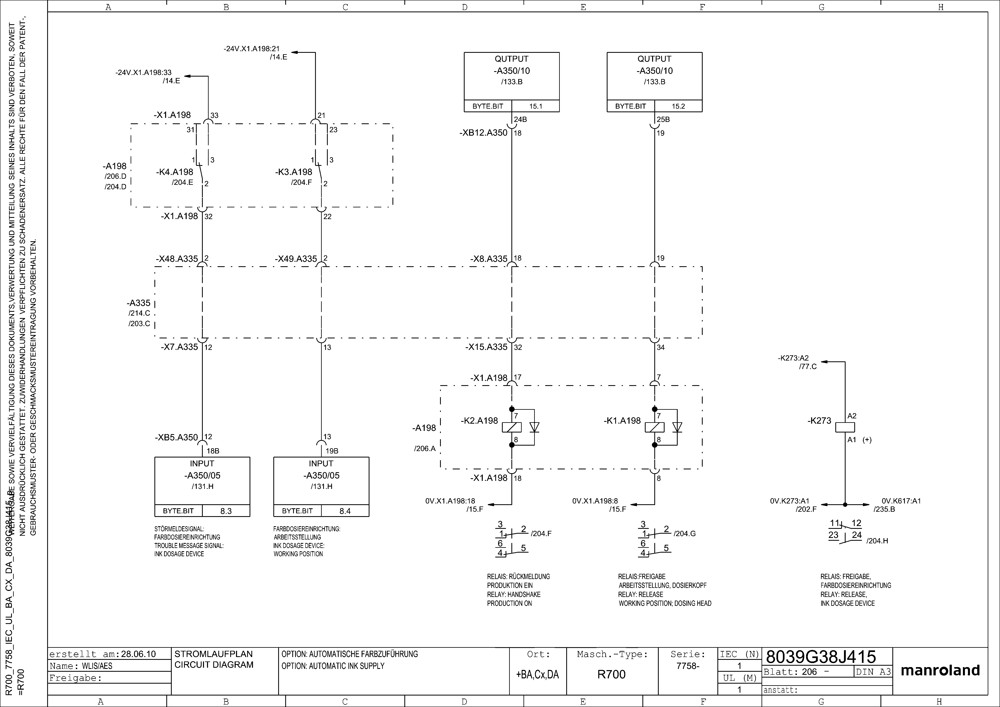

# +BA_Cx_DA — Sheet 206 of 247 — OPTION: AUTOMATISCHE FARBZUFÜHRUNG

**OPTION: AUTOMATIC INK SUPPLY**

> Part of the manroland **R700** printing press IEC/UL circuit diagrams.
> Drawing class: **Stromlaufplan / Circuit diagram** (DIN A3).
> Document `+BA_Cx_DA` covers the **Printing units / main switch cabinet** machine section.

## At a glance

| Field | Value |
|---|---|
| Document | `+BA_Cx_DA`  (8039G38J415) |
| Sheet | **206** of 247 |
| Section (DE) | OPTION: AUTOMATISCHE FARBZUFÜHRUNG |
| Section (EN) | OPTION: AUTOMATIC INK SUPPLY |
| Section type | CIRCUIT — Circuit diagram |
| Machine type | `R700` |
| Series | `7758` |
| Created | 28.06.10 |
| Replaces | — |
| Columns used | A, B, C, D, E, F, G, H |
| Path numbers | — |
| Labels on sheet | 138 |
| Cross-refs out | 21 |
| Cross-refs in | 43 |

**Previous:** [+BA_Cx_DA sheet 205](SHEET_0205.md) · **Next:** [+BA_Cx_DA sheet 207](SHEET_0207.md) · **Document TOC:** [_TOC.md](_TOC.md)  (+BA_Cx_DA) · **Master TOC:** [all sheets](../_MASTER_TOC.md)

## Sheet image (300 DPI, exact vector render)



_Rendered directly from the PDF vector layer at 300 DPI (1-bit), no OCR and no resampling. Use it to confirm anything ambiguous in the text below._

## Cross-references on this sheet

Each entry is a wire leaving this sheet. The printed token is `/sheet.column`; the link resolves to that sheet inside the same document.

| Ref | Target sheet | Col | Path | Destination on target | Target section | From col |
|---|---|---|---|---|---|---|
| `/14.E` | [+BA_Cx_DA sheet 14](SHEET_0014.md) | E | — | 24V.X1.A198:21 | SPANNUNGSVERSORGUNG, SCHALTSCHRANKBELÜFTUNG | B |
| `/14.E` | [+BA_Cx_DA sheet 14](SHEET_0014.md) | E | — | 24V.X1.A198:33 | SPANNUNGSVERSORGUNG, SCHALTSCHRANKBELÜFTUNG | A |
| `/133.B` | [+BA_Cx_DA sheet 133](SHEET_0133.md) | B | — | — | REFERENZMODUL | D |
| `/133.B` | [+BA_Cx_DA sheet 133](SHEET_0133.md) | B | — | — | REFERENZMODUL | F |
| `/206.D` | [+BA_Cx_DA sheet 206](SHEET_0206.md) | D | — | — | OPTION: AUTOMATISCHE FARBZUFÜHRUNG | A |
| `/204.D` | [+BA_Cx_DA sheet 204](SHEET_0204.md) | D | — | — | OPTION: AUTOMATISCHE FARBZUFÜHRUNG | A |
| `/204.E` | [+BA_Cx_DA sheet 204](SHEET_0204.md) | E | — | — | OPTION: AUTOMATISCHE FARBZUFÜHRUNG | B |
| `/204.F` | [+BA_Cx_DA sheet 204](SHEET_0204.md) | F | — | — | OPTION: AUTOMATISCHE FARBZUFÜHRUNG | C |
| `/214.C` | [+BA_Cx_DA sheet 214](SHEET_0214.md) | C | — | — | OPTION: FWW SPEZIALREINIGER | A |
| `/203.C` | [+BA_Cx_DA sheet 203](SHEET_0203.md) | C | — | — | OPTION: | A |
| `/77.C` | [+BA_Cx_DA sheet 77](SHEET_0077.md) | C | — | K273:A2 | FARBWERK | G |
| `/206.A` | [+BA_Cx_DA sheet 206](SHEET_0206.md) | A | — | — | OPTION: AUTOMATISCHE FARBZUFÜHRUNG | D |
| `/131.H` | [+BA_Cx_DA sheet 131](SHEET_0131.md) | H | — | — | REFERENZMODUL | B |
| `/131.H` | [+BA_Cx_DA sheet 131](SHEET_0131.md) | H | — | — | REFERENZMODUL | C |
| `/15.F` | [+BA_Cx_DA sheet 15](SHEET_0015.md) | F | — | 0V.X1.A198:8 0V.X1.A198:18 | SPANNUNGSVERSORGUNG, SCHALTSCHRANKBELÜFTUNG | E |
| `/15.F` | [+BA_Cx_DA sheet 15](SHEET_0015.md) | F | — | 0V.X1.A198:8 0V.X1.A198:18 | SPANNUNGSVERSORGUNG, SCHALTSCHRANKBELÜFTUNG | E |
| `/202.F` | [+BA_Cx_DA sheet 202](SHEET_0202.md) | F | — | 0V.K273:A1 | OPTION: | G |
| `/235.B` | [+BA_Cx_DA sheet 235](SHEET_0235.md) | B | — | — | OPTION: INLINECOATER SMART | H |
| `/204.F` | [+BA_Cx_DA sheet 204](SHEET_0204.md) | F | — | — | OPTION: AUTOMATISCHE FARBZUFÜHRUNG | E |
| `/204.G` | [+BA_Cx_DA sheet 204](SHEET_0204.md) | G | — | — | OPTION: AUTOMATISCHE FARBZUFÜHRUNG | F |
| `/204.H` | [+BA_Cx_DA sheet 204](SHEET_0204.md) | H | — | — | OPTION: AUTOMATISCHE FARBZUFÜHRUNG | G |

### Incoming references (sheets that point here)

Every other sheet that sends a wire to this one. `Back-ref` is the token printed on *that* sheet; `Path` is its line number.

| From sheet | Cols | Back-ref | Path | Refs | What continues there |
|---|---|---|---|---|---|
| [+BA_Cx_DA#14](SHEET_0014.md) | E | `/14.E` | — | 2 | 24V.X1.A198:21; 24V.X1.A198:33 |
| [+BA_Cx_DA#15](SHEET_0015.md) | F | `/15.F` | — | 2 | — |
| [+BA_Cx_DA#77](SHEET_0077.md) | C | `/77.C` | — | 1 | — |
| [+BA_Cx_DA#131](SHEET_0131.md) | H | `/131.H` | — | 2 | — |
| [+BA_Cx_DA#133](SHEET_0133.md) | B | `/133.B` | — | 2 | — |
| [+BA_Cx_DA#140](SHEET_0140.md) | G, H | `/140.G`, `/140.H` | — | 10 | — |
| [+BA_Cx_DA#161](SHEET_0161.md) | F | `/161.F` | — | 2 | — |
| [+BA_Cx_DA#163](SHEET_0163.md) | G | `/163.G` | — | 2 | — |
| [+BA_Cx_DA#165](SHEET_0165.md) | E | `/165.E` | — | 2 | — |
| [+BA_Cx_DA#169](SHEET_0169.md) | G | `/169.G` | — | 2 | — |
| [+BA_Cx_DA#171](SHEET_0171.md) | F | `/171.F` | — | 2 | — |
| [+BA_Cx_DA#182](SHEET_0182.md) | C, E | `/182.C`, `/182.E` | — | 2 | — |
| [+BA_Cx_DA#202](SHEET_0202.md) | F | `/202.F` | — | 1 | — |
| [+BA_Cx_DA#203](SHEET_0203.md) | B | `/203.B` | — | 1 | — |
| [+BA_Cx_DA#204](SHEET_0204.md) | D, E, F, G | `/204.D`, `/204.E`, `/204.F`, `/204.G` | — | 6 | — |
| [+BA_Cx_DA#206](SHEET_0206.md) | A, D | `/206.A`, `/206.D` | — | 2 | — |
| [+BA_Cx_DA#214](SHEET_0214.md) | B | `/214.B` | — | 1 | — |
| [+BA_Cx_DA#235](SHEET_0235.md) | D | `/235.D` | — | 1 | 0V.K617:A1 XB11.A350:6:2 |


## Devices on this sheet

| Tag | Class | Class meaning (IEC) | Col | Sub | Terminal | Sign |
|---|---|---|---|---|---|---|
| `A198` | A | Baugruppe / assembly, module, PC board | A | — | — | — |
| `A350/10` | A | Baugruppe / assembly, module, PC board | D | 10 | — | — |
| `A350/10` | A | Baugruppe / assembly, module, PC board | F | 10 | — | — |
| `A335` | A | Baugruppe / assembly, module, PC board | A | — | — | — |
| `A198` | A | Baugruppe / assembly, module, PC board | D | — | — | — |
| `A2` | A | Baugruppe / assembly, module, PC board | G | — | — | — |
| `A1` | A | Baugruppe / assembly, module, PC board | G | — | — | — |
| `K273` | K | Relais / relay, contactor | G | — | — | — |
| `A350/05` | A | Baugruppe / assembly, module, PC board | C | 05 | — | — |
| `A350/05` | A | Baugruppe / assembly, module, PC board | B | 05 | — | — |
| `K273:A2` | K | Relais / relay, contactor | G | — | A2 | — |
| `K3.A198` | — | cross-device reference | C | — | — | — |
| `K4.A198` | — | cross-device reference | B | — | — | — |
| `X1.A198` | — | cross-device reference | B | — | — | — |
| `15.1` | — | cross-device reference | E | — | — | — |
| `XB12.A350` | — | cross-device reference | D | — | — | — |
| `15.2` | — | cross-device reference | F | — | — | — |
| `X1.A198` | — | cross-device reference | B | — | — | — |
| `X49.A335` | — | cross-device reference | C | — | — | — |
| `X7.A335` | — | cross-device reference | B | — | — | — |
| `X48.A335` | — | cross-device reference | B | — | — | — |
| `X15.A335` | — | cross-device reference | D | — | — | — |
| `X8.A335` | — | cross-device reference | D | — | — | — |
| `X1.A198` | — | cross-device reference | D | — | — | — |
| `K2.A198` | — | cross-device reference | D | — | — | — |
| `K1.A198` | — | cross-device reference | E | — | — | — |
| `X1.A198` | — | cross-device reference | D | — | — | — |
| `8.4` | — | cross-device reference | C | — | — | — |
| `XB5.A350` | — | cross-device reference | B | — | — | — |
| `8.3` | — | cross-device reference | B | — | — | — |

## Potentials / nets

| Potential | Count | Columns | Attached devices | Terminals |
|---|---|---|---|---|
| `0V` | 4 | D, E, G, H | `A198`, `K273`, `K617`, `X1` | `18`, `8`, `A1` |
| `24V` | 2 | A, B | `A198`, `X1` | `21`, `33` |


A potential such as `L24+/4` or `M24+` is a named supply/return rail; every place it appears on this sheet is electrically common.

## Wire-end annotations (grouped as printed)

A wire that continues elsewhere is annotated with a small cluster: the destination description, the path/line number `#NN`, and the `/sheet.column` cross reference. Each row below is one such cluster exactly as it is grouped on the drawing.

| Col | Y | Path | Cross-ref | Text on the wire |
|---|---|---|---|---|
| B | 54.1 | — | `/14.E` | `24V.X1.A198:21` |
| D | 65.8 | — | — | `QUTPUT` |
| F | 65.8 | — | — | `QUTPUT` |
| D | 79.7 | — | — | `A350/10` |
| F | 79.7 | — | — | `A350/10` |
| A | 82.5 | — | `/14.E` | `24V.X1.A198:33` |
| D | 93.5 | — | `/133.B` | — |
| F | 93.5 | — | `/133.B` | — |
| D | 123.1 | — | — | `BYTE.BIT 15.1` |
| F | 123.1 | — | — | `BYTE.BIT 15.2` |
| B | 132.1 | — | — | `X1.A198 33 21` |
| D | 138.5 | — | — | `24B` |
| F | 138.5 | — | — | `25B` |
| B | 150.6 | — | — | `31` |
| D | 150.6 | — | — | `23 19` |
| D | 153.4 | — | — | `XB12.A350 18` |
| B | 186.7 | — | — | `K4.A198 3` |
| B | 186.7 | — | — | `1` |
| C | 186.7 | — | — | `K3.A198 3` |
| C | 186.7 | — | — | `1` |
| A | 193.1 | — | — | `A198` |
| A | 206.2 | — | `/206.D`, `/204.D` | — |
| B | 213.2 | — | `/204.E` | — |
| C | 213.2 | — | `/204.F` | — |
| B | 215.1 | — | — | `2` |
| C | 215.1 | — | — | `2` |
| B | 252.6 | — | — | `X1.A198 32` |
| C | 254.0 | — | — | `22` |
| B | 303.6 | — | — | `X48.A335 2` |
| C | 303.6 | — | — | `X49.A335 2` |
| D | 303.6 | — | — | `X8.A335 18` |
| F | 303.6 | — | — | `19` |
| A | 356.1 | — | — | `A335` |
| A | 369.1 | — | `/214.C`, `/203.C` | — |
| B | 408.5 | — | — | `X7.A335 12` |
| D | 408.5 | — | — | `X15.A335 32` |
| C | 409.9 | — | — | `13` |
| F | 409.9 | — | — | `34` |
| G | 422.6 | — | `/77.C` | `K273:A2` |
| E | 445.4 | — | — | `X1.A198 17 7` |
| D | 491.4 | — | — | `7` |
| F | 491.4 | — | — | `7` |
| G | 491.4 | — | — | `A2` |
| D | 496.4 | — | — | `K2.A198` |
| E | 496.4 | — | — | `K1.A198` |
| G | 496.4 | — | — | `K273` |
| D | 504.9 | — | — | `A198` |
| B | 516.2 | — | — | `XB5.A350 12` |
| C | 516.2 | — | — | `13` |
| G | 519.7 | — | — | `A1` |
| D | 519.8 | — | — | `8` |
| F | 519.8 | — | — | `8` |
| G | 519.8 | — | — | `(+)` |
| D | 530.3 | — | `/206.A` | — |
| B | 533.2 | — | — | `18B` |
| C | 533.2 | — | — | `19B` |
| B | 547.7 | — | — | `INPUT` |
| C | 547.7 | — | — | `INPUT` |
| B | 561.6 | — | — | `A350/05` |
| C | 561.6 | — | — | `A350/05` |
| E | 564.4 | — | — | `X1.A198 18 8` |
| B | 575.4 | — | `/131.H` | — |
| C | 575.4 | — | `/131.H` | — |
| E | 592.7 | — | `/15.F`, `/15.F` | `0V.X1.A198:18 0V.X1.A198:8` |
| G | 592.7 | — | `/202.F` | `0V.K273:A1` |
| H | 592.7 | — | — | `0V.K617:A1` |
| H | 602.6 | — | `/235.B` | — |
| B | 604.4 | — | — | `BYTE.BIT 8.3` |
| C | 604.4 | — | — | `BYTE.BIT 8.4` |
| G | 618.2 | — | — | `23 11 12 24` |
| D | 619.6 | — | — | `3 6 4 1` |
| F | 619.6 | — | — | `3 6 4 1` |
| D | 625.3 | — | — | `2` |
| F | 625.3 | — | — | `2` |
| B | 627.2 | — | — | `FARBDOSIEREINRICHTUNG INK DOSAGE DEVICE STÖRMELDESIGNAL: TROUBLE MESSAGE SIGNAL:` |
| C | 627.2 | — | — | `FARBDOSIEREINRICHTUNG:` |
| E | 631.7 | — | `/204.F` | — |
| F | 631.7 | — | `/204.G` | — |
| C | 637.2 | — | — | `INK DOSAGE DEVICE: ARBEITSSTELLUNG` |
| G | 640.2 | — | `/204.H` | — |
| D | 648.0 | — | — | `5` |
| F | 648.0 | — | — | `5` |
| C | 657.1 | — | — | `WORKING POSITION` |
| E | 683.7 | — | — | `RELAIS:FREIGABE` |
| G | 683.7 | — | — | `RELAIS: FREIGABE, FARBDOSIEREINRICHTUNG RELAY: RELEASE, INK DOSAGE DEVICE` |
| D | 683.8 | — | — | `RELAIS: RÜCKMELDUNG PRODUKTION EIN RELAY: HANDSHAKE PRODUCTION ON` |
| F | 694.4 | — | — | `RELAY: RELEASE ARBEITSSTELLUNG, DOSIERKOPF` |
| F | 715.7 | — | — | `WORKING POSITION; DOSING HEAD` |


## Reconstructed tables

This sheet carries tabular content (pin map / terminal assignment / index). The grid below was rebuilt from the drawing's own rule lines, so each row is exactly one physical row of the table.

### Table 1 — 1 data rows × 4 columns (at x=184.3, y=544.3)

|  | INPUT | A350/05 /131.H |  |
|---|---|---|---|
| `BYTE.BIT` |  |  | `8.3` |


### Table 2 — 1 data rows × 4 columns (at x=326.0, y=544.3)

|  | INPUT | A350/05 /131.H |  |
|---|---|---|---|
| `BYTE.BIT` |  |  | `8.4` |


### Table 3 — 1 data rows × 3 columns (at x=552.8, y=62.4)

| QUTPUT | A350/10 /133.B |  |
|---|---|---|
| `BYTE.BIT` |  | `15.1` |


### Table 4 — 1 data rows × 3 columns (at x=722.8, y=62.4)

| QUTPUT | A350/10 /133.B |  |
|---|---|---|
| `BYTE.BIT` |  | `15.2` |


## Notes and free text on this sheet

| Text | Col | Y (pt) |
|---|---|---|
| `24B` | D | 138.48 |
| `QUTPUT` | D | 65.81 |
| `BYTE.BIT` | D | 123.08 |
| `25B` | F | 138.48 |
| `QUTPUT` | F | 65.81 |
| `BYTE.BIT` | E | 123.08 |
| `RELAIS: RÜCKMELDUNG` | D | 683.78 |
| `PRODUKTION EIN` | D | 694.4 |
| `RELAY: HANDSHAKE` | D | 705.03 |
| `PRODUCTION ON` | D | 715.68 |
| `RELAIS:FREIGABE` | E | 683.74 |
| `ARBEITSSTELLUNG, DOSIERKOPF` | F | 694.41 |
| `RELAY: RELEASE` | E | 705.01 |
| `WORKING POSITION; DOSING HEAD` | F | 715.66 |
| `RELAIS: FREIGABE,` | G | 683.74 |
| `FARBDOSIEREINRICHTUNG` | G | 694.41 |
| `RELAY: RELEASE,` | G | 705 |
| `INK DOSAGE DEVICE` | G | 715.65 |
| `19B` | C | 533.2 |
| `INPUT` | C | 547.72 |
| `BYTE.BIT` | C | 604.97 |
| `FARBDOSIEREINRICHTUNG:` | C | 627.24 |
| `ARBEITSSTELLUNG` | C | 637.18 |
| `INK DOSAGE DEVICE:` | C | 647.15 |
| `WORKING POSITION` | C | 657.06 |
| `18B` | B | 533.2 |
| `INPUT` | B | 547.72 |
| `BYTE.BIT` | B | 604.97 |
| `STÖRMELDESIGNAL:` | B | 627.24 |
| `FARBDOSIEREINRICHTUNG` | B | 637.19 |
| `TROUBLE MESSAGE SIGNAL:` | B | 647.14 |
| `INK DOSAGE DEVICE` | B | 657.09 |

## Complete label inventory (exact text from the drawing)

Every text object inside the drawing area of this sheet, in DIN reading order (column A→H, then top→bottom). This is the authoritative list: if a string is not here it is not printed on this sheet.

| Col | Y | X | Dir | Type | Text |
|---|---|---|---|---|---|
| A | 82.5 | 137.5 | → | potential | `24V.X1.A198:33` |
| A | 193.1 | 122.5 | → | device tag | `A198` |
| A | 206.2 | 124.7 | → | cross-reference | `/206.D` |
| A | 218.6 | 124.7 | → | cross-reference | `/204.D` |
| A | 356.1 | 150.8 | → | device tag | `A335` |
| A | 369.1 | 153.1 | → | cross-reference | `/214.C` |
| A | 381.5 | 153.1 | → | cross-reference | `/203.C` |
| B | 54.1 | 266.5 | → | potential | `24V.X1.A198:21` |
| B | 64.0 | 321.4 | → | cross-reference | `/14.E` |
| B | 92.4 | 193.9 | → | cross-reference | `/14.E` |
| B | 132.1 | 183.1 | → | device ref | `X1.A198` |
| B | 133.6 | 250.6 | → | number | `33` |
| B | 150.6 | 222.2 | → | number | `31` |
| B | 186.7 | 227.9 | → | number | `1` |
| B | 186.7 | 250.6 | → | number | `3` |
| B | 200.2 | 186.0 | → | device ref | `K4.A198` |
| B | 213.2 | 204.7 | → | cross-reference | `/204.E` |
| B | 215.0 | 243.5 | → | number | `2` |
| B | 252.6 | 191.6 | → | device ref | `X1.A198` |
| B | 254.0 | 243.5 | → | number | `32` |
| B | 303.6 | 185.7 | → | device ref | `X48.A335` |
| B | 303.6 | 243.5 | → | number | `2` |
| B | 408.5 | 191.6 | → | device ref | `X7.A335` |
| B | 409.9 | 242.9 | → | number | `12` |
| B | 516.2 | 184.5 | → | device ref | `XB5.A350` |
| B | 516.2 | 242.9 | → | number | `12` |
| B | 533.2 | 245.8 | → | text | `18B` |
| B | 547.7 | 226.1 | → | text | `INPUT` |
| B | 561.6 | 219.5 | → | device tag | `A350/05` |
| B | 575.4 | 228.5 | → | cross-reference | `/131.H` |
| B | 604.4 | 262.5 | → | device ref | `8.3` |
| B | 605.0 | 194.2 | → | text | `BYTE.BIT` |
| B | 627.2 | 184.0 | → | text | `STÖRMELDESIGNAL:` |
| B | 637.2 | 183.7 | → | text | `FARBDOSIEREINRICHTUNG` |
| B | 647.1 | 184.0 | → | text | `TROUBLE MESSAGE SIGNAL:` |
| B | 657.1 | 183.7 | → | text | `INK DOSAGE DEVICE` |
| C | 133.6 | 378.1 | → | number | `21` |
| C | 150.6 | 392.3 | → | number | `23` |
| C | 186.7 | 369.6 | → | number | `1` |
| C | 186.7 | 392.3 | → | number | `3` |
| C | 200.2 | 327.7 | → | device ref | `K3.A198` |
| C | 213.2 | 346.7 | → | cross-reference | `/204.F` |
| C | 215.0 | 385.2 | → | number | `2` |
| C | 254.0 | 385.2 | → | number | `22` |
| C | 303.6 | 327.4 | → | device ref | `X49.A335` |
| C | 303.6 | 385.2 | → | number | `2` |
| C | 409.9 | 384.7 | → | number | `13` |
| C | 516.2 | 384.7 | → | number | `13` |
| C | 533.2 | 387.5 | → | text | `19B` |
| C | 547.7 | 367.8 | → | text | `INPUT` |
| C | 561.6 | 361.3 | → | device tag | `A350/05` |
| C | 575.4 | 370.2 | → | cross-reference | `/131.H` |
| C | 604.4 | 404.2 | → | device ref | `8.4` |
| C | 605.0 | 335.9 | → | text | `BYTE.BIT` |
| C | 627.2 | 325.4 | → | text | `FARBDOSIEREINRICHTUNG:` |
| C | 637.2 | 326.3 | → | text | `ARBEITSSTELLUNG` |
| C | 647.1 | 325.4 | → | text | `INK DOSAGE DEVICE:` |
| C | 657.1 | 326.0 | → | text | `WORKING POSITION` |
| D | 65.8 | 589.2 | → | text | `QUTPUT` |
| D | 79.7 | 588.0 | → | device tag | `A350/10` |
| D | 93.5 | 596.8 | → | cross-reference | `/133.B` |
| D | 123.1 | 562.7 | → | text | `BYTE.BIT` |
| D | 138.5 | 612.0 | → | text | `24B` |
| D | 153.4 | 547.1 | → | device ref | `XB12.A350` |
| D | 154.8 | 611.4 | → | number | `18` |
| D | 303.6 | 560.1 | → | device ref | `X8.A335` |
| D | 303.6 | 611.4 | → | number | `18` |
| D | 408.5 | 554.2 | → | device ref | `X15.A335` |
| D | 409.9 | 612.0 | → | number | `32` |
| D | 445.3 | 560.1 | → | device ref | `X1.A198` |
| D | 445.4 | 611.4 | → | number | `17` |
| D | 491.4 | 612.0 | → | number | `7` |
| D | 496.4 | 548.8 | → | device ref | `K2.A198` |
| D | 504.9 | 491.0 | → | device tag | `A198` |
| D | 519.8 | 612.0 | → | number | `8` |
| D | 530.3 | 493.2 | → | cross-reference | `/206.A` |
| D | 564.4 | 560.1 | → | device ref | `X1.A198` |
| D | 565.8 | 611.4 | → | number | `18` |
| D | 592.7 | 506.6 | → | potential | `0V.X1.A198:18` |
| D | 602.6 | 555.6 | → | cross-reference | `/15.F` |
| D | 619.6 | 592.7 | → | number | `3` |
| D | 625.3 | 620.5 | → | number | `2` |
| D | 631.0 | 594.1 | → | number | `1` |
| D | 642.3 | 592.7 | → | number | `6` |
| D | 648.0 | 620.2 | → | number | `5` |
| D | 653.7 | 592.7 | → | number | `4` |
| D | 683.8 | 580.3 | → | text | `RELAIS: RÜCKMELDUNG` |
| D | 694.4 | 580.3 | → | text | `PRODUKTION EIN` |
| D | 705.0 | 580.3 | → | text | `RELAY: HANDSHAKE` |
| D | 715.7 | 580.3 | → | text | `PRODUCTION ON` |
| E | 123.1 | 630.1 | → | device ref | `15.1` |
| E | 123.1 | 732.8 | → | text | `BYTE.BIT` |
| E | 496.4 | 718.9 | → | device ref | `K1.A198` |
| E | 592.7 | 681.4 | → | potential | `0V.X1.A198:8` |
| E | 602.6 | 725.7 | → | cross-reference | `/15.F` |
| E | 631.7 | 632.1 | → | cross-reference | `/204.F` |
| E | 683.7 | 736.2 | → | text | `RELAIS:FREIGABE` |
| E | 705.0 | 736.2 | → | text | `RELAY: RELEASE` |
| F | 65.8 | 759.3 | → | text | `QUTPUT` |
| F | 79.7 | 758.1 | → | device tag | `A350/10` |
| F | 93.5 | 766.9 | → | cross-reference | `/133.B` |
| F | 123.1 | 799.8 | → | device ref | `15.2` |
| F | 138.5 | 782.1 | → | text | `25B` |
| F | 154.8 | 781.5 | → | number | `19` |
| F | 303.6 | 781.5 | → | number | `19` |
| F | 409.9 | 782.1 | → | number | `34` |
| F | 445.4 | 782.1 | → | number | `7` |
| F | 491.4 | 782.1 | → | number | `7` |
| F | 519.8 | 782.1 | → | number | `8` |
| F | 565.8 | 782.1 | → | number | `8` |
| F | 619.6 | 762.8 | → | number | `3` |
| F | 625.3 | 790.6 | → | number | `2` |
| F | 631.0 | 764.2 | → | number | `1` |
| F | 631.7 | 802.2 | → | cross-reference | `/204.G` |
| F | 642.3 | 762.8 | → | number | `6` |
| F | 648.0 | 790.3 | → | number | `5` |
| F | 653.7 | 762.8 | → | number | `4` |
| F | 694.4 | 737.0 | → | text | `ARBEITSSTELLUNG, DOSIERKOPF` |
| F | 715.7 | 737.0 | → | text | `WORKING POSITION; DOSING HEAD` |
| G | 422.6 | 926.4 | → | device tag | `K273:A2` |
| G | 432.6 | 951.6 | → | cross-reference | `/77.C` |
| G | 491.4 | 1009.1 | → | device tag | `A2` |
| G | 496.4 | 961.5 | → | device tag | `K273` |
| G | 519.7 | 1009.1 | → | device tag | `A1` |
| G | 519.8 | 1027.0 | → | other | `(+)` |
| G | 592.7 | 917.0 | → | potential | `0V.K273:A1` |
| G | 602.6 | 947.6 | → | cross-reference | `/202.F` |
| G | 618.2 | 987.9 | → | number | `11` |
| G | 618.2 | 1013.7 | → | number | `12` |
| G | 632.4 | 986.5 | → | number | `23` |
| G | 632.4 | 1014.5 | → | number | `24` |
| G | 640.2 | 1031.8 | → | cross-reference | `/204.H` |
| G | 683.7 | 977.1 | → | text | `RELAIS: FREIGABE,` |
| G | 694.4 | 977.1 | → | text | `FARBDOSIEREINRICHTUNG` |
| G | 705.0 | 977.1 | → | text | `RELAY: RELEASE,` |
| G | 715.7 | 977.1 | → | text | `INK DOSAGE DEVICE` |
| H | 592.7 | 1050.0 | → | potential | `0V.K617:A1` |
| H | 602.6 | 1040.3 | → | cross-reference | `/235.B` |

## Reading-order text block

The same content as a plain block, grouped by DIN column — convenient to paste or to match against a visual description.

```text
=== Column A ===
  82.5  137.5  net          24V.X1.A198:33
 193.1  122.5  devtag       A198
 206.2  124.7  xref         /206.D
 218.6  124.7  xref         /204.D
 356.1  150.8  devtag       A335
 369.1  153.1  xref         /214.C
 381.5  153.1  xref         /203.C
=== Column B ===
  54.1  266.5  net          24V.X1.A198:21
  64.0  321.4  xref         /14.E
  92.4  193.9  xref         /14.E
 132.1  183.1  devref       X1.A198
 133.6  250.6  numeric      33
 150.6  222.2  numeric      31
 186.7  227.9  numeric      1
 186.7  250.6  numeric      3
 200.2  186.0  devref       K4.A198
 213.2  204.7  xref         /204.E
 215.0  243.5  numeric      2
 252.6  191.6  devref       X1.A198
 254.0  243.5  numeric      32
 303.6  185.7  devref       X48.A335
 303.6  243.5  numeric      2
 408.5  191.6  devref       X7.A335
 409.9  242.9  numeric      12
 516.2  184.5  devref       XB5.A350
 516.2  242.9  numeric      12
 533.2  245.8  text         18B
 547.7  226.1  text         INPUT
 561.6  219.5  devtag       A350/05
 575.4  228.5  xref         /131.H
 604.4  262.5  devref       8.3
 605.0  194.2  text         BYTE.BIT
 627.2  184.0  text         STÖRMELDESIGNAL:
 637.2  183.7  text         FARBDOSIEREINRICHTUNG
 647.1  184.0  text         TROUBLE MESSAGE SIGNAL:
 657.1  183.7  text         INK DOSAGE DEVICE
=== Column C ===
 133.6  378.1  numeric      21
 150.6  392.3  numeric      23
 186.7  369.6  numeric      1
 186.7  392.3  numeric      3
 200.2  327.7  devref       K3.A198
 213.2  346.7  xref         /204.F
 215.0  385.2  numeric      2
 254.0  385.2  numeric      22
 303.6  327.4  devref       X49.A335
 303.6  385.2  numeric      2
 409.9  384.7  numeric      13
 516.2  384.7  numeric      13
 533.2  387.5  text         19B
 547.7  367.8  text         INPUT
 561.6  361.3  devtag       A350/05
 575.4  370.2  xref         /131.H
 604.4  404.2  devref       8.4
 605.0  335.9  text         BYTE.BIT
 627.2  325.4  text         FARBDOSIEREINRICHTUNG:
 637.2  326.3  text         ARBEITSSTELLUNG
 647.1  325.4  text         INK DOSAGE DEVICE:
 657.1  326.0  text         WORKING POSITION
=== Column D ===
  65.8  589.2  text         QUTPUT
  79.7  588.0  devtag       A350/10
  93.5  596.8  xref         /133.B
 123.1  562.7  text         BYTE.BIT
 138.5  612.0  text         24B
 153.4  547.1  devref       XB12.A350
 154.8  611.4  numeric      18
 303.6  560.1  devref       X8.A335
 303.6  611.4  numeric      18
 408.5  554.2  devref       X15.A335
 409.9  612.0  numeric      32
 445.3  560.1  devref       X1.A198
 445.4  611.4  numeric      17
 491.4  612.0  numeric      7
 496.4  548.8  devref       K2.A198
 504.9  491.0  devtag       A198
 519.8  612.0  numeric      8
 530.3  493.2  xref         /206.A
 564.4  560.1  devref       X1.A198
 565.8  611.4  numeric      18
 592.7  506.6  net          0V.X1.A198:18
 602.6  555.6  xref         /15.F
 619.6  592.7  numeric      3
 625.3  620.5  numeric      2
 631.0  594.1  numeric      1
 642.3  592.7  numeric      6
 648.0  620.2  numeric      5
 653.7  592.7  numeric      4
 683.8  580.3  text         RELAIS: RÜCKMELDUNG
 694.4  580.3  text         PRODUKTION EIN
 705.0  580.3  text         RELAY: HANDSHAKE
 715.7  580.3  text         PRODUCTION ON
=== Column E ===
 123.1  630.1  devref       15.1
 123.1  732.8  text         BYTE.BIT
 496.4  718.9  devref       K1.A198
 592.7  681.4  net          0V.X1.A198:8
 602.6  725.7  xref         /15.F
 631.7  632.1  xref         /204.F
 683.7  736.2  text         RELAIS:FREIGABE
 705.0  736.2  text         RELAY: RELEASE
=== Column F ===
  65.8  759.3  text         QUTPUT
  79.7  758.1  devtag       A350/10
  93.5  766.9  xref         /133.B
 123.1  799.8  devref       15.2
 138.5  782.1  text         25B
 154.8  781.5  numeric      19
 303.6  781.5  numeric      19
 409.9  782.1  numeric      34
 445.4  782.1  numeric      7
 491.4  782.1  numeric      7
 519.8  782.1  numeric      8
 565.8  782.1  numeric      8
 619.6  762.8  numeric      3
 625.3  790.6  numeric      2
 631.0  764.2  numeric      1
 631.7  802.2  xref         /204.G
 642.3  762.8  numeric      6
 648.0  790.3  numeric      5
 653.7  762.8  numeric      4
 694.4  737.0  text         ARBEITSSTELLUNG, DOSIERKOPF
 715.7  737.0  text         WORKING POSITION; DOSING HEAD
=== Column G ===
 422.6  926.4  devtag       K273:A2
 432.6  951.6  xref         /77.C
 491.4 1009.1  devtag       A2
 496.4  961.5  devtag       K273
 519.7 1009.1  devtag       A1
 519.8 1027.0  other        (+)
 592.7  917.0  net          0V.K273:A1
 602.6  947.6  xref         /202.F
 618.2  987.9  numeric      11
 618.2 1013.7  numeric      12
 632.4  986.5  numeric      23
 632.4 1014.5  numeric      24
 640.2 1031.8  xref         /204.H
 683.7  977.1  text         RELAIS: FREIGABE,
 694.4  977.1  text         FARBDOSIEREINRICHTUNG
 705.0  977.1  text         RELAY: RELEASE,
 715.7  977.1  text         INK DOSAGE DEVICE
=== Column H ===
 592.7 1050.0  net          0V.K617:A1
 602.6 1040.3  xref         /235.B
```

---
_Generated from the PDF vector text layer; no OCR. Source: `R700_7758_IEC_UL_BA_CX_DA_8039G38J415_p`, sheet 206._
