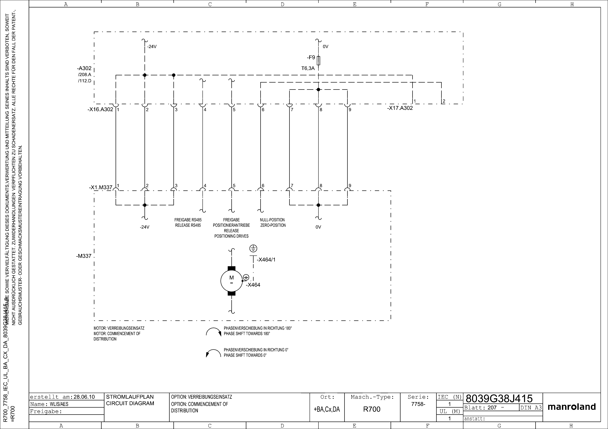

# +BA_Cx_DA — Sheet 207 of 247 — OPTION: VERREIBUNGSEINSATZ

**OPTION: COMMENCEMENT OF**

> Part of the manroland **R700** printing press IEC/UL circuit diagrams.
> Drawing class: **Stromlaufplan / Circuit diagram** (DIN A3).
> Document `+BA_Cx_DA` covers the **Printing units / main switch cabinet** machine section.

## At a glance

| Field | Value |
|---|---|
| Document | `+BA_Cx_DA`  (8039G38J415) |
| Sheet | **207** of 247 |
| Section (DE) | OPTION: VERREIBUNGSEINSATZ |
| Section (EN) | OPTION: COMMENCEMENT OF |
| Section type | CIRCUIT — Circuit diagram |
| Machine type | `R700` |
| Series | `7758` |
| Created | 28.06.10 |
| Replaces | — |
| Columns used | A, B, C, D, E, F |
| Path numbers | — |
| Labels on sheet | 51 |
| Cross-refs out | 2 |
| Cross-refs in | 22 |

**Previous:** [+BA_Cx_DA sheet 206](SHEET_0206.md) · **Next:** [+BA_Cx_DA sheet 208](SHEET_0208.md) · **Document TOC:** [_TOC.md](_TOC.md)  (+BA_Cx_DA) · **Master TOC:** [all sheets](../_MASTER_TOC.md)

## Sheet image (300 DPI, exact vector render)



_Rendered directly from the PDF vector layer at 300 DPI (1-bit), no OCR and no resampling. Use it to confirm anything ambiguous in the text below._

## Cross-references on this sheet

Each entry is a wire leaving this sheet. The printed token is `/sheet.column`; the link resolves to that sheet inside the same document.

| Ref | Target sheet | Col | Path | Destination on target | Target section | From col |
|---|---|---|---|---|---|---|
| `/208.A` | [+BA_Cx_DA sheet 208](SHEET_0208.md) | A | — | — | OPTION: | A |
| `/112.D` | [+BA_Cx_DA sheet 112](SHEET_0112.md) | D | — | — | HANDTERMINAL | A |

### Incoming references (sheets that point here)

Every other sheet that sends a wire to this one. `Back-ref` is the token printed on *that* sheet; `Path` is its line number.

| From sheet | Cols | Back-ref | Path | Refs | What continues there |
|---|---|---|---|---|---|
| [+BA_Cx_DA#112](SHEET_0112.md) | D | `/112.D` | — | 1 | — |
| [+BA_Cx_DA#148](SHEET_0148.md) | A | `/148.A` | — | 9 | — |
| [+BA_Cx_DA#172](SHEET_0172.md) | A | `/172.A` | — | 9 | — |
| [+BA_Cx_DA#173](SHEET_0173.md) | A | `/173.A` | — | 2 | — |
| [+BA_Cx_DA#208](SHEET_0208.md) | A | `/208.A` | — | 1 | — |


## Devices on this sheet

| Tag | Class | Class meaning (IEC) | Col | Sub | Terminal | Sign |
|---|---|---|---|---|---|---|
| `A302` | A | Baugruppe / assembly, module, PC board | A | — | — | — |
| `X464/1` | X | Klemme / terminal, plug connector | D | 1 | — | — |
| `X464` | X | Klemme / terminal, plug connector | D | — | — | — |
| `F9` | F | Schutz / protection device (fuse, circuit breaker) | D | — | — | — |
| `X1.M337` | — | cross-device reference | A | — | — | — |
| `X16.A302` | — | cross-device reference | A | — | — | — |
| `X17.A302` | — | cross-device reference | F | — | — | — |

## Potentials / nets

| Potential | Count | Columns | Attached devices | Terminals |
|---|---|---|---|---|
| `0V` | 2 | D, E | — | — |
| `24V` | 2 | B | — | — |
| `M337` | 1 | A | — | — |


A potential such as `L24+/4` or `M24+` is a named supply/return rail; every place it appears on this sheet is electrically common.

## Wire-end annotations (grouped as printed)

A wire that continues elsewhere is annotated with a small cluster: the destination description, the path/line number `#NN`, and the `/sheet.column` cross reference. Each row below is one such cluster exactly as it is grouped on the drawing.

| Col | Y | Path | Cross-ref | Text on the wire |
|---|---|---|---|---|
| E | 87.4 | — | — | `0V` |
| B | 87.5 | — | — | `24V` |
| D | 108.0 | — | — | `F9` |
| A | 129.3 | — | — | `A302` |
| D | 129.6 | — | — | `T6,3A` |
| A | 142.3 | — | `/208.A`, `/112.D` | — |
| F | 194.5 | — | — | `1 2` |
| F | 207.2 | — | — | `X17.A302` |
| C | 210.1 | — | — | `X16.A302 1 2 3 4 5 6 7 8 9` |
| C | 360.3 | — | — | `X1.M337 1 2 3 4 5 6 7 8 9` |
| C | 428.6 | — | — | `FREIGABE RS485` |
| C | 428.6 | — | — | `POSITIONIERANTRIEBE FREIGABE` |
| D | 428.6 | — | — | `NULL POSITION` |
| C | 439.3 | — | — | `RELEASE RS485` |
| D | 439.3 | — | — | `ZERO POSITION` |
| C | 441.8 | — | — | `24V 0V` |
| C | 449.9 | — | — | `POSITIONING DRIVES RELEASE` |
| A | 497.8 | — | — | `M337` |
| D | 504.9 | — | — | `X464/1` |
| C | 540.3 | — | — | `M` |
| D | 554.5 | — | — | `X464` |
| B | 641.3 | — | — | `DISTRIBUTION MOTOR: VERREIBUNGSEINSATZ MOTOR: COMMENCEMENT OF` |
| D | 641.3 | — | — | `PHASENVERSCHIEBUNG IN RICHTUNG 180° PHASE SHIFT TOWARDS 180°` |
| D | 683.8 | — | — | `PHASENVERSCHIEBUNG IN RICHTUNG 0° PHASE SHIFT TOWARDS 0°` |


## Notes and free text on this sheet

| Text | Col | Y (pt) |
|---|---|---|
| `MOTOR: VERREIBUNGSEINSATZ` | B | 641.26 |
| `MOTOR: COMMENCEMENT OF` | B | 651.92 |
| `DISTRIBUTION` | B | 662.5 |
| `M` | C | 540.33 |
| `T6,3A` | D | 129.6 |
| `FREIGABE` | C | 428.61 |
| `POSITIONIERANTRIEBE` | C | 439.27 |
| `RELEASE` | C | 449.88 |
| `POSITIONING DRIVES` | C | 460.54 |
| `FREIGABE RS485` | C | 428.64 |
| `RELEASE RS485` | C | 439.28 |
| `NULL POSITION` | D | 428.65 |
| `ZERO POSITION` | D | 439.29 |
| `PHASENVERSCHIEBUNG IN RICHTUNG 0°` | D | 683.78 |
| `PHASE SHIFT TOWARDS 0°` | C | 694.38 |
| `PHASENVERSCHIEBUNG IN RICHTUNG 180°` | D | 641.27 |
| `PHASE SHIFT TOWARDS 180°` | D | 651.86 |

## Complete label inventory (exact text from the drawing)

Every text object inside the drawing area of this sheet, in DIN reading order (column A→H, then top→bottom). This is the authoritative list: if a string is not here it is not printed on this sheet.

| Col | Y | X | Dir | Type | Text |
|---|---|---|---|---|---|
| A | 129.3 | 150.8 | → | device tag | `A302` |
| A | 142.4 | 153.1 | → | cross-reference | `/208.A` |
| A | 154.8 | 153.1 | → | cross-reference | `/112.D` |
| A | 210.1 | 171.5 | → | device ref | `X16.A302` |
| A | 363.1 | 174.3 | → | device ref | `X1.M337` |
| A | 497.8 | 149.1 | → | potential | `M337` |
| B | 87.5 | 288.3 | → | potential | `24V` |
| B | 211.5 | 228.8 | → | number | `1` |
| B | 211.5 | 286.0 | → | number | `2` |
| B | 360.3 | 228.8 | → | number | `1` |
| B | 360.3 | 286.0 | → | number | `2` |
| B | 441.8 | 274.1 | → | potential | `24V` |
| B | 641.3 | 183.7 | → | text | `MOTOR: VERREIBUNGSEINSATZ` |
| B | 651.9 | 183.7 | → | text | `MOTOR: COMMENCEMENT OF` |
| B | 662.5 | 183.4 | → | text | `DISTRIBUTION` |
| C | 211.5 | 342.7 | → | number | `3` |
| C | 211.5 | 399.4 | → | number | `4` |
| C | 211.5 | 456.1 | → | number | `5` |
| C | 360.3 | 342.7 | → | number | `3` |
| C | 360.3 | 399.4 | → | number | `4` |
| C | 360.3 | 456.1 | → | number | `5` |
| C | 428.6 | 341.8 | → | text | `FREIGABE RS485` |
| C | 428.6 | 437.3 | → | text | `FREIGABE` |
| C | 439.3 | 343.2 | → | text | `RELEASE RS485` |
| C | 439.3 | 417.3 | → | text | `POSITIONIERANTRIEBE` |
| C | 449.9 | 438.7 | → | text | `RELEASE` |
| C | 460.5 | 420.1 | → | text | `POSITIONING DRIVES` |
| C | 540.3 | 449.1 | → | text | `M` |
| C | 694.4 | 438.5 | → | text | `PHASE SHIFT TOWARDS 0°` |
| D | 108.0 | 601.2 | → | device tag | `F9` |
| D | 129.6 | 590.2 | → | text | `T6,3A` |
| D | 211.5 | 512.8 | → | number | `6` |
| D | 211.5 | 569.5 | → | number | `7` |
| D | 360.3 | 512.8 | → | number | `6` |
| D | 360.3 | 569.5 | → | number | `7` |
| D | 428.7 | 509.4 | → | text | `NULL POSITION` |
| D | 439.3 | 510.2 | → | text | `ZERO POSITION` |
| D | 441.8 | 618.1 | → | potential | `0V` |
| D | 504.9 | 502.9 | → | device tag | `X464/1` |
| D | 554.5 | 481.6 | → | device tag | `X464` |
| D | 641.3 | 438.5 | → | text | `PHASENVERSCHIEBUNG IN RICHTUNG 180°` |
| D | 651.9 | 438.5 | → | text | `PHASE SHIFT TOWARDS 180°` |
| D | 683.8 | 438.5 | → | text | `PHASENVERSCHIEBUNG IN RICHTUNG 0°` |
| E | 87.4 | 632.3 | → | potential | `0V` |
| E | 211.5 | 626.2 | → | number | `8` |
| E | 211.5 | 682.9 | → | number | `9` |
| E | 360.3 | 626.2 | → | number | `8` |
| E | 360.3 | 682.9 | → | number | `9` |
| F | 194.5 | 809.9 | → | number | `1` |
| F | 194.5 | 867.1 | → | number | `2` |
| F | 207.2 | 758.3 | → | device ref | `X17.A302` |

## Reading-order text block

The same content as a plain block, grouped by DIN column — convenient to paste or to match against a visual description.

```text
=== Column A ===
 129.3  150.8  devtag       A302
 142.4  153.1  xref         /208.A
 154.8  153.1  xref         /112.D
 210.1  171.5  devref       X16.A302
 363.1  174.3  devref       X1.M337
 497.8  149.1  net          M337
=== Column B ===
  87.5  288.3  net          24V
 211.5  228.8  numeric      1
 211.5  286.0  numeric      2
 360.3  228.8  numeric      1
 360.3  286.0  numeric      2
 441.8  274.1  net          24V
 641.3  183.7  text         MOTOR: VERREIBUNGSEINSATZ
 651.9  183.7  text         MOTOR: COMMENCEMENT OF
 662.5  183.4  text         DISTRIBUTION
=== Column C ===
 211.5  342.7  numeric      3
 211.5  399.4  numeric      4
 211.5  456.1  numeric      5
 360.3  342.7  numeric      3
 360.3  399.4  numeric      4
 360.3  456.1  numeric      5
 428.6  341.8  text         FREIGABE RS485
 428.6  437.3  text         FREIGABE
 439.3  343.2  text         RELEASE RS485
 439.3  417.3  text         POSITIONIERANTRIEBE
 449.9  438.7  text         RELEASE
 460.5  420.1  text         POSITIONING DRIVES
 540.3  449.1  text         M
 694.4  438.5  text         PHASE SHIFT TOWARDS 0°
=== Column D ===
 108.0  601.2  devtag       F9
 129.6  590.2  text         T6,3A
 211.5  512.8  numeric      6
 211.5  569.5  numeric      7
 360.3  512.8  numeric      6
 360.3  569.5  numeric      7
 428.7  509.4  text         NULL POSITION
 439.3  510.2  text         ZERO POSITION
 441.8  618.1  net          0V
 504.9  502.9  devtag       X464/1
 554.5  481.6  devtag       X464
 641.3  438.5  text         PHASENVERSCHIEBUNG IN RICHTUNG 180°
 651.9  438.5  text         PHASE SHIFT TOWARDS 180°
 683.8  438.5  text         PHASENVERSCHIEBUNG IN RICHTUNG 0°
=== Column E ===
  87.4  632.3  net          0V
 211.5  626.2  numeric      8
 211.5  682.9  numeric      9
 360.3  626.2  numeric      8
 360.3  682.9  numeric      9
=== Column F ===
 194.5  809.9  numeric      1
 194.5  867.1  numeric      2
 207.2  758.3  devref       X17.A302
```

---
_Generated from the PDF vector text layer; no OCR. Source: `R700_7758_IEC_UL_BA_CX_DA_8039G38J415_p`, sheet 207._
