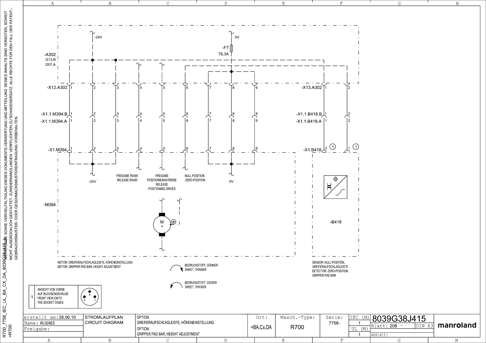

# +BA_Cx_DA — Sheet 208 of 247 — OPTION:

**GREIFERAUFSCHLAGLEISTE, HÖHENEINSTELLUNG**

> Part of the manroland **R700** printing press IEC/UL circuit diagrams.
> Drawing class: **Stromlaufplan / Circuit diagram** (DIN A3).
> Document `+BA_Cx_DA` covers the **Printing units / main switch cabinet** machine section.

## At a glance

| Field | Value |
|---|---|
| Document | `+BA_Cx_DA`  (8039G38J415) |
| Sheet | **208** of 247 |
| Section (DE) | OPTION: |
| Section (EN) | GREIFERAUFSCHLAGLEISTE, HÖHENEINSTELLUNG |
| Section type | CIRCUIT — Circuit diagram |
| Machine type | `R700` |
| Series | `7758` |
| Created | 28.06.10 |
| Replaces | — |
| Columns used | A, B, C, D, E, F |
| Path numbers | — |
| Labels on sheet | 92 |
| Cross-refs out | 2 |
| Cross-refs in | 46 |

**Previous:** [+BA_Cx_DA sheet 207](SHEET_0207.md) · **Next:** [+BA_Cx_DA sheet 209](SHEET_0209.md) · **Document TOC:** [_TOC.md](_TOC.md)  (+BA_Cx_DA) · **Master TOC:** [all sheets](../_MASTER_TOC.md)

## Sheet image (300 DPI, exact vector render)



_Rendered directly from the PDF vector layer at 300 DPI (1-bit), no OCR and no resampling. Use it to confirm anything ambiguous in the text below._

## Cross-references on this sheet

Each entry is a wire leaving this sheet. The printed token is `/sheet.column`; the link resolves to that sheet inside the same document.

| Ref | Target sheet | Col | Path | Destination on target | Target section | From col |
|---|---|---|---|---|---|---|
| `/213.B` | [+BA_Cx_DA sheet 213](SHEET_0213.md) | B | — | — | OPTION: VORDERMARKENEINSTELLUNG | A |
| `/207.A` | [+BA_Cx_DA sheet 207](SHEET_0207.md) | A | — | — | OPTION: VERREIBUNGSEINSATZ | A |

### Incoming references (sheets that point here)

Every other sheet that sends a wire to this one. `Back-ref` is the token printed on *that* sheet; `Path` is its line number.

| From sheet | Cols | Back-ref | Path | Refs | What continues there |
|---|---|---|---|---|---|
| [+BA_Cx_DA#146](SHEET_0146.md) | B, C | `/146.B`, `/146.C` | — | 6 | — |
| [+BA_Cx_DA#148](SHEET_0148.md) | C, E | `/148.C`, `/148.E` | — | 27 | — |
| [+BA_Cx_DA#169](SHEET_0169.md) | E | `/169.E` | — | 9 | — |
| [+BA_Cx_DA#170](SHEET_0170.md) | B | `/170.B` | — | 2 | — |
| [+BA_Cx_DA#207](SHEET_0207.md) | A | `/207.A` | — | 1 | — |
| [+BA_Cx_DA#213](SHEET_0213.md) | B | `/213.B` | — | 1 | — |


## Devices on this sheet

| Tag | Class | Class meaning (IEC) | Col | Sub | Terminal | Sign |
|---|---|---|---|---|---|---|
| `B418` | B | Umformer / transducer, sensor | F | — | — | — |
| `A302` | A | Baugruppe / assembly, module, PC board | A | — | — | — |
| `F7` | F | Schutz / protection device (fuse, circuit breaker) | D | — | — | — |
| `X1.M394` | — | cross-device reference | A | — | — | — |
| `X12.A302` | — | cross-device reference | A | — | — | — |
| `X1.B418` | — | cross-device reference | E | — | — | — |
| `X13.A302` | — | cross-device reference | E | — | — | — |
| `X1.1.M394.B` | — | cross-device reference | A | — | — | — |
| `X1.1.M394.A` | — | cross-device reference | A | — | — | — |
| `X1.1.B418.B` | — | cross-device reference | E | — | — | — |
| `X1.1.B418.A` | — | cross-device reference | E | — | — | — |

## Potentials / nets

| Potential | Count | Columns | Attached devices | Terminals |
|---|---|---|---|---|
| `0V` | 2 | D | — | — |
| `24V` | 2 | B | — | — |
| `M394` | 1 | A | — | — |


A potential such as `L24+/4` or `M24+` is a named supply/return rail; every place it appears on this sheet is electrically common.

## Wire-end annotations (grouped as printed)

A wire that continues elsewhere is annotated with a small cluster: the destination description, the path/line number `#NN`, and the `/sheet.column` cross reference. Each row below is one such cluster exactly as it is grouped on the drawing.

| Col | Y | Path | Cross-ref | Text on the wire |
|---|---|---|---|---|
| C | 87.4 | — | — | `24V 0V` |
| D | 112.3 | — | — | `F7` |
| D | 128.1 | — | — | `T6,3A` |
| A | 129.3 | — | — | `A302` |
| A | 142.3 | — | `/213.B`, `/207.A` | — |
| C | 210.1 | — | — | `X12.A302 1 2 3 4 5 6 7 8 9` |
| F | 210.1 | — | — | `X13.A302 1 2` |
| A | 275.3 | — | — | `X1.1.M394.B 1` |
| B | 275.3 | — | — | `2` |
| B | 275.3 | — | — | `3` |
| C | 275.3 | — | — | `4` |
| C | 275.3 | — | — | `5` |
| C | 275.3 | — | — | `6` |
| D | 275.3 | — | — | `7` |
| D | 275.3 | — | — | `8` |
| E | 275.3 | — | — | `9` |
| E | 275.3 | — | — | `X1.1.B418.B 1` |
| F | 275.3 | — | — | `2` |
| A | 292.3 | — | — | `X1.1.M394.A 1` |
| B | 292.3 | — | — | `2` |
| B | 292.3 | — | — | `3` |
| C | 292.3 | — | — | `4` |
| C | 292.3 | — | — | `5` |
| C | 292.3 | — | — | `6` |
| D | 292.3 | — | — | `7` |
| D | 292.3 | — | — | `8` |
| E | 292.3 | — | — | `9` |
| E | 292.3 | — | — | `X1.1.B418.A 1` |
| F | 292.3 | — | — | `2` |
| F | 356.9 | — | — | `1 1` |
| C | 360.3 | — | — | `X1.M394 1 2 3 4 5 6 7 8 9` |
| F | 360.3 | — | — | `X1.B418 3 1` |
| B | 428.6 | — | — | `FREIGABE RS485` |
| C | 428.6 | — | — | `POSITIONIERANTRIEBE FREIGABE` |
| C | 428.6 | — | — | `NULL POSITION` |
| B | 439.3 | — | — | `RELEASE RS485` |
| C | 439.3 | — | — | `ZERO POSITION` |
| C | 441.8 | — | — | `24V 0V` |
| C | 449.9 | — | — | `POSITIONING DRIVES RELEASE` |
| A | 497.8 | — | — | `M394` |
| C | 540.3 | — | — | `M` |
| F | 540.3 | — | — | `B418` |
| F | 641.2 | — | — | `DETECTOR: ZERO POSITION, SENSOR: NULL POSITION, GREIFERAUFSCHLAGLEISTE` |
| B | 641.3 | — | — | `MOTOR: GREIFERAUFSCHLAGLEISTE, HÖHENEINSTELLUNG MOTOR: GRIPPER PAD BAR, HEIGHT ADJUSTMENT` |
| D | 648.4 | — | — | `BEDRUCKSTOFF, DÜNNER` |
| C | 659.0 | — | — | `SHEET, THINNER` |
| F | 673.1 | — | — | `GRIPPER PAD BAR` |
| D | 690.9 | — | — | `BEDRUCKSTOFF, DICKER` |
| C | 701.5 | — | — | `SHEET, THICKER` |
| A | 707.9 | — | — | `FRONT VIEW ONTO ANSICHT VON VORNE AUF BUCHSENGEHÄUSE` |
| A | 720.2 | — | — | `1 THE SOCKET CASES 4` |
| B | 732.9 | — | — | `3 1` |


## Reconstructed tables

This sheet carries tabular content (pin map / terminal assignment / index). The grid below was rebuilt from the drawing's own rule lines, so each row is exactly one physical row of the table.

### Table 1 — 2 data rows × 8 columns (at x=85.0, y=147.4) — **/207.A**

| X12.A302 X1.1.M394.B X1.1.M394.A X1.M394 | 1 1 1 1 |  | 2 2 2 2 |  | 3 3 3 3 | 4 4 4 4 | 5 5 5 5 |
|---|---|---|---|---|---|---|---|
| `M394 MOTOR: MOTOR:` | `GRIPPER` | `24V GREIFERAUFSCHLAGLEISTE, PAD BAR,` | `HEIGHT` | `ADJUSTMENT` | `FREIGABE RS485 RELEASE RS485 HÖHENEINSTELLUNG` | `FREIGABE POSITIONIERANTRIEBE RELEASE POSITIONING M` | `DRIVES` |
| `ANSICHT VON VORNE AUF BUCHSENGEHÄUSE FRONT VIEW ONTO THE SOCKET CASES` |  | `4 3` | `1` |  |  |  |  |


### Table 2 — 2 data rows × 3 columns (at x=453.5, y=147.4)

| 6 6 6 6 | 7 7 7 7 | 8 8 8 8 |
|---|---|---|
| `NULL POSITION ZERO POSITION BEDRUCKSTOFF, SHEET, THINNER BEDRUCKSTOFF,` | `DÜNNER DICKER` |  |
| `SHEET, THICKER` |  |  |


## Notes and free text on this sheet

| Text | Col | Y (pt) |
|---|---|---|
| `M` | C | 540.33 |
| `MOTOR: GREIFERAUFSCHLAGLEISTE, HÖHENEINSTELLUNG` | B | 641.27 |
| `MOTOR: GRIPPER PAD BAR, HEIGHT ADJUSTMENT` | B | 651.89 |
| `SENSOR: NULL POSITION,` | F | 641.25 |
| `GREIFERAUFSCHLAGLEISTE` | F | 651.89 |
| `DETECTOR: ZERO POSITION,` | F | 662.51 |
| `GRIPPER PAD BAR` | F | 673.14 |
| `T6,3A` | D | 128.12 |
| `FREIGABE` | C | 428.61 |
| `POSITIONIERANTRIEBE` | C | 439.27 |
| `RELEASE` | C | 449.88 |
| `POSITIONING DRIVES` | C | 460.54 |
| `FREIGABE RS485` | B | 428.64 |
| `RELEASE RS485` | B | 439.28 |
| `NULL POSITION` | C | 428.65 |
| `ZERO POSITION` | C | 439.29 |
| `ANSICHT VON VORNE` | A | 707.88 |
| `AUF BUCHSENGEHÄUSE` | A | 718.51 |
| `FRONT VIEW ONTO` | A | 729.1 |
| `THE SOCKET CASES` | A | 739.75 |
| `BEDRUCKSTOFF, DÜNNER` | D | 648.35 |
| `SHEET, THINNER` | C | 658.97 |
| `BEDRUCKSTOFF, DICKER` | D | 690.86 |
| `SHEET, THICKER` | C | 701.49 |

## Complete label inventory (exact text from the drawing)

Every text object inside the drawing area of this sheet, in DIN reading order (column A→H, then top→bottom). This is the authoritative list: if a string is not here it is not printed on this sheet.

| Col | Y | X | Dir | Type | Text |
|---|---|---|---|---|---|
| A | 129.3 | 108.3 | → | device tag | `A302` |
| A | 142.4 | 110.8 | → | cross-reference | `/213.B` |
| A | 154.8 | 110.6 | → | cross-reference | `/207.A` |
| A | 210.1 | 114.8 | → | device ref | `X12.A302` |
| A | 211.5 | 172.1 | → | number | `1` |
| A | 275.3 | 100.3 | → | device ref | `X1.1.M394.B` |
| A | 275.3 | 172.1 | → | number | `1` |
| A | 292.3 | 172.1 | → | number | `1` |
| A | 293.0 | 99.5 | → | device ref | `X1.1.M394.A` |
| A | 360.3 | 172.1 | → | number | `1` |
| A | 363.1 | 117.6 | → | device ref | `X1.M394` |
| A | 497.8 | 106.6 | → | potential | `M394` |
| A | 707.9 | 92.1 | → | text | `ANSICHT VON VORNE` |
| A | 718.5 | 92.1 | → | text | `AUF BUCHSENGEHÄUSE` |
| A | 724.5 | 75.4 | → | number | `1` |
| A | 729.1 | 91.3 | → | text | `FRONT VIEW ONTO` |
| A | 739.8 | 91.8 | → | text | `THE SOCKET CASES` |
| B | 87.5 | 231.6 | → | potential | `24V` |
| B | 211.5 | 229.3 | → | number | `2` |
| B | 211.5 | 286.0 | → | number | `3` |
| B | 275.3 | 229.3 | → | number | `2` |
| B | 275.3 | 286.0 | → | number | `3` |
| B | 292.3 | 229.3 | → | number | `2` |
| B | 292.3 | 286.0 | → | number | `3` |
| B | 360.3 | 229.3 | → | number | `2` |
| B | 360.3 | 286.0 | → | number | `3` |
| B | 428.6 | 285.1 | → | text | `FREIGABE RS485` |
| B | 439.3 | 286.5 | → | text | `RELEASE RS485` |
| B | 441.8 | 217.4 | → | potential | `24V` |
| B | 641.3 | 141.2 | → | text | `MOTOR: GREIFERAUFSCHLAGLEISTE, HÖHENEINSTELLUNG` |
| B | 651.9 | 141.2 | → | text | `MOTOR: GRIPPER PAD BAR, HEIGHT ADJUSTMENT` |
| B | 720.2 | 217.7 | → | number | `4` |
| B | 732.9 | 204.9 | → | number | `3` |
| B | 732.9 | 230.9 | → | number | `1` |
| C | 211.5 | 342.7 | → | number | `4` |
| C | 211.5 | 399.4 | → | number | `5` |
| C | 211.5 | 456.1 | → | number | `6` |
| C | 275.3 | 342.7 | → | number | `4` |
| C | 275.3 | 399.4 | → | number | `5` |
| C | 275.3 | 456.1 | → | number | `6` |
| C | 292.3 | 342.7 | → | number | `4` |
| C | 292.3 | 399.4 | → | number | `5` |
| C | 292.3 | 456.1 | → | number | `6` |
| C | 360.3 | 342.7 | → | number | `4` |
| C | 360.3 | 399.4 | → | number | `5` |
| C | 360.3 | 456.1 | → | number | `6` |
| C | 428.6 | 380.6 | → | text | `FREIGABE` |
| C | 428.7 | 452.7 | → | text | `NULL POSITION` |
| C | 439.3 | 360.6 | → | text | `POSITIONIERANTRIEBE` |
| C | 439.3 | 453.5 | → | text | `ZERO POSITION` |
| C | 449.9 | 382.0 | → | text | `RELEASE` |
| C | 460.5 | 363.4 | → | text | `POSITIONING DRIVES` |
| C | 540.3 | 392.5 | → | text | `M` |
| C | 659.0 | 453.3 | → | text | `SHEET, THINNER` |
| C | 701.5 | 453.3 | → | text | `SHEET, THICKER` |
| D | 87.4 | 575.6 | → | potential | `0V` |
| D | 112.3 | 544.5 | → | device tag | `F7` |
| D | 128.1 | 534.4 | → | text | `T6,3A` |
| D | 211.5 | 512.8 | → | number | `7` |
| D | 211.5 | 569.5 | → | number | `8` |
| D | 275.3 | 512.8 | → | number | `7` |
| D | 275.3 | 569.5 | → | number | `8` |
| D | 292.3 | 512.8 | → | number | `7` |
| D | 292.3 | 569.5 | → | number | `8` |
| D | 360.3 | 512.8 | → | number | `7` |
| D | 360.3 | 569.5 | → | number | `8` |
| D | 441.8 | 561.4 | → | potential | `0V` |
| D | 648.4 | 452.7 | → | text | `BEDRUCKSTOFF, DÜNNER` |
| D | 690.9 | 452.7 | → | text | `BEDRUCKSTOFF, DICKER` |
| E | 210.1 | 738.4 | → | device ref | `X13.A302` |
| E | 211.5 | 626.2 | → | number | `9` |
| E | 275.3 | 626.2 | → | number | `9` |
| E | 275.3 | 725.7 | → | device ref | `X1.1.B418.B` |
| E | 292.3 | 626.2 | → | number | `9` |
| E | 293.0 | 724.8 | → | device ref | `X1.1.B418.A` |
| E | 360.3 | 626.2 | → | number | `9` |
| E | 363.1 | 743.0 | → | device ref | `X1.B418` |
| F | 211.5 | 795.7 | → | number | `1` |
| F | 211.5 | 852.9 | → | number | `2` |
| F | 275.3 | 795.7 | → | number | `1` |
| F | 275.3 | 852.9 | → | number | `2` |
| F | 292.3 | 795.7 | → | number | `1` |
| F | 292.3 | 852.9 | → | number | `2` |
| F | 356.9 | 813.2 | → | number | `1` |
| F | 356.9 | 869.9 | → | number | `1` |
| F | 360.3 | 796.3 | → | number | `3` |
| F | 360.3 | 852.4 | → | number | `1` |
| F | 540.3 | 808.4 | → | device tag | `B418` |
| F | 641.3 | 765.1 | → | text | `SENSOR: NULL POSITION,` |
| F | 651.9 | 765.1 | → | text | `GREIFERAUFSCHLAGLEISTE` |
| F | 662.5 | 764.5 | → | text | `DETECTOR: ZERO POSITION,` |
| F | 673.1 | 765.1 | → | text | `GRIPPER PAD BAR` |

## Reading-order text block

The same content as a plain block, grouped by DIN column — convenient to paste or to match against a visual description.

```text
=== Column A ===
 129.3  108.3  devtag       A302
 142.4  110.8  xref         /213.B
 154.8  110.6  xref         /207.A
 210.1  114.8  devref       X12.A302
 211.5  172.1  numeric      1
 275.3  100.3  devref       X1.1.M394.B
 275.3  172.1  numeric      1
 292.3  172.1  numeric      1
 293.0   99.5  devref       X1.1.M394.A
 360.3  172.1  numeric      1
 363.1  117.6  devref       X1.M394
 497.8  106.6  net          M394
 707.9   92.1  text         ANSICHT VON VORNE
 718.5   92.1  text         AUF BUCHSENGEHÄUSE
 724.5   75.4  numeric      1
 729.1   91.3  text         FRONT VIEW ONTO
 739.8   91.8  text         THE SOCKET CASES
=== Column B ===
  87.5  231.6  net          24V
 211.5  229.3  numeric      2
 211.5  286.0  numeric      3
 275.3  229.3  numeric      2
 275.3  286.0  numeric      3
 292.3  229.3  numeric      2
 292.3  286.0  numeric      3
 360.3  229.3  numeric      2
 360.3  286.0  numeric      3
 428.6  285.1  text         FREIGABE RS485
 439.3  286.5  text         RELEASE RS485
 441.8  217.4  net          24V
 641.3  141.2  text         MOTOR: GREIFERAUFSCHLAGLEISTE, HÖHENEINSTELLUNG
 651.9  141.2  text         MOTOR: GRIPPER PAD BAR, HEIGHT ADJUSTMENT
 720.2  217.7  numeric      4
 732.9  204.9  numeric      3
 732.9  230.9  numeric      1
=== Column C ===
 211.5  342.7  numeric      4
 211.5  399.4  numeric      5
 211.5  456.1  numeric      6
 275.3  342.7  numeric      4
 275.3  399.4  numeric      5
 275.3  456.1  numeric      6
 292.3  342.7  numeric      4
 292.3  399.4  numeric      5
 292.3  456.1  numeric      6
 360.3  342.7  numeric      4
 360.3  399.4  numeric      5
 360.3  456.1  numeric      6
 428.6  380.6  text         FREIGABE
 428.7  452.7  text         NULL POSITION
 439.3  360.6  text         POSITIONIERANTRIEBE
 439.3  453.5  text         ZERO POSITION
 449.9  382.0  text         RELEASE
 460.5  363.4  text         POSITIONING DRIVES
 540.3  392.5  text         M
 659.0  453.3  text         SHEET, THINNER
 701.5  453.3  text         SHEET, THICKER
=== Column D ===
  87.4  575.6  net          0V
 112.3  544.5  devtag       F7
 128.1  534.4  text         T6,3A
 211.5  512.8  numeric      7
 211.5  569.5  numeric      8
 275.3  512.8  numeric      7
 275.3  569.5  numeric      8
 292.3  512.8  numeric      7
 292.3  569.5  numeric      8
 360.3  512.8  numeric      7
 360.3  569.5  numeric      8
 441.8  561.4  net          0V
 648.4  452.7  text         BEDRUCKSTOFF, DÜNNER
 690.9  452.7  text         BEDRUCKSTOFF, DICKER
=== Column E ===
 210.1  738.4  devref       X13.A302
 211.5  626.2  numeric      9
 275.3  626.2  numeric      9
 275.3  725.7  devref       X1.1.B418.B
 292.3  626.2  numeric      9
 293.0  724.8  devref       X1.1.B418.A
 360.3  626.2  numeric      9
 363.1  743.0  devref       X1.B418
=== Column F ===
 211.5  795.7  numeric      1
 211.5  852.9  numeric      2
 275.3  795.7  numeric      1
 275.3  852.9  numeric      2
 292.3  795.7  numeric      1
 292.3  852.9  numeric      2
 356.9  813.2  numeric      1
 356.9  869.9  numeric      1
 360.3  796.3  numeric      3
 360.3  852.4  numeric      1
 540.3  808.4  devtag       B418
 641.3  765.1  text         SENSOR: NULL POSITION,
 651.9  765.1  text         GREIFERAUFSCHLAGLEISTE
 662.5  764.5  text         DETECTOR: ZERO POSITION,
 673.1  765.1  text         GRIPPER PAD BAR
```

---
_Generated from the PDF vector text layer; no OCR. Source: `R700_7758_IEC_UL_BA_CX_DA_8039G38J415_p`, sheet 208._
