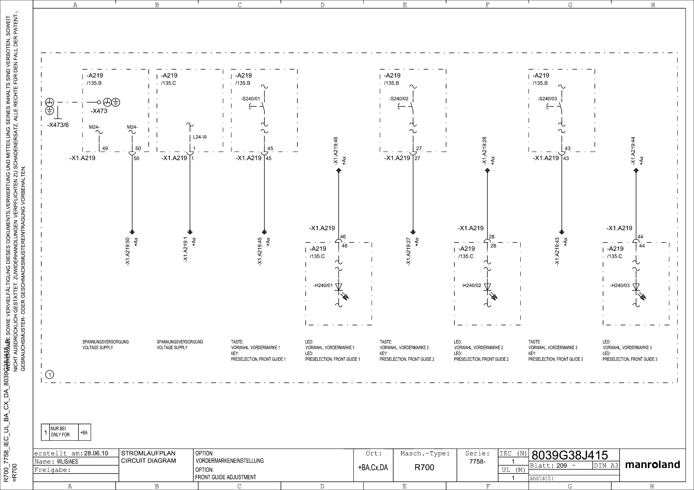

# +BA_Cx_DA — Sheet 209 of 247 — OPTION:

**VORDERMARKENEINSTELLUNG**

> Part of the manroland **R700** printing press IEC/UL circuit diagrams.
> Drawing class: **Stromlaufplan / Circuit diagram** (DIN A3).
> Document `+BA_Cx_DA` covers the **Printing units / main switch cabinet** machine section.

## At a glance

| Field | Value |
|---|---|
| Document | `+BA_Cx_DA`  (8039G38J415) |
| Sheet | **209** of 247 |
| Section (DE) | OPTION: |
| Section (EN) | VORDERMARKENEINSTELLUNG |
| Section type | CIRCUIT — Circuit diagram |
| Machine type | `R700` |
| Series | `7758` |
| Created | 28.06.10 |
| Replaces | — |
| Columns used | A, B, C, D, E, F, G, H |
| Path numbers | — |
| Labels on sheet | 101 |
| Cross-refs out | 8 |
| Cross-refs in | 16 |

**Previous:** [+BA_Cx_DA sheet 208](SHEET_0208.md) · **Next:** [+BA_Cx_DA sheet 210](SHEET_0210.md) · **Document TOC:** [_TOC.md](_TOC.md)  (+BA_Cx_DA) · **Master TOC:** [all sheets](../_MASTER_TOC.md)

## Sheet image (300 DPI, exact vector render)



_Rendered directly from the PDF vector layer at 300 DPI (1-bit), no OCR and no resampling. Use it to confirm anything ambiguous in the text below._

## Cross-references on this sheet

Each entry is a wire leaving this sheet. The printed token is `/sheet.column`; the link resolves to that sheet inside the same document.

| Ref | Target sheet | Col | Path | Destination on target | Target section | From col |
|---|---|---|---|---|---|---|
| `/135.B` | [+BA_Cx_DA sheet 135](SHEET_0135.md) | B | — | A219 | REFERENZMODUL | A |
| `/135.C` | [+BA_Cx_DA sheet 135](SHEET_0135.md) | C | — | A219 | REFERENZMODUL | B |
| `/135.B` | [+BA_Cx_DA sheet 135](SHEET_0135.md) | B | — | A219 | REFERENZMODUL | C |
| `/135.B` | [+BA_Cx_DA sheet 135](SHEET_0135.md) | B | — | A219 | REFERENZMODUL | E |
| `/135.B` | [+BA_Cx_DA sheet 135](SHEET_0135.md) | B | — | A219 | REFERENZMODUL | G |
| `/135.C` | [+BA_Cx_DA sheet 135](SHEET_0135.md) | C | — | A219 | REFERENZMODUL | D |
| `/135.C` | [+BA_Cx_DA sheet 135](SHEET_0135.md) | C | — | A219 | REFERENZMODUL | F |
| `/135.C` | [+BA_Cx_DA sheet 135](SHEET_0135.md) | C | — | A219 | REFERENZMODUL | H |

### Incoming references (sheets that point here)

Every other sheet that sends a wire to this one. `Back-ref` is the token printed on *that* sheet; `Path` is its line number.

| From sheet | Cols | Back-ref | Path | Refs | What continues there |
|---|---|---|---|---|---|
| [+BA_Cx_DA#135](SHEET_0135.md) | B, C | `/135.B`, `/135.C` | — | 8 | — |
| [+BA_Cx_DA#140](SHEET_0140.md) | G, H | `/140.G`, `/140.H` | — | 8 | — |


## Devices on this sheet

| Tag | Class | Class meaning (IEC) | Col | Sub | Terminal | Sign |
|---|---|---|---|---|---|---|
| `A219` | A | Baugruppe / assembly, module, PC board | A | — | — | — |
| `A219` | A | Baugruppe / assembly, module, PC board | B | — | — | — |
| `S240/01` | S | Schalter / switch | C | 01 | — | — |
| `A219` | A | Baugruppe / assembly, module, PC board | C | — | — | — |
| `H240/01` | H | Signalleuchte / indicator lamp | D | 01 | — | — |
| `A219` | A | Baugruppe / assembly, module, PC board | D | — | — | — |
| `S240/02` | S | Schalter / switch | E | 02 | — | — |
| `A219` | A | Baugruppe / assembly, module, PC board | E | — | — | — |
| `H240/02` | H | Signalleuchte / indicator lamp | F | 02 | — | — |
| `A219` | A | Baugruppe / assembly, module, PC board | F | — | — | — |
| `S240/03` | S | Schalter / switch | G | 03 | — | — |
| `A219` | A | Baugruppe / assembly, module, PC board | G | — | — | — |
| `H240/03` | H | Signalleuchte / indicator lamp | H | 03 | — | — |
| `A219` | A | Baugruppe / assembly, module, PC board | H | — | — | — |
| `X473/6` | X | Klemme / terminal, plug connector | A | 6 | — | — |
| `X473` | X | Klemme / terminal, plug connector | A | — | — | — |
| `X1.A219` | — | cross-device reference | A | — | — | — |
| `X1.A219` | — | cross-device reference | B | — | — | — |
| `X1.A219` | — | cross-device reference | C | — | — | — |
| `X1.A219` | — | cross-device reference | D | — | — | — |
| `X1.A219` | — | cross-device reference | E | — | — | — |
| `X1.A219` | — | cross-device reference | F | — | — | — |
| `X1.A219` | — | cross-device reference | G | — | — | — |
| `X1.A219` | — | cross-device reference | H | — | — | — |
| `X1.A219:50` | — | cross-device reference | B | — | 50 | — |
| `X1.A219:1` | — | cross-device reference | B | — | 1 | — |
| `X1.A219:45` | — | cross-device reference | C | — | 45 | — |
| `X1.A219:27` | — | cross-device reference | E | — | 27 | — |
| `X1.A219:43` | — | cross-device reference | G | — | 43 | — |
| `X1.A219:46` | — | cross-device reference | D | — | 46 | — |
| `X1.A219:28` | — | cross-device reference | F | — | 28 | — |
| `X1.A219:44` | — | cross-device reference | H | — | 44 | — |

## Potentials / nets

| Potential | Count | Columns | Attached devices | Terminals |
|---|---|---|---|---|
| `M24` | 2 | A, B | — | — |


A potential such as `L24+/4` or `M24+` is a named supply/return rail; every place it appears on this sheet is electrically common.

## Wire-end annotations (grouped as printed)

A wire that continues elsewhere is annotated with a small cluster: the destination description, the path/line number `#NN`, and the `/sheet.column` cross reference. Each row below is one such cluster exactly as it is grouped on the drawing.

| Col | Y | Path | Cross-ref | Text on the wire |
|---|---|---|---|---|
| A | 125.0 | — | `/135.B` | `A219` |
| B | 125.0 | — | `/135.C` | `A219` |
| C | 125.0 | — | `/135.B` | `A219` |
| E | 125.0 | — | `/135.B` | `A219` |
| G | 125.0 | — | `/135.B` | `A219` |
| C | 166.1 | — | — | `S240/01` |
| E | 166.1 | — | — | `S240/02` |
| G | 166.1 | — | — | `S240/03` |
| A | 186.0 | — | — | `X473` |
| A | 210.1 | — | — | `X473/6` |
| A | 214.8 | — | — | `M24 M24` |
| C | 231.8 | — | — | `L24 \9` |
| D | 235.0 | — | — | `X1.A219:46` |
| F | 235.0 | — | — | `X1.A219:28` |
| H | 235.0 | — | — | `X1.A219:44` |
| B | 251.2 | — | — | `49 50` |
| B | 251.2 | — | — | `1` |
| C | 251.2 | — | — | `45` |
| E | 251.2 | — | — | `27` |
| G | 251.2 | — | — | `43` |
| A | 266.8 | — | — | `X1.A219 50` |
| B | 266.8 | — | — | `X1.A219 1` |
| C | 266.8 | — | — | `X1.A219 45` |
| E | 266.8 | — | — | `X1.A219 27` |
| G | 266.8 | — | — | `X1.A219 43` |
| D | 268.7 | — | — | `+Ax` |
| F | 268.7 | — | — | `+Ax` |
| H | 268.7 | — | — | `+Ax` |
| D | 387.2 | — | — | `X1.A219 46` |
| F | 387.2 | — | — | `X1.A219 28` |
| H | 387.2 | — | — | `X1.A219 44` |
| B | 406.5 | — | — | `X1.A219:1` |
| B | 407.9 | — | — | `X1.A219:50` |
| C | 407.9 | — | — | `X1.A219:45` |
| E | 407.9 | — | — | `X1.A219:27` |
| G | 407.9 | — | — | `X1.A219:43` |
| B | 408.2 | — | — | `+Ax` |
| B | 408.2 | — | — | `+Ax` |
| C | 408.2 | — | — | `+Ax` |
| E | 408.2 | — | — | `+Ax` |
| G | 408.2 | — | — | `+Ax` |
| D | 418.4 | — | — | `46` |
| F | 418.4 | — | — | `28` |
| H | 418.4 | — | — | `44` |
| D | 422.7 | — | `/135.C` | `A219` |
| F | 422.7 | — | `/135.C` | `A219` |
| H | 422.7 | — | `/135.C` | `A219` |
| D | 486.9 | — | — | `H240/01` |
| F | 486.9 | — | — | `H240/02` |
| H | 486.9 | — | — | `H240/03` |
| C | 584.6 | — | — | `KEY: PRESELECTION, FRONT GUIDE 1 TASTE: VORWAHL, VORDERMARKE 1` |
| E | 584.6 | — | — | `KEY: PRESELECTION, FRONT GUIDE 2 TASTE: VORWAHL, VORDERMARKE 2` |
| G | 584.6 | — | — | `KEY: PRESELECTION, FRONT GUIDE 3 TASTE: VORWAHL, VORDERMARKE 3` |
| A | 584.7 | — | — | `SPANNUNGSVERSORGUNG VOLTAGE SUPPLY` |
| B | 584.7 | — | — | `SPANNUNGSVERSORGUNG VOLTAGE SUPPLY` |
| D | 584.7 | — | — | `LED:` |
| F | 584.7 | — | — | `LED:` |
| G | 584.7 | — | — | `LED:` |
| D | 594.6 | — | — | `LED: PRESELECTION, FRONT GUIDE 1 VORWAHL, VORDERMARKE 1` |
| F | 594.7 | — | — | `LED: PRESELECTION, FRONT GUIDE 2 VORWAHL, VORDERMARKE 2` |
| H | 594.7 | — | — | `LED: PRESELECTION, FRONT GUIDE 3 VORWAHL, VORDERMARKE 3` |
| A | 640.4 | — | — | `1` |
| A | 733.3 | — | — | `1 NUR BEI` |
| A | 740.4 | — | — | `ONLY FOR +BA` |


## Reconstructed tables

This sheet carries tabular content (pin map / terminal assignment / index). The grid below was rebuilt from the drawing's own rule lines, so each row is exactly one physical row of the table.

### Table 1 — 2 data rows × 3 columns (at x=141.7, y=119.1) — **A219 /135.B**

| X473 M24 | 49 | M24 50 |
|---|---|---|
|  |  | `50 +Ax` |
|  | `X1.A219:50` |  |


### Table 2 — 1 data rows × 2 columns (at x=269.3, y=119.1) — **A219 /135.C L24 \9 1**

| X1.A219 | 1 +Ax |
|---|---|
| `X1.A219:1` |  |


### Table 3 — 1 data rows × 2 columns (at x=396.9, y=119.1) — **A219 /135.B S240/01 45**

| X1.A219 | 45 +Ax |
|---|---|
| `X1.A219:45` |  |


### Table 4 — 1 data rows × 2 columns (at x=524.4, y=119.1) — **X1.A219:46**

| X1.A219 | +Ax 46 |
|---|---|
| `A219 /135.C H240/01` | `46` |


### Table 5 — 1 data rows × 2 columns (at x=652.0, y=119.1) — **A219 /135.B S240/02 27**

| X1.A219 | 27 +Ax |
|---|---|
| `X1.A219:27` |  |


### Table 6 — 1 data rows × 2 columns (at x=779.5, y=119.1) — **X1.A219:28**

| X1.A219 | +Ax 28 |
|---|---|
| `A219 /135.C H240/02` | `28` |


### Table 7 — 1 data rows × 2 columns (at x=907.1, y=119.1) — **A219 /135.B S240/03 43**

| X1.A219 | 43 +Ax |
|---|---|
| `X1.A219:43` |  |


### Table 8 — 1 data rows × 2 columns (at x=1034.6, y=119.1) — **X1.A219:44**

| X1.A219 | +Ax 44 |
|---|---|
| `A219 /135.C H240/03` | `44` |


## Notes and free text on this sheet

| Text | Col | Y (pt) |
|---|---|---|
| `SPANNUNGSVERSORGUNG` | A | 584.71 |
| `VOLTAGE SUPPLY` | A | 594.67 |
| `L24 \9` | C | 231.76 |
| `SPANNUNGSVERSORGUNG` | B | 584.71 |
| `VOLTAGE SUPPLY` | B | 594.67 |
| `TASTE:` | C | 584.65 |
| `VORWAHL, VORDERMARKE 1` | C | 594.65 |
| `KEY:` | C | 604.59 |
| `PRESELECTION, FRONT GUIDE 1` | C | 614.54 |
| `LED:` | D | 584.67 |
| `VORWAHL, VORDERMARKE 1` | D | 594.65 |
| `PRESELECTION, FRONT GUIDE 1` | D | 614.54 |
| `TASTE:` | E | 584.65 |
| `VORWAHL, VORDERMARKE 2` | E | 594.66 |
| `KEY:` | E | 604.59 |
| `PRESELECTION, FRONT GUIDE 2` | E | 614.55 |
| `LED:` | F | 584.67 |
| `VORWAHL, VORDERMARKE 2` | F | 594.66 |
| `PRESELECTION, FRONT GUIDE 2` | F | 614.55 |
| `TASTE:` | G | 584.65 |
| `VORWAHL, VORDERMARKE 3` | G | 594.66 |
| `KEY:` | G | 604.59 |
| `PRESELECTION, FRONT GUIDE 3` | G | 614.55 |
| `LED:` | G | 584.67 |
| `VORWAHL, VORDERMARKE 3` | H | 594.66 |
| `PRESELECTION, FRONT GUIDE 3` | H | 614.55 |
| `+Ax` | B | 408.19 |
| `+Ax` | C | 408.19 |
| `+Ax` | E | 408.19 |
| `+Ax` | G | 408.19 |
| `+Ax` | D | 268.73 |
| `+Ax` | F | 268.73 |
| `+Ax` | H | 268.73 |
| `NUR BEI` | A | 733.33 |
| `ONLY FOR` | A | 744.02 |
| `+BA` | A | 740.44 |

## Complete label inventory (exact text from the drawing)

Every text object inside the drawing area of this sheet, in DIN reading order (column A→H, then top→bottom). This is the authoritative list: if a string is not here it is not printed on this sheet.

| Col | Y | X | Dir | Type | Text |
|---|---|---|---|---|---|
| A | 125.0 | 148.5 | → | device tag | `A219` |
| A | 138.8 | 148.8 | → | cross-reference | `/135.B` |
| A | 186.0 | 155.6 | → | device tag | `X473` |
| A | 210.1 | 80.8 | → | device tag | `X473/6` |
| A | 214.8 | 152.8 | → | potential | `M24` |
| A | 251.2 | 175.5 | → | number | `49` |
| A | 266.8 | 119.3 | → | device ref | `X1.A219` |
| A | 584.7 | 141.4 | → | text | `SPANNUNGSVERSORGUNG` |
| A | 594.7 | 141.7 | → | text | `VOLTAGE SUPPLY` |
| A | 640.4 | 83.3 | → | number | `1` |
| A | 733.3 | 87.0 | → | text | `NUR BEI` |
| A | 738.7 | 75.4 | → | number | `1` |
| A | 740.4 | 137.9 | → | text | `+BA` |
| A | 744.0 | 87.6 | → | text | `ONLY FOR` |
| B | 125.0 | 276.1 | → | device tag | `A219` |
| B | 138.8 | 276.4 | → | cross-reference | `/135.C` |
| B | 214.8 | 218.0 | → | potential | `M24` |
| B | 251.2 | 232.2 | → | number | `50` |
| B | 251.2 | 330.8 | → | number | `1` |
| B | 266.8 | 276.7 | → | device ref | `X1.A219` |
| B | 268.2 | 229.3 | → | number | `50` |
| B | 268.2 | 328.0 | → | number | `1` |
| B | 406.5 | 314.2 | ↕ | device ref | `X1.A219:1` |
| B | 407.9 | 215.0 | ↕ | device ref | `X1.A219:50` |
| B | 408.2 | 229.3 | ↕ | text | `+Ax` |
| B | 408.2 | 328.5 | ↕ | text | `+Ax` |
| B | 584.7 | 269.0 | → | text | `SPANNUNGSVERSORGUNG` |
| B | 594.7 | 269.3 | → | text | `VOLTAGE SUPPLY` |
| C | 125.0 | 403.7 | → | device tag | `A219` |
| C | 138.8 | 403.9 | → | cross-reference | `/135.B` |
| C | 166.1 | 413.3 | → | device tag | `S240/01` |
| C | 231.8 | 331.1 | → | text | `L24 \9` |
| C | 251.2 | 458.9 | → | number | `45` |
| C | 266.8 | 404.2 | → | device ref | `X1.A219` |
| C | 268.2 | 456.1 | → | number | `45` |
| C | 407.9 | 441.8 | ↕ | device ref | `X1.A219:45` |
| C | 408.2 | 456.0 | ↕ | text | `+Ax` |
| C | 584.6 | 396.6 | → | text | `TASTE:` |
| C | 594.7 | 396.9 | → | text | `VORWAHL, VORDERMARKE 1` |
| C | 604.6 | 396.3 | → | text | `KEY:` |
| C | 614.5 | 396.3 | → | text | `PRESELECTION, FRONT GUIDE 1` |
| D | 235.0 | 572.2 | ↕ | device ref | `X1.A219:46` |
| D | 268.7 | 586.4 | ↕ | text | `+Ax` |
| D | 387.2 | 530.4 | → | device ref | `X1.A219` |
| D | 402.8 | 583.7 | → | number | `46` |
| D | 418.4 | 586.5 | → | number | `46` |
| D | 422.7 | 531.2 | → | device tag | `A219` |
| D | 436.5 | 531.5 | → | cross-reference | `/135.C` |
| D | 486.9 | 537.4 | → | device tag | `H240/01` |
| D | 584.7 | 523.8 | → | text | `LED:` |
| D | 594.7 | 524.4 | → | text | `VORWAHL, VORDERMARKE 1` |
| D | 604.6 | 523.8 | → | text | `LED:` |
| D | 614.5 | 523.8 | → | text | `PRESELECTION, FRONT GUIDE 1` |
| E | 125.0 | 658.8 | → | device tag | `A219` |
| E | 138.8 | 659.1 | → | cross-reference | `/135.B` |
| E | 166.1 | 667.6 | → | device tag | `S240/02` |
| E | 251.2 | 714.0 | → | number | `27` |
| E | 266.8 | 659.3 | → | device ref | `X1.A219` |
| E | 268.2 | 711.2 | → | number | `27` |
| E | 407.9 | 696.9 | ↕ | device ref | `X1.A219:27` |
| E | 408.2 | 711.1 | ↕ | text | `+Ax` |
| E | 584.6 | 651.7 | → | text | `TASTE:` |
| E | 594.7 | 652.0 | → | text | `VORWAHL, VORDERMARKE 2` |
| E | 604.6 | 651.4 | → | text | `KEY:` |
| E | 614.5 | 651.4 | → | text | `PRESELECTION, FRONT GUIDE 2` |
| F | 235.0 | 827.3 | ↕ | device ref | `X1.A219:28` |
| F | 268.7 | 841.5 | ↕ | text | `+Ax` |
| F | 387.2 | 785.5 | → | device ref | `X1.A219` |
| F | 402.8 | 838.8 | → | number | `28` |
| F | 418.4 | 841.6 | → | number | `28` |
| F | 422.7 | 786.3 | → | device tag | `A219` |
| F | 436.5 | 786.6 | → | cross-reference | `/135.C` |
| F | 486.9 | 791.7 | → | device tag | `H240/02` |
| F | 584.7 | 779.0 | → | text | `LED:` |
| F | 594.7 | 779.5 | → | text | `VORWAHL, VORDERMARKE 2` |
| F | 604.6 | 779.0 | → | text | `LED:` |
| F | 614.5 | 779.0 | → | text | `PRESELECTION, FRONT GUIDE 2` |
| G | 125.0 | 913.9 | → | device tag | `A219` |
| G | 138.8 | 914.2 | → | cross-reference | `/135.B` |
| G | 166.1 | 922.4 | → | device tag | `S240/03` |
| G | 251.2 | 969.2 | → | number | `43` |
| G | 266.8 | 914.5 | → | device ref | `X1.A219` |
| G | 268.2 | 966.3 | → | number | `43` |
| G | 407.9 | 952.0 | ↕ | device ref | `X1.A219:43` |
| G | 408.2 | 966.3 | ↕ | text | `+Ax` |
| G | 584.6 | 906.8 | → | text | `TASTE:` |
| G | 584.7 | 1034.1 | → | text | `LED:` |
| G | 594.7 | 907.1 | → | text | `VORWAHL, VORDERMARKE 3` |
| G | 604.6 | 906.5 | → | text | `KEY:` |
| G | 604.6 | 1034.1 | → | text | `LED:` |
| G | 614.6 | 906.5 | → | text | `PRESELECTION, FRONT GUIDE 3` |
| H | 235.0 | 1082.4 | ↕ | device ref | `X1.A219:44` |
| H | 268.7 | 1096.7 | ↕ | text | `+Ax` |
| H | 387.2 | 1040.6 | → | device ref | `X1.A219` |
| H | 402.8 | 1093.9 | → | number | `44` |
| H | 418.4 | 1096.7 | → | number | `44` |
| H | 422.7 | 1041.4 | → | device tag | `A219` |
| H | 436.5 | 1041.7 | → | cross-reference | `/135.C` |
| H | 486.9 | 1046.6 | → | device tag | `H240/03` |
| H | 594.7 | 1034.6 | → | text | `VORWAHL, VORDERMARKE 3` |
| H | 614.6 | 1034.1 | → | text | `PRESELECTION, FRONT GUIDE 3` |

## Reading-order text block

The same content as a plain block, grouped by DIN column — convenient to paste or to match against a visual description.

```text
=== Column A ===
 125.0  148.5  devtag       A219
 138.8  148.8  xref         /135.B
 186.0  155.6  devtag       X473
 210.1   80.8  devtag       X473/6
 214.8  152.8  net          M24
 251.2  175.5  numeric      49
 266.8  119.3  devref       X1.A219
 584.7  141.4  text         SPANNUNGSVERSORGUNG
 594.7  141.7  text         VOLTAGE SUPPLY
 640.4   83.3  numeric      1
 733.3   87.0  text         NUR BEI
 738.7   75.4  numeric      1
 740.4  137.9  text         +BA
 744.0   87.6  text         ONLY FOR
=== Column B ===
 125.0  276.1  devtag       A219
 138.8  276.4  xref         /135.C
 214.8  218.0  net          M24
 251.2  232.2  numeric      50
 251.2  330.8  numeric      1
 266.8  276.7  devref       X1.A219
 268.2  229.3  numeric      50
 268.2  328.0  numeric      1
 406.5  314.2  devref       X1.A219:1
 407.9  215.0  devref       X1.A219:50
 408.2  229.3  text         +Ax
 408.2  328.5  text         +Ax
 584.7  269.0  text         SPANNUNGSVERSORGUNG
 594.7  269.3  text         VOLTAGE SUPPLY
=== Column C ===
 125.0  403.7  devtag       A219
 138.8  403.9  xref         /135.B
 166.1  413.3  devtag       S240/01
 231.8  331.1  text         L24 \9
 251.2  458.9  numeric      45
 266.8  404.2  devref       X1.A219
 268.2  456.1  numeric      45
 407.9  441.8  devref       X1.A219:45
 408.2  456.0  text         +Ax
 584.6  396.6  text         TASTE:
 594.7  396.9  text         VORWAHL, VORDERMARKE 1
 604.6  396.3  text         KEY:
 614.5  396.3  text         PRESELECTION, FRONT GUIDE 1
=== Column D ===
 235.0  572.2  devref       X1.A219:46
 268.7  586.4  text         +Ax
 387.2  530.4  devref       X1.A219
 402.8  583.7  numeric      46
 418.4  586.5  numeric      46
 422.7  531.2  devtag       A219
 436.5  531.5  xref         /135.C
 486.9  537.4  devtag       H240/01
 584.7  523.8  text         LED:
 594.7  524.4  text         VORWAHL, VORDERMARKE 1
 604.6  523.8  text         LED:
 614.5  523.8  text         PRESELECTION, FRONT GUIDE 1
=== Column E ===
 125.0  658.8  devtag       A219
 138.8  659.1  xref         /135.B
 166.1  667.6  devtag       S240/02
 251.2  714.0  numeric      27
 266.8  659.3  devref       X1.A219
 268.2  711.2  numeric      27
 407.9  696.9  devref       X1.A219:27
 408.2  711.1  text         +Ax
 584.6  651.7  text         TASTE:
 594.7  652.0  text         VORWAHL, VORDERMARKE 2
 604.6  651.4  text         KEY:
 614.5  651.4  text         PRESELECTION, FRONT GUIDE 2
=== Column F ===
 235.0  827.3  devref       X1.A219:28
 268.7  841.5  text         +Ax
 387.2  785.5  devref       X1.A219
 402.8  838.8  numeric      28
 418.4  841.6  numeric      28
 422.7  786.3  devtag       A219
 436.5  786.6  xref         /135.C
 486.9  791.7  devtag       H240/02
 584.7  779.0  text         LED:
 594.7  779.5  text         VORWAHL, VORDERMARKE 2
 604.6  779.0  text         LED:
 614.5  779.0  text         PRESELECTION, FRONT GUIDE 2
=== Column G ===
 125.0  913.9  devtag       A219
 138.8  914.2  xref         /135.B
 166.1  922.4  devtag       S240/03
 251.2  969.2  numeric      43
 266.8  914.5  devref       X1.A219
 268.2  966.3  numeric      43
 407.9  952.0  devref       X1.A219:43
 408.2  966.3  text         +Ax
 584.6  906.8  text         TASTE:
 584.7 1034.1  text         LED:
 594.7  907.1  text         VORWAHL, VORDERMARKE 3
 604.6  906.5  text         KEY:
 604.6 1034.1  text         LED:
 614.6  906.5  text         PRESELECTION, FRONT GUIDE 3
=== Column H ===
 235.0 1082.4  devref       X1.A219:44
 268.7 1096.7  text         +Ax
 387.2 1040.6  devref       X1.A219
 402.8 1093.9  numeric      44
 418.4 1096.7  numeric      44
 422.7 1041.4  devtag       A219
 436.5 1041.7  xref         /135.C
 486.9 1046.6  devtag       H240/03
 594.7 1034.6  text         VORWAHL, VORDERMARKE 3
 614.6 1034.1  text         PRESELECTION, FRONT GUIDE 3
```

---
_Generated from the PDF vector text layer; no OCR. Source: `R700_7758_IEC_UL_BA_CX_DA_8039G38J415_p`, sheet 209._
