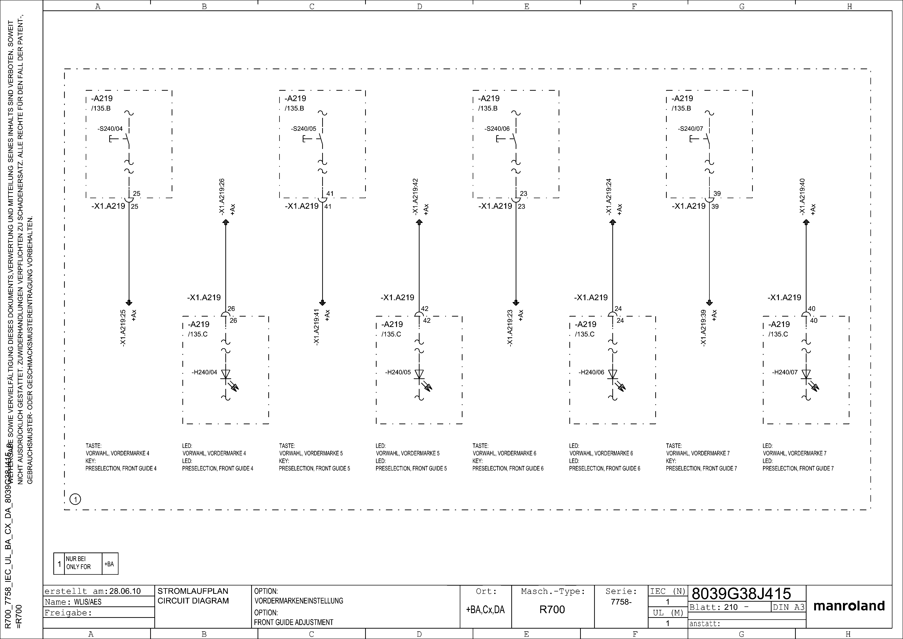

# +BA_Cx_DA — Sheet 210 of 247 — OPTION:

**VORDERMARKENEINSTELLUNG**

> Part of the manroland **R700** printing press IEC/UL circuit diagrams.
> Drawing class: **Stromlaufplan / Circuit diagram** (DIN A3).
> Document `+BA_Cx_DA` covers the **Printing units / main switch cabinet** machine section.

## At a glance

| Field | Value |
|---|---|
| Document | `+BA_Cx_DA`  (8039G38J415) |
| Sheet | **210** of 247 |
| Section (DE) | OPTION: |
| Section (EN) | VORDERMARKENEINSTELLUNG |
| Section type | CIRCUIT — Circuit diagram |
| Machine type | `R700` |
| Series | `7758` |
| Created | 28.06.10 |
| Replaces | — |
| Columns used | A, B, C, D, E, F, G, H |
| Path numbers | — |
| Labels on sheet | 101 |
| Cross-refs out | 8 |
| Cross-refs in | 16 |

**Previous:** [+BA_Cx_DA sheet 209](SHEET_0209.md) · **Next:** [+BA_Cx_DA sheet 211](SHEET_0211.md) · **Document TOC:** [_TOC.md](_TOC.md)  (+BA_Cx_DA) · **Master TOC:** [all sheets](../_MASTER_TOC.md)

## Sheet image (300 DPI, exact vector render)



_Rendered directly from the PDF vector layer at 300 DPI (1-bit), no OCR and no resampling. Use it to confirm anything ambiguous in the text below._

## Cross-references on this sheet

Each entry is a wire leaving this sheet. The printed token is `/sheet.column`; the link resolves to that sheet inside the same document.

| Ref | Target sheet | Col | Path | Destination on target | Target section | From col |
|---|---|---|---|---|---|---|
| `/135.B` | [+BA_Cx_DA sheet 135](SHEET_0135.md) | B | — | A219 | REFERENZMODUL | A |
| `/135.B` | [+BA_Cx_DA sheet 135](SHEET_0135.md) | B | — | A219 | REFERENZMODUL | C |
| `/135.B` | [+BA_Cx_DA sheet 135](SHEET_0135.md) | B | — | A219 | REFERENZMODUL | E |
| `/135.B` | [+BA_Cx_DA sheet 135](SHEET_0135.md) | B | — | A219 | REFERENZMODUL | F |
| `/135.C` | [+BA_Cx_DA sheet 135](SHEET_0135.md) | C | — | A219 | REFERENZMODUL | B |
| `/135.C` | [+BA_Cx_DA sheet 135](SHEET_0135.md) | C | — | A219 | REFERENZMODUL | D |
| `/135.C` | [+BA_Cx_DA sheet 135](SHEET_0135.md) | C | — | A219 | REFERENZMODUL | F |
| `/135.C` | [+BA_Cx_DA sheet 135](SHEET_0135.md) | C | — | A219 | REFERENZMODUL | G |

### Incoming references (sheets that point here)

Every other sheet that sends a wire to this one. `Back-ref` is the token printed on *that* sheet; `Path` is its line number.

| From sheet | Cols | Back-ref | Path | Refs | What continues there |
|---|---|---|---|---|---|
| [+BA_Cx_DA#135](SHEET_0135.md) | B, C | `/135.B`, `/135.C` | — | 8 | — |
| [+BA_Cx_DA#140](SHEET_0140.md) | G, H | `/140.G`, `/140.H` | — | 8 | — |


## Devices on this sheet

| Tag | Class | Class meaning (IEC) | Col | Sub | Terminal | Sign |
|---|---|---|---|---|---|---|
| `S240/04` | S | Schalter / switch | A | 04 | — | — |
| `A219` | A | Baugruppe / assembly, module, PC board | A | — | — | — |
| `H240/04` | H | Signalleuchte / indicator lamp | B | 04 | — | — |
| `A219` | A | Baugruppe / assembly, module, PC board | B | — | — | — |
| `S240/05` | S | Schalter / switch | C | 05 | — | — |
| `A219` | A | Baugruppe / assembly, module, PC board | C | — | — | — |
| `H240/05` | H | Signalleuchte / indicator lamp | D | 05 | — | — |
| `A219` | A | Baugruppe / assembly, module, PC board | D | — | — | — |
| `S240/06` | S | Schalter / switch | E | 06 | — | — |
| `A219` | A | Baugruppe / assembly, module, PC board | E | — | — | — |
| `H240/06` | H | Signalleuchte / indicator lamp | F | 06 | — | — |
| `A219` | A | Baugruppe / assembly, module, PC board | F | — | — | — |
| `S240/07` | S | Schalter / switch | G | 07 | — | — |
| `A219` | A | Baugruppe / assembly, module, PC board | F | — | — | — |
| `H240/07` | H | Signalleuchte / indicator lamp | G | 07 | — | — |
| `A219` | A | Baugruppe / assembly, module, PC board | G | — | — | — |
| `X1.A219` | — | cross-device reference | A | — | — | — |
| `X1.A219` | — | cross-device reference | B | — | — | — |
| `X1.A219` | — | cross-device reference | C | — | — | — |
| `X1.A219` | — | cross-device reference | D | — | — | — |
| `X1.A219` | — | cross-device reference | E | — | — | — |
| `X1.A219` | — | cross-device reference | F | — | — | — |
| `X1.A219` | — | cross-device reference | G | — | — | — |
| `X1.A219` | — | cross-device reference | G | — | — | — |
| `X1.A219:26` | — | cross-device reference | B | — | 26 | — |
| `X1.A219:42` | — | cross-device reference | D | — | 42 | — |
| `X1.A219:24` | — | cross-device reference | F | — | 24 | — |
| `X1.A219:40` | — | cross-device reference | H | — | 40 | — |
| `X1.A219:25` | — | cross-device reference | A | — | 25 | — |
| `X1.A219:41` | — | cross-device reference | C | — | 41 | — |
| `X1.A219:23` | — | cross-device reference | E | — | 23 | — |
| `X1.A219:39` | — | cross-device reference | G | — | 39 | — |

## Potentials / nets

_No named potentials on this sheet._

## Wire-end annotations (grouped as printed)

A wire that continues elsewhere is annotated with a small cluster: the destination description, the path/line number `#NN`, and the `/sheet.column` cross reference. Each row below is one such cluster exactly as it is grouped on the drawing.

| Col | Y | Path | Cross-ref | Text on the wire |
|---|---|---|---|---|
| A | 125.0 | — | `/135.B` | `A219` |
| C | 125.0 | — | `/135.B` | `A219` |
| E | 125.0 | — | `/135.B` | `A219` |
| F | 125.0 | — | `/135.B` | `A219` |
| A | 166.1 | — | — | `S240/04` |
| C | 166.1 | — | — | `S240/05` |
| E | 166.1 | — | — | `S240/06` |
| G | 166.1 | — | — | `S240/07` |
| B | 235.0 | — | — | `X1.A219:26` |
| D | 235.0 | — | — | `X1.A219:42` |
| F | 235.0 | — | — | `X1.A219:24` |
| H | 235.0 | — | — | `X1.A219:40` |
| A | 251.2 | — | — | `25` |
| C | 251.2 | — | — | `41` |
| E | 251.2 | — | — | `23` |
| G | 251.2 | — | — | `39` |
| A | 266.8 | — | — | `X1.A219 25` |
| C | 266.8 | — | — | `X1.A219 41` |
| E | 266.8 | — | — | `X1.A219 23` |
| G | 266.8 | — | — | `X1.A219 39` |
| B | 268.7 | — | — | `+Ax` |
| D | 268.7 | — | — | `+Ax` |
| F | 268.7 | — | — | `+Ax` |
| H | 268.7 | — | — | `+Ax` |
| B | 387.2 | — | — | `X1.A219 26` |
| D | 387.2 | — | — | `X1.A219 42` |
| F | 387.2 | — | — | `X1.A219 24` |
| G | 387.2 | — | — | `X1.A219 40` |
| C | 406.5 | — | — | `X1.A219:41` |
| A | 407.9 | — | — | `X1.A219:25` |
| E | 407.9 | — | — | `X1.A219:23` |
| G | 407.9 | — | — | `X1.A219:39` |
| A | 408.2 | — | — | `+Ax` |
| C | 408.2 | — | — | `+Ax` |
| E | 408.2 | — | — | `+Ax` |
| G | 408.2 | — | — | `+Ax` |
| B | 418.4 | — | — | `26` |
| D | 418.4 | — | — | `42` |
| F | 418.4 | — | — | `24` |
| H | 418.4 | — | — | `40` |
| B | 422.7 | — | `/135.C` | `A219` |
| D | 422.7 | — | `/135.C` | `A219` |
| F | 422.7 | — | `/135.C` | `A219` |
| G | 422.7 | — | `/135.C` | `A219` |
| B | 486.9 | — | — | `H240/04` |
| D | 486.9 | — | — | `H240/05` |
| F | 486.9 | — | — | `H240/06` |
| G | 486.9 | — | — | `H240/07` |
| A | 584.6 | — | — | `KEY: PRESELECTION, FRONT GUIDE 4 TASTE: VORWAHL, VORDERMARKE 4` |
| C | 584.6 | — | — | `KEY: PRESELECTION, FRONT GUIDE 5 TASTE: VORWAHL, VORDERMARKE 5` |
| E | 584.6 | — | — | `KEY: PRESELECTION, FRONT GUIDE 6 TASTE: VORWAHL, VORDERMARKE 6` |
| G | 584.6 | — | — | `KEY: PRESELECTION, FRONT GUIDE 7 TASTE: VORWAHL, VORDERMARKE 7` |
| B | 584.7 | — | — | `LED:` |
| D | 584.7 | — | — | `LED:` |
| E | 584.7 | — | — | `LED:` |
| G | 584.7 | — | — | `LED:` |
| B | 594.7 | — | — | `LED: PRESELECTION, FRONT GUIDE 4 VORWAHL, VORDERMARKE 4` |
| D | 594.7 | — | — | `LED: PRESELECTION, FRONT GUIDE 5 VORWAHL, VORDERMARKE 5` |
| F | 594.7 | — | — | `LED: PRESELECTION, FRONT GUIDE 6 VORWAHL, VORDERMARKE 6` |
| H | 594.7 | — | — | `LED: PRESELECTION, FRONT GUIDE 7 VORWAHL, VORDERMARKE 7` |
| A | 654.6 | — | — | `1` |
| A | 733.3 | — | — | `1 NUR BEI` |
| A | 740.4 | — | — | `ONLY FOR +BA` |


## Reconstructed tables

This sheet carries tabular content (pin map / terminal assignment / index). The grid below was rebuilt from the drawing's own rule lines, so each row is exactly one physical row of the table.

### Table 1 — 2 data rows × 2 columns (at x=113.4, y=119.1)

| A219 /135.B S240/04 | 25 |
|---|---|
| `X1.A219` | `25 +Ax` |
| `X1.A219:25` |  |


### Table 2 — 1 data rows × 2 columns (at x=240.9, y=119.1) — **X1.A219:26**

| X1.A219 | +Ax 26 |
|---|---|
| `A219 /135.C H240/04` | `26` |


### Table 3 — 2 data rows × 2 columns (at x=368.5, y=119.1)

| A219 /135.B S240/05 | 41 |
|---|---|
| `X1.A219` | `41 +Ax` |
| `X1.A219:41` |  |


### Table 4 — 1 data rows × 2 columns (at x=496.1, y=119.1) — **X1.A219:42**

| X1.A219 | +Ax 42 |
|---|---|
| `A219 /135.C H240/05` | `42` |


### Table 5 — 2 data rows × 2 columns (at x=623.6, y=119.1)

| A219 /135.B S240/06 | 23 |
|---|---|
| `X1.A219` | `23 +Ax` |
| `X1.A219:23` |  |


### Table 6 — 1 data rows × 2 columns (at x=751.2, y=119.1) — **X1.A219:24**

| X1.A219 | +Ax 24 |
|---|---|
| `A219 /135.C H240/06` | `24` |


### Table 7 — 2 data rows × 2 columns (at x=878.7, y=119.1)

| A219 /135.B S240/07 | 39 |
|---|---|
| `X1.A219` | `39 +Ax` |
| `X1.A219:39` |  |


### Table 8 — 1 data rows × 2 columns (at x=1006.3, y=119.1) — **X1.A219:40**

| X1.A219 | +Ax 40 |
|---|---|
| `A219 /135.C H240/07` | `40` |


## Notes and free text on this sheet

| Text | Col | Y (pt) |
|---|---|---|
| `TASTE:` | A | 584.65 |
| `VORWAHL, VORDERMARKE 4` | A | 594.66 |
| `KEY:` | A | 604.59 |
| `PRESELECTION, FRONT GUIDE 4` | A | 614.55 |
| `LED:` | B | 584.67 |
| `VORWAHL, VORDERMARKE 4` | B | 594.66 |
| `PRESELECTION, FRONT GUIDE 4` | B | 614.55 |
| `TASTE:` | C | 584.65 |
| `VORWAHL, VORDERMARKE 5` | C | 594.66 |
| `KEY:` | C | 604.59 |
| `PRESELECTION, FRONT GUIDE 5` | C | 614.55 |
| `LED:` | D | 584.67 |
| `VORWAHL, VORDERMARKE 5` | D | 594.66 |
| `PRESELECTION, FRONT GUIDE 5` | D | 614.55 |
| `TASTE:` | E | 584.65 |
| `VORWAHL, VORDERMARKE 6` | E | 594.66 |
| `KEY:` | E | 604.59 |
| `PRESELECTION, FRONT GUIDE 6` | E | 614.55 |
| `LED:` | E | 584.67 |
| `VORWAHL, VORDERMARKE 6` | F | 594.66 |
| `PRESELECTION, FRONT GUIDE 6` | F | 614.55 |
| `TASTE:` | F | 584.65 |
| `VORWAHL, VORDERMARKE 7` | G | 594.66 |
| `KEY:` | F | 604.59 |
| `PRESELECTION, FRONT GUIDE 7` | G | 614.55 |
| `LED:` | G | 584.67 |
| `PRESELECTION, FRONT GUIDE 7` | H | 614.55 |
| `+Ax` | B | 268.73 |
| `+Ax` | D | 268.73 |
| `+Ax` | F | 268.73 |
| `+Ax` | H | 268.73 |
| `+Ax` | A | 408.19 |
| `+Ax` | C | 408.19 |
| `+Ax` | E | 408.19 |
| `+Ax` | G | 408.19 |
| `NUR BEI` | A | 733.33 |
| `ONLY FOR` | A | 744.02 |
| `+BA` | A | 740.44 |

## Complete label inventory (exact text from the drawing)

Every text object inside the drawing area of this sheet, in DIN reading order (column A→H, then top→bottom). This is the authoritative list: if a string is not here it is not printed on this sheet.

| Col | Y | X | Dir | Type | Text |
|---|---|---|---|---|---|
| A | 125.0 | 120.2 | → | device tag | `A219` |
| A | 138.8 | 120.5 | → | cross-reference | `/135.B` |
| A | 166.1 | 128.7 | → | device tag | `S240/04` |
| A | 251.2 | 175.5 | → | number | `25` |
| A | 266.8 | 120.8 | → | device ref | `X1.A219` |
| A | 268.2 | 172.6 | → | number | `25` |
| A | 407.9 | 158.3 | ↕ | device ref | `X1.A219:25` |
| A | 408.2 | 172.6 | ↕ | text | `+Ax` |
| A | 584.6 | 113.1 | → | text | `TASTE:` |
| A | 594.7 | 113.4 | → | text | `VORWAHL, VORDERMARKE 4` |
| A | 604.6 | 112.8 | → | text | `KEY:` |
| A | 614.6 | 112.8 | → | text | `PRESELECTION, FRONT GUIDE 4` |
| A | 654.6 | 97.5 | → | number | `1` |
| A | 733.3 | 87.0 | → | text | `NUR BEI` |
| A | 738.7 | 75.4 | → | number | `1` |
| A | 740.4 | 137.9 | → | text | `+BA` |
| A | 744.0 | 87.6 | → | text | `ONLY FOR` |
| B | 235.0 | 288.7 | ↕ | device ref | `X1.A219:26` |
| B | 268.7 | 303.0 | ↕ | text | `+Ax` |
| B | 387.2 | 246.9 | → | device ref | `X1.A219` |
| B | 402.8 | 300.2 | → | number | `26` |
| B | 418.4 | 303.0 | → | number | `26` |
| B | 422.7 | 247.7 | → | device tag | `A219` |
| B | 436.5 | 248.0 | → | cross-reference | `/135.C` |
| B | 486.9 | 252.9 | → | device tag | `H240/04` |
| B | 584.7 | 240.4 | → | text | `LED:` |
| B | 594.7 | 240.9 | → | text | `VORWAHL, VORDERMARKE 4` |
| B | 604.6 | 240.4 | → | text | `LED:` |
| B | 614.6 | 240.4 | → | text | `PRESELECTION, FRONT GUIDE 4` |
| C | 125.0 | 375.3 | → | device tag | `A219` |
| C | 138.8 | 375.6 | → | cross-reference | `/135.B` |
| C | 166.1 | 383.8 | → | device tag | `S240/05` |
| C | 251.2 | 430.6 | → | number | `41` |
| C | 266.8 | 375.9 | → | device ref | `X1.A219` |
| C | 268.2 | 427.7 | → | number | `41` |
| C | 406.5 | 413.4 | ↕ | device ref | `X1.A219:41` |
| C | 408.2 | 427.7 | ↕ | text | `+Ax` |
| C | 584.6 | 368.2 | → | text | `TASTE:` |
| C | 594.7 | 368.5 | → | text | `VORWAHL, VORDERMARKE 5` |
| C | 604.6 | 367.9 | → | text | `KEY:` |
| C | 614.6 | 367.9 | → | text | `PRESELECTION, FRONT GUIDE 5` |
| D | 235.0 | 543.8 | ↕ | device ref | `X1.A219:42` |
| D | 268.7 | 558.1 | ↕ | text | `+Ax` |
| D | 387.2 | 502.0 | → | device ref | `X1.A219` |
| D | 402.8 | 555.3 | → | number | `42` |
| D | 418.4 | 558.1 | → | number | `42` |
| D | 422.7 | 502.9 | → | device tag | `A219` |
| D | 436.5 | 503.1 | → | cross-reference | `/135.C` |
| D | 486.9 | 508.0 | → | device tag | `H240/05` |
| D | 584.7 | 495.5 | → | text | `LED:` |
| D | 594.7 | 496.1 | → | text | `VORWAHL, VORDERMARKE 5` |
| D | 604.6 | 495.5 | → | text | `LED:` |
| D | 614.6 | 495.5 | → | text | `PRESELECTION, FRONT GUIDE 5` |
| E | 125.0 | 630.4 | → | device tag | `A219` |
| E | 138.8 | 630.7 | → | cross-reference | `/135.B` |
| E | 166.1 | 638.9 | → | device tag | `S240/06` |
| E | 251.2 | 685.7 | → | number | `23` |
| E | 266.8 | 631.0 | → | device ref | `X1.A219` |
| E | 268.2 | 682.9 | → | number | `23` |
| E | 407.9 | 668.6 | ↕ | device ref | `X1.A219:23` |
| E | 408.2 | 682.8 | ↕ | text | `+Ax` |
| E | 584.6 | 623.3 | → | text | `TASTE:` |
| E | 584.7 | 750.6 | → | text | `LED:` |
| E | 594.7 | 623.6 | → | text | `VORWAHL, VORDERMARKE 6` |
| E | 604.6 | 623.1 | → | text | `KEY:` |
| E | 604.6 | 750.6 | → | text | `LED:` |
| E | 614.6 | 623.1 | → | text | `PRESELECTION, FRONT GUIDE 6` |
| F | 125.0 | 885.5 | → | device tag | `A219` |
| F | 138.8 | 885.8 | → | cross-reference | `/135.B` |
| F | 235.0 | 798.9 | ↕ | device ref | `X1.A219:24` |
| F | 268.7 | 813.2 | ↕ | text | `+Ax` |
| F | 387.2 | 757.1 | → | device ref | `X1.A219` |
| F | 402.8 | 810.4 | → | number | `24` |
| F | 418.4 | 813.3 | → | number | `24` |
| F | 422.7 | 758.0 | → | device tag | `A219` |
| F | 436.5 | 758.3 | → | cross-reference | `/135.C` |
| F | 486.9 | 763.1 | → | device tag | `H240/06` |
| F | 584.6 | 878.5 | → | text | `TASTE:` |
| F | 594.7 | 751.2 | → | text | `VORWAHL, VORDERMARKE 6` |
| F | 604.6 | 878.2 | → | text | `KEY:` |
| F | 614.6 | 750.6 | → | text | `PRESELECTION, FRONT GUIDE 6` |
| G | 166.1 | 894.0 | → | device tag | `S240/07` |
| G | 251.2 | 940.8 | → | number | `39` |
| G | 266.8 | 886.1 | → | device ref | `X1.A219` |
| G | 268.2 | 938.0 | → | number | `39` |
| G | 387.2 | 1012.3 | → | device ref | `X1.A219` |
| G | 407.9 | 923.7 | ↕ | device ref | `X1.A219:39` |
| G | 408.2 | 937.9 | ↕ | text | `+Ax` |
| G | 422.7 | 1013.1 | → | device tag | `A219` |
| G | 436.5 | 1013.4 | → | cross-reference | `/135.C` |
| G | 486.9 | 1018.2 | → | device tag | `H240/07` |
| G | 584.7 | 1005.7 | → | text | `LED:` |
| G | 594.7 | 878.7 | → | text | `VORWAHL, VORDERMARKE 7` |
| G | 594.7 | 1006.3 | → | text | `VORWAHL, VORDERMARKE 7` |
| G | 604.6 | 1005.7 | → | text | `LED:` |
| G | 614.6 | 878.2 | → | text | `PRESELECTION, FRONT GUIDE 7` |
| H | 235.0 | 1054.1 | ↕ | device ref | `X1.A219:40` |
| H | 268.7 | 1068.3 | ↕ | text | `+Ax` |
| H | 402.8 | 1065.5 | → | number | `40` |
| H | 418.4 | 1068.4 | → | number | `40` |
| H | 614.6 | 1005.7 | → | text | `PRESELECTION, FRONT GUIDE 7` |

## Reading-order text block

The same content as a plain block, grouped by DIN column — convenient to paste or to match against a visual description.

```text
=== Column A ===
 125.0  120.2  devtag       A219
 138.8  120.5  xref         /135.B
 166.1  128.7  devtag       S240/04
 251.2  175.5  numeric      25
 266.8  120.8  devref       X1.A219
 268.2  172.6  numeric      25
 407.9  158.3  devref       X1.A219:25
 408.2  172.6  text         +Ax
 584.6  113.1  text         TASTE:
 594.7  113.4  text         VORWAHL, VORDERMARKE 4
 604.6  112.8  text         KEY:
 614.6  112.8  text         PRESELECTION, FRONT GUIDE 4
 654.6   97.5  numeric      1
 733.3   87.0  text         NUR BEI
 738.7   75.4  numeric      1
 740.4  137.9  text         +BA
 744.0   87.6  text         ONLY FOR
=== Column B ===
 235.0  288.7  devref       X1.A219:26
 268.7  303.0  text         +Ax
 387.2  246.9  devref       X1.A219
 402.8  300.2  numeric      26
 418.4  303.0  numeric      26
 422.7  247.7  devtag       A219
 436.5  248.0  xref         /135.C
 486.9  252.9  devtag       H240/04
 584.7  240.4  text         LED:
 594.7  240.9  text         VORWAHL, VORDERMARKE 4
 604.6  240.4  text         LED:
 614.6  240.4  text         PRESELECTION, FRONT GUIDE 4
=== Column C ===
 125.0  375.3  devtag       A219
 138.8  375.6  xref         /135.B
 166.1  383.8  devtag       S240/05
 251.2  430.6  numeric      41
 266.8  375.9  devref       X1.A219
 268.2  427.7  numeric      41
 406.5  413.4  devref       X1.A219:41
 408.2  427.7  text         +Ax
 584.6  368.2  text         TASTE:
 594.7  368.5  text         VORWAHL, VORDERMARKE 5
 604.6  367.9  text         KEY:
 614.6  367.9  text         PRESELECTION, FRONT GUIDE 5
=== Column D ===
 235.0  543.8  devref       X1.A219:42
 268.7  558.1  text         +Ax
 387.2  502.0  devref       X1.A219
 402.8  555.3  numeric      42
 418.4  558.1  numeric      42
 422.7  502.9  devtag       A219
 436.5  503.1  xref         /135.C
 486.9  508.0  devtag       H240/05
 584.7  495.5  text         LED:
 594.7  496.1  text         VORWAHL, VORDERMARKE 5
 604.6  495.5  text         LED:
 614.6  495.5  text         PRESELECTION, FRONT GUIDE 5
=== Column E ===
 125.0  630.4  devtag       A219
 138.8  630.7  xref         /135.B
 166.1  638.9  devtag       S240/06
 251.2  685.7  numeric      23
 266.8  631.0  devref       X1.A219
 268.2  682.9  numeric      23
 407.9  668.6  devref       X1.A219:23
 408.2  682.8  text         +Ax
 584.6  623.3  text         TASTE:
 584.7  750.6  text         LED:
 594.7  623.6  text         VORWAHL, VORDERMARKE 6
 604.6  623.1  text         KEY:
 604.6  750.6  text         LED:
 614.6  623.1  text         PRESELECTION, FRONT GUIDE 6
=== Column F ===
 125.0  885.5  devtag       A219
 138.8  885.8  xref         /135.B
 235.0  798.9  devref       X1.A219:24
 268.7  813.2  text         +Ax
 387.2  757.1  devref       X1.A219
 402.8  810.4  numeric      24
 418.4  813.3  numeric      24
 422.7  758.0  devtag       A219
 436.5  758.3  xref         /135.C
 486.9  763.1  devtag       H240/06
 584.6  878.5  text         TASTE:
 594.7  751.2  text         VORWAHL, VORDERMARKE 6
 604.6  878.2  text         KEY:
 614.6  750.6  text         PRESELECTION, FRONT GUIDE 6
=== Column G ===
 166.1  894.0  devtag       S240/07
 251.2  940.8  numeric      39
 266.8  886.1  devref       X1.A219
 268.2  938.0  numeric      39
 387.2 1012.3  devref       X1.A219
 407.9  923.7  devref       X1.A219:39
 408.2  937.9  text         +Ax
 422.7 1013.1  devtag       A219
 436.5 1013.4  xref         /135.C
 486.9 1018.2  devtag       H240/07
 584.7 1005.7  text         LED:
 594.7  878.7  text         VORWAHL, VORDERMARKE 7
 594.7 1006.3  text         VORWAHL, VORDERMARKE 7
 604.6 1005.7  text         LED:
 614.6  878.2  text         PRESELECTION, FRONT GUIDE 7
=== Column H ===
 235.0 1054.1  devref       X1.A219:40
 268.7 1068.3  text         +Ax
 402.8 1065.5  numeric      40
 418.4 1068.4  numeric      40
 614.6 1005.7  text         PRESELECTION, FRONT GUIDE 7
```

---
_Generated from the PDF vector text layer; no OCR. Source: `R700_7758_IEC_UL_BA_CX_DA_8039G38J415_p`, sheet 210._
