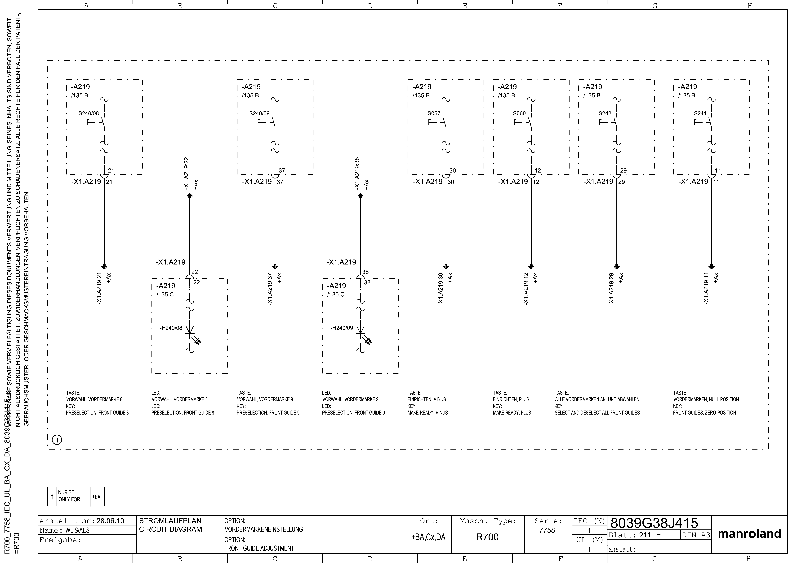

# +BA_Cx_DA — Sheet 211 of 247 — OPTION:

**VORDERMARKENEINSTELLUNG**

> Part of the manroland **R700** printing press IEC/UL circuit diagrams.
> Drawing class: **Stromlaufplan / Circuit diagram** (DIN A3).
> Document `+BA_Cx_DA` covers the **Printing units / main switch cabinet** machine section.

## At a glance

| Field | Value |
|---|---|
| Document | `+BA_Cx_DA`  (8039G38J415) |
| Sheet | **211** of 247 |
| Section (DE) | OPTION: |
| Section (EN) | VORDERMARKENEINSTELLUNG |
| Section type | CIRCUIT — Circuit diagram |
| Machine type | `R700` |
| Series | `7758` |
| Created | 28.06.10 |
| Replaces | — |
| Columns used | A, B, C, D, E, F, G, H |
| Path numbers | — |
| Labels on sheet | 101 |
| Cross-refs out | 8 |
| Cross-refs in | 16 |

**Previous:** [+BA_Cx_DA sheet 210](SHEET_0210.md) · **Next:** [+BA_Cx_DA sheet 212](SHEET_0212.md) · **Document TOC:** [_TOC.md](_TOC.md)  (+BA_Cx_DA) · **Master TOC:** [all sheets](../_MASTER_TOC.md)

## Sheet image (300 DPI, exact vector render)



_Rendered directly from the PDF vector layer at 300 DPI (1-bit), no OCR and no resampling. Use it to confirm anything ambiguous in the text below._

## Cross-references on this sheet

Each entry is a wire leaving this sheet. The printed token is `/sheet.column`; the link resolves to that sheet inside the same document.

| Ref | Target sheet | Col | Path | Destination on target | Target section | From col |
|---|---|---|---|---|---|---|
| `/135.B` | [+BA_Cx_DA sheet 135](SHEET_0135.md) | B | — | A219 | REFERENZMODUL | A |
| `/135.B` | [+BA_Cx_DA sheet 135](SHEET_0135.md) | B | — | A219 | REFERENZMODUL | C |
| `/135.B` | [+BA_Cx_DA sheet 135](SHEET_0135.md) | B | — | A219 | REFERENZMODUL | E |
| `/135.B` | [+BA_Cx_DA sheet 135](SHEET_0135.md) | B | — | A219 | REFERENZMODUL | E |
| `/135.B` | [+BA_Cx_DA sheet 135](SHEET_0135.md) | B | — | A219 | REFERENZMODUL | F |
| `/135.B` | [+BA_Cx_DA sheet 135](SHEET_0135.md) | B | — | A219 | REFERENZMODUL | G |
| `/135.C` | [+BA_Cx_DA sheet 135](SHEET_0135.md) | C | — | A219 | REFERENZMODUL | B |
| `/135.C` | [+BA_Cx_DA sheet 135](SHEET_0135.md) | C | — | A219 | REFERENZMODUL | D |

### Incoming references (sheets that point here)

Every other sheet that sends a wire to this one. `Back-ref` is the token printed on *that* sheet; `Path` is its line number.

| From sheet | Cols | Back-ref | Path | Refs | What continues there |
|---|---|---|---|---|---|
| [+BA_Cx_DA#135](SHEET_0135.md) | B, C | `/135.B`, `/135.C` | — | 8 | — |
| [+BA_Cx_DA#140](SHEET_0140.md) | G, H | `/140.G`, `/140.H` | — | 8 | — |


## Devices on this sheet

| Tag | Class | Class meaning (IEC) | Col | Sub | Terminal | Sign |
|---|---|---|---|---|---|---|
| `S241` | S | Schalter / switch | G | — | — | — |
| `A219` | A | Baugruppe / assembly, module, PC board | G | — | — | — |
| `S240/08` | S | Schalter / switch | A | 08 | — | — |
| `A219` | A | Baugruppe / assembly, module, PC board | A | — | — | — |
| `H240/08` | H | Signalleuchte / indicator lamp | B | 08 | — | — |
| `A219` | A | Baugruppe / assembly, module, PC board | B | — | — | — |
| `S240/09` | S | Schalter / switch | C | 09 | — | — |
| `A219` | A | Baugruppe / assembly, module, PC board | C | — | — | — |
| `H240/09` | H | Signalleuchte / indicator lamp | D | 09 | — | — |
| `A219` | A | Baugruppe / assembly, module, PC board | D | — | — | — |
| `S057` | S | Schalter / switch | E | — | — | — |
| `A219` | A | Baugruppe / assembly, module, PC board | E | — | — | — |
| `S060` | S | Schalter / switch | F | — | — | — |
| `A219` | A | Baugruppe / assembly, module, PC board | E | — | — | — |
| `S242` | S | Schalter / switch | F | — | — | — |
| `A219` | A | Baugruppe / assembly, module, PC board | F | — | — | — |
| `X1.A219` | — | cross-device reference | G | — | — | — |
| `X1.A219:11` | — | cross-device reference | H | — | 11 | — |
| `X1.A219` | — | cross-device reference | A | — | — | — |
| `X1.A219` | — | cross-device reference | B | — | — | — |
| `X1.A219` | — | cross-device reference | C | — | — | — |
| `X1.A219` | — | cross-device reference | D | — | — | — |
| `X1.A219` | — | cross-device reference | E | — | — | — |
| `X1.A219` | — | cross-device reference | F | — | — | — |
| `X1.A219` | — | cross-device reference | F | — | — | — |
| `X1.A219:21` | — | cross-device reference | A | — | 21 | — |
| `X1.A219:37` | — | cross-device reference | C | — | 37 | — |
| `X1.A219:30` | — | cross-device reference | E | — | 30 | — |
| `X1.A219:12` | — | cross-device reference | F | — | 12 | — |
| `X1.A219:29` | — | cross-device reference | G | — | 29 | — |
| `X1.A219:22` | — | cross-device reference | B | — | 22 | — |
| `X1.A219:38` | — | cross-device reference | D | — | 38 | — |

## Potentials / nets

_No named potentials on this sheet._

## Wire-end annotations (grouped as printed)

A wire that continues elsewhere is annotated with a small cluster: the destination description, the path/line number `#NN`, and the `/sheet.column` cross reference. Each row below is one such cluster exactly as it is grouped on the drawing.

| Col | Y | Path | Cross-ref | Text on the wire |
|---|---|---|---|---|
| A | 125.0 | — | `/135.B` | `A219` |
| C | 125.0 | — | `/135.B` | `A219` |
| E | 125.0 | — | `/135.B` | `A219` |
| E | 125.0 | — | `/135.B` | `A219` |
| F | 125.0 | — | `/135.B` | `A219` |
| G | 125.0 | — | `/135.B` | `A219` |
| A | 166.1 | — | — | `S240/08` |
| C | 166.1 | — | — | `S240/09` |
| E | 166.1 | — | — | `S057` |
| F | 166.1 | — | — | `S060` |
| F | 166.1 | — | — | `S242` |
| G | 166.1 | — | — | `S241` |
| B | 235.0 | — | — | `X1.A219:22` |
| D | 235.0 | — | — | `X1.A219:38` |
| A | 251.2 | — | — | `21` |
| C | 251.2 | — | — | `37` |
| E | 251.2 | — | — | `30` |
| F | 251.2 | — | — | `12` |
| G | 251.2 | — | — | `29` |
| H | 251.2 | — | — | `11` |
| A | 266.8 | — | — | `X1.A219 21` |
| C | 266.8 | — | — | `X1.A219 37` |
| E | 266.8 | — | — | `X1.A219 30` |
| F | 266.8 | — | — | `X1.A219 12` |
| F | 266.8 | — | — | `X1.A219 29` |
| G | 266.8 | — | — | `X1.A219 11` |
| B | 268.7 | — | — | `+Ax` |
| D | 268.7 | — | — | `+Ax` |
| B | 387.2 | — | — | `X1.A219 22` |
| D | 387.2 | — | — | `X1.A219 38` |
| A | 406.5 | — | — | `X1.A219:21` |
| H | 406.5 | — | — | `X1.A219:11` |
| F | 407.6 | — | — | `X1.A219:12` |
| C | 407.9 | — | — | `X1.A219:37` |
| E | 407.9 | — | — | `X1.A219:30` |
| G | 407.9 | — | — | `X1.A219:29` |
| A | 408.2 | — | — | `+Ax` |
| C | 408.2 | — | — | `+Ax` |
| E | 408.2 | — | — | `+Ax` |
| F | 408.2 | — | — | `+Ax` |
| G | 408.2 | — | — | `+Ax` |
| H | 408.2 | — | — | `+Ax` |
| B | 418.4 | — | — | `22` |
| D | 418.4 | — | — | `38` |
| B | 422.7 | — | `/135.C` | `A219` |
| D | 422.7 | — | `/135.C` | `A219` |
| B | 486.9 | — | — | `H240/08` |
| D | 486.9 | — | — | `H240/09` |
| A | 584.6 | — | — | `KEY: PRESELECTION, FRONT GUIDE 8 TASTE: VORWAHL, VORDERMARKE 8` |
| C | 584.6 | — | — | `KEY: PRESELECTION, FRONT GUIDE 9 TASTE: VORWAHL, VORDERMARKE 9` |
| E | 584.6 | — | — | `EINRICHTEN, MINUS KEY: TASTE: MAKE READY, MINUS` |
| E | 584.6 | — | — | `EINRICHTEN, PLUS KEY: TASTE: MAKE READY, PLUS` |
| F | 584.6 | — | — | `TASTE:` |
| H | 584.6 | — | — | `KEY: FRONT GUIDES, ZERO POSITION TASTE: VORDERMARKEN, NULL POSITION` |
| B | 584.7 | — | — | `LED:` |
| D | 584.7 | — | — | `LED:` |
| B | 594.7 | — | — | `LED: PRESELECTION, FRONT GUIDE 8 VORWAHL, VORDERMARKE 8` |
| D | 594.7 | — | — | `LED: PRESELECTION, FRONT GUIDE 9 VORWAHL, VORDERMARKE 9` |
| F | 594.7 | — | — | `KEY: SELECT AND DESELECT ALL FRONT GUIDES ALLE VORDERMARKEN AN UND ABWÄHLEN` |
| A | 654.6 | — | — | `1` |
| A | 733.3 | — | — | `1 NUR BEI` |
| A | 740.4 | — | — | `ONLY FOR +BA` |


## Reconstructed tables

This sheet carries tabular content (pin map / terminal assignment / index). The grid below was rebuilt from the drawing's own rule lines, so each row is exactly one physical row of the table.

### Table 1 — 2 data rows × 2 columns (at x=99.2, y=119.1)

| A219 /135.B S240/08 | 21 |
|---|---|
| `X1.A219` | `21 +Ax` |
| `X1.A219:21` |  |


### Table 2 — 1 data rows × 2 columns (at x=226.8, y=119.1) — **X1.A219:22**

| X1.A219 | +Ax 22 |
|---|---|
| `A219 /135.C H240/08` | `22` |


### Table 3 — 2 data rows × 2 columns (at x=354.3, y=119.1)

| A219 /135.B S240/09 | 37 |
|---|---|
| `X1.A219` | `37 +Ax` |
| `X1.A219:37` |  |


### Table 4 — 1 data rows × 2 columns (at x=481.9, y=119.1) — **X1.A219:38**

| X1.A219 | +Ax 38 |
|---|---|
| `A219 /135.C H240/09` | `38` |


### Table 5 — 2 data rows × 2 columns (at x=609.4, y=119.1)

| A219 /135.B S057 | 30 |
|---|---|
| `X1.A219` | `30 +Ax` |
| `X1.A219:30` |  |


### Table 6 — 2 data rows × 2 columns (at x=737.0, y=119.1)

| A219 /135.B S060 | 12 |
|---|---|
| `X1.A219` | `12 +Ax` |
| `X1.A219:12` |  |


### Table 7 — 2 data rows × 2 columns (at x=864.6, y=119.1)

| A219 /135.B S242 | 29 |
|---|---|
| `X1.A219` | `29 +Ax` |
| `X1.A219:29` |  |


### Table 8 — 2 data rows × 2 columns (at x=1006.3, y=119.1)

| A219 /135.B S241 | 11 |
|---|---|
| `X1.A219` | `11 +Ax` |
| `X1.A219:11` |  |


## Notes and free text on this sheet

| Text | Col | Y (pt) |
|---|---|---|
| `TASTE:` | G | 584.65 |
| `VORDERMARKEN, NULL POSITION` | H | 594.67 |
| `KEY:` | G | 604.59 |
| `FRONT GUIDES, ZERO POSITION` | H | 614.54 |
| `+Ax` | H | 408.19 |
| `TASTE:` | A | 584.65 |
| `VORWAHL, VORDERMARKE 8` | A | 594.66 |
| `KEY:` | A | 604.59 |
| `PRESELECTION, FRONT GUIDE 8` | A | 614.55 |
| `LED:` | B | 584.67 |
| `VORWAHL, VORDERMARKE 8` | B | 594.66 |
| `PRESELECTION, FRONT GUIDE 8` | B | 614.55 |
| `TASTE:` | C | 584.65 |
| `VORWAHL, VORDERMARKE 9` | C | 594.66 |
| `KEY:` | C | 604.59 |
| `PRESELECTION, FRONT GUIDE 9` | C | 614.55 |
| `LED:` | D | 584.67 |
| `VORWAHL, VORDERMARKE 9` | D | 594.66 |
| `PRESELECTION, FRONT GUIDE 9` | D | 614.55 |
| `TASTE:` | D | 584.65 |
| `EINRICHTEN, MINUS` | E | 594.68 |
| `KEY:` | D | 604.59 |
| `MAKE READY, MINUS` | E | 614.59 |
| `TASTE:` | E | 584.65 |
| `EINRICHTEN, PLUS` | E | 594.67 |
| `KEY:` | E | 604.59 |
| `MAKE READY, PLUS` | E | 614.58 |
| `TASTE:` | F | 584.65 |
| `ALLE VORDERMARKEN AN UND ABWÄHLEN` | F | 594.67 |
| `KEY:` | F | 604.59 |
| `SELECT AND DESELECT ALL FRONT GUIDES` | F | 614.55 |
| `+Ax` | A | 408.19 |
| `+Ax` | C | 408.19 |
| `+Ax` | E | 408.19 |
| `+Ax` | F | 408.19 |
| `+Ax` | G | 408.19 |
| `+Ax` | B | 268.73 |
| `+Ax` | D | 268.73 |
| `NUR BEI` | A | 733.33 |
| `ONLY FOR` | A | 744.02 |
| `+BA` | A | 740.44 |

## Complete label inventory (exact text from the drawing)

Every text object inside the drawing area of this sheet, in DIN reading order (column A→H, then top→bottom). This is the authoritative list: if a string is not here it is not printed on this sheet.

| Col | Y | X | Dir | Type | Text |
|---|---|---|---|---|---|
| A | 125.0 | 106.0 | → | device tag | `A219` |
| A | 138.8 | 106.3 | → | cross-reference | `/135.B` |
| A | 166.1 | 114.5 | → | device tag | `S240/08` |
| A | 251.2 | 161.3 | → | number | `21` |
| A | 266.8 | 106.6 | → | device ref | `X1.A219` |
| A | 268.2 | 158.5 | → | number | `21` |
| A | 406.5 | 144.1 | ↕ | device ref | `X1.A219:21` |
| A | 408.2 | 158.4 | ↕ | text | `+Ax` |
| A | 584.6 | 98.9 | → | text | `TASTE:` |
| A | 594.7 | 99.2 | → | text | `VORWAHL, VORDERMARKE 8` |
| A | 604.6 | 98.6 | → | text | `KEY:` |
| A | 614.6 | 98.6 | → | text | `PRESELECTION, FRONT GUIDE 8` |
| A | 654.6 | 83.3 | → | number | `1` |
| A | 733.3 | 87.0 | → | text | `NUR BEI` |
| A | 738.7 | 75.4 | → | number | `1` |
| A | 740.4 | 137.9 | → | text | `+BA` |
| A | 744.0 | 87.6 | → | text | `ONLY FOR` |
| B | 235.0 | 274.5 | ↕ | device ref | `X1.A219:22` |
| B | 268.7 | 288.8 | ↕ | text | `+Ax` |
| B | 387.2 | 232.7 | → | device ref | `X1.A219` |
| B | 402.8 | 286.0 | → | number | `22` |
| B | 418.4 | 288.9 | → | number | `22` |
| B | 422.7 | 233.6 | → | device tag | `A219` |
| B | 436.5 | 233.9 | → | cross-reference | `/135.C` |
| B | 486.9 | 238.7 | → | device tag | `H240/08` |
| B | 584.7 | 226.2 | → | text | `LED:` |
| B | 594.7 | 226.8 | → | text | `VORWAHL, VORDERMARKE 8` |
| B | 604.6 | 226.2 | → | text | `LED:` |
| B | 614.6 | 226.2 | → | text | `PRESELECTION, FRONT GUIDE 8` |
| C | 125.0 | 361.1 | → | device tag | `A219` |
| C | 138.8 | 361.4 | → | cross-reference | `/135.B` |
| C | 166.1 | 369.6 | → | device tag | `S240/09` |
| C | 251.2 | 416.4 | → | number | `37` |
| C | 266.8 | 361.7 | → | device ref | `X1.A219` |
| C | 268.2 | 413.6 | → | number | `37` |
| C | 407.9 | 399.3 | ↕ | device ref | `X1.A219:37` |
| C | 408.2 | 413.5 | ↕ | text | `+Ax` |
| C | 584.6 | 354.0 | → | text | `TASTE:` |
| C | 594.7 | 354.3 | → | text | `VORWAHL, VORDERMARKE 9` |
| C | 604.6 | 353.8 | → | text | `KEY:` |
| C | 614.6 | 353.8 | → | text | `PRESELECTION, FRONT GUIDE 9` |
| D | 235.0 | 529.7 | ↕ | device ref | `X1.A219:38` |
| D | 268.7 | 543.9 | ↕ | text | `+Ax` |
| D | 387.2 | 487.8 | → | device ref | `X1.A219` |
| D | 402.8 | 541.1 | → | number | `38` |
| D | 418.4 | 544.0 | → | number | `38` |
| D | 422.7 | 488.7 | → | device tag | `A219` |
| D | 436.5 | 489.0 | → | cross-reference | `/135.C` |
| D | 486.9 | 493.8 | → | device tag | `H240/09` |
| D | 584.6 | 609.2 | → | text | `TASTE:` |
| D | 584.7 | 481.3 | → | text | `LED:` |
| D | 594.7 | 481.9 | → | text | `VORWAHL, VORDERMARKE 9` |
| D | 604.6 | 481.3 | → | text | `LED:` |
| D | 604.6 | 608.9 | → | text | `KEY:` |
| D | 614.6 | 481.3 | → | text | `PRESELECTION, FRONT GUIDE 9` |
| E | 125.0 | 616.3 | → | device tag | `A219` |
| E | 125.0 | 743.8 | → | device tag | `A219` |
| E | 138.8 | 616.5 | → | cross-reference | `/135.B` |
| E | 138.8 | 744.1 | → | cross-reference | `/135.B` |
| E | 166.1 | 636.1 | → | device tag | `S057` |
| E | 251.2 | 671.5 | → | number | `30` |
| E | 266.8 | 616.8 | → | device ref | `X1.A219` |
| E | 268.2 | 668.7 | → | number | `30` |
| E | 407.9 | 654.4 | ↕ | device ref | `X1.A219:30` |
| E | 408.2 | 668.6 | ↕ | text | `+Ax` |
| E | 584.6 | 736.7 | → | text | `TASTE:` |
| E | 594.7 | 608.9 | → | text | `EINRICHTEN, MINUS` |
| E | 594.7 | 736.4 | → | text | `EINRICHTEN, PLUS` |
| E | 604.6 | 736.4 | → | text | `KEY:` |
| E | 614.6 | 609.2 | → | text | `MAKE READY, MINUS` |
| E | 614.6 | 736.7 | → | text | `MAKE READY, PLUS` |
| F | 125.0 | 871.4 | → | device tag | `A219` |
| F | 138.8 | 871.7 | → | cross-reference | `/135.B` |
| F | 166.1 | 763.7 | → | device tag | `S060` |
| F | 166.1 | 891.5 | → | device tag | `S242` |
| F | 251.2 | 798.5 | → | number | `12` |
| F | 266.8 | 744.4 | → | device ref | `X1.A219` |
| F | 266.8 | 871.9 | → | device ref | `X1.A219` |
| F | 268.2 | 795.7 | → | number | `12` |
| F | 407.6 | 781.9 | ↕ | device ref | `X1.A219:12` |
| F | 408.2 | 796.2 | ↕ | text | `+Ax` |
| F | 584.6 | 828.9 | → | text | `TASTE:` |
| F | 594.7 | 829.4 | → | text | `ALLE VORDERMARKEN AN UND ABWÄHLEN` |
| F | 604.6 | 828.6 | → | text | `KEY:` |
| F | 614.6 | 828.9 | → | text | `SELECT AND DESELECT ALL FRONT GUIDES` |
| G | 125.0 | 1013.1 | → | device tag | `A219` |
| G | 138.8 | 1013.4 | → | cross-reference | `/135.B` |
| G | 166.1 | 1034.1 | → | device tag | `S241` |
| G | 251.2 | 926.6 | → | number | `29` |
| G | 266.8 | 1013.7 | → | device ref | `X1.A219` |
| G | 268.2 | 923.8 | → | number | `29` |
| G | 407.9 | 909.5 | ↕ | device ref | `X1.A219:29` |
| G | 408.2 | 923.7 | ↕ | text | `+Ax` |
| G | 584.6 | 1006.0 | → | text | `TASTE:` |
| G | 604.6 | 1005.7 | → | text | `KEY:` |
| H | 251.2 | 1067.8 | → | number | `11` |
| H | 268.2 | 1065.0 | → | number | `11` |
| H | 406.5 | 1051.2 | ↕ | device ref | `X1.A219:11` |
| H | 408.2 | 1065.5 | ↕ | text | `+Ax` |
| H | 594.7 | 1006.3 | → | text | `VORDERMARKEN, NULL POSITION` |
| H | 614.5 | 1005.7 | → | text | `FRONT GUIDES, ZERO POSITION` |

## Reading-order text block

The same content as a plain block, grouped by DIN column — convenient to paste or to match against a visual description.

```text
=== Column A ===
 125.0  106.0  devtag       A219
 138.8  106.3  xref         /135.B
 166.1  114.5  devtag       S240/08
 251.2  161.3  numeric      21
 266.8  106.6  devref       X1.A219
 268.2  158.5  numeric      21
 406.5  144.1  devref       X1.A219:21
 408.2  158.4  text         +Ax
 584.6   98.9  text         TASTE:
 594.7   99.2  text         VORWAHL, VORDERMARKE 8
 604.6   98.6  text         KEY:
 614.6   98.6  text         PRESELECTION, FRONT GUIDE 8
 654.6   83.3  numeric      1
 733.3   87.0  text         NUR BEI
 738.7   75.4  numeric      1
 740.4  137.9  text         +BA
 744.0   87.6  text         ONLY FOR
=== Column B ===
 235.0  274.5  devref       X1.A219:22
 268.7  288.8  text         +Ax
 387.2  232.7  devref       X1.A219
 402.8  286.0  numeric      22
 418.4  288.9  numeric      22
 422.7  233.6  devtag       A219
 436.5  233.9  xref         /135.C
 486.9  238.7  devtag       H240/08
 584.7  226.2  text         LED:
 594.7  226.8  text         VORWAHL, VORDERMARKE 8
 604.6  226.2  text         LED:
 614.6  226.2  text         PRESELECTION, FRONT GUIDE 8
=== Column C ===
 125.0  361.1  devtag       A219
 138.8  361.4  xref         /135.B
 166.1  369.6  devtag       S240/09
 251.2  416.4  numeric      37
 266.8  361.7  devref       X1.A219
 268.2  413.6  numeric      37
 407.9  399.3  devref       X1.A219:37
 408.2  413.5  text         +Ax
 584.6  354.0  text         TASTE:
 594.7  354.3  text         VORWAHL, VORDERMARKE 9
 604.6  353.8  text         KEY:
 614.6  353.8  text         PRESELECTION, FRONT GUIDE 9
=== Column D ===
 235.0  529.7  devref       X1.A219:38
 268.7  543.9  text         +Ax
 387.2  487.8  devref       X1.A219
 402.8  541.1  numeric      38
 418.4  544.0  numeric      38
 422.7  488.7  devtag       A219
 436.5  489.0  xref         /135.C
 486.9  493.8  devtag       H240/09
 584.6  609.2  text         TASTE:
 584.7  481.3  text         LED:
 594.7  481.9  text         VORWAHL, VORDERMARKE 9
 604.6  481.3  text         LED:
 604.6  608.9  text         KEY:
 614.6  481.3  text         PRESELECTION, FRONT GUIDE 9
=== Column E ===
 125.0  616.3  devtag       A219
 125.0  743.8  devtag       A219
 138.8  616.5  xref         /135.B
 138.8  744.1  xref         /135.B
 166.1  636.1  devtag       S057
 251.2  671.5  numeric      30
 266.8  616.8  devref       X1.A219
 268.2  668.7  numeric      30
 407.9  654.4  devref       X1.A219:30
 408.2  668.6  text         +Ax
 584.6  736.7  text         TASTE:
 594.7  608.9  text         EINRICHTEN, MINUS
 594.7  736.4  text         EINRICHTEN, PLUS
 604.6  736.4  text         KEY:
 614.6  609.2  text         MAKE READY, MINUS
 614.6  736.7  text         MAKE READY, PLUS
=== Column F ===
 125.0  871.4  devtag       A219
 138.8  871.7  xref         /135.B
 166.1  763.7  devtag       S060
 166.1  891.5  devtag       S242
 251.2  798.5  numeric      12
 266.8  744.4  devref       X1.A219
 266.8  871.9  devref       X1.A219
 268.2  795.7  numeric      12
 407.6  781.9  devref       X1.A219:12
 408.2  796.2  text         +Ax
 584.6  828.9  text         TASTE:
 594.7  829.4  text         ALLE VORDERMARKEN AN UND ABWÄHLEN
 604.6  828.6  text         KEY:
 614.6  828.9  text         SELECT AND DESELECT ALL FRONT GUIDES
=== Column G ===
 125.0 1013.1  devtag       A219
 138.8 1013.4  xref         /135.B
 166.1 1034.1  devtag       S241
 251.2  926.6  numeric      29
 266.8 1013.7  devref       X1.A219
 268.2  923.8  numeric      29
 407.9  909.5  devref       X1.A219:29
 408.2  923.7  text         +Ax
 584.6 1006.0  text         TASTE:
 604.6 1005.7  text         KEY:
=== Column H ===
 251.2 1067.8  numeric      11
 268.2 1065.0  numeric      11
 406.5 1051.2  devref       X1.A219:11
 408.2 1065.5  text         +Ax
 594.7 1006.3  text         VORDERMARKEN, NULL POSITION
 614.5 1005.7  text         FRONT GUIDES, ZERO POSITION
```

---
_Generated from the PDF vector text layer; no OCR. Source: `R700_7758_IEC_UL_BA_CX_DA_8039G38J415_p`, sheet 211._
