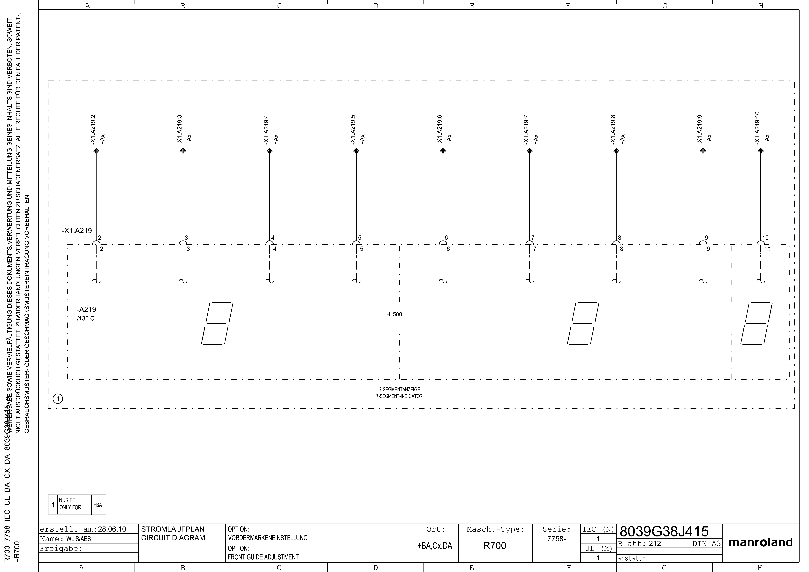

# +BA_Cx_DA — Sheet 212 of 247 — OPTION:

**VORDERMARKENEINSTELLUNG**

> Part of the manroland **R700** printing press IEC/UL circuit diagrams.
> Drawing class: **Stromlaufplan / Circuit diagram** (DIN A3).
> Document `+BA_Cx_DA` covers the **Printing units / main switch cabinet** machine section.

## At a glance

| Field | Value |
|---|---|
| Document | `+BA_Cx_DA`  (8039G38J415) |
| Sheet | **212** of 247 |
| Section (DE) | OPTION: |
| Section (EN) | VORDERMARKENEINSTELLUNG |
| Section type | CIRCUIT — Circuit diagram |
| Machine type | `R700` |
| Series | `7758` |
| Created | 28.06.10 |
| Replaces | — |
| Columns used | A, B, C, D, E, F, G, H |
| Path numbers | — |
| Labels on sheet | 47 |
| Cross-refs out | 1 |
| Cross-refs in | 10 |

**Previous:** [+BA_Cx_DA sheet 211](SHEET_0211.md) · **Next:** [+BA_Cx_DA sheet 213](SHEET_0213.md) · **Document TOC:** [_TOC.md](_TOC.md)  (+BA_Cx_DA) · **Master TOC:** [all sheets](../_MASTER_TOC.md)

## Sheet image (300 DPI, exact vector render)



_Rendered directly from the PDF vector layer at 300 DPI (1-bit), no OCR and no resampling. Use it to confirm anything ambiguous in the text below._

## Cross-references on this sheet

Each entry is a wire leaving this sheet. The printed token is `/sheet.column`; the link resolves to that sheet inside the same document.

| Ref | Target sheet | Col | Path | Destination on target | Target section | From col |
|---|---|---|---|---|---|---|
| `/135.C` | [+BA_Cx_DA sheet 135](SHEET_0135.md) | C | — | A219 | REFERENZMODUL | A |

### Incoming references (sheets that point here)

Every other sheet that sends a wire to this one. `Back-ref` is the token printed on *that* sheet; `Path` is its line number.

| From sheet | Cols | Back-ref | Path | Refs | What continues there |
|---|---|---|---|---|---|
| [+BA_Cx_DA#135](SHEET_0135.md) | C | `/135.C` | — | 1 | — |
| [+BA_Cx_DA#140](SHEET_0140.md) | G | `/140.G` | — | 9 | — |


## Devices on this sheet

| Tag | Class | Class meaning (IEC) | Col | Sub | Terminal | Sign |
|---|---|---|---|---|---|---|
| `A219` | A | Baugruppe / assembly, module, PC board | A | — | — | — |
| `X1.A219` | — | cross-device reference | A | — | — | — |
| `X1.A219:2` | — | cross-device reference | A | — | 2 | — |
| `X1.A219:3` | — | cross-device reference | B | — | 3 | — |
| `X1.A219:4` | — | cross-device reference | C | — | 4 | — |
| `X1.A219:5` | — | cross-device reference | D | — | 5 | — |
| `X1.A219:6` | — | cross-device reference | E | — | 6 | — |
| `X1.A219:7` | — | cross-device reference | F | — | 7 | — |
| `X1.A219:8` | — | cross-device reference | F | — | 8 | — |
| `X1.A219:9` | — | cross-device reference | G | — | 9 | — |
| `X1.A219:10` | — | cross-device reference | H | — | 10 | — |

## Potentials / nets

| Potential | Count | Columns | Attached devices | Terminals |
|---|---|---|---|---|
| `H500` | 1 | D | — | — |


A potential such as `L24+/4` or `M24+` is a named supply/return rail; every place it appears on this sheet is electrically common.

## Wire-end annotations (grouped as printed)

A wire that continues elsewhere is annotated with a small cluster: the destination description, the path/line number `#NN`, and the `/sheet.column` cross reference. Each row below is one such cluster exactly as it is grouped on the drawing.

| Col | Y | Path | Cross-ref | Text on the wire |
|---|---|---|---|---|
| H | 164.1 | — | — | `X1.A219:10` |
| A | 168.9 | — | — | `X1.A219:2` |
| B | 168.9 | — | — | `X1.A219:3` |
| C | 168.9 | — | — | `X1.A219:4` |
| D | 168.9 | — | — | `X1.A219:5` |
| E | 168.9 | — | — | `X1.A219:6` |
| F | 168.9 | — | — | `X1.A219:7` |
| F | 168.9 | — | — | `X1.A219:8` |
| G | 168.9 | — | — | `X1.A219:9` |
| A | 197.9 | — | — | `+Ax` |
| B | 197.9 | — | — | `+Ax` |
| C | 197.9 | — | — | `+Ax` |
| D | 197.9 | — | — | `+Ax` |
| E | 197.9 | — | — | `+Ax` |
| F | 197.9 | — | — | `+Ax` |
| G | 197.9 | — | — | `+Ax` |
| G | 197.9 | — | — | `+Ax` |
| H | 197.9 | — | — | `+Ax` |
| A | 334.8 | — | — | `X1.A219 2` |
| E | 346.1 | — | — | `3 4 5 6 7 8 9 10` |
| E | 362.4 | — | — | `2 3 4 5 6 7 8 9 10` |
| A | 451.0 | — | `/135.C` | `A219` |
| D | 459.0 | — | — | `H500` |
| D | 570.5 | — | — | `7 SEGMENT INDICATOR 7 SEGMENTANZEIGE` |
| A | 583.7 | — | — | `1` |
| A | 733.3 | — | — | `1 NUR BEI` |
| A | 740.4 | — | — | `ONLY FOR +BA` |


## Notes and free text on this sheet

| Text | Col | Y (pt) |
|---|---|---|
| `7 SEGMENTANZEIGE` | D | 570.54 |
| `7 SEGMENT INDICATOR` | D | 580.49 |
| `+Ax` | A | 197.86 |
| `+Ax` | B | 197.86 |
| `+Ax` | C | 197.86 |
| `+Ax` | D | 197.86 |
| `+Ax` | E | 197.86 |
| `+Ax` | F | 197.86 |
| `+Ax` | G | 197.86 |
| `+Ax` | H | 197.86 |
| `NUR BEI` | A | 733.33 |
| `ONLY FOR` | A | 744.02 |
| `+BA` | A | 740.44 |

## Complete label inventory (exact text from the drawing)

Every text object inside the drawing area of this sheet, in DIN reading order (column A→H, then top→bottom). This is the authoritative list: if a string is not here it is not printed on this sheet.

| Col | Y | X | Dir | Type | Text |
|---|---|---|---|---|---|
| A | 168.9 | 132.8 | ↕ | device ref | `X1.A219:2` |
| A | 197.9 | 147.1 | ↕ | text | `+Ax` |
| A | 334.8 | 91.0 | → | device ref | `X1.A219` |
| A | 346.2 | 144.3 | → | number | `2` |
| A | 362.5 | 147.1 | → | number | `2` |
| A | 451.0 | 113.1 | → | device tag | `A219` |
| A | 464.8 | 113.4 | → | cross-reference | `/135.C` |
| A | 583.7 | 83.3 | → | number | `1` |
| A | 733.3 | 87.0 | → | text | `NUR BEI` |
| A | 738.7 | 75.4 | → | number | `1` |
| A | 740.4 | 137.9 | → | text | `+BA` |
| A | 744.0 | 87.6 | → | text | `ONLY FOR` |
| B | 168.9 | 260.4 | ↕ | device ref | `X1.A219:3` |
| B | 197.9 | 274.6 | ↕ | text | `+Ax` |
| B | 346.2 | 271.8 | → | number | `3` |
| B | 362.5 | 274.7 | → | number | `3` |
| C | 168.9 | 387.9 | ↕ | device ref | `X1.A219:4` |
| C | 197.9 | 402.2 | ↕ | text | `+Ax` |
| C | 346.2 | 399.4 | → | number | `4` |
| C | 362.5 | 402.2 | → | number | `4` |
| D | 168.9 | 515.5 | ↕ | device ref | `X1.A219:5` |
| D | 197.9 | 529.7 | ↕ | text | `+Ax` |
| D | 346.2 | 527.0 | → | number | `5` |
| D | 362.5 | 529.8 | → | number | `5` |
| D | 459.0 | 569.5 | → | potential | `H500` |
| D | 570.5 | 558.3 | → | text | `7 SEGMENTANZEIGE` |
| D | 580.5 | 553.8 | → | text | `7 SEGMENT INDICATOR` |
| E | 168.9 | 643.0 | ↕ | device ref | `X1.A219:6` |
| E | 197.9 | 657.3 | ↕ | text | `+Ax` |
| E | 346.2 | 654.5 | → | number | `6` |
| E | 362.5 | 657.4 | → | number | `6` |
| F | 168.9 | 770.6 | ↕ | device ref | `X1.A219:7` |
| F | 168.9 | 898.2 | ↕ | device ref | `X1.A219:8` |
| F | 197.9 | 784.8 | ↕ | text | `+Ax` |
| F | 346.2 | 782.1 | → | number | `7` |
| F | 362.5 | 784.9 | → | number | `7` |
| G | 168.9 | 1025.7 | ↕ | device ref | `X1.A219:9` |
| G | 197.9 | 912.4 | ↕ | text | `+Ax` |
| G | 197.9 | 1040.0 | ↕ | text | `+Ax` |
| G | 346.2 | 909.6 | → | number | `8` |
| G | 346.2 | 1037.2 | → | number | `9` |
| G | 362.5 | 912.5 | → | number | `8` |
| G | 362.5 | 1040.0 | → | number | `9` |
| H | 164.1 | 1110.8 | ↕ | device ref | `X1.A219:10` |
| H | 197.9 | 1125.0 | ↕ | text | `+Ax` |
| H | 346.2 | 1121.7 | → | number | `10` |
| H | 363.2 | 1124.5 | → | number | `10` |

## Reading-order text block

The same content as a plain block, grouped by DIN column — convenient to paste or to match against a visual description.

```text
=== Column A ===
 168.9  132.8  devref       X1.A219:2
 197.9  147.1  text         +Ax
 334.8   91.0  devref       X1.A219
 346.2  144.3  numeric      2
 362.5  147.1  numeric      2
 451.0  113.1  devtag       A219
 464.8  113.4  xref         /135.C
 583.7   83.3  numeric      1
 733.3   87.0  text         NUR BEI
 738.7   75.4  numeric      1
 740.4  137.9  text         +BA
 744.0   87.6  text         ONLY FOR
=== Column B ===
 168.9  260.4  devref       X1.A219:3
 197.9  274.6  text         +Ax
 346.2  271.8  numeric      3
 362.5  274.7  numeric      3
=== Column C ===
 168.9  387.9  devref       X1.A219:4
 197.9  402.2  text         +Ax
 346.2  399.4  numeric      4
 362.5  402.2  numeric      4
=== Column D ===
 168.9  515.5  devref       X1.A219:5
 197.9  529.7  text         +Ax
 346.2  527.0  numeric      5
 362.5  529.8  numeric      5
 459.0  569.5  net          H500
 570.5  558.3  text         7 SEGMENTANZEIGE
 580.5  553.8  text         7 SEGMENT INDICATOR
=== Column E ===
 168.9  643.0  devref       X1.A219:6
 197.9  657.3  text         +Ax
 346.2  654.5  numeric      6
 362.5  657.4  numeric      6
=== Column F ===
 168.9  770.6  devref       X1.A219:7
 168.9  898.2  devref       X1.A219:8
 197.9  784.8  text         +Ax
 346.2  782.1  numeric      7
 362.5  784.9  numeric      7
=== Column G ===
 168.9 1025.7  devref       X1.A219:9
 197.9  912.4  text         +Ax
 197.9 1040.0  text         +Ax
 346.2  909.6  numeric      8
 346.2 1037.2  numeric      9
 362.5  912.5  numeric      8
 362.5 1040.0  numeric      9
=== Column H ===
 164.1 1110.8  devref       X1.A219:10
 197.9 1125.0  text         +Ax
 346.2 1121.7  numeric      10
 363.2 1124.5  numeric      10
```

---
_Generated from the PDF vector text layer; no OCR. Source: `R700_7758_IEC_UL_BA_CX_DA_8039G38J415_p`, sheet 212._
