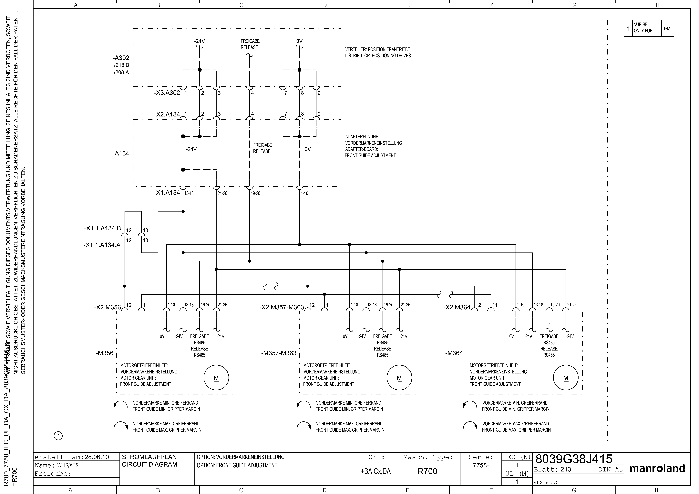

# +BA_Cx_DA — Sheet 213 of 247 — OPTION: VORDERMARKENEINSTELLUNG

**OPTION: FRONT GUIDE ADJUSTMENT**

> Part of the manroland **R700** printing press IEC/UL circuit diagrams.
> Drawing class: **Stromlaufplan / Circuit diagram** (DIN A3).
> Document `+BA_Cx_DA` covers the **Printing units / main switch cabinet** machine section.

## At a glance

| Field | Value |
|---|---|
| Document | `+BA_Cx_DA`  (8039G38J415) |
| Sheet | **213** of 247 |
| Section (DE) | OPTION: VORDERMARKENEINSTELLUNG |
| Section (EN) | OPTION: FRONT GUIDE ADJUSTMENT |
| Section type | CIRCUIT — Circuit diagram |
| Machine type | `R700` |
| Series | `7758` |
| Created | 28.06.10 |
| Replaces | — |
| Columns used | A, B, C, D, E, F, G, H |
| Path numbers | — |
| Labels on sheet | 122 |
| Cross-refs out | 2 |
| Cross-refs in | 122 |

**Previous:** [+BA_Cx_DA sheet 212](SHEET_0212.md) · **Next:** [+BA_Cx_DA sheet 214](SHEET_0214.md) · **Document TOC:** [_TOC.md](_TOC.md)  (+BA_Cx_DA) · **Master TOC:** [all sheets](../_MASTER_TOC.md)

## Sheet image (300 DPI, exact vector render)



_Rendered directly from the PDF vector layer at 300 DPI (1-bit), no OCR and no resampling. Use it to confirm anything ambiguous in the text below._

## Cross-references on this sheet

Each entry is a wire leaving this sheet. The printed token is `/sheet.column`; the link resolves to that sheet inside the same document.

| Ref | Target sheet | Col | Path | Destination on target | Target section | From col |
|---|---|---|---|---|---|---|
| `/218.B` | [+BA_Cx_DA sheet 218](SHEET_0218.md) | B | — | — | OPTION: TELEPRESENCE | B |
| `/208.A` | [+BA_Cx_DA sheet 208](SHEET_0208.md) | A | — | — | OPTION: | B |

### Incoming references (sheets that point here)

Every other sheet that sends a wire to this one. `Back-ref` is the token printed on *that* sheet; `Path` is its line number.

| From sheet | Cols | Back-ref | Path | Refs | What continues there |
|---|---|---|---|---|---|
| [+BA_Cx_DA#140](SHEET_0140.md) | C, E, F | `/140.C`, `/140.E`, `/140.F` | — | 28 | — |
| [+BA_Cx_DA#151](SHEET_0151.md) | G | `/151.G` | — | 7 | — |
| [+BA_Cx_DA#155](SHEET_0155.md) | C, E, F | `/155.C`, `/155.E`, `/155.F` | — | 78 | — |
| [+BA_Cx_DA#156](SHEET_0156.md) | G | `/156.G` | — | 7 | — |
| [+BA_Cx_DA#208](SHEET_0208.md) | A | `/208.A` | — | 1 | — |
| [+BA_Cx_DA#218](SHEET_0218.md) | B | `/218.B` | — | 1 | — |


## Devices on this sheet

| Tag | Class | Class meaning (IEC) | Col | Sub | Terminal | Sign |
|---|---|---|---|---|---|---|
| `A302` | A | Baugruppe / assembly, module, PC board | B | — | — | — |
| `A134` | A | Baugruppe / assembly, module, PC board | B | — | — | — |
| `RS485` | RS |  | G | — | — | — |
| `RS485` | RS |  | G | — | — | — |
| `RS485` | RS |  | E | — | — | — |
| `RS485` | RS |  | E | — | — | — |
| `RS485` | RS |  | B | — | — | — |
| `RS485` | RS |  | B | — | — | — |
| `X3.A302` | — | cross-device reference | B | — | — | — |
| `X2.A134` | — | cross-device reference | B | — | — | — |
| `X1.A134` | — | cross-device reference | B | — | — | — |
| `X1.1.A134.B` | — | cross-device reference | A | — | — | — |
| `X1.1.A134.A` | — | cross-device reference | A | — | — | — |
| `X2.M356` | — | cross-device reference | A | — | — | — |
| `X2.M364` | — | cross-device reference | F | — | — | — |

## Potentials / nets

| Potential | Count | Columns | Attached devices | Terminals |
|---|---|---|---|---|
| `0V` | 5 | B, D, F | — | — |
| `24V` | 8 | B, C, D, E, F, G | — | — |
| `M356` | 1 | A | — | — |
| `M364` | 1 | F | — | — |


A potential such as `L24+/4` or `M24+` is a named supply/return rail; every place it appears on this sheet is electrically common.

## Wire-end annotations (grouped as printed)

A wire that continues elsewhere is annotated with a small cluster: the destination description, the path/line number `#NN`, and the `/sheet.column` cross reference. Each row below is one such cluster exactly as it is grouped on the drawing.

| Col | Y | Path | Cross-ref | Text on the wire |
|---|---|---|---|---|
| H | 38.9 | — | — | `1 NUR BEI` |
| H | 46.0 | — | — | `ONLY FOR +BA` |
| C | 66.2 | — | — | `24V FREIGABE RELEASE 0V` |
| E | 81.4 | — | — | `DISTRIBUTOR: POSITIONING DRIVES VERTEILER: POSITIONIERANTRIEBE` |
| B | 93.8 | — | — | `A302` |
| B | 106.9 | — | `/218.B`, `/208.A` | — |
| C | 153.4 | — | — | `X3.A302 1 2 3 4 7 8 9` |
| C | 190.2 | — | — | `X2.A134 1 2 3 4 7 8 9` |
| E | 230.2 | — | — | `FRONT GUIDE ADJUSTMENT ADAPTERPLATINE: VORDERMARKENEINSTELLUNG ADAPTER BOARD:` |
| C | 244.4 | — | — | `24V FREIGABE RELEASE 0V` |
| B | 256.8 | — | — | `A134` |
| B | 323.5 | — | — | `X1.A134` |
| C | 326.6 | — | — | `13 18 21 26 19 20 1 10` |
| A | 384.4 | — | — | `X1.1.A134.B 12 13` |
| A | 405.7 | — | — | `X1.1.A134.A 12` |
| B | 405.7 | — | — | `13` |
| B | 516.2 | — | — | `X2.M356 12 11` |
| E | 516.2 | — | — | `X2.M357 M363 12 11 X2.M364 12 11` |
| B | 516.5 | — | — | `1 10 13 18 19 20 21 26` |
| E | 516.5 | — | — | `1 10 13 18 19 20 21 26` |
| G | 516.5 | — | — | `1 10 13 18 19 20 21 26` |
| B | 570.3 | — | — | `FREIGABE` |
| E | 570.3 | — | — | `FREIGABE` |
| G | 570.3 | — | — | `FREIGABE` |
| B | 570.4 | — | — | `0V 24V 24V` |
| E | 570.4 | — | — | `0V 24V 24V` |
| G | 570.4 | — | — | `0V 24V 24V` |
| B | 581.0 | — | — | `RELEASE RS485` |
| E | 581.0 | — | — | `RELEASE RS485` |
| G | 581.0 | — | — | `RELEASE RS485` |
| A | 597.0 | — | — | `M356` |
| C | 597.0 | — | — | `M357 M363` |
| F | 597.0 | — | — | `M364` |
| B | 602.3 | — | — | `RS485` |
| E | 602.3 | — | — | `RS485` |
| G | 602.3 | — | — | `RS485` |
| B | 620.0 | — | — | `MOTORGETRIEBEEINHEIT:` |
| D | 620.0 | — | — | `MOTORGETRIEBEEINHEIT:` |
| F | 620.0 | — | — | `MOTORGETRIEBEEINHEIT:` |
| B | 630.6 | — | — | `FRONT GUIDE ADJUSTMENT MOTOR GEAR UNIT: VORDERMARKENEINSTELLUNG` |
| D | 630.6 | — | — | `FRONT GUIDE ADJUSTMENT MOTOR GEAR UNIT: VORDERMARKENEINSTELLUNG` |
| F | 630.6 | — | — | `FRONT GUIDE ADJUSTMENT MOTOR GEAR UNIT: VORDERMARKENEINSTELLUNG` |
| E | 639.8 | — | — | `M M M` |
| B | 683.8 | — | — | `FRONT GUIDE MIN. GRIPPER MARGIN VORDERMARKE MIN. GREIFERRAND` |
| D | 683.8 | — | — | `FRONT GUIDE MIN. GRIPPER MARGIN VORDERMARKE MIN. GREIFERRAND` |
| F | 683.8 | — | — | `FRONT GUIDE MIN. GRIPPER MARGIN VORDERMARKE MIN. GREIFERRAND` |
| B | 719.2 | — | — | `FRONT GUIDE MAX. GRIPPER MARGIN VORDERMARKE MAX. GREIFERRAND` |
| D | 719.2 | — | — | `FRONT GUIDE MAX. GRIPPER MARGIN VORDERMARKE MAX. GREIFERRAND` |
| F | 719.2 | — | — | `FRONT GUIDE MAX. GRIPPER MARGIN VORDERMARKE MAX. GREIFERRAND` |
| A | 739.6 | — | — | `1` |


## Reconstructed tables

This sheet carries tabular content (pin map / terminal assignment / index). The grid below was rebuilt from the drawing's own rule lines, so each row is exactly one physical row of the table.

### Table 1 — 2 data rows × 7 columns (at x=283.5, y=119.1)

| X3.A302 X2.A134 | 1 1 | 2 2 | 3 3 | 4 4 | 7 7 | 8 8 |
|---|---|---|---|---|---|---|
|  | `24V` |  |  | `FREIGABE RELEASE` |  | `0V` |
| `X1.A134` | `13 18` |  | `21 26` | `19 20` |  | `1 10` |


### Table 2 — 0 data rows × 4 columns (at x=538.6, y=119.1) — **9 9**

_none_


## Notes and free text on this sheet

| Text | Col | Y (pt) |
|---|---|---|
| `VERTEILER: POSITIONIERANTRIEBE` | E | 81.4 |
| `DISTRIBUTOR: POSITIONING DRIVES` | E | 92.04 |
| `ADAPTERPLATINE:` | D | 230.22 |
| `VORDERMARKENEINSTELLUNG` | E | 240.88 |
| `ADAPTER BOARD:` | D | 251.5 |
| `FRONT GUIDE ADJUSTMENT` | E | 262.14 |
| `MOTORGETRIEBEEINHEIT:` | B | 619.99 |
| `VORDERMARKENEINSTELLUNG` | B | 630.65 |
| `MOTOR GEAR UNIT:` | B | 641.26 |
| `FRONT GUIDE ADJUSTMENT` | B | 651.9 |
| `M357 M363` | C | 597 |
| `MOTORGETRIEBEEINHEIT:` | D | 619.99 |
| `VORDERMARKENEINSTELLUNG` | D | 630.65 |
| `MOTOR GEAR UNIT:` | D | 641.26 |
| `FRONT GUIDE ADJUSTMENT` | D | 651.9 |
| `MOTORGETRIEBEEINHEIT:` | F | 619.99 |
| `VORDERMARKENEINSTELLUNG` | F | 630.65 |
| `MOTOR GEAR UNIT:` | F | 641.26 |
| `FRONT GUIDE ADJUSTMENT` | F | 651.9 |
| `X2.M357 M363` | C | 519.05 |
| `FREIGABE` | C | 67.2 |
| `RELEASE` | C | 77.83 |
| `VORDERMARKE MAX. GREIFERRAND` | F | 719.22 |
| `FRONT GUIDE MAX. GRIPPER MARGIN` | F | 729.84 |
| `VORDERMARKE MIN. GREIFERRAND` | F | 683.79 |
| `FRONT GUIDE MIN. GRIPPER MARGIN` | F | 694.41 |
| `FREIGABE` | G | 570.34 |
| `RELEASE` | G | 591.61 |
| `VORDERMARKE MAX. GREIFERRAND` | D | 719.22 |
| `FRONT GUIDE MAX. GRIPPER MARGIN` | D | 729.84 |
| `VORDERMARKE MIN. GREIFERRAND` | D | 683.79 |
| `FRONT GUIDE MIN. GRIPPER MARGIN` | D | 694.41 |
| `FREIGABE` | E | 570.34 |
| `RELEASE` | E | 591.61 |
| `FREIGABE` | B | 570.34 |
| `RELEASE` | B | 591.61 |
| `M` | C | 639.8 |
| `M` | E | 639.8 |
| `M` | G | 639.8 |
| `VORDERMARKE MAX. GREIFERRAND` | B | 719.22 |
| `FRONT GUIDE MAX. GRIPPER MARGIN` | B | 729.84 |
| `VORDERMARKE MIN. GREIFERRAND` | B | 683.79 |
| `FRONT GUIDE MIN. GRIPPER MARGIN` | B | 694.41 |
| `NUR BEI` | H | 38.85 |
| `ONLY FOR` | H | 49.53 |
| `+BA` | H | 45.95 |

## Complete label inventory (exact text from the drawing)

Every text object inside the drawing area of this sheet, in DIN reading order (column A→H, then top→bottom). This is the authoritative list: if a string is not here it is not printed on this sheet.

| Col | Y | X | Dir | Type | Text |
|---|---|---|---|---|---|
| A | 384.4 | 143.1 | → | device ref | `X1.1.A134.B` |
| A | 412.8 | 142.3 | → | device ref | `X1.1.A134.A` |
| A | 519.1 | 160.2 | → | device ref | `X2.M356` |
| A | 597.0 | 163.3 | → | potential | `M356` |
| A | 739.6 | 97.5 | → | number | `1` |
| B | 66.2 | 330.8 | → | potential | `24V` |
| B | 93.8 | 191.9 | → | device tag | `A302` |
| B | 106.9 | 194.5 | → | cross-reference | `/218.B` |
| B | 119.3 | 194.2 | → | cross-reference | `/208.A` |
| B | 153.4 | 262.5 | → | device ref | `X3.A302` |
| B | 154.8 | 313.8 | → | number | `1` |
| B | 190.2 | 262.5 | → | device ref | `X2.A134` |
| B | 190.2 | 313.8 | → | number | `1` |
| B | 250.5 | 316.6 | → | potential | `24V` |
| B | 256.8 | 191.9 | → | device tag | `A134` |
| B | 323.5 | 262.5 | → | device ref | `X1.A134` |
| B | 326.6 | 313.8 | → | number | `13 18` |
| B | 388.7 | 214.6 | → | number | `12` |
| B | 388.7 | 242.9 | → | number | `13` |
| B | 405.7 | 214.6 | → | number | `12` |
| B | 405.7 | 242.9 | → | number | `13` |
| B | 516.2 | 214.6 | → | number | `12` |
| B | 516.2 | 242.9 | → | number | `11` |
| B | 516.5 | 285.4 | → | number | `1 10` |
| B | 516.5 | 313.8 | → | number | `13 18` |
| B | 570.3 | 323.9 | → | text | `FREIGABE` |
| B | 570.4 | 272.4 | → | potential | `0V` |
| B | 570.4 | 298.0 | → | potential | `24V` |
| B | 581.0 | 330.3 | → | device tag | `RS485` |
| B | 591.6 | 325.3 | → | text | `RELEASE` |
| B | 602.3 | 330.3 | → | device tag | `RS485` |
| B | 620.0 | 204.9 | → | text | `MOTORGETRIEBEEINHEIT:` |
| B | 630.6 | 205.5 | → | text | `VORDERMARKENEINSTELLUNG` |
| B | 641.3 | 204.9 | → | text | `MOTOR GEAR UNIT:` |
| B | 651.9 | 204.7 | → | text | `FRONT GUIDE ADJUSTMENT` |
| B | 683.8 | 226.8 | → | text | `VORDERMARKE MIN. GREIFERRAND` |
| B | 694.4 | 225.9 | → | text | `FRONT GUIDE MIN. GRIPPER MARGIN` |
| B | 719.2 | 226.8 | → | text | `VORDERMARKE MAX. GREIFERRAND` |
| B | 729.8 | 225.9 | → | text | `FRONT GUIDE MAX. GRIPPER MARGIN` |
| C | 67.2 | 410.2 | → | text | `FREIGABE` |
| C | 77.8 | 410.2 | → | text | `RELEASE` |
| C | 154.8 | 342.7 | → | number | `2` |
| C | 154.8 | 371.1 | → | number | `3` |
| C | 154.8 | 427.7 | → | number | `4` |
| C | 190.2 | 342.7 | → | number | `2` |
| C | 190.2 | 371.1 | → | number | `3` |
| C | 190.2 | 427.7 | → | number | `4` |
| C | 244.4 | 431.4 | → | text | `FREIGABE` |
| C | 255.0 | 431.4 | → | text | `RELEASE` |
| C | 326.6 | 371.1 | → | number | `21 26` |
| C | 326.6 | 427.2 | → | number | `19 20` |
| C | 516.5 | 342.1 | → | number | `19 20` |
| C | 516.6 | 371.1 | → | number | `21 26` |
| C | 519.1 | 441.9 | → | text | `X2.M357 M363` |
| C | 570.4 | 368.9 | → | potential | `24V` |
| C | 597.0 | 445.0 | → | text | `M357 M363` |
| C | 639.8 | 364.4 | → | text | `M` |
| D | 66.2 | 504.7 | → | potential | `0V` |
| D | 154.8 | 484.4 | → | number | `7` |
| D | 154.8 | 512.8 | → | number | `8` |
| D | 154.8 | 541.1 | → | number | `9` |
| D | 190.2 | 484.4 | → | number | `7` |
| D | 190.2 | 512.8 | → | number | `8` |
| D | 190.2 | 541.1 | → | number | `9` |
| D | 230.2 | 588.2 | → | text | `ADAPTERPLATINE:` |
| D | 250.4 | 518.9 | → | potential | `0V` |
| D | 251.5 | 588.2 | → | text | `ADAPTER BOARD:` |
| D | 326.6 | 512.2 | → | number | `1 10` |
| D | 516.2 | 526.4 | → | number | `12` |
| D | 516.2 | 554.7 | → | number | `11` |
| D | 516.5 | 597.3 | → | number | `1 10` |
| D | 570.4 | 584.2 | → | potential | `0V` |
| D | 570.4 | 609.8 | → | potential | `24V` |
| D | 620.0 | 516.8 | → | text | `MOTORGETRIEBEEINHEIT:` |
| D | 630.6 | 517.3 | → | text | `VORDERMARKENEINSTELLUNG` |
| D | 641.3 | 516.8 | → | text | `MOTOR GEAR UNIT:` |
| D | 651.9 | 516.5 | → | text | `FRONT GUIDE ADJUSTMENT` |
| D | 683.8 | 538.6 | → | text | `VORDERMARKE MIN. GREIFERRAND` |
| D | 694.4 | 537.7 | → | text | `FRONT GUIDE MIN. GRIPPER MARGIN` |
| D | 719.2 | 538.6 | → | text | `VORDERMARKE MAX. GREIFERRAND` |
| D | 729.8 | 537.7 | → | text | `FRONT GUIDE MAX. GRIPPER MARGIN` |
| E | 81.4 | 588.2 | → | text | `VERTEILER: POSITIONIERANTRIEBE` |
| E | 92.0 | 587.3 | → | text | `DISTRIBUTOR: POSITIONING DRIVES` |
| E | 240.9 | 588.2 | → | text | `VORDERMARKENEINSTELLUNG` |
| E | 262.1 | 587.3 | → | text | `FRONT GUIDE ADJUSTMENT` |
| E | 516.5 | 625.6 | → | number | `13 18` |
| E | 516.5 | 654.0 | → | number | `19 20` |
| E | 516.6 | 682.9 | → | number | `21 26` |
| E | 570.3 | 635.7 | → | text | `FREIGABE` |
| E | 570.4 | 680.7 | → | potential | `24V` |
| E | 581.0 | 642.1 | → | device tag | `RS485` |
| E | 591.6 | 637.1 | → | text | `RELEASE` |
| E | 602.3 | 642.1 | → | device tag | `RS485` |
| E | 639.8 | 676.2 | → | text | `M` |
| F | 516.2 | 809.9 | → | number | `12` |
| F | 516.2 | 838.2 | → | number | `11` |
| F | 516.5 | 880.7 | → | number | `1 10` |
| F | 519.1 | 755.4 | → | device ref | `X2.M364` |
| F | 570.4 | 867.6 | → | potential | `0V` |
| F | 570.4 | 893.3 | → | potential | `24V` |
| F | 597.0 | 758.6 | → | potential | `M364` |
| F | 620.0 | 800.2 | → | text | `MOTORGETRIEBEEINHEIT:` |
| F | 630.6 | 800.8 | → | text | `VORDERMARKENEINSTELLUNG` |
| F | 641.3 | 800.2 | → | text | `MOTOR GEAR UNIT:` |
| F | 651.9 | 799.9 | → | text | `FRONT GUIDE ADJUSTMENT` |
| F | 683.8 | 822.0 | → | text | `VORDERMARKE MIN. GREIFERRAND` |
| F | 694.4 | 821.2 | → | text | `FRONT GUIDE MIN. GRIPPER MARGIN` |
| F | 719.2 | 822.0 | → | text | `VORDERMARKE MAX. GREIFERRAND` |
| F | 729.8 | 821.2 | → | text | `FRONT GUIDE MAX. GRIPPER MARGIN` |
| G | 516.5 | 909.1 | → | number | `13 18` |
| G | 516.5 | 937.4 | → | number | `19 20` |
| G | 516.6 | 966.3 | → | number | `21 26` |
| G | 570.3 | 919.2 | → | text | `FREIGABE` |
| G | 570.4 | 964.1 | → | potential | `24V` |
| G | 581.0 | 925.5 | → | device tag | `RS485` |
| G | 591.6 | 920.6 | → | text | `RELEASE` |
| G | 602.3 | 925.5 | → | device tag | `RS485` |
| G | 639.8 | 959.7 | → | text | `M` |
| H | 38.8 | 1079.1 | → | text | `NUR BEI` |
| H | 44.2 | 1067.5 | → | number | `1` |
| H | 45.9 | 1130.0 | → | text | `+BA` |
| H | 49.5 | 1079.7 | → | text | `ONLY FOR` |

## Reading-order text block

The same content as a plain block, grouped by DIN column — convenient to paste or to match against a visual description.

```text
=== Column A ===
 384.4  143.1  devref       X1.1.A134.B
 412.8  142.3  devref       X1.1.A134.A
 519.1  160.2  devref       X2.M356
 597.0  163.3  net          M356
 739.6   97.5  numeric      1
=== Column B ===
  66.2  330.8  net          24V
  93.8  191.9  devtag       A302
 106.9  194.5  xref         /218.B
 119.3  194.2  xref         /208.A
 153.4  262.5  devref       X3.A302
 154.8  313.8  numeric      1
 190.2  262.5  devref       X2.A134
 190.2  313.8  numeric      1
 250.5  316.6  net          24V
 256.8  191.9  devtag       A134
 323.5  262.5  devref       X1.A134
 326.6  313.8  numeric      13 18
 388.7  214.6  numeric      12
 388.7  242.9  numeric      13
 405.7  214.6  numeric      12
 405.7  242.9  numeric      13
 516.2  214.6  numeric      12
 516.2  242.9  numeric      11
 516.5  285.4  numeric      1 10
 516.5  313.8  numeric      13 18
 570.3  323.9  text         FREIGABE
 570.4  272.4  net          0V
 570.4  298.0  net          24V
 581.0  330.3  devtag       RS485
 591.6  325.3  text         RELEASE
 602.3  330.3  devtag       RS485
 620.0  204.9  text         MOTORGETRIEBEEINHEIT:
 630.6  205.5  text         VORDERMARKENEINSTELLUNG
 641.3  204.9  text         MOTOR GEAR UNIT:
 651.9  204.7  text         FRONT GUIDE ADJUSTMENT
 683.8  226.8  text         VORDERMARKE MIN. GREIFERRAND
 694.4  225.9  text         FRONT GUIDE MIN. GRIPPER MARGIN
 719.2  226.8  text         VORDERMARKE MAX. GREIFERRAND
 729.8  225.9  text         FRONT GUIDE MAX. GRIPPER MARGIN
=== Column C ===
  67.2  410.2  text         FREIGABE
  77.8  410.2  text         RELEASE
 154.8  342.7  numeric      2
 154.8  371.1  numeric      3
 154.8  427.7  numeric      4
 190.2  342.7  numeric      2
 190.2  371.1  numeric      3
 190.2  427.7  numeric      4
 244.4  431.4  text         FREIGABE
 255.0  431.4  text         RELEASE
 326.6  371.1  numeric      21 26
 326.6  427.2  numeric      19 20
 516.5  342.1  numeric      19 20
 516.6  371.1  numeric      21 26
 519.1  441.9  text         X2.M357 M363
 570.4  368.9  net          24V
 597.0  445.0  text         M357 M363
 639.8  364.4  text         M
=== Column D ===
  66.2  504.7  net          0V
 154.8  484.4  numeric      7
 154.8  512.8  numeric      8
 154.8  541.1  numeric      9
 190.2  484.4  numeric      7
 190.2  512.8  numeric      8
 190.2  541.1  numeric      9
 230.2  588.2  text         ADAPTERPLATINE:
 250.4  518.9  net          0V
 251.5  588.2  text         ADAPTER BOARD:
 326.6  512.2  numeric      1 10
 516.2  526.4  numeric      12
 516.2  554.7  numeric      11
 516.5  597.3  numeric      1 10
 570.4  584.2  net          0V
 570.4  609.8  net          24V
 620.0  516.8  text         MOTORGETRIEBEEINHEIT:
 630.6  517.3  text         VORDERMARKENEINSTELLUNG
 641.3  516.8  text         MOTOR GEAR UNIT:
 651.9  516.5  text         FRONT GUIDE ADJUSTMENT
 683.8  538.6  text         VORDERMARKE MIN. GREIFERRAND
 694.4  537.7  text         FRONT GUIDE MIN. GRIPPER MARGIN
 719.2  538.6  text         VORDERMARKE MAX. GREIFERRAND
 729.8  537.7  text         FRONT GUIDE MAX. GRIPPER MARGIN
=== Column E ===
  81.4  588.2  text         VERTEILER: POSITIONIERANTRIEBE
  92.0  587.3  text         DISTRIBUTOR: POSITIONING DRIVES
 240.9  588.2  text         VORDERMARKENEINSTELLUNG
 262.1  587.3  text         FRONT GUIDE ADJUSTMENT
 516.5  625.6  numeric      13 18
 516.5  654.0  numeric      19 20
 516.6  682.9  numeric      21 26
 570.3  635.7  text         FREIGABE
 570.4  680.7  net          24V
 581.0  642.1  devtag       RS485
 591.6  637.1  text         RELEASE
 602.3  642.1  devtag       RS485
 639.8  676.2  text         M
=== Column F ===
 516.2  809.9  numeric      12
 516.2  838.2  numeric      11
 516.5  880.7  numeric      1 10
 519.1  755.4  devref       X2.M364
 570.4  867.6  net          0V
 570.4  893.3  net          24V
 597.0  758.6  net          M364
 620.0  800.2  text         MOTORGETRIEBEEINHEIT:
 630.6  800.8  text         VORDERMARKENEINSTELLUNG
 641.3  800.2  text         MOTOR GEAR UNIT:
 651.9  799.9  text         FRONT GUIDE ADJUSTMENT
 683.8  822.0  text         VORDERMARKE MIN. GREIFERRAND
 694.4  821.2  text         FRONT GUIDE MIN. GRIPPER MARGIN
 719.2  822.0  text         VORDERMARKE MAX. GREIFERRAND
 729.8  821.2  text         FRONT GUIDE MAX. GRIPPER MARGIN
=== Column G ===
 516.5  909.1  numeric      13 18
 516.5  937.4  numeric      19 20
 516.6  966.3  numeric      21 26
 570.3  919.2  text         FREIGABE
 570.4  964.1  net          24V
 581.0  925.5  devtag       RS485
 591.6  920.6  text         RELEASE
 602.3  925.5  devtag       RS485
 639.8  959.7  text         M
=== Column H ===
  38.8 1079.1  text         NUR BEI
  44.2 1067.5  numeric      1
  45.9 1130.0  text         +BA
  49.5 1079.7  text         ONLY FOR
```

---
_Generated from the PDF vector text layer; no OCR. Source: `R700_7758_IEC_UL_BA_CX_DA_8039G38J415_p`, sheet 213._
