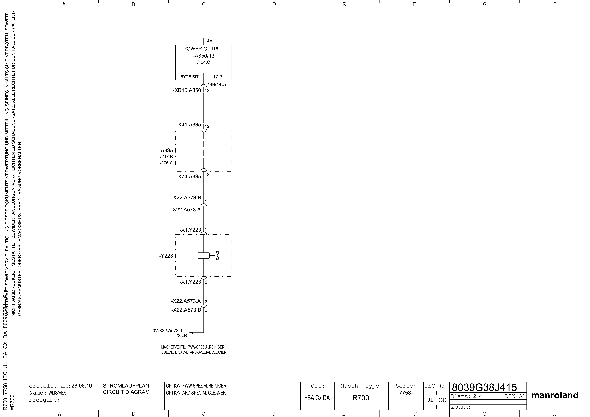

# +BA_Cx_DA — Sheet 214 of 247 — OPTION: FWW SPEZIALREINIGER

**OPTION: ARD SPECIAL CLEANER**

> Part of the manroland **R700** printing press IEC/UL circuit diagrams.
> Drawing class: **Stromlaufplan / Circuit diagram** (DIN A3).
> Document `+BA_Cx_DA` covers the **Printing units / main switch cabinet** machine section.

## At a glance

| Field | Value |
|---|---|
| Document | `+BA_Cx_DA`  (8039G38J415) |
| Sheet | **214** of 247 |
| Section (DE) | OPTION: FWW SPEZIALREINIGER |
| Section (EN) | OPTION: ARD SPECIAL CLEANER |
| Section type | CIRCUIT — Circuit diagram |
| Machine type | `R700` |
| Series | `7758` |
| Created | 28.06.10 |
| Replaces | — |
| Columns used | B, C |
| Path numbers | — |
| Labels on sheet | 33 |
| Cross-refs out | 4 |
| Cross-refs in | 13 |

**Previous:** [+BA_Cx_DA sheet 213](SHEET_0213.md) · **Next:** [+BA_Cx_DA sheet 215](SHEET_0215.md) · **Document TOC:** [_TOC.md](_TOC.md)  (+BA_Cx_DA) · **Master TOC:** [all sheets](../_MASTER_TOC.md)

## Sheet image (300 DPI, exact vector render)



_Rendered directly from the PDF vector layer at 300 DPI (1-bit), no OCR and no resampling. Use it to confirm anything ambiguous in the text below._

## Cross-references on this sheet

Each entry is a wire leaving this sheet. The printed token is `/sheet.column`; the link resolves to that sheet inside the same document.

| Ref | Target sheet | Col | Path | Destination on target | Target section | From col |
|---|---|---|---|---|---|---|
| `/134.C` | [+BA_Cx_DA sheet 134](SHEET_0134.md) | C | — | — | REFERENZMODUL | C |
| `/217.B` | [+BA_Cx_DA sheet 217](SHEET_0217.md) | B | — | — | OPTION: FARBFLUSS UMSCHALTEN | B |
| `/206.A` | [+BA_Cx_DA sheet 206](SHEET_0206.md) | A | — | — | OPTION: AUTOMATISCHE FARBZUFÜHRUNG | B |
| `/28.B` | [+BA_Cx_DA sheet 28](SHEET_0028.md) | B | — | 0V.X22.A573:3 | BUSVERBINDUNGEN: STOP SICHERN | C |

### Incoming references (sheets that point here)

Every other sheet that sends a wire to this one. `Back-ref` is the token printed on *that* sheet; `Path` is its line number.

| From sheet | Cols | Back-ref | Path | Refs | What continues there |
|---|---|---|---|---|---|
| [+BA_Cx_DA#28](SHEET_0028.md) | B | `/28.B` | — | 1 | — |
| [+BA_Cx_DA#134](SHEET_0134.md) | C | `/134.C` | — | 1 | — |
| [+BA_Cx_DA#150](SHEET_0150.md) | B | `/150.B` | — | 2 | — |
| [+BA_Cx_DA#171](SHEET_0171.md) | G | `/171.G` | — | 1 | — |
| [+BA_Cx_DA#174](SHEET_0174.md) | F | `/174.F` | — | 4 | — |
| [+BA_Cx_DA#181](SHEET_0181.md) | F | `/181.F` | — | 1 | — |
| [+BA_Cx_DA#184](SHEET_0184.md) | F | `/184.F` | — | 1 | — |
| [+BA_Cx_DA#206](SHEET_0206.md) | A | `/206.A` | — | 1 | — |
| [+BA_Cx_DA#217](SHEET_0217.md) | B | `/217.B` | — | 1 | — |


## Devices on this sheet

| Tag | Class | Class meaning (IEC) | Col | Sub | Terminal | Sign |
|---|---|---|---|---|---|---|
| `A350/13` | A | Baugruppe / assembly, module, PC board | C | 13 | — | — |
| `A335` | A | Baugruppe / assembly, module, PC board | B | — | — | — |
| `Y223` | Y | Magnetventil / solenoid valve, actuator | B | — | — | — |
| `X74.A335` | — | cross-device reference | C | — | — | — |
| `X41.A335` | — | cross-device reference | C | — | — | — |
| `17.3` | — | cross-device reference | C | — | — | — |
| `XB15.A350` | — | cross-device reference | C | — | — | — |
| `X22.A573.B` | — | cross-device reference | C | — | — | — |
| `X22.A573.A` | — | cross-device reference | C | — | — | — |
| `X1.Y223` | — | cross-device reference | C | — | — | — |
| `X1.Y223` | — | cross-device reference | C | — | — | — |
| `X22.A573.B` | — | cross-device reference | C | — | — | — |
| `X22.A573.A` | — | cross-device reference | C | — | — | — |

## Potentials / nets

| Potential | Count | Columns | Attached devices | Terminals |
|---|---|---|---|---|
| `0V` | 1 | B | `A573`, `X22` | `3` |


A potential such as `L24+/4` or `M24+` is a named supply/return rail; every place it appears on this sheet is electrically common.

## Wire-end annotations (grouped as printed)

A wire that continues elsewhere is annotated with a small cluster: the destination description, the path/line number `#NN`, and the `/sheet.column` cross reference. Each row below is one such cluster exactly as it is grouped on the drawing.

| Col | Y | Path | Cross-ref | Text on the wire |
|---|---|---|---|---|
| C | 79.0 | — | — | `14A` |
| C | 94.1 | — | — | `POWER OUTPUT` |
| C | 108.0 | — | — | `A350/13` |
| C | 121.8 | — | `/134.C` | — |
| C | 150.9 | — | — | `BYTE.BIT 17.3` |
| C | 166.9 | — | — | `14B(14C)` |
| C | 177.5 | — | — | `XB15.A350 12` |
| C | 246.9 | — | — | `X41.A335 12` |
| B | 299.4 | — | — | `A335` |
| B | 312.4 | — | `/217.B`, `/206.A` | — |
| C | 349.0 | — | — | `X74.A335 18` |
| C | 394.3 | — | — | `X22.A573.B 1` |
| C | 418.4 | — | — | `X22.A573.A 1` |
| C | 459.5 | — | — | `X1.Y223 1` |
| B | 512.0 | — | — | `Y223` |
| C | 564.5 | — | — | `X1.Y223 2` |
| C | 603.4 | — | — | `X22.A573.A 3` |
| C | 621.1 | — | — | `X22.A573.B 3` |
| C | 663.6 | — | `/28.B` | `0V.X22.A573:3` |
| C | 697.9 | — | — | `MAGNETVENTIL: FWW SPEZIALREINIGER SOLENOID VALVE: ARD SPECIAL CLEANER` |


## Reconstructed tables

This sheet carries tabular content (pin map / terminal assignment / index). The grid below was rebuilt from the drawing's own rule lines, so each row is exactly one physical row of the table.

### Table 1 — 1 data rows × 2 columns (at x=354.3, y=90.7)

| POWER | OUTPUT A350/13 /134.C |
|---|---|
| `BYTE.BIT` | `17.3` |


## Notes and free text on this sheet

| Text | Col | Y (pt) |
|---|---|---|
| `14A` | C | 78.95 |
| `14B(14C)` | C | 166.86 |
| `POWER OUTPUT` | C | 94.1 |
| `BYTE.BIT` | C | 151.43 |
| `MAGNETVENTIL: FWW SPEZIALREINIGER` | C | 697.92 |
| `SOLENOID VALVE: ARD SPECIAL CLEANER` | C | 708.58 |

## Complete label inventory (exact text from the drawing)

Every text object inside the drawing area of this sheet, in DIN reading order (column A→H, then top→bottom). This is the authoritative list: if a string is not here it is not printed on this sheet.

| Col | Y | X | Dir | Type | Text |
|---|---|---|---|---|---|
| B | 299.4 | 320.9 | → | device tag | `A335` |
| B | 312.4 | 323.4 | → | cross-reference | `/217.B` |
| B | 324.8 | 323.1 | → | cross-reference | `/206.A` |
| B | 512.0 | 321.4 | → | device tag | `Y223` |
| B | 663.6 | 308.1 | → | potential | `0V.X22.A573:3` |
| C | 78.9 | 413.0 | → | text | `14A` |
| C | 94.1 | 370.2 | → | text | `POWER OUTPUT` |
| C | 108.0 | 389.6 | → | device tag | `A350/13` |
| C | 121.8 | 398.3 | → | cross-reference | `/134.C` |
| C | 150.9 | 429.6 | → | device ref | `17.3` |
| C | 151.4 | 364.3 | → | text | `BYTE.BIT` |
| C | 166.9 | 418.7 | → | text | `14B(14C)` |
| C | 177.5 | 348.7 | → | device ref | `XB15.A350` |
| C | 178.9 | 413.0 | → | number | `12` |
| C | 246.9 | 355.7 | → | device ref | `X41.A335` |
| C | 251.2 | 413.0 | → | number | `12` |
| C | 349.0 | 413.0 | → | number | `18` |
| C | 351.8 | 355.7 | → | device ref | `X74.A335` |
| C | 394.3 | 345.8 | → | device ref | `X22.A573.B` |
| C | 402.8 | 413.0 | → | number | `1` |
| C | 418.4 | 345.0 | → | device ref | `X22.A573.A` |
| C | 419.9 | 413.0 | → | number | `1` |
| C | 459.5 | 413.0 | → | number | `1` |
| C | 459.6 | 362.3 | → | device ref | `X1.Y223` |
| C | 564.5 | 362.3 | → | device ref | `X1.Y223` |
| C | 565.8 | 413.6 | → | number | `2` |
| C | 603.4 | 345.0 | → | device ref | `X22.A573.A` |
| C | 605.5 | 413.6 | → | number | `3` |
| C | 621.1 | 345.8 | → | device ref | `X22.A573.B` |
| C | 622.5 | 413.6 | → | number | `3` |
| C | 673.5 | 356.6 | → | cross-reference | `/28.B` |
| C | 697.9 | 325.4 | → | text | `MAGNETVENTIL: FWW SPEZIALREINIGER` |
| C | 708.6 | 325.7 | → | text | `SOLENOID VALVE: ARD SPECIAL CLEANER` |

## Reading-order text block

The same content as a plain block, grouped by DIN column — convenient to paste or to match against a visual description.

```text
=== Column B ===
 299.4  320.9  devtag       A335
 312.4  323.4  xref         /217.B
 324.8  323.1  xref         /206.A
 512.0  321.4  devtag       Y223
 663.6  308.1  net          0V.X22.A573:3
=== Column C ===
  78.9  413.0  text         14A
  94.1  370.2  text         POWER OUTPUT
 108.0  389.6  devtag       A350/13
 121.8  398.3  xref         /134.C
 150.9  429.6  devref       17.3
 151.4  364.3  text         BYTE.BIT
 166.9  418.7  text         14B(14C)
 177.5  348.7  devref       XB15.A350
 178.9  413.0  numeric      12
 246.9  355.7  devref       X41.A335
 251.2  413.0  numeric      12
 349.0  413.0  numeric      18
 351.8  355.7  devref       X74.A335
 394.3  345.8  devref       X22.A573.B
 402.8  413.0  numeric      1
 418.4  345.0  devref       X22.A573.A
 419.9  413.0  numeric      1
 459.5  413.0  numeric      1
 459.6  362.3  devref       X1.Y223
 564.5  362.3  devref       X1.Y223
 565.8  413.6  numeric      2
 603.4  345.0  devref       X22.A573.A
 605.5  413.6  numeric      3
 621.1  345.8  devref       X22.A573.B
 622.5  413.6  numeric      3
 673.5  356.6  xref         /28.B
 697.9  325.4  text         MAGNETVENTIL: FWW SPEZIALREINIGER
 708.6  325.7  text         SOLENOID VALVE: ARD SPECIAL CLEANER
```

---
_Generated from the PDF vector text layer; no OCR. Source: `R700_7758_IEC_UL_BA_CX_DA_8039G38J415_p`, sheet 214._
