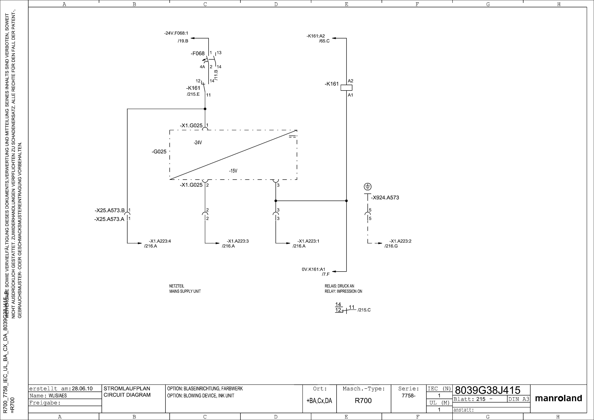

# +BA_Cx_DA — Sheet 215 of 247 — OPTION: BLASEINRICHTUNG, FARBWERK

**OPTION: BLOWING DEVICE, INK UNIT**

> Part of the manroland **R700** printing press IEC/UL circuit diagrams.
> Drawing class: **Stromlaufplan / Circuit diagram** (DIN A3).
> Document `+BA_Cx_DA` covers the **Printing units / main switch cabinet** machine section.

## At a glance

| Field | Value |
|---|---|
| Document | `+BA_Cx_DA`  (8039G38J415) |
| Sheet | **215** of 247 |
| Section (DE) | OPTION: BLASEINRICHTUNG, FARBWERK |
| Section (EN) | OPTION: BLOWING DEVICE, INK UNIT |
| Section type | CIRCUIT — Circuit diagram |
| Machine type | `R700` |
| Series | `7758` |
| Created | 28.06.10 |
| Replaces | — |
| Columns used | B, C, D, E, F |
| Path numbers | — |
| Labels on sheet | 55 |
| Cross-refs out | 9 |
| Cross-refs in | 20 |

**Previous:** [+BA_Cx_DA sheet 214](SHEET_0214.md) · **Next:** [+BA_Cx_DA sheet 216](SHEET_0216.md) · **Document TOC:** [_TOC.md](_TOC.md)  (+BA_Cx_DA) · **Master TOC:** [all sheets](../_MASTER_TOC.md)

## Sheet image (300 DPI, exact vector render)



_Rendered directly from the PDF vector layer at 300 DPI (1-bit), no OCR and no resampling. Use it to confirm anything ambiguous in the text below._

## Cross-references on this sheet

Each entry is a wire leaving this sheet. The printed token is `/sheet.column`; the link resolves to that sheet inside the same document.

| Ref | Target sheet | Col | Path | Destination on target | Target section | From col |
|---|---|---|---|---|---|---|
| `/65.C` | [+BA_Cx_DA sheet 65](SHEET_0065.md) | C | — | K161:A2 | DRUCKANSTELLUNG | E |
| `/19.B` | [+BA_Cx_DA sheet 19](SHEET_0019.md) | B | — | — | SPANNUNGSVERSORGUNG: MAGNETVENTILBLOCK | C |
| `/11.B` | [+BA_Cx_DA sheet 11](SHEET_0011.md) | B | — | — | SPANNUNGSVERSORGUNG, SCHALTSCHRANKBELÜFTUNG | C |
| `/215.E` | [+BA_Cx_DA sheet 215](SHEET_0215.md) | E | — | — | OPTION: BLASEINRICHTUNG, FARBWERK | C |
| `/216.A` | [+BA_Cx_DA sheet 216](SHEET_0216.md) | A | — | X1.A223:2 | OPTION: BLASEINRICHTUNG, FARBWERK | E |
| `/216.A` | [+BA_Cx_DA sheet 216](SHEET_0216.md) | A | — | — | OPTION: BLASEINRICHTUNG, FARBWERK | B |
| `/216.A` | [+BA_Cx_DA sheet 216](SHEET_0216.md) | A | — | — | OPTION: BLASEINRICHTUNG, FARBWERK | C |
| `/216.G` | [+BA_Cx_DA sheet 216](SHEET_0216.md) | G | — | — | OPTION: BLASEINRICHTUNG, FARBWERK | F |
| `/7.F` | [+BA_Cx_DA sheet 7](SHEET_0007.md) | F | — | 0V.K161:A1 | SPANNUNGSVERSORGUNG, SCHALTSCHRANKBELÜFTUNG | E |

### Incoming references (sheets that point here)

Every other sheet that sends a wire to this one. `Back-ref` is the token printed on *that* sheet; `Path` is its line number.

| From sheet | Cols | Back-ref | Path | Refs | What continues there |
|---|---|---|---|---|---|
| [+BA_Cx_DA#7](SHEET_0007.md) | F | `/7.F` | — | 1 | — |
| [+BA_Cx_DA#11](SHEET_0011.md) | B | `/11.B` | — | 1 | — |
| [+BA_Cx_DA#19](SHEET_0019.md) | B | `/19.B` | — | 1 | — |
| [+BA_Cx_DA#65](SHEET_0065.md) | C | `/65.C` | — | 1 | — |
| [+BA_Cx_DA#147](SHEET_0147.md) | F | `/147.F` | — | 3 | — |
| [+BA_Cx_DA#175](SHEET_0175.md) | G | `/175.G` | — | 8 | — |
| [+BA_Cx_DA#215](SHEET_0215.md) | C | `/215.C` | — | 1 | — |
| [+BA_Cx_DA#216](SHEET_0216.md) | A, F | `/216.A`, `/216.F` | — | 4 | X1.A223:1; X1.A223:2; X1.A223:3; X1.A223:4 |


## Devices on this sheet

| Tag | Class | Class meaning (IEC) | Col | Sub | Terminal | Sign |
|---|---|---|---|---|---|---|
| `G025` | G | Stromversorgung / power supply | B | — | — | — |
| `K161` | K | Relais / relay, contactor | C | — | — | — |
| `F068` | F | Schutz / protection device (fuse, circuit breaker) | C | — | — | — |
| `A2` | A | Baugruppe / assembly, module, PC board | E | — | — | — |
| `A1` | A | Baugruppe / assembly, module, PC board | E | — | — | — |
| `K161` | K | Relais / relay, contactor | E | — | — | — |
| `K161:A2` | K | Relais / relay, contactor | E | — | A2 | — |
| `X1.G025` | — | cross-device reference | C | — | — | — |
| `X1.G025` | — | cross-device reference | C | — | — | — |
| `X25.A573.B` | — | cross-device reference | B | — | — | — |
| `X25.A573.A` | — | cross-device reference | B | — | — | — |
| `X1.A223:4` | — | cross-device reference | B | — | 4 | — |
| `X1.A223:3` | — | cross-device reference | C | — | 3 | — |
| `X1.A223:2` | — | cross-device reference | F | — | 2 | — |
| `X1.A223:1` | — | cross-device reference | D | — | 1 | — |
| `X924.A573` | — | cross-device reference | F | — | — | — |

## Potentials / nets

| Potential | Count | Columns | Attached devices | Terminals |
|---|---|---|---|---|
| `0V` | 1 | E | `K161` | `A1` |
| `15V` | 1 | C | — | — |
| `24V` | 2 | C | `F068` | `1` |


A potential such as `L24+/4` or `M24+` is a named supply/return rail; every place it appears on this sheet is electrically common.

## Wire-end annotations (grouped as printed)

A wire that continues elsewhere is annotated with a small cluster: the destination description, the path/line number `#NN`, and the `/sheet.column` cross reference. Each row below is one such cluster exactly as it is grouped on the drawing.

| Col | Y | Path | Cross-ref | Text on the wire |
|---|---|---|---|---|
| C | 62.6 | — | — | `24V.F068:1` |
| E | 68.3 | — | `/65.C` | `K161:A2` |
| C | 78.2 | — | `/19.B` | — |
| C | 101.7 | — | — | `1` |
| C | 101.7 | — | — | `13` |
| C | 102.3 | — | — | `F068` |
| C | 130.0 | — | — | `4A 2` |
| C | 130.0 | — | — | `14` |
| C | 140.0 | — | `/11.B` | — |
| E | 158.3 | — | — | `A2` |
| C | 158.4 | — | — | `K161 14` |
| C | 158.4 | — | — | `12` |
| E | 163.3 | — | — | `K161` |
| C | 184.9 | — | `/215.E` | — |
| C | 186.7 | — | — | `11` |
| E | 186.7 | — | — | `A1` |
| C | 246.9 | — | — | `X1.G025 1` |
| C | 282.2 | — | — | `24V` |
| B | 299.4 | — | — | `G025` |
| C | 338.9 | — | — | `15V` |
| C | 366.0 | — | — | `X1.G025 2 3` |
| F | 391.5 | — | — | `X924.A573` |
| C | 417.0 | — | — | `X25.A573.B 1 2 3` |
| E | 417.0 | — | — | `5` |
| C | 434.0 | — | — | `X25.A573.A 1 2 3` |
| E | 434.0 | — | — | `5` |
| B | 479.3 | — | — | `X1.A223:4` |
| C | 479.3 | — | — | `X1.A223:3` |
| E | 479.3 | — | `/216.A` | `X1.A223:2` |
| D | 479.3 | — | — | `X1.A223:1` |
| B | 489.2 | — | `/216.A` | — |
| C | 489.2 | — | `/216.A` | — |
| F | 489.3 | — | `/216.G` | — |
| E | 536.0 | — | `/7.F` | `0V.K161:A1` |
| C | 570.4 | — | — | `NETZTEIL MAINS SUPPLY UNIT` |
| E | 570.4 | — | — | `RELAIS: DRUCK AN RELAY: IMPRESSION ON` |
| E | 605.5 | — | — | `14 12 11 /215.C` |


## Notes and free text on this sheet

| Text | Col | Y (pt) |
|---|---|---|
| `NETZTEIL` | C | 570.36 |
| `MAINS SUPPLY UNIT` | C | 581.02 |
| `4A` | C | 130.22 |
| `11 /215.C` | E | 611.14 |
| `RELAIS: DRUCK AN` | E | 570.37 |
| `RELAY: IMPRESSION ON` | E | 581.01 |

## Complete label inventory (exact text from the drawing)

Every text object inside the drawing area of this sheet, in DIN reading order (column A→H, then top→bottom). This is the authoritative list: if a string is not here it is not printed on this sheet.

| Col | Y | X | Dir | Type | Text |
|---|---|---|---|---|---|
| B | 299.4 | 304.2 | → | device tag | `G025` |
| B | 417.0 | 189.9 | → | device ref | `X25.A573.B` |
| B | 417.0 | 257.1 | → | number | `1` |
| B | 434.0 | 257.1 | → | number | `1` |
| B | 434.7 | 189.1 | → | device ref | `X25.A573.A` |
| B | 479.3 | 298.8 | → | device ref | `X1.A223:4` |
| B | 489.2 | 289.1 | → | cross-reference | `/216.A` |
| C | 62.7 | 329.1 | → | potential | `24V.F068:1` |
| C | 78.2 | 356.6 | → | cross-reference | `/19.B` |
| C | 101.7 | 420.1 | → | number | `1` |
| C | 101.7 | 434.3 | → | number | `13` |
| C | 102.3 | 382.4 | → | device tag | `F068` |
| C | 130.0 | 420.7 | → | number | `2` |
| C | 130.0 | 434.3 | → | number | `14` |
| C | 130.2 | 400.8 | → | text | `4A` |
| C | 140.0 | 429.0 | ↕ | cross-reference | `/11.B` |
| C | 158.4 | 392.0 | → | number | `12` |
| C | 158.4 | 420.1 | → | number | `14` |
| C | 171.8 | 373.3 | → | device tag | `K161` |
| C | 184.9 | 374.7 | → | cross-reference | `/215.E` |
| C | 186.7 | 413.0 | → | number | `11` |
| C | 246.9 | 360.6 | → | device ref | `X1.G025` |
| C | 246.9 | 413.0 | → | number | `1` |
| C | 282.2 | 388.7 | → | potential | `24V` |
| C | 338.9 | 459.6 | → | potential | `15V` |
| C | 366.0 | 360.6 | → | device ref | `X1.G025` |
| C | 367.4 | 413.6 | → | number | `2` |
| C | 417.0 | 413.6 | → | number | `2` |
| C | 434.0 | 413.6 | → | number | `2` |
| C | 479.3 | 454.7 | → | device ref | `X1.A223:3` |
| C | 489.2 | 445.0 | → | cross-reference | `/216.A` |
| C | 570.4 | 339.3 | → | text | `NETZTEIL` |
| C | 581.0 | 339.6 | → | text | `MAINS SUPPLY UNIT` |
| D | 367.4 | 555.3 | → | number | `3` |
| D | 417.0 | 555.3 | → | number | `3` |
| D | 434.0 | 555.3 | → | number | `3` |
| D | 479.3 | 596.4 | → | device ref | `X1.A223:1` |
| D | 489.2 | 586.8 | → | cross-reference | `/216.A` |
| E | 68.3 | 614.6 | → | device tag | `K161:A2` |
| E | 78.2 | 639.8 | → | cross-reference | `/65.C` |
| E | 158.3 | 697.3 | → | device tag | `A2` |
| E | 163.3 | 651.1 | → | device tag | `K161` |
| E | 186.6 | 697.3 | → | device tag | `A1` |
| E | 417.0 | 739.6 | → | number | `5` |
| E | 434.0 | 739.6 | → | number | `5` |
| E | 536.0 | 605.2 | → | potential | `0V.K161:A1` |
| E | 545.9 | 645.4 | → | cross-reference | `/7.F` |
| E | 570.4 | 651.1 | → | text | `RELAIS: DRUCK AN` |
| E | 581.0 | 651.1 | → | text | `RELAY: IMPRESSION ON` |
| E | 605.5 | 671.8 | → | number | `14` |
| E | 611.1 | 699.0 | → | text | `11 /215.C` |
| E | 616.8 | 671.8 | → | number | `12` |
| F | 391.5 | 743.8 | → | device ref | `X924.A573` |
| F | 479.3 | 780.7 | → | device ref | `X1.A223:2` |
| F | 489.3 | 771.0 | → | cross-reference | `/216.G` |

## Reading-order text block

The same content as a plain block, grouped by DIN column — convenient to paste or to match against a visual description.

```text
=== Column B ===
 299.4  304.2  devtag       G025
 417.0  189.9  devref       X25.A573.B
 417.0  257.1  numeric      1
 434.0  257.1  numeric      1
 434.7  189.1  devref       X25.A573.A
 479.3  298.8  devref       X1.A223:4
 489.2  289.1  xref         /216.A
=== Column C ===
  62.7  329.1  net          24V.F068:1
  78.2  356.6  xref         /19.B
 101.7  420.1  numeric      1
 101.7  434.3  numeric      13
 102.3  382.4  devtag       F068
 130.0  420.7  numeric      2
 130.0  434.3  numeric      14
 130.2  400.8  text         4A
 140.0  429.0  xref         /11.B
 158.4  392.0  numeric      12
 158.4  420.1  numeric      14
 171.8  373.3  devtag       K161
 184.9  374.7  xref         /215.E
 186.7  413.0  numeric      11
 246.9  360.6  devref       X1.G025
 246.9  413.0  numeric      1
 282.2  388.7  net          24V
 338.9  459.6  net          15V
 366.0  360.6  devref       X1.G025
 367.4  413.6  numeric      2
 417.0  413.6  numeric      2
 434.0  413.6  numeric      2
 479.3  454.7  devref       X1.A223:3
 489.2  445.0  xref         /216.A
 570.4  339.3  text         NETZTEIL
 581.0  339.6  text         MAINS SUPPLY UNIT
=== Column D ===
 367.4  555.3  numeric      3
 417.0  555.3  numeric      3
 434.0  555.3  numeric      3
 479.3  596.4  devref       X1.A223:1
 489.2  586.8  xref         /216.A
=== Column E ===
  68.3  614.6  devtag       K161:A2
  78.2  639.8  xref         /65.C
 158.3  697.3  devtag       A2
 163.3  651.1  devtag       K161
 186.6  697.3  devtag       A1
 417.0  739.6  numeric      5
 434.0  739.6  numeric      5
 536.0  605.2  net          0V.K161:A1
 545.9  645.4  xref         /7.F
 570.4  651.1  text         RELAIS: DRUCK AN
 581.0  651.1  text         RELAY: IMPRESSION ON
 605.5  671.8  numeric      14
 611.1  699.0  text         11 /215.C
 616.8  671.8  numeric      12
=== Column F ===
 391.5  743.8  devref       X924.A573
 479.3  780.7  devref       X1.A223:2
 489.3  771.0  xref         /216.G
```

---
_Generated from the PDF vector text layer; no OCR. Source: `R700_7758_IEC_UL_BA_CX_DA_8039G38J415_p`, sheet 215._
