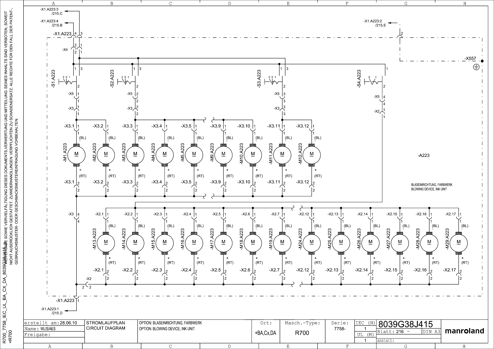

# +BA_Cx_DA — Sheet 216 of 247 — OPTION: BLASEINRICHTUNG, FARBWERK

**OPTION: BLOWING DEVICE, INK UNIT**

> Part of the manroland **R700** printing press IEC/UL circuit diagrams.
> Drawing class: **Stromlaufplan / Circuit diagram** (DIN A3).
> Document `+BA_Cx_DA` covers the **Printing units / main switch cabinet** machine section.

## At a glance

| Field | Value |
|---|---|
| Document | `+BA_Cx_DA`  (8039G38J415) |
| Sheet | **216** of 247 |
| Section (DE) | OPTION: BLASEINRICHTUNG, FARBWERK |
| Section (EN) | OPTION: BLOWING DEVICE, INK UNIT |
| Section type | CIRCUIT — Circuit diagram |
| Machine type | `R700` |
| Series | `7758` |
| Created | 28.06.10 |
| Replaces | — |
| Columns used | A, B, C, D, E, F, G, H |
| Path numbers | — |
| Labels on sheet | 317 |
| Cross-refs out | 4 |
| Cross-refs in | 8 |

**Previous:** [+BA_Cx_DA sheet 215](SHEET_0215.md) · **Next:** [+BA_Cx_DA sheet 217](SHEET_0217.md) · **Document TOC:** [_TOC.md](_TOC.md)  (+BA_Cx_DA) · **Master TOC:** [all sheets](../_MASTER_TOC.md)

## Sheet image (300 DPI, exact vector render)



_Rendered directly from the PDF vector layer at 300 DPI (1-bit), no OCR and no resampling. Use it to confirm anything ambiguous in the text below._

## Cross-references on this sheet

Each entry is a wire leaving this sheet. The printed token is `/sheet.column`; the link resolves to that sheet inside the same document.

| Ref | Target sheet | Col | Path | Destination on target | Target section | From col |
|---|---|---|---|---|---|---|
| `/215.C` | [+BA_Cx_DA sheet 215](SHEET_0215.md) | C | — | X1.A223:3 | OPTION: BLASEINRICHTUNG, FARBWERK | A |
| `/215.B` | [+BA_Cx_DA sheet 215](SHEET_0215.md) | B | — | X1.A223:4 | OPTION: BLASEINRICHTUNG, FARBWERK | A |
| `/215.E` | [+BA_Cx_DA sheet 215](SHEET_0215.md) | E | — | X1.A223:2 | OPTION: BLASEINRICHTUNG, FARBWERK | F |
| `/215.D` | [+BA_Cx_DA sheet 215](SHEET_0215.md) | D | — | X1.A223:1 | OPTION: BLASEINRICHTUNG, FARBWERK | A |

### Incoming references (sheets that point here)

Every other sheet that sends a wire to this one. `Back-ref` is the token printed on *that* sheet; `Path` is its line number.

| From sheet | Cols | Back-ref | Path | Refs | What continues there |
|---|---|---|---|---|---|
| [+BA_Cx_DA#141](SHEET_0141.md) | A | `/141.A` | — | 4 | — |
| [+BA_Cx_DA#215](SHEET_0215.md) | B, C, E, F | `/215.B`, `/215.C`, `/215.E`, `/215.F` | — | 4 | X1.A223:2 |


## Devices on this sheet

| Tag | Class | Class meaning (IEC) | Col | Sub | Terminal | Sign |
|---|---|---|---|---|---|---|
| `A223` | A | Baugruppe / assembly, module, PC board | G | — | — | — |
| `X2` | X | Klemme / terminal, plug connector | B | — | — | — |
| `X3` | X | Klemme / terminal, plug connector | A | — | — | — |
| `X4` | X | Klemme / terminal, plug connector | A | — | — | — |
| `X5` | X | Klemme / terminal, plug connector | A | — | — | — |
| `X3` | X | Klemme / terminal, plug connector | A | — | — | — |
| `X5` | X | Klemme / terminal, plug connector | B | — | — | — |
| `X3` | X | Klemme / terminal, plug connector | B | — | — | — |
| `X5` | X | Klemme / terminal, plug connector | G | — | — | — |
| `X5` | X | Klemme / terminal, plug connector | E | — | — | — |
| `X3` | X | Klemme / terminal, plug connector | E | — | — | — |
| `X2` | X | Klemme / terminal, plug connector | G | — | — | — |
| `X557` | X | Klemme / terminal, plug connector | H | — | — | — |
| `X1.A223` | — | cross-device reference | A | — | — | — |
| `S1.A223` | — | cross-device reference | A | — | — | — |
| `S2.A223` | — | cross-device reference | B | — | — | — |
| `S3.A223` | — | cross-device reference | E | — | — | — |
| `S4.A223` | — | cross-device reference | F | — | — | — |
| `X1.A223` | — | cross-device reference | A | — | — | — |
| `X1.A223:4` | — | cross-device reference | A | — | 4 | — |
| `X1.A223:3` | — | cross-device reference | A | — | 3 | — |
| `X1.A223:1` | — | cross-device reference | A | — | 1 | — |
| `X1.A223:2` | — | cross-device reference | F | — | 2 | — |
| `X2.1` | — | cross-device reference | B | — | — | — |
| `X2.2` | — | cross-device reference | B | — | — | — |
| `X2.3` | — | cross-device reference | C | — | — | — |
| `X2.4` | — | cross-device reference | C | — | — | — |
| `X2.5` | — | cross-device reference | D | — | — | — |
| `X2.6` | — | cross-device reference | D | — | — | — |
| `X2.7` | — | cross-device reference | E | — | — | — |
| `X2.12` | — | cross-device reference | E | — | — | — |
| `X2.13` | — | cross-device reference | F | — | — | — |
| `X2.14` | — | cross-device reference | F | — | — | — |
| `X2.16` | — | cross-device reference | G | — | — | — |
| `X2.17` | — | cross-device reference | H | — | — | — |
| `X2.15` | — | cross-device reference | G | — | — | — |
| `X3.1` | — | cross-device reference | A | — | — | — |
| `X3.2` | — | cross-device reference | B | — | — | — |
| `X3.4` | — | cross-device reference | C | — | — | — |
| `X3.5` | — | cross-device reference | C | — | — | — |
| `X3.10` | — | cross-device reference | D | — | — | — |
| `X3.11` | — | cross-device reference | E | — | — | — |
| `X3.12` | — | cross-device reference | E | — | — | — |
| `X3.3` | — | cross-device reference | B | — | — | — |
| `X3.9` | — | cross-device reference | D | — | — | — |
| `X2.1` | — | cross-device reference | B | — | — | — |
| `X2.2` | — | cross-device reference | B | — | — | — |
| `X2.3` | — | cross-device reference | C | — | — | — |
| `X2.4` | — | cross-device reference | C | — | — | — |
| `X2.5` | — | cross-device reference | D | — | — | — |
| `X2.6` | — | cross-device reference | D | — | — | — |
| `X2.7` | — | cross-device reference | E | — | — | — |
| `X2.12` | — | cross-device reference | E | — | — | — |
| `X2.13` | — | cross-device reference | F | — | — | — |
| `X2.14` | — | cross-device reference | F | — | — | — |
| `X2.16` | — | cross-device reference | G | — | — | — |
| `X2.17` | — | cross-device reference | H | — | — | — |
| `X2.15` | — | cross-device reference | G | — | — | — |
| `X3.1` | — | cross-device reference | A | — | — | — |
| `X3.2` | — | cross-device reference | B | — | — | — |
| `X3.3` | — | cross-device reference | B | — | — | — |
| `X3.4` | — | cross-device reference | C | — | — | — |
| `X3.5` | — | cross-device reference | C | — | — | — |
| `X3.9` | — | cross-device reference | D | — | — | — |
| `X3.10` | — | cross-device reference | D | — | — | — |
| `X3.11` | — | cross-device reference | E | — | — | — |
| `X3.12` | — | cross-device reference | E | — | — | — |

## Potentials / nets

| Potential | Count | Columns | Attached devices | Terminals |
|---|---|---|---|---|
| `M1` | 1 | A | `A223` | — |
| `M10` | 1 | D | `A223` | — |
| `M11` | 1 | E | `A223` | — |
| `M12` | 1 | E | `A223` | — |
| `M13` | 1 | B | `A223` | — |
| `M14` | 1 | B | `A223` | — |
| `M15` | 1 | C | `A223` | — |
| `M16` | 1 | C | `A223` | — |
| `M17` | 1 | D | `A223` | — |
| `M18` | 1 | D | `A223` | — |
| `M19` | 1 | E | `A223` | — |
| `M2` | 1 | B | `A223` | — |
| `M24` | 1 | E | `A223` | — |
| `M25` | 1 | F | `A223` | — |
| `M26` | 1 | F | `A223` | — |
| `M27` | 1 | G | `A223` | — |
| `M28` | 1 | G | `A223` | — |
| `M29` | 1 | H | `A223` | — |
| `M3` | 1 | B | `A223` | — |
| `M4` | 1 | C | `A223` | — |
| `M5` | 1 | C | `A223` | — |
| `M9` | 1 | D | `A223` | — |


A potential such as `L24+/4` or `M24+` is a named supply/return rail; every place it appears on this sheet is electrically common.

## Wire-end annotations (grouped as printed)

A wire that continues elsewhere is annotated with a small cluster: the destination description, the path/line number `#NN`, and the `/sheet.column` cross reference. Each row below is one such cluster exactly as it is grouped on the drawing.

| Col | Y | Path | Cross-ref | Text on the wire |
|---|---|---|---|---|
| A | 18.7 | — | `/215.C` | `X1.A223:3` |
| A | 47.0 | — | `/215.B` | `X1.A223:4` |
| F | 47.0 | — | `/215.E` | `X1.A223:2` |
| D | 76.8 | — | — | `X1.A223 4 3 2` |
| A | 105.2 | — | — | `2` |
| A | 105.2 | — | — | `1` |
| A | 115.8 | — | — | `X4` |
| A | 122.2 | — | — | `2` |
| A | 122.2 | — | — | `1` |
| H | 136.4 | — | — | `X557` |
| A | 161.9 | — | — | `1 3` |
| B | 161.9 | — | — | `1 3` |
| E | 161.9 | — | — | `1 3` |
| G | 161.9 | — | — | `1` |
| A | 168.1 | — | — | `S1.A223` |
| B | 168.1 | — | — | `S2.A223` |
| E | 168.1 | — | — | `S3.A223` |
| F | 168.1 | — | — | `S4.A223` |
| A | 183.4 | — | — | `2 0 1` |
| B | 183.4 | — | — | `2 0 1` |
| E | 183.4 | — | — | `2 0 1` |
| F | 183.4 | — | — | `0 1` |
| A | 204.4 | — | — | `2` |
| B | 204.4 | — | — | `2` |
| E | 204.4 | — | — | `2` |
| G | 204.4 | — | — | `2` |
| A | 222.1 | — | — | `X5` |
| B | 222.1 | — | — | `X5` |
| F | 222.1 | — | — | `X5 X5` |
| A | 222.8 | — | — | `1` |
| B | 222.8 | — | — | `2` |
| E | 222.8 | — | — | `3` |
| G | 229.9 | — | — | `4` |
| A | 239.8 | — | — | `1` |
| B | 239.8 | — | — | `2` |
| E | 239.8 | — | — | `3` |
| G | 246.9 | — | — | `4` |
| A | 254.0 | — | — | `1` |
| B | 254.0 | — | — | `2` |
| E | 254.0 | — | — | `3` |
| A | 257.5 | — | — | `X3` |
| B | 257.5 | — | — | `X3` |
| E | 257.5 | — | — | `X3` |
| F | 261.1 | — | — | `3 1` |
| G | 264.6 | — | — | `X2` |
| A | 271.0 | — | — | `1` |
| B | 271.0 | — | — | `2` |
| G | 278.1 | — | — | `1` |
| C | 299.4 | — | — | `X3.1 X3.2 X3.3 X3.4 X3.5 X3.9 X3.10 X3.11 X3.12` |
| A | 300.8 | — | — | `1` |
| B | 300.8 | — | — | `1` |
| B | 300.8 | — | — | `1` |
| C | 300.8 | — | — | `1 1` |
| D | 300.8 | — | — | `1` |
| D | 300.8 | — | — | `1` |
| E | 300.8 | — | — | `1` |
| E | 300.8 | — | — | `1` |
| A | 317.8 | — | — | `1` |
| B | 317.8 | — | — | `1` |
| B | 317.8 | — | — | `1` |
| C | 317.8 | — | — | `1` |
| D | 317.8 | — | — | `1` |
| E | 317.8 | — | — | `1 1` |
| E | 317.8 | — | — | `1` |
| A | 328.4 | — | — | `(BL)` |
| B | 328.4 | — | — | `(BL)` |
| C | 328.4 | — | — | `(BL)` |
| C | 328.4 | — | — | `(BL)` |
| D | 328.4 | — | — | `(BL)` |
| D | 328.4 | — | — | `(BL)` |
| E | 328.4 | — | — | `(BL)` |
| E | 328.4 | — | — | `(BL)` |
| F | 328.4 | — | — | `(BL)` |
| A | 345.3 | — | — | `M1.A223` |
| B | 345.3 | — | — | `M2.A223` |
| B | 345.3 | — | — | `M3.A223` |
| C | 345.3 | — | — | `M4.A223` |
| C | 345.3 | — | — | `M5.A223` |
| D | 345.3 | — | — | `M9.A223` |
| D | 345.3 | — | — | `M10.A223` |
| E | 345.3 | — | — | `M11.A223` |
| E | 345.3 | — | — | `M12.A223` |
| A | 365.8 | — | — | `M` |
| B | 365.8 | — | — | `M` |
| B | 365.8 | — | — | `M` |
| C | 365.8 | — | — | `M` |
| C | 365.8 | — | — | `M` |
| D | 365.8 | — | — | `M` |
| D | 365.8 | — | — | `M` |
| E | 365.8 | — | — | `M` |
| E | 365.8 | — | — | `M` |
| G | 370.2 | — | — | `A223` |
| A | 406.4 | — | — | `+` |
| B | 406.4 | — | — | `+` |
| B | 406.4 | — | — | `+` |
| C | 406.4 | — | — | `+` |
| C | 406.4 | — | — | `+` |
| D | 406.4 | — | — | `+` |
| D | 406.4 | — | — | `+` |
| E | 406.4 | — | — | `+` |
| E | 406.4 | — | — | `+` |
| B | 420.6 | — | — | `(RT)` |
| B | 420.6 | — | — | `(RT)` |
| C | 420.6 | — | — | `(RT)` |
| C | 420.6 | — | — | `(RT)` |
| D | 420.6 | — | — | `(RT)` |
| D | 420.6 | — | — | `(RT)` |
| E | 420.6 | — | — | `(RT)` |
| E | 420.6 | — | — | `(RT)` |
| F | 420.6 | — | — | `(RT)` |
| C | 434.0 | — | — | `X3.1 X3.2 X3.3 X3.4 X3.5 X3.9 X3.10 X3.11 X3.12` |
| A | 438.3 | — | — | `2` |
| B | 438.3 | — | — | `2` |
| B | 438.3 | — | — | `2` |
| C | 438.3 | — | — | `2` |
| C | 438.3 | — | — | `2` |
| D | 438.3 | — | — | `2` |
| D | 438.3 | — | — | `2` |
| E | 438.3 | — | — | `2` |
| E | 438.3 | — | — | `2` |
| G | 442.8 | — | — | `BLASEINRICHTUNG, FARBWERK BLOWING DEVICE, INK UNIT` |
| A | 455.3 | — | — | `2` |
| B | 455.3 | — | — | `2` |
| B | 455.3 | — | — | `2` |
| C | 455.3 | — | — | `2` |
| C | 455.3 | — | — | `2` |
| D | 455.3 | — | — | `2` |
| D | 455.3 | — | — | `2` |
| E | 455.3 | — | — | `2` |
| E | 455.3 | — | — | `2` |
| E | 512.6 | — | — | `X3 X2.1 X2.2 X2.3 X2.4 X2.5 X2.6 X2.7 X2.12 X2.13 X2.14 X2.15 X2.16 X2.17` |
| A | 513.4 | — | — | `4` |
| B | 513.4 | — | — | `1` |
| B | 513.4 | — | — | `1` |
| C | 513.4 | — | — | `1` |
| C | 513.4 | — | — | `1` |
| D | 513.4 | — | — | `1` |
| D | 513.4 | — | — | `1` |
| E | 513.4 | — | — | `1` |
| E | 513.4 | — | — | `1` |
| F | 513.4 | — | — | `1` |
| F | 513.4 | — | — | `1` |
| G | 513.4 | — | — | `1` |
| G | 513.4 | — | — | `1` |
| H | 513.4 | — | — | `1` |
| A | 530.4 | — | — | `4` |
| B | 530.4 | — | — | `1` |
| B | 530.4 | — | — | `1` |
| C | 530.4 | — | — | `1` |
| C | 530.4 | — | — | `1` |
| D | 530.4 | — | — | `1` |
| D | 530.4 | — | — | `1` |
| E | 530.4 | — | — | `1` |
| E | 530.4 | — | — | `1` |
| F | 530.4 | — | — | `1` |
| F | 530.4 | — | — | `1` |
| G | 530.4 | — | — | `1` |
| G | 530.4 | — | — | `1` |
| H | 530.4 | — | — | `1` |
| E | 541.0 | — | — | `(BL) (BL) (BL) (BL) (BL) (BL) (BL) (BL) (BL) (BL) (BL) (BL) (BL)` |
| B | 550.8 | — | — | `M13.A223` |
| B | 550.8 | — | — | `M14.A223` |
| C | 550.8 | — | — | `M15.A223` |
| C | 550.8 | — | — | `M16.A223` |
| D | 550.8 | — | — | `M17.A223` |
| D | 550.8 | — | — | `M18.A223` |
| E | 550.8 | — | — | `M19.A223` |
| E | 550.8 | — | — | `M24.A223` |
| F | 550.8 | — | — | `M25.A223` |
| F | 550.8 | — | — | `M26.A223` |
| G | 550.8 | — | — | `M27.A223` |
| G | 550.8 | — | — | `M28.A223` |
| H | 550.8 | — | — | `M29.A223` |
| B | 578.4 | — | — | `M` |
| B | 578.4 | — | — | `M` |
| C | 578.4 | — | — | `M` |
| C | 578.4 | — | — | `M` |
| D | 578.4 | — | — | `M` |
| D | 578.4 | — | — | `M` |
| E | 578.4 | — | — | `M` |
| E | 578.4 | — | — | `M` |
| F | 578.4 | — | — | `M` |
| F | 578.4 | — | — | `M` |
| G | 578.4 | — | — | `M` |
| G | 578.4 | — | — | `M` |
| H | 578.4 | — | — | `M` |
| B | 619.0 | — | — | `+` |
| B | 619.0 | — | — | `+` |
| C | 619.0 | — | — | `+` |
| C | 619.0 | — | — | `+` |
| D | 619.0 | — | — | `+` |
| D | 619.0 | — | — | `+` |
| E | 619.0 | — | — | `+` |
| E | 619.0 | — | — | `+` |
| F | 619.0 | — | — | `+` |
| F | 619.0 | — | — | `+` |
| G | 619.0 | — | — | `+` |
| G | 619.0 | — | — | `+` |
| H | 619.0 | — | — | `+` |
| E | 629.6 | — | — | `(RT) (RT) (RT) (RT) (RT) (RT) (RT) (RT) (RT) (RT) (RT) (RT) (RT)` |
| E | 646.6 | — | — | `X2.1 X2.2 X2.3 X2.4 X2.5 X2.6 X2.7 X2.12 X2.13 X2.14 X2.15 X2.16 X2.17` |
| E | 650.9 | — | — | `2 2 2 2 2 2 2 2 2 2 2 2 2` |
| D | 667.9 | — | — | `2 2 2 2 2 2 2 2 2 2` |
| G | 667.9 | — | — | `2 2 2` |
| B | 668.6 | — | — | `X2` |
| B | 689.1 | — | — | `2 2` |
| A | 720.3 | — | — | `X1.A223 1` |
| A | 741.5 | — | `/215.D` | `X1.A223:1` |


## Reconstructed tables

This sheet carries tabular content (pin map / terminal assignment / index). The grid below was rebuilt from the drawing's own rule lines, so each row is exactly one physical row of the table.

### Table 1 — 2 data rows × 18 columns (at x=177.2, y=140.3)

| 1 | 2 1 1 1 1 | 3 | 1 S2.A223 2 0 1 X5 X3 | 2 2 2 2 2 | 3 |  |  |  | 1 S3.A223 2 0 1 X5 X3 | 2 3 3 3 3 | 3 |  | S4.A223 0 | 1 X5 X2 | 1 2 4 4 1 1 |  |  |
|---|---|---|---|---|---|---|---|---|---|---|---|---|---|---|---|---|---|
| `M` | `1 1 2 2` | `X3.2 (BL) M2.A223 + (RT) X3.2` | `X3.3 1 1 (BL) M3.A223 M M + (RT) X3.3 2 2` | `1 1 2 2` | `X3.4 (BL) M4.A223 M + (RT) X3.4` | `X3.5 1 (BL) M5.A223 + (RT) X3.5 2 2` | `X3.9 1 1 (BL) M9.A223 M M + (RT) X3.9 2 2` | `X3.10 1 1 (BL) M10.A223 + (RT) X3.10 2 2` | `X3.11 1 1 (BL) M11.A223 M + (RT) X3.11 2 2` | `1 1 M 2 2` | `X3.12 (BL) M12.A223 M + (RT) X3.12` | `1 1 (BL) + (RT) 2 2` |  |  |  | `A223 BLASEINRICHTUNG, BLOWING` | `FARBWERK DEVICE, INK UNIT` |
|  | `4 4` | `X2.1 M13.A223 X2.1 X2` | `X2.2 1 1 (BL) M14.A223 M M + (RT) X2.2 2 2` | `1 1 2 2` | `X2.3 (BL) M15.A223 M + (RT) X2.3` | `X2.4 1 1 (BL) M16.A223 + (RT) X2.4 2 2` | `X2.5 1 1 (BL) M17.A223 M M + (RT) X2.5 2 2` | `X2.6 1 1 (BL) M18.A223 + (RT) X2.6 2 2` | `X2.7 1 1 (BL) M19.A223 M + (RT) X2.7 2 2` | `1 1 M 2 2` | `X2.12 (BL) M24.A223 M + (RT) X2.12` | `X2.13 1 1 (BL) M25.A223 + (RT) X2.13 2 2` | `X2.14 1 1 (BL) M26.A223 M + (RT) X2.14 2 2` | `1 1 (BL) M + (RT) 2 2` | `X2.15 M27.A223 M X2.15` | `X2.16 1 1 (BL) M28.A223 + (RT) X2.16 2 2` | `X2.17 1 1 (BL) M29.A223 M + (RT) X2.17 2 2` |


## Notes and free text on this sheet

| Text | Col | Y (pt) |
|---|---|---|
| `M` | B | 578.35 |
| `M` | C | 578.35 |
| `M` | D | 578.35 |
| `M` | E | 578.35 |
| `M` | F | 578.35 |
| `M` | G | 578.35 |
| `M` | H | 578.35 |
| `M` | A | 365.75 |
| `BLASEINRICHTUNG, FARBWERK` | G | 442.82 |
| `BLOWING DEVICE, INK UNIT` | G | 453.44 |
| `(BL)` | B | 541.02 |
| `(BL)` | C | 541.02 |
| `(BL)` | D | 541.02 |
| `(BL)` | E | 541.02 |
| `(BL)` | F | 541.02 |
| `(BL)` | G | 541.02 |
| `(BL)` | H | 541.02 |
| `(RT)` | B | 629.62 |
| `(RT)` | C | 629.62 |
| `(RT)` | D | 629.62 |
| `(RT)` | E | 629.62 |
| `(RT)` | F | 629.62 |
| `(RT)` | G | 629.62 |
| `(RT)` | H | 629.62 |
| `(BL)` | A | 328.42 |

## Complete label inventory (exact text from the drawing)

Every text object inside the drawing area of this sheet, in DIN reading order (column A→H, then top→bottom). This is the authoritative list: if a string is not here it is not printed on this sheet.

| Col | Y | X | Dir | Type | Text |
|---|---|---|---|---|---|
| A | 18.7 | 96.7 | → | device ref | `X1.A223:3` |
| A | 28.6 | 124.7 | → | cross-reference | `/215.C` |
| A | 47.1 | 96.7 | → | device ref | `X1.A223:4` |
| A | 57.0 | 125.0 | → | cross-reference | `/215.B` |
| A | 76.8 | 127.8 | → | device ref | `X1.A223` |
| A | 76.9 | 179.7 | → | number | `4` |
| A | 76.9 | 193.9 | → | number | `3` |
| A | 105.2 | 179.7 | → | number | `2` |
| A | 105.2 | 193.3 | → | number | `1` |
| A | 115.8 | 149.7 | → | device tag | `X4` |
| A | 122.2 | 179.7 | → | number | `2` |
| A | 122.2 | 193.3 | → | number | `1` |
| A | 161.9 | 179.1 | → | number | `1` |
| A | 161.9 | 193.9 | → | number | `3` |
| A | 168.1 | 123.6 | ↕ | device ref | `S1.A223` |
| A | 183.4 | 151.2 | → | number | `2 0` |
| A | 183.4 | 165.5 | → | number | `1` |
| A | 204.4 | 186.8 | → | number | `2` |
| A | 222.1 | 163.8 | → | device tag | `X5` |
| A | 222.8 | 186.2 | → | number | `1` |
| A | 239.9 | 186.2 | → | number | `1` |
| A | 254.0 | 186.2 | → | number | `1` |
| A | 257.5 | 163.8 | → | device tag | `X3` |
| A | 271.0 | 186.2 | → | number | `1` |
| A | 299.4 | 153.9 | → | device ref | `X3.1` |
| A | 300.8 | 186.2 | → | number | `1` |
| A | 317.8 | 186.2 | → | number | `1` |
| A | 328.4 | 190.8 | → | text | `(BL)` |
| A | 345.3 | 152.0 | ↕ | potential | `M1.A223` |
| A | 365.8 | 179.6 | → | text | `M` |
| A | 406.4 | 191.1 | → | number | `+` |
| A | 434.0 | 153.9 | → | device ref | `X3.1` |
| A | 438.3 | 186.8 | → | number | `2` |
| A | 455.3 | 186.8 | → | number | `2` |
| A | 512.7 | 163.8 | → | device tag | `X3` |
| A | 513.4 | 186.8 | → | number | `4` |
| A | 530.4 | 186.8 | → | number | `4` |
| A | 720.3 | 134.9 | → | device ref | `X1.A223` |
| A | 721.7 | 186.2 | → | number | `1` |
| A | 741.5 | 98.1 | → | device ref | `X1.A223:1` |
| A | 751.5 | 124.7 | → | cross-reference | `/215.D` |
| B | 161.9 | 320.9 | → | number | `1` |
| B | 161.9 | 335.6 | → | number | `3` |
| B | 168.1 | 265.3 | ↕ | device ref | `S2.A223` |
| B | 183.4 | 293.0 | → | number | `2 0` |
| B | 183.4 | 307.3 | → | number | `1` |
| B | 204.4 | 328.5 | → | number | `2` |
| B | 222.1 | 305.6 | → | device tag | `X5` |
| B | 222.8 | 328.5 | → | number | `2` |
| B | 239.9 | 328.5 | → | number | `2` |
| B | 254.0 | 328.5 | → | number | `2` |
| B | 257.5 | 305.6 | → | device tag | `X3` |
| B | 271.0 | 328.5 | → | number | `2` |
| B | 299.4 | 223.4 | → | device ref | `X3.2` |
| B | 299.4 | 294.2 | → | device ref | `X3.3` |
| B | 300.8 | 257.1 | → | number | `1` |
| B | 300.8 | 328.0 | → | number | `1` |
| B | 317.8 | 257.1 | → | number | `1` |
| B | 317.8 | 328.0 | → | number | `1` |
| B | 328.4 | 261.6 | → | text | `(BL)` |
| B | 345.3 | 222.8 | ↕ | potential | `M2.A223` |
| B | 345.3 | 293.7 | ↕ | potential | `M3.A223` |
| B | 365.8 | 250.4 | → | text | `M` |
| B | 365.8 | 321.3 | → | text | `M` |
| B | 406.4 | 261.9 | → | number | `+` |
| B | 406.4 | 332.8 | → | number | `+` |
| B | 420.6 | 190.8 | → | text | `(RT)` |
| B | 420.6 | 261.6 | → | text | `(RT)` |
| B | 434.0 | 223.4 | → | device ref | `X3.2` |
| B | 434.0 | 294.2 | → | device ref | `X3.3` |
| B | 438.3 | 257.7 | → | number | `2` |
| B | 438.3 | 328.5 | → | number | `2` |
| B | 455.3 | 257.7 | → | number | `2` |
| B | 455.3 | 328.5 | → | number | `2` |
| B | 512.6 | 228.8 | → | device ref | `X2.1` |
| B | 512.6 | 298.5 | → | device ref | `X2.2` |
| B | 513.4 | 257.1 | → | number | `1` |
| B | 513.4 | 328.0 | → | number | `1` |
| B | 530.4 | 257.1 | → | number | `1` |
| B | 530.4 | 328.0 | → | number | `1` |
| B | 541.0 | 261.6 | → | text | `(BL)` |
| B | 550.8 | 222.8 | ↕ | potential | `M13.A223` |
| B | 550.8 | 293.7 | ↕ | potential | `M14.A223` |
| B | 578.4 | 250.4 | → | text | `M` |
| B | 578.4 | 321.3 | → | text | `M` |
| B | 619.0 | 261.9 | → | number | `+` |
| B | 619.0 | 332.8 | → | number | `+` |
| B | 629.6 | 261.6 | → | text | `(RT)` |
| B | 646.6 | 224.8 | → | device ref | `X2.1` |
| B | 646.6 | 294.2 | → | device ref | `X2.2` |
| B | 650.9 | 257.7 | → | number | `2` |
| B | 650.9 | 328.5 | → | number | `2` |
| B | 667.9 | 257.7 | → | number | `2` |
| B | 667.9 | 328.5 | → | number | `2` |
| B | 668.6 | 206.6 | → | device tag | `X2` |
| B | 689.1 | 198.1 | → | number | `2` |
| B | 689.1 | 215.1 | → | number | `2` |
| C | 299.4 | 365.1 | → | device ref | `X3.4` |
| C | 299.4 | 436.0 | → | device ref | `X3.5` |
| C | 300.8 | 398.8 | → | number | `1` |
| C | 300.8 | 469.7 | → | number | `1` |
| C | 317.8 | 469.7 | → | number | `1` |
| C | 328.4 | 332.5 | → | text | `(BL)` |
| C | 328.4 | 403.4 | → | text | `(BL)` |
| C | 345.3 | 364.6 | ↕ | potential | `M4.A223` |
| C | 345.3 | 435.4 | ↕ | potential | `M5.A223` |
| C | 365.8 | 392.2 | → | text | `M` |
| C | 365.8 | 463.0 | → | text | `M` |
| C | 406.4 | 403.7 | → | number | `+` |
| C | 406.4 | 474.5 | → | number | `+` |
| C | 420.6 | 332.5 | → | text | `(RT)` |
| C | 420.6 | 403.4 | → | text | `(RT)` |
| C | 434.0 | 365.1 | → | device ref | `X3.4` |
| C | 434.0 | 436.0 | → | device ref | `X3.5` |
| C | 438.3 | 399.4 | → | number | `2` |
| C | 438.3 | 470.3 | → | number | `2` |
| C | 455.3 | 399.4 | → | number | `2` |
| C | 455.3 | 470.3 | → | number | `2` |
| C | 512.6 | 369.1 | → | device ref | `X2.3` |
| C | 512.6 | 439.9 | → | device ref | `X2.4` |
| C | 513.4 | 398.8 | → | number | `1` |
| C | 513.4 | 469.7 | → | number | `1` |
| C | 530.4 | 398.8 | → | number | `1` |
| C | 530.4 | 469.7 | → | number | `1` |
| C | 541.0 | 332.5 | → | text | `(BL)` |
| C | 541.0 | 403.4 | → | text | `(BL)` |
| C | 550.8 | 364.6 | ↕ | potential | `M15.A223` |
| C | 550.8 | 435.4 | ↕ | potential | `M16.A223` |
| C | 578.4 | 392.2 | → | text | `M` |
| C | 578.4 | 463.0 | → | text | `M` |
| C | 619.0 | 403.7 | → | number | `+` |
| C | 619.0 | 474.5 | → | number | `+` |
| C | 629.6 | 332.5 | → | text | `(RT)` |
| C | 629.6 | 403.4 | → | text | `(RT)` |
| C | 646.6 | 365.1 | → | device ref | `X2.3` |
| C | 646.6 | 436.0 | → | device ref | `X2.4` |
| C | 650.9 | 399.4 | → | number | `2` |
| C | 650.9 | 470.3 | → | number | `2` |
| C | 667.9 | 399.4 | → | number | `2` |
| C | 667.9 | 470.3 | → | number | `2` |
| D | 299.4 | 506.8 | → | device ref | `X3.9` |
| D | 299.4 | 571.7 | → | device ref | `X3.10` |
| D | 300.8 | 540.6 | → | number | `1` |
| D | 300.8 | 611.4 | → | number | `1` |
| D | 317.8 | 540.6 | → | number | `1` |
| D | 317.8 | 611.4 | → | number | `1` |
| D | 328.4 | 474.2 | → | text | `(BL)` |
| D | 328.4 | 545.1 | → | text | `(BL)` |
| D | 345.3 | 506.3 | ↕ | potential | `M9.A223` |
| D | 345.3 | 577.2 | ↕ | potential | `M10.A223` |
| D | 365.8 | 533.9 | → | text | `M` |
| D | 365.8 | 604.8 | → | text | `M` |
| D | 406.4 | 545.4 | → | number | `+` |
| D | 406.4 | 616.3 | → | number | `+` |
| D | 420.6 | 474.2 | → | text | `(RT)` |
| D | 420.6 | 545.1 | → | text | `(RT)` |
| D | 434.0 | 506.8 | → | device ref | `X3.9` |
| D | 434.0 | 571.7 | → | device ref | `X3.10` |
| D | 438.3 | 541.1 | → | number | `2` |
| D | 438.3 | 612.0 | → | number | `2` |
| D | 455.3 | 541.1 | → | number | `2` |
| D | 455.3 | 612.0 | → | number | `2` |
| D | 512.6 | 510.8 | → | device ref | `X2.5` |
| D | 512.6 | 581.7 | → | device ref | `X2.6` |
| D | 513.4 | 540.6 | → | number | `1` |
| D | 513.4 | 611.4 | → | number | `1` |
| D | 530.4 | 540.6 | → | number | `1` |
| D | 530.4 | 611.4 | → | number | `1` |
| D | 541.0 | 474.2 | → | text | `(BL)` |
| D | 541.0 | 545.1 | → | text | `(BL)` |
| D | 550.8 | 506.3 | ↕ | potential | `M17.A223` |
| D | 550.8 | 577.2 | ↕ | potential | `M18.A223` |
| D | 578.4 | 533.9 | → | text | `M` |
| D | 578.4 | 604.8 | → | text | `M` |
| D | 619.0 | 545.4 | → | number | `+` |
| D | 619.0 | 616.3 | → | number | `+` |
| D | 629.6 | 474.2 | → | text | `(RT)` |
| D | 629.6 | 545.1 | → | text | `(RT)` |
| D | 646.6 | 506.8 | → | device ref | `X2.5` |
| D | 646.6 | 577.7 | → | device ref | `X2.6` |
| D | 650.9 | 541.1 | → | number | `2` |
| D | 650.9 | 612.0 | → | number | `2` |
| D | 667.9 | 541.1 | → | number | `2` |
| D | 667.9 | 612.0 | → | number | `2` |
| E | 161.9 | 675.2 | → | number | `1` |
| E | 161.9 | 690.0 | → | number | `3` |
| E | 168.1 | 619.7 | ↕ | device ref | `S3.A223` |
| E | 183.4 | 647.3 | → | number | `2 0` |
| E | 183.4 | 661.6 | → | number | `1` |
| E | 204.4 | 682.9 | → | number | `2` |
| E | 222.1 | 659.9 | → | device tag | `X5` |
| E | 222.8 | 682.9 | → | number | `3` |
| E | 239.9 | 682.9 | → | number | `3` |
| E | 254.0 | 682.9 | → | number | `3` |
| E | 257.5 | 659.9 | → | device tag | `X3` |
| E | 271.0 | 682.9 | → | number | `3` |
| E | 299.4 | 644.0 | → | device ref | `X3.11` |
| E | 299.4 | 713.5 | → | device ref | `X3.12` |
| E | 300.8 | 682.3 | → | number | `1` |
| E | 300.8 | 753.2 | → | number | `1` |
| E | 317.8 | 682.3 | → | number | `1` |
| E | 317.8 | 753.2 | → | number | `1` |
| E | 328.4 | 616.0 | → | text | `(BL)` |
| E | 328.4 | 686.8 | → | text | `(BL)` |
| E | 345.3 | 648.0 | ↕ | potential | `M11.A223` |
| E | 345.3 | 718.9 | ↕ | potential | `M12.A223` |
| E | 365.8 | 675.6 | → | text | `M` |
| E | 365.8 | 746.5 | → | text | `M` |
| E | 406.4 | 687.1 | → | number | `+` |
| E | 406.4 | 758.0 | → | number | `+` |
| E | 420.6 | 616.0 | → | text | `(RT)` |
| E | 420.6 | 686.8 | → | text | `(RT)` |
| E | 434.0 | 644.0 | → | device ref | `X3.11` |
| E | 434.0 | 713.5 | → | device ref | `X3.12` |
| E | 438.3 | 682.9 | → | number | `2` |
| E | 438.3 | 753.7 | → | number | `2` |
| E | 455.3 | 682.9 | → | number | `2` |
| E | 455.3 | 753.7 | → | number | `2` |
| E | 512.6 | 652.5 | → | device ref | `X2.7` |
| E | 512.7 | 718.9 | → | device ref | `X2.12` |
| E | 513.4 | 682.3 | → | number | `1` |
| E | 513.4 | 753.2 | → | number | `1` |
| E | 530.4 | 682.3 | → | number | `1` |
| E | 530.4 | 753.2 | → | number | `1` |
| E | 541.0 | 616.0 | → | text | `(BL)` |
| E | 541.0 | 686.8 | → | text | `(BL)` |
| E | 550.8 | 648.0 | ↕ | potential | `M19.A223` |
| E | 550.8 | 718.9 | ↕ | potential | `M24.A223` |
| E | 578.4 | 675.6 | → | text | `M` |
| E | 578.4 | 746.5 | → | text | `M` |
| E | 619.0 | 687.1 | → | number | `+` |
| E | 619.0 | 758.0 | → | number | `+` |
| E | 629.6 | 616.0 | → | text | `(RT)` |
| E | 629.6 | 686.8 | → | text | `(RT)` |
| E | 646.6 | 648.6 | → | device ref | `X2.7` |
| E | 646.6 | 713.5 | → | device ref | `X2.12` |
| E | 650.9 | 682.9 | → | number | `2` |
| E | 650.9 | 753.7 | → | number | `2` |
| E | 667.9 | 682.9 | → | number | `2` |
| E | 667.9 | 753.7 | → | number | `2` |
| F | 47.1 | 876.5 | → | device ref | `X1.A223:2` |
| F | 168.1 | 860.6 | ↕ | device ref | `S4.A223` |
| F | 183.4 | 888.2 | → | number | `0` |
| F | 183.4 | 904.0 | → | number | `1` |
| F | 328.4 | 757.7 | → | text | `(BL)` |
| F | 420.6 | 757.7 | → | text | `(RT)` |
| F | 512.7 | 789.4 | → | device ref | `X2.13` |
| F | 512.7 | 860.3 | → | device ref | `X2.14` |
| F | 513.4 | 824.0 | → | number | `1` |
| F | 513.4 | 894.9 | → | number | `1` |
| F | 530.4 | 824.0 | → | number | `1` |
| F | 530.4 | 894.9 | → | number | `1` |
| F | 541.0 | 757.7 | → | text | `(BL)` |
| F | 541.0 | 828.6 | → | text | `(BL)` |
| F | 550.8 | 789.8 | ↕ | potential | `M25.A223` |
| F | 550.8 | 860.6 | ↕ | potential | `M26.A223` |
| F | 578.4 | 817.4 | → | text | `M` |
| F | 578.4 | 888.2 | → | text | `M` |
| F | 619.0 | 828.9 | → | number | `+` |
| F | 619.0 | 899.7 | → | number | `+` |
| F | 629.6 | 757.7 | → | text | `(RT)` |
| F | 629.6 | 828.6 | → | text | `(RT)` |
| F | 646.6 | 784.3 | → | device ref | `X2.13` |
| F | 646.6 | 855.2 | → | device ref | `X2.14` |
| F | 650.9 | 824.6 | → | number | `2` |
| F | 650.9 | 895.5 | → | number | `2` |
| F | 667.9 | 824.6 | → | number | `2` |
| F | 667.9 | 895.5 | → | number | `2` |
| G | 57.0 | 904.8 | → | cross-reference | `/215.E` |
| G | 76.9 | 966.3 | → | number | `2` |
| G | 161.9 | 930.3 | → | number | `1` |
| G | 204.4 | 923.8 | → | number | `2` |
| G | 229.2 | 900.9 | → | device tag | `X5` |
| G | 229.9 | 923.8 | → | number | `4` |
| G | 246.9 | 923.8 | → | number | `4` |
| G | 261.1 | 923.2 | → | number | `1` |
| G | 264.6 | 901.1 | → | device tag | `X2` |
| G | 278.1 | 923.2 | → | number | `1` |
| G | 370.2 | 1006.9 | → | device tag | `A223` |
| G | 442.8 | 991.3 | → | text | `BLASEINRICHTUNG, FARBWERK` |
| G | 453.4 | 991.3 | → | text | `BLOWING DEVICE, INK UNIT` |
| G | 512.7 | 931.2 | → | device ref | `X2.15` |
| G | 512.7 | 1002.0 | → | device ref | `X2.16` |
| G | 513.4 | 965.8 | → | number | `1` |
| G | 513.4 | 1036.6 | → | number | `1` |
| G | 530.4 | 965.8 | → | number | `1` |
| G | 530.4 | 1036.6 | → | number | `1` |
| G | 541.0 | 899.4 | → | text | `(BL)` |
| G | 541.0 | 970.3 | → | text | `(BL)` |
| G | 550.8 | 931.5 | ↕ | potential | `M27.A223` |
| G | 550.8 | 1002.4 | ↕ | potential | `M28.A223` |
| G | 578.4 | 959.1 | → | text | `M` |
| G | 578.4 | 1030.0 | → | text | `M` |
| G | 619.0 | 970.6 | → | number | `+` |
| G | 619.0 | 1041.4 | → | number | `+` |
| G | 629.6 | 899.4 | → | text | `(RT)` |
| G | 629.6 | 970.3 | → | text | `(RT)` |
| G | 646.6 | 926.1 | → | device ref | `X2.15` |
| G | 646.6 | 996.9 | → | device ref | `X2.16` |
| G | 650.9 | 966.3 | → | number | `2` |
| G | 650.9 | 1037.2 | → | number | `2` |
| G | 667.9 | 966.3 | → | number | `2` |
| G | 667.9 | 1037.2 | → | number | `2` |
| H | 136.4 | 1119.4 | → | device tag | `X557` |
| H | 512.7 | 1072.9 | → | device ref | `X2.17` |
| H | 513.4 | 1107.5 | → | number | `1` |
| H | 530.4 | 1107.5 | → | number | `1` |
| H | 541.0 | 1041.2 | → | text | `(BL)` |
| H | 541.0 | 1112.0 | → | text | `(BL)` |
| H | 550.8 | 1073.2 | ↕ | potential | `M29.A223` |
| H | 578.4 | 1100.8 | → | text | `M` |
| H | 619.0 | 1112.3 | → | number | `+` |
| H | 629.6 | 1041.2 | → | text | `(RT)` |
| H | 629.6 | 1112.0 | → | text | `(RT)` |
| H | 646.6 | 1067.8 | → | device ref | `X2.17` |
| H | 650.9 | 1108.1 | → | number | `2` |
| H | 667.9 | 1108.1 | → | number | `2` |

## Reading-order text block

The same content as a plain block, grouped by DIN column — convenient to paste or to match against a visual description.

```text
=== Column A ===
  18.7   96.7  devref       X1.A223:3
  28.6  124.7  xref         /215.C
  47.1   96.7  devref       X1.A223:4
  57.0  125.0  xref         /215.B
  76.8  127.8  devref       X1.A223
  76.9  179.7  numeric      4
  76.9  193.9  numeric      3
 105.2  179.7  numeric      2
 105.2  193.3  numeric      1
 115.8  149.7  devtag       X4
 122.2  179.7  numeric      2
 122.2  193.3  numeric      1
 161.9  179.1  numeric      1
 161.9  193.9  numeric      3
 168.1  123.6  devref       S1.A223
 183.4  151.2  numeric      2 0
 183.4  165.5  numeric      1
 204.4  186.8  numeric      2
 222.1  163.8  devtag       X5
 222.8  186.2  numeric      1
 239.9  186.2  numeric      1
 254.0  186.2  numeric      1
 257.5  163.8  devtag       X3
 271.0  186.2  numeric      1
 299.4  153.9  devref       X3.1
 300.8  186.2  numeric      1
 317.8  186.2  numeric      1
 328.4  190.8  text         (BL)
 345.3  152.0  net          M1.A223
 365.8  179.6  text         M
 406.4  191.1  numeric      +
 434.0  153.9  devref       X3.1
 438.3  186.8  numeric      2
 455.3  186.8  numeric      2
 512.7  163.8  devtag       X3
 513.4  186.8  numeric      4
 530.4  186.8  numeric      4
 720.3  134.9  devref       X1.A223
 721.7  186.2  numeric      1
 741.5   98.1  devref       X1.A223:1
 751.5  124.7  xref         /215.D
=== Column B ===
 161.9  320.9  numeric      1
 161.9  335.6  numeric      3
 168.1  265.3  devref       S2.A223
 183.4  293.0  numeric      2 0
 183.4  307.3  numeric      1
 204.4  328.5  numeric      2
 222.1  305.6  devtag       X5
 222.8  328.5  numeric      2
 239.9  328.5  numeric      2
 254.0  328.5  numeric      2
 257.5  305.6  devtag       X3
 271.0  328.5  numeric      2
 299.4  223.4  devref       X3.2
 299.4  294.2  devref       X3.3
 300.8  257.1  numeric      1
 300.8  328.0  numeric      1
 317.8  257.1  numeric      1
 317.8  328.0  numeric      1
 328.4  261.6  text         (BL)
 345.3  222.8  net          M2.A223
 345.3  293.7  net          M3.A223
 365.8  250.4  text         M
 365.8  321.3  text         M
 406.4  261.9  numeric      +
 406.4  332.8  numeric      +
 420.6  190.8  text         (RT)
 420.6  261.6  text         (RT)
 434.0  223.4  devref       X3.2
 434.0  294.2  devref       X3.3
 438.3  257.7  numeric      2
 438.3  328.5  numeric      2
 455.3  257.7  numeric      2
 455.3  328.5  numeric      2
 512.6  228.8  devref       X2.1
 512.6  298.5  devref       X2.2
 513.4  257.1  numeric      1
 513.4  328.0  numeric      1
 530.4  257.1  numeric      1
 530.4  328.0  numeric      1
 541.0  261.6  text         (BL)
 550.8  222.8  net          M13.A223
 550.8  293.7  net          M14.A223
 578.4  250.4  text         M
 578.4  321.3  text         M
 619.0  261.9  numeric      +
 619.0  332.8  numeric      +
 629.6  261.6  text         (RT)
 646.6  224.8  devref       X2.1
 646.6  294.2  devref       X2.2
 650.9  257.7  numeric      2
 650.9  328.5  numeric      2
 667.9  257.7  numeric      2
 667.9  328.5  numeric      2
 668.6  206.6  devtag       X2
 689.1  198.1  numeric      2
 689.1  215.1  numeric      2
=== Column C ===
 299.4  365.1  devref       X3.4
 299.4  436.0  devref       X3.5
 300.8  398.8  numeric      1
 300.8  469.7  numeric      1
 317.8  469.7  numeric      1
 328.4  332.5  text         (BL)
 328.4  403.4  text         (BL)
 345.3  364.6  net          M4.A223
 345.3  435.4  net          M5.A223
 365.8  392.2  text         M
 365.8  463.0  text         M
 406.4  403.7  numeric      +
 406.4  474.5  numeric      +
 420.6  332.5  text         (RT)
 420.6  403.4  text         (RT)
 434.0  365.1  devref       X3.4
 434.0  436.0  devref       X3.5
 438.3  399.4  numeric      2
 438.3  470.3  numeric      2
 455.3  399.4  numeric      2
 455.3  470.3  numeric      2
 512.6  369.1  devref       X2.3
 512.6  439.9  devref       X2.4
 513.4  398.8  numeric      1
 513.4  469.7  numeric      1
 530.4  398.8  numeric      1
 530.4  469.7  numeric      1
 541.0  332.5  text         (BL)
 541.0  403.4  text         (BL)
 550.8  364.6  net          M15.A223
 550.8  435.4  net          M16.A223
 578.4  392.2  text         M
 578.4  463.0  text         M
 619.0  403.7  numeric      +
 619.0  474.5  numeric      +
 629.6  332.5  text         (RT)
 629.6  403.4  text         (RT)
 646.6  365.1  devref       X2.3
 646.6  436.0  devref       X2.4
 650.9  399.4  numeric      2
 650.9  470.3  numeric      2
 667.9  399.4  numeric      2
 667.9  470.3  numeric      2
=== Column D ===
 299.4  506.8  devref       X3.9
 299.4  571.7  devref       X3.10
 300.8  540.6  numeric      1
 300.8  611.4  numeric      1
 317.8  540.6  numeric      1
 317.8  611.4  numeric      1
 328.4  474.2  text         (BL)
 328.4  545.1  text         (BL)
 345.3  506.3  net          M9.A223
 345.3  577.2  net          M10.A223
 365.8  533.9  text         M
 365.8  604.8  text         M
 406.4  545.4  numeric      +
 406.4  616.3  numeric      +
 420.6  474.2  text         (RT)
 420.6  545.1  text         (RT)
 434.0  506.8  devref       X3.9
 434.0  571.7  devref       X3.10
 438.3  541.1  numeric      2
 438.3  612.0  numeric      2
 455.3  541.1  numeric      2
 455.3  612.0  numeric      2
 512.6  510.8  devref       X2.5
 512.6  581.7  devref       X2.6
 513.4  540.6  numeric      1
 513.4  611.4  numeric      1
 530.4  540.6  numeric      1
 530.4  611.4  numeric      1
 541.0  474.2  text         (BL)
 541.0  545.1  text         (BL)
 550.8  506.3  net          M17.A223
 550.8  577.2  net          M18.A223
 578.4  533.9  text         M
 578.4  604.8  text         M
 619.0  545.4  numeric      +
 619.0  616.3  numeric      +
 629.6  474.2  text         (RT)
 629.6  545.1  text         (RT)
 646.6  506.8  devref       X2.5
 646.6  577.7  devref       X2.6
 650.9  541.1  numeric      2
 650.9  612.0  numeric      2
 667.9  541.1  numeric      2
 667.9  612.0  numeric      2
=== Column E ===
 161.9  675.2  numeric      1
 161.9  690.0  numeric      3
 168.1  619.7  devref       S3.A223
 183.4  647.3  numeric      2 0
 183.4  661.6  numeric      1
 204.4  682.9  numeric      2
 222.1  659.9  devtag       X5
 222.8  682.9  numeric      3
 239.9  682.9  numeric      3
 254.0  682.9  numeric      3
 257.5  659.9  devtag       X3
 271.0  682.9  numeric      3
 299.4  644.0  devref       X3.11
 299.4  713.5  devref       X3.12
 300.8  682.3  numeric      1
 300.8  753.2  numeric      1
 317.8  682.3  numeric      1
 317.8  753.2  numeric      1
 328.4  616.0  text         (BL)
 328.4  686.8  text         (BL)
 345.3  648.0  net          M11.A223
 345.3  718.9  net          M12.A223
 365.8  675.6  text         M
 365.8  746.5  text         M
 406.4  687.1  numeric      +
 406.4  758.0  numeric      +
 420.6  616.0  text         (RT)
 420.6  686.8  text         (RT)
 434.0  644.0  devref       X3.11
 434.0  713.5  devref       X3.12
 438.3  682.9  numeric      2
 438.3  753.7  numeric      2
 455.3  682.9  numeric      2
 455.3  753.7  numeric      2
 512.6  652.5  devref       X2.7
 512.7  718.9  devref       X2.12
 513.4  682.3  numeric      1
 513.4  753.2  numeric      1
 530.4  682.3  numeric      1
 530.4  753.2  numeric      1
 541.0  616.0  text         (BL)
 541.0  686.8  text         (BL)
 550.8  648.0  net          M19.A223
 550.8  718.9  net          M24.A223
 578.4  675.6  text         M
 578.4  746.5  text         M
 619.0  687.1  numeric      +
 619.0  758.0  numeric      +
 629.6  616.0  text         (RT)
 629.6  686.8  text         (RT)
 646.6  648.6  devref       X2.7
 646.6  713.5  devref       X2.12
 650.9  682.9  numeric      2
 650.9  753.7  numeric      2
 667.9  682.9  numeric      2
 667.9  753.7  numeric      2
=== Column F ===
  47.1  876.5  devref       X1.A223:2
 168.1  860.6  devref       S4.A223
 183.4  888.2  numeric      0
 183.4  904.0  numeric      1
 328.4  757.7  text         (BL)
 420.6  757.7  text         (RT)
 512.7  789.4  devref       X2.13
 512.7  860.3  devref       X2.14
 513.4  824.0  numeric      1
 513.4  894.9  numeric      1
 530.4  824.0  numeric      1
 530.4  894.9  numeric      1
 541.0  757.7  text         (BL)
 541.0  828.6  text         (BL)
 550.8  789.8  net          M25.A223
 550.8  860.6  net          M26.A223
 578.4  817.4  text         M
 578.4  888.2  text         M
 619.0  828.9  numeric      +
 619.0  899.7  numeric      +
 629.6  757.7  text         (RT)
 629.6  828.6  text         (RT)
 646.6  784.3  devref       X2.13
 646.6  855.2  devref       X2.14
 650.9  824.6  numeric      2
 650.9  895.5  numeric      2
 667.9  824.6  numeric      2
 667.9  895.5  numeric      2
=== Column G ===
  57.0  904.8  xref         /215.E
  76.9  966.3  numeric      2
 161.9  930.3  numeric      1
 204.4  923.8  numeric      2
 229.2  900.9  devtag       X5
 229.9  923.8  numeric      4
 246.9  923.8  numeric      4
 261.1  923.2  numeric      1
 264.6  901.1  devtag       X2
 278.1  923.2  numeric      1
 370.2 1006.9  devtag       A223
 442.8  991.3  text         BLASEINRICHTUNG, FARBWERK
 453.4  991.3  text         BLOWING DEVICE, INK UNIT
 512.7  931.2  devref       X2.15
 512.7 1002.0  devref       X2.16
 513.4  965.8  numeric      1
 513.4 1036.6  numeric      1
 530.4  965.8  numeric      1
 530.4 1036.6  numeric      1
 541.0  899.4  text         (BL)
 541.0  970.3  text         (BL)
 550.8  931.5  net          M27.A223
 550.8 1002.4  net          M28.A223
 578.4  959.1  text         M
 578.4 1030.0  text         M
 619.0  970.6  numeric      +
 619.0 1041.4  numeric      +
 629.6  899.4  text         (RT)
 629.6  970.3  text         (RT)
 646.6  926.1  devref       X2.15
 646.6  996.9  devref       X2.16
 650.9  966.3  numeric      2
 650.9 1037.2  numeric      2
 667.9  966.3  numeric      2
 667.9 1037.2  numeric      2
=== Column H ===
 136.4 1119.4  devtag       X557
 512.7 1072.9  devref       X2.17
 513.4 1107.5  numeric      1
 530.4 1107.5  numeric      1
 541.0 1041.2  text         (BL)
 541.0 1112.0  text         (BL)
 550.8 1073.2  net          M29.A223
 578.4 1100.8  text         M
 619.0 1112.3  numeric      +
 629.6 1041.2  text         (RT)
 629.6 1112.0  text         (RT)
 646.6 1067.8  devref       X2.17
 650.9 1108.1  numeric      2
 667.9 1108.1  numeric      2
```

---
_Generated from the PDF vector text layer; no OCR. Source: `R700_7758_IEC_UL_BA_CX_DA_8039G38J415_p`, sheet 216._
