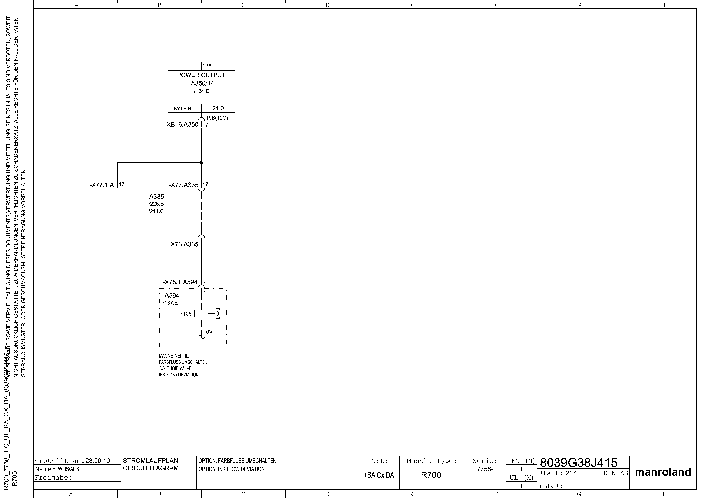

# +BA_Cx_DA — Sheet 217 of 247 — OPTION: FARBFLUSS UMSCHALTEN

**OPTION: INK FLOW DEVIATION**

> Part of the manroland **R700** printing press IEC/UL circuit diagrams.
> Drawing class: **Stromlaufplan / Circuit diagram** (DIN A3).
> Document `+BA_Cx_DA` covers the **Printing units / main switch cabinet** machine section.

## At a glance

| Field | Value |
|---|---|
| Document | `+BA_Cx_DA`  (8039G38J415) |
| Sheet | **217** of 247 |
| Section (DE) | OPTION: FARBFLUSS UMSCHALTEN |
| Section (EN) | OPTION: INK FLOW DEVIATION |
| Section type | CIRCUIT — Circuit diagram |
| Machine type | `R700` |
| Series | `7758` |
| Created | 28.06.10 |
| Replaces | — |
| Columns used | A, B, C |
| Path numbers | — |
| Labels on sheet | 29 |
| Cross-refs out | 4 |
| Cross-refs in | 9 |

**Previous:** [+BA_Cx_DA sheet 216](SHEET_0216.md) · **Next:** [+BA_Cx_DA sheet 218](SHEET_0218.md) · **Document TOC:** [_TOC.md](_TOC.md)  (+BA_Cx_DA) · **Master TOC:** [all sheets](../_MASTER_TOC.md)

## Sheet image (300 DPI, exact vector render)



_Rendered directly from the PDF vector layer at 300 DPI (1-bit), no OCR and no resampling. Use it to confirm anything ambiguous in the text below._

## Cross-references on this sheet

Each entry is a wire leaving this sheet. The printed token is `/sheet.column`; the link resolves to that sheet inside the same document.

| Ref | Target sheet | Col | Path | Destination on target | Target section | From col |
|---|---|---|---|---|---|---|
| `/134.E` | [+BA_Cx_DA sheet 134](SHEET_0134.md) | E | — | — | REFERENZMODUL | C |
| `/226.B` | [+BA_Cx_DA sheet 226](SHEET_0226.md) | B | — | — | OPTION: ZWISCHENTROCKNER VORBEREITUNG | B |
| `/214.C` | [+BA_Cx_DA sheet 214](SHEET_0214.md) | C | — | — | OPTION: FWW SPEZIALREINIGER | B |
| `/137.E` | [+BA_Cx_DA sheet 137](SHEET_0137.md) | E | — | A594 | REFERENZMODUL | B |

### Incoming references (sheets that point here)

Every other sheet that sends a wire to this one. `Back-ref` is the token printed on *that* sheet; `Path` is its line number.

| From sheet | Cols | Back-ref | Path | Refs | What continues there |
|---|---|---|---|---|---|
| [+BA_Cx_DA#134](SHEET_0134.md) | E | `/134.E` | — | 1 | — |
| [+BA_Cx_DA#137](SHEET_0137.md) | E | `/137.E` | — | 1 | — |
| [+BA_Cx_DA#172](SHEET_0172.md) | F | `/172.F` | — | 1 | — |
| [+BA_Cx_DA#185](SHEET_0185.md) | A, C, E, G | `/185.A`, `/185.C`, `/185.E`, `/185.G` | — | 4 | — |
| [+BA_Cx_DA#214](SHEET_0214.md) | B | `/214.B` | — | 1 | — |
| [+BA_Cx_DA#226](SHEET_0226.md) | A | `/226.A` | — | 1 | — |


## Devices on this sheet

| Tag | Class | Class meaning (IEC) | Col | Sub | Terminal | Sign |
|---|---|---|---|---|---|---|
| `A350/14` | A | Baugruppe / assembly, module, PC board | B | 14 | — | — |
| `Y106` | Y | Magnetventil / solenoid valve, actuator | B | — | — | — |
| `A594` | A | Baugruppe / assembly, module, PC board | B | — | — | — |
| `A335` | A | Baugruppe / assembly, module, PC board | B | — | — | — |
| `21.0` | — | cross-device reference | C | — | — | — |
| `XB16.A350` | — | cross-device reference | B | — | — | — |
| `X75.1.A594` | — | cross-device reference | B | — | — | — |
| `X77.A335` | — | cross-device reference | B | — | — | — |
| `X76.A335` | — | cross-device reference | B | — | — | — |
| `X77.1.A` | — | cross-device reference | A | — | — | — |

## Potentials / nets

| Potential | Count | Columns | Attached devices | Terminals |
|---|---|---|---|---|
| `0V` | 1 | C | — | — |


A potential such as `L24+/4` or `M24+` is a named supply/return rail; every place it appears on this sheet is electrically common.

## Wire-end annotations (grouped as printed)

A wire that continues elsewhere is annotated with a small cluster: the destination description, the path/line number `#NN`, and the `/sheet.column` cross reference. Each row below is one such cluster exactly as it is grouped on the drawing.

| Col | Y | Path | Cross-ref | Text on the wire |
|---|---|---|---|---|
| C | 107.3 | — | — | `19A` |
| B | 122.5 | — | — | `POWER QUTPUT` |
| B | 136.4 | — | — | `A350/14` |
| C | 150.2 | — | `/134.E` | — |
| B | 179.2 | — | — | `BYTE.BIT 21.0` |
| C | 195.2 | — | — | `19B(19C)` |
| B | 205.8 | — | — | `XB16.A350 17` |
| A | 307.9 | — | — | `X77.1.A 17` |
| B | 307.9 | — | — | `X77.A335 17` |
| B | 327.7 | — | — | `A335` |
| B | 340.8 | — | `/226.B`, `/214.C` | — |
| B | 405.7 | — | — | `X76.A335 1` |
| B | 472.3 | — | — | `X75.1.A594 7` |
| C | 489.3 | — | — | `7` |
| B | 494.9 | — | `/137.E` | `A594` |
| B | 526.8 | — | — | `Y106` |
| C | 557.3 | — | — | `0V` |
| B | 598.7 | — | — | `FARBFLUSS UMSCHALTEN MAGNETVENTIL:` |
| B | 620.0 | — | — | `INK FLOW DEVIATION SOLENOID VALVE:` |


## Reconstructed tables

This sheet carries tabular content (pin map / terminal assignment / index). The grid below was rebuilt from the drawing's own rule lines, so each row is exactly one physical row of the table.

### Table 1 — 2 data rows × 2 columns (at x=283.5, y=119.1)

| POWER | QUTPUT A350/14 /134.E |
|---|---|
| `BYTE.BIT` | `21.0` |
| `XB16.A350` | `19B(19C) 17` |


## Notes and free text on this sheet

| Text | Col | Y (pt) |
|---|---|---|
| `19A` | C | 107.29 |
| `19B(19C)` | C | 195.2 |
| `POWER QUTPUT` | B | 122.45 |
| `BYTE.BIT` | B | 179.78 |
| `MAGNETVENTIL:` | B | 598.72 |
| `FARBFLUSS UMSCHALTEN` | B | 609.37 |
| `SOLENOID VALVE:` | B | 619.98 |
| `INK FLOW DEVIATION` | B | 630.59 |

## Complete label inventory (exact text from the drawing)

Every text object inside the drawing area of this sheet, in DIN reading order (column A→H, then top→bottom). This is the authoritative list: if a string is not here it is not printed on this sheet.

| Col | Y | X | Dir | Type | Text |
|---|---|---|---|---|---|
| A | 307.9 | 151.4 | → | device ref | `X77.1.A` |
| B | 122.5 | 299.3 | → | text | `POWER QUTPUT` |
| B | 136.4 | 318.8 | → | device tag | `A350/14` |
| B | 179.8 | 293.4 | → | text | `BYTE.BIT` |
| B | 205.8 | 277.8 | → | device ref | `XB16.A350` |
| B | 307.9 | 200.4 | → | number | `17` |
| B | 307.9 | 284.9 | → | device ref | `X77.A335` |
| B | 327.7 | 248.6 | → | device tag | `A335` |
| B | 340.8 | 251.1 | → | cross-reference | `/226.B` |
| B | 353.2 | 250.9 | → | cross-reference | `/214.C` |
| B | 408.5 | 284.9 | → | device ref | `X76.A335` |
| B | 472.3 | 274.7 | → | device ref | `X75.1.A594` |
| B | 494.9 | 274.7 | → | device tag | `A594` |
| B | 508.0 | 275.0 | → | cross-reference | `/137.E` |
| B | 526.8 | 300.2 | → | device tag | `Y106` |
| B | 598.7 | 268.7 | → | text | `MAGNETVENTIL:` |
| B | 609.4 | 268.4 | → | text | `FARBFLUSS UMSCHALTEN` |
| B | 620.0 | 269.0 | → | text | `SOLENOID VALVE:` |
| B | 630.6 | 268.4 | → | text | `INK FLOW DEVIATION` |
| C | 107.3 | 342.1 | → | text | `19A` |
| C | 150.1 | 327.7 | → | cross-reference | `/134.E` |
| C | 179.2 | 359.0 | → | device ref | `21.0` |
| C | 195.2 | 347.8 | → | text | `19B(19C)` |
| C | 207.3 | 342.1 | → | number | `17` |
| C | 307.9 | 342.1 | → | number | `17` |
| C | 405.7 | 342.1 | → | number | `1` |
| C | 473.7 | 342.7 | → | number | `7` |
| C | 489.3 | 342.7 | → | number | `7` |
| C | 557.3 | 348.4 | → | potential | `0V` |

## Reading-order text block

The same content as a plain block, grouped by DIN column — convenient to paste or to match against a visual description.

```text
=== Column A ===
 307.9  151.4  devref       X77.1.A
=== Column B ===
 122.5  299.3  text         POWER QUTPUT
 136.4  318.8  devtag       A350/14
 179.8  293.4  text         BYTE.BIT
 205.8  277.8  devref       XB16.A350
 307.9  200.4  numeric      17
 307.9  284.9  devref       X77.A335
 327.7  248.6  devtag       A335
 340.8  251.1  xref         /226.B
 353.2  250.9  xref         /214.C
 408.5  284.9  devref       X76.A335
 472.3  274.7  devref       X75.1.A594
 494.9  274.7  devtag       A594
 508.0  275.0  xref         /137.E
 526.8  300.2  devtag       Y106
 598.7  268.7  text         MAGNETVENTIL:
 609.4  268.4  text         FARBFLUSS UMSCHALTEN
 620.0  269.0  text         SOLENOID VALVE:
 630.6  268.4  text         INK FLOW DEVIATION
=== Column C ===
 107.3  342.1  text         19A
 150.1  327.7  xref         /134.E
 179.2  359.0  devref       21.0
 195.2  347.8  text         19B(19C)
 207.3  342.1  numeric      17
 307.9  342.1  numeric      17
 405.7  342.1  numeric      1
 473.7  342.7  numeric      7
 489.3  342.7  numeric      7
 557.3  348.4  net          0V
```

---
_Generated from the PDF vector text layer; no OCR. Source: `R700_7758_IEC_UL_BA_CX_DA_8039G38J415_p`, sheet 217._
