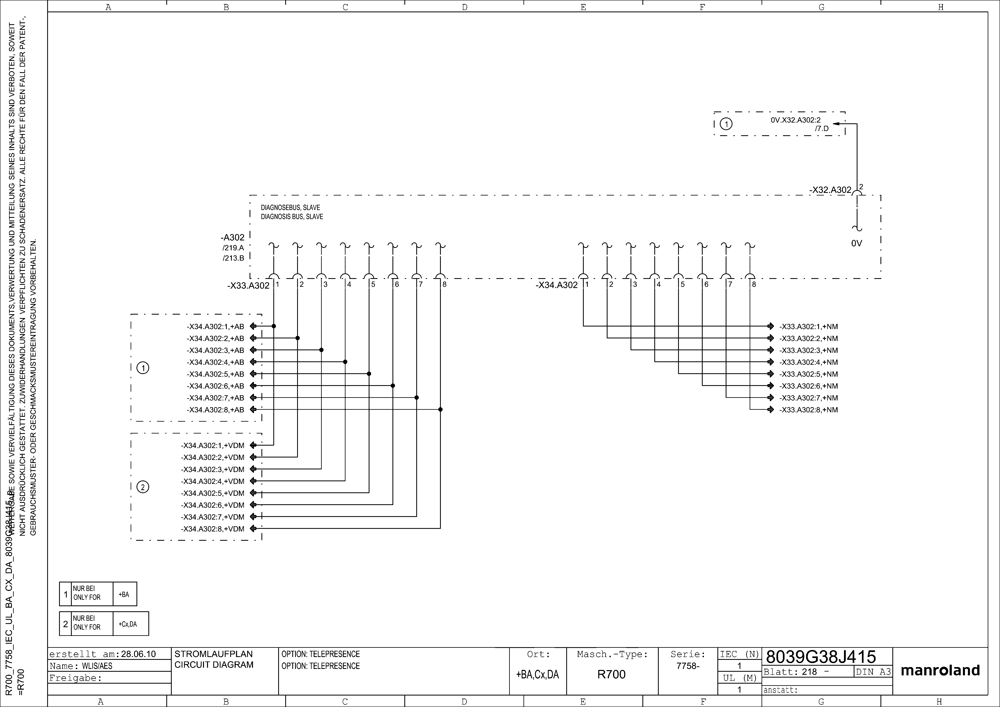

# +BA_Cx_DA — Sheet 218 of 247 — OPTION: TELEPRESENCE

**OPTION: TELEPRESENCE**

> Part of the manroland **R700** printing press IEC/UL circuit diagrams.
> Drawing class: **Stromlaufplan / Circuit diagram** (DIN A3).
> Document `+BA_Cx_DA` covers the **Printing units / main switch cabinet** machine section.

## At a glance

| Field | Value |
|---|---|
| Document | `+BA_Cx_DA`  (8039G38J415) |
| Sheet | **218** of 247 |
| Section (DE) | OPTION: TELEPRESENCE |
| Section (EN) | OPTION: TELEPRESENCE |
| Section type | CIRCUIT — Circuit diagram |
| Machine type | `R700` |
| Series | `7758` |
| Created | 28.06.10 |
| Replaces | — |
| Columns used | A, B, C, D, E, F, G |
| Path numbers | — |
| Labels on sheet | 63 |
| Cross-refs out | 3 |
| Cross-refs in | 20 |

**Previous:** [+BA_Cx_DA sheet 217](SHEET_0217.md) · **Next:** [+BA_Cx_DA sheet 219](SHEET_0219.md) · **Document TOC:** [_TOC.md](_TOC.md)  (+BA_Cx_DA) · **Master TOC:** [all sheets](../_MASTER_TOC.md)

## Sheet image (300 DPI, exact vector render)



_Rendered directly from the PDF vector layer at 300 DPI (1-bit), no OCR and no resampling. Use it to confirm anything ambiguous in the text below._

## Cross-references on this sheet

Each entry is a wire leaving this sheet. The printed token is `/sheet.column`; the link resolves to that sheet inside the same document.

| Ref | Target sheet | Col | Path | Destination on target | Target section | From col |
|---|---|---|---|---|---|---|
| `/7.D` | [+BA_Cx_DA sheet 7](SHEET_0007.md) | D | — | 0V.X32.A302:2 | SPANNUNGSVERSORGUNG, SCHALTSCHRANKBELÜFTUNG | G |
| `/219.A` | [+BA_Cx_DA sheet 219](SHEET_0219.md) | A | — | — | OPTION: TELEPRESENCE | B |
| `/213.B` | [+BA_Cx_DA sheet 213](SHEET_0213.md) | B | — | — | OPTION: VORDERMARKENEINSTELLUNG | B |

### Incoming references (sheets that point here)

Every other sheet that sends a wire to this one. `Back-ref` is the token printed on *that* sheet; `Path` is its line number.

| From sheet | Cols | Back-ref | Path | Refs | What continues there |
|---|---|---|---|---|---|
| [+BA_Cx_DA#7](SHEET_0007.md) | D | `/7.D` | — | 1 | 0V.X32.A302:2 |
| [+BA_Cx_DA#179](SHEET_0179.md) | H | `/179.H` | — | 1 | — |
| [+BA_Cx_DA#180](SHEET_0180.md) | A, B | `/180.A`, `/180.B` | — | 16 | — |
| [+BA_Cx_DA#213](SHEET_0213.md) | B | `/213.B` | — | 1 | — |
| [+BA_Cx_DA#219](SHEET_0219.md) | A | `/219.A` | — | 1 | — |


## Devices on this sheet

| Tag | Class | Class meaning (IEC) | Col | Sub | Terminal | Sign |
|---|---|---|---|---|---|---|
| `A302` | A | Baugruppe / assembly, module, PC board | B | — | — | — |
| `X33.A302` | — | cross-device reference | B | — | — | — |
| `X34.A302` | — | cross-device reference | E | — | — | — |
| `X32.A302` | — | cross-device reference | G | — | — | — |

## Potentials / nets

| Potential | Count | Columns | Attached devices | Terminals |
|---|---|---|---|---|
| `0V` | 2 | G | `A302`, `X32` | `2` |


A potential such as `L24+/4` or `M24+` is a named supply/return rail; every place it appears on this sheet is electrically common.

## Wire-end annotations (grouped as printed)

A wire that continues elsewhere is annotated with a small cluster: the destination description, the path/line number `#NN`, and the `/sheet.column` cross reference. Each row below is one such cluster exactly as it is grouped on the drawing.

| Col | Y | Path | Cross-ref | Text on the wire |
|---|---|---|---|---|
| G | 139.2 | — | `/7.D` | `0V.X32.A302:2` |
| F | 144.3 | — | — | `1` |
| G | 218.6 | — | — | `X32.A302 2` |
| C | 244.4 | — | — | `DIAGNOSEBUS, SLAVE DIAGNOSIS BUS, SLAVE` |
| B | 278.1 | — | — | `A302` |
| G | 285.2 | — | — | `0V` |
| B | 291.2 | — | `/219.A`, `/213.B` | — |
| C | 334.8 | — | — | `X33.A302 1 2 3 4 5 6 7 8` |
| F | 334.8 | — | — | `X34.A302 1 2 3 4 5 6 7 8` |
| B | 385.1 | — | — | `X34.A302:1,+AB` |
| G | 385.1 | — | — | `X33.A302:1,+NM` |
| B | 399.2 | — | — | `X34.A302:2,+AB` |
| G | 399.3 | — | — | `X33.A302:2,+NM` |
| B | 413.4 | — | — | `X34.A302:3,+AB` |
| G | 413.4 | — | — | `X33.A302:3,+NM` |
| B | 427.6 | — | — | `X34.A302:4,+AB` |
| G | 427.6 | — | — | `X33.A302:4,+NM` |
| A | 434.9 | — | — | `1` |
| B | 441.8 | — | — | `X34.A302:5,+AB` |
| G | 441.8 | — | — | `X33.A302:5,+NM` |
| B | 455.9 | — | — | `X34.A302:6,+AB` |
| G | 456.0 | — | — | `X33.A302:6,+NM` |
| B | 470.1 | — | — | `X34.A302:7,+AB` |
| G | 470.1 | — | — | `X33.A302:7,+NM` |
| B | 484.3 | — | — | `X34.A302:8,+AB` |
| G | 484.3 | — | — | `X33.A302:8,+NM` |
| B | 526.8 | — | — | `X34.A302:1,+VDM` |
| B | 541.0 | — | — | `X34.A302:2,+VDM` |
| B | 555.2 | — | — | `X34.A302:3,+VDM` |
| B | 569.3 | — | — | `X34.A302:4,+VDM` |
| A | 577.1 | — | — | `2` |
| B | 583.5 | — | — | `X34.A302:5,+VDM` |
| B | 597.7 | — | — | `X34.A302:6,+VDM` |
| B | 611.9 | — | — | `X34.A302:7,+VDM` |
| B | 626.0 | — | — | `X34.A302:8,+VDM` |
| A | 697.9 | — | — | `NUR BEI` |
| A | 703.3 | — | — | `1` |
| A | 705.0 | — | — | `ONLY FOR +BA` |
| A | 733.3 | — | — | `NUR BEI` |
| A | 738.7 | — | — | `2` |
| A | 740.5 | — | — | `+Cx,DA` |
| A | 744.0 | — | — | `ONLY FOR` |


## Notes and free text on this sheet

| Text | Col | Y (pt) |
|---|---|---|
| `X34.A302:1,+AB` | B | 385.07 |
| `X34.A302:2,+AB` | B | 399.25 |
| `X34.A302:3,+AB` | B | 413.42 |
| `X34.A302:4,+AB` | B | 427.59 |
| `X34.A302:5,+AB` | B | 441.77 |
| `X34.A302:6,+AB` | B | 455.94 |
| `X34.A302:7,+AB` | B | 470.11 |
| `X34.A302:8,+AB` | B | 484.28 |
| `X34.A302:1,+VDM` | B | 526.82 |
| `X34.A302:2,+VDM` | B | 541 |
| `X34.A302:3,+VDM` | B | 555.17 |
| `X34.A302:4,+VDM` | B | 569.34 |
| `X34.A302:5,+VDM` | B | 583.52 |
| `X34.A302:6,+VDM` | B | 597.69 |
| `X34.A302:7,+VDM` | B | 611.86 |
| `X34.A302:8,+VDM` | B | 626.04 |
| `X33.A302:1,+NM` | G | 385.1 |
| `X33.A302:2,+NM` | G | 399.27 |
| `X33.A302:3,+NM` | G | 413.44 |
| `X33.A302:4,+NM` | G | 427.62 |
| `X33.A302:5,+NM` | G | 441.79 |
| `X33.A302:6,+NM` | G | 455.96 |
| `X33.A302:7,+NM` | G | 470.14 |
| `X33.A302:8,+NM` | G | 484.31 |
| `NUR BEI` | A | 733.33 |
| `ONLY FOR` | A | 744.02 |
| `+BA` | A | 705 |
| `+Cx,DA` | A | 740.52 |
| `DIAGNOSEBUS, SLAVE` | C | 244.38 |
| `DIAGNOSIS BUS, SLAVE` | C | 255.01 |

## Complete label inventory (exact text from the drawing)

Every text object inside the drawing area of this sheet, in DIN reading order (column A→H, then top→bottom). This is the authoritative list: if a string is not here it is not printed on this sheet.

| Col | Y | X | Dir | Type | Text |
|---|---|---|---|---|---|
| A | 434.9 | 168.3 | → | number | `1` |
| A | 577.1 | 168.1 | → | number | `2` |
| A | 697.9 | 87.0 | → | text | `NUR BEI` |
| A | 703.3 | 75.4 | → | number | `1` |
| A | 705.0 | 141.4 | → | text | `+BA` |
| A | 708.6 | 87.6 | → | text | `ONLY FOR` |
| A | 733.3 | 87.0 | → | text | `NUR BEI` |
| A | 738.7 | 75.1 | → | number | `2` |
| A | 740.5 | 141.4 | → | text | `+Cx,DA` |
| A | 744.0 | 87.6 | → | text | `ONLY FOR` |
| B | 278.1 | 262.8 | → | device tag | `A302` |
| B | 291.2 | 265.0 | → | cross-reference | `/219.A` |
| B | 303.6 | 265.3 | → | cross-reference | `/213.B` |
| B | 334.8 | 328.0 | → | number | `1` |
| B | 335.5 | 270.7 | → | device ref | `X33.A302` |
| B | 385.1 | 222.5 | → | text | `X34.A302:1,+AB` |
| B | 399.2 | 222.5 | → | text | `X34.A302:2,+AB` |
| B | 413.4 | 222.5 | → | text | `X34.A302:3,+AB` |
| B | 427.6 | 222.5 | → | text | `X34.A302:4,+AB` |
| B | 441.8 | 222.5 | → | text | `X34.A302:5,+AB` |
| B | 455.9 | 222.5 | → | text | `X34.A302:6,+AB` |
| B | 470.1 | 222.5 | → | text | `X34.A302:7,+AB` |
| B | 484.3 | 222.5 | → | text | `X34.A302:8,+AB` |
| B | 526.8 | 215.4 | → | text | `X34.A302:1,+VDM` |
| B | 541.0 | 215.4 | → | text | `X34.A302:2,+VDM` |
| B | 555.2 | 215.4 | → | text | `X34.A302:3,+VDM` |
| B | 569.3 | 215.4 | → | text | `X34.A302:4,+VDM` |
| B | 583.5 | 215.4 | → | text | `X34.A302:5,+VDM` |
| B | 597.7 | 215.4 | → | text | `X34.A302:6,+VDM` |
| B | 611.9 | 215.4 | → | text | `X34.A302:7,+VDM` |
| B | 626.0 | 215.4 | → | text | `X34.A302:8,+VDM` |
| C | 244.4 | 311.0 | → | text | `DIAGNOSEBUS, SLAVE` |
| C | 255.0 | 311.0 | → | text | `DIAGNOSIS BUS, SLAVE` |
| C | 334.8 | 356.9 | → | number | `2` |
| C | 334.8 | 385.2 | → | number | `3` |
| C | 334.8 | 413.6 | → | number | `4` |
| C | 334.8 | 441.9 | → | number | `5` |
| C | 334.8 | 470.3 | → | number | `6` |
| D | 334.8 | 498.6 | → | number | `7` |
| D | 334.8 | 527.0 | → | number | `8` |
| E | 334.8 | 637.8 | → | device ref | `X34.A302` |
| E | 334.8 | 696.5 | → | number | `1` |
| E | 334.8 | 725.4 | → | number | `2` |
| E | 334.8 | 753.7 | → | number | `3` |
| F | 144.3 | 862.8 | → | number | `1` |
| F | 334.8 | 782.1 | → | number | `4` |
| F | 334.8 | 810.4 | → | number | `5` |
| F | 334.8 | 838.8 | → | number | `6` |
| F | 334.8 | 867.1 | → | number | `7` |
| F | 334.8 | 895.5 | → | number | `8` |
| G | 139.2 | 917.9 | → | potential | `0V.X32.A302:2` |
| G | 149.1 | 970.6 | → | cross-reference | `/7.D` |
| G | 218.6 | 1023.0 | → | number | `2` |
| G | 221.4 | 963.8 | → | device ref | `X32.A302` |
| G | 285.2 | 1013.7 | → | potential | `0V` |
| G | 385.1 | 928.1 | → | text | `X33.A302:1,+NM` |
| G | 399.3 | 928.1 | → | text | `X33.A302:2,+NM` |
| G | 413.4 | 928.1 | → | text | `X33.A302:3,+NM` |
| G | 427.6 | 928.1 | → | text | `X33.A302:4,+NM` |
| G | 441.8 | 928.1 | → | text | `X33.A302:5,+NM` |
| G | 456.0 | 928.1 | → | text | `X33.A302:6,+NM` |
| G | 470.1 | 928.1 | → | text | `X33.A302:7,+NM` |
| G | 484.3 | 928.1 | → | text | `X33.A302:8,+NM` |

## Reading-order text block

The same content as a plain block, grouped by DIN column — convenient to paste or to match against a visual description.

```text
=== Column A ===
 434.9  168.3  numeric      1
 577.1  168.1  numeric      2
 697.9   87.0  text         NUR BEI
 703.3   75.4  numeric      1
 705.0  141.4  text         +BA
 708.6   87.6  text         ONLY FOR
 733.3   87.0  text         NUR BEI
 738.7   75.1  numeric      2
 740.5  141.4  text         +Cx,DA
 744.0   87.6  text         ONLY FOR
=== Column B ===
 278.1  262.8  devtag       A302
 291.2  265.0  xref         /219.A
 303.6  265.3  xref         /213.B
 334.8  328.0  numeric      1
 335.5  270.7  devref       X33.A302
 385.1  222.5  text         X34.A302:1,+AB
 399.2  222.5  text         X34.A302:2,+AB
 413.4  222.5  text         X34.A302:3,+AB
 427.6  222.5  text         X34.A302:4,+AB
 441.8  222.5  text         X34.A302:5,+AB
 455.9  222.5  text         X34.A302:6,+AB
 470.1  222.5  text         X34.A302:7,+AB
 484.3  222.5  text         X34.A302:8,+AB
 526.8  215.4  text         X34.A302:1,+VDM
 541.0  215.4  text         X34.A302:2,+VDM
 555.2  215.4  text         X34.A302:3,+VDM
 569.3  215.4  text         X34.A302:4,+VDM
 583.5  215.4  text         X34.A302:5,+VDM
 597.7  215.4  text         X34.A302:6,+VDM
 611.9  215.4  text         X34.A302:7,+VDM
 626.0  215.4  text         X34.A302:8,+VDM
=== Column C ===
 244.4  311.0  text         DIAGNOSEBUS, SLAVE
 255.0  311.0  text         DIAGNOSIS BUS, SLAVE
 334.8  356.9  numeric      2
 334.8  385.2  numeric      3
 334.8  413.6  numeric      4
 334.8  441.9  numeric      5
 334.8  470.3  numeric      6
=== Column D ===
 334.8  498.6  numeric      7
 334.8  527.0  numeric      8
=== Column E ===
 334.8  637.8  devref       X34.A302
 334.8  696.5  numeric      1
 334.8  725.4  numeric      2
 334.8  753.7  numeric      3
=== Column F ===
 144.3  862.8  numeric      1
 334.8  782.1  numeric      4
 334.8  810.4  numeric      5
 334.8  838.8  numeric      6
 334.8  867.1  numeric      7
 334.8  895.5  numeric      8
=== Column G ===
 139.2  917.9  net          0V.X32.A302:2
 149.1  970.6  xref         /7.D
 218.6 1023.0  numeric      2
 221.4  963.8  devref       X32.A302
 285.2 1013.7  net          0V
 385.1  928.1  text         X33.A302:1,+NM
 399.3  928.1  text         X33.A302:2,+NM
 413.4  928.1  text         X33.A302:3,+NM
 427.6  928.1  text         X33.A302:4,+NM
 441.8  928.1  text         X33.A302:5,+NM
 456.0  928.1  text         X33.A302:6,+NM
 470.1  928.1  text         X33.A302:7,+NM
 484.3  928.1  text         X33.A302:8,+NM
```

---
_Generated from the PDF vector text layer; no OCR. Source: `R700_7758_IEC_UL_BA_CX_DA_8039G38J415_p`, sheet 218._
