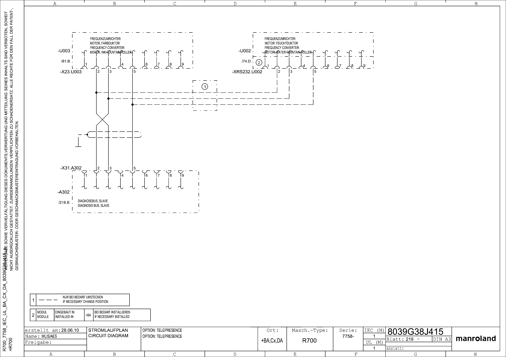

# +BA_Cx_DA — Sheet 219 of 247 — OPTION: TELEPRESENCE

**OPTION: TELEPRESENCE**

> Part of the manroland **R700** printing press IEC/UL circuit diagrams.
> Drawing class: **Stromlaufplan / Circuit diagram** (DIN A3).
> Document `+BA_Cx_DA` covers the **Printing units / main switch cabinet** machine section.

## At a glance

| Field | Value |
|---|---|
| Document | `+BA_Cx_DA`  (8039G38J415) |
| Sheet | **219** of 247 |
| Section (DE) | OPTION: TELEPRESENCE |
| Section (EN) | OPTION: TELEPRESENCE |
| Section type | CIRCUIT — Circuit diagram |
| Machine type | `R700` |
| Series | `7758` |
| Created | 28.06.10 |
| Replaces | — |
| Columns used | A, B, C, D, E, F |
| Path numbers | — |
| Labels on sheet | 59 |
| Cross-refs out | 3 |
| Cross-refs in | 30 |

**Previous:** [+BA_Cx_DA sheet 218](SHEET_0218.md) · **Next:** [+BA_Cx_DA sheet 220](SHEET_0220.md) · **Document TOC:** [_TOC.md](_TOC.md)  (+BA_Cx_DA) · **Master TOC:** [all sheets](../_MASTER_TOC.md)

## Sheet image (300 DPI, exact vector render)



_Rendered directly from the PDF vector layer at 300 DPI (1-bit), no OCR and no resampling. Use it to confirm anything ambiguous in the text below._

## Cross-references on this sheet

Each entry is a wire leaving this sheet. The printed token is `/sheet.column`; the link resolves to that sheet inside the same document.

| Ref | Target sheet | Col | Path | Destination on target | Target section | From col |
|---|---|---|---|---|---|---|
| `/81.B` | [+BA_Cx_DA sheet 81](SHEET_0081.md) | B | — | — | FARBWERK | A |
| `/74.D` | [+BA_Cx_DA sheet 74](SHEET_0074.md) | D | — | — | FEUCHTWERK | D |
| `/218.B` | [+BA_Cx_DA sheet 218](SHEET_0218.md) | B | — | — | OPTION: TELEPRESENCE | A |

### Incoming references (sheets that point here)

Every other sheet that sends a wire to this one. `Back-ref` is the token printed on *that* sheet; `Path` is its line number.

| From sheet | Cols | Back-ref | Path | Refs | What continues there |
|---|---|---|---|---|---|
| [+BA_Cx_DA#74](SHEET_0074.md) | D | `/74.D` | — | 1 | — |
| [+BA_Cx_DA#81](SHEET_0081.md) | B | `/81.B` | — | 1 | — |
| [+BA_Cx_DA#175](SHEET_0175.md) | A | `/175.A` | — | 9 | — |
| [+BA_Cx_DA#179](SHEET_0179.md) | F | `/179.F` | — | 9 | — |
| [+BA_Cx_DA#190](SHEET_0190.md) | E | `/190.E` | — | 9 | — |
| [+BA_Cx_DA#218](SHEET_0218.md) | B | `/218.B` | — | 1 | — |


## Devices on this sheet

| Tag | Class | Class meaning (IEC) | Col | Sub | Terminal | Sign |
|---|---|---|---|---|---|---|
| `A302` | A | Baugruppe / assembly, module, PC board | A | — | — | — |
| `U003` | U | Umrichter / frequency converter | A | — | — | — |
| `U002` | U | Umrichter / frequency converter | D | — | — | — |
| `X31.A302` | — | cross-device reference | A | — | — | — |
| `X23.U003` | — | cross-device reference | A | — | — | — |
| `XRS232.U002` | — | cross-device reference | D | — | — | — |

## Potentials / nets

_No named potentials on this sheet._

## Wire-end annotations (grouped as printed)

A wire that continues elsewhere is annotated with a small cluster: the destination description, the path/line number `#NN`, and the `/sheet.column` cross reference. Each row below is one such cluster exactly as it is grouped on the drawing.

| Col | Y | Path | Cross-ref | Text on the wire |
|---|---|---|---|---|
| C | 88.5 | — | — | `FREQUENZUMRICHTER: FREQUENCY CONVERTER: MOTOR, FARBDUKTOR MOTOR, INK FOUNTAIN ROLLER U002` |
| E | 88.5 | — | — | `FREQUENZUMRICHTER: FREQUENCY CONVERTER: MOTOR: FEUCHTDUKTOR MOTOR: WATER FOUNTAIN ROLLER` |
| A | 115.1 | — | — | `U003` |
| A | 140.6 | — | `/81.B` | — |
| D | 140.6 | — | `/74.D` | — |
| E | 144.9 | — | — | `2 1 4 6 7 8 9` |
| B | 147.7 | — | — | `1` |
| B | 147.7 | — | — | `4` |
| C | 147.7 | — | — | `6 7 8 9` |
| B | 164.7 | — | — | `X23.U003 2 3` |
| B | 164.7 | — | — | `5` |
| E | 164.7 | — | — | `XRS232.U002 2 3 5` |
| D | 201.0 | — | — | `1` |
| B | 391.5 | — | — | `X31.A302 2 3 5` |
| B | 409.9 | — | — | `1 4 6 7 8 9` |
| A | 448.2 | — | — | `A302` |
| B | 471.1 | — | — | `DIAGNOSEBUS, SLAVE DIAGNOSIS BUS, SLAVE` |
| A | 473.6 | — | `/218.B` | — |
| A | 697.9 | — | — | `1 NUR BEI BEDARF UMSTECKEN IF NECESSARY CHANGE POSITION` |
| A | 733.4 | — | — | `2 MODUL MODULE` |
| A | 733.4 | — | — | `EINGEBAUT IN INSTALLED IN +BA` |
| B | 733.4 | — | — | `BEI BEDARF INSTALLIEREN IF NECESSARY INSTALLED` |


## Notes and free text on this sheet

| Text | Col | Y (pt) |
|---|---|---|
| `FREQUENZUMRICHTER:` | B | 88.51 |
| `MOTOR, FARBDUKTOR` | B | 99.15 |
| `FREQUENCY CONVERTER:` | B | 109.77 |
| `MOTOR, INK FOUNTAIN ROLLER` | B | 120.41 |
| `FREQUENZUMRICHTER:` | E | 88.51 |
| `MOTOR: FEUCHTDUKTOR` | E | 99.15 |
| `FREQUENCY CONVERTER:` | E | 109.77 |
| `MOTOR: WATER FOUNTAIN ROLLER` | E | 120.4 |
| `MODUL` | A | 733.41 |
| `MODULE` | A | 744.03 |
| `EINGEBAUT IN` | A | 733.35 |
| `INSTALLED IN` | A | 743.99 |
| `+BA` | B | 740.44 |
| `BEI BEDARF INSTALLIEREN` | B | 733.36 |
| `IF NECESSARY INSTALLED` | B | 744 |
| `NUR BEI BEDARF UMSTECKEN` | A | 697.94 |
| `IF NECESSARY CHANGE POSITION` | B | 708.57 |
| `DIAGNOSEBUS, SLAVE` | B | 471.15 |
| `DIAGNOSIS BUS, SLAVE` | B | 481.78 |

## Complete label inventory (exact text from the drawing)

Every text object inside the drawing area of this sheet, in DIN reading order (column A→H, then top→bottom). This is the authoritative list: if a string is not here it is not printed on this sheet.

| Col | Y | X | Dir | Type | Text |
|---|---|---|---|---|---|
| A | 115.1 | 136.1 | → | device tag | `U003` |
| A | 140.6 | 144.0 | → | cross-reference | `/81.B` |
| A | 164.7 | 141.2 | → | device ref | `X23.U003` |
| A | 391.5 | 141.7 | → | device ref | `X31.A302` |
| A | 448.2 | 135.2 | → | device tag | `A302` |
| A | 473.6 | 137.8 | → | cross-reference | `/218.B` |
| A | 697.9 | 148.0 | → | text | `NUR BEI BEDARF UMSTECKEN` |
| A | 703.3 | 75.4 | → | number | `1` |
| A | 733.3 | 130.3 | → | text | `EINGEBAUT IN` |
| A | 733.4 | 88.0 | → | text | `MODUL` |
| A | 738.7 | 75.1 | → | number | `2` |
| A | 744.0 | 88.0 | → | text | `MODULE` |
| A | 744.0 | 130.3 | → | text | `INSTALLED IN` |
| B | 88.5 | 211.7 | → | text | `FREQUENZUMRICHTER:` |
| B | 99.1 | 212.0 | → | text | `MOTOR, FARBDUKTOR` |
| B | 109.8 | 211.7 | → | text | `FREQUENCY CONVERTER:` |
| B | 120.4 | 212.0 | → | text | `MOTOR, INK FOUNTAIN ROLLER` |
| B | 147.7 | 200.4 | → | number | `1` |
| B | 147.7 | 286.0 | → | number | `4` |
| B | 164.7 | 229.3 | → | number | `2` |
| B | 164.7 | 257.7 | → | number | `3` |
| B | 164.7 | 314.4 | → | number | `5` |
| B | 392.9 | 229.3 | → | number | `2` |
| B | 392.9 | 257.7 | → | number | `3` |
| B | 392.9 | 314.4 | → | number | `5` |
| B | 409.9 | 200.4 | → | number | `1` |
| B | 409.9 | 286.0 | → | number | `4` |
| B | 471.2 | 183.4 | → | text | `DIAGNOSEBUS, SLAVE` |
| B | 481.8 | 183.4 | → | text | `DIAGNOSIS BUS, SLAVE` |
| B | 708.6 | 148.0 | → | text | `IF NECESSARY CHANGE POSITION` |
| B | 733.4 | 222.4 | → | text | `BEI BEDARF INSTALLIEREN` |
| B | 740.4 | 201.7 | → | text | `+BA` |
| B | 744.0 | 222.4 | → | text | `IF NECESSARY INSTALLED` |
| C | 147.7 | 342.7 | → | number | `6` |
| C | 147.7 | 371.1 | → | number | `7` |
| C | 147.7 | 399.4 | → | number | `8` |
| C | 147.7 | 427.7 | → | number | `9` |
| C | 409.9 | 342.7 | → | number | `6` |
| C | 409.9 | 371.1 | → | number | `7` |
| C | 409.9 | 399.4 | → | number | `8` |
| C | 409.9 | 427.7 | → | number | `9` |
| D | 115.1 | 561.3 | → | device tag | `U002` |
| D | 140.6 | 568.9 | → | cross-reference | `/74.D` |
| D | 144.9 | 607.5 | → | number | `2` |
| D | 164.7 | 545.7 | → | device ref | `XRS232.U002` |
| D | 201.0 | 480.1 | → | number | `1` |
| E | 88.5 | 622.8 | → | text | `FREQUENZUMRICHTER:` |
| E | 99.2 | 623.1 | → | text | `MOTOR: FEUCHTDUKTOR` |
| E | 109.8 | 622.8 | → | text | `FREQUENCY CONVERTER:` |
| E | 120.4 | 623.1 | → | text | `MOTOR: WATER FOUNTAIN ROLLER` |
| E | 151.3 | 628.7 | → | number | `1` |
| E | 151.3 | 713.3 | → | number | `4` |
| E | 164.7 | 654.5 | → | number | `2` |
| E | 164.7 | 682.9 | → | number | `3` |
| E | 164.7 | 739.6 | → | number | `5` |
| F | 151.3 | 770.0 | → | number | `6` |
| F | 151.3 | 798.4 | → | number | `7` |
| F | 151.3 | 826.7 | → | number | `8` |
| F | 151.3 | 855.1 | → | number | `9` |

## Reading-order text block

The same content as a plain block, grouped by DIN column — convenient to paste or to match against a visual description.

```text
=== Column A ===
 115.1  136.1  devtag       U003
 140.6  144.0  xref         /81.B
 164.7  141.2  devref       X23.U003
 391.5  141.7  devref       X31.A302
 448.2  135.2  devtag       A302
 473.6  137.8  xref         /218.B
 697.9  148.0  text         NUR BEI BEDARF UMSTECKEN
 703.3   75.4  numeric      1
 733.3  130.3  text         EINGEBAUT IN
 733.4   88.0  text         MODUL
 738.7   75.1  numeric      2
 744.0   88.0  text         MODULE
 744.0  130.3  text         INSTALLED IN
=== Column B ===
  88.5  211.7  text         FREQUENZUMRICHTER:
  99.1  212.0  text         MOTOR, FARBDUKTOR
 109.8  211.7  text         FREQUENCY CONVERTER:
 120.4  212.0  text         MOTOR, INK FOUNTAIN ROLLER
 147.7  200.4  numeric      1
 147.7  286.0  numeric      4
 164.7  229.3  numeric      2
 164.7  257.7  numeric      3
 164.7  314.4  numeric      5
 392.9  229.3  numeric      2
 392.9  257.7  numeric      3
 392.9  314.4  numeric      5
 409.9  200.4  numeric      1
 409.9  286.0  numeric      4
 471.2  183.4  text         DIAGNOSEBUS, SLAVE
 481.8  183.4  text         DIAGNOSIS BUS, SLAVE
 708.6  148.0  text         IF NECESSARY CHANGE POSITION
 733.4  222.4  text         BEI BEDARF INSTALLIEREN
 740.4  201.7  text         +BA
 744.0  222.4  text         IF NECESSARY INSTALLED
=== Column C ===
 147.7  342.7  numeric      6
 147.7  371.1  numeric      7
 147.7  399.4  numeric      8
 147.7  427.7  numeric      9
 409.9  342.7  numeric      6
 409.9  371.1  numeric      7
 409.9  399.4  numeric      8
 409.9  427.7  numeric      9
=== Column D ===
 115.1  561.3  devtag       U002
 140.6  568.9  xref         /74.D
 144.9  607.5  numeric      2
 164.7  545.7  devref       XRS232.U002
 201.0  480.1  numeric      1
=== Column E ===
  88.5  622.8  text         FREQUENZUMRICHTER:
  99.2  623.1  text         MOTOR: FEUCHTDUKTOR
 109.8  622.8  text         FREQUENCY CONVERTER:
 120.4  623.1  text         MOTOR: WATER FOUNTAIN ROLLER
 151.3  628.7  numeric      1
 151.3  713.3  numeric      4
 164.7  654.5  numeric      2
 164.7  682.9  numeric      3
 164.7  739.6  numeric      5
=== Column F ===
 151.3  770.0  numeric      6
 151.3  798.4  numeric      7
 151.3  826.7  numeric      8
 151.3  855.1  numeric      9
```

---
_Generated from the PDF vector text layer; no OCR. Source: `R700_7758_IEC_UL_BA_CX_DA_8039G38J415_p`, sheet 219._
