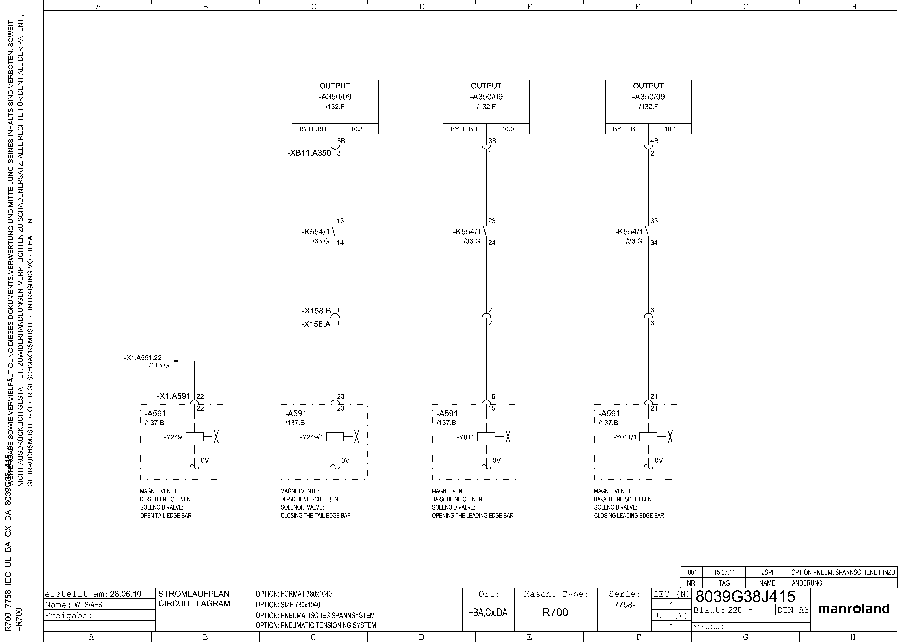

# +BA_Cx_DA — Sheet 220 of 247 — OPTION: FORMAT 780x1040

**OPTION: SIZE 780x1040**

> Part of the manroland **R700** printing press IEC/UL circuit diagrams.
> Drawing class: **Stromlaufplan / Circuit diagram** (DIN A3).
> Document `+BA_Cx_DA` covers the **Printing units / main switch cabinet** machine section.

## At a glance

| Field | Value |
|---|---|
| Document | `+BA_Cx_DA`  (8039G38J415) |
| Sheet | **220** of 247 |
| Section (DE) | OPTION: FORMAT 780x1040 |
| Section (EN) | OPTION: SIZE 780x1040 |
| Section type | CIRCUIT — Circuit diagram |
| Machine type | `R700` |
| Series | `7758` |
| Created | 28.06.10 |
| Replaces | — |
| Columns used | A, B, C, D, E, F, G, H |
| Path numbers | — |
| Labels on sheet | 93 |
| Cross-refs out | 11 |
| Cross-refs in | 24 |

**Previous:** [+BA_Cx_DA sheet 219](SHEET_0219.md) · **Next:** [+BA_Cx_DA sheet 221](SHEET_0221.md) · **Document TOC:** [_TOC.md](_TOC.md)  (+BA_Cx_DA) · **Master TOC:** [all sheets](../_MASTER_TOC.md)

## Sheet image (300 DPI, exact vector render)



_Rendered directly from the PDF vector layer at 300 DPI (1-bit), no OCR and no resampling. Use it to confirm anything ambiguous in the text below._

## Cross-references on this sheet

Each entry is a wire leaving this sheet. The printed token is `/sheet.column`; the link resolves to that sheet inside the same document.

| Ref | Target sheet | Col | Path | Destination on target | Target section | From col |
|---|---|---|---|---|---|---|
| `/132.F` | [+BA_Cx_DA sheet 132](SHEET_0132.md) | F | — | — | REFERENZMODUL | C |
| `/132.F` | [+BA_Cx_DA sheet 132](SHEET_0132.md) | F | — | — | REFERENZMODUL | E |
| `/132.F` | [+BA_Cx_DA sheet 132](SHEET_0132.md) | F | — | — | REFERENZMODUL | F |
| `/33.G` | [+BA_Cx_DA sheet 33](SHEET_0033.md) | G | — | — | BUSVERBINDUNGEN: RESERVE SIGNALE | C |
| `/33.G` | [+BA_Cx_DA sheet 33](SHEET_0033.md) | G | — | — | BUSVERBINDUNGEN: RESERVE SIGNALE | D |
| `/33.G` | [+BA_Cx_DA sheet 33](SHEET_0033.md) | G | — | — | BUSVERBINDUNGEN: RESERVE SIGNALE | F |
| `/116.G` | [+BA_Cx_DA sheet 116](SHEET_0116.md) | G | — | X1.A591:22 | PPL 2 | A |
| `/137.B` | [+BA_Cx_DA sheet 137](SHEET_0137.md) | B | — | A591 | REFERENZMODUL | B |
| `/137.B` | [+BA_Cx_DA sheet 137](SHEET_0137.md) | B | — | A591 | REFERENZMODUL | C |
| `/137.B` | [+BA_Cx_DA sheet 137](SHEET_0137.md) | B | — | A591 | REFERENZMODUL | D |
| `/137.B` | [+BA_Cx_DA sheet 137](SHEET_0137.md) | B | — | A591 | REFERENZMODUL | F |

### Incoming references (sheets that point here)

Every other sheet that sends a wire to this one. `Back-ref` is the token printed on *that* sheet; `Path` is its line number.

| From sheet | Cols | Back-ref | Path | Refs | What continues there |
|---|---|---|---|---|---|
| [+BA_Cx_DA#33](SHEET_0033.md) | G | `/33.G` | — | 3 | — |
| [+BA_Cx_DA#116](SHEET_0116.md) | G | `/116.G` | — | 1 | — |
| [+BA_Cx_DA#132](SHEET_0132.md) | F | `/132.F` | — | 3 | — |
| [+BA_Cx_DA#137](SHEET_0137.md) | B | `/137.B` | — | 4 | — |
| [+BA_Cx_DA#142](SHEET_0142.md) | B | `/142.B` | — | 4 | — |
| [+BA_Cx_DA#168](SHEET_0168.md) | H | `/168.H` | — | 3 | — |
| [+BA_Cx_DA#187](SHEET_0187.md) | G | `/187.G` | — | 6 | — |


## Devices on this sheet

| Tag | Class | Class meaning (IEC) | Col | Sub | Terminal | Sign |
|---|---|---|---|---|---|---|
| `A350/09` | A | Baugruppe / assembly, module, PC board | C | 09 | — | — |
| `A350/09` | A | Baugruppe / assembly, module, PC board | E | 09 | — | — |
| `A350/09` | A | Baugruppe / assembly, module, PC board | F | 09 | — | — |
| `Y249` | Y | Magnetventil / solenoid valve, actuator | B | — | — | — |
| `A591` | A | Baugruppe / assembly, module, PC board | B | — | — | — |
| `Y249/1` | Y | Magnetventil / solenoid valve, actuator | C | 1 | — | — |
| `A591` | A | Baugruppe / assembly, module, PC board | C | — | — | — |
| `Y011` | Y | Magnetventil / solenoid valve, actuator | D | — | — | — |
| `A591` | A | Baugruppe / assembly, module, PC board | D | — | — | — |
| `Y011/1` | Y | Magnetventil / solenoid valve, actuator | F | 1 | — | — |
| `A591` | A | Baugruppe / assembly, module, PC board | F | — | — | — |
| `K554/1` | K | Relais / relay, contactor | F | 1 | — | — |
| `K554/1` | K | Relais / relay, contactor | C | 1 | — | — |
| `K554/1` | K | Relais / relay, contactor | D | 1 | — | — |
| `XB11.A350` | — | cross-device reference | C | — | — | — |
| `10.2` | — | cross-device reference | C | — | — | — |
| `10.0` | — | cross-device reference | E | — | — | — |
| `10.1` | — | cross-device reference | F | — | — | — |
| `X1.A591` | — | cross-device reference | B | — | — | — |
| `X158.B` | — | cross-device reference | C | — | — | — |
| `X158.A` | — | cross-device reference | C | — | — | — |
| `X1.A591:22` | — | cross-device reference | A | — | 22 | — |
| `NR.` | — | cross-device reference | G | — | — | — |
| `15.07.11` | — | cross-device reference | G | — | — | — |

## Potentials / nets

| Potential | Count | Columns | Attached devices | Terminals |
|---|---|---|---|---|
| `0V` | 4 | B, C, E, F | — | — |


A potential such as `L24+/4` or `M24+` is a named supply/return rail; every place it appears on this sheet is electrically common.

## Wire-end annotations (grouped as printed)

A wire that continues elsewhere is annotated with a small cluster: the destination description, the path/line number `#NN`, and the `/sheet.column` cross reference. Each row below is one such cluster exactly as it is grouped on the drawing.

| Col | Y | Path | Cross-ref | Text on the wire |
|---|---|---|---|---|
| C | 108.3 | — | — | `OUTPUT` |
| E | 108.3 | — | — | `OUTPUT` |
| F | 108.3 | — | — | `OUTPUT` |
| C | 122.2 | — | — | `A350/09` |
| E | 122.2 | — | — | `A350/09` |
| F | 122.2 | — | — | `A350/09` |
| C | 136.0 | — | `/132.F` | — |
| E | 136.0 | — | `/132.F` | — |
| F | 136.0 | — | `/132.F` | — |
| C | 165.6 | — | — | `BYTE.BIT 10.2` |
| E | 165.6 | — | — | `BYTE.BIT 10.0` |
| F | 165.6 | — | — | `BYTE.BIT 10.1` |
| C | 181.0 | — | — | `5B` |
| E | 181.0 | — | — | `3B` |
| F | 181.0 | — | — | `4B` |
| C | 195.9 | — | — | `XB11.A350 3` |
| E | 197.3 | — | — | `1 2` |
| C | 285.9 | — | — | `13` |
| E | 285.9 | — | — | `23` |
| F | 285.9 | — | — | `33` |
| C | 299.4 | — | — | `K554/1 14` |
| D | 299.4 | — | — | `K554/1 24` |
| F | 299.4 | — | — | `K554/1 34` |
| C | 312.4 | — | `/33.G` | — |
| D | 312.4 | — | `/33.G` | — |
| F | 312.4 | — | `/33.G` | — |
| E | 402.8 | — | — | `X158.B 1 2 3` |
| E | 419.9 | — | — | `X158.A 1 2 3` |
| A | 465.2 | — | `/116.G` | `X1.A591:22` |
| B | 514.8 | — | — | `X1.A591 22` |
| C | 516.2 | — | — | `23` |
| E | 516.2 | — | — | `15` |
| F | 516.2 | — | — | `21` |
| B | 531.8 | — | — | `22` |
| C | 531.8 | — | — | `23` |
| E | 531.8 | — | — | `15` |
| F | 531.8 | — | — | `21` |
| B | 537.5 | — | `/137.B` | `A591` |
| C | 537.5 | — | `/137.B` | `A591` |
| D | 537.5 | — | `/137.B` | `A591` |
| F | 537.5 | — | `/137.B` | `A591` |
| B | 569.4 | — | — | `Y249` |
| C | 569.4 | — | — | `Y249/1` |
| D | 569.4 | — | — | `Y011` |
| F | 569.4 | — | — | `Y011/1` |
| B | 599.8 | — | — | `0V` |
| C | 599.8 | — | — | `0V` |
| E | 599.8 | — | — | `0V` |
| F | 599.8 | — | — | `0V` |
| B | 641.2 | — | — | `DE SCHIENE ÖFFNEN MAGNETVENTIL:` |
| C | 641.2 | — | — | `DE SCHIENE SCHLIEßEN MAGNETVENTIL:` |
| D | 641.2 | — | — | `DA SCHIENE ÖFFNEN MAGNETVENTIL:` |
| F | 641.2 | — | — | `DA SCHIENE SCHLIEßEN MAGNETVENTIL:` |
| B | 662.5 | — | — | `SOLENOID VALVE: OPEN TAIL EDGE BAR` |
| C | 662.5 | — | — | `SOLENOID VALVE: CLOSING THE TAIL EDGE BAR` |
| D | 662.5 | — | — | `SOLENOID VALVE: OPENING THE LEADING EDGE BAR` |
| F | 662.5 | — | — | `SOLENOID VALVE: CLOSING LEADING EDGE BAR` |
| G | 747.2 | — | — | `001 15.07.11 JSPI OPTION PNEUM. SPANNSCHIENE HINZU` |
| G | 761.3 | — | — | `NR. TAG NAME ÄNDERUNG` |


## Reconstructed tables

This sheet carries tabular content (pin map / terminal assignment / index). The grid below was rebuilt from the drawing's own rule lines, so each row is exactly one physical row of the table.

### Table 1 — 1 data rows × 2 columns (at x=382.7, y=104.9)

| OUTPUT | A350/09 /132.F |
|---|---|
| `BYTE.BIT` | `10.2` |


### Table 2 — 1 data rows × 2 columns (at x=581.1, y=104.9)

| OUTPUT | A350/09 /132.F |
|---|---|
| `BYTE.BIT` | `10.0` |


### Table 3 — 1 data rows × 2 columns (at x=793.7, y=104.9)

| OUTPUT | A350/09 /132.F |
|---|---|
| `BYTE.BIT` | `10.1` |


## Notes and free text on this sheet

| Text | Col | Y (pt) |
|---|---|---|
| `5B` | C | 180.98 |
| `OUTPUT` | C | 108.33 |
| `BYTE.BIT` | C | 165.6 |
| `3B` | E | 180.98 |
| `OUTPUT` | E | 108.33 |
| `BYTE.BIT` | D | 165.6 |
| `4B` | F | 180.98 |
| `OUTPUT` | F | 108.33 |
| `BYTE.BIT` | F | 165.6 |
| `MAGNETVENTIL:` | B | 641.24 |
| `DE SCHIENE ÖFFNEN` | B | 651.88 |
| `SOLENOID VALVE:` | B | 662.5 |
| `OPEN TAIL EDGE BAR` | B | 673.14 |
| `MAGNETVENTIL:` | C | 641.24 |
| `DE SCHIENE SCHLIEßEN` | C | 651.88 |
| `SOLENOID VALVE:` | C | 662.5 |
| `CLOSING THE TAIL EDGE BAR` | C | 673.15 |
| `MAGNETVENTIL:` | D | 641.24 |
| `DA SCHIENE ÖFFNEN` | D | 651.88 |
| `SOLENOID VALVE:` | D | 662.5 |
| `OPENING THE LEADING EDGE BAR` | D | 673.15 |
| `MAGNETVENTIL:` | F | 641.24 |
| `DA SCHIENE SCHLIEßEN` | F | 651.88 |
| `SOLENOID VALVE:` | F | 662.5 |
| `CLOSING LEADING EDGE BAR` | F | 673.16 |
| `TAG` | G | 761.44 |
| `NAME` | G | 761.42 |
| `ÄNDERUNG` | H | 761.48 |
| `JSPI` | G | 747.25 |
| `OPTION PNEUM. SPANNSCHIENE HINZU` | H | 747.31 |

## Complete label inventory (exact text from the drawing)

Every text object inside the drawing area of this sheet, in DIN reading order (column A→H, then top→bottom). This is the authoritative list: if a string is not here it is not printed on this sheet.

| Col | Y | X | Dir | Type | Text |
|---|---|---|---|---|---|
| A | 465.2 | 163.0 | → | device ref | `X1.A591:22` |
| B | 475.1 | 195.3 | → | cross-reference | `/116.G` |
| B | 514.8 | 205.8 | → | device ref | `X1.A591` |
| B | 516.2 | 257.7 | → | number | `22` |
| B | 531.8 | 257.7 | → | number | `22` |
| B | 537.5 | 189.6 | → | device tag | `A591` |
| B | 550.5 | 189.9 | → | cross-reference | `/137.B` |
| B | 569.4 | 215.1 | → | device tag | `Y249` |
| B | 599.8 | 263.3 | → | potential | `0V` |
| B | 641.2 | 183.7 | → | text | `MAGNETVENTIL:` |
| B | 651.9 | 183.4 | → | text | `DE SCHIENE ÖFFNEN` |
| B | 662.5 | 184.0 | → | text | `SOLENOID VALVE:` |
| B | 673.1 | 184.0 | → | text | `OPEN TAIL EDGE BAR` |
| C | 108.3 | 419.1 | → | text | `OUTPUT` |
| C | 122.2 | 418.0 | → | device tag | `A350/09` |
| C | 136.0 | 427.0 | → | cross-reference | `/132.F` |
| C | 165.6 | 392.6 | → | text | `BYTE.BIT` |
| C | 165.6 | 459.6 | → | device ref | `10.2` |
| C | 181.0 | 441.9 | → | text | `5B` |
| C | 195.9 | 377.0 | → | device ref | `XB11.A350` |
| C | 197.3 | 441.9 | → | number | `3` |
| C | 285.9 | 441.4 | → | number | `13` |
| C | 299.4 | 395.7 | → | device tag | `K554/1` |
| C | 312.4 | 409.9 | → | cross-reference | `/33.G` |
| C | 314.3 | 441.4 | → | number | `14` |
| C | 402.8 | 396.0 | → | device ref | `X158.B` |
| C | 402.8 | 441.4 | → | number | `1` |
| C | 419.9 | 441.4 | → | number | `1` |
| C | 420.6 | 395.1 | → | device ref | `X158.A` |
| C | 516.2 | 441.9 | → | number | `23` |
| C | 531.8 | 441.9 | → | number | `23` |
| C | 537.5 | 373.9 | → | device tag | `A591` |
| C | 550.5 | 374.2 | → | cross-reference | `/137.B` |
| C | 569.4 | 393.4 | → | device tag | `Y249/1` |
| C | 599.8 | 447.6 | → | potential | `0V` |
| C | 641.2 | 367.9 | → | text | `MAGNETVENTIL:` |
| C | 651.9 | 367.7 | → | text | `DE SCHIENE SCHLIEßEN` |
| C | 662.5 | 368.2 | → | text | `SOLENOID VALVE:` |
| C | 673.2 | 368.2 | → | text | `CLOSING THE TAIL EDGE BAR` |
| D | 165.6 | 591.0 | → | text | `BYTE.BIT` |
| D | 299.4 | 594.1 | → | device tag | `K554/1` |
| D | 312.4 | 608.3 | → | cross-reference | `/33.G` |
| D | 537.5 | 572.3 | → | device tag | `A591` |
| D | 550.5 | 572.6 | → | cross-reference | `/137.B` |
| D | 569.4 | 599.2 | → | device tag | `Y011` |
| D | 641.2 | 566.4 | → | text | `MAGNETVENTIL:` |
| D | 651.9 | 566.1 | → | text | `DA SCHIENE ÖFFNEN` |
| D | 662.5 | 566.6 | → | text | `SOLENOID VALVE:` |
| D | 673.2 | 566.6 | → | text | `OPENING THE LEADING EDGE BAR` |
| E | 108.3 | 617.5 | → | text | `OUTPUT` |
| E | 122.2 | 616.4 | → | device tag | `A350/09` |
| E | 136.0 | 625.5 | → | cross-reference | `/132.F` |
| E | 165.6 | 657.9 | → | device ref | `10.0` |
| E | 181.0 | 640.3 | → | text | `3B` |
| E | 197.3 | 639.8 | → | number | `1` |
| E | 285.9 | 640.3 | → | number | `23` |
| E | 314.3 | 640.3 | → | number | `24` |
| E | 402.8 | 640.3 | → | number | `2` |
| E | 419.9 | 640.3 | → | number | `2` |
| E | 516.2 | 639.8 | → | number | `15` |
| E | 531.8 | 639.8 | → | number | `15` |
| E | 599.8 | 646.0 | → | potential | `0V` |
| F | 108.3 | 830.1 | → | text | `OUTPUT` |
| F | 122.2 | 829.0 | → | device tag | `A350/09` |
| F | 136.0 | 838.1 | → | cross-reference | `/132.F` |
| F | 165.6 | 803.6 | → | text | `BYTE.BIT` |
| F | 165.6 | 871.1 | → | device ref | `10.1` |
| F | 181.0 | 852.9 | → | text | `4B` |
| F | 197.3 | 852.9 | → | number | `2` |
| F | 285.9 | 852.9 | → | number | `33` |
| F | 299.4 | 806.7 | → | device tag | `K554/1` |
| F | 312.4 | 820.9 | → | cross-reference | `/33.G` |
| F | 314.3 | 852.9 | → | number | `34` |
| F | 402.8 | 852.9 | → | number | `3` |
| F | 419.9 | 852.9 | → | number | `3` |
| F | 516.2 | 852.9 | → | number | `21` |
| F | 531.8 | 852.9 | → | number | `21` |
| F | 537.5 | 784.9 | → | device tag | `A591` |
| F | 550.5 | 785.2 | → | cross-reference | `/137.B` |
| F | 569.4 | 804.5 | → | device tag | `Y011/1` |
| F | 599.8 | 858.6 | → | potential | `0V` |
| F | 641.2 | 779.0 | → | text | `MAGNETVENTIL:` |
| F | 651.9 | 778.7 | → | text | `DA SCHIENE SCHLIEßEN` |
| F | 662.5 | 779.2 | → | text | `SOLENOID VALVE:` |
| F | 673.2 | 779.2 | → | text | `CLOSING LEADING EDGE BAR` |
| G | 747.2 | 901.9 | → | number | `001` |
| G | 747.2 | 936.3 | → | device ref | `15.07.11` |
| G | 747.2 | 999.1 | → | text | `JSPI` |
| G | 761.3 | 900.9 | → | device ref | `NR.` |
| G | 761.4 | 942.5 | → | text | `TAG` |
| G | 761.4 | 995.9 | → | text | `NAME` |
| H | 747.3 | 1037.6 | → | text | `OPTION PNEUM. SPANNSCHIENE HINZU` |
| H | 761.5 | 1038.5 | → | text | `ÄNDERUNG` |

## Reading-order text block

The same content as a plain block, grouped by DIN column — convenient to paste or to match against a visual description.

```text
=== Column A ===
 465.2  163.0  devref       X1.A591:22
=== Column B ===
 475.1  195.3  xref         /116.G
 514.8  205.8  devref       X1.A591
 516.2  257.7  numeric      22
 531.8  257.7  numeric      22
 537.5  189.6  devtag       A591
 550.5  189.9  xref         /137.B
 569.4  215.1  devtag       Y249
 599.8  263.3  net          0V
 641.2  183.7  text         MAGNETVENTIL:
 651.9  183.4  text         DE SCHIENE ÖFFNEN
 662.5  184.0  text         SOLENOID VALVE:
 673.1  184.0  text         OPEN TAIL EDGE BAR
=== Column C ===
 108.3  419.1  text         OUTPUT
 122.2  418.0  devtag       A350/09
 136.0  427.0  xref         /132.F
 165.6  392.6  text         BYTE.BIT
 165.6  459.6  devref       10.2
 181.0  441.9  text         5B
 195.9  377.0  devref       XB11.A350
 197.3  441.9  numeric      3
 285.9  441.4  numeric      13
 299.4  395.7  devtag       K554/1
 312.4  409.9  xref         /33.G
 314.3  441.4  numeric      14
 402.8  396.0  devref       X158.B
 402.8  441.4  numeric      1
 419.9  441.4  numeric      1
 420.6  395.1  devref       X158.A
 516.2  441.9  numeric      23
 531.8  441.9  numeric      23
 537.5  373.9  devtag       A591
 550.5  374.2  xref         /137.B
 569.4  393.4  devtag       Y249/1
 599.8  447.6  net          0V
 641.2  367.9  text         MAGNETVENTIL:
 651.9  367.7  text         DE SCHIENE SCHLIEßEN
 662.5  368.2  text         SOLENOID VALVE:
 673.2  368.2  text         CLOSING THE TAIL EDGE BAR
=== Column D ===
 165.6  591.0  text         BYTE.BIT
 299.4  594.1  devtag       K554/1
 312.4  608.3  xref         /33.G
 537.5  572.3  devtag       A591
 550.5  572.6  xref         /137.B
 569.4  599.2  devtag       Y011
 641.2  566.4  text         MAGNETVENTIL:
 651.9  566.1  text         DA SCHIENE ÖFFNEN
 662.5  566.6  text         SOLENOID VALVE:
 673.2  566.6  text         OPENING THE LEADING EDGE BAR
=== Column E ===
 108.3  617.5  text         OUTPUT
 122.2  616.4  devtag       A350/09
 136.0  625.5  xref         /132.F
 165.6  657.9  devref       10.0
 181.0  640.3  text         3B
 197.3  639.8  numeric      1
 285.9  640.3  numeric      23
 314.3  640.3  numeric      24
 402.8  640.3  numeric      2
 419.9  640.3  numeric      2
 516.2  639.8  numeric      15
 531.8  639.8  numeric      15
 599.8  646.0  net          0V
=== Column F ===
 108.3  830.1  text         OUTPUT
 122.2  829.0  devtag       A350/09
 136.0  838.1  xref         /132.F
 165.6  803.6  text         BYTE.BIT
 165.6  871.1  devref       10.1
 181.0  852.9  text         4B
 197.3  852.9  numeric      2
 285.9  852.9  numeric      33
 299.4  806.7  devtag       K554/1
 312.4  820.9  xref         /33.G
 314.3  852.9  numeric      34
 402.8  852.9  numeric      3
 419.9  852.9  numeric      3
 516.2  852.9  numeric      21
 531.8  852.9  numeric      21
 537.5  784.9  devtag       A591
 550.5  785.2  xref         /137.B
 569.4  804.5  devtag       Y011/1
 599.8  858.6  net          0V
 641.2  779.0  text         MAGNETVENTIL:
 651.9  778.7  text         DA SCHIENE SCHLIEßEN
 662.5  779.2  text         SOLENOID VALVE:
 673.2  779.2  text         CLOSING LEADING EDGE BAR
=== Column G ===
 747.2  901.9  numeric      001
 747.2  936.3  devref       15.07.11
 747.2  999.1  text         JSPI
 761.3  900.9  devref       NR.
 761.4  942.5  text         TAG
 761.4  995.9  text         NAME
=== Column H ===
 747.3 1037.6  text         OPTION PNEUM. SPANNSCHIENE HINZU
 761.5 1038.5  text         ÄNDERUNG
```

---
_Generated from the PDF vector text layer; no OCR. Source: `R700_7758_IEC_UL_BA_CX_DA_8039G38J415_p`, sheet 220._
