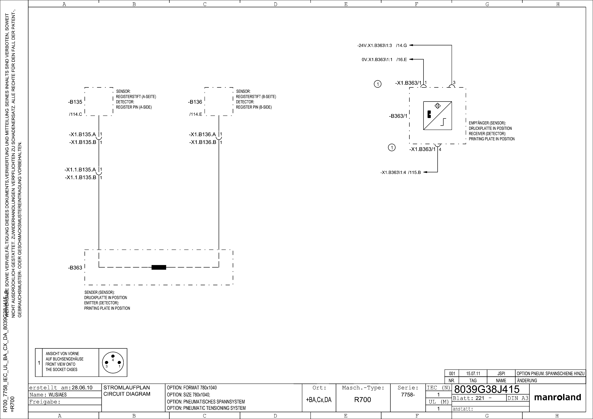

# +BA_Cx_DA — Sheet 221 of 247 — OPTION: FORMAT 780x1040

**OPTION: SIZE 780x1040;**

> Part of the manroland **R700** printing press IEC/UL circuit diagrams.
> Drawing class: **Stromlaufplan / Circuit diagram** (DIN A3).
> Document `+BA_Cx_DA` covers the **Printing units / main switch cabinet** machine section.

## At a glance

| Field | Value |
|---|---|
| Document | `+BA_Cx_DA`  (8039G38J415) |
| Sheet | **221** of 247 |
| Section (DE) | OPTION: FORMAT 780x1040 |
| Section (EN) | OPTION: SIZE 780x1040; |
| Section type | CIRCUIT — Circuit diagram |
| Machine type | `R700` |
| Series | `7758` |
| Created | 28.06.10 |
| Replaces | — |
| Columns used | A, B, C, D, E, F, G, H |
| Path numbers | — |
| Labels on sheet | 63 |
| Cross-refs out | 5 |
| Cross-refs in | 14 |

**Previous:** [+BA_Cx_DA sheet 220](SHEET_0220.md) · **Next:** [+BA_Cx_DA sheet 222](SHEET_0222.md) · **Document TOC:** [_TOC.md](_TOC.md)  (+BA_Cx_DA) · **Master TOC:** [all sheets](../_MASTER_TOC.md)

## Sheet image (300 DPI, exact vector render)



_Rendered directly from the PDF vector layer at 300 DPI (1-bit), no OCR and no resampling. Use it to confirm anything ambiguous in the text below._

## Cross-references on this sheet

Each entry is a wire leaving this sheet. The printed token is `/sheet.column`; the link resolves to that sheet inside the same document.

| Ref | Target sheet | Col | Path | Destination on target | Target section | From col |
|---|---|---|---|---|---|---|
| `/14.G` | [+BA_Cx_DA sheet 14](SHEET_0014.md) | G | — | 24V.X1.B363\1:3 | SPANNUNGSVERSORGUNG, SCHALTSCHRANKBELÜFTUNG | F |
| `/16.E` | [+BA_Cx_DA sheet 16](SHEET_0016.md) | E | — | 0V.X1.B363\1:1 | SPANNUNGSVERSORGUNG, SCHALTSCHRANKBELÜFTUNG | F |
| `/114.E` | [+BA_Cx_DA sheet 114](SHEET_0114.md) | E | — | — | PPL 2 | C |
| `/114.C` | [+BA_Cx_DA sheet 114](SHEET_0114.md) | C | — | — | PPL 2 | A |
| `/115.B` | [+BA_Cx_DA sheet 115](SHEET_0115.md) | B | — | X1.B363\1:4 | PPL 2 | F |

### Incoming references (sheets that point here)

Every other sheet that sends a wire to this one. `Back-ref` is the token printed on *that* sheet; `Path` is its line number.

| From sheet | Cols | Back-ref | Path | Refs | What continues there |
|---|---|---|---|---|---|
| [+BA_Cx_DA#14](SHEET_0014.md) | G | `/14.G` | — | 1 | 24V.X1.B363\1:3 |
| [+BA_Cx_DA#16](SHEET_0016.md) | E | `/16.E` | — | 1 | 0V.X1.B363\1:1 |
| [+BA_Cx_DA#114](SHEET_0114.md) | C, E | `/114.C`, `/114.E` | — | 2 | — |
| [+BA_Cx_DA#115](SHEET_0115.md) | B | `/115.B` | — | 1 | — |
| [+BA_Cx_DA#145](SHEET_0145.md) | C, D, E | `/145.C`, `/145.D`, `/145.E` | — | 6 | STROMPFAD PIN 1 2 |
| [+BA_Cx_DA#146](SHEET_0146.md) | A | `/146.A` | — | 3 | — |


## Devices on this sheet

| Tag | Class | Class meaning (IEC) | Col | Sub | Terminal | Sign |
|---|---|---|---|---|---|---|
| `B135` | B | Umformer / transducer, sensor | A | — | — | — |
| `B136` | B | Umformer / transducer, sensor | C | — | — | — |
| `B363/1` | B | Umformer / transducer, sensor | F | 1 | — | — |
| `B363` | B | Umformer / transducer, sensor | A | — | — | — |
| `X1.B135.B` | — | cross-device reference | A | — | — | — |
| `X1.B135.A` | — | cross-device reference | A | — | — | — |
| `X1.1.B135.B` | — | cross-device reference | A | — | — | — |
| `X1.1.B135.A` | — | cross-device reference | A | — | — | — |
| `X1.B136.B` | — | cross-device reference | C | — | — | — |
| `X1.B136.A` | — | cross-device reference | C | — | — | — |
| `X1.B363\1:4` | — | cross-device reference | F | — | 4 | — |
| `NR.` | — | cross-device reference | G | — | — | — |
| `15.07.11` | — | cross-device reference | G | — | — | — |

## Potentials / nets

| Potential | Count | Columns | Attached devices | Terminals |
|---|---|---|---|---|
| `0V` | 1 | E | `B363\1`, `X1` | `1` |
| `24V` | 1 | E | `B363\1`, `X1` | `3` |


A potential such as `L24+/4` or `M24+` is a named supply/return rail; every place it appears on this sheet is electrically common.

## Wire-end annotations (grouped as printed)

A wire that continues elsewhere is annotated with a small cluster: the destination description, the path/line number `#NN`, and the `/sheet.column` cross reference. Each row below is one such cluster exactly as it is grouped on the drawing.

| Col | Y | Path | Cross-ref | Text on the wire |
|---|---|---|---|---|
| F | 87.4 | — | `/14.G` | `24V.X1.B363\1:3` |
| F | 115.8 | — | `/16.E` | `0V.X1.B363\1:1` |
| F | 161.9 | — | — | `X1.B363/1 1 3` |
| E | 165.6 | — | — | `1` |
| B | 180.6 | — | — | `REGISTERSTIFT (A SEITE) DETECTOR: REGISTER PIN (A SIDE) SENSOR:` |
| D | 180.6 | — | — | `REGISTERSTIFT (B SEITE) DETECTOR: REGISTER PIN (B SIDE) SENSOR:` |
| A | 200.1 | — | — | `B135` |
| C | 200.1 | — | — | `B136` |
| A | 225.6 | — | `/114.C` | — |
| C | 225.6 | — | `/114.E` | — |
| F | 228.5 | — | — | `B363/1` |
| G | 244.4 | — | — | `EMPFÄNGER (SENSOR): DRUCKPLATTE IN POSITION RECEIVER (DETECTOR): PRINTING PLATE IN POSITION` |
| A | 265.4 | — | — | `X1.B135.A 1` |
| C | 265.4 | — | — | `X1.B136.A 1` |
| A | 280.9 | — | — | `X1.B135.B 1` |
| C | 280.9 | — | — | `X1.B136.B 1` |
| F | 293.2 | — | — | `1` |
| F | 295.1 | — | — | `X1.B363/1 4` |
| A | 336.2 | — | — | `X1.1.B135.A 1` |
| F | 342.6 | — | `/115.B` | `X1.B363\1:4` |
| A | 351.8 | — | — | `X1.1.B135.B 1` |
| A | 533.2 | — | — | `B363` |
| B | 584.6 | — | — | `DRUCKPLATTE IN POSITION EMITTER (DETECTOR): PRINTING PLATE IN POSITION SENDER (SENSOR):` |
| A | 707.9 | — | — | `FRONT VIEW ONTO ANSICHT VON VORNE AUF BUCHSENGEHÄUSE` |
| A | 720.2 | — | — | `1 THE SOCKET CASES 4` |
| B | 732.9 | — | — | `3 1` |
| G | 747.2 | — | — | `001 15.07.11 JSPI OPTION PNEUM. SPANNSCHIENE HINZU` |
| G | 761.3 | — | — | `NR. TAG NAME ÄNDERUNG` |


## Notes and free text on this sheet

| Text | Col | Y (pt) |
|---|---|---|
| `SENSOR:` | B | 180.6 |
| `REGISTERSTIFT (A SEITE)` | B | 191.24 |
| `DETECTOR:` | B | 201.87 |
| `REGISTER PIN (A SIDE)` | B | 212.51 |
| `SENSOR:` | D | 180.6 |
| `REGISTERSTIFT (B SEITE)` | D | 191.24 |
| `DETECTOR:` | D | 201.87 |
| `REGISTER PIN (B SIDE)` | D | 212.51 |
| `EMPFÄNGER (SENSOR):` | G | 244.4 |
| `DRUCKPLATTE IN POSITION` | G | 255.03 |
| `RECEIVER (DETECTOR):` | G | 265.67 |
| `PRINTING PLATE IN POSITION` | G | 276.29 |
| `X1.B363/1` | F | 295.12 |
| `SENDER (SENSOR):` | B | 584.56 |
| `DRUCKPLATTE IN POSITION` | B | 595.19 |
| `EMITTER (DETECTOR):` | B | 605.83 |
| `PRINTING PLATE IN POSITION` | B | 616.44 |
| `TAG` | G | 761.44 |
| `NAME` | G | 761.42 |
| `ÄNDERUNG` | H | 761.48 |
| `JSPI` | G | 747.25 |
| `OPTION PNEUM. SPANNSCHIENE HINZU` | H | 747.31 |
| `ANSICHT VON VORNE` | A | 707.88 |
| `AUF BUCHSENGEHÄUSE` | A | 718.51 |
| `FRONT VIEW ONTO` | A | 729.1 |
| `THE SOCKET CASES` | A | 739.75 |

## Complete label inventory (exact text from the drawing)

Every text object inside the drawing area of this sheet, in DIN reading order (column A→H, then top→bottom). This is the authoritative list: if a string is not here it is not printed on this sheet.

| Col | Y | X | Dir | Type | Text |
|---|---|---|---|---|---|
| A | 200.1 | 136.6 | → | device tag | `B135` |
| A | 225.6 | 138.9 | → | cross-reference | `/114.C` |
| A | 265.4 | 138.3 | → | device ref | `X1.B135.A` |
| A | 280.9 | 139.2 | → | device ref | `X1.B135.B` |
| A | 336.2 | 129.5 | → | device ref | `X1.1.B135.A` |
| A | 351.8 | 130.4 | → | device ref | `X1.1.B135.B` |
| A | 533.2 | 136.6 | → | device tag | `B363` |
| A | 707.9 | 92.1 | → | text | `ANSICHT VON VORNE` |
| A | 718.5 | 92.1 | → | text | `AUF BUCHSENGEHÄUSE` |
| A | 724.5 | 75.4 | → | number | `1` |
| A | 729.1 | 91.3 | → | text | `FRONT VIEW ONTO` |
| A | 739.8 | 91.8 | → | text | `THE SOCKET CASES` |
| B | 180.6 | 233.6 | → | text | `SENSOR:` |
| B | 191.2 | 233.0 | → | text | `REGISTERSTIFT (A SEITE)` |
| B | 201.9 | 233.0 | → | text | `DETECTOR:` |
| B | 212.5 | 233.0 | → | text | `REGISTER PIN (A SIDE)` |
| B | 265.4 | 200.4 | → | number | `1` |
| B | 282.4 | 200.4 | → | number | `1` |
| B | 336.2 | 200.4 | → | number | `1` |
| B | 353.2 | 200.4 | → | number | `1` |
| B | 584.6 | 169.8 | → | text | `SENDER (SENSOR):` |
| B | 595.2 | 169.2 | → | text | `DRUCKPLATTE IN POSITION` |
| B | 605.8 | 169.2 | → | text | `EMITTER (DETECTOR):` |
| B | 616.4 | 169.2 | → | text | `PRINTING PLATE IN POSITION` |
| B | 720.2 | 224.8 | → | number | `4` |
| B | 732.9 | 212.0 | → | number | `3` |
| B | 732.9 | 238.0 | → | number | `1` |
| C | 200.1 | 377.6 | → | device tag | `B136` |
| C | 225.6 | 380.4 | → | cross-reference | `/114.E` |
| C | 265.4 | 379.3 | → | device ref | `X1.B136.A` |
| C | 265.4 | 441.4 | → | number | `1` |
| C | 280.9 | 380.1 | → | device ref | `X1.B136.B` |
| C | 282.4 | 441.4 | → | number | `1` |
| D | 180.6 | 474.5 | → | text | `SENSOR:` |
| D | 191.2 | 474.0 | → | text | `REGISTERSTIFT (B SEITE)` |
| D | 201.9 | 474.0 | → | text | `DETECTOR:` |
| D | 212.5 | 474.0 | → | text | `REGISTER PIN (B SIDE)` |
| E | 87.4 | 717.4 | → | potential | `24V.X1.B363\1:3` |
| E | 115.8 | 726.5 | → | potential | `0V.X1.B363\1:1` |
| E | 165.6 | 756.5 | → | number | `1` |
| F | 87.4 | 795.4 | → | cross-reference | `/14.G` |
| F | 115.8 | 796.3 | → | cross-reference | `/16.E` |
| F | 161.9 | 793.7 | → | text | `X1.B363/1` |
| F | 161.9 | 852.4 | → | number | `1` |
| F | 228.5 | 781.2 | → | device tag | `B363/1` |
| F | 293.2 | 784.9 | → | number | `1` |
| F | 295.1 | 822.0 | → | text | `X1.B363/1` |
| F | 296.5 | 881.3 | → | number | `4` |
| F | 342.5 | 819.5 | → | cross-reference | `/115.B` |
| F | 342.6 | 763.9 | → | device ref | `X1.B363\1:4` |
| G | 161.9 | 909.6 | → | number | `3` |
| G | 244.4 | 941.7 | → | text | `EMPFÄNGER (SENSOR):` |
| G | 255.0 | 941.7 | → | text | `DRUCKPLATTE IN POSITION` |
| G | 265.7 | 941.7 | → | text | `RECEIVER (DETECTOR):` |
| G | 276.3 | 941.7 | → | text | `PRINTING PLATE IN POSITION` |
| G | 747.2 | 901.9 | → | number | `001` |
| G | 747.2 | 936.3 | → | device ref | `15.07.11` |
| G | 747.2 | 999.1 | → | text | `JSPI` |
| G | 761.3 | 900.9 | → | device ref | `NR.` |
| G | 761.4 | 942.5 | → | text | `TAG` |
| G | 761.4 | 995.9 | → | text | `NAME` |
| H | 747.3 | 1037.6 | → | text | `OPTION PNEUM. SPANNSCHIENE HINZU` |
| H | 761.5 | 1038.5 | → | text | `ÄNDERUNG` |

## Reading-order text block

The same content as a plain block, grouped by DIN column — convenient to paste or to match against a visual description.

```text
=== Column A ===
 200.1  136.6  devtag       B135
 225.6  138.9  xref         /114.C
 265.4  138.3  devref       X1.B135.A
 280.9  139.2  devref       X1.B135.B
 336.2  129.5  devref       X1.1.B135.A
 351.8  130.4  devref       X1.1.B135.B
 533.2  136.6  devtag       B363
 707.9   92.1  text         ANSICHT VON VORNE
 718.5   92.1  text         AUF BUCHSENGEHÄUSE
 724.5   75.4  numeric      1
 729.1   91.3  text         FRONT VIEW ONTO
 739.8   91.8  text         THE SOCKET CASES
=== Column B ===
 180.6  233.6  text         SENSOR:
 191.2  233.0  text         REGISTERSTIFT (A SEITE)
 201.9  233.0  text         DETECTOR:
 212.5  233.0  text         REGISTER PIN (A SIDE)
 265.4  200.4  numeric      1
 282.4  200.4  numeric      1
 336.2  200.4  numeric      1
 353.2  200.4  numeric      1
 584.6  169.8  text         SENDER (SENSOR):
 595.2  169.2  text         DRUCKPLATTE IN POSITION
 605.8  169.2  text         EMITTER (DETECTOR):
 616.4  169.2  text         PRINTING PLATE IN POSITION
 720.2  224.8  numeric      4
 732.9  212.0  numeric      3
 732.9  238.0  numeric      1
=== Column C ===
 200.1  377.6  devtag       B136
 225.6  380.4  xref         /114.E
 265.4  379.3  devref       X1.B136.A
 265.4  441.4  numeric      1
 280.9  380.1  devref       X1.B136.B
 282.4  441.4  numeric      1
=== Column D ===
 180.6  474.5  text         SENSOR:
 191.2  474.0  text         REGISTERSTIFT (B SEITE)
 201.9  474.0  text         DETECTOR:
 212.5  474.0  text         REGISTER PIN (B SIDE)
=== Column E ===
  87.4  717.4  net          24V.X1.B363\1:3
 115.8  726.5  net          0V.X1.B363\1:1
 165.6  756.5  numeric      1
=== Column F ===
  87.4  795.4  xref         /14.G
 115.8  796.3  xref         /16.E
 161.9  793.7  text         X1.B363/1
 161.9  852.4  numeric      1
 228.5  781.2  devtag       B363/1
 293.2  784.9  numeric      1
 295.1  822.0  text         X1.B363/1
 296.5  881.3  numeric      4
 342.5  819.5  xref         /115.B
 342.6  763.9  devref       X1.B363\1:4
=== Column G ===
 161.9  909.6  numeric      3
 244.4  941.7  text         EMPFÄNGER (SENSOR):
 255.0  941.7  text         DRUCKPLATTE IN POSITION
 265.7  941.7  text         RECEIVER (DETECTOR):
 276.3  941.7  text         PRINTING PLATE IN POSITION
 747.2  901.9  numeric      001
 747.2  936.3  devref       15.07.11
 747.2  999.1  text         JSPI
 761.3  900.9  devref       NR.
 761.4  942.5  text         TAG
 761.4  995.9  text         NAME
=== Column H ===
 747.3 1037.6  text         OPTION PNEUM. SPANNSCHIENE HINZU
 761.5 1038.5  text         ÄNDERUNG
```

---
_Generated from the PDF vector text layer; no OCR. Source: `R700_7758_IEC_UL_BA_CX_DA_8039G38J415_p`, sheet 221._
