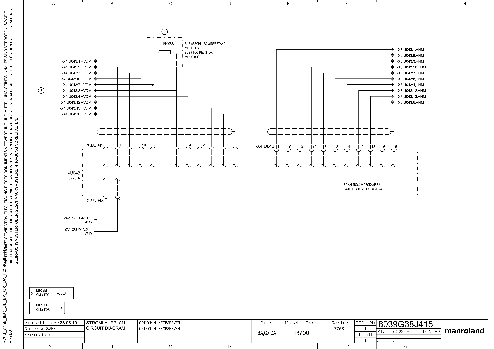

# +BA_Cx_DA — Sheet 222 of 247 — OPTION: INLINEOBSERVER

**OPTION: INLINEOBSERVER**

> Part of the manroland **R700** printing press IEC/UL circuit diagrams.
> Drawing class: **Stromlaufplan / Circuit diagram** (DIN A3).
> Document `+BA_Cx_DA` covers the **Printing units / main switch cabinet** machine section.

## At a glance

| Field | Value |
|---|---|
| Document | `+BA_Cx_DA`  (8039G38J415) |
| Sheet | **222** of 247 |
| Section (DE) | OPTION: INLINEOBSERVER |
| Section (EN) | OPTION: INLINEOBSERVER |
| Section type | CIRCUIT — Circuit diagram |
| Machine type | `R700` |
| Series | `7758` |
| Created | 28.06.10 |
| Replaces | — |
| Columns used | A, B, C, D, E, F, G |
| Path numbers | — |
| Labels on sheet | 70 |
| Cross-refs out | 3 |
| Cross-refs in | 27 |

**Previous:** [+BA_Cx_DA sheet 221](SHEET_0221.md) · **Next:** [+BA_Cx_DA sheet 223](SHEET_0223.md) · **Document TOC:** [_TOC.md](_TOC.md)  (+BA_Cx_DA) · **Master TOC:** [all sheets](../_MASTER_TOC.md)

## Sheet image (300 DPI, exact vector render)



_Rendered directly from the PDF vector layer at 300 DPI (1-bit), no OCR and no resampling. Use it to confirm anything ambiguous in the text below._

## Cross-references on this sheet

Each entry is a wire leaving this sheet. The printed token is `/sheet.column`; the link resolves to that sheet inside the same document.

| Ref | Target sheet | Col | Path | Destination on target | Target section | From col |
|---|---|---|---|---|---|---|
| `/223.A` | [+BA_Cx_DA sheet 223](SHEET_0223.md) | A | — | — | OPTION: INLINEOBSERVER | A |
| `/8.C` | [+BA_Cx_DA sheet 8](SHEET_0008.md) | C | — | 24V.X2.U043:1 | SPANNUNGSVERSORGUNG, SCHALTSCHRANKBELÜFTUNG | A |
| `/7.D` | [+BA_Cx_DA sheet 7](SHEET_0007.md) | D | — | 0V.X2.U043:2 | SPANNUNGSVERSORGUNG, SCHALTSCHRANKBELÜFTUNG | A |

### Incoming references (sheets that point here)

Every other sheet that sends a wire to this one. `Back-ref` is the token printed on *that* sheet; `Path` is its line number.

| From sheet | Cols | Back-ref | Path | Refs | What continues there |
|---|---|---|---|---|---|
| [+BA_Cx_DA#7](SHEET_0007.md) | D | `/7.D` | — | 1 | 0V.X2.U043:2 |
| [+BA_Cx_DA#8](SHEET_0008.md) | D | `/8.D` | — | 1 | — |
| [+BA_Cx_DA#155](SHEET_0155.md) | H | `/155.H` | — | 2 | — |
| [+BA_Cx_DA#158](SHEET_0158.md) | C | `/158.C` | — | 11 | — |
| [+BA_Cx_DA#160](SHEET_0160.md) | B | `/160.B` | — | 11 | — |
| [+BA_Cx_DA#223](SHEET_0223.md) | B | `/223.B` | — | 1 | SCHALTBOX: VIDEOKAMERA SWITCH BOX: VIDEO CAMERA |


## Devices on this sheet

| Tag | Class | Class meaning (IEC) | Col | Sub | Terminal | Sign |
|---|---|---|---|---|---|---|
| `R035` | R | Widerstand / resistor | C | — | — | — |
| `U043` | U | Umrichter / frequency converter | A | — | — | — |
| `X2.U043` | — | cross-device reference | B | — | — | — |
| `X3.U043` | — | cross-device reference | B | — | — | — |
| `X4.U043` | — | cross-device reference | E | — | — | — |

## Potentials / nets

| Potential | Count | Columns | Attached devices | Terminals |
|---|---|---|---|---|
| `0V` | 1 | A | `U043`, `X2` | `2` |
| `24V` | 1 | A | `U043`, `X2` | `1` |


A potential such as `L24+/4` or `M24+` is a named supply/return rail; every place it appears on this sheet is electrically common.

## Wire-end annotations (grouped as printed)

A wire that continues elsewhere is annotated with a small cluster: the destination description, the path/line number `#NN`, and the `/sheet.column` cross reference. Each row below is one such cluster exactly as it is grouped on the drawing.

| Col | Y | Path | Cross-ref | Text on the wire |
|---|---|---|---|---|
| C | 73.5 | — | — | `1` |
| C | 100.9 | — | — | `R035 BUS ABSCHLUSS WIDERSTAND:` |
| C | 113.3 | — | — | `BUS FINAL RESISTOR: VIDEOBUS` |
| G | 115.8 | — | — | `X3.U043:1,+NM` |
| G | 130.0 | — | — | `X3.U043:9,+NM` |
| C | 134.6 | — | — | `VIDEO BUS` |
| A | 144.2 | — | — | `X4.U043:1,+VDM` |
| G | 144.2 | — | — | `X3.U043:3,+NM` |
| A | 158.3 | — | — | `X4.U043:9,+VDM` |
| G | 158.3 | — | — | `X3.U043:10,+NM` |
| A | 172.5 | — | — | `X4.U043:3,+VDM` |
| G | 172.5 | — | — | `X3.U043:7,+NM` |
| A | 186.7 | — | — | `X4.U043:10,+VDM` |
| G | 186.7 | — | — | `X3.U043:8,+NM` |
| A | 200.8 | — | — | `X4.U043:7,+VDM` |
| G | 200.8 | — | — | `X3.U043:4,+NM` |
| A | 215.0 | — | — | `X4.U043:8,+VDM` |
| G | 215.0 | — | — | `X3.U043:12,+NM` |
| A | 215.7 | — | — | `2` |
| A | 229.2 | — | — | `X4.U043:4,+VDM` |
| G | 229.2 | — | — | `X3.U043:13,+NM` |
| A | 243.4 | — | — | `X4.U043:12,+VDM` |
| G | 243.4 | — | — | `X3.U043:6,+NM` |
| A | 257.5 | — | — | `X4.U043:13,+VDM` |
| A | 271.7 | — | — | `X4.U043:6,+VDM` |
| D | 346.1 | — | — | `X3.U043 1 9 3 10 7 8 4 12 13 6 5 X4.U043 1 9 3 10 7 8 4 12 13 6 5` |
| A | 412.8 | — | — | `U043` |
| A | 425.8 | — | `/223.A` | — |
| F | 442.8 | — | — | `SCHALTBOX: VIDEOKAMERA SWITCH BOX: VIDEO CAMERA` |
| B | 479.4 | — | — | `X2.U043 1 2` |
| A | 521.9 | — | `/8.C` | `24V.X2.U043:1` |
| A | 550.2 | — | `/7.D` | `0V.X2.U043:2` |
| A | 697.9 | — | — | `2 NUR BEI` |
| A | 705.1 | — | — | `ONLY FOR +Cx,DA` |
| A | 733.3 | — | — | `1 NUR BEI` |
| A | 740.4 | — | — | `ONLY FOR +BA` |


## Reconstructed tables

This sheet carries tabular content (pin map / terminal assignment / index). The grid below was rebuilt from the drawing's own rule lines, so each row is exactly one physical row of the table.

### Table 1 — 2 data rows × 21 columns (at x=255.1, y=119.1)

|  |  |  |  |  | BUS | FINAL | RESISTOR: |  |  |  |  |  |  |  |  |  |  |  |  |  |
|---|---|---|---|---|---|---|---|---|---|---|---|---|---|---|---|---|---|---|---|---|
|  |  |  |  |  |  | `VIDEO BUS` |  |  |  |  |  |  |  |  |  |  |  |  |  |  |
| `1 1` | `9 2` | `3` | `10` | `7` | `8` | `4` | `12` | `13` | `6` | `5 X4.U043` | `1` | `9` | `3` | `10` | `7` | `8` | `4 SCHALTBOX: SWITCH BOX:` | `12 VIDEO` | `13 VIDEOKAMERA CAMERA` | `6` |


## Notes and free text on this sheet

| Text | Col | Y (pt) |
|---|---|---|
| `X4.U043:1,+VDM` | A | 144.15 |
| `X4.U043:9,+VDM` | A | 158.33 |
| `X4.U043:3,+VDM` | A | 172.5 |
| `X4.U043:10,+VDM` | A | 186.68 |
| `X4.U043:7,+VDM` | A | 200.85 |
| `X4.U043:8,+VDM` | A | 215.02 |
| `X4.U043:4,+VDM` | A | 229.19 |
| `X4.U043:12,+VDM` | A | 243.37 |
| `X4.U043:13,+VDM` | A | 257.54 |
| `X4.U043:6,+VDM` | A | 271.71 |
| `X3.U043:1,+NM` | G | 115.81 |
| `X3.U043:9,+NM` | G | 129.99 |
| `X3.U043:3,+NM` | G | 144.16 |
| `X3.U043:10,+NM` | G | 158.34 |
| `X3.U043:7,+NM` | G | 172.51 |
| `X3.U043:8,+NM` | G | 186.68 |
| `X3.U043:4,+NM` | G | 200.85 |
| `X3.U043:12,+NM` | G | 215.03 |
| `X3.U043:13,+NM` | G | 229.2 |
| `X3.U043:6,+NM` | G | 243.37 |
| `BUS ABSCHLUSS WIDERSTAND:` | D | 102.66 |
| `VIDEOBUS` | C | 113.29 |
| `BUS FINAL RESISTOR:` | C | 123.91 |
| `VIDEO BUS` | C | 134.55 |
| `SCHALTBOX: VIDEOKAMERA` | F | 442.83 |
| `SWITCH BOX: VIDEO CAMERA` | F | 453.45 |
| `NUR BEI` | A | 733.33 |
| `ONLY FOR` | A | 744.02 |
| `+BA` | A | 740.44 |
| `+Cx,DA` | A | 705.08 |

## Complete label inventory (exact text from the drawing)

Every text object inside the drawing area of this sheet, in DIN reading order (column A→H, then top→bottom). This is the authoritative list: if a string is not here it is not printed on this sheet.

| Col | Y | X | Dir | Type | Text |
|---|---|---|---|---|---|
| A | 144.2 | 149.1 | → | text | `X4.U043:1,+VDM` |
| A | 158.3 | 149.1 | → | text | `X4.U043:9,+VDM` |
| A | 172.5 | 149.1 | → | text | `X4.U043:3,+VDM` |
| A | 186.7 | 144.3 | → | text | `X4.U043:10,+VDM` |
| A | 200.8 | 149.1 | → | text | `X4.U043:7,+VDM` |
| A | 215.0 | 149.1 | → | text | `X4.U043:8,+VDM` |
| A | 215.7 | 97.2 | → | number | `2` |
| A | 229.2 | 149.1 | → | text | `X4.U043:4,+VDM` |
| A | 243.4 | 144.3 | → | text | `X4.U043:12,+VDM` |
| A | 257.5 | 144.3 | → | text | `X4.U043:13,+VDM` |
| A | 271.7 | 149.1 | → | text | `X4.U043:6,+VDM` |
| A | 412.7 | 164.4 | → | device tag | `U043` |
| A | 425.8 | 167.2 | → | cross-reference | `/223.A` |
| A | 521.9 | 150.5 | → | potential | `24V.X2.U043:1` |
| A | 550.2 | 157.0 | → | potential | `0V.X2.U043:2` |
| A | 697.9 | 87.0 | → | text | `NUR BEI` |
| A | 703.3 | 75.1 | → | number | `2` |
| A | 705.1 | 137.9 | → | text | `+Cx,DA` |
| A | 708.6 | 87.6 | → | text | `ONLY FOR` |
| A | 733.3 | 87.0 | → | text | `NUR BEI` |
| A | 738.7 | 75.4 | → | number | `1` |
| A | 740.4 | 137.9 | → | text | `+BA` |
| A | 744.0 | 87.6 | → | text | `ONLY FOR` |
| B | 346.1 | 205.2 | → | device ref | `X3.U043` |
| B | 346.2 | 257.1 | → | number | `1` |
| B | 346.2 | 286.0 | → | number | `9` |
| B | 346.2 | 314.4 | → | number | `3` |
| B | 479.4 | 205.2 | → | device ref | `X2.U043` |
| B | 480.8 | 257.1 | → | number | `1` |
| B | 480.8 | 286.0 | → | number | `2` |
| B | 531.8 | 205.2 | → | cross-reference | `/8.C` |
| B | 560.1 | 205.2 | → | cross-reference | `/7.D` |
| C | 73.5 | 395.1 | → | number | `1` |
| C | 100.9 | 389.8 | → | device tag | `R035` |
| C | 113.3 | 446.5 | → | text | `VIDEOBUS` |
| C | 123.9 | 445.6 | → | text | `BUS FINAL RESISTOR:` |
| C | 134.6 | 446.5 | → | text | `VIDEO BUS` |
| C | 346.2 | 342.1 | → | number | `10` |
| C | 346.2 | 371.1 | → | number | `7` |
| C | 346.2 | 427.7 | → | number | `8` |
| C | 346.2 | 456.1 | → | number | `4` |
| D | 102.7 | 445.6 | → | text | `BUS ABSCHLUSS WIDERSTAND:` |
| D | 346.2 | 483.9 | → | number | `12` |
| D | 346.2 | 512.2 | → | number | `13` |
| D | 346.2 | 541.1 | → | number | `6` |
| D | 346.2 | 569.5 | → | number | `5` |
| E | 348.3 | 616.3 | → | device ref | `X4.U043` |
| E | 350.4 | 668.1 | → | number | `1` |
| E | 350.4 | 697.0 | → | number | `9` |
| E | 350.4 | 725.4 | → | number | `3` |
| E | 350.4 | 753.2 | → | number | `10` |
| F | 350.4 | 782.1 | → | number | `7` |
| F | 350.4 | 810.4 | → | number | `8` |
| F | 350.4 | 838.8 | → | number | `4` |
| F | 350.4 | 866.6 | → | number | `12` |
| F | 350.4 | 894.9 | → | number | `13` |
| F | 442.8 | 828.9 | → | text | `SCHALTBOX: VIDEOKAMERA` |
| F | 453.4 | 828.9 | → | text | `SWITCH BOX: VIDEO CAMERA` |
| G | 115.8 | 956.4 | → | text | `X3.U043:1,+NM` |
| G | 130.0 | 956.4 | → | text | `X3.U043:9,+NM` |
| G | 144.2 | 956.4 | → | text | `X3.U043:3,+NM` |
| G | 158.3 | 956.4 | → | text | `X3.U043:10,+NM` |
| G | 172.5 | 956.4 | → | text | `X3.U043:7,+NM` |
| G | 186.7 | 956.4 | → | text | `X3.U043:8,+NM` |
| G | 200.9 | 956.4 | → | text | `X3.U043:4,+NM` |
| G | 215.0 | 956.4 | → | text | `X3.U043:12,+NM` |
| G | 229.2 | 956.4 | → | text | `X3.U043:13,+NM` |
| G | 243.4 | 956.4 | → | text | `X3.U043:6,+NM` |
| G | 350.4 | 923.8 | → | number | `6` |
| G | 350.4 | 952.2 | → | number | `5` |

## Reading-order text block

The same content as a plain block, grouped by DIN column — convenient to paste or to match against a visual description.

```text
=== Column A ===
 144.2  149.1  text         X4.U043:1,+VDM
 158.3  149.1  text         X4.U043:9,+VDM
 172.5  149.1  text         X4.U043:3,+VDM
 186.7  144.3  text         X4.U043:10,+VDM
 200.8  149.1  text         X4.U043:7,+VDM
 215.0  149.1  text         X4.U043:8,+VDM
 215.7   97.2  numeric      2
 229.2  149.1  text         X4.U043:4,+VDM
 243.4  144.3  text         X4.U043:12,+VDM
 257.5  144.3  text         X4.U043:13,+VDM
 271.7  149.1  text         X4.U043:6,+VDM
 412.7  164.4  devtag       U043
 425.8  167.2  xref         /223.A
 521.9  150.5  net          24V.X2.U043:1
 550.2  157.0  net          0V.X2.U043:2
 697.9   87.0  text         NUR BEI
 703.3   75.1  numeric      2
 705.1  137.9  text         +Cx,DA
 708.6   87.6  text         ONLY FOR
 733.3   87.0  text         NUR BEI
 738.7   75.4  numeric      1
 740.4  137.9  text         +BA
 744.0   87.6  text         ONLY FOR
=== Column B ===
 346.1  205.2  devref       X3.U043
 346.2  257.1  numeric      1
 346.2  286.0  numeric      9
 346.2  314.4  numeric      3
 479.4  205.2  devref       X2.U043
 480.8  257.1  numeric      1
 480.8  286.0  numeric      2
 531.8  205.2  xref         /8.C
 560.1  205.2  xref         /7.D
=== Column C ===
  73.5  395.1  numeric      1
 100.9  389.8  devtag       R035
 113.3  446.5  text         VIDEOBUS
 123.9  445.6  text         BUS FINAL RESISTOR:
 134.6  446.5  text         VIDEO BUS
 346.2  342.1  numeric      10
 346.2  371.1  numeric      7
 346.2  427.7  numeric      8
 346.2  456.1  numeric      4
=== Column D ===
 102.7  445.6  text         BUS ABSCHLUSS WIDERSTAND:
 346.2  483.9  numeric      12
 346.2  512.2  numeric      13
 346.2  541.1  numeric      6
 346.2  569.5  numeric      5
=== Column E ===
 348.3  616.3  devref       X4.U043
 350.4  668.1  numeric      1
 350.4  697.0  numeric      9
 350.4  725.4  numeric      3
 350.4  753.2  numeric      10
=== Column F ===
 350.4  782.1  numeric      7
 350.4  810.4  numeric      8
 350.4  838.8  numeric      4
 350.4  866.6  numeric      12
 350.4  894.9  numeric      13
 442.8  828.9  text         SCHALTBOX: VIDEOKAMERA
 453.4  828.9  text         SWITCH BOX: VIDEO CAMERA
=== Column G ===
 115.8  956.4  text         X3.U043:1,+NM
 130.0  956.4  text         X3.U043:9,+NM
 144.2  956.4  text         X3.U043:3,+NM
 158.3  956.4  text         X3.U043:10,+NM
 172.5  956.4  text         X3.U043:7,+NM
 186.7  956.4  text         X3.U043:8,+NM
 200.9  956.4  text         X3.U043:4,+NM
 215.0  956.4  text         X3.U043:12,+NM
 229.2  956.4  text         X3.U043:13,+NM
 243.4  956.4  text         X3.U043:6,+NM
 350.4  923.8  numeric      6
 350.4  952.2  numeric      5
```

---
_Generated from the PDF vector text layer; no OCR. Source: `R700_7758_IEC_UL_BA_CX_DA_8039G38J415_p`, sheet 222._
