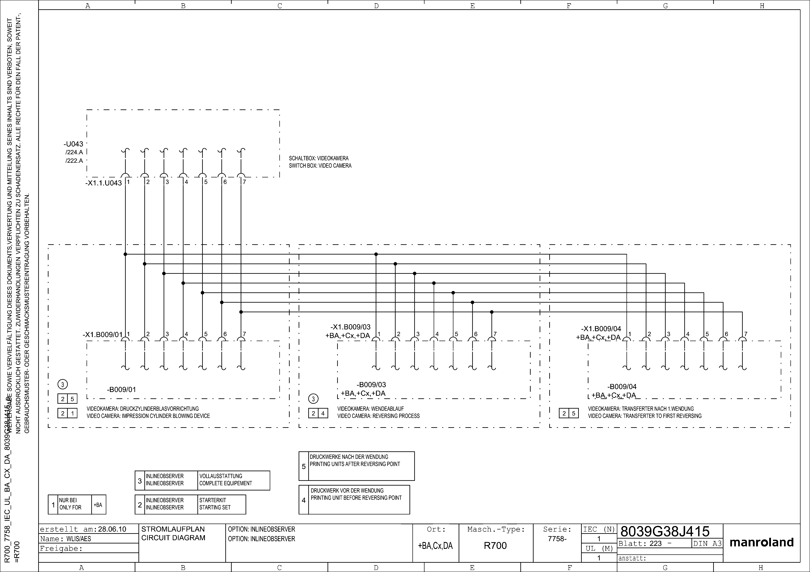

# +BA_Cx_DA — Sheet 223 of 247 — OPTION: INLINEOBSERVER

**OPTION: INLINEOBSERVER**

> Part of the manroland **R700** printing press IEC/UL circuit diagrams.
> Drawing class: **Stromlaufplan / Circuit diagram** (DIN A3).
> Document `+BA_Cx_DA` covers the **Printing units / main switch cabinet** machine section.

## At a glance

| Field | Value |
|---|---|
| Document | `+BA_Cx_DA`  (8039G38J415) |
| Sheet | **223** of 247 |
| Section (DE) | OPTION: INLINEOBSERVER |
| Section (EN) | OPTION: INLINEOBSERVER |
| Section type | CIRCUIT — Circuit diagram |
| Machine type | `R700` |
| Series | `7758` |
| Created | 28.06.10 |
| Replaces | — |
| Columns used | A, B, C, D, E, F, G, H |
| Path numbers | — |
| Labels on sheet | 80 |
| Cross-refs out | 2 |
| Cross-refs in | 30 |

**Previous:** [+BA_Cx_DA sheet 222](SHEET_0222.md) · **Next:** [+BA_Cx_DA sheet 224](SHEET_0224.md) · **Document TOC:** [_TOC.md](_TOC.md)  (+BA_Cx_DA) · **Master TOC:** [all sheets](../_MASTER_TOC.md)

## Sheet image (300 DPI, exact vector render)



_Rendered directly from the PDF vector layer at 300 DPI (1-bit), no OCR and no resampling. Use it to confirm anything ambiguous in the text below._

## Cross-references on this sheet

Each entry is a wire leaving this sheet. The printed token is `/sheet.column`; the link resolves to that sheet inside the same document.

| Ref | Target sheet | Col | Path | Destination on target | Target section | From col |
|---|---|---|---|---|---|---|
| `/224.A` | [+BA_Cx_DA sheet 224](SHEET_0224.md) | A | — | SCHALTBOX: VIDEOKAMERA SWITCH BOX: VIDEO CAMERA | OPTION: INLINEOBSERVER | B |
| `/222.A` | [+BA_Cx_DA sheet 222](SHEET_0222.md) | A | — | SCHALTBOX: VIDEOKAMERA SWITCH BOX: VIDEO CAMERA | OPTION: INLINEOBSERVER | B |

### Incoming references (sheets that point here)

Every other sheet that sends a wire to this one. `Back-ref` is the token printed on *that* sheet; `Path` is its line number.

| From sheet | Cols | Back-ref | Path | Refs | What continues there |
|---|---|---|---|---|---|
| [+BA_Cx_DA#144](SHEET_0144.md) | D, E, G, H | `/144.D`, `/144.E`, `/144.G`, `/144.H` | — | 21 | — |
| [+BA_Cx_DA#149](SHEET_0149.md) | F | `/149.F` | — | 7 | — |
| [+BA_Cx_DA#222](SHEET_0222.md) | A | `/222.A` | — | 1 | — |
| [+BA_Cx_DA#224](SHEET_0224.md) | B | `/224.B` | — | 1 | SCHALTBOX: VIDEOKAMERA SWITCH BOX: VIDEO CAMERA |


## Devices on this sheet

| Tag | Class | Class meaning (IEC) | Col | Sub | Terminal | Sign |
|---|---|---|---|---|---|---|
| `B009/01` | B | Umformer / transducer, sensor | A | 01 | — | — |
| `B009/03` | B | Umformer / transducer, sensor | D | 03 | — | — |
| `B009/04` | B | Umformer / transducer, sensor | G | 04 | — | — |
| `U043` | U | Umrichter / frequency converter | A | — | — | — |
| `X1.1.U043` | — | cross-device reference | A | — | — | — |

## Potentials / nets

_No named potentials on this sheet._

## Wire-end annotations (grouped as printed)

A wire that continues elsewhere is annotated with a small cluster: the destination description, the path/line number `#NN`, and the `/sheet.column` cross reference. Each row below is one such cluster exactly as it is grouped on the drawing.

| Col | Y | Path | Cross-ref | Text on the wire |
|---|---|---|---|---|
| A | 207.2 | — | — | `U043` |
| B | 220.3 | — | `/224.A`, `/222.A` | `SCHALTBOX: VIDEOKAMERA SWITCH BOX: VIDEO CAMERA` |
| B | 263.9 | — | — | `X1.1.U043 1 2 3 4 5 6 7` |
| C | 476.5 | — | — | `X1.B009/01 1 2 3 4 5 6 7 +BA,+Cx,+DA X1.B009/03 1 2 3 4 5 6 7` |
| G | 479.4 | — | — | `+BA,+Cx,+DA X1.B009/04 1 2 3 4 5 6 7` |
| D | 561.6 | — | — | `+BA,+Cx,+DA B009/03` |
| A | 563.0 | — | — | `3` |
| F | 564.4 | — | — | `+BA,+Cx,+DA B009/04` |
| A | 568.6 | — | — | `B009/01` |
| A | 583.5 | — | — | `2 5` |
| C | 584.2 | — | — | `3` |
| D | 598.7 | — | — | `VIDEOKAMERA: WENDEABLAUF VIDEO CAMERA: REVERSING PROCESS` |
| G | 598.7 | — | — | `VIDEOKAMERA: TRANSFERTER NACH 1.WENDUNG VIDEO CAMERA: TRANSFERTER TO FIRST REVERSING` |
| B | 598.8 | — | — | `VIDEOKAMERA: DRUCKZYLINDERBLASVORRICHTUNG VIDEO CAMERA: IMPRESSION CYLINDER BLOWING DEVICE` |
| A | 604.8 | — | — | `2 1` |
| C | 604.8 | — | — | `2 4` |
| F | 604.8 | — | — | `2 5` |
| D | 669.6 | — | — | `DRUCKWERKE NACH DER WENDUNG PRINTING UNITS AFTER REVERSING POINT` |
| C | 682.0 | — | — | `5` |
| B | 697.9 | — | — | `3 INLINEOBSERVER INLINEOBSERVER` |
| B | 698.0 | — | — | `COMPLETE EQUIPEMENT VOLLAUSSTATTUNG` |
| D | 719.2 | — | — | `DRUCKWERK VOR DER WENDUNG PRINTING UNIT BEFORE REVERSING POINT` |
| C | 731.6 | — | — | `4` |
| A | 733.3 | — | — | `1 NUR BEI` |
| B | 733.4 | — | — | `ONLY FOR +BA 2 INLINEOBSERVER INLINEOBSERVER STARTERKIT STARTING SET` |


## Notes and free text on this sheet

| Text | Col | Y (pt) |
|---|---|---|
| `VIDEOKAMERA: DRUCKZYLINDERBLASVORRICHTUNG` | B | 598.75 |
| `VIDEO CAMERA: IMPRESSION CYLINDER BLOWING DEVICE` | B | 609.37 |
| `X1.B009/01` | A | 487.87 |
| `X1.B009/03` | D | 476.53 |
| `+BA,+Cx,+DA` | D | 489.25 |
| `VIDEOKAMERA: WENDEABLAUF` | D | 598.72 |
| `VIDEO CAMERA: REVERSING PROCESS` | D | 609.37 |
| `X1.B009/04` | F | 479.36 |
| `+BA,+Cx,+DA` | F | 492.09 |
| `VIDEOKAMERA: TRANSFERTER NACH 1.WENDUNG` | G | 598.74 |
| `VIDEO CAMERA: TRANSFERTER TO FIRST REVERSING` | G | 609.37 |
| `SCHALTBOX: VIDEOKAMERA` | C | 230.23 |
| `SWITCH BOX: VIDEO CAMERA` | C | 240.85 |
| `NUR BEI` | A | 733.33 |
| `ONLY FOR` | A | 744.02 |
| `+BA` | A | 740.44 |
| `STARTERKIT` | B | 733.37 |
| `STARTING SET` | B | 744 |
| `INLINEOBSERVER` | B | 733.37 |
| `VOLLAUSSTATTUNG` | B | 697.96 |
| `COMPLETE EQUIPEMENT` | B | 708.59 |
| `DRUCKWERK VOR DER WENDUNG` | D | 719.19 |
| `PRINTING UNIT BEFORE REVERSING POINT` | D | 729.84 |
| `DRUCKWERKE NACH DER WENDUNG` | D | 669.59 |
| `PRINTING UNITS AFTER REVERSING POINT` | D | 680.23 |

## Complete label inventory (exact text from the drawing)

Every text object inside the drawing area of this sheet, in DIN reading order (column A→H, then top→bottom). This is the authoritative list: if a string is not here it is not printed on this sheet.

| Col | Y | X | Dir | Type | Text |
|---|---|---|---|---|---|
| A | 207.2 | 93.5 | → | device tag | `U043` |
| A | 220.3 | 96.4 | → | cross-reference | `/224.A` |
| A | 232.7 | 96.4 | → | cross-reference | `/222.A` |
| A | 263.9 | 186.2 | → | number | `1` |
| A | 264.6 | 125.6 | → | device ref | `X1.1.U043` |
| A | 487.9 | 121.6 | → | text | `X1.B009/01` |
| A | 487.9 | 186.2 | → | number | `1` |
| A | 563.0 | 90.1 | → | number | `3` |
| A | 568.7 | 157.3 | → | device tag | `B009/01` |
| A | 583.6 | 89.9 | → | number | `2` |
| A | 583.6 | 103.9 | → | number | `5` |
| A | 604.8 | 89.9 | → | number | `2` |
| A | 604.8 | 104.3 | → | number | `1` |
| A | 733.3 | 87.0 | → | text | `NUR BEI` |
| A | 738.7 | 75.4 | → | number | `1` |
| A | 740.4 | 137.9 | → | text | `+BA` |
| A | 744.0 | 87.6 | → | text | `ONLY FOR` |
| B | 263.9 | 215.1 | → | number | `2` |
| B | 263.9 | 243.5 | → | number | `3` |
| B | 263.9 | 271.8 | → | number | `4` |
| B | 263.9 | 300.2 | → | number | `5` |
| B | 263.9 | 328.5 | → | number | `6` |
| B | 487.9 | 215.1 | → | number | `2` |
| B | 487.9 | 243.5 | → | number | `3` |
| B | 487.9 | 271.8 | → | number | `4` |
| B | 487.9 | 300.2 | → | number | `5` |
| B | 487.9 | 328.5 | → | number | `6` |
| B | 598.8 | 127.6 | → | text | `VIDEOKAMERA: DRUCKZYLINDERBLASVORRICHTUNG` |
| B | 609.4 | 127.6 | → | text | `VIDEO CAMERA: IMPRESSION CYLINDER BLOWING DEVICE` |
| B | 697.9 | 214.6 | → | text | `INLINEOBSERVER` |
| B | 698.0 | 293.4 | → | text | `VOLLAUSSTATTUNG` |
| B | 703.3 | 202.5 | → | number | `3` |
| B | 708.6 | 214.6 | → | text | `INLINEOBSERVER` |
| B | 708.6 | 293.1 | → | text | `COMPLETE EQUIPEMENT` |
| B | 733.4 | 214.6 | → | text | `INLINEOBSERVER` |
| B | 733.4 | 293.1 | → | text | `STARTERKIT` |
| B | 738.7 | 202.7 | → | number | `2` |
| B | 744.0 | 214.6 | → | text | `INLINEOBSERVER` |
| B | 744.0 | 293.1 | → | text | `STARTING SET` |
| C | 230.2 | 424.9 | → | text | `SCHALTBOX: VIDEOKAMERA` |
| C | 240.8 | 424.9 | → | text | `SWITCH BOX: VIDEO CAMERA` |
| C | 263.9 | 356.9 | → | number | `7` |
| C | 487.9 | 356.9 | → | number | `7` |
| C | 584.2 | 458.6 | → | number | `3` |
| C | 604.8 | 458.4 | → | number | `2` |
| C | 604.8 | 472.4 | → | number | `4` |
| C | 682.0 | 443.5 | → | number | `5` |
| C | 731.6 | 443.6 | → | number | `4` |
| D | 476.5 | 485.9 | → | text | `X1.B009/03` |
| D | 487.9 | 554.7 | → | number | `1` |
| D | 487.9 | 583.7 | → | number | `2` |
| D | 487.9 | 612.0 | → | number | `3` |
| D | 489.3 | 478.2 | → | text | `+BA,+Cx,+DA` |
| D | 561.6 | 524.4 | → | device tag | `B009/03` |
| D | 574.3 | 500.9 | → | text | `+BA,+Cx,+DA` |
| D | 598.7 | 496.1 | → | text | `VIDEOKAMERA: WENDEABLAUF` |
| D | 609.4 | 496.1 | → | text | `VIDEO CAMERA: REVERSING PROCESS` |
| D | 669.6 | 455.5 | → | text | `DRUCKWERKE NACH DER WENDUNG` |
| D | 680.2 | 455.5 | → | text | `PRINTING UNITS AFTER REVERSING POINT` |
| D | 719.2 | 456.9 | → | text | `DRUCKWERK VOR DER WENDUNG` |
| D | 729.8 | 456.9 | → | text | `PRINTING UNIT BEFORE REVERSING POINT` |
| E | 487.9 | 640.3 | → | number | `4` |
| E | 487.9 | 668.7 | → | number | `5` |
| E | 487.9 | 697.0 | → | number | `6` |
| E | 487.9 | 725.4 | → | number | `7` |
| F | 479.4 | 854.4 | → | text | `X1.B009/04` |
| F | 492.1 | 846.7 | → | text | `+BA,+Cx,+DA` |
| F | 577.1 | 869.4 | → | text | `+BA,+Cx,+DA` |
| F | 604.8 | 826.9 | → | number | `2` |
| F | 604.8 | 840.9 | → | number | `5` |
| G | 487.9 | 923.2 | → | number | `1` |
| G | 487.9 | 952.2 | → | number | `2` |
| G | 487.9 | 980.5 | → | number | `3` |
| G | 487.9 | 1008.9 | → | number | `4` |
| G | 487.9 | 1037.2 | → | number | `5` |
| G | 564.4 | 892.9 | → | device tag | `B009/04` |
| G | 598.7 | 864.6 | → | text | `VIDEOKAMERA: TRANSFERTER NACH 1.WENDUNG` |
| G | 609.4 | 864.6 | → | text | `VIDEO CAMERA: TRANSFERTER TO FIRST REVERSING` |
| H | 487.9 | 1065.5 | → | number | `6` |
| H | 487.9 | 1093.9 | → | number | `7` |

## Reading-order text block

The same content as a plain block, grouped by DIN column — convenient to paste or to match against a visual description.

```text
=== Column A ===
 207.2   93.5  devtag       U043
 220.3   96.4  xref         /224.A
 232.7   96.4  xref         /222.A
 263.9  186.2  numeric      1
 264.6  125.6  devref       X1.1.U043
 487.9  121.6  text         X1.B009/01
 487.9  186.2  numeric      1
 563.0   90.1  numeric      3
 568.7  157.3  devtag       B009/01
 583.6   89.9  numeric      2
 583.6  103.9  numeric      5
 604.8   89.9  numeric      2
 604.8  104.3  numeric      1
 733.3   87.0  text         NUR BEI
 738.7   75.4  numeric      1
 740.4  137.9  text         +BA
 744.0   87.6  text         ONLY FOR
=== Column B ===
 263.9  215.1  numeric      2
 263.9  243.5  numeric      3
 263.9  271.8  numeric      4
 263.9  300.2  numeric      5
 263.9  328.5  numeric      6
 487.9  215.1  numeric      2
 487.9  243.5  numeric      3
 487.9  271.8  numeric      4
 487.9  300.2  numeric      5
 487.9  328.5  numeric      6
 598.8  127.6  text         VIDEOKAMERA: DRUCKZYLINDERBLASVORRICHTUNG
 609.4  127.6  text         VIDEO CAMERA: IMPRESSION CYLINDER BLOWING DEVICE
 697.9  214.6  text         INLINEOBSERVER
 698.0  293.4  text         VOLLAUSSTATTUNG
 703.3  202.5  numeric      3
 708.6  214.6  text         INLINEOBSERVER
 708.6  293.1  text         COMPLETE EQUIPEMENT
 733.4  214.6  text         INLINEOBSERVER
 733.4  293.1  text         STARTERKIT
 738.7  202.7  numeric      2
 744.0  214.6  text         INLINEOBSERVER
 744.0  293.1  text         STARTING SET
=== Column C ===
 230.2  424.9  text         SCHALTBOX: VIDEOKAMERA
 240.8  424.9  text         SWITCH BOX: VIDEO CAMERA
 263.9  356.9  numeric      7
 487.9  356.9  numeric      7
 584.2  458.6  numeric      3
 604.8  458.4  numeric      2
 604.8  472.4  numeric      4
 682.0  443.5  numeric      5
 731.6  443.6  numeric      4
=== Column D ===
 476.5  485.9  text         X1.B009/03
 487.9  554.7  numeric      1
 487.9  583.7  numeric      2
 487.9  612.0  numeric      3
 489.3  478.2  text         +BA,+Cx,+DA
 561.6  524.4  devtag       B009/03
 574.3  500.9  text         +BA,+Cx,+DA
 598.7  496.1  text         VIDEOKAMERA: WENDEABLAUF
 609.4  496.1  text         VIDEO CAMERA: REVERSING PROCESS
 669.6  455.5  text         DRUCKWERKE NACH DER WENDUNG
 680.2  455.5  text         PRINTING UNITS AFTER REVERSING POINT
 719.2  456.9  text         DRUCKWERK VOR DER WENDUNG
 729.8  456.9  text         PRINTING UNIT BEFORE REVERSING POINT
=== Column E ===
 487.9  640.3  numeric      4
 487.9  668.7  numeric      5
 487.9  697.0  numeric      6
 487.9  725.4  numeric      7
=== Column F ===
 479.4  854.4  text         X1.B009/04
 492.1  846.7  text         +BA,+Cx,+DA
 577.1  869.4  text         +BA,+Cx,+DA
 604.8  826.9  numeric      2
 604.8  840.9  numeric      5
=== Column G ===
 487.9  923.2  numeric      1
 487.9  952.2  numeric      2
 487.9  980.5  numeric      3
 487.9 1008.9  numeric      4
 487.9 1037.2  numeric      5
 564.4  892.9  devtag       B009/04
 598.7  864.6  text         VIDEOKAMERA: TRANSFERTER NACH 1.WENDUNG
 609.4  864.6  text         VIDEO CAMERA: TRANSFERTER TO FIRST REVERSING
=== Column H ===
 487.9 1065.5  numeric      6
 487.9 1093.9  numeric      7
```

---
_Generated from the PDF vector text layer; no OCR. Source: `R700_7758_IEC_UL_BA_CX_DA_8039G38J415_p`, sheet 223._
