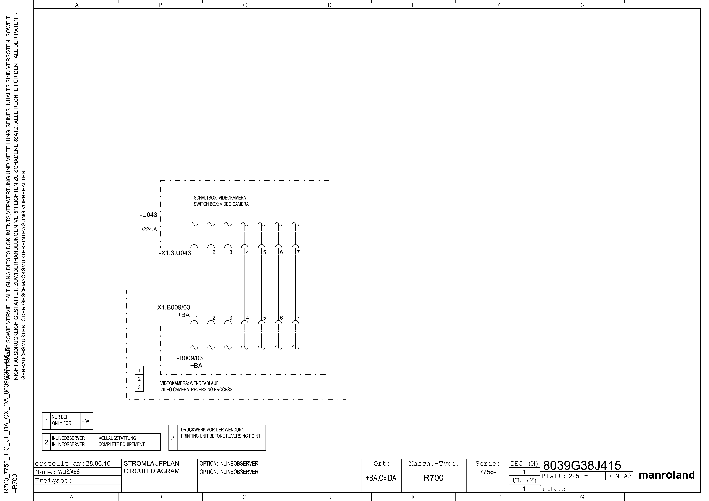

# +BA_Cx_DA — Sheet 225 of 247 — OPTION: INLINEOBSERVER

**OPTION: INLINEOBSERVER**

> Part of the manroland **R700** printing press IEC/UL circuit diagrams.
> Drawing class: **Stromlaufplan / Circuit diagram** (DIN A3).
> Document `+BA_Cx_DA` covers the **Printing units / main switch cabinet** machine section.

## At a glance

| Field | Value |
|---|---|
| Document | `+BA_Cx_DA`  (8039G38J415) |
| Sheet | **225** of 247 |
| Section (DE) | OPTION: INLINEOBSERVER |
| Section (EN) | OPTION: INLINEOBSERVER |
| Section type | CIRCUIT — Circuit diagram |
| Machine type | `R700` |
| Series | `7758` |
| Created | 28.06.10 |
| Replaces | — |
| Columns used | A, B, C, D |
| Path numbers | — |
| Labels on sheet | 40 |
| Cross-refs out | 1 |
| Cross-refs in | 15 |

**Previous:** [+BA_Cx_DA sheet 224](SHEET_0224.md) · **Next:** [+BA_Cx_DA sheet 226](SHEET_0226.md) · **Document TOC:** [_TOC.md](_TOC.md)  (+BA_Cx_DA) · **Master TOC:** [all sheets](../_MASTER_TOC.md)

## Sheet image (300 DPI, exact vector render)



_Rendered directly from the PDF vector layer at 300 DPI (1-bit), no OCR and no resampling. Use it to confirm anything ambiguous in the text below._

## Cross-references on this sheet

Each entry is a wire leaving this sheet. The printed token is `/sheet.column`; the link resolves to that sheet inside the same document.

| Ref | Target sheet | Col | Path | Destination on target | Target section | From col |
|---|---|---|---|---|---|---|
| `/224.A` | [+BA_Cx_DA sheet 224](SHEET_0224.md) | A | — | — | OPTION: INLINEOBSERVER | B |

### Incoming references (sheets that point here)

Every other sheet that sends a wire to this one. `Back-ref` is the token printed on *that* sheet; `Path` is its line number.

| From sheet | Cols | Back-ref | Path | Refs | What continues there |
|---|---|---|---|---|---|
| [+BA_Cx_DA#144](SHEET_0144.md) | F | `/144.F` | — | 7 | — |
| [+BA_Cx_DA#149](SHEET_0149.md) | H | `/149.H` | — | 7 | — |
| [+BA_Cx_DA#224](SHEET_0224.md) | B | `/224.B` | — | 1 | SCHALTBOX: VIDEOKAMERA SWITCH BOX: VIDEO CAMERA |


## Devices on this sheet

| Tag | Class | Class meaning (IEC) | Col | Sub | Terminal | Sign |
|---|---|---|---|---|---|---|
| `U043` | U | Umrichter / frequency converter | B | — | — | — |
| `B009/03` | B | Umformer / transducer, sensor | B | 03 | — | — |
| `X1.3.U043` | — | cross-device reference | B | — | — | — |

## Potentials / nets

_No named potentials on this sheet._

## Wire-end annotations (grouped as printed)

A wire that continues elsewhere is annotated with a small cluster: the destination description, the path/line number `#NN`, and the `/sheet.column` cross reference. Each row below is one such cluster exactly as it is grouped on the drawing.

| Col | Y | Path | Cross-ref | Text on the wire |
|---|---|---|---|---|
| C | 329.4 | — | — | `SCHALTBOX: VIDEOKAMERA SWITCH BOX: VIDEO CAMERA` |
| B | 356.1 | — | — | `U043` |
| B | 381.5 | — | `/224.A` | — |
| C | 419.9 | — | — | `X1.3.U043 1 2 3 4 5 6 7` |
| B | 512.0 | — | — | `X1.B009/03` |
| C | 524.6 | — | — | `+BA 2 3 4 5 6 7` |
| B | 530.4 | — | — | `1` |
| B | 597.0 | — | — | `B009/03` |
| B | 609.7 | — | — | `+BA` |
| B | 619.0 | — | — | `1` |
| B | 633.2 | — | — | `2` |
| B | 641.2 | — | — | `VIDEOKAMERA: WENDEABLAUF VIDEO CAMERA: REVERSING PROCESS` |
| B | 647.3 | — | — | `3` |
| A | 697.9 | — | — | `1 NUR BEI` |
| A | 705.0 | — | — | `ONLY FOR +BA` |
| C | 719.2 | — | — | `3 DRUCKWERK VOR DER WENDUNG PRINTING UNIT BEFORE REVERSING POINT` |
| A | 733.4 | — | — | `2 INLINEOBSERVER INLINEOBSERVER` |
| B | 733.4 | — | — | `COMPLETE EQUIPEMENT VOLLAUSSTATTUNG` |


## Notes and free text on this sheet

| Text | Col | Y (pt) |
|---|---|---|
| `SCHALTBOX: VIDEOKAMERA` | C | 329.45 |
| `SWITCH BOX: VIDEO CAMERA` | C | 340.06 |
| `X1.B009/03` | B | 511.96 |
| `+BA` | B | 524.64 |
| `VIDEOKAMERA: WENDEABLAUF` | B | 641.24 |
| `VIDEO CAMERA: REVERSING PROCESS` | B | 651.89 |
| `INLINEOBSERVER` | A | 733.37 |
| `VOLLAUSSTATTUNG` | A | 733.39 |
| `COMPLETE EQUIPEMENT` | B | 744.02 |
| `DRUCKWERK VOR DER WENDUNG` | C | 719.19 |
| `PRINTING UNIT BEFORE REVERSING POINT` | C | 729.84 |
| `NUR BEI` | A | 697.9 |
| `ONLY FOR` | A | 708.59 |
| `+BA` | A | 705 |

## Complete label inventory (exact text from the drawing)

Every text object inside the drawing area of this sheet, in DIN reading order (column A→H, then top→bottom). This is the authoritative list: if a string is not here it is not printed on this sheet.

| Col | Y | X | Dir | Type | Text |
|---|---|---|---|---|---|
| A | 697.9 | 87.0 | → | text | `NUR BEI` |
| A | 703.3 | 75.4 | → | number | `1` |
| A | 705.0 | 137.9 | → | text | `+BA` |
| A | 708.6 | 87.6 | → | text | `ONLY FOR` |
| A | 733.4 | 87.0 | → | text | `INLINEOBSERVER` |
| A | 733.4 | 165.8 | → | text | `VOLLAUSSTATTUNG` |
| A | 738.7 | 75.1 | → | number | `2` |
| A | 744.0 | 87.0 | → | text | `INLINEOBSERVER` |
| B | 356.1 | 235.3 | → | device tag | `U043` |
| B | 381.5 | 238.1 | → | cross-reference | `/224.A` |
| B | 419.9 | 328.0 | → | number | `1` |
| B | 420.6 | 267.3 | → | device ref | `X1.3.U043` |
| B | 512.0 | 260.5 | → | text | `X1.B009/03` |
| B | 524.6 | 298.2 | → | text | `+BA` |
| B | 530.4 | 328.0 | → | number | `1` |
| B | 597.0 | 297.6 | → | device tag | `B009/03` |
| B | 609.7 | 319.5 | → | text | `+BA` |
| B | 619.0 | 231.9 | → | number | `1` |
| B | 633.2 | 231.6 | → | number | `2` |
| B | 641.2 | 269.3 | → | text | `VIDEOKAMERA: WENDEABLAUF` |
| B | 647.3 | 231.4 | → | number | `3` |
| B | 651.9 | 269.3 | → | text | `VIDEO CAMERA: REVERSING PROCESS` |
| B | 731.6 | 287.6 | → | number | `3` |
| B | 744.0 | 165.5 | → | text | `COMPLETE EQUIPEMENT` |
| C | 329.4 | 325.7 | → | text | `SCHALTBOX: VIDEOKAMERA` |
| C | 340.1 | 325.7 | → | text | `SWITCH BOX: VIDEO CAMERA` |
| C | 419.9 | 356.9 | → | number | `2` |
| C | 419.9 | 385.2 | → | number | `3` |
| C | 419.9 | 413.6 | → | number | `4` |
| C | 419.9 | 441.9 | → | number | `5` |
| C | 419.9 | 470.3 | → | number | `6` |
| C | 530.4 | 356.9 | → | number | `2` |
| C | 530.4 | 385.2 | → | number | `3` |
| C | 530.4 | 413.6 | → | number | `4` |
| C | 530.4 | 441.9 | → | number | `5` |
| C | 530.4 | 470.3 | → | number | `6` |
| C | 719.2 | 303.9 | → | text | `DRUCKWERK VOR DER WENDUNG` |
| C | 729.8 | 303.9 | → | text | `PRINTING UNIT BEFORE REVERSING POINT` |
| D | 419.9 | 498.6 | → | number | `7` |
| D | 530.4 | 498.6 | → | number | `7` |

## Reading-order text block

The same content as a plain block, grouped by DIN column — convenient to paste or to match against a visual description.

```text
=== Column A ===
 697.9   87.0  text         NUR BEI
 703.3   75.4  numeric      1
 705.0  137.9  text         +BA
 708.6   87.6  text         ONLY FOR
 733.4   87.0  text         INLINEOBSERVER
 733.4  165.8  text         VOLLAUSSTATTUNG
 738.7   75.1  numeric      2
 744.0   87.0  text         INLINEOBSERVER
=== Column B ===
 356.1  235.3  devtag       U043
 381.5  238.1  xref         /224.A
 419.9  328.0  numeric      1
 420.6  267.3  devref       X1.3.U043
 512.0  260.5  text         X1.B009/03
 524.6  298.2  text         +BA
 530.4  328.0  numeric      1
 597.0  297.6  devtag       B009/03
 609.7  319.5  text         +BA
 619.0  231.9  numeric      1
 633.2  231.6  numeric      2
 641.2  269.3  text         VIDEOKAMERA: WENDEABLAUF
 647.3  231.4  numeric      3
 651.9  269.3  text         VIDEO CAMERA: REVERSING PROCESS
 731.6  287.6  numeric      3
 744.0  165.5  text         COMPLETE EQUIPEMENT
=== Column C ===
 329.4  325.7  text         SCHALTBOX: VIDEOKAMERA
 340.1  325.7  text         SWITCH BOX: VIDEO CAMERA
 419.9  356.9  numeric      2
 419.9  385.2  numeric      3
 419.9  413.6  numeric      4
 419.9  441.9  numeric      5
 419.9  470.3  numeric      6
 530.4  356.9  numeric      2
 530.4  385.2  numeric      3
 530.4  413.6  numeric      4
 530.4  441.9  numeric      5
 530.4  470.3  numeric      6
 719.2  303.9  text         DRUCKWERK VOR DER WENDUNG
 729.8  303.9  text         PRINTING UNIT BEFORE REVERSING POINT
=== Column D ===
 419.9  498.6  numeric      7
 530.4  498.6  numeric      7
```

---
_Generated from the PDF vector text layer; no OCR. Source: `R700_7758_IEC_UL_BA_CX_DA_8039G38J415_p`, sheet 225._
