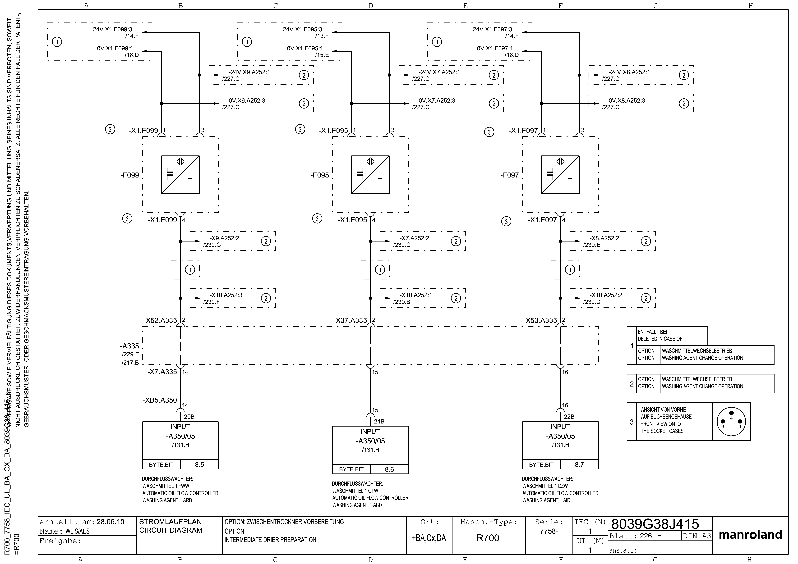

# +BA_Cx_DA — Sheet 226 of 247 — OPTION: ZWISCHENTROCKNER VORBEREITUNG

**OPTION:**

> Part of the manroland **R700** printing press IEC/UL circuit diagrams.
> Drawing class: **Stromlaufplan / Circuit diagram** (DIN A3).
> Document `+BA_Cx_DA` covers the **Printing units / main switch cabinet** machine section.

## At a glance

| Field | Value |
|---|---|
| Document | `+BA_Cx_DA`  (8039G38J415) |
| Sheet | **226** of 247 |
| Section (DE) | OPTION: ZWISCHENTROCKNER VORBEREITUNG |
| Section (EN) | OPTION: |
| Section type | CIRCUIT — Circuit diagram |
| Machine type | `R700` |
| Series | `7758` |
| Created | 28.06.10 |
| Replaces | — |
| Columns used | A, B, C, D, E, F, G, H |
| Path numbers | — |
| Labels on sheet | 145 |
| Cross-refs out | 23 |
| Cross-refs in | 41 |

**Previous:** [+BA_Cx_DA sheet 225](SHEET_0225.md) · **Next:** [+BA_Cx_DA sheet 227](SHEET_0227.md) · **Document TOC:** [_TOC.md](_TOC.md)  (+BA_Cx_DA) · **Master TOC:** [all sheets](../_MASTER_TOC.md)

## Sheet image (300 DPI, exact vector render)



_Rendered directly from the PDF vector layer at 300 DPI (1-bit), no OCR and no resampling. Use it to confirm anything ambiguous in the text below._

## Cross-references on this sheet

Each entry is a wire leaving this sheet. The printed token is `/sheet.column`; the link resolves to that sheet inside the same document.

| Ref | Target sheet | Col | Path | Destination on target | Target section | From col |
|---|---|---|---|---|---|---|
| `/14.F` | [+BA_Cx_DA sheet 14](SHEET_0014.md) | F | — | 24V.X1.F099:3 24V.X1.F097:3 | SPANNUNGSVERSORGUNG, SCHALTSCHRANKBELÜFTUNG | C |
| `/14.F` | [+BA_Cx_DA sheet 14](SHEET_0014.md) | F | — | 24V.X1.F099:3 24V.X1.F097:3 | SPANNUNGSVERSORGUNG, SCHALTSCHRANKBELÜFTUNG | C |
| `/13.F` | [+BA_Cx_DA sheet 13](SHEET_0013.md) | F | — | 24V.X1.F095:3 | SPANNUNGSVERSORGUNG, SCHALTSCHRANKBELÜFTUNG | C |
| `/15.E` | [+BA_Cx_DA sheet 15](SHEET_0015.md) | E | — | 1 0V.X1.F099:1 0V.X1.F095:1 0V.X1.F097:1 | SPANNUNGSVERSORGUNG, SCHALTSCHRANKBELÜFTUNG | C |
| `/16.D` | [+BA_Cx_DA sheet 16](SHEET_0016.md) | D | — | 1 0V.X1.F099:1 0V.X1.F095:1 0V.X1.F097:1 | SPANNUNGSVERSORGUNG, SCHALTSCHRANKBELÜFTUNG | C |
| `/16.D` | [+BA_Cx_DA sheet 16](SHEET_0016.md) | D | — | 1 0V.X1.F099:1 0V.X1.F095:1 0V.X1.F097:1 | SPANNUNGSVERSORGUNG, SCHALTSCHRANKBELÜFTUNG | C |
| `/227.C` | [+BA_Cx_DA sheet 227](SHEET_0227.md) | C | — | — | OPTION: WASCHMITTELWECHSELBETRIEB | C |
| `/227.C` | [+BA_Cx_DA sheet 227](SHEET_0227.md) | C | — | — | OPTION: WASCHMITTELWECHSELBETRIEB | E |
| `/227.C` | [+BA_Cx_DA sheet 227](SHEET_0227.md) | C | — | — | OPTION: WASCHMITTELWECHSELBETRIEB | G |
| `/227.C` | [+BA_Cx_DA sheet 227](SHEET_0227.md) | C | — | 0V.X8.A252:3 | OPTION: WASCHMITTELWECHSELBETRIEB | E |
| `/227.C` | [+BA_Cx_DA sheet 227](SHEET_0227.md) | C | — | 0V.X7.A252:3 | OPTION: WASCHMITTELWECHSELBETRIEB | F |
| `/227.C` | [+BA_Cx_DA sheet 227](SHEET_0227.md) | C | — | — | OPTION: WASCHMITTELWECHSELBETRIEB | E |
| `/230.C` | [+BA_Cx_DA sheet 230](SHEET_0230.md) | C | — | X8.A252:2 | OPTION: WASCHMITTELWECHSELBETRIEB | E |
| `/230.E` | [+BA_Cx_DA sheet 230](SHEET_0230.md) | E | — | — | OPTION: WASCHMITTELWECHSELBETRIEB | F |
| `/230.G` | [+BA_Cx_DA sheet 230](SHEET_0230.md) | G | — | — | OPTION: WASCHMITTELWECHSELBETRIEB | B |
| `/230.F` | [+BA_Cx_DA sheet 230](SHEET_0230.md) | F | — | X10.A252:2 | OPTION: WASCHMITTELWECHSELBETRIEB | D |
| `/230.B` | [+BA_Cx_DA sheet 230](SHEET_0230.md) | B | — | — | OPTION: WASCHMITTELWECHSELBETRIEB | D |
| `/230.D` | [+BA_Cx_DA sheet 230](SHEET_0230.md) | D | — | — | OPTION: WASCHMITTELWECHSELBETRIEB | F |
| `/229.E` | [+BA_Cx_DA sheet 229](SHEET_0229.md) | E | — | — | OPTION: WASCHMITTELWECHSELBETRIEB | A |
| `/217.B` | [+BA_Cx_DA sheet 217](SHEET_0217.md) | B | — | — | OPTION: FARBFLUSS UMSCHALTEN | A |
| `/131.H` | [+BA_Cx_DA sheet 131](SHEET_0131.md) | H | — | — | REFERENZMODUL | B |
| `/131.H` | [+BA_Cx_DA sheet 131](SHEET_0131.md) | H | — | — | REFERENZMODUL | F |
| `/131.H` | [+BA_Cx_DA sheet 131](SHEET_0131.md) | H | — | — | REFERENZMODUL | D |

### Incoming references (sheets that point here)

Every other sheet that sends a wire to this one. `Back-ref` is the token printed on *that* sheet; `Path` is its line number.

| From sheet | Cols | Back-ref | Path | Refs | What continues there |
|---|---|---|---|---|---|
| [+BA_Cx_DA#13](SHEET_0013.md) | F | `/13.F` | — | 1 | — |
| [+BA_Cx_DA#14](SHEET_0014.md) | F | `/14.F` | — | 2 | 24V.X1.F097:3; 24V.X1.F099:3 |
| [+BA_Cx_DA#15](SHEET_0015.md) | E | `/15.E` | — | 1 | — |
| [+BA_Cx_DA#16](SHEET_0016.md) | D | `/16.D` | — | 2 | 0V.X1.F097:1; 0V.X1.F099:1 |
| [+BA_Cx_DA#131](SHEET_0131.md) | H | `/131.H` | — | 3 | — |
| [+BA_Cx_DA#147](SHEET_0147.md) | C, E | `/147.C`, `/147.E` | — | 9 | — |
| [+BA_Cx_DA#161](SHEET_0161.md) | F | `/161.F` | — | 3 | — |
| [+BA_Cx_DA#163](SHEET_0163.md) | G | `/163.G` | — | 3 | — |
| [+BA_Cx_DA#180](SHEET_0180.md) | G | `/180.G` | — | 1 | — |
| [+BA_Cx_DA#182](SHEET_0182.md) | F, G | `/182.F`, `/182.G` | — | 2 | — |
| [+BA_Cx_DA#217](SHEET_0217.md) | B | `/217.B` | — | 1 | — |
| [+BA_Cx_DA#227](SHEET_0227.md) | C | `/227.C` | — | 6 | 24V.X7.A252:1; 24V.X8.A252:1; 24V.X9.A252:1 |
| [+BA_Cx_DA#229](SHEET_0229.md) | E | `/229.E` | — | 1 | — |
| [+BA_Cx_DA#230](SHEET_0230.md) | A, B, D, F, G | `/230.A`, `/230.B`, `/230.D`, `/230.F`, `/230.G` | — | 6 | X10.A252:1; X10.A252:2; X10.A252:3 |


## Devices on this sheet

| Tag | Class | Class meaning (IEC) | Col | Sub | Terminal | Sign |
|---|---|---|---|---|---|---|
| `A350/05` | A | Baugruppe / assembly, module, PC board | D | 05 | — | — |
| `F095` | F | Schutz / protection device (fuse, circuit breaker) | C | — | — | — |
| `A350/05` | A | Baugruppe / assembly, module, PC board | F | 05 | — | — |
| `F097` | F | Schutz / protection device (fuse, circuit breaker) | E | — | — | — |
| `A350/05` | A | Baugruppe / assembly, module, PC board | B | 05 | — | — |
| `F099` | F | Schutz / protection device (fuse, circuit breaker) | A | — | — | — |
| `A335` | A | Baugruppe / assembly, module, PC board | A | — | — | — |
| `8.6` | — | cross-device reference | D | — | — | — |
| `X1.F095` | — | cross-device reference | D | — | — | — |
| `X1.F095` | — | cross-device reference | D | — | — | — |
| `8.7` | — | cross-device reference | F | — | — | — |
| `X1.F097` | — | cross-device reference | F | — | — | — |
| `X1.F097` | — | cross-device reference | F | — | — | — |
| `8.5` | — | cross-device reference | B | — | — | — |
| `XB5.A350` | — | cross-device reference | B | — | — | — |
| `X1.F099` | — | cross-device reference | B | — | — | — |
| `X1.F099` | — | cross-device reference | B | — | — | — |
| `X53.A335` | — | cross-device reference | F | — | — | — |
| `X37.A335` | — | cross-device reference | D | — | — | — |
| `X52.A335` | — | cross-device reference | B | — | — | — |
| `X7.A335` | — | cross-device reference | B | — | — | — |
| `X10.A252:1` | — | cross-device reference | D | — | 1 | — |
| `X9.A252:2` | — | cross-device reference | B | — | 2 | — |
| `X10.A252:2` | — | cross-device reference | F | — | 2 | — |
| `X10.A252:3` | — | cross-device reference | B | — | 3 | — |
| `X8.A252:2` | — | cross-device reference | F | — | 2 | — |
| `X7.A252:2` | — | cross-device reference | D | — | 2 | — |

## Potentials / nets

| Potential | Count | Columns | Attached devices | Terminals |
|---|---|---|---|---|
| `0V` | 6 | A, C, E, G | `A252`, `F095`, `F097`, `F099`, `X1`, `X7`, `X8`, `X9` | `1`, `3` |
| `24V` | 6 | A, C, E, G | `A252`, `F095`, `F097`, `F099`, `X1`, `X7`, `X8`, `X9` | `1`, `3` |


A potential such as `L24+/4` or `M24+` is a named supply/return rail; every place it appears on this sheet is electrically common.

## Wire-end annotations (grouped as printed)

A wire that continues elsewhere is annotated with a small cluster: the destination description, the path/line number `#NN`, and the `/sheet.column` cross reference. Each row below is one such cluster exactly as it is grouped on the drawing.

| Col | Y | Path | Cross-ref | Text on the wire |
|---|---|---|---|---|
| C | 40.0 | — | `/14.F`, `/14.F` | `24V.X1.F099:3 24V.X1.F097:3` |
| C | 40.0 | — | `/13.F` | `24V.X1.F095:3` |
| A | 59.3 | — | — | `1` |
| C | 59.3 | — | `/15.E`, `/16.D`, `/16.D` | `0V.X1.F099:1 1 0V.X1.F095:1 0V.X1.F097:1` |
| E | 59.3 | — | — | `1` |
| C | 103.7 | — | — | `24V.X9.A252:1` |
| E | 103.7 | — | — | `24V.X7.A252:1` |
| G | 103.7 | — | — | `24V.X8.A252:1` |
| C | 109.4 | — | — | `2` |
| E | 109.4 | — | — | `2` |
| G | 109.4 | — | — | `2` |
| C | 113.7 | — | `/227.C` | — |
| E | 113.7 | — | `/227.C` | — |
| G | 113.7 | — | `/227.C` | — |
| E | 146.2 | — | `/227.C` | `0V.X8.A252:3` |
| C | 146.2 | — | — | `0V.X9.A252:3` |
| F | 146.2 | — | `/227.C` | `0V.X7.A252:3` |
| C | 151.9 | — | — | `2` |
| E | 151.9 | — | — | `2` |
| G | 151.9 | — | — | `2` |
| E | 156.2 | — | `/227.C` | — |
| A | 190.2 | — | — | `3` |
| B | 190.2 | — | — | `X1.F099 1 3` |
| C | 190.2 | — | — | `3` |
| D | 190.2 | — | — | `X1.F095 1 3` |
| F | 190.2 | — | — | `X1.F097 1 3` |
| E | 194.5 | — | — | `3` |
| A | 256.8 | — | — | `F099` |
| C | 256.8 | — | — | `F095` |
| E | 256.8 | — | — | `F097` |
| A | 323.4 | — | — | `3` |
| C | 323.4 | — | — | `3` |
| B | 323.5 | — | — | `X1.F099 4` |
| D | 323.5 | — | — | `X1.F095 4` |
| F | 323.5 | — | — | `X1.F097 4` |
| E | 327.7 | — | — | `3` |
| B | 351.8 | — | — | `X9.A252:2` |
| E | 351.8 | — | `/230.C` | `X8.A252:2` |
| D | 351.8 | — | — | `X7.A252:2` |
| C | 357.5 | — | — | `2` |
| E | 357.5 | — | — | `2` |
| G | 357.5 | — | — | `2` |
| B | 361.7 | — | `/230.G` | — |
| F | 361.7 | — | `/230.E` | — |
| B | 399.5 | — | — | `1` |
| D | 399.5 | — | — | `1` |
| F | 399.5 | — | — | `1` |
| D | 436.8 | — | `/230.F` | `X10.A252:2` |
| B | 436.8 | — | — | `X10.A252:3` |
| D | 436.8 | — | — | `X10.A252:1` |
| C | 442.5 | — | — | `2` |
| E | 442.5 | — | — | `2` |
| G | 442.5 | — | — | `2` |
| D | 446.7 | — | `/230.B` | — |
| F | 446.8 | — | `/230.D` | — |
| B | 473.7 | — | — | `X52.A335 2` |
| E | 473.7 | — | — | `X37.A335 2 X53.A335 2` |
| G | 492.4 | — | — | `ENTFÄLLT BEI DELETED IN CASE OF` |
| G | 511.9 | — | — | `1` |
| A | 512.0 | — | — | `A335` |
| G | 520.8 | — | — | `OPTION OPTION` |
| G | 520.8 | — | — | `WASCHMITTELWECHSELBETRIEB WASHING AGENT CHANGE OPERATION` |
| A | 525.0 | — | `/229.E`, `/217.B` | — |
| D | 550.2 | — | — | `X7.A335 14 15 16` |
| G | 563.3 | — | — | `2 OPTION OPTION` |
| G | 563.3 | — | — | `WASCHMITTELWECHSELBETRIEB WASHING AGENT CHANGE OPERATION` |
| B | 592.8 | — | — | `XB5.A350 14` |
| F | 601.3 | — | — | `16` |
| D | 608.4 | — | — | `15` |
| G | 608.7 | — | — | `FRONT VIEW ONTO ANSICHT VON VORNE AUF BUCHSENGEHÄUSE` |
| B | 618.2 | — | — | `20B` |
| F | 618.2 | — | — | `22B` |
| H | 621.0 | — | — | `4` |
| D | 625.3 | — | — | `21B` |
| G | 625.3 | — | — | `3 3 1` |
| B | 632.8 | — | — | `INPUT` |
| F | 632.8 | — | — | `INPUT` |
| D | 639.9 | — | — | `INPUT` |
| G | 640.5 | — | — | `THE SOCKET CASES` |
| B | 646.6 | — | — | `A350/05` |
| F | 646.6 | — | — | `A350/05` |
| D | 653.7 | — | — | `A350/05` |
| B | 660.4 | — | `/131.H` | — |
| F | 660.4 | — | `/131.H` | — |
| D | 667.5 | — | `/131.H` | — |
| B | 689.4 | — | — | `BYTE.BIT 8.5` |
| F | 689.4 | — | — | `BYTE.BIT 8.7` |
| D | 696.5 | — | — | `BYTE.BIT 8.6` |
| B | 712.1 | — | — | `DURCHFLUSSWÄCHTER:` |
| F | 712.1 | — | — | `DURCHFLUSSWÄCHTER:` |
| D | 719.2 | — | — | `DURCHFLUSSWÄCHTER:` |
| B | 722.7 | — | — | `WASCHMITTEL 1 FWW AUTOMATIC OIL FLOW CONTROLLER: WASHING AGENT 1 ARD` |
| F | 722.7 | — | — | `WASCHMITTEL 1 DZW AUTOMATIC OIL FLOW CONTROLLER: WASHING AGENT 1 AID` |
| D | 729.8 | — | — | `WASCHMITTEL 1 GTW AUTOMATIC OIL FLOW CONTROLLER: WASHING AGENT 1 ABD` |


## Reconstructed tables

This sheet carries tabular content (pin map / terminal assignment / index). The grid below was rebuilt from the drawing's own rule lines, so each row is exactly one physical row of the table.

### Table 1 — 3 data rows × 4 columns (at x=212.6, y=48.2)

| X1.F099 | 1 |  | 3 |
|---|---|---|---|
| `X52.A335 XB5.A350` | `X1.F099 X7.A335` | `4 1 2 14 14 20B` | `/230.G /230.F` |
|  | `INPUT` | `A350/05 /131.H` |  |
| `BYTE.BIT` |  |  | `8.5` |


### Table 2 — 3 data rows × 4 columns (at x=496.1, y=48.2)

| X1.F095 | 1 |  | 3 |
|---|---|---|---|
| `X37.A335` | `X1.F095` | `4 1 2 15 15 21B` | `/230.C /230.B` |
|  | `INPUT` | `A350/05 /131.H` |  |
| `BYTE.BIT` |  |  | `8.6` |


### Table 3 — 3 data rows × 5 columns (at x=779.5, y=48.2) — **24V.X8.A252:1 /227.C 0V.X8.A252:3**

| X1.F097 | 1 |  | 3 | /227.C |
|---|---|---|---|---|
| `X53.A335` | `X1.F097` | `4 1 2 16 16 22B` | `/230.E /230.D` | `X8.A252:2 X10.A252:2 1 2` |
|  | `INPUT` | `A350/05 /131.H` |  | `3` |
| `BYTE.BIT` |  | `8.7` |  |  |


## Notes and free text on this sheet

| Text | Col | Y (pt) |
|---|---|---|
| `21B` | D | 625.33 |
| `INPUT` | D | 639.85 |
| `BYTE.BIT` | D | 697.1 |
| `DURCHFLUSSWÄCHTER:` | D | 719.2 |
| `WASCHMITTEL 1 GTW` | D | 729.8 |
| `AUTOMATIC OIL FLOW CONTROLLER:` | D | 740.47 |
| `WASHING AGENT 1 ABD` | D | 751.08 |
| `22B` | F | 618.24 |
| `INPUT` | F | 632.76 |
| `BYTE.BIT` | F | 690.01 |
| `DURCHFLUSSWÄCHTER:` | F | 712.11 |
| `WASCHMITTEL 1 DZW` | F | 722.72 |
| `AUTOMATIC OIL FLOW CONTROLLER:` | F | 733.39 |
| `WASHING AGENT 1 AID` | F | 744 |
| `20B` | B | 618.24 |
| `INPUT` | B | 632.76 |
| `BYTE.BIT` | B | 690.01 |
| `DURCHFLUSSWÄCHTER:` | B | 712.11 |
| `WASCHMITTEL 1 FWW` | B | 722.69 |
| `AUTOMATIC OIL FLOW CONTROLLER:` | B | 733.39 |
| `WASHING AGENT 1 ARD` | B | 744 |
| `OPTION` | G | 563.27 |
| `WASCHMITTELWECHSELBETRIEB` | G | 563.28 |
| `WASHING AGENT CHANGE OPERATION` | G | 573.93 |
| `ANSICHT VON VORNE` | G | 608.66 |
| `AUF BUCHSENGEHÄUSE` | G | 619.3 |
| `FRONT VIEW ONTO` | G | 629.89 |
| `THE SOCKET CASES` | G | 640.54 |
| `ENTFÄLLT BEI` | G | 492.4 |
| `DELETED IN CASE OF` | G | 503.06 |

## Complete label inventory (exact text from the drawing)

Every text object inside the drawing area of this sheet, in DIN reading order (column A→H, then top→bottom). This is the authoritative list: if a string is not here it is not printed on this sheet.

| Col | Y | X | Dir | Type | Text |
|---|---|---|---|---|---|
| A | 40.0 | 135.8 | → | potential | `24V.X1.F099:3` |
| A | 49.9 | 187.1 | → | cross-reference | `/14.F` |
| A | 59.3 | 83.3 | → | number | `1` |
| A | 68.3 | 144.9 | → | potential | `0V.X1.F099:1` |
| A | 78.2 | 186.2 | → | cross-reference | `/16.D` |
| A | 190.2 | 162.4 | → | number | `3` |
| A | 256.8 | 179.7 | → | device tag | `F099` |
| A | 323.4 | 187.9 | → | number | `3` |
| A | 512.0 | 179.1 | → | device tag | `A335` |
| A | 525.0 | 182.0 | → | cross-reference | `/229.E` |
| A | 537.4 | 181.7 | → | cross-reference | `/217.B` |
| B | 190.2 | 192.2 | → | device ref | `X1.F099` |
| B | 190.2 | 242.9 | → | number | `1` |
| B | 190.2 | 300.2 | → | number | `3` |
| B | 323.5 | 220.5 | → | device ref | `X1.F099` |
| B | 324.9 | 271.8 | → | number | `4` |
| B | 351.8 | 312.9 | → | device ref | `X9.A252:2` |
| B | 361.7 | 303.3 | → | cross-reference | `/230.G` |
| B | 399.5 | 281.7 | → | number | `1` |
| B | 436.8 | 312.9 | → | device ref | `X10.A252:3` |
| B | 446.7 | 303.3 | → | cross-reference | `/230.F` |
| B | 473.7 | 214.0 | → | device ref | `X52.A335` |
| B | 473.7 | 271.8 | → | number | `2` |
| B | 550.2 | 220.0 | → | device ref | `X7.A335` |
| B | 551.7 | 271.3 | → | number | `14` |
| B | 592.7 | 212.9 | → | device ref | `XB5.A350` |
| B | 601.3 | 271.3 | → | number | `14` |
| B | 618.2 | 274.7 | → | text | `20B` |
| B | 632.8 | 254.4 | → | text | `INPUT` |
| B | 646.6 | 247.9 | → | device tag | `A350/05` |
| B | 660.4 | 256.8 | → | cross-reference | `/131.H` |
| B | 689.4 | 290.8 | → | device ref | `8.5` |
| B | 690.0 | 222.5 | → | text | `BYTE.BIT` |
| B | 712.1 | 211.7 | → | text | `DURCHFLUSSWÄCHTER:` |
| B | 722.7 | 212.6 | → | text | `WASCHMITTEL 1 FWW` |
| B | 733.4 | 212.6 | → | text | `AUTOMATIC OIL FLOW CONTROLLER:` |
| B | 744.0 | 212.6 | → | text | `WASHING AGENT 1 ARD` |
| C | 40.0 | 419.2 | → | potential | `24V.X1.F095:3` |
| C | 49.9 | 470.6 | → | cross-reference | `/13.F` |
| C | 59.3 | 366.7 | → | number | `1` |
| C | 68.3 | 428.3 | → | potential | `0V.X1.F095:1` |
| C | 78.2 | 470.3 | → | cross-reference | `/15.E` |
| C | 103.7 | 341.3 | → | potential | `24V.X9.A252:1` |
| C | 109.4 | 451.5 | → | number | `2` |
| C | 113.7 | 331.7 | → | cross-reference | `/227.C` |
| C | 146.2 | 341.3 | → | potential | `0V.X9.A252:3` |
| C | 151.9 | 451.5 | → | number | `2` |
| C | 156.2 | 331.7 | → | cross-reference | `/227.C` |
| C | 190.2 | 445.9 | → | number | `3` |
| C | 256.8 | 463.2 | → | device tag | `F095` |
| C | 323.4 | 471.4 | → | number | `3` |
| C | 357.5 | 394.9 | → | number | `2` |
| C | 442.5 | 394.9 | → | number | `2` |
| D | 190.2 | 475.7 | → | device ref | `X1.F095` |
| D | 190.2 | 526.4 | → | number | `1` |
| D | 190.2 | 583.7 | → | number | `3` |
| D | 323.5 | 504.0 | → | device ref | `X1.F095` |
| D | 324.9 | 555.3 | → | number | `4` |
| D | 351.8 | 596.4 | → | device ref | `X7.A252:2` |
| D | 361.7 | 586.8 | → | cross-reference | `/230.C` |
| D | 399.5 | 565.2 | → | number | `1` |
| D | 436.8 | 596.4 | → | device ref | `X10.A252:1` |
| D | 446.7 | 586.8 | → | cross-reference | `/230.B` |
| D | 473.7 | 497.5 | → | device ref | `X37.A335` |
| D | 473.7 | 555.3 | → | number | `2` |
| D | 551.7 | 554.7 | → | number | `15` |
| D | 608.4 | 554.7 | → | number | `15` |
| D | 625.3 | 558.1 | → | text | `21B` |
| D | 639.8 | 537.9 | → | text | `INPUT` |
| D | 653.7 | 531.4 | → | device tag | `A350/05` |
| D | 667.5 | 540.3 | → | cross-reference | `/131.H` |
| D | 696.5 | 574.3 | → | device ref | `8.6` |
| D | 697.1 | 506.0 | → | text | `BYTE.BIT` |
| D | 719.2 | 495.2 | → | text | `DURCHFLUSSWÄCHTER:` |
| D | 729.8 | 496.1 | → | text | `WASCHMITTEL 1 GTW` |
| D | 740.5 | 496.1 | → | text | `AUTOMATIC OIL FLOW CONTROLLER:` |
| D | 751.1 | 496.1 | → | text | `WASHING AGENT 1 ABD` |
| E | 40.0 | 702.7 | → | potential | `24V.X1.F097:3` |
| E | 49.9 | 754.0 | → | cross-reference | `/14.F` |
| E | 59.3 | 650.2 | → | number | `1` |
| E | 68.3 | 711.8 | → | potential | `0V.X1.F097:1` |
| E | 78.2 | 753.2 | → | cross-reference | `/16.D` |
| E | 103.7 | 624.8 | → | potential | `24V.X7.A252:1` |
| E | 109.4 | 735.0 | → | number | `2` |
| E | 113.7 | 615.1 | → | cross-reference | `/227.C` |
| E | 146.2 | 624.8 | → | potential | `0V.X7.A252:3` |
| E | 151.9 | 735.0 | → | number | `2` |
| E | 156.2 | 615.1 | → | cross-reference | `/227.C` |
| E | 194.5 | 727.9 | → | number | `3` |
| E | 256.8 | 746.6 | → | device tag | `F097` |
| E | 327.7 | 753.4 | → | number | `3` |
| E | 357.5 | 678.3 | → | number | `2` |
| E | 442.5 | 678.3 | → | number | `2` |
| F | 190.2 | 759.1 | → | device ref | `X1.F097` |
| F | 190.2 | 809.9 | → | number | `1` |
| F | 190.2 | 867.1 | → | number | `3` |
| F | 323.5 | 787.5 | → | device ref | `X1.F097` |
| F | 324.9 | 838.8 | → | number | `4` |
| F | 351.8 | 879.9 | → | device ref | `X8.A252:2` |
| F | 361.7 | 870.2 | → | cross-reference | `/230.E` |
| F | 399.5 | 848.6 | → | number | `1` |
| F | 436.8 | 879.9 | → | device ref | `X10.A252:2` |
| F | 446.7 | 870.2 | → | cross-reference | `/230.D` |
| F | 473.7 | 780.9 | → | device ref | `X53.A335` |
| F | 473.7 | 838.8 | → | number | `2` |
| F | 551.7 | 838.2 | → | number | `16` |
| F | 601.3 | 838.2 | → | number | `16` |
| F | 618.2 | 841.6 | → | text | `22B` |
| F | 632.8 | 821.3 | → | text | `INPUT` |
| F | 646.6 | 814.8 | → | device tag | `A350/05` |
| F | 660.4 | 823.7 | → | cross-reference | `/131.H` |
| F | 689.4 | 857.8 | → | device ref | `8.7` |
| F | 690.0 | 789.4 | → | text | `BYTE.BIT` |
| F | 712.1 | 778.7 | → | text | `DURCHFLUSSWÄCHTER:` |
| F | 722.7 | 779.5 | → | text | `WASCHMITTEL 1 DZW` |
| F | 733.4 | 779.5 | → | text | `AUTOMATIC OIL FLOW CONTROLLER:` |
| F | 744.0 | 779.5 | → | text | `WASHING AGENT 1 AID` |
| G | 103.7 | 908.2 | → | potential | `24V.X8.A252:1` |
| G | 109.4 | 1018.5 | → | number | `2` |
| G | 113.7 | 898.6 | → | cross-reference | `/227.C` |
| G | 146.2 | 908.2 | → | potential | `0V.X8.A252:3` |
| G | 151.9 | 1018.5 | → | number | `2` |
| G | 156.2 | 898.6 | → | cross-reference | `/227.C` |
| G | 357.5 | 961.8 | → | number | `2` |
| G | 442.5 | 961.8 | → | number | `2` |
| G | 492.4 | 951.6 | → | text | `ENTFÄLLT BEI` |
| G | 503.1 | 951.6 | → | text | `DELETED IN CASE OF` |
| G | 511.9 | 940.0 | → | number | `1` |
| G | 520.8 | 952.2 | → | text | `OPTION` |
| G | 520.8 | 987.9 | → | text | `WASCHMITTELWECHSELBETRIEB` |
| G | 531.4 | 952.2 | → | text | `OPTION` |
| G | 531.4 | 987.9 | → | text | `WASHING AGENT CHANGE OPERATION` |
| G | 563.3 | 952.2 | → | text | `OPTION` |
| G | 563.3 | 987.9 | → | text | `WASCHMITTELWECHSELBETRIEB` |
| G | 568.6 | 939.7 | → | number | `2` |
| G | 573.9 | 952.2 | → | text | `OPTION` |
| G | 573.9 | 987.9 | → | text | `WASHING AGENT CHANGE OPERATION` |
| G | 608.7 | 956.7 | → | text | `ANSICHT VON VORNE` |
| G | 619.3 | 956.7 | → | text | `AUF BUCHSENGEHÄUSE` |
| G | 625.3 | 939.5 | → | number | `3` |
| G | 629.9 | 955.8 | → | text | `FRONT VIEW ONTO` |
| G | 640.5 | 956.4 | → | text | `THE SOCKET CASES` |
| H | 621.0 | 1089.4 | → | number | `4` |
| H | 633.7 | 1076.6 | → | number | `3` |
| H | 633.7 | 1102.5 | → | number | `1` |

## Reading-order text block

The same content as a plain block, grouped by DIN column — convenient to paste or to match against a visual description.

```text
=== Column A ===
  40.0  135.8  net          24V.X1.F099:3
  49.9  187.1  xref         /14.F
  59.3   83.3  numeric      1
  68.3  144.9  net          0V.X1.F099:1
  78.2  186.2  xref         /16.D
 190.2  162.4  numeric      3
 256.8  179.7  devtag       F099
 323.4  187.9  numeric      3
 512.0  179.1  devtag       A335
 525.0  182.0  xref         /229.E
 537.4  181.7  xref         /217.B
=== Column B ===
 190.2  192.2  devref       X1.F099
 190.2  242.9  numeric      1
 190.2  300.2  numeric      3
 323.5  220.5  devref       X1.F099
 324.9  271.8  numeric      4
 351.8  312.9  devref       X9.A252:2
 361.7  303.3  xref         /230.G
 399.5  281.7  numeric      1
 436.8  312.9  devref       X10.A252:3
 446.7  303.3  xref         /230.F
 473.7  214.0  devref       X52.A335
 473.7  271.8  numeric      2
 550.2  220.0  devref       X7.A335
 551.7  271.3  numeric      14
 592.7  212.9  devref       XB5.A350
 601.3  271.3  numeric      14
 618.2  274.7  text         20B
 632.8  254.4  text         INPUT
 646.6  247.9  devtag       A350/05
 660.4  256.8  xref         /131.H
 689.4  290.8  devref       8.5
 690.0  222.5  text         BYTE.BIT
 712.1  211.7  text         DURCHFLUSSWÄCHTER:
 722.7  212.6  text         WASCHMITTEL 1 FWW
 733.4  212.6  text         AUTOMATIC OIL FLOW CONTROLLER:
 744.0  212.6  text         WASHING AGENT 1 ARD
=== Column C ===
  40.0  419.2  net          24V.X1.F095:3
  49.9  470.6  xref         /13.F
  59.3  366.7  numeric      1
  68.3  428.3  net          0V.X1.F095:1
  78.2  470.3  xref         /15.E
 103.7  341.3  net          24V.X9.A252:1
 109.4  451.5  numeric      2
 113.7  331.7  xref         /227.C
 146.2  341.3  net          0V.X9.A252:3
 151.9  451.5  numeric      2
 156.2  331.7  xref         /227.C
 190.2  445.9  numeric      3
 256.8  463.2  devtag       F095
 323.4  471.4  numeric      3
 357.5  394.9  numeric      2
 442.5  394.9  numeric      2
=== Column D ===
 190.2  475.7  devref       X1.F095
 190.2  526.4  numeric      1
 190.2  583.7  numeric      3
 323.5  504.0  devref       X1.F095
 324.9  555.3  numeric      4
 351.8  596.4  devref       X7.A252:2
 361.7  586.8  xref         /230.C
 399.5  565.2  numeric      1
 436.8  596.4  devref       X10.A252:1
 446.7  586.8  xref         /230.B
 473.7  497.5  devref       X37.A335
 473.7  555.3  numeric      2
 551.7  554.7  numeric      15
 608.4  554.7  numeric      15
 625.3  558.1  text         21B
 639.8  537.9  text         INPUT
 653.7  531.4  devtag       A350/05
 667.5  540.3  xref         /131.H
 696.5  574.3  devref       8.6
 697.1  506.0  text         BYTE.BIT
 719.2  495.2  text         DURCHFLUSSWÄCHTER:
 729.8  496.1  text         WASCHMITTEL 1 GTW
 740.5  496.1  text         AUTOMATIC OIL FLOW CONTROLLER:
 751.1  496.1  text         WASHING AGENT 1 ABD
=== Column E ===
  40.0  702.7  net          24V.X1.F097:3
  49.9  754.0  xref         /14.F
  59.3  650.2  numeric      1
  68.3  711.8  net          0V.X1.F097:1
  78.2  753.2  xref         /16.D
 103.7  624.8  net          24V.X7.A252:1
 109.4  735.0  numeric      2
 113.7  615.1  xref         /227.C
 146.2  624.8  net          0V.X7.A252:3
 151.9  735.0  numeric      2
 156.2  615.1  xref         /227.C
 194.5  727.9  numeric      3
 256.8  746.6  devtag       F097
 327.7  753.4  numeric      3
 357.5  678.3  numeric      2
 442.5  678.3  numeric      2
=== Column F ===
 190.2  759.1  devref       X1.F097
 190.2  809.9  numeric      1
 190.2  867.1  numeric      3
 323.5  787.5  devref       X1.F097
 324.9  838.8  numeric      4
 351.8  879.9  devref       X8.A252:2
 361.7  870.2  xref         /230.E
 399.5  848.6  numeric      1
 436.8  879.9  devref       X10.A252:2
 446.7  870.2  xref         /230.D
 473.7  780.9  devref       X53.A335
 473.7  838.8  numeric      2
 551.7  838.2  numeric      16
 601.3  838.2  numeric      16
 618.2  841.6  text         22B
 632.8  821.3  text         INPUT
 646.6  814.8  devtag       A350/05
 660.4  823.7  xref         /131.H
 689.4  857.8  devref       8.7
 690.0  789.4  text         BYTE.BIT
 712.1  778.7  text         DURCHFLUSSWÄCHTER:
 722.7  779.5  text         WASCHMITTEL 1 DZW
 733.4  779.5  text         AUTOMATIC OIL FLOW CONTROLLER:
 744.0  779.5  text         WASHING AGENT 1 AID
=== Column G ===
 103.7  908.2  net          24V.X8.A252:1
 109.4 1018.5  numeric      2
 113.7  898.6  xref         /227.C
 146.2  908.2  net          0V.X8.A252:3
 151.9 1018.5  numeric      2
 156.2  898.6  xref         /227.C
 357.5  961.8  numeric      2
 442.5  961.8  numeric      2
 492.4  951.6  text         ENTFÄLLT BEI
 503.1  951.6  text         DELETED IN CASE OF
 511.9  940.0  numeric      1
 520.8  952.2  text         OPTION
 520.8  987.9  text         WASCHMITTELWECHSELBETRIEB
 531.4  952.2  text         OPTION
 531.4  987.9  text         WASHING AGENT CHANGE OPERATION
 563.3  952.2  text         OPTION
 563.3  987.9  text         WASCHMITTELWECHSELBETRIEB
 568.6  939.7  numeric      2
 573.9  952.2  text         OPTION
 573.9  987.9  text         WASHING AGENT CHANGE OPERATION
 608.7  956.7  text         ANSICHT VON VORNE
 619.3  956.7  text         AUF BUCHSENGEHÄUSE
 625.3  939.5  numeric      3
 629.9  955.8  text         FRONT VIEW ONTO
 640.5  956.4  text         THE SOCKET CASES
=== Column H ===
 621.0 1089.4  numeric      4
 633.7 1076.6  numeric      3
 633.7 1102.5  numeric      1
```

---
_Generated from the PDF vector text layer; no OCR. Source: `R700_7758_IEC_UL_BA_CX_DA_8039G38J415_p`, sheet 226._
