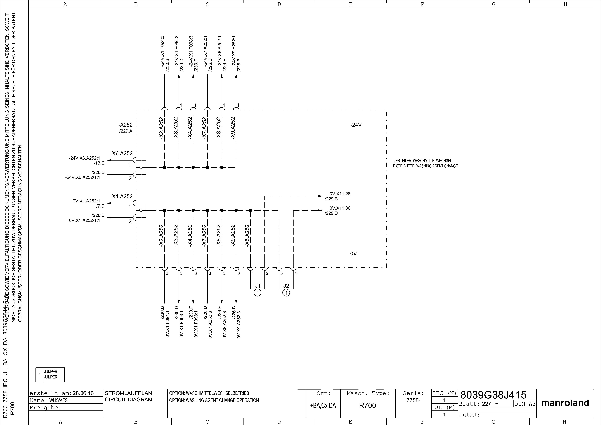

# +BA_Cx_DA — Sheet 227 of 247 — OPTION: WASCHMITTELWECHSELBETRIEB

**OPTION: WASHING AGENT CHANGE OPERATION**

> Part of the manroland **R700** printing press IEC/UL circuit diagrams.
> Drawing class: **Stromlaufplan / Circuit diagram** (DIN A3).
> Document `+BA_Cx_DA` covers the **Printing units / main switch cabinet** machine section.

## At a glance

| Field | Value |
|---|---|
| Document | `+BA_Cx_DA`  (8039G38J415) |
| Sheet | **227** of 247 |
| Section (DE) | OPTION: WASCHMITTELWECHSELBETRIEB |
| Section (EN) | OPTION: WASHING AGENT CHANGE OPERATION |
| Section type | CIRCUIT — Circuit diagram |
| Machine type | `R700` |
| Series | `7758` |
| Created | 28.06.10 |
| Replaces | — |
| Columns used | A, B, C, D, E, F |
| Path numbers | — |
| Labels on sheet | 84 |
| Cross-refs out | 19 |
| Cross-refs in | 35 |

**Previous:** [+BA_Cx_DA sheet 226](SHEET_0226.md) · **Next:** [+BA_Cx_DA sheet 228](SHEET_0228.md) · **Document TOC:** [_TOC.md](_TOC.md)  (+BA_Cx_DA) · **Master TOC:** [all sheets](../_MASTER_TOC.md)

## Sheet image (300 DPI, exact vector render)



_Rendered directly from the PDF vector layer at 300 DPI (1-bit), no OCR and no resampling. Use it to confirm anything ambiguous in the text below._

## Cross-references on this sheet

Each entry is a wire leaving this sheet. The printed token is `/sheet.column`; the link resolves to that sheet inside the same document.

| Ref | Target sheet | Col | Path | Destination on target | Target section | From col |
|---|---|---|---|---|---|---|
| `/226.D` | [+BA_Cx_DA sheet 226](SHEET_0226.md) | D | — | 24V.X7.A252:1 | OPTION: ZWISCHENTROCKNER VORBEREITUNG | C |
| `/226.F` | [+BA_Cx_DA sheet 226](SHEET_0226.md) | F | — | 24V.X8.A252:1 | OPTION: ZWISCHENTROCKNER VORBEREITUNG | C |
| `/226.B` | [+BA_Cx_DA sheet 226](SHEET_0226.md) | B | — | 24V.X9.A252:1 | OPTION: ZWISCHENTROCKNER VORBEREITUNG | C |
| `/230.B` | [+BA_Cx_DA sheet 230](SHEET_0230.md) | B | — | 24V.X1.F094:3 | OPTION: WASCHMITTELWECHSELBETRIEB | B |
| `/230.D` | [+BA_Cx_DA sheet 230](SHEET_0230.md) | D | — | 24V.X1.F096:3 | OPTION: WASCHMITTELWECHSELBETRIEB | C |
| `/230.F` | [+BA_Cx_DA sheet 230](SHEET_0230.md) | F | — | 24V.X1.F098:3 | OPTION: WASCHMITTELWECHSELBETRIEB | C |
| `/229.A` | [+BA_Cx_DA sheet 229](SHEET_0229.md) | A | — | — | OPTION: WASCHMITTELWECHSELBETRIEB | B |
| `/13.C` | [+BA_Cx_DA sheet 13](SHEET_0013.md) | C | — | 24V.X6.A252:1 | SPANNUNGSVERSORGUNG, SCHALTSCHRANKBELÜFTUNG | A |
| `/228.B` | [+BA_Cx_DA sheet 228](SHEET_0228.md) | B | — | 24V.X6.A252\1:1 | OPTION: WASCHMITTELWECHSELBETRIEB | A |
| `/229.B` | [+BA_Cx_DA sheet 229](SHEET_0229.md) | B | — | — | OPTION: WASCHMITTELWECHSELBETRIEB | E |
| `/7.D` | [+BA_Cx_DA sheet 7](SHEET_0007.md) | D | — | 0V.X1.A252:1 | SPANNUNGSVERSORGUNG, SCHALTSCHRANKBELÜFTUNG | A |
| `/229.D` | [+BA_Cx_DA sheet 229](SHEET_0229.md) | D | — | — | OPTION: WASCHMITTELWECHSELBETRIEB | E |
| `/228.B` | [+BA_Cx_DA sheet 228](SHEET_0228.md) | B | — | 0V.X1.A252\1:1 | OPTION: WASCHMITTELWECHSELBETRIEB | A |
| `/230.B` | [+BA_Cx_DA sheet 230](SHEET_0230.md) | B | — | — | OPTION: WASCHMITTELWECHSELBETRIEB | B |
| `/230.D` | [+BA_Cx_DA sheet 230](SHEET_0230.md) | D | — | — | OPTION: WASCHMITTELWECHSELBETRIEB | C |
| `/230.F` | [+BA_Cx_DA sheet 230](SHEET_0230.md) | F | — | — | OPTION: WASCHMITTELWECHSELBETRIEB | C |
| `/226.D` | [+BA_Cx_DA sheet 226](SHEET_0226.md) | D | — | — | OPTION: ZWISCHENTROCKNER VORBEREITUNG | C |
| `/226.F` | [+BA_Cx_DA sheet 226](SHEET_0226.md) | F | — | — | OPTION: ZWISCHENTROCKNER VORBEREITUNG | C |
| `/226.B` | [+BA_Cx_DA sheet 226](SHEET_0226.md) | B | — | — | OPTION: ZWISCHENTROCKNER VORBEREITUNG | C |

### Incoming references (sheets that point here)

Every other sheet that sends a wire to this one. `Back-ref` is the token printed on *that* sheet; `Path` is its line number.

| From sheet | Cols | Back-ref | Path | Refs | What continues there |
|---|---|---|---|---|---|
| [+BA_Cx_DA#7](SHEET_0007.md) | D | `/7.D` | — | 1 | — |
| [+BA_Cx_DA#13](SHEET_0013.md) | B | `/13.B` | — | 1 | 24V.X6.A252:1 |
| [+BA_Cx_DA#152](SHEET_0152.md) | E | `/152.E` | — | 2 | — |
| [+BA_Cx_DA#156](SHEET_0156.md) | A | `/156.A` | — | 2 | — |
| [+BA_Cx_DA#158](SHEET_0158.md) | G | `/158.G` | — | 2 | — |
| [+BA_Cx_DA#160](SHEET_0160.md) | G | `/160.G` | — | 4 | — |
| [+BA_Cx_DA#163](SHEET_0163.md) | E | `/163.E` | — | 2 | — |
| [+BA_Cx_DA#165](SHEET_0165.md) | A | `/165.A` | — | 2 | — |
| [+BA_Cx_DA#166](SHEET_0166.md) | A | `/166.A` | — | 2 | — |
| [+BA_Cx_DA#226](SHEET_0226.md) | C, E, F, G | `/226.C`, `/226.E`, `/226.F`, `/226.G` | — | 6 | 0V.X7.A252:3; 0V.X8.A252:3 |
| [+BA_Cx_DA#228](SHEET_0228.md) | A | `/228.A` | — | 2 | 0V.X1.A252\1:1; 24V.X6.A252\1:1 |
| [+BA_Cx_DA#229](SHEET_0229.md) | A, B | `/229.A`, `/229.B` | — | 3 | 0V.X11:28 0V.X11:30 |
| [+BA_Cx_DA#230](SHEET_0230.md) | A, C, F | `/230.A`, `/230.C`, `/230.F` | — | 6 | 0V.X1.F094:1 0V.X1.F096:1 0V.X1.F098:1; 24V.X1.F094:3; 24V.X1.F096:3; 24V.X1.F098:3 |


## Devices on this sheet

| Tag | Class | Class meaning (IEC) | Col | Sub | Terminal | Sign |
|---|---|---|---|---|---|---|
| `A252` | A | Baugruppe / assembly, module, PC board | B | — | — | — |
| `J1` | J |  | D | — | — | — |
| `J2` | J |  | D | — | — | — |
| `X2.A252` | — | cross-device reference | B | — | — | — |
| `X3.A252` | — | cross-device reference | C | — | — | — |
| `X4.A252` | — | cross-device reference | C | — | — | — |
| `X2.A252` | — | cross-device reference | B | — | — | — |
| `X3.A252` | — | cross-device reference | C | — | — | — |
| `X4.A252` | — | cross-device reference | C | — | — | — |
| `X7.A252` | — | cross-device reference | C | — | — | — |
| `X8.A252` | — | cross-device reference | C | — | — | — |
| `X9.A252` | — | cross-device reference | C | — | — | — |
| `X5.A252` | — | cross-device reference | D | — | — | — |
| `X6.A252` | — | cross-device reference | B | — | — | — |
| `X7.A252` | — | cross-device reference | C | — | — | — |
| `X8.A252` | — | cross-device reference | C | — | — | — |
| `X9.A252` | — | cross-device reference | C | — | — | — |
| `X1.A252` | — | cross-device reference | B | — | — | — |

## Potentials / nets

| Potential | Count | Columns | Attached devices | Terminals |
|---|---|---|---|---|
| `0V` | 11 | A, B, C, E | `A252`, `A252\1`, `F094`, `F096`, `F098`, `X1`, `X11`, `X7`, `X8`, `X9` | `1`, `28`, `3`, `30` |
| `24V` | 9 | A, B, C, E | `A252`, `A252\1`, `F094`, `F096`, `F098`, `X1`, `X6`, `X7`, `X8`, `X9` | `1`, `3` |


A potential such as `L24+/4` or `M24+` is a named supply/return rail; every place it appears on this sheet is electrically common.

## Wire-end annotations (grouped as printed)

A wire that continues elsewhere is annotated with a small cluster: the destination description, the path/line number `#NN`, and the `/sheet.column` cross reference. Each row below is one such cluster exactly as it is grouped on the drawing.

| Col | Y | Path | Cross-ref | Text on the wire |
|---|---|---|---|---|
| C | 70.0 | — | `/226.D` | `24V.X7.A252:1` |
| C | 70.0 | — | `/226.F` | `24V.X8.A252:1` |
| C | 70.0 | — | `/226.B` | `24V.X9.A252:1` |
| B | 70.6 | — | `/230.B` | `24V.X1.F094:3` |
| C | 70.6 | — | `/230.D` | `24V.X1.F096:3` |
| C | 70.6 | — | `/230.F` | `24V.X1.F098:3` |
| B | 204.4 | — | — | `1` |
| C | 204.4 | — | — | `1` |
| C | 204.4 | — | — | `1` |
| C | 204.4 | — | — | `1` |
| C | 204.4 | — | — | `1` |
| C | 204.4 | — | — | `1` |
| B | 231.9 | — | — | `X2.A252` |
| C | 231.9 | — | — | `X3.A252` |
| C | 231.9 | — | — | `X4.A252` |
| C | 231.9 | — | — | `X7.A252` |
| C | 231.9 | — | — | `X8.A252` |
| C | 231.9 | — | — | `X9.A252` |
| B | 242.7 | — | — | `A252` |
| E | 242.7 | — | — | `24V` |
| B | 255.7 | — | `/229.A` | — |
| B | 299.4 | — | — | `X6.A252` |
| A | 309.2 | — | `/13.C` | `24V.X6.A252:1` |
| F | 315.2 | — | — | `DISTRIBUTOR: WASHING AGENT CHANGE VERTEILER: WASCHMITTELWECHSEL` |
| B | 320.6 | — | — | `1` |
| A | 337.6 | — | `/228.B` | `24V.X6.A252\1:1` |
| B | 348.9 | — | — | `2` |
| E | 380.1 | — | — | `0V.X11:28` |
| B | 384.4 | — | — | `X1.A252` |
| E | 390.0 | — | `/229.B` | — |
| A | 394.3 | — | `/7.D` | `0V.X1.A252:1` |
| B | 405.6 | — | — | `1` |
| E | 408.5 | — | — | `0V.X11:30` |
| E | 418.4 | — | `/229.D` | — |
| A | 422.6 | — | `/228.B` | `0V.X1.A252\1:1` |
| B | 434.0 | — | — | `2` |
| B | 444.5 | — | — | `X2.A252` |
| C | 444.5 | — | — | `X3.A252` |
| C | 444.5 | — | — | `X4.A252` |
| C | 444.5 | — | — | `X7.A252` |
| C | 444.5 | — | — | `X8.A252` |
| C | 444.5 | — | — | `X9.A252` |
| D | 444.5 | — | — | `X5.A252` |
| E | 497.8 | — | — | `0V` |
| B | 537.5 | — | — | `3` |
| C | 537.5 | — | — | `3` |
| C | 537.5 | — | — | `3` |
| C | 537.5 | — | — | `3` |
| C | 537.5 | — | — | `3` |
| C | 537.5 | — | — | `3` |
| D | 537.5 | — | — | `1` |
| D | 537.5 | — | — | `2 3 4` |
| D | 561.5 | — | — | `J1 J2` |
| D | 576.6 | — | — | `1 1` |
| B | 606.3 | — | `/230.B` | — |
| C | 606.3 | — | `/230.D` | — |
| C | 606.3 | — | `/230.F` | — |
| C | 606.3 | — | `/226.D` | — |
| C | 606.3 | — | `/226.F` | — |
| C | 606.3 | — | `/226.B` | — |
| B | 614.8 | — | — | `0V.X1.F094:1` |
| C | 614.8 | — | — | `0V.X1.F096:1` |
| C | 614.8 | — | — | `0V.X1.F098:1` |
| C | 616.2 | — | — | `0V.X7.A252:3` |
| C | 616.2 | — | — | `0V.X8.A252:3` |
| C | 616.2 | — | — | `0V.X9.A252:3` |
| A | 733.4 | — | — | `1 JUMPER JUMPER` |


## Notes and free text on this sheet

| Text | Col | Y (pt) |
|---|---|---|
| `VERTEILER: WASCHMITTELWECHSEL` | F | 315.25 |
| `DISTRIBUTOR: WASHING AGENT CHANGE` | F | 325.89 |
| `JUMPER` | A | 733.39 |

## Complete label inventory (exact text from the drawing)

Every text object inside the drawing area of this sheet, in DIN reading order (column A→H, then top→bottom). This is the authoritative list: if a string is not here it is not printed on this sheet.

| Col | Y | X | Dir | Type | Text |
|---|---|---|---|---|---|
| A | 309.3 | 136.6 | → | potential | `24V.X6.A252:1` |
| A | 319.2 | 186.2 | → | cross-reference | `/13.C` |
| A | 337.6 | 181.7 | → | cross-reference | `/228.B` |
| A | 347.5 | 129.3 | → | potential | `24V.X6.A252\1:1` |
| A | 394.3 | 144.3 | → | potential | `0V.X1.A252:1` |
| A | 404.2 | 191.1 | → | cross-reference | `/7.D` |
| A | 422.6 | 181.7 | → | cross-reference | `/228.B` |
| A | 432.5 | 136.9 | → | potential | `0V.X1.A252\1:1` |
| A | 733.4 | 87.6 | → | text | `JUMPER` |
| A | 738.7 | 75.4 | → | number | `1` |
| A | 744.0 | 87.6 | → | text | `JUMPER` |
| B | 70.6 | 317.8 | ↕ | potential | `24V.X1.F094:3` |
| B | 116.2 | 327.7 | ↕ | cross-reference | `/230.B` |
| B | 204.4 | 328.0 | → | number | `1` |
| B | 231.9 | 315.0 | ↕ | device ref | `X2.A252` |
| B | 242.7 | 234.4 | → | device tag | `A252` |
| B | 255.7 | 236.7 | → | cross-reference | `/229.A` |
| B | 299.4 | 218.6 | → | device ref | `X6.A252` |
| B | 320.6 | 254.0 | → | number | `1` |
| B | 348.9 | 254.8 | → | number | `2` |
| B | 384.4 | 218.6 | → | device ref | `X1.A252` |
| B | 405.6 | 254.0 | → | number | `1` |
| B | 434.0 | 254.8 | → | number | `2` |
| B | 444.5 | 315.0 | ↕ | device ref | `X2.A252` |
| B | 537.5 | 328.5 | → | number | `3` |
| B | 606.3 | 317.7 | ↕ | cross-reference | `/230.B` |
| B | 614.8 | 327.7 | ↕ | potential | `0V.X1.F094:1` |
| C | 70.0 | 402.8 | ↕ | potential | `24V.X7.A252:1` |
| C | 70.0 | 431.1 | ↕ | potential | `24V.X8.A252:1` |
| C | 70.0 | 459.5 | ↕ | potential | `24V.X9.A252:1` |
| C | 70.6 | 346.1 | ↕ | potential | `24V.X1.F096:3` |
| C | 70.6 | 374.5 | ↕ | potential | `24V.X1.F098:3` |
| C | 115.9 | 356.0 | ↕ | cross-reference | `/230.D` |
| C | 115.9 | 412.7 | ↕ | cross-reference | `/226.D` |
| C | 116.2 | 469.4 | ↕ | cross-reference | `/226.B` |
| C | 116.8 | 384.4 | ↕ | cross-reference | `/230.F` |
| C | 116.8 | 441.1 | ↕ | cross-reference | `/226.F` |
| C | 204.4 | 356.3 | → | number | `1` |
| C | 204.4 | 384.7 | → | number | `1` |
| C | 204.4 | 413.0 | → | number | `1` |
| C | 204.4 | 441.4 | → | number | `1` |
| C | 204.4 | 469.7 | → | number | `1` |
| C | 231.9 | 343.3 | ↕ | device ref | `X3.A252` |
| C | 231.9 | 371.6 | ↕ | device ref | `X4.A252` |
| C | 231.9 | 400.0 | ↕ | device ref | `X7.A252` |
| C | 231.9 | 428.3 | ↕ | device ref | `X8.A252` |
| C | 231.9 | 456.7 | ↕ | device ref | `X9.A252` |
| C | 444.5 | 343.3 | ↕ | device ref | `X3.A252` |
| C | 444.5 | 371.6 | ↕ | device ref | `X4.A252` |
| C | 444.5 | 400.0 | ↕ | device ref | `X7.A252` |
| C | 444.5 | 428.3 | ↕ | device ref | `X8.A252` |
| C | 444.5 | 456.7 | ↕ | device ref | `X9.A252` |
| C | 537.5 | 356.9 | → | number | `3` |
| C | 537.5 | 385.2 | → | number | `3` |
| C | 537.5 | 413.6 | → | number | `3` |
| C | 537.5 | 441.9 | → | number | `3` |
| C | 537.5 | 470.3 | → | number | `3` |
| C | 606.3 | 346.1 | ↕ | cross-reference | `/230.D` |
| C | 606.3 | 374.4 | ↕ | cross-reference | `/230.F` |
| C | 606.3 | 402.8 | ↕ | cross-reference | `/226.D` |
| C | 606.3 | 431.1 | ↕ | cross-reference | `/226.F` |
| C | 606.3 | 459.5 | ↕ | cross-reference | `/226.B` |
| C | 614.8 | 356.0 | ↕ | potential | `0V.X1.F096:1` |
| C | 614.8 | 384.4 | ↕ | potential | `0V.X1.F098:1` |
| C | 616.3 | 412.7 | ↕ | potential | `0V.X7.A252:3` |
| C | 616.3 | 441.1 | ↕ | potential | `0V.X8.A252:3` |
| C | 616.3 | 469.4 | ↕ | potential | `0V.X9.A252:3` |
| D | 444.5 | 485.0 | ↕ | device ref | `X5.A252` |
| D | 537.5 | 498.0 | → | number | `1` |
| D | 537.5 | 527.0 | → | number | `2` |
| D | 537.5 | 555.3 | → | number | `3` |
| D | 537.5 | 583.7 | → | number | `4` |
| D | 561.5 | 505.4 | → | device tag | `J1` |
| D | 561.5 | 561.4 | → | device tag | `J2` |
| D | 576.6 | 508.5 | → | number | `1` |
| D | 576.6 | 565.2 | → | number | `1` |
| E | 242.7 | 694.2 | → | potential | `24V` |
| E | 380.1 | 653.1 | → | potential | `0V.X11:28` |
| E | 390.0 | 643.5 | → | cross-reference | `/229.B` |
| E | 408.5 | 653.1 | → | potential | `0V.X11:30` |
| E | 418.4 | 643.5 | → | cross-reference | `/229.D` |
| E | 497.8 | 693.9 | → | potential | `0V` |
| F | 315.3 | 779.5 | → | text | `VERTEILER: WASCHMITTELWECHSEL` |
| F | 325.9 | 778.7 | → | text | `DISTRIBUTOR: WASHING AGENT CHANGE` |

## Reading-order text block

The same content as a plain block, grouped by DIN column — convenient to paste or to match against a visual description.

```text
=== Column A ===
 309.3  136.6  net          24V.X6.A252:1
 319.2  186.2  xref         /13.C
 337.6  181.7  xref         /228.B
 347.5  129.3  net          24V.X6.A252\1:1
 394.3  144.3  net          0V.X1.A252:1
 404.2  191.1  xref         /7.D
 422.6  181.7  xref         /228.B
 432.5  136.9  net          0V.X1.A252\1:1
 733.4   87.6  text         JUMPER
 738.7   75.4  numeric      1
 744.0   87.6  text         JUMPER
=== Column B ===
  70.6  317.8  net          24V.X1.F094:3
 116.2  327.7  xref         /230.B
 204.4  328.0  numeric      1
 231.9  315.0  devref       X2.A252
 242.7  234.4  devtag       A252
 255.7  236.7  xref         /229.A
 299.4  218.6  devref       X6.A252
 320.6  254.0  numeric      1
 348.9  254.8  numeric      2
 384.4  218.6  devref       X1.A252
 405.6  254.0  numeric      1
 434.0  254.8  numeric      2
 444.5  315.0  devref       X2.A252
 537.5  328.5  numeric      3
 606.3  317.7  xref         /230.B
 614.8  327.7  net          0V.X1.F094:1
=== Column C ===
  70.0  402.8  net          24V.X7.A252:1
  70.0  431.1  net          24V.X8.A252:1
  70.0  459.5  net          24V.X9.A252:1
  70.6  346.1  net          24V.X1.F096:3
  70.6  374.5  net          24V.X1.F098:3
 115.9  356.0  xref         /230.D
 115.9  412.7  xref         /226.D
 116.2  469.4  xref         /226.B
 116.8  384.4  xref         /230.F
 116.8  441.1  xref         /226.F
 204.4  356.3  numeric      1
 204.4  384.7  numeric      1
 204.4  413.0  numeric      1
 204.4  441.4  numeric      1
 204.4  469.7  numeric      1
 231.9  343.3  devref       X3.A252
 231.9  371.6  devref       X4.A252
 231.9  400.0  devref       X7.A252
 231.9  428.3  devref       X8.A252
 231.9  456.7  devref       X9.A252
 444.5  343.3  devref       X3.A252
 444.5  371.6  devref       X4.A252
 444.5  400.0  devref       X7.A252
 444.5  428.3  devref       X8.A252
 444.5  456.7  devref       X9.A252
 537.5  356.9  numeric      3
 537.5  385.2  numeric      3
 537.5  413.6  numeric      3
 537.5  441.9  numeric      3
 537.5  470.3  numeric      3
 606.3  346.1  xref         /230.D
 606.3  374.4  xref         /230.F
 606.3  402.8  xref         /226.D
 606.3  431.1  xref         /226.F
 606.3  459.5  xref         /226.B
 614.8  356.0  net          0V.X1.F096:1
 614.8  384.4  net          0V.X1.F098:1
 616.3  412.7  net          0V.X7.A252:3
 616.3  441.1  net          0V.X8.A252:3
 616.3  469.4  net          0V.X9.A252:3
=== Column D ===
 444.5  485.0  devref       X5.A252
 537.5  498.0  numeric      1
 537.5  527.0  numeric      2
 537.5  555.3  numeric      3
 537.5  583.7  numeric      4
 561.5  505.4  devtag       J1
 561.5  561.4  devtag       J2
 576.6  508.5  numeric      1
 576.6  565.2  numeric      1
=== Column E ===
 242.7  694.2  net          24V
 380.1  653.1  net          0V.X11:28
 390.0  643.5  xref         /229.B
 408.5  653.1  net          0V.X11:30
 418.4  643.5  xref         /229.D
 497.8  693.9  net          0V
=== Column F ===
 315.3  779.5  text         VERTEILER: WASCHMITTELWECHSEL
 325.9  778.7  text         DISTRIBUTOR: WASHING AGENT CHANGE
```

---
_Generated from the PDF vector text layer; no OCR. Source: `R700_7758_IEC_UL_BA_CX_DA_8039G38J415_p`, sheet 227._
