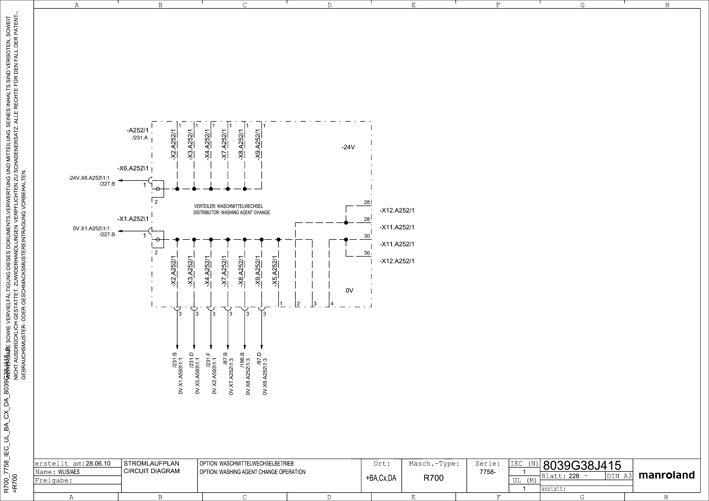

# +BA_Cx_DA — Sheet 228 of 247 — OPTION: WASCHMITTELWECHSELBETRIEB

**OPTION: WASHING AGENT CHANGE OPERATION**

> Part of the manroland **R700** printing press IEC/UL circuit diagrams.
> Drawing class: **Stromlaufplan / Circuit diagram** (DIN A3).
> Document `+BA_Cx_DA` covers the **Printing units / main switch cabinet** machine section.

## At a glance

| Field | Value |
|---|---|
| Document | `+BA_Cx_DA`  (8039G38J415) |
| Sheet | **228** of 247 |
| Section (DE) | OPTION: WASCHMITTELWECHSELBETRIEB |
| Section (EN) | OPTION: WASHING AGENT CHANGE OPERATION |
| Section type | CIRCUIT — Circuit diagram |
| Machine type | `R700` |
| Series | `7758` |
| Created | 28.06.10 |
| Replaces | — |
| Columns used | A, B, C, D, E |
| Path numbers | — |
| Labels on sheet | 65 |
| Cross-refs out | 9 |
| Cross-refs in | 29 |

**Previous:** [+BA_Cx_DA sheet 227](SHEET_0227.md) · **Next:** [+BA_Cx_DA sheet 229](SHEET_0229.md) · **Document TOC:** [_TOC.md](_TOC.md)  (+BA_Cx_DA) · **Master TOC:** [all sheets](../_MASTER_TOC.md)

## Sheet image (300 DPI, exact vector render)



_Rendered directly from the PDF vector layer at 300 DPI (1-bit), no OCR and no resampling. Use it to confirm anything ambiguous in the text below._

## Cross-references on this sheet

Each entry is a wire leaving this sheet. The printed token is `/sheet.column`; the link resolves to that sheet inside the same document.

| Ref | Target sheet | Col | Path | Destination on target | Target section | From col |
|---|---|---|---|---|---|---|
| `/231.A` | [+BA_Cx_DA sheet 231](SHEET_0231.md) | A | — | — | OPTION: WASCHMITTELWECHSELBETRIEB | B |
| `/227.B` | [+BA_Cx_DA sheet 227](SHEET_0227.md) | B | — | 24V.X6.A252\1:1 | OPTION: WASCHMITTELWECHSELBETRIEB | A |
| `/227.B` | [+BA_Cx_DA sheet 227](SHEET_0227.md) | B | — | 0V.X1.A252\1:1 | OPTION: WASCHMITTELWECHSELBETRIEB | A |
| `/231.B` | [+BA_Cx_DA sheet 231](SHEET_0231.md) | B | — | — | OPTION: WASCHMITTELWECHSELBETRIEB | B |
| `/231.D` | [+BA_Cx_DA sheet 231](SHEET_0231.md) | D | — | — | OPTION: WASCHMITTELWECHSELBETRIEB | B |
| `/231.F` | [+BA_Cx_DA sheet 231](SHEET_0231.md) | F | — | — | OPTION: WASCHMITTELWECHSELBETRIEB | C |
| `/87.B` | [+BA_Cx_DA sheet 87](SHEET_0087.md) | B | — | — | WASCHVORRICHTUNG | C |
| `/196.B` | [+BA_Cx_DA sheet 196](SHEET_0196.md) | B | — | — | OPTION: WASCHVORRICHTUNG MIT BÜRSTE | C |
| `/87.D` | [+BA_Cx_DA sheet 87](SHEET_0087.md) | D | — | — | WASCHVORRICHTUNG | C |

### Incoming references (sheets that point here)

Every other sheet that sends a wire to this one. `Back-ref` is the token printed on *that* sheet; `Path` is its line number.

| From sheet | Cols | Back-ref | Path | Refs | What continues there |
|---|---|---|---|---|---|
| [+BA_Cx_DA#87](SHEET_0087.md) | B, D | `/87.B`, `/87.D` | — | 2 | — |
| [+BA_Cx_DA#152](SHEET_0152.md) | E | `/152.E` | — | 2 | — |
| [+BA_Cx_DA#156](SHEET_0156.md) | A | `/156.A` | — | 2 | — |
| [+BA_Cx_DA#158](SHEET_0158.md) | G | `/158.G` | — | 2 | — |
| [+BA_Cx_DA#160](SHEET_0160.md) | G | `/160.G` | — | 4 | — |
| [+BA_Cx_DA#163](SHEET_0163.md) | E | `/163.E` | — | 2 | — |
| [+BA_Cx_DA#165](SHEET_0165.md) | A | `/165.A` | — | 2 | — |
| [+BA_Cx_DA#166](SHEET_0166.md) | A | `/166.A` | — | 2 | — |
| [+BA_Cx_DA#168](SHEET_0168.md) | D | `/168.D` | — | 2 | — |
| [+BA_Cx_DA#169](SHEET_0169.md) | D | `/169.D` | — | 2 | — |
| [+BA_Cx_DA#196](SHEET_0196.md) | B | `/196.B` | — | 1 | — |
| [+BA_Cx_DA#227](SHEET_0227.md) | A | `/227.A` | — | 2 | 0V.X1.A252\1:1; 24V.X6.A252\1:1 |
| [+BA_Cx_DA#231](SHEET_0231.md) | A, D | `/231.A`, `/231.D` | — | 4 | 0V.X1.A593\1:1 0V.X5.A593\1:1 0V.X2.A593\1:1 |


## Devices on this sheet

| Tag | Class | Class meaning (IEC) | Col | Sub | Terminal | Sign |
|---|---|---|---|---|---|---|
| `A252/1` | A | Baugruppe / assembly, module, PC board | B | 1 | — | — |
| `X6.A252\1` | — | cross-device reference | B | — | — | — |
| `X1.A252\1` | — | cross-device reference | B | — | — | — |

## Potentials / nets

| Potential | Count | Columns | Attached devices | Terminals |
|---|---|---|---|---|
| `0V` | 8 | A, B, C, D | `A252\1`, `A593\1`, `X1`, `X2`, `X5`, `X7`, `X8`, `X9` | `1`, `3` |
| `24V` | 2 | A, D | `A252\1`, `X6` | `1` |


A potential such as `L24+/4` or `M24+` is a named supply/return rail; every place it appears on this sheet is electrically common.

## Wire-end annotations (grouped as printed)

A wire that continues elsewhere is annotated with a small cluster: the destination description, the path/line number `#NN`, and the `/sheet.column` cross reference. Each row below is one such cluster exactly as it is grouped on the drawing.

| Col | Y | Path | Cross-ref | Text on the wire |
|---|---|---|---|---|
| B | 207.2 | — | — | `A252/1 1 1 1` |
| B | 207.2 | — | — | `1 1 1` |
| B | 216.3 | — | — | `X2.A252/1` |
| B | 216.3 | — | — | `X3.A252/1` |
| C | 216.3 | — | — | `X4.A252/1` |
| C | 216.3 | — | — | `X7.A252/1` |
| C | 216.3 | — | — | `X8.A252/1` |
| C | 216.3 | — | — | `X9.A252/1` |
| B | 227.4 | — | `/231.A` | — |
| D | 242.7 | — | — | `24V` |
| B | 278.1 | — | — | `X6.A252\1` |
| A | 295.1 | — | `/227.B` | `24V.X6.A252\1:1` |
| B | 306.4 | — | — | `1` |
| B | 335.5 | — | — | `2` |
| D | 336.2 | — | — | `28` |
| C | 343.6 | — | — | `DISTRIBUTOR: WASHING AGENT CHANGE VERTEILER: WASCHMITTELWECHSEL` |
| E | 349.0 | — | — | `X12.A252/1` |
| C | 363.1 | — | — | `X1.A252\1 28` |
| E | 377.3 | — | — | `X11.A252/1` |
| A | 380.1 | — | `/227.B` | `0V.X1.A252\1:1` |
| B | 391.4 | — | — | `1` |
| D | 392.9 | — | — | `30` |
| E | 405.7 | — | — | `X11.A252/1` |
| B | 420.6 | — | — | `2` |
| D | 421.3 | — | — | `30` |
| B | 428.9 | — | — | `X2.A252/1` |
| B | 428.9 | — | — | `X3.A252/1` |
| C | 428.9 | — | — | `X4.A252/1` |
| C | 428.9 | — | — | `X7.A252/1` |
| C | 428.9 | — | — | `X8.A252/1` |
| C | 428.9 | — | — | `X9.A252/1` |
| C | 428.9 | — | — | `X5.A252/1` |
| E | 434.0 | — | — | `X12.A252/1` |
| D | 483.6 | — | — | `0V` |
| D | 506.3 | — | — | `1 2 3 4` |
| B | 523.3 | — | — | `3` |
| B | 523.3 | — | — | `3` |
| C | 523.3 | — | — | `3` |
| C | 523.3 | — | — | `3` |
| C | 523.3 | — | — | `3` |
| C | 523.3 | — | — | `3` |
| B | 592.2 | — | `/231.B` | — |
| B | 592.2 | — | `/231.D` | — |
| C | 592.2 | — | `/231.F` | — |
| C | 592.2 | — | `/87.B` | — |
| C | 592.2 | — | `/196.B` | — |
| C | 592.2 | — | `/87.D` | — |
| B | 600.7 | — | — | `0V.X1.A593\1:1` |
| B | 600.7 | — | — | `0V.X5.A593\1:1` |
| C | 600.7 | — | — | `0V.X2.A593\1:1` |
| C | 602.1 | — | — | `0V.X7.A252\1:3` |
| C | 602.1 | — | — | `0V.X8.A252\1:3` |
| C | 602.1 | — | — | `0V.X9.A252\1:3` |


## Notes and free text on this sheet

| Text | Col | Y (pt) |
|---|---|---|
| `X2.A252/1` | B | 428.88 |
| `X3.A252/1` | B | 428.88 |
| `X4.A252/1` | C | 428.88 |
| `X7.A252/1` | C | 428.88 |
| `X8.A252/1` | C | 428.88 |
| `X9.A252/1` | C | 428.88 |
| `VERTEILER: WASCHMITTELWECHSEL` | C | 343.6 |
| `DISTRIBUTOR: WASHING AGENT CHANGE` | C | 354.24 |
| `X5.A252/1` | C | 428.88 |
| `X12.A252/1` | E | 348.97 |
| `X11.A252/1` | E | 377.32 |

## Complete label inventory (exact text from the drawing)

Every text object inside the drawing area of this sheet, in DIN reading order (column A→H, then top→bottom). This is the authoritative list: if a string is not here it is not printed on this sheet.

| Col | Y | X | Dir | Type | Text |
|---|---|---|---|---|---|
| A | 295.1 | 115.1 | → | potential | `24V.X6.A252\1:1` |
| A | 305.0 | 167.5 | → | cross-reference | `/227.B` |
| A | 380.1 | 122.7 | → | potential | `0V.X1.A252\1:1` |
| A | 390.0 | 167.5 | → | cross-reference | `/227.B` |
| B | 207.3 | 299.6 | → | number | `1` |
| B | 207.3 | 328.0 | → | number | `1` |
| B | 214.3 | 212.9 | → | device tag | `A252/1` |
| B | 216.3 | 286.6 | ↕ | text | `X2.A252/1` |
| B | 216.3 | 315.0 | ↕ | text | `X3.A252/1` |
| B | 227.4 | 222.5 | → | cross-reference | `/231.A` |
| B | 278.1 | 197.0 | → | device ref | `X6.A252\1` |
| B | 306.4 | 239.8 | → | number | `1` |
| B | 335.5 | 259.9 | → | number | `2` |
| B | 363.1 | 197.0 | → | device ref | `X1.A252\1` |
| B | 391.5 | 239.8 | → | number | `1` |
| B | 420.6 | 259.9 | → | number | `2` |
| B | 428.9 | 286.6 | ↕ | text | `X2.A252/1` |
| B | 428.9 | 315.0 | ↕ | text | `X3.A252/1` |
| B | 523.3 | 300.2 | → | number | `3` |
| B | 523.3 | 328.5 | → | number | `3` |
| B | 592.2 | 289.4 | ↕ | cross-reference | `/231.B` |
| B | 592.2 | 317.8 | ↕ | cross-reference | `/231.D` |
| B | 600.7 | 299.3 | ↕ | potential | `0V.X1.A593\1:1` |
| B | 600.7 | 327.7 | ↕ | potential | `0V.X5.A593\1:1` |
| C | 207.3 | 356.3 | → | number | `1` |
| C | 207.3 | 384.7 | → | number | `1` |
| C | 207.3 | 413.0 | → | number | `1` |
| C | 207.3 | 441.4 | → | number | `1` |
| C | 216.3 | 343.3 | ↕ | text | `X4.A252/1` |
| C | 216.3 | 371.7 | ↕ | text | `X7.A252/1` |
| C | 216.3 | 400.0 | ↕ | text | `X8.A252/1` |
| C | 216.3 | 428.3 | ↕ | text | `X9.A252/1` |
| C | 343.6 | 326.0 | → | text | `VERTEILER: WASCHMITTELWECHSEL` |
| C | 354.2 | 325.1 | → | text | `DISTRIBUTOR: WASHING AGENT CHANGE` |
| C | 428.9 | 343.3 | ↕ | text | `X4.A252/1` |
| C | 428.9 | 371.7 | ↕ | text | `X7.A252/1` |
| C | 428.9 | 400.0 | ↕ | text | `X8.A252/1` |
| C | 428.9 | 428.3 | ↕ | text | `X9.A252/1` |
| C | 428.9 | 456.7 | ↕ | text | `X5.A252/1` |
| C | 506.3 | 469.7 | → | number | `1` |
| C | 523.3 | 356.9 | → | number | `3` |
| C | 523.3 | 385.2 | → | number | `3` |
| C | 523.3 | 413.6 | → | number | `3` |
| C | 523.3 | 441.9 | → | number | `3` |
| C | 592.2 | 346.1 | ↕ | cross-reference | `/231.F` |
| C | 592.2 | 374.4 | ↕ | cross-reference | `/87.B` |
| C | 592.2 | 402.8 | ↕ | cross-reference | `/196.B` |
| C | 592.2 | 431.1 | ↕ | cross-reference | `/87.D` |
| C | 600.7 | 356.0 | ↕ | potential | `0V.X2.A593\1:1` |
| C | 602.1 | 384.4 | ↕ | potential | `0V.X7.A252\1:3` |
| C | 602.1 | 412.7 | ↕ | potential | `0V.X8.A252\1:3` |
| C | 602.1 | 441.1 | ↕ | potential | `0V.X9.A252\1:3` |
| D | 242.7 | 573.7 | → | potential | `24V` |
| D | 336.2 | 611.4 | → | number | `28` |
| D | 364.6 | 611.4 | → | number | `28` |
| D | 392.9 | 611.4 | → | number | `30` |
| D | 421.3 | 611.4 | → | number | `30` |
| D | 483.6 | 580.5 | → | potential | `0V` |
| D | 506.3 | 498.6 | → | number | `2` |
| D | 506.3 | 527.0 | → | number | `3` |
| D | 506.3 | 555.3 | → | number | `4` |
| E | 349.0 | 637.5 | → | text | `X12.A252/1` |
| E | 377.3 | 637.5 | → | text | `X11.A252/1` |
| E | 405.7 | 637.5 | → | text | `X11.A252/1` |
| E | 434.0 | 637.5 | → | text | `X12.A252/1` |

## Reading-order text block

The same content as a plain block, grouped by DIN column — convenient to paste or to match against a visual description.

```text
=== Column A ===
 295.1  115.1  net          24V.X6.A252\1:1
 305.0  167.5  xref         /227.B
 380.1  122.7  net          0V.X1.A252\1:1
 390.0  167.5  xref         /227.B
=== Column B ===
 207.3  299.6  numeric      1
 207.3  328.0  numeric      1
 214.3  212.9  devtag       A252/1
 216.3  286.6  text         X2.A252/1
 216.3  315.0  text         X3.A252/1
 227.4  222.5  xref         /231.A
 278.1  197.0  devref       X6.A252\1
 306.4  239.8  numeric      1
 335.5  259.9  numeric      2
 363.1  197.0  devref       X1.A252\1
 391.5  239.8  numeric      1
 420.6  259.9  numeric      2
 428.9  286.6  text         X2.A252/1
 428.9  315.0  text         X3.A252/1
 523.3  300.2  numeric      3
 523.3  328.5  numeric      3
 592.2  289.4  xref         /231.B
 592.2  317.8  xref         /231.D
 600.7  299.3  net          0V.X1.A593\1:1
 600.7  327.7  net          0V.X5.A593\1:1
=== Column C ===
 207.3  356.3  numeric      1
 207.3  384.7  numeric      1
 207.3  413.0  numeric      1
 207.3  441.4  numeric      1
 216.3  343.3  text         X4.A252/1
 216.3  371.7  text         X7.A252/1
 216.3  400.0  text         X8.A252/1
 216.3  428.3  text         X9.A252/1
 343.6  326.0  text         VERTEILER: WASCHMITTELWECHSEL
 354.2  325.1  text         DISTRIBUTOR: WASHING AGENT CHANGE
 428.9  343.3  text         X4.A252/1
 428.9  371.7  text         X7.A252/1
 428.9  400.0  text         X8.A252/1
 428.9  428.3  text         X9.A252/1
 428.9  456.7  text         X5.A252/1
 506.3  469.7  numeric      1
 523.3  356.9  numeric      3
 523.3  385.2  numeric      3
 523.3  413.6  numeric      3
 523.3  441.9  numeric      3
 592.2  346.1  xref         /231.F
 592.2  374.4  xref         /87.B
 592.2  402.8  xref         /196.B
 592.2  431.1  xref         /87.D
 600.7  356.0  net          0V.X2.A593\1:1
 602.1  384.4  net          0V.X7.A252\1:3
 602.1  412.7  net          0V.X8.A252\1:3
 602.1  441.1  net          0V.X9.A252\1:3
=== Column D ===
 242.7  573.7  net          24V
 336.2  611.4  numeric      28
 364.6  611.4  numeric      28
 392.9  611.4  numeric      30
 421.3  611.4  numeric      30
 483.6  580.5  net          0V
 506.3  498.6  numeric      2
 506.3  527.0  numeric      3
 506.3  555.3  numeric      4
=== Column E ===
 349.0  637.5  text         X12.A252/1
 377.3  637.5  text         X11.A252/1
 405.7  637.5  text         X11.A252/1
 434.0  637.5  text         X12.A252/1
```

---
_Generated from the PDF vector text layer; no OCR. Source: `R700_7758_IEC_UL_BA_CX_DA_8039G38J415_p`, sheet 228._
