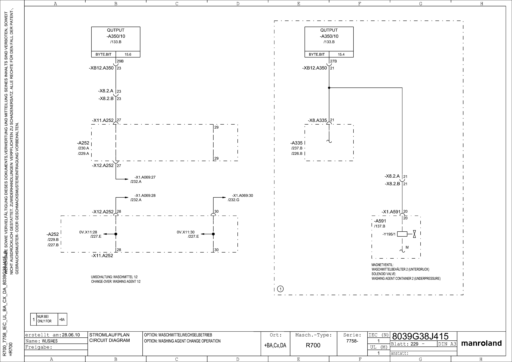

# +BA_Cx_DA — Sheet 229 of 247 — OPTION: WASCHMITTELWECHSELBETRIEB

**OPTION: WASHING AGENT CHANGE OPERATION**

> Part of the manroland **R700** printing press IEC/UL circuit diagrams.
> Drawing class: **Stromlaufplan / Circuit diagram** (DIN A3).
> Document `+BA_Cx_DA` covers the **Printing units / main switch cabinet** machine section.

## At a glance

| Field | Value |
|---|---|
| Document | `+BA_Cx_DA`  (8039G38J415) |
| Sheet | **229** of 247 |
| Section (DE) | OPTION: WASCHMITTELWECHSELBETRIEB |
| Section (EN) | OPTION: WASHING AGENT CHANGE OPERATION |
| Section type | CIRCUIT — Circuit diagram |
| Machine type | `R700` |
| Series | `7758` |
| Created | 28.06.10 |
| Replaces | — |
| Columns used | A, B, C, D, E, F, G |
| Path numbers | — |
| Labels on sheet | 75 |
| Cross-refs out | 14 |
| Cross-refs in | 30 |

**Previous:** [+BA_Cx_DA sheet 228](SHEET_0228.md) · **Next:** [+BA_Cx_DA sheet 230](SHEET_0230.md) · **Document TOC:** [_TOC.md](_TOC.md)  (+BA_Cx_DA) · **Master TOC:** [all sheets](../_MASTER_TOC.md)

## Sheet image (300 DPI, exact vector render)



_Rendered directly from the PDF vector layer at 300 DPI (1-bit), no OCR and no resampling. Use it to confirm anything ambiguous in the text below._

## Cross-references on this sheet

Each entry is a wire leaving this sheet. The printed token is `/sheet.column`; the link resolves to that sheet inside the same document.

| Ref | Target sheet | Col | Path | Destination on target | Target section | From col |
|---|---|---|---|---|---|---|
| `/133.B` | [+BA_Cx_DA sheet 133](SHEET_0133.md) | B | — | — | REFERENZMODUL | B |
| `/133.B` | [+BA_Cx_DA sheet 133](SHEET_0133.md) | B | — | — | REFERENZMODUL | F |
| `/230.A` | [+BA_Cx_DA sheet 230](SHEET_0230.md) | A | — | — | OPTION: WASCHMITTELWECHSELBETRIEB | A |
| `/229.A` | [+BA_Cx_DA sheet 229](SHEET_0229.md) | A | — | — | OPTION: WASCHMITTELWECHSELBETRIEB | A |
| `/237.B` | [+BA_Cx_DA sheet 237](SHEET_0237.md) | B | — | — | OPTION: INLINECOATER SMART | E |
| `/226.B` | [+BA_Cx_DA sheet 226](SHEET_0226.md) | B | — | — | OPTION: ZWISCHENTROCKNER VORBEREITUNG | E |
| `/232.A` | [+BA_Cx_DA sheet 232](SHEET_0232.md) | A | — | — | OPTION: WASCHMITTELWECHSELBETRIEB | B |
| `/232.A` | [+BA_Cx_DA sheet 232](SHEET_0232.md) | A | — | — | OPTION: WASCHMITTELWECHSELBETRIEB | B |
| `/232.G` | [+BA_Cx_DA sheet 232](SHEET_0232.md) | G | — | — | OPTION: WASCHMITTELWECHSELBETRIEB | D |
| `/137.B` | [+BA_Cx_DA sheet 137](SHEET_0137.md) | B | — | A591 | REFERENZMODUL | F |
| `/227.E` | [+BA_Cx_DA sheet 227](SHEET_0227.md) | E | — | 0V.X11:28 0V.X11:30 | OPTION: WASCHMITTELWECHSELBETRIEB | B |
| `/227.E` | [+BA_Cx_DA sheet 227](SHEET_0227.md) | E | — | 0V.X11:28 0V.X11:30 | OPTION: WASCHMITTELWECHSELBETRIEB | B |
| `/229.B` | [+BA_Cx_DA sheet 229](SHEET_0229.md) | B | — | — | OPTION: WASCHMITTELWECHSELBETRIEB | A |
| `/227.B` | [+BA_Cx_DA sheet 227](SHEET_0227.md) | B | — | — | OPTION: WASCHMITTELWECHSELBETRIEB | A |

### Incoming references (sheets that point here)

Every other sheet that sends a wire to this one. `Back-ref` is the token printed on *that* sheet; `Path` is its line number.

| From sheet | Cols | Back-ref | Path | Refs | What continues there |
|---|---|---|---|---|---|
| [+BA_Cx_DA#133](SHEET_0133.md) | B | `/133.B` | — | 2 | — |
| [+BA_Cx_DA#137](SHEET_0137.md) | B | `/137.B` | — | 1 | — |
| [+BA_Cx_DA#142](SHEET_0142.md) | B | `/142.B` | — | 1 | — |
| [+BA_Cx_DA#164](SHEET_0164.md) | G, H | `/164.G`, `/164.H` | — | 4 | — |
| [+BA_Cx_DA#165](SHEET_0165.md) | E | `/165.E` | — | 1 | — |
| [+BA_Cx_DA#168](SHEET_0168.md) | B | `/168.B` | — | 4 | — |
| [+BA_Cx_DA#169](SHEET_0169.md) | B, G | `/169.B`, `/169.G` | — | 6 | — |
| [+BA_Cx_DA#226](SHEET_0226.md) | A | `/226.A` | — | 1 | — |
| [+BA_Cx_DA#227](SHEET_0227.md) | B, E | `/227.B`, `/227.E` | — | 3 | — |
| [+BA_Cx_DA#229](SHEET_0229.md) | A | `/229.A` | — | 2 | — |
| [+BA_Cx_DA#230](SHEET_0230.md) | A | `/230.A` | — | 1 | — |
| [+BA_Cx_DA#232](SHEET_0232.md) | A, F | `/232.A`, `/232.F` | — | 3 | X1.A069:25 X1.A069:30; X1.A069:27; X1.A069:28 |
| [+BA_Cx_DA#237](SHEET_0237.md) | B | `/237.B` | — | 1 | — |


## Devices on this sheet

| Tag | Class | Class meaning (IEC) | Col | Sub | Terminal | Sign |
|---|---|---|---|---|---|---|
| `A350/10` | A | Baugruppe / assembly, module, PC board | B | 10 | — | — |
| `A252` | A | Baugruppe / assembly, module, PC board | A | — | — | — |
| `A252` | A | Baugruppe / assembly, module, PC board | A | — | — | — |
| `A350/10` | A | Baugruppe / assembly, module, PC board | F | 10 | — | — |
| `A335` | A | Baugruppe / assembly, module, PC board | E | — | — | — |
| `Y195/1` | Y | Magnetventil / solenoid valve, actuator | F | 1 | — | — |
| `A591` | A | Baugruppe / assembly, module, PC board | F | — | — | — |
| `15.6` | — | cross-device reference | B | — | — | — |
| `XB12.A350` | — | cross-device reference | B | — | — | — |
| `X11.A252` | — | cross-device reference | B | — | — | — |
| `X12.A252` | — | cross-device reference | B | — | — | — |
| `X12.A252` | — | cross-device reference | B | — | — | — |
| `X8.2.B` | — | cross-device reference | B | — | — | — |
| `X8.2.A` | — | cross-device reference | B | — | — | — |
| `15.4` | — | cross-device reference | F | — | — | — |
| `XB12.A350` | — | cross-device reference | E | — | — | — |
| `X8.A335` | — | cross-device reference | E | — | — | — |
| `X8.2.B` | — | cross-device reference | G | — | — | — |
| `X8.2.A` | — | cross-device reference | G | — | — | — |
| `X1.A591` | — | cross-device reference | G | — | — | — |
| `X1.A069:30` | — | cross-device reference | D | — | 30 | — |
| `X1.A069:27` | — | cross-device reference | B | — | 27 | — |
| `X1.A069:28` | — | cross-device reference | B | — | 28 | — |
| `X11.A252` | — | cross-device reference | B | — | — | — |

## Potentials / nets

| Potential | Count | Columns | Attached devices | Terminals |
|---|---|---|---|---|
| `0V` | 2 | B, C | `X11` | `28`, `30` |


A potential such as `L24+/4` or `M24+` is a named supply/return rail; every place it appears on this sheet is electrically common.

## Wire-end annotations (grouped as printed)

A wire that continues elsewhere is annotated with a small cluster: the destination description, the path/line number `#NN`, and the `/sheet.column` cross reference. Each row below is one such cluster exactly as it is grouped on the drawing.

| Col | Y | Path | Cross-ref | Text on the wire |
|---|---|---|---|---|
| B | 65.8 | — | — | `QUTPUT` |
| E | 65.8 | — | — | `QUTPUT` |
| B | 79.7 | — | — | `A350/10` |
| F | 79.7 | — | — | `A350/10` |
| B | 93.5 | — | `/133.B` | — |
| F | 93.5 | — | `/133.B` | — |
| B | 123.1 | — | — | `BYTE.BIT 15.6` |
| E | 123.1 | — | — | `BYTE.BIT 15.4` |
| B | 138.5 | — | — | `29B` |
| F | 138.5 | — | — | `27B` |
| B | 153.4 | — | — | `XB12.A350 23` |
| E | 153.4 | — | — | `XB12.A350 21` |
| B | 206.6 | — | — | `X8.2.A 23` |
| B | 224.3 | — | — | `X8.2.B 23` |
| B | 275.3 | — | — | `X11.A252 27` |
| E | 275.3 | — | — | `X8.A335 21` |
| D | 292.3 | — | — | `29` |
| A | 327.7 | — | — | `A252` |
| E | 327.7 | — | — | `A335` |
| A | 340.8 | — | `/230.A`, `/229.A` | — |
| E | 340.8 | — | `/237.B`, `/226.B` | — |
| D | 364.6 | — | — | `29` |
| B | 380.1 | — | — | `X12.A252 27` |
| G | 405.0 | — | — | `X8.2.A 21` |
| B | 408.5 | — | — | `X1.A069:27` |
| B | 418.4 | — | `/232.A` | — |
| G | 422.7 | — | — | `X8.2.B 21` |
| B | 451.0 | — | — | `X1.A069:28` |
| D | 451.0 | — | — | `X1.A069:30` |
| B | 460.9 | — | `/232.A` | — |
| D | 460.9 | — | `/232.G` | — |
| B | 487.9 | — | — | `X12.A252 28` |
| D | 487.9 | — | — | `30` |
| G | 487.9 | — | — | `X1.A591 20` |
| G | 503.5 | — | — | `20` |
| F | 509.1 | — | `/137.B` | `A591` |
| B | 536.0 | — | `/227.E`, `/227.E` | `0V.X11:28 0V.X11:30` |
| A | 540.3 | — | — | `A252` |
| F | 541.0 | — | — | `Y195/1` |
| A | 553.4 | — | `/229.B`, `/227.B` | — |
| G | 571.6 | — | — | `M` |
| B | 577.2 | — | — | `28` |
| D | 577.2 | — | — | `30` |
| B | 589.9 | — | — | `X11.A252` |
| F | 612.9 | — | — | `MAGNETVENTIL:` |
| G | 623.5 | — | — | `SOLENOID VALVE: WASCHMITTELBEHÄLTER 2 (UNTERDRUCK) WASHING AGENT CONTAINER 2 (UNDERPRESSURE)` |
| B | 641.2 | — | — | `UMSCHALTUNG: WASCHMITTEL 1/2` |
| B | 651.9 | — | — | `CHANGE OVER: WASHING AGENT 1/2` |
| E | 668.8 | — | — | `1` |
| A | 733.3 | — | — | `1 NUR BEI` |
| A | 740.4 | — | — | `ONLY FOR +BA` |


## Reconstructed tables

This sheet carries tabular content (pin map / terminal assignment / index). The grid below was rebuilt from the drawing's own rule lines, so each row is exactly one physical row of the table.

### Table 1 — 1 data rows × 2 columns (at x=212.6, y=62.4)

| QUTPUT | A350/10 /133.B |
|---|---|
| `BYTE.BIT` | `15.6` |


### Table 2 — 2 data rows × 2 columns (at x=708.7, y=62.4)

| QUTPUT | A350/10 /133.B |
|---|---|
| `BYTE.BIT` | `15.4` |
| `XB12.A350` | `27B 21` |


## Notes and free text on this sheet

| Text | Col | Y (pt) |
|---|---|---|
| `29B` | B | 138.48 |
| `QUTPUT` | B | 65.81 |
| `BYTE.BIT` | B | 123.08 |
| `UMSCHALTUNG: WASCHMITTEL 1/2` | B | 641.25 |
| `CHANGE OVER: WASHING AGENT 1/2` | B | 651.88 |
| `27B` | F | 138.48 |
| `QUTPUT` | E | 65.81 |
| `BYTE.BIT` | E | 123.08 |
| `MAGNETVENTIL:` | F | 612.9 |
| `WASCHMITTELBEHÄLTER 2 (UNTERDRUCK)` | G | 623.55 |
| `SOLENOID VALVE:` | F | 634.16 |
| `WASHING AGENT CONTAINER 2 (UNDERPRESSURE)` | G | 644.81 |
| `M` | G | 571.57 |
| `NUR BEI` | A | 733.33 |
| `ONLY FOR` | A | 744.02 |
| `+BA` | A | 740.44 |

## Complete label inventory (exact text from the drawing)

Every text object inside the drawing area of this sheet, in DIN reading order (column A→H, then top→bottom). This is the authoritative list: if a string is not here it is not printed on this sheet.

| Col | Y | X | Dir | Type | Text |
|---|---|---|---|---|---|
| A | 327.7 | 179.1 | → | device tag | `A252` |
| A | 340.8 | 181.4 | → | cross-reference | `/230.A` |
| A | 353.2 | 181.4 | → | cross-reference | `/229.A` |
| A | 540.3 | 108.3 | → | device tag | `A252` |
| A | 553.4 | 110.8 | → | cross-reference | `/229.B` |
| A | 565.8 | 110.8 | → | cross-reference | `/227.B` |
| A | 733.3 | 87.0 | → | text | `NUR BEI` |
| A | 738.7 | 75.4 | → | number | `1` |
| A | 740.4 | 137.9 | → | text | `+BA` |
| A | 744.0 | 87.6 | → | text | `ONLY FOR` |
| B | 65.8 | 249.0 | → | text | `QUTPUT` |
| B | 79.7 | 247.9 | → | device tag | `A350/10` |
| B | 93.5 | 256.7 | → | cross-reference | `/133.B` |
| B | 123.1 | 222.5 | → | text | `BYTE.BIT` |
| B | 123.1 | 289.4 | → | device ref | `15.6` |
| B | 138.5 | 271.8 | → | text | `29B` |
| B | 153.4 | 206.9 | → | device ref | `XB12.A350` |
| B | 154.8 | 271.8 | → | number | `23` |
| B | 206.6 | 228.2 | → | device ref | `X8.2.A` |
| B | 208.7 | 271.8 | → | number | `23` |
| B | 224.3 | 229.0 | → | device ref | `X8.2.B` |
| B | 225.7 | 271.8 | → | number | `23` |
| B | 275.3 | 214.0 | → | device ref | `X11.A252` |
| B | 275.3 | 271.8 | → | number | `27` |
| B | 380.1 | 214.0 | → | device ref | `X12.A252` |
| B | 381.6 | 271.8 | → | number | `27` |
| B | 408.5 | 312.9 | → | device ref | `X1.A069:27` |
| B | 418.4 | 303.3 | → | cross-reference | `/232.A` |
| B | 451.0 | 312.9 | → | device ref | `X1.A069:28` |
| B | 460.9 | 303.3 | → | cross-reference | `/232.A` |
| B | 487.9 | 214.0 | → | device ref | `X12.A252` |
| B | 487.9 | 271.8 | → | number | `28` |
| B | 536.0 | 184.5 | → | potential | `0V.X11:28` |
| B | 545.9 | 210.3 | → | cross-reference | `/227.E` |
| B | 577.2 | 271.8 | → | number | `28` |
| B | 589.9 | 212.6 | → | device ref | `X11.A252` |
| B | 641.3 | 211.7 | → | text | `UMSCHALTUNG: WASCHMITTEL 1/2` |
| B | 651.9 | 212.3 | → | text | `CHANGE OVER: WASHING AGENT 1/2` |
| C | 536.0 | 411.3 | → | potential | `0V.X11:30` |
| C | 545.9 | 437.1 | → | cross-reference | `/227.E` |
| D | 292.3 | 498.6 | → | number | `29` |
| D | 364.6 | 498.6 | → | number | `29` |
| D | 451.0 | 539.7 | → | device ref | `X1.A069:30` |
| D | 460.9 | 530.1 | → | cross-reference | `/232.G` |
| D | 487.9 | 498.6 | → | number | `30` |
| D | 577.2 | 498.6 | → | number | `30` |
| E | 65.8 | 745.1 | → | text | `QUTPUT` |
| E | 123.1 | 718.6 | → | text | `BYTE.BIT` |
| E | 153.4 | 703.0 | → | device ref | `XB12.A350` |
| E | 275.3 | 716.0 | → | device ref | `X8.A335` |
| E | 327.7 | 675.2 | → | device tag | `A335` |
| E | 340.8 | 677.8 | → | cross-reference | `/237.B` |
| E | 353.2 | 677.8 | → | cross-reference | `/226.B` |
| E | 668.8 | 650.2 | → | number | `1` |
| F | 79.7 | 744.0 | → | device tag | `A350/10` |
| F | 93.5 | 752.7 | → | cross-reference | `/133.B` |
| F | 123.1 | 785.5 | → | device ref | `15.4` |
| F | 138.5 | 767.9 | → | text | `27B` |
| F | 154.8 | 767.9 | → | number | `21` |
| F | 275.3 | 767.9 | → | number | `21` |
| F | 509.1 | 870.0 | → | device tag | `A591` |
| F | 522.2 | 870.2 | → | cross-reference | `/137.B` |
| F | 541.0 | 889.5 | → | device tag | `Y195/1` |
| F | 612.9 | 864.0 | → | text | `MAGNETVENTIL:` |
| F | 634.2 | 864.3 | → | text | `SOLENOID VALVE:` |
| G | 405.0 | 894.3 | → | device ref | `X8.2.A` |
| G | 407.1 | 938.0 | → | number | `21` |
| G | 422.7 | 895.2 | → | device ref | `X8.2.B` |
| G | 424.1 | 938.0 | → | number | `21` |
| G | 487.9 | 887.5 | → | device ref | `X1.A591` |
| G | 487.9 | 938.0 | → | number | `20` |
| G | 503.5 | 938.0 | → | number | `20` |
| G | 571.6 | 943.4 | → | text | `M` |
| G | 623.6 | 864.6 | → | text | `WASCHMITTELBEHÄLTER 2 (UNTERDRUCK)` |
| G | 644.8 | 864.6 | → | text | `WASHING AGENT CONTAINER 2 (UNDERPRESSURE)` |

## Reading-order text block

The same content as a plain block, grouped by DIN column — convenient to paste or to match against a visual description.

```text
=== Column A ===
 327.7  179.1  devtag       A252
 340.8  181.4  xref         /230.A
 353.2  181.4  xref         /229.A
 540.3  108.3  devtag       A252
 553.4  110.8  xref         /229.B
 565.8  110.8  xref         /227.B
 733.3   87.0  text         NUR BEI
 738.7   75.4  numeric      1
 740.4  137.9  text         +BA
 744.0   87.6  text         ONLY FOR
=== Column B ===
  65.8  249.0  text         QUTPUT
  79.7  247.9  devtag       A350/10
  93.5  256.7  xref         /133.B
 123.1  222.5  text         BYTE.BIT
 123.1  289.4  devref       15.6
 138.5  271.8  text         29B
 153.4  206.9  devref       XB12.A350
 154.8  271.8  numeric      23
 206.6  228.2  devref       X8.2.A
 208.7  271.8  numeric      23
 224.3  229.0  devref       X8.2.B
 225.7  271.8  numeric      23
 275.3  214.0  devref       X11.A252
 275.3  271.8  numeric      27
 380.1  214.0  devref       X12.A252
 381.6  271.8  numeric      27
 408.5  312.9  devref       X1.A069:27
 418.4  303.3  xref         /232.A
 451.0  312.9  devref       X1.A069:28
 460.9  303.3  xref         /232.A
 487.9  214.0  devref       X12.A252
 487.9  271.8  numeric      28
 536.0  184.5  net          0V.X11:28
 545.9  210.3  xref         /227.E
 577.2  271.8  numeric      28
 589.9  212.6  devref       X11.A252
 641.3  211.7  text         UMSCHALTUNG: WASCHMITTEL 1/2
 651.9  212.3  text         CHANGE OVER: WASHING AGENT 1/2
=== Column C ===
 536.0  411.3  net          0V.X11:30
 545.9  437.1  xref         /227.E
=== Column D ===
 292.3  498.6  numeric      29
 364.6  498.6  numeric      29
 451.0  539.7  devref       X1.A069:30
 460.9  530.1  xref         /232.G
 487.9  498.6  numeric      30
 577.2  498.6  numeric      30
=== Column E ===
  65.8  745.1  text         QUTPUT
 123.1  718.6  text         BYTE.BIT
 153.4  703.0  devref       XB12.A350
 275.3  716.0  devref       X8.A335
 327.7  675.2  devtag       A335
 340.8  677.8  xref         /237.B
 353.2  677.8  xref         /226.B
 668.8  650.2  numeric      1
=== Column F ===
  79.7  744.0  devtag       A350/10
  93.5  752.7  xref         /133.B
 123.1  785.5  devref       15.4
 138.5  767.9  text         27B
 154.8  767.9  numeric      21
 275.3  767.9  numeric      21
 509.1  870.0  devtag       A591
 522.2  870.2  xref         /137.B
 541.0  889.5  devtag       Y195/1
 612.9  864.0  text         MAGNETVENTIL:
 634.2  864.3  text         SOLENOID VALVE:
=== Column G ===
 405.0  894.3  devref       X8.2.A
 407.1  938.0  numeric      21
 422.7  895.2  devref       X8.2.B
 424.1  938.0  numeric      21
 487.9  887.5  devref       X1.A591
 487.9  938.0  numeric      20
 503.5  938.0  numeric      20
 571.6  943.4  text         M
 623.6  864.6  text         WASCHMITTELBEHÄLTER 2 (UNTERDRUCK)
 644.8  864.6  text         WASHING AGENT CONTAINER 2 (UNDERPRESSURE)
```

---
_Generated from the PDF vector text layer; no OCR. Source: `R700_7758_IEC_UL_BA_CX_DA_8039G38J415_p`, sheet 229._
