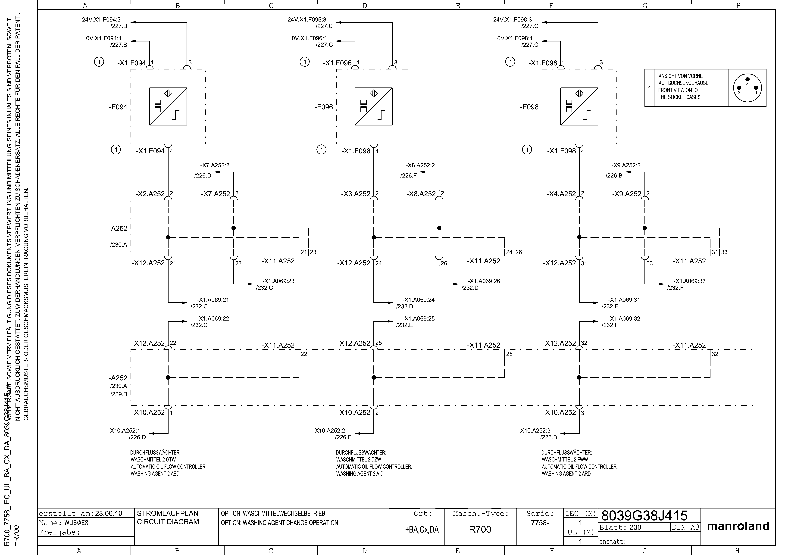

# +BA_Cx_DA — Sheet 230 of 247 — OPTION: WASCHMITTELWECHSELBETRIEB

**OPTION: WASHING AGENT CHANGE OPERATION**

> Part of the manroland **R700** printing press IEC/UL circuit diagrams.
> Drawing class: **Stromlaufplan / Circuit diagram** (DIN A3).
> Document `+BA_Cx_DA` covers the **Printing units / main switch cabinet** machine section.

## At a glance

| Field | Value |
|---|---|
| Document | `+BA_Cx_DA`  (8039G38J415) |
| Sheet | **230** of 247 |
| Section (DE) | OPTION: WASCHMITTELWECHSELBETRIEB |
| Section (EN) | OPTION: WASHING AGENT CHANGE OPERATION |
| Section type | CIRCUIT — Circuit diagram |
| Machine type | `R700` |
| Series | `7758` |
| Created | 28.06.10 |
| Replaces | — |
| Columns used | A, B, C, D, E, F, G, H |
| Path numbers | — |
| Labels on sheet | 136 |
| Cross-refs out | 24 |
| Cross-refs in | 60 |

**Previous:** [+BA_Cx_DA sheet 229](SHEET_0229.md) · **Next:** [+BA_Cx_DA sheet 231](SHEET_0231.md) · **Document TOC:** [_TOC.md](_TOC.md)  (+BA_Cx_DA) · **Master TOC:** [all sheets](../_MASTER_TOC.md)

## Sheet image (300 DPI, exact vector render)



_Rendered directly from the PDF vector layer at 300 DPI (1-bit), no OCR and no resampling. Use it to confirm anything ambiguous in the text below._

## Cross-references on this sheet

Each entry is a wire leaving this sheet. The printed token is `/sheet.column`; the link resolves to that sheet inside the same document.

| Ref | Target sheet | Col | Path | Destination on target | Target section | From col |
|---|---|---|---|---|---|---|
| `/227.B` | [+BA_Cx_DA sheet 227](SHEET_0227.md) | B | — | 24V.X1.F094:3 | OPTION: WASCHMITTELWECHSELBETRIEB | A |
| `/227.C` | [+BA_Cx_DA sheet 227](SHEET_0227.md) | C | — | 24V.X1.F096:3 | OPTION: WASCHMITTELWECHSELBETRIEB | C |
| `/227.C` | [+BA_Cx_DA sheet 227](SHEET_0227.md) | C | — | 24V.X1.F098:3 | OPTION: WASCHMITTELWECHSELBETRIEB | F |
| `/227.B` | [+BA_Cx_DA sheet 227](SHEET_0227.md) | B | — | 0V.X1.F094:1 0V.X1.F096:1 0V.X1.F098:1 | OPTION: WASCHMITTELWECHSELBETRIEB | C |
| `/227.C` | [+BA_Cx_DA sheet 227](SHEET_0227.md) | C | — | 0V.X1.F094:1 0V.X1.F096:1 0V.X1.F098:1 | OPTION: WASCHMITTELWECHSELBETRIEB | C |
| `/227.C` | [+BA_Cx_DA sheet 227](SHEET_0227.md) | C | — | 0V.X1.F094:1 0V.X1.F096:1 0V.X1.F098:1 | OPTION: WASCHMITTELWECHSELBETRIEB | C |
| `/226.B` | [+BA_Cx_DA sheet 226](SHEET_0226.md) | B | — | — | OPTION: ZWISCHENTROCKNER VORBEREITUNG | G |
| `/226.F` | [+BA_Cx_DA sheet 226](SHEET_0226.md) | F | — | — | OPTION: ZWISCHENTROCKNER VORBEREITUNG | D |
| `/226.D` | [+BA_Cx_DA sheet 226](SHEET_0226.md) | D | — | — | OPTION: ZWISCHENTROCKNER VORBEREITUNG | B |
| `/230.A` | [+BA_Cx_DA sheet 230](SHEET_0230.md) | A | — | — | OPTION: WASCHMITTELWECHSELBETRIEB | A |
| `/232.C` | [+BA_Cx_DA sheet 232](SHEET_0232.md) | C | — | X1.A069:26 | OPTION: WASCHMITTELWECHSELBETRIEB | D |
| `/232.F` | [+BA_Cx_DA sheet 232](SHEET_0232.md) | F | — | — | OPTION: WASCHMITTELWECHSELBETRIEB | G |
| `/232.D` | [+BA_Cx_DA sheet 232](SHEET_0232.md) | D | — | — | OPTION: WASCHMITTELWECHSELBETRIEB | E |
| `/232.F` | [+BA_Cx_DA sheet 232](SHEET_0232.md) | F | — | — | OPTION: WASCHMITTELWECHSELBETRIEB | G |
| `/232.C` | [+BA_Cx_DA sheet 232](SHEET_0232.md) | C | — | — | OPTION: WASCHMITTELWECHSELBETRIEB | B |
| `/232.D` | [+BA_Cx_DA sheet 232](SHEET_0232.md) | D | — | — | OPTION: WASCHMITTELWECHSELBETRIEB | D |
| `/232.E` | [+BA_Cx_DA sheet 232](SHEET_0232.md) | E | — | — | OPTION: WASCHMITTELWECHSELBETRIEB | D |
| `/232.F` | [+BA_Cx_DA sheet 232](SHEET_0232.md) | F | — | — | OPTION: WASCHMITTELWECHSELBETRIEB | G |
| `/232.C` | [+BA_Cx_DA sheet 232](SHEET_0232.md) | C | — | — | OPTION: WASCHMITTELWECHSELBETRIEB | B |
| `/230.A` | [+BA_Cx_DA sheet 230](SHEET_0230.md) | A | — | — | OPTION: WASCHMITTELWECHSELBETRIEB | A |
| `/229.B` | [+BA_Cx_DA sheet 229](SHEET_0229.md) | B | — | — | OPTION: WASCHMITTELWECHSELBETRIEB | A |
| `/226.D` | [+BA_Cx_DA sheet 226](SHEET_0226.md) | D | — | X10.A252:1 | OPTION: ZWISCHENTROCKNER VORBEREITUNG | A |
| `/226.F` | [+BA_Cx_DA sheet 226](SHEET_0226.md) | F | — | X10.A252:2 | OPTION: ZWISCHENTROCKNER VORBEREITUNG | D |
| `/226.B` | [+BA_Cx_DA sheet 226](SHEET_0226.md) | B | — | X10.A252:3 | OPTION: ZWISCHENTROCKNER VORBEREITUNG | F |

### Incoming references (sheets that point here)

Every other sheet that sends a wire to this one. `Back-ref` is the token printed on *that* sheet; `Path` is its line number.

| From sheet | Cols | Back-ref | Path | Refs | What continues there |
|---|---|---|---|---|---|
| [+BA_Cx_DA#147](SHEET_0147.md) | C, E | `/147.C`, `/147.E` | — | 9 | — |
| [+BA_Cx_DA#152](SHEET_0152.md) | E | `/152.E` | — | 1 | — |
| [+BA_Cx_DA#156](SHEET_0156.md) | A | `/156.A` | — | 1 | — |
| [+BA_Cx_DA#158](SHEET_0158.md) | G | `/158.G` | — | 1 | — |
| [+BA_Cx_DA#163](SHEET_0163.md) | E | `/163.E` | — | 1 | — |
| [+BA_Cx_DA#165](SHEET_0165.md) | A | `/165.A` | — | 1 | — |
| [+BA_Cx_DA#166](SHEET_0166.md) | A | `/166.A` | — | 1 | — |
| [+BA_Cx_DA#167](SHEET_0167.md) | A | `/167.A` | — | 3 | — |
| [+BA_Cx_DA#168](SHEET_0168.md) | B | `/168.B` | — | 9 | — |
| [+BA_Cx_DA#169](SHEET_0169.md) | B | `/169.B` | — | 9 | — |
| [+BA_Cx_DA#226](SHEET_0226.md) | B, D, E, F | `/226.B`, `/226.D`, `/226.E`, `/226.F` | — | 6 | X10.A252:2; X8.A252:2 |
| [+BA_Cx_DA#227](SHEET_0227.md) | B, C | `/227.B`, `/227.C` | — | 6 | 24V.X1.F094:3; 24V.X1.F096:3; 24V.X1.F098:3 |
| [+BA_Cx_DA#229](SHEET_0229.md) | A | `/229.A` | — | 1 | — |
| [+BA_Cx_DA#230](SHEET_0230.md) | A | `/230.A` | — | 2 | — |
| [+BA_Cx_DA#232](SHEET_0232.md) | C, D, E, F | `/232.C`, `/232.D`, `/232.E`, `/232.F` | — | 9 | X1.A069:21 X1.A069:17; X1.A069:22; X1.A069:23; X1.A069:24; X1.A069:25 X1.A069:30; X1.A069:26; X1.A069:31; X1.A069:32; X1.A069:33 |


## Devices on this sheet

| Tag | Class | Class meaning (IEC) | Col | Sub | Terminal | Sign |
|---|---|---|---|---|---|---|
| `F094` | F | Schutz / protection device (fuse, circuit breaker) | A | — | — | — |
| `F096` | F | Schutz / protection device (fuse, circuit breaker) | D | — | — | — |
| `F098` | F | Schutz / protection device (fuse, circuit breaker) | F | — | — | — |
| `A252` | A | Baugruppe / assembly, module, PC board | A | — | — | — |
| `A252` | A | Baugruppe / assembly, module, PC board | A | — | — | — |
| `X1.F094` | — | cross-device reference | B | — | — | — |
| `X1.F094` | — | cross-device reference | B | — | — | — |
| `X1.F096` | — | cross-device reference | D | — | — | — |
| `X1.F096` | — | cross-device reference | D | — | — | — |
| `X1.F098` | — | cross-device reference | F | — | — | — |
| `X1.F098` | — | cross-device reference | F | — | — | — |
| `X2.A252` | — | cross-device reference | B | — | — | — |
| `X12.A252` | — | cross-device reference | B | — | — | — |
| `X7.A252` | — | cross-device reference | B | — | — | — |
| `X3.A252` | — | cross-device reference | D | — | — | — |
| `X12.A252` | — | cross-device reference | D | — | — | — |
| `X8.A252` | — | cross-device reference | E | — | — | — |
| `X4.A252` | — | cross-device reference | F | — | — | — |
| `X12.A252` | — | cross-device reference | F | — | — | — |
| `X9.A252` | — | cross-device reference | G | — | — | — |
| `X12.A252` | — | cross-device reference | B | — | — | — |
| `X10.A252` | — | cross-device reference | B | — | — | — |
| `X12.A252` | — | cross-device reference | D | — | — | — |
| `X10.A252` | — | cross-device reference | D | — | — | — |
| `X12.A252` | — | cross-device reference | F | — | — | — |
| `X10.A252` | — | cross-device reference | F | — | — | — |
| `X1.A069:31` | — | cross-device reference | G | — | 31 | — |
| `X1.A069:32` | — | cross-device reference | G | — | 32 | — |
| `X1.A069:33` | — | cross-device reference | G | — | 33 | — |
| `X1.A069:24` | — | cross-device reference | E | — | 24 | — |
| `X1.A069:25` | — | cross-device reference | E | — | 25 | — |
| `X1.A069:26` | — | cross-device reference | E | — | 26 | — |
| `X1.A069:23` | — | cross-device reference | C | — | 23 | — |
| `X1.A069:21` | — | cross-device reference | B | — | 21 | — |
| `X1.A069:22` | — | cross-device reference | B | — | 22 | — |
| `X10.A252:1` | — | cross-device reference | A | — | 1 | — |
| `X9.A252:2` | — | cross-device reference | G | — | 2 | — |
| `X10.A252:2` | — | cross-device reference | D | — | 2 | — |
| `X10.A252:3` | — | cross-device reference | F | — | 3 | — |
| `X8.A252:2` | — | cross-device reference | E | — | 2 | — |
| `X7.A252:2` | — | cross-device reference | B | — | 2 | — |
| `X11.A252` | — | cross-device reference | C | — | — | — |
| `X11.A252` | — | cross-device reference | E | — | — | — |
| `X11.A252` | — | cross-device reference | G | — | — | — |
| `X11.A252` | — | cross-device reference | C | — | — | — |
| `X11.A252` | — | cross-device reference | E | — | — | — |
| `X11.A252` | — | cross-device reference | G | — | — | — |

## Potentials / nets

| Potential | Count | Columns | Attached devices | Terminals |
|---|---|---|---|---|
| `0V` | 3 | A, C, F | `F094`, `F096`, `F098`, `X1` | `1` |
| `24V` | 3 | A, C, F | `F094`, `F096`, `F098`, `X1` | `3` |


A potential such as `L24+/4` or `M24+` is a named supply/return rail; every place it appears on this sheet is electrically common.

## Wire-end annotations (grouped as printed)

A wire that continues elsewhere is annotated with a small cluster: the destination description, the path/line number `#NN`, and the `/sheet.column` cross reference. Each row below is one such cluster exactly as it is grouped on the drawing.

| Col | Y | Path | Cross-ref | Text on the wire |
|---|---|---|---|---|
| A | 25.8 | — | `/227.B` | `24V.X1.F094:3` |
| C | 25.8 | — | `/227.C` | `24V.X1.F096:3` |
| F | 25.8 | — | `/227.C` | `24V.X1.F098:3` |
| C | 54.1 | — | `/227.B`, `/227.C`, `/227.C` | `0V.X1.F094:1 0V.X1.F096:1 0V.X1.F098:1` |
| A | 90.5 | — | — | `1` |
| C | 90.5 | — | — | `1` |
| F | 90.5 | — | — | `1` |
| B | 91.0 | — | — | `X1.F094 1 3` |
| D | 91.0 | — | — | `X1.F096 1 3` |
| F | 91.0 | — | — | `X1.F098 1 3` |
| G | 112.6 | — | — | `FRONT VIEW ONTO ANSICHT VON VORNE AUF BUCHSENGEHÄUSE` |
| H | 124.9 | — | — | `4` |
| H | 129.2 | — | — | `1 3 1` |
| G | 144.5 | — | — | `THE SOCKET CASES` |
| A | 157.6 | — | — | `F094` |
| D | 157.6 | — | — | `F096` |
| F | 157.6 | — | — | `F098` |
| A | 223.7 | — | — | `1` |
| D | 223.7 | — | — | `1` |
| F | 223.7 | — | — | `1` |
| B | 224.2 | — | — | `X1.F094 4` |
| D | 224.2 | — | — | `X1.F096 4` |
| F | 224.2 | — | — | `X1.F098 4` |
| B | 246.9 | — | — | `X7.A252:2` |
| E | 246.9 | — | — | `X8.A252:2` |
| G | 246.9 | — | — | `X9.A252:2` |
| B | 262.5 | — | `/226.D` | — |
| D | 262.5 | — | `/226.F` | — |
| G | 262.5 | — | `/226.B` | — |
| B | 289.4 | — | — | `X2.A252 2` |
| B | 289.4 | — | — | `X7.A252 2` |
| D | 289.4 | — | — | `X3.A252 2` |
| E | 289.4 | — | — | `X8.A252 2` |
| F | 289.4 | — | — | `X4.A252 2` |
| G | 289.4 | — | — | `X9.A252 2` |
| A | 341.9 | — | — | `A252` |
| A | 367.4 | — | `/230.A` | — |
| C | 378.8 | — | — | `21 23` |
| F | 378.8 | — | — | `24 26` |
| H | 378.8 | — | — | `31 33` |
| E | 391.5 | — | — | `X11.A252 X11.A252 X11.A252` |
| B | 394.3 | — | — | `X12.A252 21` |
| D | 394.3 | — | — | `X12.A252 24` |
| F | 394.3 | — | — | `X12.A252 31` |
| C | 395.8 | — | — | `23` |
| E | 395.8 | — | — | `26` |
| G | 395.8 | — | — | `33` |
| D | 422.6 | — | `/232.C` | `X1.A069:26` |
| C | 422.6 | — | — | `X1.A069:23` |
| G | 422.6 | — | — | `X1.A069:33` |
| E | 432.6 | — | `/232.D` | — |
| G | 432.6 | — | `/232.F` | — |
| B | 451.0 | — | — | `X1.A069:21` |
| E | 451.0 | — | — | `X1.A069:24` |
| G | 451.0 | — | — | `X1.A069:31` |
| B | 460.9 | — | `/232.C` | — |
| D | 460.9 | — | `/232.D` | — |
| G | 460.9 | — | `/232.F` | — |
| B | 479.3 | — | — | `X1.A069:22` |
| E | 479.3 | — | — | `X1.A069:25` |
| G | 479.3 | — | — | `X1.A069:32` |
| D | 489.2 | — | `/232.E` | — |
| G | 489.2 | — | `/232.F` | — |
| B | 489.3 | — | `/232.C` | — |
| B | 516.2 | — | — | `X12.A252 22` |
| D | 516.2 | — | — | `X12.A252 25` |
| F | 516.2 | — | — | `X12.A252 32` |
| E | 519.0 | — | — | `X11.A252 X11.A252 X11.A252` |
| C | 533.2 | — | — | `22` |
| F | 533.2 | — | — | `25` |
| H | 533.2 | — | — | `32` |
| A | 568.6 | — | — | `A252` |
| A | 581.7 | — | `/230.A`, `/229.B` | — |
| B | 621.1 | — | — | `X10.A252 1` |
| D | 621.1 | — | — | `X10.A252 2` |
| F | 621.1 | — | — | `X10.A252 3` |
| A | 649.4 | — | `/226.D` | `X10.A252:1` |
| D | 649.4 | — | `/226.F` | `X10.A252:2` |
| F | 649.4 | — | `/226.B` | `X10.A252:3` |
| B | 683.8 | — | — | `DURCHFLUSSWÄCHTER:` |
| D | 683.8 | — | — | `DURCHFLUSSWÄCHTER:` |
| F | 683.8 | — | — | `DURCHFLUSSWÄCHTER:` |
| B | 694.4 | — | — | `WASCHMITTEL 2 GTW AUTOMATIC OIL FLOW CONTROLLER: WASHING AGENT 2 ABD` |
| D | 694.4 | — | — | `WASCHMITTEL 2 DZW AUTOMATIC OIL FLOW CONTROLLER: WASHING AGENT 2 AID` |
| F | 694.4 | — | — | `WASCHMITTEL 2 FWW AUTOMATIC OIL FLOW CONTROLLER: WASHING AGENT 2 ARD` |


## Reconstructed tables

This sheet carries tabular content (pin map / terminal assignment / index). The grid below was rebuilt from the drawing's own rule lines, so each row is exactly one physical row of the table.

### Table 1 — 3 data rows × 18 columns (at x=226.8, y=34.0)

| 1 |  | 3 |  | 1 | /227.C 0V.X1.F096:1 /227.C X1.F096 | 1 |  | 3 |  | 1 | /227.C 0V.X1.F098:1 /227.C X1.F098 | 1 |  | 3 |  | ANSICHT VON VORNE AUF BUCHSENGEHÄUSE |  |
|---|---|---|---|---|---|---|---|---|---|---|---|---|---|---|---|---|---|
|  |  |  |  |  | `F096` |  |  |  |  |  | `F098` |  |  |  | `1` | `FRONT VIEW ONTO THE SOCKET CASES` |  |
| `X1.F094 X2.A252` | `4 2` | `X7.A252:2 /226.D X7.A252` | `2` |  | `1` | `X1.F096 X3.A252` | `4 2` | `X8.A252:2 /226.F X8.A252` | `2` |  | `1` | `X1.F098 X4.A252` | `4 2` | `X9.A252:2 /226.B X9.A252` | `2` |  |  |
|  | `21 22` | `X1.A069:21 /232.C X1.A069:22 /232.C` | `X11.A252 23 X1.A069:23 /232.C X11.A252` | `21 22` | `23 X12.A252 X12.A252` |  | `24 25` | `X1.A069:24 /232.D X1.A069:25 /232.E` | `X11.A252 26 X1.A069:26 /232.D X11.A252` | `24 25` | `26 X12.A252 X12.A252` |  | `31 32` | `X1.A069:31 /232.F X1.A069:32 /232.F` | `33` | `X11.A252 X1.A069:33 /232.F X11.A252` | `31 32` |


## Notes and free text on this sheet

| Text | Col | Y (pt) |
|---|---|---|
| `DURCHFLUSSWÄCHTER:` | B | 683.77 |
| `WASCHMITTEL 2 GTW` | B | 694.37 |
| `AUTOMATIC OIL FLOW CONTROLLER:` | B | 705.04 |
| `WASHING AGENT 2 ABD` | B | 715.65 |
| `DURCHFLUSSWÄCHTER:` | D | 683.77 |
| `WASCHMITTEL 2 DZW` | D | 694.37 |
| `AUTOMATIC OIL FLOW CONTROLLER:` | D | 705.04 |
| `WASHING AGENT 2 AID` | D | 715.65 |
| `DURCHFLUSSWÄCHTER:` | F | 683.77 |
| `WASCHMITTEL 2 FWW` | F | 694.35 |
| `AUTOMATIC OIL FLOW CONTROLLER:` | F | 705.04 |
| `WASHING AGENT 2 ARD` | F | 715.66 |
| `ANSICHT VON VORNE` | G | 112.6 |
| `AUF BUCHSENGEHÄUSE` | G | 123.23 |
| `FRONT VIEW ONTO` | G | 133.83 |
| `THE SOCKET CASES` | G | 144.48 |

## Complete label inventory (exact text from the drawing)

Every text object inside the drawing area of this sheet, in DIN reading order (column A→H, then top→bottom). This is the authoritative list: if a string is not here it is not printed on this sheet.

| Col | Y | X | Dir | Type | Text |
|---|---|---|---|---|---|
| A | 25.8 | 121.6 | → | potential | `24V.X1.F094:3` |
| A | 35.7 | 167.5 | → | cross-reference | `/227.B` |
| A | 54.1 | 130.7 | → | potential | `0V.X1.F094:1` |
| A | 64.0 | 167.5 | → | cross-reference | `/227.B` |
| A | 90.5 | 148.5 | → | number | `1` |
| A | 157.6 | 165.5 | → | device tag | `F094` |
| A | 223.7 | 174.0 | → | number | `1` |
| A | 341.9 | 165.0 | → | device tag | `A252` |
| A | 367.4 | 167.2 | → | cross-reference | `/230.A` |
| A | 568.6 | 165.0 | → | device tag | `A252` |
| A | 581.7 | 167.2 | → | cross-reference | `/230.A` |
| A | 594.1 | 167.5 | → | cross-reference | `/229.B` |
| A | 649.4 | 164.1 | → | device ref | `X10.A252:1` |
| B | 91.0 | 178.0 | → | device ref | `X1.F094` |
| B | 91.0 | 228.8 | → | number | `1` |
| B | 91.0 | 286.0 | → | number | `3` |
| B | 224.2 | 206.4 | → | device ref | `X1.F094` |
| B | 225.7 | 257.7 | → | number | `4` |
| B | 246.9 | 303.9 | → | device ref | `X7.A252:2` |
| B | 262.5 | 294.8 | → | cross-reference | `/226.D` |
| B | 289.4 | 205.8 | → | device ref | `X2.A252` |
| B | 289.4 | 305.0 | → | device ref | `X7.A252` |
| B | 289.5 | 257.7 | → | number | `2` |
| B | 394.3 | 199.8 | → | device ref | `X12.A252` |
| B | 395.8 | 257.7 | → | number | `21` |
| B | 451.0 | 298.8 | → | device ref | `X1.A069:21` |
| B | 460.9 | 289.1 | → | cross-reference | `/232.C` |
| B | 479.3 | 298.8 | → | device ref | `X1.A069:22` |
| B | 489.3 | 289.1 | → | cross-reference | `/232.C` |
| B | 516.2 | 199.8 | → | device ref | `X12.A252` |
| B | 516.2 | 257.7 | → | number | `22` |
| B | 621.1 | 199.8 | → | device ref | `X10.A252` |
| B | 622.5 | 257.1 | → | number | `1` |
| B | 659.3 | 195.6 | → | cross-reference | `/226.D` |
| B | 683.8 | 197.6 | → | text | `DURCHFLUSSWÄCHTER:` |
| B | 694.4 | 198.4 | → | text | `WASCHMITTEL 2 GTW` |
| B | 705.0 | 198.4 | → | text | `AUTOMATIC OIL FLOW CONTROLLER:` |
| B | 715.7 | 198.4 | → | text | `WASHING AGENT 2 ABD` |
| C | 25.8 | 433.4 | → | potential | `24V.X1.F096:3` |
| C | 54.1 | 442.5 | → | potential | `0V.X1.F096:1` |
| C | 90.5 | 460.3 | → | number | `1` |
| C | 289.5 | 356.9 | → | number | `2` |
| C | 378.7 | 456.1 | → | number | `21 23` |
| C | 391.5 | 396.9 | → | device ref | `X11.A252` |
| C | 395.8 | 356.9 | → | number | `23` |
| C | 422.6 | 398.0 | → | device ref | `X1.A069:23` |
| C | 432.6 | 388.3 | → | cross-reference | `/232.C` |
| C | 519.0 | 396.9 | → | device ref | `X11.A252` |
| C | 533.2 | 456.1 | → | number | `22` |
| D | 35.7 | 479.1 | → | cross-reference | `/227.C` |
| D | 64.1 | 479.1 | → | cross-reference | `/227.C` |
| D | 91.0 | 489.8 | → | device ref | `X1.F096` |
| D | 91.0 | 540.6 | → | number | `1` |
| D | 91.0 | 597.8 | → | number | `3` |
| D | 157.6 | 477.4 | → | device tag | `F096` |
| D | 223.7 | 485.8 | → | number | `1` |
| D | 224.2 | 518.2 | → | device ref | `X1.F096` |
| D | 225.7 | 569.5 | → | number | `4` |
| D | 262.5 | 607.5 | → | cross-reference | `/226.F` |
| D | 289.4 | 517.6 | → | device ref | `X3.A252` |
| D | 289.5 | 569.5 | → | number | `2` |
| D | 394.3 | 511.7 | → | device ref | `X12.A252` |
| D | 395.8 | 569.5 | → | number | `24` |
| D | 460.9 | 600.9 | → | cross-reference | `/232.D` |
| D | 489.2 | 600.9 | → | cross-reference | `/232.E` |
| D | 516.2 | 511.7 | → | device ref | `X12.A252` |
| D | 516.2 | 569.5 | → | number | `25` |
| D | 621.1 | 511.7 | → | device ref | `X10.A252` |
| D | 622.5 | 569.5 | → | number | `2` |
| D | 649.4 | 474.8 | → | device ref | `X10.A252:2` |
| D | 659.3 | 508.3 | → | cross-reference | `/226.F` |
| D | 683.8 | 509.4 | → | text | `DURCHFLUSSWÄCHTER:` |
| D | 694.4 | 510.2 | → | text | `WASCHMITTEL 2 DZW` |
| D | 705.0 | 510.2 | → | text | `AUTOMATIC OIL FLOW CONTROLLER:` |
| D | 715.6 | 510.2 | → | text | `WASHING AGENT 2 AID` |
| E | 246.9 | 615.7 | → | device ref | `X8.A252:2` |
| E | 289.4 | 616.8 | → | device ref | `X8.A252` |
| E | 289.5 | 668.7 | → | number | `2` |
| E | 391.5 | 708.7 | → | device ref | `X11.A252` |
| E | 395.8 | 668.7 | → | number | `26` |
| E | 422.6 | 709.8 | → | device ref | `X1.A069:26` |
| E | 432.6 | 700.2 | → | cross-reference | `/232.D` |
| E | 451.0 | 610.6 | → | device ref | `X1.A069:24` |
| E | 479.3 | 610.6 | → | device ref | `X1.A069:25` |
| E | 519.0 | 708.7 | → | device ref | `X11.A252` |
| F | 25.8 | 745.2 | → | potential | `24V.X1.F098:3` |
| F | 35.7 | 790.9 | → | cross-reference | `/227.C` |
| F | 54.1 | 754.3 | → | potential | `0V.X1.F098:1` |
| F | 64.1 | 790.9 | → | cross-reference | `/227.C` |
| F | 90.5 | 772.1 | → | number | `1` |
| F | 91.0 | 801.6 | → | device ref | `X1.F098` |
| F | 91.0 | 852.4 | → | number | `1` |
| F | 157.6 | 789.2 | → | device tag | `F098` |
| F | 223.7 | 797.6 | → | number | `1` |
| F | 224.2 | 830.0 | → | device ref | `X1.F098` |
| F | 225.7 | 881.3 | → | number | `4` |
| F | 289.4 | 829.4 | → | device ref | `X4.A252` |
| F | 289.5 | 881.3 | → | number | `2` |
| F | 378.7 | 767.9 | → | number | `24 26` |
| F | 394.3 | 823.5 | → | device ref | `X12.A252` |
| F | 395.8 | 881.3 | → | number | `31` |
| F | 516.2 | 823.5 | → | device ref | `X12.A252` |
| F | 516.2 | 881.3 | → | number | `32` |
| F | 533.2 | 767.9 | → | number | `25` |
| F | 621.1 | 823.5 | → | device ref | `X10.A252` |
| F | 622.5 | 881.3 | → | number | `3` |
| F | 649.4 | 786.3 | → | device ref | `X10.A252:3` |
| F | 659.3 | 819.5 | → | cross-reference | `/226.B` |
| F | 683.8 | 821.2 | → | text | `DURCHFLUSSWÄCHTER:` |
| F | 694.3 | 822.0 | → | text | `WASCHMITTEL 2 FWW` |
| F | 705.0 | 822.0 | → | text | `AUTOMATIC OIL FLOW CONTROLLER:` |
| F | 715.7 | 822.0 | → | text | `WASHING AGENT 2 ARD` |
| G | 91.0 | 909.6 | → | number | `3` |
| G | 112.6 | 999.2 | → | text | `ANSICHT VON VORNE` |
| G | 123.2 | 999.2 | → | text | `AUF BUCHSENGEHÄUSE` |
| G | 129.2 | 982.5 | → | number | `1` |
| G | 133.8 | 998.4 | → | text | `FRONT VIEW ONTO` |
| G | 144.5 | 998.9 | → | text | `THE SOCKET CASES` |
| G | 246.9 | 927.5 | → | device ref | `X9.A252:2` |
| G | 262.5 | 918.7 | → | cross-reference | `/226.B` |
| G | 289.4 | 928.6 | → | device ref | `X9.A252` |
| G | 289.5 | 980.5 | → | number | `2` |
| G | 391.5 | 1020.5 | → | device ref | `X11.A252` |
| G | 395.8 | 980.5 | → | number | `33` |
| G | 422.6 | 1021.6 | → | device ref | `X1.A069:33` |
| G | 432.6 | 1012.0 | → | cross-reference | `/232.F` |
| G | 451.0 | 922.4 | → | device ref | `X1.A069:31` |
| G | 460.9 | 912.8 | → | cross-reference | `/232.F` |
| G | 479.3 | 922.4 | → | device ref | `X1.A069:32` |
| G | 489.2 | 912.8 | → | cross-reference | `/232.F` |
| G | 519.0 | 1020.5 | → | device ref | `X11.A252` |
| H | 124.9 | 1131.9 | → | number | `4` |
| H | 137.7 | 1119.1 | → | number | `3` |
| H | 137.7 | 1145.1 | → | number | `1` |
| H | 378.7 | 1079.7 | → | number | `31 33` |
| H | 533.2 | 1079.7 | → | number | `32` |

## Reading-order text block

The same content as a plain block, grouped by DIN column — convenient to paste or to match against a visual description.

```text
=== Column A ===
  25.8  121.6  net          24V.X1.F094:3
  35.7  167.5  xref         /227.B
  54.1  130.7  net          0V.X1.F094:1
  64.0  167.5  xref         /227.B
  90.5  148.5  numeric      1
 157.6  165.5  devtag       F094
 223.7  174.0  numeric      1
 341.9  165.0  devtag       A252
 367.4  167.2  xref         /230.A
 568.6  165.0  devtag       A252
 581.7  167.2  xref         /230.A
 594.1  167.5  xref         /229.B
 649.4  164.1  devref       X10.A252:1
=== Column B ===
  91.0  178.0  devref       X1.F094
  91.0  228.8  numeric      1
  91.0  286.0  numeric      3
 224.2  206.4  devref       X1.F094
 225.7  257.7  numeric      4
 246.9  303.9  devref       X7.A252:2
 262.5  294.8  xref         /226.D
 289.4  205.8  devref       X2.A252
 289.4  305.0  devref       X7.A252
 289.5  257.7  numeric      2
 394.3  199.8  devref       X12.A252
 395.8  257.7  numeric      21
 451.0  298.8  devref       X1.A069:21
 460.9  289.1  xref         /232.C
 479.3  298.8  devref       X1.A069:22
 489.3  289.1  xref         /232.C
 516.2  199.8  devref       X12.A252
 516.2  257.7  numeric      22
 621.1  199.8  devref       X10.A252
 622.5  257.1  numeric      1
 659.3  195.6  xref         /226.D
 683.8  197.6  text         DURCHFLUSSWÄCHTER:
 694.4  198.4  text         WASCHMITTEL 2 GTW
 705.0  198.4  text         AUTOMATIC OIL FLOW CONTROLLER:
 715.7  198.4  text         WASHING AGENT 2 ABD
=== Column C ===
  25.8  433.4  net          24V.X1.F096:3
  54.1  442.5  net          0V.X1.F096:1
  90.5  460.3  numeric      1
 289.5  356.9  numeric      2
 378.7  456.1  numeric      21 23
 391.5  396.9  devref       X11.A252
 395.8  356.9  numeric      23
 422.6  398.0  devref       X1.A069:23
 432.6  388.3  xref         /232.C
 519.0  396.9  devref       X11.A252
 533.2  456.1  numeric      22
=== Column D ===
  35.7  479.1  xref         /227.C
  64.1  479.1  xref         /227.C
  91.0  489.8  devref       X1.F096
  91.0  540.6  numeric      1
  91.0  597.8  numeric      3
 157.6  477.4  devtag       F096
 223.7  485.8  numeric      1
 224.2  518.2  devref       X1.F096
 225.7  569.5  numeric      4
 262.5  607.5  xref         /226.F
 289.4  517.6  devref       X3.A252
 289.5  569.5  numeric      2
 394.3  511.7  devref       X12.A252
 395.8  569.5  numeric      24
 460.9  600.9  xref         /232.D
 489.2  600.9  xref         /232.E
 516.2  511.7  devref       X12.A252
 516.2  569.5  numeric      25
 621.1  511.7  devref       X10.A252
 622.5  569.5  numeric      2
 649.4  474.8  devref       X10.A252:2
 659.3  508.3  xref         /226.F
 683.8  509.4  text         DURCHFLUSSWÄCHTER:
 694.4  510.2  text         WASCHMITTEL 2 DZW
 705.0  510.2  text         AUTOMATIC OIL FLOW CONTROLLER:
 715.6  510.2  text         WASHING AGENT 2 AID
=== Column E ===
 246.9  615.7  devref       X8.A252:2
 289.4  616.8  devref       X8.A252
 289.5  668.7  numeric      2
 391.5  708.7  devref       X11.A252
 395.8  668.7  numeric      26
 422.6  709.8  devref       X1.A069:26
 432.6  700.2  xref         /232.D
 451.0  610.6  devref       X1.A069:24
 479.3  610.6  devref       X1.A069:25
 519.0  708.7  devref       X11.A252
=== Column F ===
  25.8  745.2  net          24V.X1.F098:3
  35.7  790.9  xref         /227.C
  54.1  754.3  net          0V.X1.F098:1
  64.1  790.9  xref         /227.C
  90.5  772.1  numeric      1
  91.0  801.6  devref       X1.F098
  91.0  852.4  numeric      1
 157.6  789.2  devtag       F098
 223.7  797.6  numeric      1
 224.2  830.0  devref       X1.F098
 225.7  881.3  numeric      4
 289.4  829.4  devref       X4.A252
 289.5  881.3  numeric      2
 378.7  767.9  numeric      24 26
 394.3  823.5  devref       X12.A252
 395.8  881.3  numeric      31
 516.2  823.5  devref       X12.A252
 516.2  881.3  numeric      32
 533.2  767.9  numeric      25
 621.1  823.5  devref       X10.A252
 622.5  881.3  numeric      3
 649.4  786.3  devref       X10.A252:3
 659.3  819.5  xref         /226.B
 683.8  821.2  text         DURCHFLUSSWÄCHTER:
 694.3  822.0  text         WASCHMITTEL 2 FWW
 705.0  822.0  text         AUTOMATIC OIL FLOW CONTROLLER:
 715.7  822.0  text         WASHING AGENT 2 ARD
=== Column G ===
  91.0  909.6  numeric      3
 112.6  999.2  text         ANSICHT VON VORNE
 123.2  999.2  text         AUF BUCHSENGEHÄUSE
 129.2  982.5  numeric      1
 133.8  998.4  text         FRONT VIEW ONTO
 144.5  998.9  text         THE SOCKET CASES
 246.9  927.5  devref       X9.A252:2
 262.5  918.7  xref         /226.B
 289.4  928.6  devref       X9.A252
 289.5  980.5  numeric      2
 391.5 1020.5  devref       X11.A252
 395.8  980.5  numeric      33
 422.6 1021.6  devref       X1.A069:33
 432.6 1012.0  xref         /232.F
 451.0  922.4  devref       X1.A069:31
 460.9  912.8  xref         /232.F
 479.3  922.4  devref       X1.A069:32
 489.2  912.8  xref         /232.F
 519.0 1020.5  devref       X11.A252
=== Column H ===
 124.9 1131.9  numeric      4
 137.7 1119.1  numeric      3
 137.7 1145.1  numeric      1
 378.7 1079.7  numeric      31 33
 533.2 1079.7  numeric      32
```

---
_Generated from the PDF vector text layer; no OCR. Source: `R700_7758_IEC_UL_BA_CX_DA_8039G38J415_p`, sheet 230._
