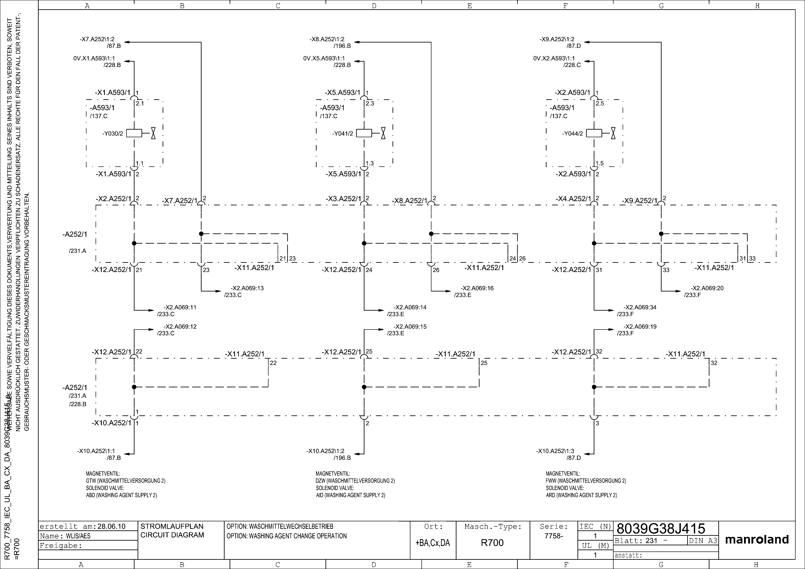

# +BA_Cx_DA — Sheet 231 of 247 — OPTION: WASCHMITTELWECHSELBETRIEB

**OPTION: WASHING AGENT CHANGE OPERATION**

> Part of the manroland **R700** printing press IEC/UL circuit diagrams.
> Drawing class: **Stromlaufplan / Circuit diagram** (DIN A3).
> Document `+BA_Cx_DA` covers the **Printing units / main switch cabinet** machine section.

## At a glance

| Field | Value |
|---|---|
| Document | `+BA_Cx_DA`  (8039G38J415) |
| Sheet | **231** of 247 |
| Section (DE) | OPTION: WASCHMITTELWECHSELBETRIEB |
| Section (EN) | OPTION: WASHING AGENT CHANGE OPERATION |
| Section type | CIRCUIT — Circuit diagram |
| Machine type | `R700` |
| Series | `7758` |
| Created | 28.06.10 |
| Replaces | — |
| Columns used | A, B, C, D, E, F, G, H |
| Path numbers | — |
| Labels on sheet | 124 |
| Cross-refs out | 24 |
| Cross-refs in | 57 |

**Previous:** [+BA_Cx_DA sheet 230](SHEET_0230.md) · **Next:** [+BA_Cx_DA sheet 232](SHEET_0232.md) · **Document TOC:** [_TOC.md](_TOC.md)  (+BA_Cx_DA) · **Master TOC:** [all sheets](../_MASTER_TOC.md)

## Sheet image (300 DPI, exact vector render)



_Rendered directly from the PDF vector layer at 300 DPI (1-bit), no OCR and no resampling. Use it to confirm anything ambiguous in the text below._

## Cross-references on this sheet

Each entry is a wire leaving this sheet. The printed token is `/sheet.column`; the link resolves to that sheet inside the same document.

| Ref | Target sheet | Col | Path | Destination on target | Target section | From col |
|---|---|---|---|---|---|---|
| `/87.B` | [+BA_Cx_DA sheet 87](SHEET_0087.md) | B | — | X7.A252\1:2 | WASCHVORRICHTUNG | A |
| `/196.B` | [+BA_Cx_DA sheet 196](SHEET_0196.md) | B | — | X8.A252\1:2 | OPTION: WASCHVORRICHTUNG MIT BÜRSTE | D |
| `/87.D` | [+BA_Cx_DA sheet 87](SHEET_0087.md) | D | — | X9.A252\1:2 | WASCHVORRICHTUNG | F |
| `/228.B` | [+BA_Cx_DA sheet 228](SHEET_0228.md) | B | — | 0V.X1.A593\1:1 0V.X5.A593\1:1 0V.X2.A593\1:1 | OPTION: WASCHMITTELWECHSELBETRIEB | D |
| `/228.B` | [+BA_Cx_DA sheet 228](SHEET_0228.md) | B | — | 0V.X1.A593\1:1 0V.X5.A593\1:1 0V.X2.A593\1:1 | OPTION: WASCHMITTELWECHSELBETRIEB | D |
| `/228.C` | [+BA_Cx_DA sheet 228](SHEET_0228.md) | C | — | 0V.X1.A593\1:1 0V.X5.A593\1:1 0V.X2.A593\1:1 | OPTION: WASCHMITTELWECHSELBETRIEB | D |
| `/137.C` | [+BA_Cx_DA sheet 137](SHEET_0137.md) | C | — | A593/1 | REFERENZMODUL | A |
| `/137.C` | [+BA_Cx_DA sheet 137](SHEET_0137.md) | C | — | A593/1 | REFERENZMODUL | D |
| `/137.C` | [+BA_Cx_DA sheet 137](SHEET_0137.md) | C | — | A593/1 | REFERENZMODUL | F |
| `/231.A` | [+BA_Cx_DA sheet 231](SHEET_0231.md) | A | — | — | OPTION: WASCHMITTELWECHSELBETRIEB | A |
| `/233.E` | [+BA_Cx_DA sheet 233](SHEET_0233.md) | E | — | — | OPTION: WASCHMITTELWECHSELBETRIEB | E |
| `/233.F` | [+BA_Cx_DA sheet 233](SHEET_0233.md) | F | — | — | OPTION: WASCHMITTELWECHSELBETRIEB | G |
| `/233.C` | [+BA_Cx_DA sheet 233](SHEET_0233.md) | C | — | — | OPTION: WASCHMITTELWECHSELBETRIEB | C |
| `/233.E` | [+BA_Cx_DA sheet 233](SHEET_0233.md) | E | — | — | OPTION: WASCHMITTELWECHSELBETRIEB | D |
| `/233.F` | [+BA_Cx_DA sheet 233](SHEET_0233.md) | F | — | — | OPTION: WASCHMITTELWECHSELBETRIEB | G |
| `/233.C` | [+BA_Cx_DA sheet 233](SHEET_0233.md) | C | — | — | OPTION: WASCHMITTELWECHSELBETRIEB | B |
| `/233.E` | [+BA_Cx_DA sheet 233](SHEET_0233.md) | E | — | — | OPTION: WASCHMITTELWECHSELBETRIEB | D |
| `/233.F` | [+BA_Cx_DA sheet 233](SHEET_0233.md) | F | — | — | OPTION: WASCHMITTELWECHSELBETRIEB | G |
| `/233.C` | [+BA_Cx_DA sheet 233](SHEET_0233.md) | C | — | — | OPTION: WASCHMITTELWECHSELBETRIEB | B |
| `/231.A` | [+BA_Cx_DA sheet 231](SHEET_0231.md) | A | — | — | OPTION: WASCHMITTELWECHSELBETRIEB | A |
| `/228.B` | [+BA_Cx_DA sheet 228](SHEET_0228.md) | B | — | — | OPTION: WASCHMITTELWECHSELBETRIEB | A |
| `/87.B` | [+BA_Cx_DA sheet 87](SHEET_0087.md) | B | — | X10.A252\1:1 X10.A252\1:3 | WASCHVORRICHTUNG | D |
| `/87.D` | [+BA_Cx_DA sheet 87](SHEET_0087.md) | D | — | X10.A252\1:1 X10.A252\1:3 | WASCHVORRICHTUNG | D |
| `/196.B` | [+BA_Cx_DA sheet 196](SHEET_0196.md) | B | — | X10.A252\1:2 | OPTION: WASCHVORRICHTUNG MIT BÜRSTE | D |

### Incoming references (sheets that point here)

Every other sheet that sends a wire to this one. `Back-ref` is the token printed on *that* sheet; `Path` is its line number.

| From sheet | Cols | Back-ref | Path | Refs | What continues there |
|---|---|---|---|---|---|
| [+BA_Cx_DA#87](SHEET_0087.md) | B, C, D | `/87.B`, `/87.C`, `/87.D` | — | 4 | X10.A252\1:3 |
| [+BA_Cx_DA#137](SHEET_0137.md) | C | `/137.C` | — | 3 | — |
| [+BA_Cx_DA#142](SHEET_0142.md) | C | `/142.C` | — | 2 | — |
| [+BA_Cx_DA#152](SHEET_0152.md) | E | `/152.E` | — | 1 | — |
| [+BA_Cx_DA#154](SHEET_0154.md) | A | `/154.A` | — | 2 | — |
| [+BA_Cx_DA#156](SHEET_0156.md) | A | `/156.A` | — | 1 | — |
| [+BA_Cx_DA#158](SHEET_0158.md) | G | `/158.G` | — | 1 | — |
| [+BA_Cx_DA#161](SHEET_0161.md) | H | `/161.H` | — | 2 | — |
| [+BA_Cx_DA#163](SHEET_0163.md) | E | `/163.E` | — | 1 | — |
| [+BA_Cx_DA#165](SHEET_0165.md) | A | `/165.A` | — | 1 | — |
| [+BA_Cx_DA#166](SHEET_0166.md) | A | `/166.A` | — | 1 | — |
| [+BA_Cx_DA#167](SHEET_0167.md) | A | `/167.A` | — | 3 | — |
| [+BA_Cx_DA#168](SHEET_0168.md) | D | `/168.D` | — | 9 | — |
| [+BA_Cx_DA#169](SHEET_0169.md) | D | `/169.D` | — | 9 | — |
| [+BA_Cx_DA#196](SHEET_0196.md) | B | `/196.B` | — | 2 | — |
| [+BA_Cx_DA#228](SHEET_0228.md) | B, C | `/228.B`, `/228.C` | — | 4 | — |
| [+BA_Cx_DA#231](SHEET_0231.md) | A | `/231.A` | — | 2 | — |
| [+BA_Cx_DA#233](SHEET_0233.md) | C, D, F | `/233.C`, `/233.D`, `/233.F` | — | 9 | X2.A069:11; X2.A069:12; X2.A069:13; X2.A069:14; X2.A069:15; X2.A069:16; X2.A069:18 X2.A069:19; X2.A069:20; X2.A069:34 |


## Devices on this sheet

| Tag | Class | Class meaning (IEC) | Col | Sub | Terminal | Sign |
|---|---|---|---|---|---|---|
| `A252/1` | A | Baugruppe / assembly, module, PC board | A | 1 | — | — |
| `A252/1` | A | Baugruppe / assembly, module, PC board | A | 1 | — | — |
| `Y030/2` | Y | Magnetventil / solenoid valve, actuator | A | 2 | — | — |
| `A593/1` | A | Baugruppe / assembly, module, PC board | A | 1 | — | — |
| `Y041/2` | Y | Magnetventil / solenoid valve, actuator | D | 2 | — | — |
| `A593/1` | A | Baugruppe / assembly, module, PC board | D | 1 | — | — |
| `Y044/2` | Y | Magnetventil / solenoid valve, actuator | F | 2 | — | — |
| `A593/1` | A | Baugruppe / assembly, module, PC board | F | 1 | — | — |
| `2.1` | — | cross-device reference | B | — | — | — |
| `1.1` | — | cross-device reference | B | — | — | — |
| `2.3` | — | cross-device reference | D | — | — | — |
| `1.3` | — | cross-device reference | D | — | — | — |
| `2.5` | — | cross-device reference | F | — | — | — |
| `1.5` | — | cross-device reference | F | — | — | — |
| `X2.A069:19` | — | cross-device reference | G | — | 19 | — |
| `X2.A069:16` | — | cross-device reference | E | — | 16 | — |
| `X2.A069:20` | — | cross-device reference | G | — | 20 | — |
| `X2.A069:34` | — | cross-device reference | G | — | 34 | — |
| `X2.A069:15` | — | cross-device reference | D | — | 15 | — |
| `X2.A069:14` | — | cross-device reference | D | — | 14 | — |
| `X2.A069:13` | — | cross-device reference | C | — | 13 | — |
| `X2.A069:12` | — | cross-device reference | B | — | 12 | — |
| `X2.A069:11` | — | cross-device reference | B | — | 11 | — |
| `X9.A252\1:2` | — | cross-device reference | F | — | 2 | — |
| `X10.A252\1:3` | — | cross-device reference | F | — | 3 | — |
| `X10.A252\1:1` | — | cross-device reference | A | — | 1 | — |
| `X10.A252\1:2` | — | cross-device reference | C | — | 2 | — |
| `X7.A252\1:2` | — | cross-device reference | A | — | 2 | — |
| `X8.A252\1:2` | — | cross-device reference | D | — | 2 | — |

## Potentials / nets

| Potential | Count | Columns | Attached devices | Terminals |
|---|---|---|---|---|
| `0V` | 3 | A, C, F | `A593\1`, `X1`, `X2`, `X5` | `1` |


A potential such as `L24+/4` or `M24+` is a named supply/return rail; every place it appears on this sheet is electrically common.

## Wire-end annotations (grouped as printed)

A wire that continues elsewhere is annotated with a small cluster: the destination description, the path/line number `#NN`, and the `/sheet.column` cross reference. Each row below is one such cluster exactly as it is grouped on the drawing.

| Col | Y | Path | Cross-ref | Text on the wire |
|---|---|---|---|---|
| A | 54.1 | — | `/87.B` | `X7.A252\1:2` |
| D | 54.1 | — | `/196.B` | `X8.A252\1:2` |
| F | 54.1 | — | `/87.D` | `X9.A252\1:2` |
| D | 82.5 | — | `/228.B`, `/228.B`, `/228.C` | `0V.X1.A593\1:1 0V.X5.A593\1:1 0V.X2.A593\1:1` |
| A | 132.1 | — | — | `X1.A593/1 1` |
| D | 132.1 | — | — | `X5.A593/1 1` |
| F | 132.1 | — | — | `X2.A593/1 1` |
| B | 149.1 | — | — | `2.1` |
| D | 149.1 | — | — | `2.3` |
| F | 149.1 | — | — | `2.5` |
| A | 154.8 | — | `/137.C` | `A593/1` |
| D | 154.8 | — | `/137.C` | `A593/1` |
| F | 154.8 | — | `/137.C` | `A593/1` |
| A | 193.8 | — | — | `Y030/2` |
| D | 193.8 | — | — | `Y041/2` |
| F | 193.8 | — | — | `Y044/2` |
| B | 237.7 | — | — | `1.1` |
| D | 237.7 | — | — | `1.3` |
| F | 237.7 | — | — | `1.5` |
| A | 252.6 | — | — | `X1.A593/1 2` |
| D | 252.6 | — | — | `X5.A593/1 2` |
| F | 252.6 | — | — | `X2.A593/1 2` |
| A | 289.4 | — | — | `X2.A252/1 2` |
| D | 289.4 | — | — | `X3.A252/1 2` |
| F | 289.4 | — | — | `X4.A252/1 2` |
| B | 289.5 | — | — | `X7.A252/1 2` |
| D | 289.5 | — | — | `X8.A252/1 2` |
| G | 289.5 | — | — | `X9.A252/1 2` |
| A | 341.9 | — | — | `A252/1` |
| A | 367.4 | — | `/231.A` | — |
| C | 378.8 | — | — | `21 23` |
| F | 378.8 | — | — | `24 26` |
| H | 378.8 | — | — | `31 33` |
| C | 391.5 | — | — | `X11.A252/1` |
| E | 391.5 | — | — | `X11.A252/1` |
| H | 391.5 | — | — | `X11.A252/1` |
| A | 394.3 | — | — | `X12.A252/1 21` |
| D | 394.3 | — | — | `X12.A252/1 24` |
| F | 394.3 | — | — | `X12.A252/1 31` |
| B | 395.8 | — | — | `23` |
| E | 395.8 | — | — | `26` |
| G | 395.8 | — | — | `33` |
| C | 422.6 | — | — | `X2.A069:13` |
| E | 422.6 | — | — | `X2.A069:16` |
| G | 422.6 | — | — | `X2.A069:20` |
| C | 432.6 | — | `/233.C` | — |
| E | 432.6 | — | `/233.E` | — |
| G | 432.6 | — | `/233.F` | — |
| B | 451.0 | — | — | `X2.A069:11` |
| D | 451.0 | — | — | `X2.A069:14` |
| G | 451.0 | — | — | `X2.A069:34` |
| B | 460.9 | — | `/233.C` | — |
| D | 460.9 | — | `/233.E` | — |
| G | 460.9 | — | `/233.F` | — |
| B | 479.3 | — | — | `X2.A069:12` |
| D | 479.3 | — | — | `X2.A069:15` |
| G | 479.3 | — | — | `X2.A069:19` |
| D | 489.2 | — | `/233.E` | — |
| G | 489.2 | — | `/233.F` | — |
| B | 489.3 | — | `/233.C` | — |
| A | 516.2 | — | — | `X12.A252/1 22` |
| D | 516.2 | — | — | `X12.A252/1 25` |
| F | 516.2 | — | — | `X12.A252/1 32` |
| C | 519.0 | — | — | `X11.A252/1` |
| E | 519.0 | — | — | `X11.A252/1` |
| G | 519.0 | — | — | `X11.A252/1` |
| C | 533.2 | — | — | `22` |
| E | 533.2 | — | — | `25` |
| H | 533.2 | — | — | `32` |
| A | 568.7 | — | — | `A252/1` |
| A | 581.7 | — | `/231.A`, `/228.B` | — |
| B | 605.5 | — | — | `1` |
| A | 621.1 | — | — | `X10.A252/1 1` |
| D | 622.5 | — | — | `2` |
| F | 622.5 | — | — | `3` |
| D | 663.6 | — | `/87.B`, `/87.D` | `X10.A252\1:1 X10.A252\1:3` |
| D | 663.6 | — | `/196.B` | `X10.A252\1:2` |
| A | 697.9 | — | — | `MAGNETVENTIL: GTW (WASCHMITTELVERSORGUNG 2) SOLENOID VALVE: ABD (WASHING AGENT SUPPLY 2)` |
| D | 697.9 | — | — | `DZW (WASCHMITTELVERSORGUNG 2) MAGNETVENTIL:` |
| F | 697.9 | — | — | `FWW (WASCHMITTELVERSORGUNG 2) MAGNETVENTIL:` |
| D | 719.2 | — | — | `SOLENOID VALVE: AID (WASHING AGENT SUPPLY 2)` |
| F | 719.2 | — | — | `SOLENOID VALVE: ARD (WASHING AGENT SUPPLY 2)` |


## Reconstructed tables

This sheet carries tabular content (pin map / terminal assignment / index). The grid below was rebuilt from the drawing's own rule lines, so each row is exactly one physical row of the table.

### Table 1 — 1 data rows × 3 columns (at x=198.4, y=62.4)

| 1 2.1 1.1 2 2 X7.A252/1 | 2 |  |
|---|---|---|
| `21 X2.A069:11 /233.C X2.A069:12 /233.C 22` | `X11.A252/1 23 X2.A069:13 /233.C X11.A252/1` | `21 22` |


### Table 2 — 1 data rows × 3 columns (at x=538.6, y=62.4)

| 1 2.3 1.3 2 2 X8.A252/1 | 2 |  |
|---|---|---|
| `24 X2.A069:14 /233.E X2.A069:15 /233.E 25` | `26 X2.A069:16 /233.E X11.A252/1` | `24 X11.A252/1 25` |


### Table 3 — 1 data rows × 3 columns (at x=878.7, y=62.4)

| 1 2.5 1.5 2 2 X9.A252/1 | 2 |  |
|---|---|---|
| `31 X2.A069:34 /233.F X2.A069:19 /233.F 32` | `33 X2.A069:20 /233.F X11.A252/1` | `31 X11.A252/1 32` |


## Notes and free text on this sheet

| Text | Col | Y (pt) |
|---|---|---|
| `X2.A252/1` | A | 289.45 |
| `X12.A252/1` | A | 394.33 |
| `X10.A252/1` | A | 621.1 |
| `MAGNETVENTIL:` | A | 697.94 |
| `GTW (WASCHMITTELVERSORGUNG 2)` | A | 708.57 |
| `SOLENOID VALVE:` | A | 719.2 |
| `ABD (WASHING AGENT SUPPLY 2)` | A | 729.83 |
| `X1.A593/1` | A | 132.12 |
| `X7.A252/1` | B | 292.28 |
| `X3.A252/1` | D | 289.45 |
| `X12.A252/1` | D | 394.33 |
| `MAGNETVENTIL:` | D | 697.94 |
| `DZW (WASCHMITTELVERSORGUNG 2)` | D | 708.57 |
| `SOLENOID VALVE:` | D | 719.2 |
| `AID (WASHING AGENT SUPPLY 2)` | D | 729.83 |
| `X5.A593/1` | D | 132.12 |
| `X8.A252/1` | D | 292.28 |
| `X4.A252/1` | F | 289.45 |
| `X12.A252/1` | F | 394.33 |
| `MAGNETVENTIL:` | F | 697.94 |
| `FWW (WASCHMITTELVERSORGUNG 2)` | F | 708.55 |
| `SOLENOID VALVE:` | F | 719.2 |
| `ARD (WASHING AGENT SUPPLY 2)` | F | 729.84 |
| `X2.A593/1` | F | 132.12 |
| `X9.A252/1` | G | 292.28 |
| `X11.A252/1` | C | 519.05 |
| `X11.A252/1` | E | 519.05 |
| `X11.A252/1` | G | 519.05 |
| `X11.A252/1` | H | 391.49 |

## Complete label inventory (exact text from the drawing)

Every text object inside the drawing area of this sheet, in DIN reading order (column A→H, then top→bottom). This is the authoritative list: if a string is not here it is not printed on this sheet.

| Col | Y | X | Dir | Type | Text |
|---|---|---|---|---|---|
| A | 54.1 | 117.9 | → | device ref | `X7.A252\1:2` |
| A | 64.0 | 158.2 | → | cross-reference | `/87.B` |
| A | 82.5 | 108.6 | → | potential | `0V.X1.A593\1:1` |
| A | 92.4 | 153.4 | → | cross-reference | `/228.B` |
| A | 132.1 | 140.3 | → | text | `X1.A593/1` |
| A | 154.8 | 132.9 | → | device tag | `A593/1` |
| A | 167.9 | 133.2 | → | cross-reference | `/137.C` |
| A | 193.8 | 151.4 | → | device tag | `Y030/2` |
| A | 252.6 | 141.7 | → | text | `X1.A593/1` |
| A | 289.4 | 141.7 | → | text | `X2.A252/1` |
| A | 341.9 | 92.4 | → | device tag | `A252/1` |
| A | 367.4 | 102.0 | → | cross-reference | `/231.A` |
| A | 394.3 | 135.8 | → | text | `X12.A252/1` |
| A | 516.2 | 135.8 | → | text | `X12.A252/1` |
| A | 568.7 | 92.4 | → | device tag | `A252/1` |
| A | 581.7 | 102.0 | → | cross-reference | `/231.A` |
| A | 594.1 | 102.3 | → | cross-reference | `/228.B` |
| A | 621.1 | 135.8 | → | text | `X10.A252/1` |
| A | 663.6 | 114.2 | → | device ref | `X10.A252\1:1` |
| A | 673.5 | 158.2 | → | cross-reference | `/87.B` |
| A | 697.9 | 127.0 | → | text | `MAGNETVENTIL:` |
| A | 708.6 | 127.3 | → | text | `GTW (WASCHMITTELVERSORGUNG 2)` |
| A | 719.2 | 127.3 | → | text | `SOLENOID VALVE:` |
| A | 729.8 | 127.6 | → | text | `ABD (WASHING AGENT SUPPLY 2)` |
| B | 133.6 | 200.4 | → | number | `1` |
| B | 149.1 | 201.0 | → | device ref | `2.1` |
| B | 237.7 | 200.4 | → | device ref | `1.1` |
| B | 254.0 | 201.0 | → | number | `2` |
| B | 289.5 | 201.0 | → | number | `2` |
| B | 289.5 | 300.2 | → | number | `2` |
| B | 292.3 | 239.5 | → | text | `X7.A252/1` |
| B | 395.8 | 201.0 | → | number | `21` |
| B | 395.8 | 300.2 | → | number | `23` |
| B | 451.0 | 242.1 | → | device ref | `X2.A069:11` |
| B | 460.9 | 232.4 | → | cross-reference | `/233.C` |
| B | 479.3 | 242.1 | → | device ref | `X2.A069:12` |
| B | 489.3 | 232.4 | → | cross-reference | `/233.C` |
| B | 516.2 | 201.0 | → | number | `22` |
| B | 605.5 | 200.4 | → | number | `1` |
| B | 622.5 | 200.4 | → | number | `1` |
| C | 82.5 | 448.7 | → | potential | `0V.X5.A593\1:1` |
| C | 378.7 | 413.6 | → | number | `21 23` |
| C | 391.5 | 347.0 | → | text | `X11.A252/1` |
| C | 422.6 | 341.3 | → | device ref | `X2.A069:13` |
| C | 432.6 | 331.7 | → | cross-reference | `/233.C` |
| C | 519.0 | 332.8 | → | text | `X11.A252/1` |
| C | 533.2 | 399.4 | → | number | `22` |
| C | 663.6 | 453.3 | → | device ref | `X10.A252\1:2` |
| D | 54.1 | 458.1 | → | device ref | `X8.A252\1:2` |
| D | 64.0 | 493.5 | → | cross-reference | `/196.B` |
| D | 92.4 | 493.5 | → | cross-reference | `/228.B` |
| D | 132.1 | 480.5 | → | text | `X5.A593/1` |
| D | 133.6 | 540.6 | → | number | `1` |
| D | 149.1 | 541.1 | → | device ref | `2.3` |
| D | 154.8 | 473.1 | → | device tag | `A593/1` |
| D | 167.9 | 473.4 | → | cross-reference | `/137.C` |
| D | 193.8 | 491.5 | → | device tag | `Y041/2` |
| D | 237.7 | 540.6 | → | device ref | `1.3` |
| D | 252.6 | 481.9 | → | text | `X5.A593/1` |
| D | 254.0 | 541.1 | → | number | `2` |
| D | 289.4 | 481.9 | → | text | `X3.A252/1` |
| D | 289.5 | 541.1 | → | number | `2` |
| D | 292.3 | 579.7 | → | text | `X8.A252/1` |
| D | 394.3 | 475.9 | → | text | `X12.A252/1` |
| D | 395.8 | 541.1 | → | number | `24` |
| D | 451.0 | 582.2 | → | device ref | `X2.A069:14` |
| D | 460.9 | 572.6 | → | cross-reference | `/233.E` |
| D | 479.3 | 582.2 | → | device ref | `X2.A069:15` |
| D | 489.2 | 572.6 | → | cross-reference | `/233.E` |
| D | 516.2 | 475.9 | → | text | `X12.A252/1` |
| D | 516.2 | 541.1 | → | number | `25` |
| D | 622.5 | 541.1 | → | number | `2` |
| D | 673.5 | 493.5 | → | cross-reference | `/196.B` |
| D | 697.9 | 467.1 | → | text | `MAGNETVENTIL:` |
| D | 708.6 | 466.9 | → | text | `DZW (WASCHMITTELVERSORGUNG 2)` |
| D | 719.2 | 467.4 | → | text | `SOLENOID VALVE:` |
| D | 729.8 | 467.7 | → | text | `AID (WASHING AGENT SUPPLY 2)` |
| E | 289.5 | 640.3 | → | number | `2` |
| E | 391.5 | 687.1 | → | text | `X11.A252/1` |
| E | 395.8 | 640.3 | → | number | `26` |
| E | 422.6 | 681.4 | → | device ref | `X2.A069:16` |
| E | 432.5 | 671.8 | → | cross-reference | `/233.E` |
| E | 519.0 | 644.6 | → | text | `X11.A252/1` |
| E | 533.2 | 711.2 | → | number | `25` |
| F | 54.1 | 798.2 | → | device ref | `X9.A252\1:2` |
| F | 64.1 | 838.2 | → | cross-reference | `/87.D` |
| F | 82.5 | 788.9 | → | potential | `0V.X2.A593\1:1` |
| F | 92.4 | 833.4 | → | cross-reference | `/228.C` |
| F | 132.1 | 820.6 | → | text | `X2.A593/1` |
| F | 133.6 | 880.7 | → | number | `1` |
| F | 149.1 | 881.3 | → | device ref | `2.5` |
| F | 154.8 | 813.3 | → | device tag | `A593/1` |
| F | 167.9 | 813.5 | → | cross-reference | `/137.C` |
| F | 193.8 | 831.7 | → | device tag | `Y044/2` |
| F | 237.7 | 880.7 | → | device ref | `1.5` |
| F | 252.6 | 822.0 | → | text | `X2.A593/1` |
| F | 254.0 | 881.3 | → | number | `2` |
| F | 289.4 | 822.0 | → | text | `X4.A252/1` |
| F | 289.5 | 881.3 | → | number | `2` |
| F | 378.7 | 753.7 | → | number | `24 26` |
| F | 394.3 | 816.1 | → | text | `X12.A252/1` |
| F | 395.8 | 881.3 | → | number | `31` |
| F | 516.2 | 816.1 | → | text | `X12.A252/1` |
| F | 516.2 | 881.3 | → | number | `32` |
| F | 622.5 | 881.3 | → | number | `3` |
| F | 663.6 | 793.1 | → | device ref | `X10.A252\1:3` |
| F | 673.5 | 838.2 | → | cross-reference | `/87.D` |
| F | 697.9 | 807.3 | → | text | `MAGNETVENTIL:` |
| F | 708.6 | 807.0 | → | text | `FWW (WASCHMITTELVERSORGUNG 2)` |
| F | 719.2 | 807.6 | → | text | `SOLENOID VALVE:` |
| F | 729.8 | 807.9 | → | text | `ARD (WASHING AGENT SUPPLY 2)` |
| G | 289.5 | 980.5 | → | number | `2` |
| G | 292.3 | 919.8 | → | text | `X9.A252/1` |
| G | 395.8 | 980.5 | → | number | `33` |
| G | 422.6 | 1021.6 | → | device ref | `X2.A069:20` |
| G | 432.6 | 1012.0 | → | cross-reference | `/233.F` |
| G | 451.0 | 922.4 | → | device ref | `X2.A069:34` |
| G | 460.9 | 912.8 | → | cross-reference | `/233.F` |
| G | 479.3 | 922.4 | → | device ref | `X2.A069:19` |
| G | 489.2 | 912.8 | → | cross-reference | `/233.F` |
| G | 519.0 | 984.8 | → | text | `X11.A252/1` |
| H | 378.7 | 1093.9 | → | number | `31 33` |
| H | 391.5 | 1027.3 | → | text | `X11.A252/1` |
| H | 533.2 | 1051.4 | → | number | `32` |

## Reading-order text block

The same content as a plain block, grouped by DIN column — convenient to paste or to match against a visual description.

```text
=== Column A ===
  54.1  117.9  devref       X7.A252\1:2
  64.0  158.2  xref         /87.B
  82.5  108.6  net          0V.X1.A593\1:1
  92.4  153.4  xref         /228.B
 132.1  140.3  text         X1.A593/1
 154.8  132.9  devtag       A593/1
 167.9  133.2  xref         /137.C
 193.8  151.4  devtag       Y030/2
 252.6  141.7  text         X1.A593/1
 289.4  141.7  text         X2.A252/1
 341.9   92.4  devtag       A252/1
 367.4  102.0  xref         /231.A
 394.3  135.8  text         X12.A252/1
 516.2  135.8  text         X12.A252/1
 568.7   92.4  devtag       A252/1
 581.7  102.0  xref         /231.A
 594.1  102.3  xref         /228.B
 621.1  135.8  text         X10.A252/1
 663.6  114.2  devref       X10.A252\1:1
 673.5  158.2  xref         /87.B
 697.9  127.0  text         MAGNETVENTIL:
 708.6  127.3  text         GTW (WASCHMITTELVERSORGUNG 2)
 719.2  127.3  text         SOLENOID VALVE:
 729.8  127.6  text         ABD (WASHING AGENT SUPPLY 2)
=== Column B ===
 133.6  200.4  numeric      1
 149.1  201.0  devref       2.1
 237.7  200.4  devref       1.1
 254.0  201.0  numeric      2
 289.5  201.0  numeric      2
 289.5  300.2  numeric      2
 292.3  239.5  text         X7.A252/1
 395.8  201.0  numeric      21
 395.8  300.2  numeric      23
 451.0  242.1  devref       X2.A069:11
 460.9  232.4  xref         /233.C
 479.3  242.1  devref       X2.A069:12
 489.3  232.4  xref         /233.C
 516.2  201.0  numeric      22
 605.5  200.4  numeric      1
 622.5  200.4  numeric      1
=== Column C ===
  82.5  448.7  net          0V.X5.A593\1:1
 378.7  413.6  numeric      21 23
 391.5  347.0  text         X11.A252/1
 422.6  341.3  devref       X2.A069:13
 432.6  331.7  xref         /233.C
 519.0  332.8  text         X11.A252/1
 533.2  399.4  numeric      22
 663.6  453.3  devref       X10.A252\1:2
=== Column D ===
  54.1  458.1  devref       X8.A252\1:2
  64.0  493.5  xref         /196.B
  92.4  493.5  xref         /228.B
 132.1  480.5  text         X5.A593/1
 133.6  540.6  numeric      1
 149.1  541.1  devref       2.3
 154.8  473.1  devtag       A593/1
 167.9  473.4  xref         /137.C
 193.8  491.5  devtag       Y041/2
 237.7  540.6  devref       1.3
 252.6  481.9  text         X5.A593/1
 254.0  541.1  numeric      2
 289.4  481.9  text         X3.A252/1
 289.5  541.1  numeric      2
 292.3  579.7  text         X8.A252/1
 394.3  475.9  text         X12.A252/1
 395.8  541.1  numeric      24
 451.0  582.2  devref       X2.A069:14
 460.9  572.6  xref         /233.E
 479.3  582.2  devref       X2.A069:15
 489.2  572.6  xref         /233.E
 516.2  475.9  text         X12.A252/1
 516.2  541.1  numeric      25
 622.5  541.1  numeric      2
 673.5  493.5  xref         /196.B
 697.9  467.1  text         MAGNETVENTIL:
 708.6  466.9  text         DZW (WASCHMITTELVERSORGUNG 2)
 719.2  467.4  text         SOLENOID VALVE:
 729.8  467.7  text         AID (WASHING AGENT SUPPLY 2)
=== Column E ===
 289.5  640.3  numeric      2
 391.5  687.1  text         X11.A252/1
 395.8  640.3  numeric      26
 422.6  681.4  devref       X2.A069:16
 432.5  671.8  xref         /233.E
 519.0  644.6  text         X11.A252/1
 533.2  711.2  numeric      25
=== Column F ===
  54.1  798.2  devref       X9.A252\1:2
  64.1  838.2  xref         /87.D
  82.5  788.9  net          0V.X2.A593\1:1
  92.4  833.4  xref         /228.C
 132.1  820.6  text         X2.A593/1
 133.6  880.7  numeric      1
 149.1  881.3  devref       2.5
 154.8  813.3  devtag       A593/1
 167.9  813.5  xref         /137.C
 193.8  831.7  devtag       Y044/2
 237.7  880.7  devref       1.5
 252.6  822.0  text         X2.A593/1
 254.0  881.3  numeric      2
 289.4  822.0  text         X4.A252/1
 289.5  881.3  numeric      2
 378.7  753.7  numeric      24 26
 394.3  816.1  text         X12.A252/1
 395.8  881.3  numeric      31
 516.2  816.1  text         X12.A252/1
 516.2  881.3  numeric      32
 622.5  881.3  numeric      3
 663.6  793.1  devref       X10.A252\1:3
 673.5  838.2  xref         /87.D
 697.9  807.3  text         MAGNETVENTIL:
 708.6  807.0  text         FWW (WASCHMITTELVERSORGUNG 2)
 719.2  807.6  text         SOLENOID VALVE:
 729.8  807.9  text         ARD (WASHING AGENT SUPPLY 2)
=== Column G ===
 289.5  980.5  numeric      2
 292.3  919.8  text         X9.A252/1
 395.8  980.5  numeric      33
 422.6 1021.6  devref       X2.A069:20
 432.6 1012.0  xref         /233.F
 451.0  922.4  devref       X2.A069:34
 460.9  912.8  xref         /233.F
 479.3  922.4  devref       X2.A069:19
 489.2  912.8  xref         /233.F
 519.0  984.8  text         X11.A252/1
=== Column H ===
 378.7 1093.9  numeric      31 33
 391.5 1027.3  text         X11.A252/1
 533.2 1051.4  numeric      32
```

---
_Generated from the PDF vector text layer; no OCR. Source: `R700_7758_IEC_UL_BA_CX_DA_8039G38J415_p`, sheet 231._
