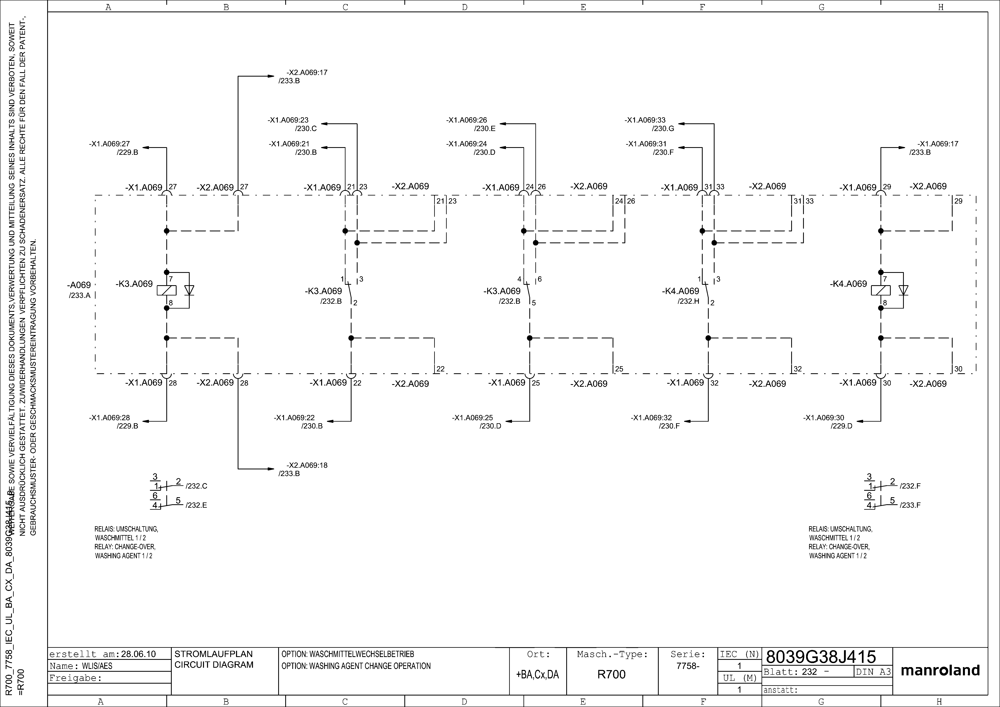

# +BA_Cx_DA — Sheet 232 of 247 — OPTION: WASCHMITTELWECHSELBETRIEB

**OPTION: WASHING AGENT CHANGE OPERATION**

> Part of the manroland **R700** printing press IEC/UL circuit diagrams.
> Drawing class: **Stromlaufplan / Circuit diagram** (DIN A3).
> Document `+BA_Cx_DA` covers the **Printing units / main switch cabinet** machine section.

## At a glance

| Field | Value |
|---|---|
| Document | `+BA_Cx_DA`  (8039G38J415) |
| Sheet | **232** of 247 |
| Section (DE) | OPTION: WASCHMITTELWECHSELBETRIEB |
| Section (EN) | OPTION: WASHING AGENT CHANGE OPERATION |
| Section type | CIRCUIT — Circuit diagram |
| Machine type | `R700` |
| Series | `7758` |
| Created | 28.06.10 |
| Replaces | — |
| Columns used | A, B, C, D, E, F, G, H |
| Path numbers | — |
| Labels on sheet | 120 |
| Cross-refs out | 23 |
| Cross-refs in | 49 |

**Previous:** [+BA_Cx_DA sheet 231](SHEET_0231.md) · **Next:** [+BA_Cx_DA sheet 233](SHEET_0233.md) · **Document TOC:** [_TOC.md](_TOC.md)  (+BA_Cx_DA) · **Master TOC:** [all sheets](../_MASTER_TOC.md)

## Sheet image (300 DPI, exact vector render)



_Rendered directly from the PDF vector layer at 300 DPI (1-bit), no OCR and no resampling. Use it to confirm anything ambiguous in the text below._

## Cross-references on this sheet

Each entry is a wire leaving this sheet. The printed token is `/sheet.column`; the link resolves to that sheet inside the same document.

| Ref | Target sheet | Col | Path | Destination on target | Target section | From col |
|---|---|---|---|---|---|---|
| `/233.B` | [+BA_Cx_DA sheet 233](SHEET_0233.md) | B | — | — | OPTION: WASCHMITTELWECHSELBETRIEB | C |
| `/230.C` | [+BA_Cx_DA sheet 230](SHEET_0230.md) | C | — | X1.A069:23 | OPTION: WASCHMITTELWECHSELBETRIEB | C |
| `/230.E` | [+BA_Cx_DA sheet 230](SHEET_0230.md) | E | — | X1.A069:26 | OPTION: WASCHMITTELWECHSELBETRIEB | D |
| `/230.G` | [+BA_Cx_DA sheet 230](SHEET_0230.md) | G | — | X1.A069:33 | OPTION: WASCHMITTELWECHSELBETRIEB | F |
| `/229.B` | [+BA_Cx_DA sheet 229](SHEET_0229.md) | B | — | X1.A069:27 | OPTION: WASCHMITTELWECHSELBETRIEB | A |
| `/230.B` | [+BA_Cx_DA sheet 230](SHEET_0230.md) | B | — | X1.A069:21 X1.A069:17 | OPTION: WASCHMITTELWECHSELBETRIEB | E |
| `/230.D` | [+BA_Cx_DA sheet 230](SHEET_0230.md) | D | — | X1.A069:24 | OPTION: WASCHMITTELWECHSELBETRIEB | D |
| `/230.F` | [+BA_Cx_DA sheet 230](SHEET_0230.md) | F | — | X1.A069:31 | OPTION: WASCHMITTELWECHSELBETRIEB | F |
| `/233.B` | [+BA_Cx_DA sheet 233](SHEET_0233.md) | B | — | — | OPTION: WASCHMITTELWECHSELBETRIEB | H |
| `/233.A` | [+BA_Cx_DA sheet 233](SHEET_0233.md) | A | — | — | OPTION: WASCHMITTELWECHSELBETRIEB | A |
| `/232.B` | [+BA_Cx_DA sheet 232](SHEET_0232.md) | B | — | — | OPTION: WASCHMITTELWECHSELBETRIEB | C |
| `/232.B` | [+BA_Cx_DA sheet 232](SHEET_0232.md) | B | — | — | OPTION: WASCHMITTELWECHSELBETRIEB | D |
| `/232.H` | [+BA_Cx_DA sheet 232](SHEET_0232.md) | H | — | — | OPTION: WASCHMITTELWECHSELBETRIEB | F |
| `/229.B` | [+BA_Cx_DA sheet 229](SHEET_0229.md) | B | — | X1.A069:28 | OPTION: WASCHMITTELWECHSELBETRIEB | A |
| `/230.B` | [+BA_Cx_DA sheet 230](SHEET_0230.md) | B | — | X1.A069:22 | OPTION: WASCHMITTELWECHSELBETRIEB | C |
| `/230.D` | [+BA_Cx_DA sheet 230](SHEET_0230.md) | D | — | X1.A069:25 X1.A069:30 | OPTION: WASCHMITTELWECHSELBETRIEB | F |
| `/229.D` | [+BA_Cx_DA sheet 229](SHEET_0229.md) | D | — | X1.A069:25 X1.A069:30 | OPTION: WASCHMITTELWECHSELBETRIEB | F |
| `/230.F` | [+BA_Cx_DA sheet 230](SHEET_0230.md) | F | — | X1.A069:32 | OPTION: WASCHMITTELWECHSELBETRIEB | F |
| `/233.B` | [+BA_Cx_DA sheet 233](SHEET_0233.md) | B | — | — | OPTION: WASCHMITTELWECHSELBETRIEB | C |
| `/232.F` | [+BA_Cx_DA sheet 232](SHEET_0232.md) | F | — | — | OPTION: WASCHMITTELWECHSELBETRIEB | H |
| `/232.C` | [+BA_Cx_DA sheet 232](SHEET_0232.md) | C | — | — | OPTION: WASCHMITTELWECHSELBETRIEB | B |
| `/232.E` | [+BA_Cx_DA sheet 232](SHEET_0232.md) | E | — | — | OPTION: WASCHMITTELWECHSELBETRIEB | B |
| `/233.F` | [+BA_Cx_DA sheet 233](SHEET_0233.md) | F | — | — | OPTION: WASCHMITTELWECHSELBETRIEB | H |

### Incoming references (sheets that point here)

Every other sheet that sends a wire to this one. `Back-ref` is the token printed on *that* sheet; `Path` is its line number.

| From sheet | Cols | Back-ref | Path | Refs | What continues there |
|---|---|---|---|---|---|
| [+BA_Cx_DA#139](SHEET_0139.md) | F | `/139.F` | — | 13 | — |
| [+BA_Cx_DA#151](SHEET_0151.md) | D | `/151.D` | — | 13 | — |
| [+BA_Cx_DA#229](SHEET_0229.md) | B, D | `/229.B`, `/229.D` | — | 3 | — |
| [+BA_Cx_DA#230](SHEET_0230.md) | B, D, E, G | `/230.B`, `/230.D`, `/230.E`, `/230.G` | — | 9 | X1.A069:26 |
| [+BA_Cx_DA#232](SHEET_0232.md) | B, C, D, F, H | `/232.B`, `/232.C`, `/232.D`, `/232.F`, `/232.H` | — | 6 | — |
| [+BA_Cx_DA#233](SHEET_0233.md) | A, D, F | `/233.A`, `/233.D`, `/233.F` | — | 5 | X1.A069:17; X2.A069:17; X2.A069:18 X2.A069:19 |


## Devices on this sheet

| Tag | Class | Class meaning (IEC) | Col | Sub | Terminal | Sign |
|---|---|---|---|---|---|---|
| `A069` | A | Baugruppe / assembly, module, PC board | A | — | — | — |
| `K3.A069` | — | cross-device reference | A | — | — | — |
| `X1.A069` | — | cross-device reference | A | — | — | — |
| `X2.A069` | — | cross-device reference | B | — | — | — |
| `X1.A069` | — | cross-device reference | A | — | — | — |
| `X2.A069` | — | cross-device reference | B | — | — | — |
| `K3.A069` | — | cross-device reference | C | — | — | — |
| `X1.A069` | — | cross-device reference | C | — | — | — |
| `X1.A069` | — | cross-device reference | C | — | — | — |
| `K3.A069` | — | cross-device reference | D | — | — | — |
| `X1.A069` | — | cross-device reference | D | — | — | — |
| `X1.A069` | — | cross-device reference | D | — | — | — |
| `K4.A069` | — | cross-device reference | F | — | — | — |
| `X1.A069` | — | cross-device reference | F | — | — | — |
| `X1.A069` | — | cross-device reference | F | — | — | — |
| `K4.A069` | — | cross-device reference | G | — | — | — |
| `X1.A069` | — | cross-device reference | G | — | — | — |
| `X1.A069` | — | cross-device reference | G | — | — | — |
| `X1.A069:31` | — | cross-device reference | F | — | 31 | — |
| `X1.A069:32` | — | cross-device reference | F | — | 32 | — |
| `X1.A069:33` | — | cross-device reference | F | — | 33 | — |
| `X1.A069:30` | — | cross-device reference | G | — | 30 | — |
| `X1.A069:25` | — | cross-device reference | D | — | 25 | — |
| `X1.A069:26` | — | cross-device reference | D | — | 26 | — |
| `X1.A069:27` | — | cross-device reference | A | — | 27 | — |
| `X1.A069:28` | — | cross-device reference | A | — | 28 | — |
| `X1.A069:24` | — | cross-device reference | D | — | 24 | — |
| `X1.A069:23` | — | cross-device reference | C | — | 23 | — |
| `X1.A069:17` | — | cross-device reference | H | — | 17 | — |
| `X1.A069:21` | — | cross-device reference | C | — | 21 | — |
| `X1.A069:22` | — | cross-device reference | C | — | 22 | — |
| `X2.A069:18` | — | cross-device reference | C | — | 18 | — |
| `X2.A069:17` | — | cross-device reference | C | — | 17 | — |
| `X2.A069` | — | cross-device reference | D | — | — | — |
| `X2.A069` | — | cross-device reference | D | — | — | — |
| `X2.A069` | — | cross-device reference | E | — | — | — |
| `X2.A069` | — | cross-device reference | E | — | — | — |
| `X2.A069` | — | cross-device reference | G | — | — | — |
| `X2.A069` | — | cross-device reference | G | — | — | — |
| `X2.A069` | — | cross-device reference | H | — | — | — |
| `X2.A069` | — | cross-device reference | H | — | — | — |

## Potentials / nets

_No named potentials on this sheet._

## Wire-end annotations (grouped as printed)

A wire that continues elsewhere is annotated with a small cluster: the destination description, the path/line number `#NN`, and the `/sheet.column` cross reference. Each row below is one such cluster exactly as it is grouped on the drawing.

| Col | Y | Path | Cross-ref | Text on the wire |
|---|---|---|---|---|
| C | 82.5 | — | — | `X2.A069:17` |
| C | 92.4 | — | `/233.B` | — |
| C | 139.2 | — | `/230.C` | `X1.A069:23` |
| D | 139.2 | — | `/230.E` | `X1.A069:26` |
| F | 139.2 | — | `/230.G` | `X1.A069:33` |
| A | 167.5 | — | `/229.B` | `X1.A069:27` |
| E | 167.5 | — | `/230.B` | `X1.A069:21 X1.A069:17` |
| D | 167.5 | — | `/230.D` | `X1.A069:24` |
| F | 167.5 | — | `/230.F` | `X1.A069:31` |
| H | 177.4 | — | `/233.B` | — |
| D | 217.2 | — | — | `X2.A069` |
| E | 217.2 | — | — | `X2.A069` |
| G | 217.2 | — | — | `X2.A069` |
| H | 217.2 | — | — | `X2.A069` |
| B | 218.6 | — | — | `X1.A069 27 X2.A069 27` |
| C | 218.6 | — | — | `X1.A069 21 23` |
| D | 218.6 | — | — | `X1.A069 24 26` |
| F | 218.6 | — | — | `X1.A069 31 33` |
| G | 218.6 | — | — | `X1.A069 29` |
| D | 235.6 | — | — | `21 23` |
| E | 235.6 | — | — | `24 26` |
| G | 235.6 | — | — | `31 33` |
| H | 235.6 | — | — | `29` |
| B | 328.4 | — | — | `7` |
| C | 328.4 | — | — | `K3.A069 3` |
| C | 328.4 | — | — | `1` |
| D | 328.4 | — | — | `K3.A069 6` |
| D | 328.4 | — | — | `4` |
| F | 328.4 | — | — | `K4.A069 3` |
| F | 328.4 | — | — | `1` |
| H | 328.4 | — | — | `7` |
| A | 333.4 | — | — | `K3.A069` |
| G | 333.4 | — | — | `K4.A069` |
| A | 334.8 | — | — | `A069` |
| A | 347.9 | — | `/233.A` | — |
| C | 354.9 | — | `/232.B` | — |
| D | 354.9 | — | `/232.B` | — |
| F | 355.0 | — | `/232.H` | — |
| B | 356.8 | — | — | `8` |
| C | 356.8 | — | — | `2` |
| E | 356.8 | — | — | `5` |
| F | 356.8 | — | — | `2` |
| H | 356.8 | — | — | `8` |
| D | 435.4 | — | — | `22` |
| E | 435.4 | — | — | `25` |
| G | 435.4 | — | — | `32` |
| H | 435.4 | — | — | `30` |
| B | 451.0 | — | — | `X1.A069 28 X2.A069 28` |
| C | 451.0 | — | — | `X1.A069 22` |
| D | 451.0 | — | — | `X1.A069 25` |
| F | 451.0 | — | — | `X1.A069 32` |
| G | 451.0 | — | — | `X1.A069 30` |
| D | 452.4 | — | — | `X2.A069` |
| E | 452.4 | — | — | `X2.A069` |
| G | 452.4 | — | — | `X2.A069 X2.A069` |
| A | 493.5 | — | `/229.B` | `X1.A069:28` |
| C | 493.5 | — | `/230.B` | `X1.A069:22` |
| F | 493.5 | — | `/230.D`, `/229.D` | `X1.A069:25 X1.A069:30` |
| F | 493.5 | — | `/230.F` | `X1.A069:32` |
| C | 550.2 | — | — | `X2.A069:18` |
| C | 560.1 | — | `/233.B` | — |
| A | 563.0 | — | — | `3 6 4 1` |
| G | 563.0 | — | — | `3 6 4 1` |
| B | 568.6 | — | — | `2` |
| H | 568.6 | — | — | `2` |
| B | 575.0 | — | `/232.C` | — |
| H | 575.0 | — | `/232.F` | — |
| B | 591.3 | — | — | `5` |
| H | 591.3 | — | — | `5` |
| B | 597.7 | — | `/232.E` | — |
| H | 597.7 | — | `/233.F` | — |
| A | 627.1 | — | — | `RELAIS: UMSCHALTUNG,` |
| G | 627.1 | — | — | `RELAIS: UMSCHALTUNG,` |
| A | 637.7 | — | — | `RELAY: CHANGE OVER, WASCHMITTEL 1 / 2` |
| G | 637.7 | — | — | `RELAY: CHANGE OVER, WASCHMITTEL 1 / 2` |
| A | 659.0 | — | — | `WASHING AGENT 1 / 2` |
| G | 659.0 | — | — | `WASHING AGENT 1 / 2` |


## Notes and free text on this sheet

| Text | Col | Y (pt) |
|---|---|---|
| `RELAIS: UMSCHALTUNG,` | A | 627.08 |
| `WASCHMITTEL 1 / 2` | A | 637.69 |
| `RELAY: CHANGE OVER,` | A | 648.34 |
| `WASHING AGENT 1 / 2` | A | 658.95 |
| `RELAIS: UMSCHALTUNG,` | G | 627.08 |
| `WASCHMITTEL 1 / 2` | G | 637.69 |
| `RELAY: CHANGE OVER,` | G | 648.34 |
| `WASHING AGENT 1 / 2` | G | 658.95 |

## Complete label inventory (exact text from the drawing)

Every text object inside the drawing area of this sheet, in DIN reading order (column A→H, then top→bottom). This is the authoritative list: if a string is not here it is not printed on this sheet.

| Col | Y | X | Dir | Type | Text |
|---|---|---|---|---|---|
| A | 167.5 | 106.0 | → | device ref | `X1.A069:27` |
| A | 177.4 | 139.2 | → | cross-reference | `/229.B` |
| A | 218.6 | 149.1 | → | device ref | `X1.A069` |
| A | 333.4 | 137.8 | → | device ref | `K3.A069` |
| A | 334.8 | 79.9 | → | device tag | `A069` |
| A | 347.9 | 82.2 | → | cross-reference | `/233.A` |
| A | 451.0 | 149.1 | → | device ref | `X1.A069` |
| A | 493.5 | 106.0 | → | device ref | `X1.A069:28` |
| A | 503.4 | 139.2 | → | cross-reference | `/229.B` |
| A | 562.9 | 181.7 | → | number | `3` |
| A | 574.3 | 183.1 | → | number | `1` |
| A | 585.6 | 181.7 | → | number | `6` |
| A | 597.0 | 181.7 | → | number | `4` |
| A | 627.1 | 112.5 | → | text | `RELAIS: UMSCHALTUNG,` |
| A | 637.7 | 113.4 | → | text | `WASCHMITTEL 1 / 2` |
| A | 648.3 | 112.5 | → | text | `RELAY: CHANGE OVER,` |
| A | 658.9 | 113.4 | → | text | `WASHING AGENT 1 / 2` |
| B | 218.6 | 201.0 | → | number | `27` |
| B | 218.6 | 234.1 | → | device ref | `X2.A069` |
| B | 218.6 | 286.0 | → | number | `27` |
| B | 328.4 | 201.0 | → | number | `7` |
| B | 356.8 | 201.0 | → | number | `8` |
| B | 451.0 | 234.1 | → | device ref | `X2.A069` |
| B | 452.5 | 201.0 | → | number | `28` |
| B | 452.5 | 286.0 | → | number | `28` |
| B | 568.6 | 209.5 | → | number | `2` |
| B | 575.0 | 221.1 | → | cross-reference | `/232.C` |
| B | 591.3 | 209.2 | → | number | `5` |
| B | 597.7 | 221.1 | → | cross-reference | `/232.E` |
| C | 82.5 | 341.3 | → | device ref | `X2.A069:17` |
| C | 92.4 | 331.7 | → | cross-reference | `/233.B` |
| C | 139.2 | 318.6 | → | device ref | `X1.A069:23` |
| C | 149.1 | 351.5 | → | cross-reference | `/230.C` |
| C | 167.5 | 320.0 | → | device ref | `X1.A069:21` |
| C | 177.4 | 351.8 | → | cross-reference | `/230.B` |
| C | 218.6 | 361.7 | → | device ref | `X1.A069` |
| C | 218.6 | 413.6 | → | number | `21` |
| C | 218.6 | 427.7 | → | number | `23` |
| C | 328.4 | 405.1 | → | number | `1` |
| C | 328.4 | 427.7 | → | number | `3` |
| C | 341.9 | 363.1 | → | device ref | `K3.A069` |
| C | 354.9 | 381.5 | → | cross-reference | `/232.B` |
| C | 356.8 | 420.7 | → | number | `2` |
| C | 451.0 | 368.8 | → | device ref | `X1.A069` |
| C | 452.5 | 420.7 | → | number | `22` |
| C | 493.5 | 326.0 | → | device ref | `X1.A069:22` |
| C | 503.4 | 358.9 | → | cross-reference | `/230.B` |
| C | 550.2 | 341.3 | → | device ref | `X2.A069:18` |
| C | 560.1 | 331.7 | → | cross-reference | `/233.B` |
| D | 139.2 | 531.2 | → | device ref | `X1.A069:26` |
| D | 149.1 | 564.7 | → | cross-reference | `/230.E` |
| D | 167.5 | 531.2 | → | device ref | `X1.A069:24` |
| D | 177.5 | 564.1 | → | cross-reference | `/230.D` |
| D | 217.2 | 466.6 | → | device ref | `X2.A069` |
| D | 218.6 | 574.3 | → | device ref | `X1.A069` |
| D | 235.6 | 519.9 | → | number | `21 23` |
| D | 328.4 | 616.3 | → | number | `4` |
| D | 341.9 | 575.7 | → | device ref | `K3.A069` |
| D | 354.9 | 594.1 | → | cross-reference | `/232.B` |
| D | 435.4 | 519.9 | → | number | `22` |
| D | 451.0 | 581.4 | → | device ref | `X1.A069` |
| D | 452.4 | 466.6 | → | device ref | `X2.A069` |
| D | 493.5 | 538.3 | → | device ref | `X1.A069:25` |
| D | 503.4 | 571.2 | → | cross-reference | `/230.D` |
| E | 217.2 | 679.2 | → | device ref | `X2.A069` |
| E | 218.6 | 626.2 | → | number | `24` |
| E | 218.6 | 640.3 | → | number | `26` |
| E | 235.6 | 732.5 | → | number | `24 26` |
| E | 328.4 | 640.3 | → | number | `6` |
| E | 356.8 | 633.3 | → | number | `5` |
| E | 435.4 | 732.5 | → | number | `25` |
| E | 452.4 | 679.2 | → | device ref | `X2.A069` |
| E | 452.5 | 633.3 | → | number | `25` |
| F | 139.2 | 743.8 | → | device ref | `X1.A069:33` |
| F | 149.1 | 776.4 | → | cross-reference | `/230.G` |
| F | 167.5 | 745.2 | → | device ref | `X1.A069:31` |
| F | 177.4 | 777.5 | → | cross-reference | `/230.F` |
| F | 218.6 | 786.9 | → | device ref | `X1.A069` |
| F | 218.6 | 838.8 | → | number | `31` |
| F | 218.6 | 852.9 | → | number | `33` |
| F | 328.4 | 830.3 | → | number | `1` |
| F | 328.4 | 852.9 | → | number | `3` |
| F | 341.9 | 788.3 | → | device ref | `K4.A069` |
| F | 355.0 | 807.0 | → | cross-reference | `/232.H` |
| F | 356.8 | 845.9 | → | number | `2` |
| F | 451.0 | 794.0 | → | device ref | `X1.A069` |
| F | 452.5 | 845.9 | → | number | `32` |
| F | 493.5 | 751.2 | → | device ref | `X1.A069:32` |
| F | 503.4 | 784.6 | → | cross-reference | `/230.F` |
| G | 217.2 | 891.8 | → | device ref | `X2.A069` |
| G | 218.6 | 999.5 | → | device ref | `X1.A069` |
| G | 235.6 | 945.1 | → | number | `31 33` |
| G | 333.4 | 988.2 | → | device ref | `K4.A069` |
| G | 435.4 | 945.1 | → | number | `32` |
| G | 451.0 | 999.5 | → | device ref | `X1.A069` |
| G | 452.4 | 891.8 | → | device ref | `X2.A069` |
| G | 493.5 | 956.4 | → | device ref | `X1.A069:30` |
| G | 503.4 | 989.3 | → | cross-reference | `/229.D` |
| G | 562.9 | 1032.1 | → | number | `3` |
| G | 574.3 | 1033.5 | → | number | `1` |
| G | 585.6 | 1032.1 | → | number | `6` |
| G | 597.0 | 1032.1 | → | number | `4` |
| G | 627.1 | 962.9 | → | text | `RELAIS: UMSCHALTUNG,` |
| G | 637.7 | 963.8 | → | text | `WASCHMITTEL 1 / 2` |
| G | 648.3 | 962.9 | → | text | `RELAY: CHANGE OVER,` |
| G | 658.9 | 963.8 | → | text | `WASHING AGENT 1 / 2` |
| H | 167.5 | 1092.5 | → | device ref | `X1.A069:17` |
| H | 177.4 | 1082.8 | → | cross-reference | `/233.B` |
| H | 217.2 | 1083.1 | → | device ref | `X2.A069` |
| H | 218.6 | 1051.4 | → | number | `29` |
| H | 235.6 | 1136.4 | → | number | `29` |
| H | 328.4 | 1051.4 | → | number | `7` |
| H | 356.8 | 1051.4 | → | number | `8` |
| H | 435.4 | 1136.4 | → | number | `30` |
| H | 452.4 | 1083.1 | → | device ref | `X2.A069` |
| H | 452.5 | 1051.4 | → | number | `30` |
| H | 568.6 | 1059.9 | → | number | `2` |
| H | 575.0 | 1071.5 | → | cross-reference | `/232.F` |
| H | 591.3 | 1059.6 | → | number | `5` |
| H | 597.7 | 1071.5 | → | cross-reference | `/233.F` |

## Reading-order text block

The same content as a plain block, grouped by DIN column — convenient to paste or to match against a visual description.

```text
=== Column A ===
 167.5  106.0  devref       X1.A069:27
 177.4  139.2  xref         /229.B
 218.6  149.1  devref       X1.A069
 333.4  137.8  devref       K3.A069
 334.8   79.9  devtag       A069
 347.9   82.2  xref         /233.A
 451.0  149.1  devref       X1.A069
 493.5  106.0  devref       X1.A069:28
 503.4  139.2  xref         /229.B
 562.9  181.7  numeric      3
 574.3  183.1  numeric      1
 585.6  181.7  numeric      6
 597.0  181.7  numeric      4
 627.1  112.5  text         RELAIS: UMSCHALTUNG,
 637.7  113.4  text         WASCHMITTEL 1 / 2
 648.3  112.5  text         RELAY: CHANGE OVER,
 658.9  113.4  text         WASHING AGENT 1 / 2
=== Column B ===
 218.6  201.0  numeric      27
 218.6  234.1  devref       X2.A069
 218.6  286.0  numeric      27
 328.4  201.0  numeric      7
 356.8  201.0  numeric      8
 451.0  234.1  devref       X2.A069
 452.5  201.0  numeric      28
 452.5  286.0  numeric      28
 568.6  209.5  numeric      2
 575.0  221.1  xref         /232.C
 591.3  209.2  numeric      5
 597.7  221.1  xref         /232.E
=== Column C ===
  82.5  341.3  devref       X2.A069:17
  92.4  331.7  xref         /233.B
 139.2  318.6  devref       X1.A069:23
 149.1  351.5  xref         /230.C
 167.5  320.0  devref       X1.A069:21
 177.4  351.8  xref         /230.B
 218.6  361.7  devref       X1.A069
 218.6  413.6  numeric      21
 218.6  427.7  numeric      23
 328.4  405.1  numeric      1
 328.4  427.7  numeric      3
 341.9  363.1  devref       K3.A069
 354.9  381.5  xref         /232.B
 356.8  420.7  numeric      2
 451.0  368.8  devref       X1.A069
 452.5  420.7  numeric      22
 493.5  326.0  devref       X1.A069:22
 503.4  358.9  xref         /230.B
 550.2  341.3  devref       X2.A069:18
 560.1  331.7  xref         /233.B
=== Column D ===
 139.2  531.2  devref       X1.A069:26
 149.1  564.7  xref         /230.E
 167.5  531.2  devref       X1.A069:24
 177.5  564.1  xref         /230.D
 217.2  466.6  devref       X2.A069
 218.6  574.3  devref       X1.A069
 235.6  519.9  numeric      21 23
 328.4  616.3  numeric      4
 341.9  575.7  devref       K3.A069
 354.9  594.1  xref         /232.B
 435.4  519.9  numeric      22
 451.0  581.4  devref       X1.A069
 452.4  466.6  devref       X2.A069
 493.5  538.3  devref       X1.A069:25
 503.4  571.2  xref         /230.D
=== Column E ===
 217.2  679.2  devref       X2.A069
 218.6  626.2  numeric      24
 218.6  640.3  numeric      26
 235.6  732.5  numeric      24 26
 328.4  640.3  numeric      6
 356.8  633.3  numeric      5
 435.4  732.5  numeric      25
 452.4  679.2  devref       X2.A069
 452.5  633.3  numeric      25
=== Column F ===
 139.2  743.8  devref       X1.A069:33
 149.1  776.4  xref         /230.G
 167.5  745.2  devref       X1.A069:31
 177.4  777.5  xref         /230.F
 218.6  786.9  devref       X1.A069
 218.6  838.8  numeric      31
 218.6  852.9  numeric      33
 328.4  830.3  numeric      1
 328.4  852.9  numeric      3
 341.9  788.3  devref       K4.A069
 355.0  807.0  xref         /232.H
 356.8  845.9  numeric      2
 451.0  794.0  devref       X1.A069
 452.5  845.9  numeric      32
 493.5  751.2  devref       X1.A069:32
 503.4  784.6  xref         /230.F
=== Column G ===
 217.2  891.8  devref       X2.A069
 218.6  999.5  devref       X1.A069
 235.6  945.1  numeric      31 33
 333.4  988.2  devref       K4.A069
 435.4  945.1  numeric      32
 451.0  999.5  devref       X1.A069
 452.4  891.8  devref       X2.A069
 493.5  956.4  devref       X1.A069:30
 503.4  989.3  xref         /229.D
 562.9 1032.1  numeric      3
 574.3 1033.5  numeric      1
 585.6 1032.1  numeric      6
 597.0 1032.1  numeric      4
 627.1  962.9  text         RELAIS: UMSCHALTUNG,
 637.7  963.8  text         WASCHMITTEL 1 / 2
 648.3  962.9  text         RELAY: CHANGE OVER,
 658.9  963.8  text         WASHING AGENT 1 / 2
=== Column H ===
 167.5 1092.5  devref       X1.A069:17
 177.4 1082.8  xref         /233.B
 217.2 1083.1  devref       X2.A069
 218.6 1051.4  numeric      29
 235.6 1136.4  numeric      29
 328.4 1051.4  numeric      7
 356.8 1051.4  numeric      8
 435.4 1136.4  numeric      30
 452.4 1083.1  devref       X2.A069
 452.5 1051.4  numeric      30
 568.6 1059.9  numeric      2
 575.0 1071.5  xref         /232.F
 591.3 1059.6  numeric      5
 597.7 1071.5  xref         /233.F
```

---
_Generated from the PDF vector text layer; no OCR. Source: `R700_7758_IEC_UL_BA_CX_DA_8039G38J415_p`, sheet 232._
