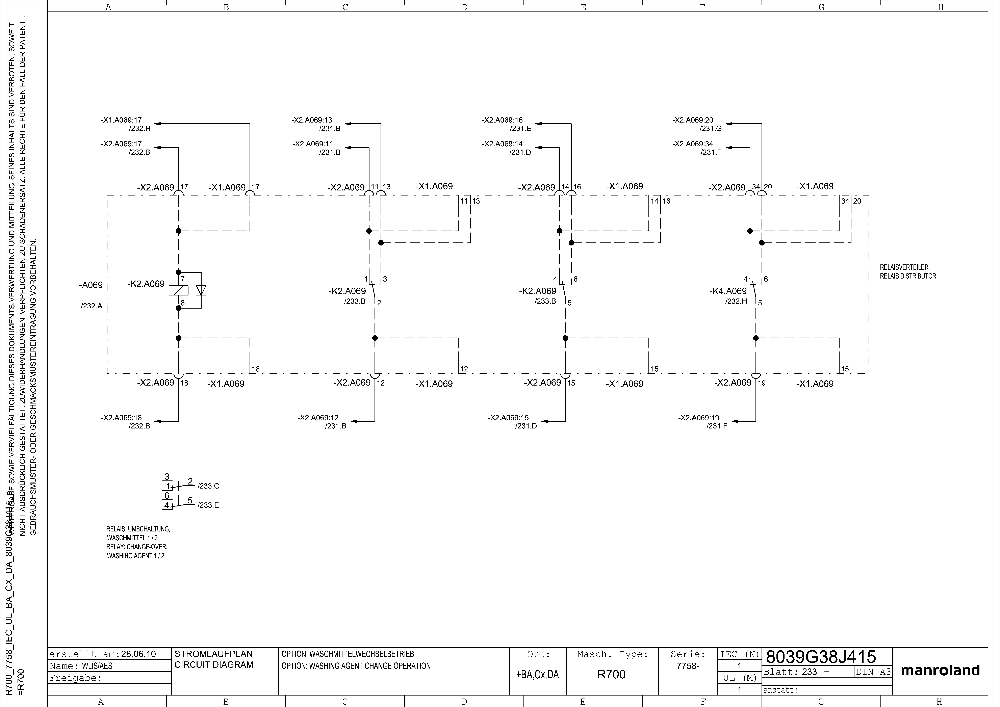

# +BA_Cx_DA — Sheet 233 of 247 — OPTION: WASCHMITTELWECHSELBETRIEB

**OPTION: WASHING AGENT CHANGE OPERATION**

> Part of the manroland **R700** printing press IEC/UL circuit diagrams.
> Drawing class: **Stromlaufplan / Circuit diagram** (DIN A3).
> Document `+BA_Cx_DA` covers the **Printing units / main switch cabinet** machine section.

## At a glance

| Field | Value |
|---|---|
| Document | `+BA_Cx_DA`  (8039G38J415) |
| Sheet | **233** of 247 |
| Section (DE) | OPTION: WASCHMITTELWECHSELBETRIEB |
| Section (EN) | OPTION: WASHING AGENT CHANGE OPERATION |
| Section type | CIRCUIT — Circuit diagram |
| Machine type | `R700` |
| Series | `7758` |
| Created | 28.06.10 |
| Replaces | — |
| Columns used | A, B, C, D, E, F, G, H |
| Path numbers | — |
| Labels on sheet | 93 |
| Cross-refs out | 18 |
| Cross-refs in | 40 |

**Previous:** [+BA_Cx_DA sheet 232](SHEET_0232.md) · **Next:** [+BA_Cx_DA sheet 234](SHEET_0234.md) · **Document TOC:** [_TOC.md](_TOC.md)  (+BA_Cx_DA) · **Master TOC:** [all sheets](../_MASTER_TOC.md)

## Sheet image (300 DPI, exact vector render)



_Rendered directly from the PDF vector layer at 300 DPI (1-bit), no OCR and no resampling. Use it to confirm anything ambiguous in the text below._

## Cross-references on this sheet

Each entry is a wire leaving this sheet. The printed token is `/sheet.column`; the link resolves to that sheet inside the same document.

| Ref | Target sheet | Col | Path | Destination on target | Target section | From col |
|---|---|---|---|---|---|---|
| `/232.H` | [+BA_Cx_DA sheet 232](SHEET_0232.md) | H | — | X1.A069:17 | OPTION: WASCHMITTELWECHSELBETRIEB | A |
| `/231.B` | [+BA_Cx_DA sheet 231](SHEET_0231.md) | B | — | X2.A069:13 | OPTION: WASCHMITTELWECHSELBETRIEB | C |
| `/231.E` | [+BA_Cx_DA sheet 231](SHEET_0231.md) | E | — | X2.A069:16 | OPTION: WASCHMITTELWECHSELBETRIEB | D |
| `/231.G` | [+BA_Cx_DA sheet 231](SHEET_0231.md) | G | — | X2.A069:20 | OPTION: WASCHMITTELWECHSELBETRIEB | F |
| `/232.B` | [+BA_Cx_DA sheet 232](SHEET_0232.md) | B | — | X2.A069:17 | OPTION: WASCHMITTELWECHSELBETRIEB | A |
| `/231.B` | [+BA_Cx_DA sheet 231](SHEET_0231.md) | B | — | X2.A069:11 | OPTION: WASCHMITTELWECHSELBETRIEB | C |
| `/231.D` | [+BA_Cx_DA sheet 231](SHEET_0231.md) | D | — | X2.A069:14 | OPTION: WASCHMITTELWECHSELBETRIEB | D |
| `/231.F` | [+BA_Cx_DA sheet 231](SHEET_0231.md) | F | — | X2.A069:34 | OPTION: WASCHMITTELWECHSELBETRIEB | F |
| `/233.B` | [+BA_Cx_DA sheet 233](SHEET_0233.md) | B | — | — | OPTION: WASCHMITTELWECHSELBETRIEB | C |
| `/233.B` | [+BA_Cx_DA sheet 233](SHEET_0233.md) | B | — | — | OPTION: WASCHMITTELWECHSELBETRIEB | E |
| `/232.H` | [+BA_Cx_DA sheet 232](SHEET_0232.md) | H | — | — | OPTION: WASCHMITTELWECHSELBETRIEB | F |
| `/232.A` | [+BA_Cx_DA sheet 232](SHEET_0232.md) | A | — | — | OPTION: WASCHMITTELWECHSELBETRIEB | A |
| `/232.B` | [+BA_Cx_DA sheet 232](SHEET_0232.md) | B | — | X2.A069:18 X2.A069:19 | OPTION: WASCHMITTELWECHSELBETRIEB | D |
| `/231.F` | [+BA_Cx_DA sheet 231](SHEET_0231.md) | F | — | X2.A069:18 X2.A069:19 | OPTION: WASCHMITTELWECHSELBETRIEB | D |
| `/231.B` | [+BA_Cx_DA sheet 231](SHEET_0231.md) | B | — | X2.A069:12 | OPTION: WASCHMITTELWECHSELBETRIEB | C |
| `/231.D` | [+BA_Cx_DA sheet 231](SHEET_0231.md) | D | — | X2.A069:15 | OPTION: WASCHMITTELWECHSELBETRIEB | D |
| `/233.C` | [+BA_Cx_DA sheet 233](SHEET_0233.md) | C | — | — | OPTION: WASCHMITTELWECHSELBETRIEB | B |
| `/233.E` | [+BA_Cx_DA sheet 233](SHEET_0233.md) | E | — | — | OPTION: WASCHMITTELWECHSELBETRIEB | B |

### Incoming references (sheets that point here)

Every other sheet that sends a wire to this one. `Back-ref` is the token printed on *that* sheet; `Path` is its line number.

| From sheet | Cols | Back-ref | Path | Refs | What continues there |
|---|---|---|---|---|---|
| [+BA_Cx_DA#139](SHEET_0139.md) | E, F | `/139.E`, `/139.F` | — | 11 | — |
| [+BA_Cx_DA#151](SHEET_0151.md) | C, D | `/151.C`, `/151.D` | — | 11 | — |
| [+BA_Cx_DA#231](SHEET_0231.md) | B, C, D, E, G | `/231.B`, `/231.C`, `/231.D`, `/231.E`, `/231.G` | — | 9 | — |
| [+BA_Cx_DA#232](SHEET_0232.md) | A, C, H | `/232.A`, `/232.C`, `/232.H` | — | 5 | — |
| [+BA_Cx_DA#233](SHEET_0233.md) | B, C, E | `/233.B`, `/233.C`, `/233.E` | — | 4 | — |


## Devices on this sheet

| Tag | Class | Class meaning (IEC) | Col | Sub | Terminal | Sign |
|---|---|---|---|---|---|---|
| `A069` | A | Baugruppe / assembly, module, PC board | A | — | — | — |
| `K2.A069` | — | cross-device reference | A | — | — | — |
| `X2.A069` | — | cross-device reference | A | — | — | — |
| `X1.A069` | — | cross-device reference | B | — | — | — |
| `X2.A069` | — | cross-device reference | A | — | — | — |
| `K2.A069` | — | cross-device reference | C | — | — | — |
| `X2.A069` | — | cross-device reference | C | — | — | — |
| `X2.A069` | — | cross-device reference | C | — | — | — |
| `K2.A069` | — | cross-device reference | E | — | — | — |
| `X2.A069` | — | cross-device reference | E | — | — | — |
| `X2.A069` | — | cross-device reference | E | — | — | — |
| `K4.A069` | — | cross-device reference | F | — | — | — |
| `X2.A069` | — | cross-device reference | F | — | — | — |
| `X2.A069` | — | cross-device reference | F | — | — | — |
| `X1.A069:17` | — | cross-device reference | A | — | 17 | — |
| `X2.A069:20` | — | cross-device reference | F | — | 20 | — |
| `X2.A069:19` | — | cross-device reference | F | — | 19 | — |
| `X2.A069:18` | — | cross-device reference | A | — | 18 | — |
| `X2.A069:17` | — | cross-device reference | A | — | 17 | — |
| `X2.A069:16` | — | cross-device reference | D | — | 16 | — |
| `X2.A069:34` | — | cross-device reference | F | — | 34 | — |
| `X2.A069:15` | — | cross-device reference | D | — | 15 | — |
| `X2.A069:14` | — | cross-device reference | D | — | 14 | — |
| `X2.A069:13` | — | cross-device reference | C | — | 13 | — |
| `X2.A069:12` | — | cross-device reference | C | — | 12 | — |
| `X2.A069:11` | — | cross-device reference | C | — | 11 | — |
| `X1.A069` | — | cross-device reference | B | — | — | — |
| `X1.A069` | — | cross-device reference | D | — | — | — |
| `X1.A069` | — | cross-device reference | D | — | — | — |
| `X1.A069` | — | cross-device reference | E | — | — | — |
| `X1.A069` | — | cross-device reference | E | — | — | — |
| `X1.A069` | — | cross-device reference | G | — | — | — |
| `X1.A069` | — | cross-device reference | G | — | — | — |

## Potentials / nets

_No named potentials on this sheet._

## Wire-end annotations (grouped as printed)

A wire that continues elsewhere is annotated with a small cluster: the destination description, the path/line number `#NN`, and the `/sheet.column` cross reference. Each row below is one such cluster exactly as it is grouped on the drawing.

| Col | Y | Path | Cross-ref | Text on the wire |
|---|---|---|---|---|
| A | 139.2 | — | `/232.H` | `X1.A069:17` |
| C | 139.2 | — | `/231.B` | `X2.A069:13` |
| D | 139.2 | — | `/231.E` | `X2.A069:16` |
| F | 139.2 | — | `/231.G` | `X2.A069:20` |
| A | 167.5 | — | `/232.B` | `X2.A069:17` |
| C | 167.5 | — | `/231.B` | `X2.A069:11` |
| D | 167.5 | — | `/231.D` | `X2.A069:14` |
| F | 167.5 | — | `/231.F` | `X2.A069:34` |
| D | 217.2 | — | — | `X1.A069` |
| E | 217.2 | — | — | `X1.A069` |
| G | 217.2 | — | — | `X1.A069` |
| B | 218.6 | — | — | `X2.A069 17 X1.A069 17` |
| C | 218.6 | — | — | `X2.A069 11 13` |
| E | 218.6 | — | — | `X2.A069 14 16` |
| F | 218.6 | — | — | `X2.A069 34 20` |
| D | 235.6 | — | — | `11 13` |
| F | 235.6 | — | — | `14 16` |
| G | 235.6 | — | — | `34 20` |
| H | 315.2 | — | — | `RELAISVERTEILER RELAIS DISTRIBUTOR` |
| B | 328.4 | — | — | `7` |
| C | 328.4 | — | — | `K2.A069 3` |
| C | 328.4 | — | — | `1` |
| E | 328.4 | — | — | `K2.A069 6` |
| E | 328.4 | — | — | `4` |
| F | 328.4 | — | — | `K4.A069 6` |
| F | 328.4 | — | — | `4` |
| A | 333.4 | — | — | `K2.A069` |
| A | 334.8 | — | — | `A069` |
| C | 354.9 | — | `/233.B` | — |
| E | 354.9 | — | `/233.B` | — |
| F | 355.0 | — | `/232.H` | — |
| B | 356.8 | — | — | `8` |
| C | 356.8 | — | — | `2` |
| E | 356.8 | — | — | `5` |
| F | 356.8 | — | — | `5` |
| A | 360.3 | — | `/232.A` | — |
| B | 435.4 | — | — | `18` |
| D | 435.4 | — | — | `12` |
| F | 435.4 | — | — | `15` |
| G | 435.4 | — | — | `15` |
| A | 451.0 | — | — | `X2.A069 18` |
| C | 451.0 | — | — | `X2.A069 12` |
| E | 451.0 | — | — | `X2.A069 15` |
| F | 451.0 | — | — | `X2.A069 19` |
| B | 452.4 | — | — | `X1.A069` |
| D | 452.4 | — | — | `X1.A069` |
| E | 452.4 | — | — | `X1.A069` |
| G | 452.4 | — | — | `X1.A069` |
| D | 493.5 | — | `/232.B`, `/231.F` | `X2.A069:18 X2.A069:19` |
| C | 493.5 | — | `/231.B` | `X2.A069:12` |
| D | 493.5 | — | `/231.D` | `X2.A069:15` |
| B | 563.0 | — | — | `3 6 4 1` |
| B | 568.6 | — | — | `2` |
| B | 575.0 | — | `/233.C` | — |
| B | 591.3 | — | — | `5` |
| B | 597.7 | — | `/233.E` | — |
| A | 627.1 | — | — | `RELAIS: UMSCHALTUNG,` |
| A | 637.7 | — | — | `RELAY: CHANGE OVER, WASCHMITTEL 1 / 2` |
| A | 659.0 | — | — | `WASHING AGENT 1 / 2` |


## Reconstructed tables

This sheet carries tabular content (pin map / terminal assignment / index). The grid below was rebuilt from the drawing's own rule lines, so each row is exactly one physical row of the table.

### Table 1 — 1 data rows × 2 columns (at x=212.6, y=147.4)

| 17 | X1.A069 |
|---|---|
| `7 8` |  |


## Notes and free text on this sheet

| Text | Col | Y (pt) |
|---|---|---|
| `RELAIS: UMSCHALTUNG,` | A | 627.08 |
| `WASCHMITTEL 1 / 2` | A | 637.69 |
| `RELAY: CHANGE OVER,` | A | 648.34 |
| `WASHING AGENT 1 / 2` | A | 658.95 |
| `RELAISVERTEILER` | H | 315.25 |
| `RELAIS DISTRIBUTOR` | H | 325.9 |

## Complete label inventory (exact text from the drawing)

Every text object inside the drawing area of this sheet, in DIN reading order (column A→H, then top→bottom). This is the authoritative list: if a string is not here it is not printed on this sheet.

| Col | Y | X | Dir | Type | Text |
|---|---|---|---|---|---|
| A | 139.2 | 120.2 | → | device ref | `X1.A069:17` |
| A | 149.1 | 153.6 | → | cross-reference | `/232.H` |
| A | 167.5 | 120.2 | → | device ref | `X2.A069:17` |
| A | 177.4 | 153.4 | → | cross-reference | `/232.B` |
| A | 218.6 | 163.3 | → | device ref | `X2.A069` |
| A | 333.4 | 151.9 | → | device ref | `K2.A069` |
| A | 334.8 | 94.1 | → | device tag | `A069` |
| A | 360.3 | 96.4 | → | cross-reference | `/232.A` |
| A | 451.0 | 163.3 | → | device ref | `X2.A069` |
| A | 493.5 | 120.2 | → | device ref | `X2.A069:18` |
| A | 503.4 | 153.4 | → | cross-reference | `/232.B` |
| A | 562.9 | 195.9 | → | number | `3` |
| A | 585.6 | 195.9 | → | number | `6` |
| A | 597.0 | 195.9 | → | number | `4` |
| A | 627.1 | 126.7 | → | text | `RELAIS: UMSCHALTUNG,` |
| A | 637.7 | 127.6 | → | text | `WASCHMITTEL 1 / 2` |
| A | 648.3 | 126.7 | → | text | `RELAY: CHANGE OVER,` |
| A | 658.9 | 127.6 | → | text | `WASHING AGENT 1 / 2` |
| B | 218.6 | 214.6 | → | number | `17` |
| B | 218.6 | 248.3 | → | device ref | `X1.A069` |
| B | 218.6 | 299.6 | → | number | `17` |
| B | 328.4 | 215.1 | → | number | `7` |
| B | 356.8 | 215.1 | → | number | `8` |
| B | 435.4 | 299.6 | → | number | `18` |
| B | 452.4 | 246.9 | → | device ref | `X1.A069` |
| B | 452.5 | 214.6 | → | number | `18` |
| B | 568.6 | 223.7 | → | number | `2` |
| B | 574.3 | 197.3 | → | number | `1` |
| B | 575.0 | 235.3 | → | cross-reference | `/233.C` |
| B | 591.3 | 223.4 | → | number | `5` |
| B | 597.7 | 235.3 | → | cross-reference | `/233.E` |
| C | 139.2 | 347.0 | → | device ref | `X2.A069:13` |
| C | 149.1 | 380.1 | → | cross-reference | `/231.B` |
| C | 167.5 | 348.4 | → | device ref | `X2.A069:11` |
| C | 177.4 | 380.1 | → | cross-reference | `/231.B` |
| C | 218.6 | 390.0 | → | device ref | `X2.A069` |
| C | 218.6 | 441.4 | → | number | `11` |
| C | 218.6 | 455.5 | → | number | `13` |
| C | 328.4 | 433.4 | → | number | `1` |
| C | 328.4 | 456.1 | → | number | `3` |
| C | 341.9 | 391.5 | → | device ref | `K2.A069` |
| C | 354.9 | 409.9 | → | cross-reference | `/233.B` |
| C | 356.8 | 449.0 | → | number | `2` |
| C | 451.0 | 397.1 | → | device ref | `X2.A069` |
| C | 452.5 | 448.4 | → | number | `12` |
| C | 493.5 | 354.3 | → | device ref | `X2.A069:12` |
| C | 503.4 | 387.2 | → | cross-reference | `/231.B` |
| D | 139.2 | 573.7 | → | device ref | `X2.A069:16` |
| D | 149.1 | 607.2 | → | cross-reference | `/231.E` |
| D | 167.5 | 573.7 | → | device ref | `X2.A069:14` |
| D | 177.5 | 606.6 | → | cross-reference | `/231.D` |
| D | 217.2 | 494.9 | → | device ref | `X1.A069` |
| D | 235.6 | 547.7 | → | number | `11 13` |
| D | 435.4 | 547.7 | → | number | `12` |
| D | 452.4 | 494.9 | → | device ref | `X1.A069` |
| D | 493.5 | 580.8 | → | device ref | `X2.A069:15` |
| E | 217.2 | 721.7 | → | device ref | `X1.A069` |
| E | 218.6 | 616.8 | → | device ref | `X2.A069` |
| E | 218.6 | 668.1 | → | number | `14` |
| E | 218.6 | 682.3 | → | number | `16` |
| E | 328.4 | 658.8 | → | number | `4` |
| E | 328.4 | 682.9 | → | number | `6` |
| E | 341.9 | 618.2 | → | device ref | `K2.A069` |
| E | 354.9 | 636.7 | → | cross-reference | `/233.B` |
| E | 356.8 | 675.8 | → | number | `5` |
| E | 451.0 | 623.9 | → | device ref | `X2.A069` |
| E | 452.4 | 721.7 | → | device ref | `X1.A069` |
| E | 452.5 | 675.2 | → | number | `15` |
| E | 503.4 | 613.7 | → | cross-reference | `/231.D` |
| F | 139.2 | 800.5 | → | device ref | `X2.A069:20` |
| F | 149.1 | 833.1 | → | cross-reference | `/231.G` |
| F | 167.5 | 800.5 | → | device ref | `X2.A069:34` |
| F | 177.4 | 834.2 | → | cross-reference | `/231.F` |
| F | 218.6 | 843.6 | → | device ref | `X2.A069` |
| F | 218.6 | 895.5 | → | number | `34` |
| F | 235.6 | 774.4 | → | number | `14 16` |
| F | 328.4 | 885.5 | → | number | `4` |
| F | 341.9 | 845.0 | → | device ref | `K4.A069` |
| F | 355.0 | 863.7 | → | cross-reference | `/232.H` |
| F | 356.8 | 902.6 | → | number | `5` |
| F | 435.4 | 774.4 | → | number | `15` |
| F | 451.0 | 850.7 | → | device ref | `X2.A069` |
| F | 452.5 | 902.0 | → | number | `19` |
| F | 493.5 | 807.6 | → | device ref | `X2.A069:19` |
| F | 503.4 | 841.3 | → | cross-reference | `/231.F` |
| G | 217.2 | 948.5 | → | device ref | `X1.A069` |
| G | 218.6 | 909.6 | → | number | `20` |
| G | 235.6 | 1001.8 | → | number | `34 20` |
| G | 328.4 | 909.6 | → | number | `6` |
| G | 435.4 | 1001.2 | → | number | `15` |
| G | 452.4 | 948.5 | → | device ref | `X1.A069` |
| H | 315.3 | 1048.0 | → | text | `RELAISVERTEILER` |
| H | 325.9 | 1048.0 | → | text | `RELAIS DISTRIBUTOR` |

## Reading-order text block

The same content as a plain block, grouped by DIN column — convenient to paste or to match against a visual description.

```text
=== Column A ===
 139.2  120.2  devref       X1.A069:17
 149.1  153.6  xref         /232.H
 167.5  120.2  devref       X2.A069:17
 177.4  153.4  xref         /232.B
 218.6  163.3  devref       X2.A069
 333.4  151.9  devref       K2.A069
 334.8   94.1  devtag       A069
 360.3   96.4  xref         /232.A
 451.0  163.3  devref       X2.A069
 493.5  120.2  devref       X2.A069:18
 503.4  153.4  xref         /232.B
 562.9  195.9  numeric      3
 585.6  195.9  numeric      6
 597.0  195.9  numeric      4
 627.1  126.7  text         RELAIS: UMSCHALTUNG,
 637.7  127.6  text         WASCHMITTEL 1 / 2
 648.3  126.7  text         RELAY: CHANGE OVER,
 658.9  127.6  text         WASHING AGENT 1 / 2
=== Column B ===
 218.6  214.6  numeric      17
 218.6  248.3  devref       X1.A069
 218.6  299.6  numeric      17
 328.4  215.1  numeric      7
 356.8  215.1  numeric      8
 435.4  299.6  numeric      18
 452.4  246.9  devref       X1.A069
 452.5  214.6  numeric      18
 568.6  223.7  numeric      2
 574.3  197.3  numeric      1
 575.0  235.3  xref         /233.C
 591.3  223.4  numeric      5
 597.7  235.3  xref         /233.E
=== Column C ===
 139.2  347.0  devref       X2.A069:13
 149.1  380.1  xref         /231.B
 167.5  348.4  devref       X2.A069:11
 177.4  380.1  xref         /231.B
 218.6  390.0  devref       X2.A069
 218.6  441.4  numeric      11
 218.6  455.5  numeric      13
 328.4  433.4  numeric      1
 328.4  456.1  numeric      3
 341.9  391.5  devref       K2.A069
 354.9  409.9  xref         /233.B
 356.8  449.0  numeric      2
 451.0  397.1  devref       X2.A069
 452.5  448.4  numeric      12
 493.5  354.3  devref       X2.A069:12
 503.4  387.2  xref         /231.B
=== Column D ===
 139.2  573.7  devref       X2.A069:16
 149.1  607.2  xref         /231.E
 167.5  573.7  devref       X2.A069:14
 177.5  606.6  xref         /231.D
 217.2  494.9  devref       X1.A069
 235.6  547.7  numeric      11 13
 435.4  547.7  numeric      12
 452.4  494.9  devref       X1.A069
 493.5  580.8  devref       X2.A069:15
=== Column E ===
 217.2  721.7  devref       X1.A069
 218.6  616.8  devref       X2.A069
 218.6  668.1  numeric      14
 218.6  682.3  numeric      16
 328.4  658.8  numeric      4
 328.4  682.9  numeric      6
 341.9  618.2  devref       K2.A069
 354.9  636.7  xref         /233.B
 356.8  675.8  numeric      5
 451.0  623.9  devref       X2.A069
 452.4  721.7  devref       X1.A069
 452.5  675.2  numeric      15
 503.4  613.7  xref         /231.D
=== Column F ===
 139.2  800.5  devref       X2.A069:20
 149.1  833.1  xref         /231.G
 167.5  800.5  devref       X2.A069:34
 177.4  834.2  xref         /231.F
 218.6  843.6  devref       X2.A069
 218.6  895.5  numeric      34
 235.6  774.4  numeric      14 16
 328.4  885.5  numeric      4
 341.9  845.0  devref       K4.A069
 355.0  863.7  xref         /232.H
 356.8  902.6  numeric      5
 435.4  774.4  numeric      15
 451.0  850.7  devref       X2.A069
 452.5  902.0  numeric      19
 493.5  807.6  devref       X2.A069:19
 503.4  841.3  xref         /231.F
=== Column G ===
 217.2  948.5  devref       X1.A069
 218.6  909.6  numeric      20
 235.6 1001.8  numeric      34 20
 328.4  909.6  numeric      6
 435.4 1001.2  numeric      15
 452.4  948.5  devref       X1.A069
=== Column H ===
 315.3 1048.0  text         RELAISVERTEILER
 325.9 1048.0  text         RELAIS DISTRIBUTOR
```

---
_Generated from the PDF vector text layer; no OCR. Source: `R700_7758_IEC_UL_BA_CX_DA_8039G38J415_p`, sheet 233._
