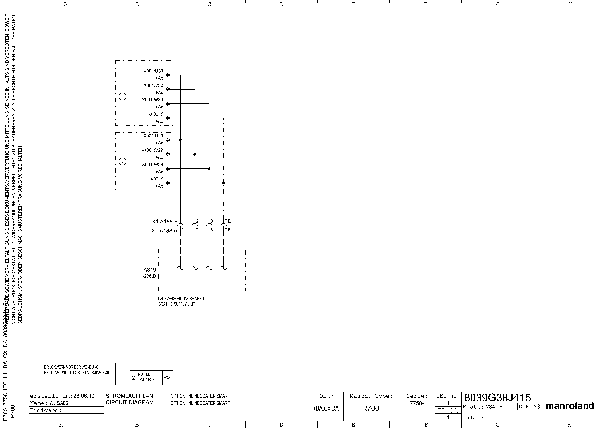

# +BA_Cx_DA — Sheet 234 of 247 — OPTION: INLINECOATER SMART

**OPTION: INLINECOATER SMART**

> Part of the manroland **R700** printing press IEC/UL circuit diagrams.
> Drawing class: **Stromlaufplan / Circuit diagram** (DIN A3).
> Document `+BA_Cx_DA` covers the **Printing units / main switch cabinet** machine section.

## At a glance

| Field | Value |
|---|---|
| Document | `+BA_Cx_DA`  (8039G38J415) |
| Sheet | **234** of 247 |
| Section (DE) | OPTION: INLINECOATER SMART |
| Section (EN) | OPTION: INLINECOATER SMART |
| Section type | CIRCUIT — Circuit diagram |
| Machine type | `R700` |
| Series | `7758` |
| Created | 28.06.10 |
| Replaces | — |
| Columns used | A, B, C |
| Path numbers | — |
| Labels on sheet | 39 |
| Cross-refs out | 1 |
| Cross-refs in | 9 |

**Previous:** [+BA_Cx_DA sheet 233](SHEET_0233.md) · **Next:** [+BA_Cx_DA sheet 235](SHEET_0235.md) · **Document TOC:** [_TOC.md](_TOC.md)  (+BA_Cx_DA) · **Master TOC:** [all sheets](../_MASTER_TOC.md)

## Sheet image (300 DPI, exact vector render)



_Rendered directly from the PDF vector layer at 300 DPI (1-bit), no OCR and no resampling. Use it to confirm anything ambiguous in the text below._

## Cross-references on this sheet

Each entry is a wire leaving this sheet. The printed token is `/sheet.column`; the link resolves to that sheet inside the same document.

| Ref | Target sheet | Col | Path | Destination on target | Target section | From col |
|---|---|---|---|---|---|---|
| `/236.B` | [+BA_Cx_DA sheet 236](SHEET_0236.md) | B | — | — | OPTION: INLINECOATER SMART | B |

### Incoming references (sheets that point here)

Every other sheet that sends a wire to this one. `Back-ref` is the token printed on *that* sheet; `Path` is its line number.

| From sheet | Cols | Back-ref | Path | Refs | What continues there |
|---|---|---|---|---|---|
| [+BA_Cx_DA#140](SHEET_0140.md) | C, E | `/140.C`, `/140.E` | — | 8 | — |
| [+BA_Cx_DA#236](SHEET_0236.md) | B | `/236.B` | — | 1 | — |


## Devices on this sheet

| Tag | Class | Class meaning (IEC) | Col | Sub | Terminal | Sign |
|---|---|---|---|---|---|---|
| `A319` | A | Baugruppe / assembly, module, PC board | B | — | — | — |
| `X001:U30` | X | Klemme / terminal, plug connector | B | — | U30 | — |
| `X001:V30` | X | Klemme / terminal, plug connector | B | — | V30 | — |
| `X001:W30` | X | Klemme / terminal, plug connector | B | — | W30 | — |
| `X001:U29` | X | Klemme / terminal, plug connector | B | — | U29 | — |
| `X001:V29` | X | Klemme / terminal, plug connector | B | — | V29 | — |
| `X001:W29` | X | Klemme / terminal, plug connector | B | — | W29 | — |
| `X1.A188.B` | — | cross-device reference | B | — | — | — |
| `X1.A188.A` | — | cross-device reference | B | — | — | — |

## Potentials / nets

| Potential | Count | Columns | Attached devices | Terminals |
|---|---|---|---|---|
| `PE` | 2 | C | — | — |


A potential such as `L24+/4` or `M24+` is a named supply/return rail; every place it appears on this sheet is electrically common.

## Wire-end annotations (grouped as printed)

A wire that continues elsewhere is annotated with a small cluster: the destination description, the path/line number `#NN`, and the `/sheet.column` cross reference. Each row below is one such cluster exactly as it is grouped on the drawing.

| Col | Y | Path | Cross-ref | Text on the wire |
|---|---|---|---|---|
| B | 135.7 | — | — | `X001:U30` |
| B | 149.9 | — | — | `+Ax` |
| B | 164.0 | — | — | `X001:V30` |
| B | 178.2 | — | — | `+Ax` |
| B | 186.9 | — | — | `1` |
| B | 192.3 | — | — | `X001:W30` |
| B | 206.6 | — | — | `+Ax` |
| B | 220.7 | — | — | `X001:'` |
| B | 234.9 | — | — | `+Ax` |
| B | 263.2 | — | — | `X001:U29` |
| B | 277.4 | — | — | `+Ax` |
| B | 291.6 | — | — | `X001:V29` |
| B | 305.8 | — | — | `+Ax` |
| B | 314.9 | — | — | `2` |
| B | 319.8 | — | — | `X001:W29` |
| B | 334.1 | — | — | `+Ax` |
| B | 348.2 | — | — | `X001:'` |
| B | 362.5 | — | — | `+Ax` |
| C | 431.1 | — | — | `X1.A188.B 1 2 3 PE` |
| C | 448.1 | — | — | `X1.A188.A 1 2 3 PE` |
| B | 526.1 | — | — | `A319` |
| B | 539.2 | — | `/236.B` | — |
| C | 584.6 | — | — | `LACKVERSORGUNGSEINHEIT` |
| C | 595.2 | — | — | `COATING SUPPLY UNIT` |
| A | 719.2 | — | — | `1 DRUCKWERK VOR DER WENDUNG PRINTING UNIT BEFORE REVERSING POINT 2 NUR BEI` |
| B | 740.5 | — | — | `ONLY FOR +DA` |


## Notes and free text on this sheet

| Text | Col | Y (pt) |
|---|---|---|
| `LACKVERSORGUNGSEINHEIT` | C | 584.57 |
| `COATING SUPPLY UNIT` | C | 595.2 |
| `+Ax` | B | 149.89 |
| `X001:'` | B | 220.69 |
| `DRUCKWERK VOR DER WENDUNG` | A | 719.19 |
| `PRINTING UNIT BEFORE REVERSING POINT` | A | 729.84 |
| `NUR BEI` | B | 733.33 |
| `ONLY FOR` | B | 744.02 |
| `+DA` | B | 740.47 |

## Complete label inventory (exact text from the drawing)

Every text object inside the drawing area of this sheet, in DIN reading order (column A→H, then top→bottom). This is the authoritative list: if a string is not here it is not printed on this sheet.

| Col | Y | X | Dir | Type | Text |
|---|---|---|---|---|---|
| A | 719.2 | 87.0 | → | text | `DRUCKWERK VOR DER WENDUNG` |
| A | 729.8 | 87.0 | → | text | `PRINTING UNIT BEFORE REVERSING POINT` |
| A | 731.6 | 75.4 | → | number | `1` |
| B | 135.7 | 278.9 | → | device tag | `X001:U30` |
| B | 149.9 | 305.3 | → | text | `+Ax` |
| B | 164.0 | 279.2 | → | device tag | `X001:V30` |
| B | 178.2 | 305.3 | → | text | `+Ax` |
| B | 186.9 | 239.2 | → | number | `1` |
| B | 192.3 | 276.1 | → | device tag | `X001:W30` |
| B | 206.6 | 305.3 | → | text | `+Ax` |
| B | 220.7 | 292.5 | → | text | `X001:'` |
| B | 234.9 | 305.3 | → | text | `+Ax` |
| B | 263.2 | 278.9 | → | device tag | `X001:U29` |
| B | 277.4 | 305.3 | → | text | `+Ax` |
| B | 291.5 | 279.2 | → | device tag | `X001:V29` |
| B | 305.8 | 305.3 | → | text | `+Ax` |
| B | 314.9 | 239.0 | → | number | `2` |
| B | 319.8 | 276.1 | → | device tag | `X001:W29` |
| B | 334.1 | 305.3 | → | text | `+Ax` |
| B | 348.3 | 292.5 | → | text | `X001:'` |
| B | 362.5 | 305.3 | → | text | `+Ax` |
| B | 431.2 | 295.1 | → | device ref | `X1.A188.B` |
| B | 448.9 | 294.2 | → | device ref | `X1.A188.A` |
| B | 526.1 | 278.4 | → | device tag | `A319` |
| B | 539.2 | 280.9 | → | cross-reference | `/236.B` |
| B | 733.3 | 271.3 | → | text | `NUR BEI` |
| B | 738.7 | 259.4 | → | number | `2` |
| B | 740.5 | 322.2 | → | text | `+DA` |
| B | 744.0 | 271.8 | → | text | `ONLY FOR` |
| C | 431.1 | 441.4 | → | potential | `PE` |
| C | 431.2 | 356.3 | → | number | `1` |
| C | 431.2 | 385.2 | → | number | `2` |
| C | 431.2 | 413.6 | → | number | `3` |
| C | 448.1 | 441.4 | → | potential | `PE` |
| C | 448.2 | 356.3 | → | number | `1` |
| C | 448.2 | 385.2 | → | number | `2` |
| C | 448.2 | 413.6 | → | number | `3` |
| C | 584.6 | 311.0 | → | text | `LACKVERSORGUNGSEINHEIT` |
| C | 595.2 | 311.5 | → | text | `COATING SUPPLY UNIT` |

## Reading-order text block

The same content as a plain block, grouped by DIN column — convenient to paste or to match against a visual description.

```text
=== Column A ===
 719.2   87.0  text         DRUCKWERK VOR DER WENDUNG
 729.8   87.0  text         PRINTING UNIT BEFORE REVERSING POINT
 731.6   75.4  numeric      1
=== Column B ===
 135.7  278.9  devtag       X001:U30
 149.9  305.3  text         +Ax
 164.0  279.2  devtag       X001:V30
 178.2  305.3  text         +Ax
 186.9  239.2  numeric      1
 192.3  276.1  devtag       X001:W30
 206.6  305.3  text         +Ax
 220.7  292.5  text         X001:`
 234.9  305.3  text         +Ax
 263.2  278.9  devtag       X001:U29
 277.4  305.3  text         +Ax
 291.5  279.2  devtag       X001:V29
 305.8  305.3  text         +Ax
 314.9  239.0  numeric      2
 319.8  276.1  devtag       X001:W29
 334.1  305.3  text         +Ax
 348.3  292.5  text         X001:`
 362.5  305.3  text         +Ax
 431.2  295.1  devref       X1.A188.B
 448.9  294.2  devref       X1.A188.A
 526.1  278.4  devtag       A319
 539.2  280.9  xref         /236.B
 733.3  271.3  text         NUR BEI
 738.7  259.4  numeric      2
 740.5  322.2  text         +DA
 744.0  271.8  text         ONLY FOR
=== Column C ===
 431.1  441.4  net          PE
 431.2  356.3  numeric      1
 431.2  385.2  numeric      2
 431.2  413.6  numeric      3
 448.1  441.4  net          PE
 448.2  356.3  numeric      1
 448.2  385.2  numeric      2
 448.2  413.6  numeric      3
 584.6  311.0  text         LACKVERSORGUNGSEINHEIT
 595.2  311.5  text         COATING SUPPLY UNIT
```

---
_Generated from the PDF vector text layer; no OCR. Source: `R700_7758_IEC_UL_BA_CX_DA_8039G38J415_p`, sheet 234._
