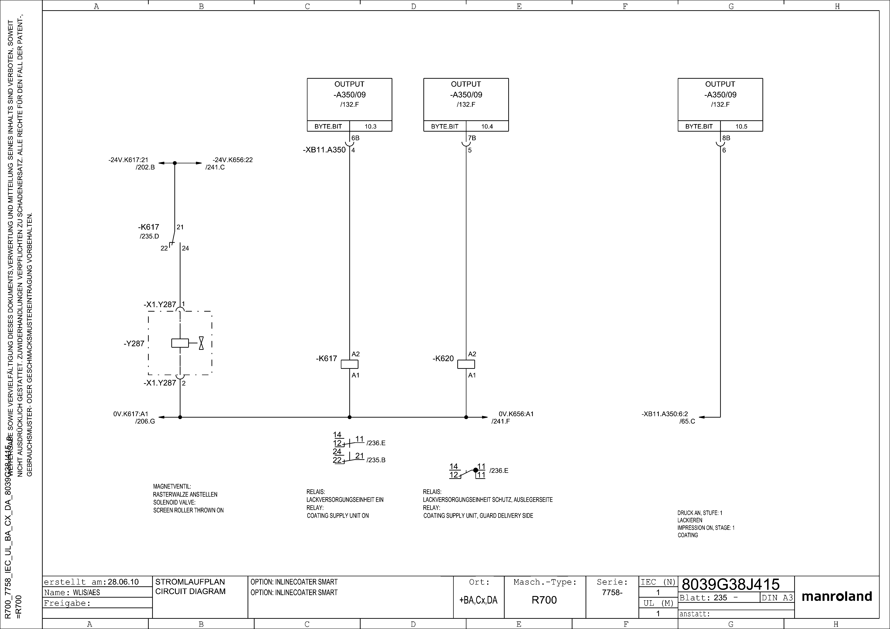

# +BA_Cx_DA — Sheet 235 of 247 — OPTION: INLINECOATER SMART

**OPTION: INLINECOATER SMART**

> Part of the manroland **R700** printing press IEC/UL circuit diagrams.
> Drawing class: **Stromlaufplan / Circuit diagram** (DIN A3).
> Document `+BA_Cx_DA` covers the **Printing units / main switch cabinet** machine section.

## At a glance

| Field | Value |
|---|---|
| Document | `+BA_Cx_DA`  (8039G38J415) |
| Sheet | **235** of 247 |
| Section (DE) | OPTION: INLINECOATER SMART |
| Section (EN) | OPTION: INLINECOATER SMART |
| Section type | CIRCUIT — Circuit diagram |
| Machine type | `R700` |
| Series | `7758` |
| Created | 28.06.10 |
| Replaces | — |
| Columns used | A, B, C, D, E, F, G |
| Path numbers | — |
| Labels on sheet | 75 |
| Cross-refs out | 10 |
| Cross-refs in | 17 |

**Previous:** [+BA_Cx_DA sheet 234](SHEET_0234.md) · **Next:** [+BA_Cx_DA sheet 236](SHEET_0236.md) · **Document TOC:** [_TOC.md](_TOC.md)  (+BA_Cx_DA) · **Master TOC:** [all sheets](../_MASTER_TOC.md)

## Sheet image (300 DPI, exact vector render)



_Rendered directly from the PDF vector layer at 300 DPI (1-bit), no OCR and no resampling. Use it to confirm anything ambiguous in the text below._

## Cross-references on this sheet

Each entry is a wire leaving this sheet. The printed token is `/sheet.column`; the link resolves to that sheet inside the same document.

| Ref | Target sheet | Col | Path | Destination on target | Target section | From col |
|---|---|---|---|---|---|---|
| `/132.F` | [+BA_Cx_DA sheet 132](SHEET_0132.md) | F | — | — | REFERENZMODUL | C |
| `/132.F` | [+BA_Cx_DA sheet 132](SHEET_0132.md) | F | — | — | REFERENZMODUL | E |
| `/132.F` | [+BA_Cx_DA sheet 132](SHEET_0132.md) | F | — | — | REFERENZMODUL | G |
| `/202.B` | [+BA_Cx_DA sheet 202](SHEET_0202.md) | B | — | 24V.K617:21 | OPTION: | A |
| `/241.C` | [+BA_Cx_DA sheet 241](SHEET_0241.md) | C | — | — | OPTION: BOGENSTOPPEINRICHTUNG | B |
| `/235.D` | [+BA_Cx_DA sheet 235](SHEET_0235.md) | D | — | — | OPTION: INLINECOATER SMART | B |
| `/206.G` | [+BA_Cx_DA sheet 206](SHEET_0206.md) | G | — | 0V.K617:A1 XB11.A350:6:2 | OPTION: AUTOMATISCHE FARBZUFÜHRUNG | D |
| `/65.C` | [+BA_Cx_DA sheet 65](SHEET_0065.md) | C | — | 0V.K617:A1 XB11.A350:6:2 | DRUCKANSTELLUNG | D |
| `/241.F` | [+BA_Cx_DA sheet 241](SHEET_0241.md) | F | — | — | OPTION: BOGENSTOPPEINRICHTUNG | E |
| `/235.B` | [+BA_Cx_DA sheet 235](SHEET_0235.md) | B | — | — | OPTION: INLINECOATER SMART | D |

### Incoming references (sheets that point here)

Every other sheet that sends a wire to this one. `Back-ref` is the token printed on *that* sheet; `Path` is its line number.

| From sheet | Cols | Back-ref | Path | Refs | What continues there |
|---|---|---|---|---|---|
| [+BA_Cx_DA#65](SHEET_0065.md) | C | `/65.C` | — | 1 | — |
| [+BA_Cx_DA#132](SHEET_0132.md) | F | `/132.F` | — | 3 | — |
| [+BA_Cx_DA#150](SHEET_0150.md) | F | `/150.F` | — | 2 | — |
| [+BA_Cx_DA#168](SHEET_0168.md) | H | `/168.H` | — | 3 | — |
| [+BA_Cx_DA#202](SHEET_0202.md) | B | `/202.B` | — | 1 | — |
| [+BA_Cx_DA#206](SHEET_0206.md) | H | `/206.H` | — | 1 | — |
| [+BA_Cx_DA#235](SHEET_0235.md) | B, D | `/235.B`, `/235.D` | — | 2 | — |
| [+BA_Cx_DA#236](SHEET_0236.md) | D, E | `/236.D`, `/236.E` | — | 2 | — |
| [+BA_Cx_DA#241](SHEET_0241.md) | C, E | `/241.C`, `/241.E` | — | 2 | 0V.K656:A1; 24V.K656:22 |


## Devices on this sheet

| Tag | Class | Class meaning (IEC) | Col | Sub | Terminal | Sign |
|---|---|---|---|---|---|---|
| `K617` | K | Relais / relay, contactor | A | — | — | — |
| `Y287` | Y | Magnetventil / solenoid valve, actuator | A | — | — | — |
| `A350/09` | A | Baugruppe / assembly, module, PC board | C | 09 | — | — |
| `A350/09` | A | Baugruppe / assembly, module, PC board | E | 09 | — | — |
| `A2` | A | Baugruppe / assembly, module, PC board | C | — | — | — |
| `A1` | A | Baugruppe / assembly, module, PC board | C | — | — | — |
| `K617` | K | Relais / relay, contactor | C | — | — | — |
| `A2` | A | Baugruppe / assembly, module, PC board | E | — | — | — |
| `A1` | A | Baugruppe / assembly, module, PC board | E | — | — | — |
| `K620` | K | Relais / relay, contactor | D | — | — | — |
| `A350/09` | A | Baugruppe / assembly, module, PC board | G | 09 | — | — |
| `X1.Y287` | — | cross-device reference | B | — | — | — |
| `X1.Y287` | — | cross-device reference | B | — | — | — |
| `XB11.A350` | — | cross-device reference | C | — | — | — |
| `10.3` | — | cross-device reference | D | — | — | — |
| `10.4` | — | cross-device reference | E | — | — | — |
| `10.5` | — | cross-device reference | G | — | — | — |

## Potentials / nets

| Potential | Count | Columns | Attached devices | Terminals |
|---|---|---|---|---|
| `0V` | 2 | A, E | `K617`, `K656` | `A1` |
| `24V` | 2 | A, B | `K617`, `K656` | `21`, `22` |


A potential such as `L24+/4` or `M24+` is a named supply/return rail; every place it appears on this sheet is electrically common.

## Wire-end annotations (grouped as printed)

A wire that continues elsewhere is annotated with a small cluster: the destination description, the path/line number `#NN`, and the `/sheet.column` cross reference. Each row below is one such cluster exactly as it is grouped on the drawing.

| Col | Y | Path | Cross-ref | Text on the wire |
|---|---|---|---|---|
| C | 108.3 | — | — | `OUTPUT` |
| D | 108.3 | — | — | `OUTPUT` |
| G | 108.3 | — | — | `OUTPUT` |
| C | 122.2 | — | — | `A350/09` |
| E | 122.2 | — | — | `A350/09` |
| G | 122.2 | — | — | `A350/09` |
| C | 136.0 | — | `/132.F` | — |
| E | 136.0 | — | `/132.F` | — |
| G | 136.0 | — | `/132.F` | — |
| C | 165.6 | — | — | `BYTE.BIT 10.3` |
| D | 165.6 | — | — | `BYTE.BIT 10.4` |
| G | 165.6 | — | — | `BYTE.BIT 10.5` |
| C | 181.0 | — | — | `6B` |
| E | 181.0 | — | — | `7B` |
| G | 181.0 | — | — | `8B` |
| C | 195.9 | — | — | `XB11.A350 4` |
| E | 197.3 | — | — | `5` |
| G | 197.3 | — | — | `6` |
| A | 210.1 | — | `/202.B` | `24V.K617:21` |
| B | 210.1 | — | — | `24V.K656:22` |
| B | 220.0 | — | `/241.C` | — |
| A | 299.4 | — | — | `K617` |
| B | 300.1 | — | — | `21` |
| B | 312.5 | — | `/235.D` | — |
| B | 328.4 | — | — | `22` |
| B | 328.4 | — | — | `24` |
| B | 402.8 | — | — | `X1.Y287 1` |
| A | 455.4 | — | — | `Y287` |
| C | 470.1 | — | — | `A2` |
| E | 470.1 | — | — | `A2` |
| C | 475.1 | — | — | `K617` |
| D | 475.1 | — | — | `K620` |
| C | 498.5 | — | — | `A1` |
| E | 498.5 | — | — | `A1` |
| B | 507.8 | — | — | `X1.Y287 2` |
| D | 550.2 | — | `/206.G`, `/65.C` | `0V.K617:A1 XB11.A350:6:2` |
| E | 550.2 | — | — | `0V.K656:A1` |
| E | 560.1 | — | `/241.F` | — |
| C | 577.1 | — | — | `14 12 24 22 21` |
| D | 582.8 | — | — | `11 /236.E` |
| D | 611.8 | — | `/235.B` | — |
| E | 619.6 | — | — | `14 12 11 11 /236.E` |
| B | 648.3 | — | — | `RASTERWALZE ANSTELLEN MAGNETVENTIL:` |
| C | 655.4 | — | — | `RELAIS: LACKVERSORGUNGSEINHEIT EIN RELAY:` |
| E | 655.4 | — | — | `RELAIS: LACKVERSORGUNGSEINHEIT SCHUTZ, AUSLEGERSEITE RELAY:` |
| B | 669.6 | — | — | `SOLENOID VALVE: SCREEN ROLLER THROWN ON` |
| G | 683.9 | — | — | `DRUCK AN, STUFE: 1 LACKIEREN IMPRESSION ON, STAGE: 1 COATING` |
| C | 687.3 | — | — | `COATING SUPPLY UNIT ON` |
| E | 687.3 | — | — | `COATING SUPPLY UNIT, GUARD DELIVERY SIDE` |


## Reconstructed tables

This sheet carries tabular content (pin map / terminal assignment / index). The grid below was rebuilt from the drawing's own rule lines, so each row is exactly one physical row of the table.

### Table 1 — 2 data rows × 2 columns (at x=411.0, y=104.9)

| OUTPUT | A350/09 /132.F |
|---|---|
| `BYTE.BIT` | `10.3` |
| `XB11.A350 K617` | `6B 4 A2 A1` |


### Table 2 — 2 data rows × 2 columns (at x=566.9, y=104.9)

| OUTPUT | A350/09 /132.F |
|---|---|
| `BYTE.BIT` | `10.4` |
| `K620` | `7B 5 A2 A1` |


### Table 3 — 1 data rows × 2 columns (at x=907.1, y=104.9)

| OUTPUT | A350/09 /132.F |
|---|---|
| `BYTE.BIT` | `10.5` |


## Notes and free text on this sheet

| Text | Col | Y (pt) |
|---|---|---|
| `MAGNETVENTIL:` | B | 648.33 |
| `RASTERWALZE ANSTELLEN` | B | 658.95 |
| `SOLENOID VALVE:` | B | 669.59 |
| `SCREEN ROLLER THROWN ON` | B | 680.24 |
| `6B` | C | 180.98 |
| `OUTPUT` | C | 108.33 |
| `BYTE.BIT` | C | 165.6 |
| `7B` | E | 180.98 |
| `OUTPUT` | D | 108.33 |
| `BYTE.BIT` | D | 165.6 |
| `11 /236.E` | D | 582.79 |
| `RELAIS:` | C | 655.36 |
| `LACKVERSORGUNGSEINHEIT EIN` | C | 666.06 |
| `RELAY:` | C | 676.63 |
| `COATING SUPPLY UNIT ON` | C | 687.33 |
| `11 /236.E` | E | 626.01 |
| `RELAIS:` | D | 655.36 |
| `LACKVERSORGUNGSEINHEIT SCHUTZ, AUSLEGERSEITE` | E | 666.06 |
| `RELAY:` | D | 676.63 |
| `COATING SUPPLY UNIT, GUARD DELIVERY SIDE` | E | 687.33 |
| `8B` | G | 180.98 |
| `OUTPUT` | G | 108.33 |
| `BYTE.BIT` | G | 165.6 |
| `DRUCK AN, STUFE: 1` | G | 683.9 |
| `LACKIEREN` | G | 693.89 |
| `IMPRESSION ON, STAGE: 1` | G | 703.83 |
| `COATING` | G | 713.73 |
| `XB11.A350:6:2` | F | 550.2 |

## Complete label inventory (exact text from the drawing)

Every text object inside the drawing area of this sheet, in DIN reading order (column A→H, then top→bottom). This is the authoritative list: if a string is not here it is not printed on this sheet.

| Col | Y | X | Dir | Type | Text |
|---|---|---|---|---|---|
| A | 210.1 | 145.1 | → | potential | `24V.K617:21` |
| A | 219.9 | 181.7 | → | cross-reference | `/202.B` |
| A | 299.4 | 184.8 | → | device tag | `K617` |
| A | 455.3 | 165.5 | → | device tag | `Y287` |
| A | 550.2 | 151.7 | → | potential | `0V.K617:A1` |
| A | 560.1 | 181.1 | → | cross-reference | `/206.G` |
| B | 210.1 | 284.6 | → | potential | `24V.K656:22` |
| B | 220.0 | 275.0 | → | cross-reference | `/241.C` |
| B | 300.1 | 236.4 | → | number | `21` |
| B | 312.5 | 187.1 | → | cross-reference | `/235.D` |
| B | 328.4 | 214.9 | → | number | `22` |
| B | 328.4 | 243.5 | → | number | `24` |
| B | 402.8 | 242.9 | → | number | `1` |
| B | 402.9 | 192.2 | → | device ref | `X1.Y287` |
| B | 507.8 | 192.2 | → | device ref | `X1.Y287` |
| B | 509.1 | 243.5 | → | number | `2` |
| B | 648.3 | 204.9 | → | text | `MAGNETVENTIL:` |
| B | 658.9 | 204.7 | → | text | `RASTERWALZE ANSTELLEN` |
| B | 669.6 | 205.2 | → | text | `SOLENOID VALVE:` |
| B | 680.2 | 205.2 | → | text | `SCREEN ROLLER THROWN ON` |
| C | 108.3 | 447.4 | → | text | `OUTPUT` |
| C | 122.2 | 446.3 | → | device tag | `A350/09` |
| C | 136.0 | 455.4 | → | cross-reference | `/132.F` |
| C | 165.6 | 420.9 | → | text | `BYTE.BIT` |
| C | 181.0 | 470.3 | → | text | `6B` |
| C | 195.9 | 405.4 | → | device ref | `XB11.A350` |
| C | 197.3 | 470.3 | → | number | `4` |
| C | 470.1 | 470.6 | → | device tag | `A2` |
| C | 475.1 | 422.9 | → | device tag | `K617` |
| C | 498.5 | 470.6 | → | device tag | `A1` |
| C | 577.1 | 445.0 | → | number | `14` |
| C | 588.5 | 445.0 | → | number | `12` |
| C | 599.8 | 445.0 | → | number | `24` |
| C | 605.5 | 475.4 | → | number | `21` |
| C | 611.1 | 445.0 | → | number | `22` |
| C | 655.4 | 410.2 | → | text | `RELAIS:` |
| C | 666.1 | 410.2 | → | text | `LACKVERSORGUNGSEINHEIT EIN` |
| C | 676.6 | 410.2 | → | text | `RELAY:` |
| C | 687.3 | 410.7 | → | text | `COATING SUPPLY UNIT ON` |
| D | 108.3 | 603.4 | → | text | `OUTPUT` |
| D | 165.6 | 487.8 | → | device ref | `10.3` |
| D | 165.6 | 576.9 | → | text | `BYTE.BIT` |
| D | 475.1 | 578.8 | → | device tag | `K620` |
| D | 582.8 | 475.1 | → | text | `11 /236.E` |
| D | 611.8 | 490.4 | → | cross-reference | `/235.B` |
| D | 619.6 | 600.9 | → | number | `14` |
| D | 631.0 | 600.9 | → | number | `12` |
| D | 655.4 | 566.1 | → | text | `RELAIS:` |
| D | 676.6 | 566.1 | → | text | `RELAY:` |
| E | 122.2 | 602.2 | → | device tag | `A350/09` |
| E | 136.0 | 611.3 | → | cross-reference | `/132.F` |
| E | 165.6 | 643.7 | → | device ref | `10.4` |
| E | 181.0 | 626.2 | → | text | `7B` |
| E | 197.3 | 626.2 | → | number | `5` |
| E | 470.1 | 626.5 | → | device tag | `A2` |
| E | 498.5 | 626.5 | → | device tag | `A1` |
| E | 550.2 | 667.3 | → | potential | `0V.K656:A1` |
| E | 560.1 | 657.6 | → | cross-reference | `/241.F` |
| E | 619.6 | 638.1 | → | number | `11` |
| E | 626.0 | 638.1 | → | text | `11 /236.E` |
| E | 666.1 | 566.1 | → | text | `LACKVERSORGUNGSEINHEIT SCHUTZ, AUSLEGERSEITE` |
| E | 687.3 | 566.6 | → | text | `COATING SUPPLY UNIT, GUARD DELIVERY SIDE` |
| F | 550.2 | 858.3 | → | text | `XB11.A350:6:2` |
| G | 108.3 | 943.5 | → | text | `OUTPUT` |
| G | 122.2 | 942.4 | → | device tag | `A350/09` |
| G | 136.0 | 951.4 | → | cross-reference | `/132.F` |
| G | 165.6 | 917.0 | → | text | `BYTE.BIT` |
| G | 165.6 | 983.9 | → | device ref | `10.5` |
| G | 181.0 | 966.3 | → | text | `8B` |
| G | 197.3 | 966.3 | → | number | `6` |
| G | 560.1 | 909.1 | → | cross-reference | `/65.C` |
| G | 683.9 | 906.5 | → | text | `DRUCK AN, STUFE: 1` |
| G | 693.9 | 906.5 | → | text | `LACKIEREN` |
| G | 703.8 | 906.5 | → | text | `IMPRESSION ON, STAGE: 1` |
| G | 713.7 | 906.8 | → | text | `COATING` |

## Reading-order text block

The same content as a plain block, grouped by DIN column — convenient to paste or to match against a visual description.

```text
=== Column A ===
 210.1  145.1  net          24V.K617:21
 219.9  181.7  xref         /202.B
 299.4  184.8  devtag       K617
 455.3  165.5  devtag       Y287
 550.2  151.7  net          0V.K617:A1
 560.1  181.1  xref         /206.G
=== Column B ===
 210.1  284.6  net          24V.K656:22
 220.0  275.0  xref         /241.C
 300.1  236.4  numeric      21
 312.5  187.1  xref         /235.D
 328.4  214.9  numeric      22
 328.4  243.5  numeric      24
 402.8  242.9  numeric      1
 402.9  192.2  devref       X1.Y287
 507.8  192.2  devref       X1.Y287
 509.1  243.5  numeric      2
 648.3  204.9  text         MAGNETVENTIL:
 658.9  204.7  text         RASTERWALZE ANSTELLEN
 669.6  205.2  text         SOLENOID VALVE:
 680.2  205.2  text         SCREEN ROLLER THROWN ON
=== Column C ===
 108.3  447.4  text         OUTPUT
 122.2  446.3  devtag       A350/09
 136.0  455.4  xref         /132.F
 165.6  420.9  text         BYTE.BIT
 181.0  470.3  text         6B
 195.9  405.4  devref       XB11.A350
 197.3  470.3  numeric      4
 470.1  470.6  devtag       A2
 475.1  422.9  devtag       K617
 498.5  470.6  devtag       A1
 577.1  445.0  numeric      14
 588.5  445.0  numeric      12
 599.8  445.0  numeric      24
 605.5  475.4  numeric      21
 611.1  445.0  numeric      22
 655.4  410.2  text         RELAIS:
 666.1  410.2  text         LACKVERSORGUNGSEINHEIT EIN
 676.6  410.2  text         RELAY:
 687.3  410.7  text         COATING SUPPLY UNIT ON
=== Column D ===
 108.3  603.4  text         OUTPUT
 165.6  487.8  devref       10.3
 165.6  576.9  text         BYTE.BIT
 475.1  578.8  devtag       K620
 582.8  475.1  text         11 /236.E
 611.8  490.4  xref         /235.B
 619.6  600.9  numeric      14
 631.0  600.9  numeric      12
 655.4  566.1  text         RELAIS:
 676.6  566.1  text         RELAY:
=== Column E ===
 122.2  602.2  devtag       A350/09
 136.0  611.3  xref         /132.F
 165.6  643.7  devref       10.4
 181.0  626.2  text         7B
 197.3  626.2  numeric      5
 470.1  626.5  devtag       A2
 498.5  626.5  devtag       A1
 550.2  667.3  net          0V.K656:A1
 560.1  657.6  xref         /241.F
 619.6  638.1  numeric      11
 626.0  638.1  text         11 /236.E
 666.1  566.1  text         LACKVERSORGUNGSEINHEIT SCHUTZ, AUSLEGERSEITE
 687.3  566.6  text         COATING SUPPLY UNIT, GUARD DELIVERY SIDE
=== Column F ===
 550.2  858.3  text         XB11.A350:6:2
=== Column G ===
 108.3  943.5  text         OUTPUT
 122.2  942.4  devtag       A350/09
 136.0  951.4  xref         /132.F
 165.6  917.0  text         BYTE.BIT
 165.6  983.9  devref       10.5
 181.0  966.3  text         8B
 197.3  966.3  numeric      6
 560.1  909.1  xref         /65.C
 683.9  906.5  text         DRUCK AN, STUFE: 1
 693.9  906.5  text         LACKIEREN
 703.8  906.5  text         IMPRESSION ON, STAGE: 1
 713.7  906.8  text         COATING
```

---
_Generated from the PDF vector text layer; no OCR. Source: `R700_7758_IEC_UL_BA_CX_DA_8039G38J415_p`, sheet 235._
