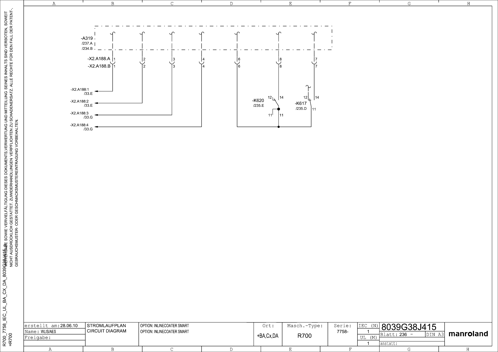

# +BA_Cx_DA — Sheet 236 of 247 — OPTION: INLINECOATER SMART

**OPTION: INLINECOATER SMART**

> Part of the manroland **R700** printing press IEC/UL circuit diagrams.
> Drawing class: **Stromlaufplan / Circuit diagram** (DIN A3).
> Document `+BA_Cx_DA` covers the **Printing units / main switch cabinet** machine section.

## At a glance

| Field | Value |
|---|---|
| Document | `+BA_Cx_DA`  (8039G38J415) |
| Sheet | **236** of 247 |
| Section (DE) | OPTION: INLINECOATER SMART |
| Section (EN) | OPTION: INLINECOATER SMART |
| Section type | CIRCUIT — Circuit diagram |
| Machine type | `R700` |
| Series | `7758` |
| Created | 28.06.10 |
| Replaces | — |
| Columns used | A, B, C, D, E |
| Path numbers | — |
| Labels on sheet | 38 |
| Cross-refs out | 8 |
| Cross-refs in | 20 |

**Previous:** [+BA_Cx_DA sheet 235](SHEET_0235.md) · **Next:** [+BA_Cx_DA sheet 237](SHEET_0237.md) · **Document TOC:** [_TOC.md](_TOC.md)  (+BA_Cx_DA) · **Master TOC:** [all sheets](../_MASTER_TOC.md)

## Sheet image (300 DPI, exact vector render)



_Rendered directly from the PDF vector layer at 300 DPI (1-bit), no OCR and no resampling. Use it to confirm anything ambiguous in the text below._

## Cross-references on this sheet

Each entry is a wire leaving this sheet. The printed token is `/sheet.column`; the link resolves to that sheet inside the same document.

| Ref | Target sheet | Col | Path | Destination on target | Target section | From col |
|---|---|---|---|---|---|---|
| `/237.A` | [+BA_Cx_DA sheet 237](SHEET_0237.md) | A | — | — | OPTION: INLINECOATER SMART | B |
| `/234.B` | [+BA_Cx_DA sheet 234](SHEET_0234.md) | B | — | — | OPTION: INLINECOATER SMART | B |
| `/33.E` | [+BA_Cx_DA sheet 33](SHEET_0033.md) | E | — | X2.A188:1 | BUSVERBINDUNGEN: RESERVE SIGNALE | A |
| `/33.E` | [+BA_Cx_DA sheet 33](SHEET_0033.md) | E | — | X2.A188:2 | BUSVERBINDUNGEN: RESERVE SIGNALE | A |
| `/235.E` | [+BA_Cx_DA sheet 235](SHEET_0235.md) | E | — | — | OPTION: INLINECOATER SMART | D |
| `/235.D` | [+BA_Cx_DA sheet 235](SHEET_0235.md) | D | — | — | OPTION: INLINECOATER SMART | E |
| `/33.G` | [+BA_Cx_DA sheet 33](SHEET_0033.md) | G | — | X2.A188:3 | BUSVERBINDUNGEN: RESERVE SIGNALE | A |
| `/33.G` | [+BA_Cx_DA sheet 33](SHEET_0033.md) | G | — | X2.A188:4 | BUSVERBINDUNGEN: RESERVE SIGNALE | A |

### Incoming references (sheets that point here)

Every other sheet that sends a wire to this one. `Back-ref` is the token printed on *that* sheet; `Path` is its line number.

| From sheet | Cols | Back-ref | Path | Refs | What continues there |
|---|---|---|---|---|---|
| [+BA_Cx_DA#33](SHEET_0033.md) | F, H | `/33.F`, `/33.H` | — | 4 | — |
| [+BA_Cx_DA#152](SHEET_0152.md) | A, B | `/152.A`, `/152.B` | — | 14 | — |
| [+BA_Cx_DA#234](SHEET_0234.md) | B | `/234.B` | — | 1 | — |
| [+BA_Cx_DA#237](SHEET_0237.md) | A | `/237.A` | — | 1 | — |


## Devices on this sheet

| Tag | Class | Class meaning (IEC) | Col | Sub | Terminal | Sign |
|---|---|---|---|---|---|---|
| `A319` | A | Baugruppe / assembly, module, PC board | B | — | — | — |
| `K620` | K | Relais / relay, contactor | D | — | — | — |
| `K617` | K | Relais / relay, contactor | E | — | — | — |
| `X2.A188.B` | — | cross-device reference | B | — | — | — |
| `X2.A188.A` | — | cross-device reference | B | — | — | — |
| `X2.A188:4` | — | cross-device reference | A | — | 4 | — |
| `X2.A188:3` | — | cross-device reference | A | — | 3 | — |
| `X2.A188:2` | — | cross-device reference | A | — | 2 | — |
| `X2.A188:1` | — | cross-device reference | A | — | 1 | — |

## Potentials / nets

_No named potentials on this sheet._

## Wire-end annotations (grouped as printed)

A wire that continues elsewhere is annotated with a small cluster: the destination description, the path/line number `#NN`, and the `/sheet.column` cross reference. Each row below is one such cluster exactly as it is grouped on the drawing.

| Col | Y | Path | Cross-ref | Text on the wire |
|---|---|---|---|---|
| B | 86.8 | — | — | `A319` |
| B | 99.8 | — | `/237.A`, `/234.B` | — |
| B | 135.7 | — | — | `X2.A188.A 1` |
| C | 137.8 | — | — | `2` |
| C | 137.8 | — | — | `3` |
| D | 137.8 | — | — | `4` |
| D | 137.8 | — | — | `6` |
| E | 137.8 | — | — | `8` |
| E | 137.8 | — | — | `7` |
| B | 153.4 | — | — | `X2.A188.B 1` |
| C | 154.8 | — | — | `2` |
| C | 154.8 | — | — | `3` |
| D | 154.8 | — | — | `4` |
| D | 154.8 | — | — | `6` |
| E | 154.8 | — | — | `8` |
| E | 154.8 | — | — | `7` |
| A | 210.0 | — | `/33.E` | `X2.A188:1` |
| E | 229.2 | — | — | `K620 14` |
| E | 229.2 | — | — | `12` |
| E | 229.2 | — | — | `K617 14` |
| E | 229.2 | — | — | `12` |
| A | 238.4 | — | `/33.E` | `X2.A188:2` |
| D | 248.7 | — | `/235.E` | — |
| E | 255.8 | — | `/235.D` | — |
| E | 257.6 | — | — | `11` |
| A | 266.7 | — | `/33.G` | `X2.A188:3` |
| E | 271.7 | — | — | `11 11` |
| A | 295.1 | — | `/33.G` | `X2.A188:4` |


## Reconstructed tables

This sheet carries tabular content (pin map / terminal assignment / index). The grid below was rebuilt from the drawing's own rule lines, so each row is exactly one physical row of the table.

### Table 1 — 1 data rows × 3 columns (at x=566.9, y=246.6)

| /235.E | K617 /235.D | 11 |
|---|---|---|
| `11` | `11` |  |


## Complete label inventory (exact text from the drawing)

Every text object inside the drawing area of this sheet, in DIN reading order (column A→H, then top→bottom). This is the authoritative list: if a string is not here it is not printed on this sheet.

| Col | Y | X | Dir | Type | Text |
|---|---|---|---|---|---|
| A | 210.0 | 168.9 | → | device ref | `X2.A188:1` |
| A | 238.4 | 167.8 | → | device ref | `X2.A188:2` |
| A | 266.7 | 167.5 | → | device ref | `X2.A188:3` |
| A | 295.1 | 167.5 | → | device ref | `X2.A188:4` |
| B | 86.8 | 193.3 | → | device tag | `A319` |
| B | 99.8 | 195.6 | → | cross-reference | `/237.A` |
| B | 112.2 | 195.9 | → | cross-reference | `/234.B` |
| B | 135.7 | 209.2 | → | device ref | `X2.A188.A` |
| B | 137.8 | 271.3 | → | number | `1` |
| B | 153.4 | 210.0 | → | device ref | `X2.A188.B` |
| B | 154.8 | 271.3 | → | number | `1` |
| B | 219.9 | 201.0 | → | cross-reference | `/33.E` |
| B | 248.3 | 201.0 | → | cross-reference | `/33.E` |
| B | 276.6 | 200.1 | → | cross-reference | `/33.G` |
| B | 305.0 | 200.1 | → | cross-reference | `/33.G` |
| C | 137.8 | 342.7 | → | number | `2` |
| C | 137.8 | 413.6 | → | number | `3` |
| C | 154.8 | 342.7 | → | number | `2` |
| C | 154.8 | 413.6 | → | number | `3` |
| D | 137.8 | 484.4 | → | number | `4` |
| D | 137.8 | 569.5 | → | number | `6` |
| D | 154.8 | 484.4 | → | number | `4` |
| D | 154.8 | 569.5 | → | number | `6` |
| D | 235.6 | 602.9 | → | device tag | `K620` |
| D | 248.6 | 605.8 | → | cross-reference | `/235.E` |
| E | 137.8 | 668.7 | → | number | `8` |
| E | 137.8 | 753.7 | → | number | `7` |
| E | 154.8 | 668.7 | → | number | `8` |
| E | 154.8 | 753.7 | → | number | `7` |
| E | 229.2 | 640.1 | → | number | `12` |
| E | 229.2 | 668.1 | → | number | `14` |
| E | 229.2 | 725.1 | → | number | `12` |
| E | 229.2 | 753.2 | → | number | `14` |
| E | 242.7 | 705.0 | → | device tag | `K617` |
| E | 255.8 | 707.2 | → | cross-reference | `/235.D` |
| E | 257.6 | 746.1 | → | number | `11` |
| E | 271.7 | 641.2 | → | number | `11` |
| E | 271.7 | 668.1 | → | number | `11` |

## Reading-order text block

The same content as a plain block, grouped by DIN column — convenient to paste or to match against a visual description.

```text
=== Column A ===
 210.0  168.9  devref       X2.A188:1
 238.4  167.8  devref       X2.A188:2
 266.7  167.5  devref       X2.A188:3
 295.1  167.5  devref       X2.A188:4
=== Column B ===
  86.8  193.3  devtag       A319
  99.8  195.6  xref         /237.A
 112.2  195.9  xref         /234.B
 135.7  209.2  devref       X2.A188.A
 137.8  271.3  numeric      1
 153.4  210.0  devref       X2.A188.B
 154.8  271.3  numeric      1
 219.9  201.0  xref         /33.E
 248.3  201.0  xref         /33.E
 276.6  200.1  xref         /33.G
 305.0  200.1  xref         /33.G
=== Column C ===
 137.8  342.7  numeric      2
 137.8  413.6  numeric      3
 154.8  342.7  numeric      2
 154.8  413.6  numeric      3
=== Column D ===
 137.8  484.4  numeric      4
 137.8  569.5  numeric      6
 154.8  484.4  numeric      4
 154.8  569.5  numeric      6
 235.6  602.9  devtag       K620
 248.6  605.8  xref         /235.E
=== Column E ===
 137.8  668.7  numeric      8
 137.8  753.7  numeric      7
 154.8  668.7  numeric      8
 154.8  753.7  numeric      7
 229.2  640.1  numeric      12
 229.2  668.1  numeric      14
 229.2  725.1  numeric      12
 229.2  753.2  numeric      14
 242.7  705.0  devtag       K617
 255.8  707.2  xref         /235.D
 257.6  746.1  numeric      11
 271.7  641.2  numeric      11
 271.7  668.1  numeric      11
```

---
_Generated from the PDF vector text layer; no OCR. Source: `R700_7758_IEC_UL_BA_CX_DA_8039G38J415_p`, sheet 236._
