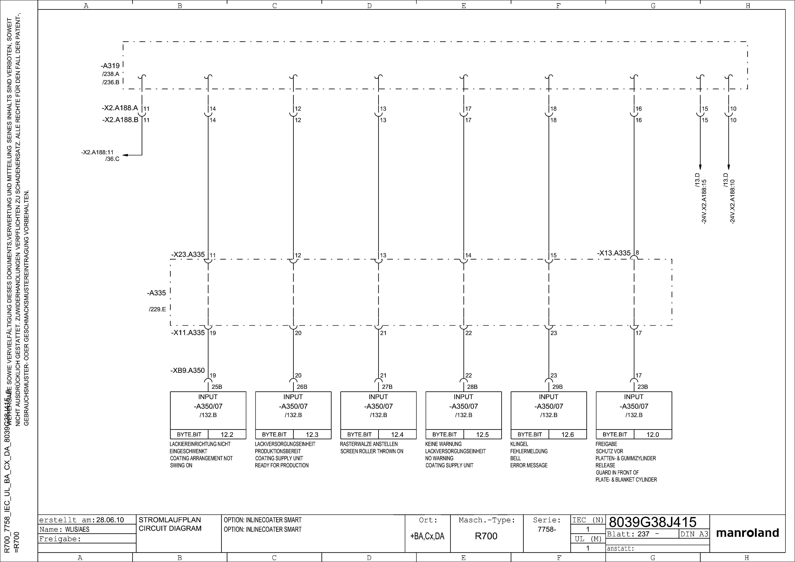

# +BA_Cx_DA — Sheet 237 of 247 — OPTION: INLINECOATER SMART

**OPTION: INLINECOATER SMART**

> Part of the manroland **R700** printing press IEC/UL circuit diagrams.
> Drawing class: **Stromlaufplan / Circuit diagram** (DIN A3).
> Document `+BA_Cx_DA` covers the **Printing units / main switch cabinet** machine section.

## At a glance

| Field | Value |
|---|---|
| Document | `+BA_Cx_DA`  (8039G38J415) |
| Sheet | **237** of 247 |
| Section (DE) | OPTION: INLINECOATER SMART |
| Section (EN) | OPTION: INLINECOATER SMART |
| Section type | CIRCUIT — Circuit diagram |
| Machine type | `R700` |
| Series | `7758` |
| Created | 28.06.10 |
| Replaces | — |
| Columns used | A, B, C, D, E, F, G, H |
| Path numbers | — |
| Labels on sheet | 113 |
| Cross-refs out | 12 |
| Cross-refs in | 48 |

**Previous:** [+BA_Cx_DA sheet 236](SHEET_0236.md) · **Next:** [+BA_Cx_DA sheet 238](SHEET_0238.md) · **Document TOC:** [_TOC.md](_TOC.md)  (+BA_Cx_DA) · **Master TOC:** [all sheets](../_MASTER_TOC.md)

## Sheet image (300 DPI, exact vector render)



_Rendered directly from the PDF vector layer at 300 DPI (1-bit), no OCR and no resampling. Use it to confirm anything ambiguous in the text below._

## Cross-references on this sheet

Each entry is a wire leaving this sheet. The printed token is `/sheet.column`; the link resolves to that sheet inside the same document.

| Ref | Target sheet | Col | Path | Destination on target | Target section | From col |
|---|---|---|---|---|---|---|
| `/238.A` | [+BA_Cx_DA sheet 238](SHEET_0238.md) | A | — | — | OPTION: INLINECOATER SMART | A |
| `/236.B` | [+BA_Cx_DA sheet 236](SHEET_0236.md) | B | — | — | OPTION: INLINECOATER SMART | A |
| `/36.C` | [+BA_Cx_DA sheet 36](SHEET_0036.md) | C | — | X2.A188:11 | SCHUTZEINRICHTUNGEN | A |
| `/13.D` | [+BA_Cx_DA sheet 13](SHEET_0013.md) | D | — | — | SPANNUNGSVERSORGUNG, SCHALTSCHRANKBELÜFTUNG | G |
| `/13.D` | [+BA_Cx_DA sheet 13](SHEET_0013.md) | D | — | — | SPANNUNGSVERSORGUNG, SCHALTSCHRANKBELÜFTUNG | H |
| `/229.E` | [+BA_Cx_DA sheet 229](SHEET_0229.md) | E | — | — | OPTION: WASCHMITTELWECHSELBETRIEB | B |
| `/132.B` | [+BA_Cx_DA sheet 132](SHEET_0132.md) | B | — | — | REFERENZMODUL | B |
| `/132.B` | [+BA_Cx_DA sheet 132](SHEET_0132.md) | B | — | — | REFERENZMODUL | C |
| `/132.B` | [+BA_Cx_DA sheet 132](SHEET_0132.md) | B | — | — | REFERENZMODUL | D |
| `/132.B` | [+BA_Cx_DA sheet 132](SHEET_0132.md) | B | — | — | REFERENZMODUL | E |
| `/132.B` | [+BA_Cx_DA sheet 132](SHEET_0132.md) | B | — | — | REFERENZMODUL | F |
| `/132.B` | [+BA_Cx_DA sheet 132](SHEET_0132.md) | B | — | — | REFERENZMODUL | G |

### Incoming references (sheets that point here)

Every other sheet that sends a wire to this one. `Back-ref` is the token printed on *that* sheet; `Path` is its line number.

| From sheet | Cols | Back-ref | Path | Refs | What continues there |
|---|---|---|---|---|---|
| [+BA_Cx_DA#13](SHEET_0013.md) | D | `/13.D` | — | 2 | 24V.X2.A188:10; 24V.X2.A188:15 |
| [+BA_Cx_DA#36](SHEET_0036.md) | C | `/36.C` | — | 1 | — |
| [+BA_Cx_DA#132](SHEET_0132.md) | B | `/132.B` | — | 6 | — |
| [+BA_Cx_DA#152](SHEET_0152.md) | A, B | `/152.A`, `/152.B` | — | 18 | — |
| [+BA_Cx_DA#166](SHEET_0166.md) | G | `/166.G` | — | 6 | — |
| [+BA_Cx_DA#168](SHEET_0168.md) | G | `/168.G` | — | 6 | — |
| [+BA_Cx_DA#170](SHEET_0170.md) | B | `/170.B` | — | 1 | — |
| [+BA_Cx_DA#174](SHEET_0174.md) | G | `/174.G` | — | 5 | — |
| [+BA_Cx_DA#229](SHEET_0229.md) | E | `/229.E` | — | 1 | — |
| [+BA_Cx_DA#236](SHEET_0236.md) | B | `/236.B` | — | 1 | — |
| [+BA_Cx_DA#238](SHEET_0238.md) | A | `/238.A` | — | 1 | — |


## Devices on this sheet

| Tag | Class | Class meaning (IEC) | Col | Sub | Terminal | Sign |
|---|---|---|---|---|---|---|
| `A335` | A | Baugruppe / assembly, module, PC board | B | — | — | — |
| `A319` | A | Baugruppe / assembly, module, PC board | A | — | — | — |
| `A350/07` | A | Baugruppe / assembly, module, PC board | G | 07 | — | — |
| `A350/07` | A | Baugruppe / assembly, module, PC board | B | 07 | — | — |
| `A350/07` | A | Baugruppe / assembly, module, PC board | C | 07 | — | — |
| `A350/07` | A | Baugruppe / assembly, module, PC board | D | 07 | — | — |
| `A350/07` | A | Baugruppe / assembly, module, PC board | E | 07 | — | — |
| `A350/07` | A | Baugruppe / assembly, module, PC board | F | 07 | — | — |
| `X2.A188.B` | — | cross-device reference | A | — | — | — |
| `X2.A188.A` | — | cross-device reference | A | — | — | — |
| `X13.A335` | — | cross-device reference | G | — | — | — |
| `X11.A335` | — | cross-device reference | B | — | — | — |
| `X23.A335` | — | cross-device reference | B | — | — | — |
| `12.0` | — | cross-device reference | G | — | — | — |
| `12.2` | — | cross-device reference | B | — | — | — |
| `XB9.A350` | — | cross-device reference | B | — | — | — |
| `12.3` | — | cross-device reference | C | — | — | — |
| `12.4` | — | cross-device reference | D | — | — | — |
| `12.5` | — | cross-device reference | E | — | — | — |
| `12.6` | — | cross-device reference | F | — | — | — |
| `X2.A188:11` | — | cross-device reference | A | — | 11 | — |

## Potentials / nets

| Potential | Count | Columns | Attached devices | Terminals |
|---|---|---|---|---|
| `24V` | 2 | H | `A188`, `X2` | `10`, `15` |


A potential such as `L24+/4` or `M24+` is a named supply/return rail; every place it appears on this sheet is electrically common.

## Wire-end annotations (grouped as printed)

A wire that continues elsewhere is annotated with a small cluster: the destination description, the path/line number `#NN`, and the `/sheet.column` cross reference. Each row below is one such cluster exactly as it is grouped on the drawing.

| Col | Y | Path | Cross-ref | Text on the wire |
|---|---|---|---|---|
| A | 93.8 | — | — | `A319` |
| A | 106.9 | — | `/238.A`, `/236.B` | — |
| A | 156.9 | — | — | `X2.A188.A 11` |
| B | 159.1 | — | — | `14` |
| C | 159.1 | — | — | `12` |
| D | 159.1 | — | — | `13` |
| E | 159.1 | — | — | `17` |
| F | 159.1 | — | — | `18` |
| G | 159.1 | — | — | `16` |
| H | 159.1 | — | — | `15` |
| H | 159.1 | — | — | `10` |
| A | 174.7 | — | — | `X2.A188.B 11` |
| B | 176.1 | — | — | `14` |
| C | 176.1 | — | — | `12` |
| D | 176.1 | — | — | `13` |
| E | 176.1 | — | — | `17` |
| F | 176.1 | — | — | `18` |
| G | 176.1 | — | — | `16` |
| H | 176.1 | — | — | `15` |
| H | 176.1 | — | — | `10` |
| A | 224.2 | — | `/36.C` | `X2.A188:11` |
| G | 259.1 | — | `/13.D` | — |
| H | 259.1 | — | `/13.D` | — |
| H | 269.0 | — | — | `24V.X2.A188:15` |
| H | 269.0 | — | — | `24V.X2.A188:10` |
| G | 374.5 | — | — | `X13.A335 8` |
| B | 376.6 | — | — | `X23.A335 11` |
| C | 378.8 | — | — | `12` |
| D | 378.8 | — | — | `13` |
| E | 378.8 | — | — | `14` |
| F | 378.8 | — | — | `15` |
| B | 434.0 | — | — | `A335` |
| B | 459.5 | — | `/229.E` | — |
| B | 493.5 | — | — | `X11.A335 19` |
| C | 495.0 | — | — | `20` |
| D | 495.0 | — | — | `21` |
| E | 495.0 | — | — | `22` |
| F | 495.0 | — | — | `23` |
| G | 495.0 | — | — | `17` |
| B | 550.2 | — | — | `XB9.A350 19` |
| C | 558.8 | — | — | `20` |
| D | 558.8 | — | — | `21` |
| E | 558.8 | — | — | `22` |
| F | 558.8 | — | — | `23` |
| G | 558.8 | — | — | `17` |
| B | 575.7 | — | — | `25B` |
| C | 575.7 | — | — | `26B` |
| D | 575.7 | — | — | `27B` |
| E | 575.7 | — | — | `28B` |
| F | 575.7 | — | — | `29B` |
| G | 575.7 | — | — | `23B` |
| B | 590.2 | — | — | `INPUT` |
| C | 590.2 | — | — | `INPUT` |
| D | 590.2 | — | — | `INPUT` |
| E | 590.2 | — | — | `INPUT` |
| F | 590.2 | — | — | `INPUT` |
| G | 590.2 | — | — | `INPUT` |
| B | 604.1 | — | — | `A350/07` |
| C | 604.1 | — | — | `A350/07` |
| D | 604.1 | — | — | `A350/07` |
| E | 604.1 | — | — | `A350/07` |
| F | 604.1 | — | — | `A350/07` |
| G | 604.1 | — | — | `A350/07` |
| B | 617.9 | — | `/132.B` | — |
| C | 617.9 | — | `/132.B` | — |
| D | 617.9 | — | `/132.B` | — |
| E | 617.9 | — | `/132.B` | — |
| F | 617.9 | — | `/132.B` | — |
| G | 617.9 | — | `/132.B` | — |
| B | 646.9 | — | — | `BYTE.BIT 12.2` |
| C | 646.9 | — | — | `BYTE.BIT 12.3` |
| D | 646.9 | — | — | `BYTE.BIT 12.4` |
| E | 646.9 | — | — | `BYTE.BIT 12.5` |
| F | 646.9 | — | — | `BYTE.BIT 12.6` |
| G | 646.9 | — | — | `BYTE.BIT 12.0` |
| B | 662.5 | — | — | `LACKIEREINRICHTUNG NICHT EINGESCHWENKT` |
| C | 662.5 | — | — | `LACKVERSORGUNGSEINHEIT PRODUKTIONSBEREIT` |
| D | 662.5 | — | — | `RASTERWALZE ANSTELLEN` |
| E | 662.5 | — | — | `KEINE WARNUNG LACKVERSORGUNGSEINHEIT NO WARNING` |
| F | 662.5 | — | — | `KLINGEL FEHLERMELDUNG BELL ERROR MESSAGE` |
| G | 662.5 | — | — | `FREIGABE` |
| D | 673.1 | — | — | `SCREEN ROLLER THROWN ON` |
| G | 673.2 | — | — | `PLATTEN & GUMMIZYLINDER RELEASE SCHUTZ VOR` |
| B | 683.8 | — | — | `COATING ARRANGEMENT NOT SWING ON` |
| C | 683.8 | — | — | `READY FOR PRODUCTION COATING SUPPLY UNIT` |
| E | 694.4 | — | — | `COATING SUPPLY UNIT` |
| G | 705.1 | — | — | `PLATE & BLANKET CYLINDER GUARD IN FRONT OF` |


## Reconstructed tables

This sheet carries tabular content (pin map / terminal assignment / index). The grid below was rebuilt from the drawing's own rule lines, so each row is exactly one physical row of the table.

### Table 1 — 1 data rows × 2 columns (at x=255.1, y=586.8)

| INPUT | A350/07 /132.B |
|---|---|
| `BYTE.BIT` | `12.2` |


### Table 2 — 1 data rows × 2 columns (at x=382.7, y=586.8)

| INPUT | A350/07 /132.B |
|---|---|
| `BYTE.BIT` | `12.3` |


### Table 3 — 1 data rows × 2 columns (at x=510.2, y=586.8)

| INPUT | A350/07 /132.B |
|---|---|
| `BYTE.BIT` | `12.4` |


### Table 4 — 1 data rows × 2 columns (at x=637.8, y=586.8)

| INPUT | A350/07 /132.B |
|---|---|
| `BYTE.BIT` | `12.5` |


### Table 5 — 1 data rows × 2 columns (at x=765.4, y=586.8)

| INPUT | A350/07 /132.B |
|---|---|
| `BYTE.BIT` | `12.6` |


### Table 6 — 1 data rows × 2 columns (at x=892.9, y=586.8)

| INPUT | A350/07 /132.B |
|---|---|
| `BYTE.BIT` | `12.0` |


## Notes and free text on this sheet

| Text | Col | Y (pt) |
|---|---|---|
| `23B` | G | 575.72 |
| `INPUT` | G | 590.24 |
| `BYTE.BIT` | G | 647.49 |
| `FREIGABE` | G | 662.47 |
| `SCHUTZ VOR` | G | 673.16 |
| `PLATTEN & GUMMIZYLINDER` | G | 683.79 |
| `RELEASE` | F | 694.37 |
| `GUARD IN FRONT OF` | G | 705.06 |
| `PLATE & BLANKET CYLINDER` | G | 715.67 |
| `25B` | B | 575.72 |
| `INPUT` | B | 590.24 |
| `BYTE.BIT` | B | 647.49 |
| `LACKIEREINRICHTUNG NICHT` | B | 662.53 |
| `EINGESCHWENKT` | B | 673.11 |
| `COATING ARRANGEMENT NOT` | B | 683.8 |
| `SWING ON` | B | 694.35 |
| `26B` | C | 575.72 |
| `INPUT` | C | 590.24 |
| `BYTE.BIT` | C | 647.49 |
| `LACKVERSORGUNGSEINHEIT` | C | 662.52 |
| `PRODUKTIONSBEREIT` | C | 673.14 |
| `COATING SUPPLY UNIT` | C | 683.78 |
| `READY FOR PRODUCTION` | C | 694.42 |
| `27B` | D | 575.72 |
| `INPUT` | D | 590.24 |
| `BYTE.BIT` | D | 647.49 |
| `RASTERWALZE ANSTELLEN` | D | 662.49 |
| `SCREEN ROLLER THROWN ON` | D | 673.15 |
| `28B` | E | 575.72 |
| `INPUT` | E | 590.24 |
| `BYTE.BIT` | E | 647.49 |
| `KEINE WARNUNG` | E | 662.48 |
| `LACKVERSORGUNGSEINHEIT` | E | 673.15 |
| `NO WARNING` | E | 683.74 |
| `COATING SUPPLY UNIT` | E | 694.41 |
| `29B` | F | 575.72 |
| `INPUT` | F | 590.24 |
| `BYTE.BIT` | F | 647.49 |
| `KLINGEL` | F | 662.49 |
| `FEHLERMELDUNG` | F | 673.17 |
| `BELL` | F | 683.73 |
| `ERROR MESSAGE` | F | 694.41 |

## Complete label inventory (exact text from the drawing)

Every text object inside the drawing area of this sheet, in DIN reading order (column A→H, then top→bottom). This is the authoritative list: if a string is not here it is not printed on this sheet.

| Col | Y | X | Dir | Type | Text |
|---|---|---|---|---|---|
| A | 93.8 | 150.8 | → | device tag | `A319` |
| A | 106.9 | 153.1 | → | cross-reference | `/238.A` |
| A | 119.3 | 153.4 | → | cross-reference | `/236.B` |
| A | 156.9 | 152.5 | → | device ref | `X2.A188.A` |
| A | 174.6 | 153.4 | → | device ref | `X2.A188.B` |
| A | 224.2 | 121.6 | → | device ref | `X2.A188:11` |
| A | 234.1 | 157.9 | → | cross-reference | `/36.C` |
| B | 159.1 | 214.6 | → | number | `11` |
| B | 159.1 | 313.8 | → | number | `14` |
| B | 176.1 | 214.6 | → | number | `11` |
| B | 176.1 | 313.8 | → | number | `14` |
| B | 376.6 | 256.5 | → | device ref | `X23.A335` |
| B | 378.7 | 313.8 | → | number | `11` |
| B | 434.0 | 220.3 | → | device tag | `A335` |
| B | 459.5 | 223.1 | → | cross-reference | `/229.E` |
| B | 493.5 | 256.5 | → | device ref | `X11.A335` |
| B | 495.0 | 313.8 | → | number | `19` |
| B | 550.2 | 255.4 | → | device ref | `XB9.A350` |
| B | 558.7 | 313.8 | → | number | `19` |
| B | 575.7 | 317.2 | → | text | `25B` |
| B | 590.2 | 296.9 | → | text | `INPUT` |
| B | 604.1 | 290.4 | → | device tag | `A350/07` |
| B | 617.9 | 299.2 | → | cross-reference | `/132.B` |
| B | 646.9 | 330.4 | → | device ref | `12.2` |
| B | 647.5 | 265.0 | → | text | `BYTE.BIT` |
| B | 662.5 | 254.3 | → | text | `LACKIEREINRICHTUNG NICHT` |
| B | 673.1 | 254.3 | → | text | `EINGESCHWENKT` |
| B | 683.8 | 254.8 | → | text | `COATING ARRANGEMENT NOT` |
| B | 694.3 | 254.8 | → | text | `SWING ON` |
| C | 159.1 | 441.4 | → | number | `12` |
| C | 176.1 | 441.4 | → | number | `12` |
| C | 378.7 | 441.4 | → | number | `12` |
| C | 495.0 | 441.9 | → | number | `20` |
| C | 558.7 | 441.9 | → | number | `20` |
| C | 575.7 | 444.8 | → | text | `26B` |
| C | 590.2 | 424.5 | → | text | `INPUT` |
| C | 604.1 | 418.0 | → | device tag | `A350/07` |
| C | 617.9 | 426.8 | → | cross-reference | `/132.B` |
| C | 646.9 | 457.9 | → | device ref | `12.3` |
| C | 647.5 | 392.6 | → | text | `BYTE.BIT` |
| C | 662.5 | 381.8 | → | text | `LACKVERSORGUNGSEINHEIT` |
| C | 673.1 | 381.8 | → | text | `PRODUKTIONSBEREIT` |
| C | 683.8 | 382.4 | → | text | `COATING SUPPLY UNIT` |
| C | 694.4 | 381.8 | → | text | `READY FOR PRODUCTION` |
| D | 159.1 | 568.9 | → | number | `13` |
| D | 176.1 | 568.9 | → | number | `13` |
| D | 378.7 | 568.9 | → | number | `13` |
| D | 495.0 | 569.5 | → | number | `21` |
| D | 558.7 | 569.5 | → | number | `21` |
| D | 575.7 | 572.3 | → | text | `27B` |
| D | 590.2 | 552.0 | → | text | `INPUT` |
| D | 604.1 | 545.5 | → | device tag | `A350/07` |
| D | 617.9 | 554.3 | → | cross-reference | `/132.B` |
| D | 646.9 | 585.5 | → | device ref | `12.4` |
| D | 647.5 | 520.2 | → | text | `BYTE.BIT` |
| D | 662.5 | 509.4 | → | text | `RASTERWALZE ANSTELLEN` |
| D | 673.1 | 510.0 | → | text | `SCREEN ROLLER THROWN ON` |
| E | 159.1 | 696.5 | → | number | `17` |
| E | 176.1 | 696.5 | → | number | `17` |
| E | 378.7 | 696.5 | → | number | `14` |
| E | 495.0 | 697.0 | → | number | `22` |
| E | 558.7 | 697.0 | → | number | `22` |
| E | 575.7 | 699.9 | → | text | `28B` |
| E | 590.2 | 679.6 | → | text | `INPUT` |
| E | 604.1 | 673.1 | → | device tag | `A350/07` |
| E | 617.9 | 681.9 | → | cross-reference | `/132.B` |
| E | 646.9 | 713.1 | → | device ref | `12.5` |
| E | 647.5 | 647.7 | → | text | `BYTE.BIT` |
| E | 662.5 | 636.9 | → | text | `KEINE WARNUNG` |
| E | 673.2 | 636.9 | → | text | `LACKVERSORGUNGSEINHEIT` |
| E | 683.7 | 636.9 | → | text | `NO WARNING` |
| E | 694.4 | 637.5 | → | text | `COATING SUPPLY UNIT` |
| F | 159.1 | 824.0 | → | number | `18` |
| F | 176.1 | 824.0 | → | number | `18` |
| F | 378.7 | 824.0 | → | number | `15` |
| F | 495.0 | 824.6 | → | number | `23` |
| F | 558.7 | 824.6 | → | number | `23` |
| F | 575.7 | 827.4 | → | text | `29B` |
| F | 590.2 | 807.2 | → | text | `INPUT` |
| F | 604.1 | 800.6 | → | device tag | `A350/07` |
| F | 617.9 | 809.4 | → | cross-reference | `/132.B` |
| F | 646.9 | 840.6 | → | device ref | `12.6` |
| F | 647.5 | 775.3 | → | text | `BYTE.BIT` |
| F | 662.5 | 764.5 | → | text | `KLINGEL` |
| F | 673.2 | 764.5 | → | text | `FEHLERMELDUNG` |
| F | 683.7 | 764.5 | → | text | `BELL` |
| F | 694.4 | 764.5 | → | text | `ERROR MESSAGE` |
| F | 694.4 | 892.1 | → | text | `RELEASE` |
| G | 159.1 | 951.6 | → | number | `16` |
| G | 176.1 | 951.6 | → | number | `16` |
| G | 259.1 | 1040.6 | ↕ | cross-reference | `/13.D` |
| G | 374.5 | 894.3 | → | device ref | `X13.A335` |
| G | 374.5 | 952.2 | → | number | `8` |
| G | 495.0 | 951.6 | → | number | `17` |
| G | 558.7 | 951.6 | → | number | `17` |
| G | 575.7 | 955.0 | → | text | `23B` |
| G | 590.2 | 934.7 | → | text | `INPUT` |
| G | 604.1 | 928.2 | → | device tag | `A350/07` |
| G | 617.9 | 937.0 | → | cross-reference | `/132.B` |
| G | 646.9 | 968.2 | → | device ref | `12.0` |
| G | 647.5 | 902.8 | → | text | `BYTE.BIT` |
| G | 662.5 | 892.1 | → | text | `FREIGABE` |
| G | 673.2 | 892.6 | → | text | `SCHUTZ VOR` |
| G | 683.8 | 892.1 | → | text | `PLATTEN & GUMMIZYLINDER` |
| G | 705.1 | 892.6 | → | text | `GUARD IN FRONT OF` |
| G | 715.7 | 892.1 | → | text | `PLATE & BLANKET CYLINDER` |
| H | 159.1 | 1050.8 | → | number | `15` |
| H | 159.1 | 1093.3 | → | number | `10` |
| H | 176.1 | 1050.8 | → | number | `15` |
| H | 176.1 | 1093.3 | → | number | `10` |
| H | 259.1 | 1083.1 | ↕ | cross-reference | `/13.D` |
| H | 269.0 | 1050.5 | ↕ | potential | `24V.X2.A188:15` |
| H | 269.0 | 1093.0 | ↕ | potential | `24V.X2.A188:10` |

## Reading-order text block

The same content as a plain block, grouped by DIN column — convenient to paste or to match against a visual description.

```text
=== Column A ===
  93.8  150.8  devtag       A319
 106.9  153.1  xref         /238.A
 119.3  153.4  xref         /236.B
 156.9  152.5  devref       X2.A188.A
 174.6  153.4  devref       X2.A188.B
 224.2  121.6  devref       X2.A188:11
 234.1  157.9  xref         /36.C
=== Column B ===
 159.1  214.6  numeric      11
 159.1  313.8  numeric      14
 176.1  214.6  numeric      11
 176.1  313.8  numeric      14
 376.6  256.5  devref       X23.A335
 378.7  313.8  numeric      11
 434.0  220.3  devtag       A335
 459.5  223.1  xref         /229.E
 493.5  256.5  devref       X11.A335
 495.0  313.8  numeric      19
 550.2  255.4  devref       XB9.A350
 558.7  313.8  numeric      19
 575.7  317.2  text         25B
 590.2  296.9  text         INPUT
 604.1  290.4  devtag       A350/07
 617.9  299.2  xref         /132.B
 646.9  330.4  devref       12.2
 647.5  265.0  text         BYTE.BIT
 662.5  254.3  text         LACKIEREINRICHTUNG NICHT
 673.1  254.3  text         EINGESCHWENKT
 683.8  254.8  text         COATING ARRANGEMENT NOT
 694.3  254.8  text         SWING ON
=== Column C ===
 159.1  441.4  numeric      12
 176.1  441.4  numeric      12
 378.7  441.4  numeric      12
 495.0  441.9  numeric      20
 558.7  441.9  numeric      20
 575.7  444.8  text         26B
 590.2  424.5  text         INPUT
 604.1  418.0  devtag       A350/07
 617.9  426.8  xref         /132.B
 646.9  457.9  devref       12.3
 647.5  392.6  text         BYTE.BIT
 662.5  381.8  text         LACKVERSORGUNGSEINHEIT
 673.1  381.8  text         PRODUKTIONSBEREIT
 683.8  382.4  text         COATING SUPPLY UNIT
 694.4  381.8  text         READY FOR PRODUCTION
=== Column D ===
 159.1  568.9  numeric      13
 176.1  568.9  numeric      13
 378.7  568.9  numeric      13
 495.0  569.5  numeric      21
 558.7  569.5  numeric      21
 575.7  572.3  text         27B
 590.2  552.0  text         INPUT
 604.1  545.5  devtag       A350/07
 617.9  554.3  xref         /132.B
 646.9  585.5  devref       12.4
 647.5  520.2  text         BYTE.BIT
 662.5  509.4  text         RASTERWALZE ANSTELLEN
 673.1  510.0  text         SCREEN ROLLER THROWN ON
=== Column E ===
 159.1  696.5  numeric      17
 176.1  696.5  numeric      17
 378.7  696.5  numeric      14
 495.0  697.0  numeric      22
 558.7  697.0  numeric      22
 575.7  699.9  text         28B
 590.2  679.6  text         INPUT
 604.1  673.1  devtag       A350/07
 617.9  681.9  xref         /132.B
 646.9  713.1  devref       12.5
 647.5  647.7  text         BYTE.BIT
 662.5  636.9  text         KEINE WARNUNG
 673.2  636.9  text         LACKVERSORGUNGSEINHEIT
 683.7  636.9  text         NO WARNING
 694.4  637.5  text         COATING SUPPLY UNIT
=== Column F ===
 159.1  824.0  numeric      18
 176.1  824.0  numeric      18
 378.7  824.0  numeric      15
 495.0  824.6  numeric      23
 558.7  824.6  numeric      23
 575.7  827.4  text         29B
 590.2  807.2  text         INPUT
 604.1  800.6  devtag       A350/07
 617.9  809.4  xref         /132.B
 646.9  840.6  devref       12.6
 647.5  775.3  text         BYTE.BIT
 662.5  764.5  text         KLINGEL
 673.2  764.5  text         FEHLERMELDUNG
 683.7  764.5  text         BELL
 694.4  764.5  text         ERROR MESSAGE
 694.4  892.1  text         RELEASE
=== Column G ===
 159.1  951.6  numeric      16
 176.1  951.6  numeric      16
 259.1 1040.6  xref         /13.D
 374.5  894.3  devref       X13.A335
 374.5  952.2  numeric      8
 495.0  951.6  numeric      17
 558.7  951.6  numeric      17
 575.7  955.0  text         23B
 590.2  934.7  text         INPUT
 604.1  928.2  devtag       A350/07
 617.9  937.0  xref         /132.B
 646.9  968.2  devref       12.0
 647.5  902.8  text         BYTE.BIT
 662.5  892.1  text         FREIGABE
 673.2  892.6  text         SCHUTZ VOR
 683.8  892.1  text         PLATTEN & GUMMIZYLINDER
 705.1  892.6  text         GUARD IN FRONT OF
 715.7  892.1  text         PLATE & BLANKET CYLINDER
=== Column H ===
 159.1 1050.8  numeric      15
 159.1 1093.3  numeric      10
 176.1 1050.8  numeric      15
 176.1 1093.3  numeric      10
 259.1 1083.1  xref         /13.D
 269.0 1050.5  net          24V.X2.A188:15
 269.0 1093.0  net          24V.X2.A188:10
```

---
_Generated from the PDF vector text layer; no OCR. Source: `R700_7758_IEC_UL_BA_CX_DA_8039G38J415_p`, sheet 237._
