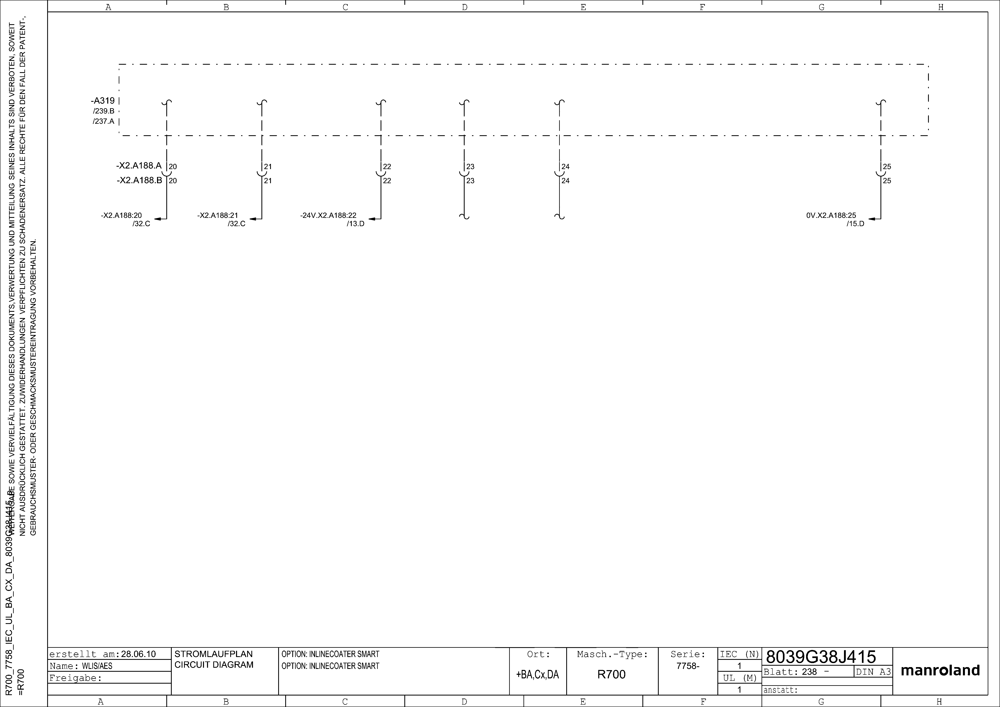

# +BA_Cx_DA — Sheet 238 of 247 — OPTION: INLINECOATER SMART

**OPTION: INLINECOATER SMART**

> Part of the manroland **R700** printing press IEC/UL circuit diagrams.
> Drawing class: **Stromlaufplan / Circuit diagram** (DIN A3).
> Document `+BA_Cx_DA` covers the **Printing units / main switch cabinet** machine section.

## At a glance

| Field | Value |
|---|---|
| Document | `+BA_Cx_DA`  (8039G38J415) |
| Sheet | **238** of 247 |
| Section (DE) | OPTION: INLINECOATER SMART |
| Section (EN) | OPTION: INLINECOATER SMART |
| Section type | CIRCUIT — Circuit diagram |
| Machine type | `R700` |
| Series | `7758` |
| Created | 28.06.10 |
| Replaces | — |
| Columns used | A, B, C, D, E, G, H |
| Path numbers | — |
| Labels on sheet | 25 |
| Cross-refs out | 6 |
| Cross-refs in | 18 |

**Previous:** [+BA_Cx_DA sheet 237](SHEET_0237.md) · **Next:** [+BA_Cx_DA sheet 239](SHEET_0239.md) · **Document TOC:** [_TOC.md](_TOC.md)  (+BA_Cx_DA) · **Master TOC:** [all sheets](../_MASTER_TOC.md)

## Sheet image (300 DPI, exact vector render)



_Rendered directly from the PDF vector layer at 300 DPI (1-bit), no OCR and no resampling. Use it to confirm anything ambiguous in the text below._

## Cross-references on this sheet

Each entry is a wire leaving this sheet. The printed token is `/sheet.column`; the link resolves to that sheet inside the same document.

| Ref | Target sheet | Col | Path | Destination on target | Target section | From col |
|---|---|---|---|---|---|---|
| `/239.B` | [+BA_Cx_DA sheet 239](SHEET_0239.md) | B | — | — | OPTION: INLINECOATER SMART | A |
| `/237.A` | [+BA_Cx_DA sheet 237](SHEET_0237.md) | A | — | — | OPTION: INLINECOATER SMART | A |
| `/15.D` | [+BA_Cx_DA sheet 15](SHEET_0015.md) | D | — | 0V.X2.A188:25 | SPANNUNGSVERSORGUNG, SCHALTSCHRANKBELÜFTUNG | G |
| `/13.D` | [+BA_Cx_DA sheet 13](SHEET_0013.md) | D | — | 24V.X2.A188:22 | SPANNUNGSVERSORGUNG, SCHALTSCHRANKBELÜFTUNG | C |
| `/32.C` | [+BA_Cx_DA sheet 32](SHEET_0032.md) | C | — | X2.A188:20 X2.A188:21 | BUSVERBINDUNGEN: 20 mA SCHLEIFE, BUSFUNKTIONEN | B |
| `/32.C` | [+BA_Cx_DA sheet 32](SHEET_0032.md) | C | — | X2.A188:20 X2.A188:21 | BUSVERBINDUNGEN: 20 mA SCHLEIFE, BUSFUNKTIONEN | B |

### Incoming references (sheets that point here)

Every other sheet that sends a wire to this one. `Back-ref` is the token printed on *that* sheet; `Path` is its line number.

| From sheet | Cols | Back-ref | Path | Refs | What continues there |
|---|---|---|---|---|---|
| [+BA_Cx_DA#13](SHEET_0013.md) | D | `/13.D` | — | 1 | 24V.X2.A188:22 |
| [+BA_Cx_DA#15](SHEET_0015.md) | D | `/15.D` | — | 1 | 0V.X2.A188:25 |
| [+BA_Cx_DA#32](SHEET_0032.md) | C, E | `/32.C`, `/32.E` | — | 2 | K270:11 |
| [+BA_Cx_DA#152](SHEET_0152.md) | A, B | `/152.A`, `/152.B` | — | 12 | — |
| [+BA_Cx_DA#237](SHEET_0237.md) | A | `/237.A` | — | 1 | — |
| [+BA_Cx_DA#239](SHEET_0239.md) | B | `/239.B` | — | 1 | — |


## Devices on this sheet

| Tag | Class | Class meaning (IEC) | Col | Sub | Terminal | Sign |
|---|---|---|---|---|---|---|
| `A319` | A | Baugruppe / assembly, module, PC board | A | — | — | — |
| `X2.A188.B` | — | cross-device reference | A | — | — | — |
| `X2.A188.A` | — | cross-device reference | A | — | — | — |
| `X2.A188:21` | — | cross-device reference | B | — | 21 | — |
| `X2.A188:20` | — | cross-device reference | A | — | 20 | — |

## Potentials / nets

| Potential | Count | Columns | Attached devices | Terminals |
|---|---|---|---|---|
| `0V` | 1 | G | `A188`, `X2` | `25` |
| `24V` | 1 | C | `A188`, `X2` | `22` |


A potential such as `L24+/4` or `M24+` is a named supply/return rail; every place it appears on this sheet is electrically common.

## Wire-end annotations (grouped as printed)

A wire that continues elsewhere is annotated with a small cluster: the destination description, the path/line number `#NN`, and the `/sheet.column` cross reference. Each row below is one such cluster exactly as it is grouped on the drawing.

| Col | Y | Path | Cross-ref | Text on the wire |
|---|---|---|---|---|
| A | 115.1 | — | — | `A319` |
| A | 128.2 | — | `/239.B`, `/237.A` | — |
| A | 192.4 | — | — | `X2.A188.A 20` |
| B | 194.5 | — | — | `21` |
| C | 194.5 | — | — | `22` |
| D | 194.5 | — | — | `23` |
| E | 194.5 | — | — | `24` |
| H | 194.5 | — | — | `25` |
| A | 210.1 | — | — | `X2.A188.B 20` |
| B | 211.5 | — | — | `21` |
| C | 211.5 | — | — | `22` |
| D | 211.5 | — | — | `23` |
| E | 211.5 | — | — | `24` |
| H | 211.5 | — | — | `25` |
| B | 252.6 | — | `/32.C`, `/32.C` | `X2.A188:20 X2.A188:21` |
| C | 252.6 | — | `/13.D` | `24V.X2.A188:22` |
| G | 252.6 | — | `/15.D` | `0V.X2.A188:25` |


## Complete label inventory (exact text from the drawing)

Every text object inside the drawing area of this sheet, in DIN reading order (column A→H, then top→bottom). This is the authoritative list: if a string is not here it is not printed on this sheet.

| Col | Y | X | Dir | Type | Text |
|---|---|---|---|---|---|
| A | 115.1 | 108.3 | → | device tag | `A319` |
| A | 128.2 | 110.8 | → | cross-reference | `/239.B` |
| A | 140.6 | 110.6 | → | cross-reference | `/237.A` |
| A | 192.4 | 138.3 | → | device ref | `X2.A188.A` |
| A | 210.1 | 139.2 | → | device ref | `X2.A188.B` |
| A | 252.6 | 120.2 | → | device ref | `X2.A188:20` |
| A | 262.5 | 157.9 | → | cross-reference | `/32.C` |
| B | 194.5 | 201.0 | → | number | `20` |
| B | 194.5 | 314.4 | → | number | `21` |
| B | 211.5 | 201.0 | → | number | `20` |
| B | 211.5 | 314.4 | → | number | `21` |
| B | 252.6 | 235.0 | → | device ref | `X2.A188:21` |
| B | 262.5 | 271.3 | → | cross-reference | `/32.C` |
| C | 194.5 | 456.1 | → | number | `22` |
| C | 211.5 | 456.1 | → | number | `22` |
| C | 252.6 | 357.4 | → | potential | `24V.X2.A188:22` |
| C | 262.5 | 413.0 | → | cross-reference | `/13.D` |
| D | 194.5 | 555.3 | → | number | `23` |
| D | 211.5 | 555.3 | → | number | `23` |
| E | 194.5 | 668.7 | → | number | `24` |
| E | 211.5 | 668.7 | → | number | `24` |
| G | 252.6 | 960.1 | → | potential | `0V.X2.A188:25` |
| G | 262.5 | 1008.3 | → | cross-reference | `/15.D` |
| H | 194.5 | 1051.4 | → | number | `25` |
| H | 211.5 | 1051.4 | → | number | `25` |

## Reading-order text block

The same content as a plain block, grouped by DIN column — convenient to paste or to match against a visual description.

```text
=== Column A ===
 115.1  108.3  devtag       A319
 128.2  110.8  xref         /239.B
 140.6  110.6  xref         /237.A
 192.4  138.3  devref       X2.A188.A
 210.1  139.2  devref       X2.A188.B
 252.6  120.2  devref       X2.A188:20
 262.5  157.9  xref         /32.C
=== Column B ===
 194.5  201.0  numeric      20
 194.5  314.4  numeric      21
 211.5  201.0  numeric      20
 211.5  314.4  numeric      21
 252.6  235.0  devref       X2.A188:21
 262.5  271.3  xref         /32.C
=== Column C ===
 194.5  456.1  numeric      22
 211.5  456.1  numeric      22
 252.6  357.4  net          24V.X2.A188:22
 262.5  413.0  xref         /13.D
=== Column D ===
 194.5  555.3  numeric      23
 211.5  555.3  numeric      23
=== Column E ===
 194.5  668.7  numeric      24
 211.5  668.7  numeric      24
=== Column G ===
 252.6  960.1  net          0V.X2.A188:25
 262.5 1008.3  xref         /15.D
=== Column H ===
 194.5 1051.4  numeric      25
 211.5 1051.4  numeric      25
```

---
_Generated from the PDF vector text layer; no OCR. Source: `R700_7758_IEC_UL_BA_CX_DA_8039G38J415_p`, sheet 238._
