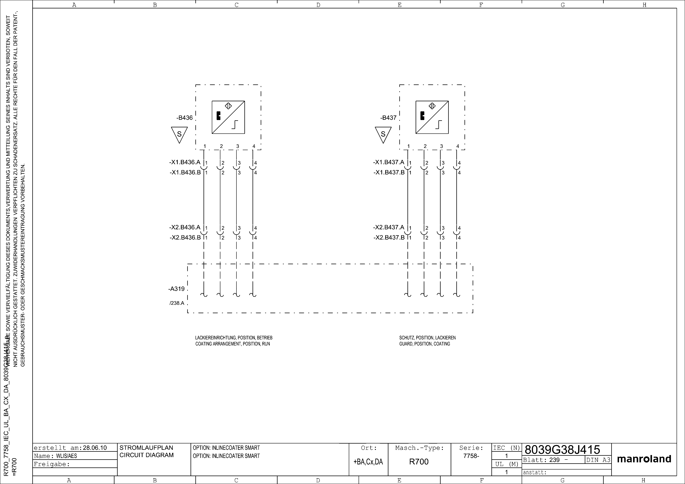

# +BA_Cx_DA — Sheet 239 of 247 — OPTION: INLINECOATER SMART

**OPTION: INLINECOATER SMART**

> Part of the manroland **R700** printing press IEC/UL circuit diagrams.
> Drawing class: **Stromlaufplan / Circuit diagram** (DIN A3).
> Document `+BA_Cx_DA` covers the **Printing units / main switch cabinet** machine section.

## At a glance

| Field | Value |
|---|---|
| Document | `+BA_Cx_DA`  (8039G38J415) |
| Sheet | **239** of 247 |
| Section (DE) | OPTION: INLINECOATER SMART |
| Section (EN) | OPTION: INLINECOATER SMART |
| Section type | CIRCUIT — Circuit diagram |
| Machine type | `R700` |
| Series | `7758` |
| Created | 28.06.10 |
| Replaces | — |
| Columns used | B, C, E, F |
| Path numbers | — |
| Labels on sheet | 58 |
| Cross-refs out | 1 |
| Cross-refs in | 33 |

**Previous:** [+BA_Cx_DA sheet 238](SHEET_0238.md) · **Next:** [+BA_Cx_DA sheet 240](SHEET_0240.md) · **Document TOC:** [_TOC.md](_TOC.md)  (+BA_Cx_DA) · **Master TOC:** [all sheets](../_MASTER_TOC.md)

## Sheet image (300 DPI, exact vector render)



_Rendered directly from the PDF vector layer at 300 DPI (1-bit), no OCR and no resampling. Use it to confirm anything ambiguous in the text below._

## Cross-references on this sheet

Each entry is a wire leaving this sheet. The printed token is `/sheet.column`; the link resolves to that sheet inside the same document.

| Ref | Target sheet | Col | Path | Destination on target | Target section | From col |
|---|---|---|---|---|---|---|
| `/238.A` | [+BA_Cx_DA sheet 238](SHEET_0238.md) | A | — | — | OPTION: INLINECOATER SMART | B |

### Incoming references (sheets that point here)

Every other sheet that sends a wire to this one. `Back-ref` is the token printed on *that* sheet; `Path` is its line number.

| From sheet | Cols | Back-ref | Path | Refs | What continues there |
|---|---|---|---|---|---|
| [+BA_Cx_DA#146](SHEET_0146.md) | C, E | `/146.C`, `/146.E` | — | 16 | — |
| [+BA_Cx_DA#154](SHEET_0154.md) | E, F | `/154.E`, `/154.F` | — | 16 | — |
| [+BA_Cx_DA#238](SHEET_0238.md) | A | `/238.A` | — | 1 | — |


## Devices on this sheet

| Tag | Class | Class meaning (IEC) | Col | Sub | Terminal | Sign |
|---|---|---|---|---|---|---|
| `B437` | B | Umformer / transducer, sensor | E | — | — | — |
| `B436` | B | Umformer / transducer, sensor | B | — | — | — |
| `A319` | A | Baugruppe / assembly, module, PC board | B | — | — | — |
| `X1.B437.B` | — | cross-device reference | E | — | — | — |
| `X1.B437.A` | — | cross-device reference | E | — | — | — |
| `X1.B436.B` | — | cross-device reference | B | — | — | — |
| `X1.B436.A` | — | cross-device reference | B | — | — | — |
| `X2.B437.B` | — | cross-device reference | E | — | — | — |
| `X2.B437.A` | — | cross-device reference | E | — | — | — |
| `X2.B436.B` | — | cross-device reference | B | — | — | — |
| `X2.B436.A` | — | cross-device reference | B | — | — | — |

## Potentials / nets

_No named potentials on this sheet._

## Wire-end annotations (grouped as printed)

A wire that continues elsewhere is annotated with a small cluster: the destination description, the path/line number `#NN`, and the `/sheet.column` cross reference. Each row below is one such cluster exactly as it is grouped on the drawing.

| Col | Y | Path | Cross-ref | Text on the wire |
|---|---|---|---|---|
| B | 200.1 | — | — | `B436` |
| E | 200.1 | — | — | `B437` |
| D | 227.9 | — | — | `S S` |
| C | 250.5 | — | — | `1 2 3 4` |
| E | 250.5 | — | — | `1 2 3 4` |
| C | 277.4 | — | — | `X1.B436.A 1 2 3 4` |
| E | 277.4 | — | — | `X1.B437.A 1 2 3 4` |
| C | 295.1 | — | — | `X1.B436.B 1 2 3 4` |
| E | 295.1 | — | — | `X1.B437.B 1 2 3 4` |
| C | 390.8 | — | — | `X2.B436.A 1 2 3 4` |
| E | 390.8 | — | — | `X2.B437.A 1 2 3 4` |
| C | 408.5 | — | — | `X2.B436.B 1 2 3 4` |
| E | 408.5 | — | — | `X2.B437.B 1 2 3 4` |
| B | 497.8 | — | — | `A319` |
| B | 523.3 | — | `/238.A` | — |
| C | 584.6 | — | — | `LACKIEREINRICHTUNG, POSITION, BETRIEB` |
| E | 584.6 | — | — | `SCHUTZ, POSITION, LACKIEREN GUARD, POSITION, COATING` |
| C | 595.2 | — | — | `COATING ARRANGEMENT, POSITION, RUN` |


## Notes and free text on this sheet

| Text | Col | Y (pt) |
|---|---|---|
| `S` | E | 227.86 |
| `S` | B | 227.86 |
| `LACKIEREINRICHTUNG, POSITION, BETRIEB` | C | 584.56 |
| `COATING ARRANGEMENT, POSITION, RUN` | C | 595.2 |
| `SCHUTZ, POSITION, LACKIEREN` | E | 584.56 |
| `GUARD, POSITION, COATING` | E | 595.19 |

## Complete label inventory (exact text from the drawing)

Every text object inside the drawing area of this sheet, in DIN reading order (column A→H, then top→bottom). This is the authoritative list: if a string is not here it is not printed on this sheet.

| Col | Y | X | Dir | Type | Text |
|---|---|---|---|---|---|
| B | 200.1 | 306.7 | → | device tag | `B436` |
| B | 227.9 | 307.7 | → | text | `S` |
| B | 277.4 | 294.2 | → | device ref | `X1.B436.A` |
| B | 295.1 | 295.1 | → | device ref | `X1.B436.B` |
| B | 390.8 | 294.2 | → | device ref | `X2.B436.A` |
| B | 408.5 | 295.1 | → | device ref | `X2.B436.B` |
| B | 497.8 | 292.5 | → | device tag | `A319` |
| B | 523.3 | 294.8 | → | cross-reference | `/238.A` |
| C | 250.5 | 353.5 | → | number | `1` |
| C | 250.5 | 382.4 | → | number | `2` |
| C | 250.5 | 410.7 | → | number | `3` |
| C | 250.5 | 439.1 | → | number | `4` |
| C | 279.5 | 356.3 | → | number | `1` |
| C | 279.5 | 385.2 | → | number | `2` |
| C | 279.5 | 413.6 | → | number | `3` |
| C | 279.5 | 441.9 | → | number | `4` |
| C | 296.5 | 356.3 | → | number | `1` |
| C | 296.5 | 385.2 | → | number | `2` |
| C | 296.5 | 413.6 | → | number | `3` |
| C | 296.5 | 441.9 | → | number | `4` |
| C | 392.9 | 356.3 | → | number | `1` |
| C | 392.9 | 385.2 | → | number | `2` |
| C | 392.9 | 413.6 | → | number | `3` |
| C | 392.9 | 441.9 | → | number | `4` |
| C | 409.9 | 356.3 | → | number | `1` |
| C | 409.9 | 385.2 | → | number | `2` |
| C | 409.9 | 413.6 | → | number | `3` |
| C | 409.9 | 441.9 | → | number | `4` |
| C | 584.6 | 339.3 | → | text | `LACKIEREINRICHTUNG, POSITION, BETRIEB` |
| C | 595.2 | 339.9 | → | text | `COATING ARRANGEMENT, POSITION, RUN` |
| E | 200.1 | 661.0 | → | device tag | `B437` |
| E | 227.9 | 662.0 | → | text | `S` |
| E | 250.5 | 707.8 | → | number | `1` |
| E | 250.5 | 736.7 | → | number | `2` |
| E | 277.4 | 648.6 | → | device ref | `X1.B437.A` |
| E | 279.5 | 710.6 | → | number | `1` |
| E | 279.5 | 739.6 | → | number | `2` |
| E | 295.1 | 649.4 | → | device ref | `X1.B437.B` |
| E | 296.5 | 710.6 | → | number | `1` |
| E | 296.5 | 739.6 | → | number | `2` |
| E | 390.8 | 648.6 | → | device ref | `X2.B437.A` |
| E | 392.9 | 710.6 | → | number | `1` |
| E | 392.9 | 739.6 | → | number | `2` |
| E | 408.5 | 649.4 | → | device ref | `X2.B437.B` |
| E | 409.9 | 710.6 | → | number | `1` |
| E | 409.9 | 739.6 | → | number | `2` |
| E | 584.6 | 694.2 | → | text | `SCHUTZ, POSITION, LACKIEREN` |
| E | 595.2 | 694.2 | → | text | `GUARD, POSITION, COATING` |
| F | 250.5 | 765.1 | → | number | `3` |
| F | 250.5 | 793.4 | → | number | `4` |
| F | 279.5 | 767.9 | → | number | `3` |
| F | 279.5 | 796.3 | → | number | `4` |
| F | 296.5 | 767.9 | → | number | `3` |
| F | 296.5 | 796.3 | → | number | `4` |
| F | 392.9 | 767.9 | → | number | `3` |
| F | 392.9 | 796.3 | → | number | `4` |
| F | 409.9 | 767.9 | → | number | `3` |
| F | 409.9 | 796.3 | → | number | `4` |

## Reading-order text block

The same content as a plain block, grouped by DIN column — convenient to paste or to match against a visual description.

```text
=== Column B ===
 200.1  306.7  devtag       B436
 227.9  307.7  text         S
 277.4  294.2  devref       X1.B436.A
 295.1  295.1  devref       X1.B436.B
 390.8  294.2  devref       X2.B436.A
 408.5  295.1  devref       X2.B436.B
 497.8  292.5  devtag       A319
 523.3  294.8  xref         /238.A
=== Column C ===
 250.5  353.5  numeric      1
 250.5  382.4  numeric      2
 250.5  410.7  numeric      3
 250.5  439.1  numeric      4
 279.5  356.3  numeric      1
 279.5  385.2  numeric      2
 279.5  413.6  numeric      3
 279.5  441.9  numeric      4
 296.5  356.3  numeric      1
 296.5  385.2  numeric      2
 296.5  413.6  numeric      3
 296.5  441.9  numeric      4
 392.9  356.3  numeric      1
 392.9  385.2  numeric      2
 392.9  413.6  numeric      3
 392.9  441.9  numeric      4
 409.9  356.3  numeric      1
 409.9  385.2  numeric      2
 409.9  413.6  numeric      3
 409.9  441.9  numeric      4
 584.6  339.3  text         LACKIEREINRICHTUNG, POSITION, BETRIEB
 595.2  339.9  text         COATING ARRANGEMENT, POSITION, RUN
=== Column E ===
 200.1  661.0  devtag       B437
 227.9  662.0  text         S
 250.5  707.8  numeric      1
 250.5  736.7  numeric      2
 277.4  648.6  devref       X1.B437.A
 279.5  710.6  numeric      1
 279.5  739.6  numeric      2
 295.1  649.4  devref       X1.B437.B
 296.5  710.6  numeric      1
 296.5  739.6  numeric      2
 390.8  648.6  devref       X2.B437.A
 392.9  710.6  numeric      1
 392.9  739.6  numeric      2
 408.5  649.4  devref       X2.B437.B
 409.9  710.6  numeric      1
 409.9  739.6  numeric      2
 584.6  694.2  text         SCHUTZ, POSITION, LACKIEREN
 595.2  694.2  text         GUARD, POSITION, COATING
=== Column F ===
 250.5  765.1  numeric      3
 250.5  793.4  numeric      4
 279.5  767.9  numeric      3
 279.5  796.3  numeric      4
 296.5  767.9  numeric      3
 296.5  796.3  numeric      4
 392.9  767.9  numeric      3
 392.9  796.3  numeric      4
 409.9  767.9  numeric      3
 409.9  796.3  numeric      4
```

---
_Generated from the PDF vector text layer; no OCR. Source: `R700_7758_IEC_UL_BA_CX_DA_8039G38J415_p`, sheet 239._
