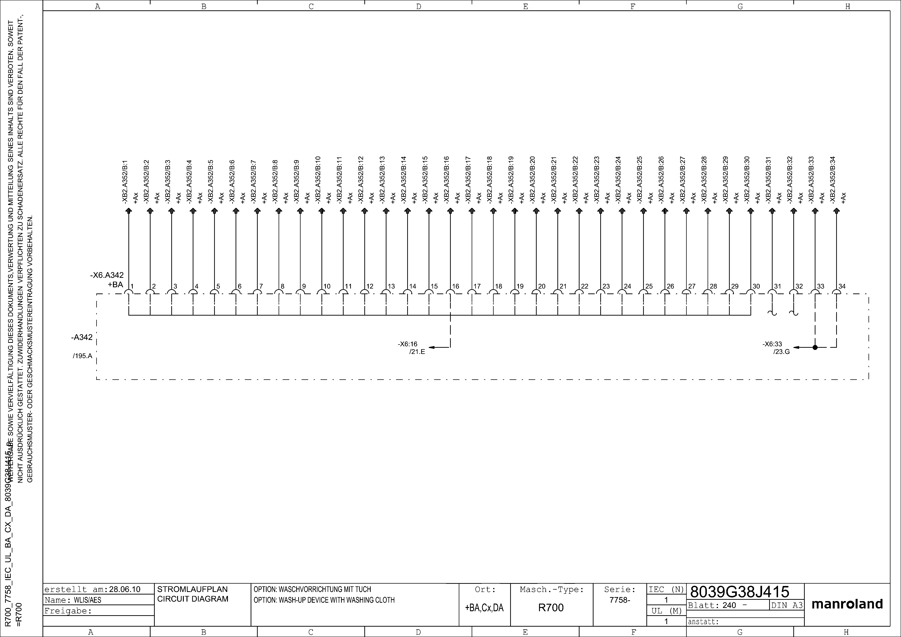

# +BA_Cx_DA — Sheet 240 of 247 — OPTION: WASCHVORRICHTUNG MIT TUCH

**OPTION: WASH UP DEVICE WITH WASHING CLOTH**

> Part of the manroland **R700** printing press IEC/UL circuit diagrams.
> Drawing class: **Stromlaufplan / Circuit diagram** (DIN A3).
> Document `+BA_Cx_DA` covers the **Printing units / main switch cabinet** machine section.

## At a glance

| Field | Value |
|---|---|
| Document | `+BA_Cx_DA`  (8039G38J415) |
| Sheet | **240** of 247 |
| Section (DE) | OPTION: WASCHVORRICHTUNG MIT TUCH |
| Section (EN) | OPTION: WASH UP DEVICE WITH WASHING CLOTH |
| Section type | CIRCUIT — Circuit diagram |
| Machine type | `R700` |
| Series | `7758` |
| Created | 28.06.10 |
| Replaces | — |
| Columns used | A, B, C, D, E, F, G, H |
| Path numbers | — |
| Labels on sheet | 110 |
| Cross-refs out | 3 |
| Cross-refs in | 37 |

**Previous:** [+BA_Cx_DA sheet 239](SHEET_0239.md) · **Next:** [+BA_Cx_DA sheet 241](SHEET_0241.md) · **Document TOC:** [_TOC.md](_TOC.md)  (+BA_Cx_DA) · **Master TOC:** [all sheets](../_MASTER_TOC.md)

## Sheet image (300 DPI, exact vector render)



_Rendered directly from the PDF vector layer at 300 DPI (1-bit), no OCR and no resampling. Use it to confirm anything ambiguous in the text below._

## Cross-references on this sheet

Each entry is a wire leaving this sheet. The printed token is `/sheet.column`; the link resolves to that sheet inside the same document.

| Ref | Target sheet | Col | Path | Destination on target | Target section | From col |
|---|---|---|---|---|---|---|
| `/21.E` | [+BA_Cx_DA sheet 21](SHEET_0021.md) | E | — | X6:16 X6:33 | BUSVERBINDUNGEN: SICHERHEITSBUS | F |
| `/23.G` | [+BA_Cx_DA sheet 23](SHEET_0023.md) | G | — | X6:16 X6:33 | BUSVERBINDUNGEN: SICHERHEITSBUS | F |
| `/195.A` | [+BA_Cx_DA sheet 195](SHEET_0195.md) | A | — | — | OPTION: WASCHVORRICHTUNG MIT BÜRSTE | A |

### Incoming references (sheets that point here)

Every other sheet that sends a wire to this one. `Back-ref` is the token printed on *that* sheet; `Path` is its line number.

| From sheet | Cols | Back-ref | Path | Refs | What continues there |
|---|---|---|---|---|---|
| [+BA_Cx_DA#21](SHEET_0021.md) | E | `/21.E` | — | 1 | — |
| [+BA_Cx_DA#23](SHEET_0023.md) | G | `/23.G` | — | 1 | X2:40 X6:33 |
| [+BA_Cx_DA#162](SHEET_0162.md) | F, G | `/162.F`, `/162.G` | — | 34 | — |
| [+BA_Cx_DA#195](SHEET_0195.md) | A | `/195.A` | — | 1 | — |


## Devices on this sheet

| Tag | Class | Class meaning (IEC) | Col | Sub | Terminal | Sign |
|---|---|---|---|---|---|---|
| `A342` | A | Baugruppe / assembly, module, PC board | A | — | — | — |
| `X6:33` | X | Klemme / terminal, plug connector | G | — | 33 | — |
| `X6:16` | X | Klemme / terminal, plug connector | D | — | 16 | — |
| `X6.A342` | — | cross-device reference | A | — | — | — |

## Potentials / nets

_No named potentials on this sheet._

## Wire-end annotations (grouped as printed)

A wire that continues elsewhere is annotated with a small cluster: the destination description, the path/line number `#NN`, and the `/sheet.column` cross reference. Each row below is one such cluster exactly as it is grouped on the drawing.

| Col | Y | Path | Cross-ref | Text on the wire |
|---|---|---|---|---|
| C | 206.4 | — | — | `XB2.A352/B:10` |
| C | 206.4 | — | — | `XB2.A352/B:11` |
| C | 206.4 | — | — | `XB2.A352/B:12` |
| D | 206.4 | — | — | `XB2.A352/B:13` |
| D | 206.4 | — | — | `XB2.A352/B:14` |
| D | 206.4 | — | — | `XB2.A352/B:15` |
| D | 206.4 | — | — | `XB2.A352/B:16` |
| D | 206.4 | — | — | `XB2.A352/B:17` |
| E | 206.4 | — | — | `XB2.A352/B:18` |
| E | 206.4 | — | — | `XB2.A352/B:19` |
| E | 206.4 | — | — | `XB2.A352/B:20` |
| E | 206.4 | — | — | `XB2.A352/B:21` |
| E | 206.4 | — | — | `XB2.A352/B:22` |
| F | 206.4 | — | — | `XB2.A352/B:23` |
| F | 206.4 | — | — | `XB2.A352/B:24` |
| F | 206.4 | — | — | `XB2.A352/B:25` |
| F | 206.4 | — | — | `XB2.A352/B:26` |
| F | 206.4 | — | — | `XB2.A352/B:27` |
| G | 206.4 | — | — | `XB2.A352/B:28` |
| G | 206.4 | — | — | `XB2.A352/B:29` |
| G | 206.4 | — | — | `XB2.A352/B:30` |
| G | 206.4 | — | — | `XB2.A352/B:31` |
| G | 206.4 | — | — | `XB2.A352/B:32` |
| H | 206.4 | — | — | `XB2.A352/B:33` |
| H | 206.4 | — | — | `XB2.A352/B:34` |
| A | 211.2 | — | — | `XB2.A352/B:1` |
| A | 211.2 | — | — | `XB2.A352/B:2` |
| B | 211.2 | — | — | `XB2.A352/B:3` |
| B | 211.2 | — | — | `XB2.A352/B:4` |
| B | 211.2 | — | — | `XB2.A352/B:5` |
| B | 211.2 | — | — | `XB2.A352/B:6` |
| B | 211.2 | — | — | `XB2.A352/B:7` |
| C | 211.2 | — | — | `XB2.A352/B:8` |
| C | 211.2 | — | — | `XB2.A352/B:9` |
| A | 254.6 | — | — | `+Ax` |
| B | 254.6 | — | — | `+Ax` |
| B | 254.6 | — | — | `+Ax` |
| B | 254.6 | — | — | `+Ax` |
| B | 254.6 | — | — | `+Ax` |
| B | 254.6 | — | — | `+Ax` |
| C | 254.6 | — | — | `+Ax` |
| C | 254.6 | — | — | `+Ax` |
| C | 254.6 | — | — | `+Ax` |
| C | 254.6 | — | — | `+Ax` |
| C | 254.6 | — | — | `+Ax` |
| D | 254.6 | — | — | `+Ax` |
| D | 254.6 | — | — | `+Ax` |
| D | 254.6 | — | — | `+Ax` |
| D | 254.6 | — | — | `+Ax` |
| D | 254.6 | — | — | `+Ax` |
| E | 254.6 | — | — | `+Ax` |
| E | 254.6 | — | — | `+Ax` |
| E | 254.6 | — | — | `+Ax` |
| E | 254.6 | — | — | `+Ax` |
| E | 254.6 | — | — | `+Ax` |
| F | 254.6 | — | — | `+Ax` |
| F | 254.6 | — | — | `+Ax` |
| F | 254.6 | — | — | `+Ax` |
| F | 254.6 | — | — | `+Ax` |
| F | 254.6 | — | — | `+Ax` |
| G | 254.6 | — | — | `+Ax` |
| G | 254.6 | — | — | `+Ax` |
| G | 254.6 | — | — | `+Ax` |
| G | 254.6 | — | — | `+Ax` |
| G | 254.6 | — | — | `+Ax` |
| H | 254.6 | — | — | `+Ax` |
| H | 254.6 | — | — | `+Ax` |
| H | 254.6 | — | — | `+Ax` |
| A | 358.9 | — | — | `X6.A342 1` |
| E | 371.6 | — | — | `+BA 2 3 4 5 6 7 8 9 10 11 12 13 14 15 16 17 18 19 20 21 22 23 24 25 26 27 28 29 30 31 32 33 34` |
| A | 441.1 | — | — | `A342` |
| F | 451.0 | — | `/21.E`, `/23.G` | `X6:16 X6:33` |
| A | 466.6 | — | `/195.A` | — |


## Notes and free text on this sheet

| Text | Col | Y (pt) |
|---|---|---|
| `+BA` | A | 371.57 |
| `XB2.A352/B:1` | A | 211.18 |
| `+Ax` | A | 254.55 |
| `XB2.A352/B:2` | A | 211.18 |
| `+Ax` | B | 254.55 |
| `XB2.A352/B:3` | B | 211.18 |
| `XB2.A352/B:4` | B | 211.18 |
| `XB2.A352/B:5` | B | 211.18 |
| `XB2.A352/B:6` | B | 211.18 |
| `XB2.A352/B:7` | B | 211.18 |
| `+Ax` | C | 254.55 |
| `XB2.A352/B:8` | C | 211.18 |
| `XB2.A352/B:9` | C | 211.18 |
| `XB2.A352/B:10` | C | 206.37 |
| `XB2.A352/B:11` | C | 206.37 |
| `XB2.A352/B:12` | C | 206.37 |
| `+Ax` | D | 254.55 |
| `XB2.A352/B:13` | D | 206.37 |
| `XB2.A352/B:14` | D | 206.37 |
| `XB2.A352/B:15` | D | 206.37 |
| `XB2.A352/B:16` | D | 206.37 |
| `XB2.A352/B:17` | D | 206.37 |
| `+Ax` | E | 254.55 |
| `XB2.A352/B:18` | E | 206.37 |
| `XB2.A352/B:19` | E | 206.37 |
| `XB2.A352/B:20` | E | 206.37 |
| `XB2.A352/B:21` | E | 206.37 |
| `XB2.A352/B:22` | E | 206.37 |
| `+Ax` | F | 254.55 |
| `XB2.A352/B:23` | F | 206.37 |
| `XB2.A352/B:24` | F | 206.37 |
| `XB2.A352/B:25` | F | 206.37 |
| `XB2.A352/B:26` | F | 206.37 |
| `XB2.A352/B:27` | F | 206.37 |
| `+Ax` | G | 254.55 |
| `XB2.A352/B:28` | G | 206.37 |
| `XB2.A352/B:29` | G | 206.37 |
| `XB2.A352/B:30` | G | 206.37 |
| `XB2.A352/B:31` | G | 206.37 |
| `XB2.A352/B:32` | G | 206.37 |
| `+Ax` | H | 254.55 |
| `XB2.A352/B:33` | H | 206.37 |
| `XB2.A352/B:34` | H | 206.37 |

## Complete label inventory (exact text from the drawing)

Every text object inside the drawing area of this sheet, in DIN reading order (column A→H, then top→bottom). This is the authoritative list: if a string is not here it is not printed on this sheet.

| Col | Y | X | Dir | Type | Text |
|---|---|---|---|---|---|
| A | 211.2 | 161.1 | ↕ | text | `XB2.A352/B:1` |
| A | 211.2 | 189.5 | ↕ | text | `XB2.A352/B:2` |
| A | 254.6 | 175.4 | ↕ | text | `+Ax` |
| A | 358.9 | 119.3 | → | device ref | `X6.A342` |
| A | 371.6 | 142.3 | → | text | `+BA` |
| A | 374.5 | 172.1 | → | number | `1` |
| A | 441.1 | 94.1 | → | device tag | `A342` |
| A | 466.6 | 96.4 | → | cross-reference | `/195.A` |
| B | 211.2 | 217.8 | ↕ | text | `XB2.A352/B:3` |
| B | 211.2 | 246.2 | ↕ | text | `XB2.A352/B:4` |
| B | 211.2 | 274.5 | ↕ | text | `XB2.A352/B:5` |
| B | 211.2 | 302.9 | ↕ | text | `XB2.A352/B:6` |
| B | 211.2 | 331.2 | ↕ | text | `XB2.A352/B:7` |
| B | 254.6 | 203.7 | ↕ | text | `+Ax` |
| B | 254.6 | 232.1 | ↕ | text | `+Ax` |
| B | 254.6 | 260.4 | ↕ | text | `+Ax` |
| B | 254.6 | 288.8 | ↕ | text | `+Ax` |
| B | 254.6 | 317.1 | ↕ | text | `+Ax` |
| B | 374.5 | 201.0 | → | number | `2` |
| B | 374.5 | 229.3 | → | number | `3` |
| B | 374.5 | 257.7 | → | number | `4` |
| B | 374.5 | 286.0 | → | number | `5` |
| B | 374.5 | 314.4 | → | number | `6` |
| C | 206.4 | 416.3 | ↕ | text | `XB2.A352/B:10` |
| C | 206.4 | 444.6 | ↕ | text | `XB2.A352/B:11` |
| C | 206.4 | 472.9 | ↕ | text | `XB2.A352/B:12` |
| C | 211.2 | 359.6 | ↕ | text | `XB2.A352/B:8` |
| C | 211.2 | 387.9 | ↕ | text | `XB2.A352/B:9` |
| C | 254.6 | 345.5 | ↕ | text | `+Ax` |
| C | 254.6 | 373.8 | ↕ | text | `+Ax` |
| C | 254.6 | 402.2 | ↕ | text | `+Ax` |
| C | 254.6 | 430.5 | ↕ | text | `+Ax` |
| C | 254.6 | 458.9 | ↕ | text | `+Ax` |
| C | 374.5 | 342.7 | → | number | `7` |
| C | 374.5 | 371.1 | → | number | `8` |
| C | 374.5 | 399.4 | → | number | `9` |
| C | 374.5 | 427.2 | → | number | `10` |
| C | 374.5 | 455.5 | → | number | `11` |
| D | 206.4 | 501.3 | ↕ | text | `XB2.A352/B:13` |
| D | 206.4 | 529.6 | ↕ | text | `XB2.A352/B:14` |
| D | 206.4 | 558.0 | ↕ | text | `XB2.A352/B:15` |
| D | 206.4 | 586.3 | ↕ | text | `XB2.A352/B:16` |
| D | 206.4 | 614.7 | ↕ | text | `XB2.A352/B:17` |
| D | 254.6 | 487.2 | ↕ | text | `+Ax` |
| D | 254.6 | 515.6 | ↕ | text | `+Ax` |
| D | 254.6 | 543.9 | ↕ | text | `+Ax` |
| D | 254.6 | 572.2 | ↕ | text | `+Ax` |
| D | 254.6 | 600.6 | ↕ | text | `+Ax` |
| D | 374.5 | 483.9 | → | number | `12` |
| D | 374.5 | 512.2 | → | number | `13` |
| D | 374.5 | 540.6 | → | number | `14` |
| D | 374.5 | 568.9 | → | number | `15` |
| D | 374.5 | 597.3 | → | number | `16` |
| D | 451.0 | 525.8 | → | device tag | `X6:16` |
| D | 460.9 | 541.1 | → | cross-reference | `/21.E` |
| E | 206.4 | 643.0 | ↕ | text | `XB2.A352/B:18` |
| E | 206.4 | 671.4 | ↕ | text | `XB2.A352/B:19` |
| E | 206.4 | 699.7 | ↕ | text | `XB2.A352/B:20` |
| E | 206.4 | 728.1 | ↕ | text | `XB2.A352/B:21` |
| E | 206.4 | 756.4 | ↕ | text | `XB2.A352/B:22` |
| E | 254.6 | 628.9 | ↕ | text | `+Ax` |
| E | 254.6 | 657.3 | ↕ | text | `+Ax` |
| E | 254.6 | 685.6 | ↕ | text | `+Ax` |
| E | 254.6 | 714.0 | ↕ | text | `+Ax` |
| E | 254.6 | 742.3 | ↕ | text | `+Ax` |
| E | 374.5 | 625.6 | → | number | `17` |
| E | 374.5 | 654.0 | → | number | `18` |
| E | 374.5 | 682.3 | → | number | `19` |
| E | 374.5 | 711.2 | → | number | `20` |
| E | 374.5 | 739.6 | → | number | `21` |
| F | 206.4 | 784.8 | ↕ | text | `XB2.A352/B:23` |
| F | 206.4 | 813.1 | ↕ | text | `XB2.A352/B:24` |
| F | 206.4 | 841.4 | ↕ | text | `XB2.A352/B:25` |
| F | 206.4 | 869.8 | ↕ | text | `XB2.A352/B:26` |
| F | 206.4 | 898.1 | ↕ | text | `XB2.A352/B:27` |
| F | 254.6 | 770.7 | ↕ | text | `+Ax` |
| F | 254.6 | 799.0 | ↕ | text | `+Ax` |
| F | 254.6 | 827.4 | ↕ | text | `+Ax` |
| F | 254.6 | 855.7 | ↕ | text | `+Ax` |
| F | 254.6 | 884.1 | ↕ | text | `+Ax` |
| F | 374.5 | 767.9 | → | number | `22` |
| F | 374.5 | 796.3 | → | number | `23` |
| F | 374.5 | 824.6 | → | number | `24` |
| F | 374.5 | 852.9 | → | number | `25` |
| F | 374.5 | 881.3 | → | number | `26` |
| G | 206.4 | 926.5 | ↕ | text | `XB2.A352/B:28` |
| G | 206.4 | 954.8 | ↕ | text | `XB2.A352/B:29` |
| G | 206.4 | 983.2 | ↕ | text | `XB2.A352/B:30` |
| G | 206.4 | 1011.5 | ↕ | text | `XB2.A352/B:31` |
| G | 206.4 | 1039.9 | ↕ | text | `XB2.A352/B:32` |
| G | 254.6 | 912.4 | ↕ | text | `+Ax` |
| G | 254.6 | 940.8 | ↕ | text | `+Ax` |
| G | 254.6 | 969.1 | ↕ | text | `+Ax` |
| G | 254.6 | 997.4 | ↕ | text | `+Ax` |
| G | 254.6 | 1025.8 | ↕ | text | `+Ax` |
| G | 374.5 | 909.6 | → | number | `27` |
| G | 374.5 | 938.0 | → | number | `28` |
| G | 374.5 | 966.3 | → | number | `29` |
| G | 374.5 | 994.7 | → | number | `30` |
| G | 374.5 | 1023.0 | → | number | `31` |
| G | 451.0 | 1007.7 | → | device tag | `X6:33` |
| G | 460.9 | 1022.2 | → | cross-reference | `/23.G` |
| H | 206.4 | 1068.2 | ↕ | text | `XB2.A352/B:33` |
| H | 206.4 | 1096.6 | ↕ | text | `XB2.A352/B:34` |
| H | 254.6 | 1054.1 | ↕ | text | `+Ax` |
| H | 254.6 | 1082.5 | ↕ | text | `+Ax` |
| H | 254.6 | 1110.8 | ↕ | text | `+Ax` |
| H | 374.5 | 1051.4 | → | number | `32` |
| H | 374.5 | 1079.7 | → | number | `33` |
| H | 374.5 | 1108.1 | → | number | `34` |

## Reading-order text block

The same content as a plain block, grouped by DIN column — convenient to paste or to match against a visual description.

```text
=== Column A ===
 211.2  161.1  text         XB2.A352/B:1
 211.2  189.5  text         XB2.A352/B:2
 254.6  175.4  text         +Ax
 358.9  119.3  devref       X6.A342
 371.6  142.3  text         +BA
 374.5  172.1  numeric      1
 441.1   94.1  devtag       A342
 466.6   96.4  xref         /195.A
=== Column B ===
 211.2  217.8  text         XB2.A352/B:3
 211.2  246.2  text         XB2.A352/B:4
 211.2  274.5  text         XB2.A352/B:5
 211.2  302.9  text         XB2.A352/B:6
 211.2  331.2  text         XB2.A352/B:7
 254.6  203.7  text         +Ax
 254.6  232.1  text         +Ax
 254.6  260.4  text         +Ax
 254.6  288.8  text         +Ax
 254.6  317.1  text         +Ax
 374.5  201.0  numeric      2
 374.5  229.3  numeric      3
 374.5  257.7  numeric      4
 374.5  286.0  numeric      5
 374.5  314.4  numeric      6
=== Column C ===
 206.4  416.3  text         XB2.A352/B:10
 206.4  444.6  text         XB2.A352/B:11
 206.4  472.9  text         XB2.A352/B:12
 211.2  359.6  text         XB2.A352/B:8
 211.2  387.9  text         XB2.A352/B:9
 254.6  345.5  text         +Ax
 254.6  373.8  text         +Ax
 254.6  402.2  text         +Ax
 254.6  430.5  text         +Ax
 254.6  458.9  text         +Ax
 374.5  342.7  numeric      7
 374.5  371.1  numeric      8
 374.5  399.4  numeric      9
 374.5  427.2  numeric      10
 374.5  455.5  numeric      11
=== Column D ===
 206.4  501.3  text         XB2.A352/B:13
 206.4  529.6  text         XB2.A352/B:14
 206.4  558.0  text         XB2.A352/B:15
 206.4  586.3  text         XB2.A352/B:16
 206.4  614.7  text         XB2.A352/B:17
 254.6  487.2  text         +Ax
 254.6  515.6  text         +Ax
 254.6  543.9  text         +Ax
 254.6  572.2  text         +Ax
 254.6  600.6  text         +Ax
 374.5  483.9  numeric      12
 374.5  512.2  numeric      13
 374.5  540.6  numeric      14
 374.5  568.9  numeric      15
 374.5  597.3  numeric      16
 451.0  525.8  devtag       X6:16
 460.9  541.1  xref         /21.E
=== Column E ===
 206.4  643.0  text         XB2.A352/B:18
 206.4  671.4  text         XB2.A352/B:19
 206.4  699.7  text         XB2.A352/B:20
 206.4  728.1  text         XB2.A352/B:21
 206.4  756.4  text         XB2.A352/B:22
 254.6  628.9  text         +Ax
 254.6  657.3  text         +Ax
 254.6  685.6  text         +Ax
 254.6  714.0  text         +Ax
 254.6  742.3  text         +Ax
 374.5  625.6  numeric      17
 374.5  654.0  numeric      18
 374.5  682.3  numeric      19
 374.5  711.2  numeric      20
 374.5  739.6  numeric      21
=== Column F ===
 206.4  784.8  text         XB2.A352/B:23
 206.4  813.1  text         XB2.A352/B:24
 206.4  841.4  text         XB2.A352/B:25
 206.4  869.8  text         XB2.A352/B:26
 206.4  898.1  text         XB2.A352/B:27
 254.6  770.7  text         +Ax
 254.6  799.0  text         +Ax
 254.6  827.4  text         +Ax
 254.6  855.7  text         +Ax
 254.6  884.1  text         +Ax
 374.5  767.9  numeric      22
 374.5  796.3  numeric      23
 374.5  824.6  numeric      24
 374.5  852.9  numeric      25
 374.5  881.3  numeric      26
=== Column G ===
 206.4  926.5  text         XB2.A352/B:28
 206.4  954.8  text         XB2.A352/B:29
 206.4  983.2  text         XB2.A352/B:30
 206.4 1011.5  text         XB2.A352/B:31
 206.4 1039.9  text         XB2.A352/B:32
 254.6  912.4  text         +Ax
 254.6  940.8  text         +Ax
 254.6  969.1  text         +Ax
 254.6  997.4  text         +Ax
 254.6 1025.8  text         +Ax
 374.5  909.6  numeric      27
 374.5  938.0  numeric      28
 374.5  966.3  numeric      29
 374.5  994.7  numeric      30
 374.5 1023.0  numeric      31
 451.0 1007.7  devtag       X6:33
 460.9 1022.2  xref         /23.G
=== Column H ===
 206.4 1068.2  text         XB2.A352/B:33
 206.4 1096.6  text         XB2.A352/B:34
 254.6 1054.1  text         +Ax
 254.6 1082.5  text         +Ax
 254.6 1110.8  text         +Ax
 374.5 1051.4  numeric      32
 374.5 1079.7  numeric      33
 374.5 1108.1  numeric      34
```

---
_Generated from the PDF vector text layer; no OCR. Source: `R700_7758_IEC_UL_BA_CX_DA_8039G38J415_p`, sheet 240._
