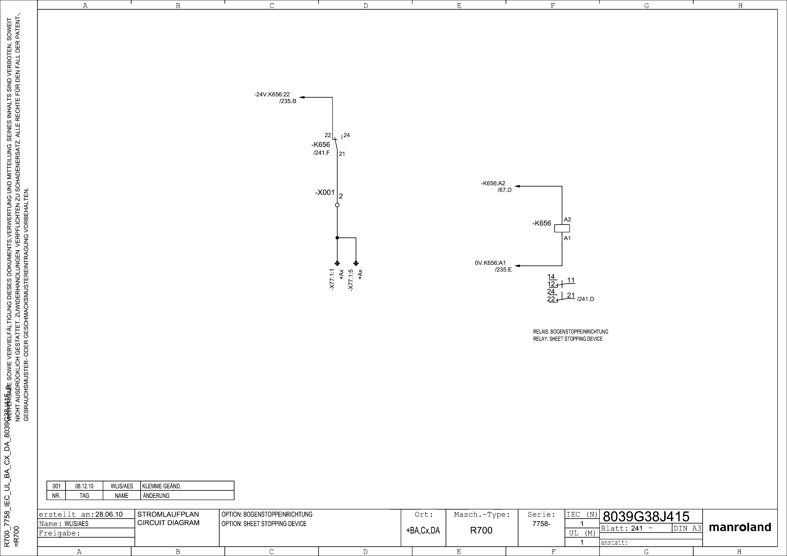

# +BA_Cx_DA — Sheet 241 of 247 — OPTION: BOGENSTOPPEINRICHTUNG

**OPTION: SHEET STOPPING DEVICE**

> Part of the manroland **R700** printing press IEC/UL circuit diagrams.
> Drawing class: **Stromlaufplan / Circuit diagram** (DIN A3).
> Document `+BA_Cx_DA` covers the **Printing units / main switch cabinet** machine section.

## At a glance

| Field | Value |
|---|---|
| Document | `+BA_Cx_DA`  (8039G38J415) |
| Sheet | **241** of 247 |
| Section (DE) | OPTION: BOGENSTOPPEINRICHTUNG |
| Section (EN) | OPTION: SHEET STOPPING DEVICE |
| Section type | CIRCUIT — Circuit diagram |
| Machine type | `R700` |
| Series | `7758` |
| Created | 28.06.10 |
| Replaces | — |
| Columns used | A, B, C, D, E, F |
| Path numbers | — |
| Labels on sheet | 37 |
| Cross-refs out | 5 |
| Cross-refs in | 5 |

**Previous:** [+BA_Cx_DA sheet 240](SHEET_0240.md) · **Next:** [+BA_Cx_DA sheet 242](SHEET_0242.md) · **Document TOC:** [_TOC.md](_TOC.md)  (+BA_Cx_DA) · **Master TOC:** [all sheets](../_MASTER_TOC.md)

## Sheet image (300 DPI, exact vector render)



_Rendered directly from the PDF vector layer at 300 DPI (1-bit), no OCR and no resampling. Use it to confirm anything ambiguous in the text below._

## Cross-references on this sheet

Each entry is a wire leaving this sheet. The printed token is `/sheet.column`; the link resolves to that sheet inside the same document.

| Ref | Target sheet | Col | Path | Destination on target | Target section | From col |
|---|---|---|---|---|---|---|
| `/235.B` | [+BA_Cx_DA sheet 235](SHEET_0235.md) | B | — | 24V.K656:22 | OPTION: INLINECOATER SMART | C |
| `/241.F` | [+BA_Cx_DA sheet 241](SHEET_0241.md) | F | — | — | OPTION: BOGENSTOPPEINRICHTUNG | D |
| `/67.D` | [+BA_Cx_DA sheet 67](SHEET_0067.md) | D | — | K656:A2 | TRENNBLÄSER / | E |
| `/235.E` | [+BA_Cx_DA sheet 235](SHEET_0235.md) | E | — | 0V.K656:A1 | OPTION: INLINECOATER SMART | E |
| `/241.D` | [+BA_Cx_DA sheet 241](SHEET_0241.md) | D | — | — | OPTION: BOGENSTOPPEINRICHTUNG | F |

### Incoming references (sheets that point here)

Every other sheet that sends a wire to this one. `Back-ref` is the token printed on *that* sheet; `Path` is its line number.

| From sheet | Cols | Back-ref | Path | Refs | What continues there |
|---|---|---|---|---|---|
| [+BA_Cx_DA#67](SHEET_0067.md) | D | `/67.D` | — | 1 | — |
| [+BA_Cx_DA#235](SHEET_0235.md) | B, E | `/235.B`, `/235.E` | — | 2 | — |
| [+BA_Cx_DA#241](SHEET_0241.md) | D, F | `/241.D`, `/241.F` | — | 2 | — |


## Devices on this sheet

| Tag | Class | Class meaning (IEC) | Col | Sub | Terminal | Sign |
|---|---|---|---|---|---|---|
| `K656` | K | Relais / relay, contactor | D | — | — | — |
| `X001` | X | Klemme / terminal, plug connector | D | — | — | — |
| `A2` | A | Baugruppe / assembly, module, PC board | F | — | — | — |
| `A1` | A | Baugruppe / assembly, module, PC board | F | — | — | — |
| `K656` | K | Relais / relay, contactor | F | — | — | — |
| `K656:A2` | K | Relais / relay, contactor | E | — | A2 | — |
| `X77.1:1` | — | cross-device reference | D | — | 1 | — |
| `X77.1:5` | — | cross-device reference | D | — | 5 | — |
| `NR.` | — | cross-device reference | A | — | — | — |
| `08.12.10` | — | cross-device reference | A | — | — | — |

## Potentials / nets

| Potential | Count | Columns | Attached devices | Terminals |
|---|---|---|---|---|
| `0V` | 1 | E | `K656` | `A1` |
| `24V` | 1 | C | `K656` | `22` |


A potential such as `L24+/4` or `M24+` is a named supply/return rail; every place it appears on this sheet is electrically common.

## Wire-end annotations (grouped as printed)

A wire that continues elsewhere is annotated with a small cluster: the destination description, the path/line number `#NN`, and the `/sheet.column` cross reference. Each row below is one such cluster exactly as it is grouped on the drawing.

| Col | Y | Path | Cross-ref | Text on the wire |
|---|---|---|---|---|
| C | 139.2 | — | `/235.B` | `24V.K656:22` |
| D | 200.9 | — | — | `K656 24` |
| D | 200.9 | — | — | `22` |
| D | 227.4 | — | `/241.F` | — |
| D | 229.2 | — | — | `21` |
| E | 273.8 | — | `/67.D` | `K656:A2` |
| D | 286.4 | — | — | `X001 2` |
| F | 328.4 | — | — | `A2` |
| F | 333.4 | — | — | `K656` |
| F | 356.7 | — | — | `A1` |
| E | 394.3 | — | `/235.E` | `0V.K656:A1` |
| D | 406.5 | — | — | `X77.1:1` |
| D | 407.9 | — | — | `X77.1:5` |
| D | 408.2 | — | — | `+Ax` |
| D | 408.2 | — | — | `+Ax` |
| F | 414.1 | — | — | `14 12 24 22 21` |
| F | 419.8 | — | — | `11` |
| F | 448.9 | — | `/241.D` | — |
| F | 499.5 | — | — | `RELAIS: BOGENSTOPPEINRICHTUNG RELAY: SHEET STOPPING DEVICE` |
| A | 733.0 | — | — | `001 08.12.10 WLIS/AES KLEMME GEÄND.` |
| A | 747.1 | — | — | `NR. TAG NAME ÄNDERUNG` |


## Notes and free text on this sheet

| Text | Col | Y (pt) |
|---|---|---|
| `+Ax` | D | 408.19 |
| `RELAIS: BOGENSTOPPEINRICHTUNG` | F | 499.52 |
| `RELAY: SHEET STOPPING DEVICE` | F | 510.14 |
| `TAG` | A | 747.27 |
| `NAME` | A | 747.25 |
| `ÄNDERUNG` | B | 747.31 |
| `WLIS/AES` | A | 733.08 |
| `KLEMME GEÄND.` | B | 733.11 |

## Complete label inventory (exact text from the drawing)

Every text object inside the drawing area of this sheet, in DIN reading order (column A→H, then top→bottom). This is the authoritative list: if a string is not here it is not printed on this sheet.

| Col | Y | X | Dir | Type | Text |
|---|---|---|---|---|---|
| A | 733.0 | 79.8 | → | number | `001` |
| A | 733.1 | 114.0 | → | device ref | `08.12.10` |
| A | 733.1 | 167.7 | → | text | `WLIS/AES` |
| A | 747.1 | 78.9 | → | device ref | `NR.` |
| A | 747.3 | 120.4 | → | text | `TAG` |
| A | 747.3 | 173.8 | → | text | `NAME` |
| B | 733.1 | 215.3 | → | text | `KLEMME GEÄND.` |
| B | 747.3 | 216.4 | → | text | `ÄNDERUNG` |
| C | 139.2 | 384.9 | → | potential | `24V.K656:22` |
| C | 149.1 | 422.6 | → | cross-reference | `/235.B` |
| D | 200.9 | 491.2 | → | number | `22` |
| D | 200.9 | 519.9 | → | number | `24` |
| D | 214.3 | 471.1 | → | device tag | `K656` |
| D | 227.4 | 474.2 | → | cross-reference | `/241.F` |
| D | 229.2 | 512.8 | → | number | `21` |
| D | 286.4 | 476.8 | → | device tag | `X001` |
| D | 292.2 | 512.8 | → | number | `2` |
| D | 406.5 | 498.5 | ↕ | device ref | `X77.1:1` |
| D | 407.9 | 526.8 | ↕ | device ref | `X77.1:5` |
| D | 408.2 | 512.7 | ↕ | text | `+Ax` |
| D | 408.2 | 541.1 | ↕ | text | `+Ax` |
| E | 273.8 | 727.9 | → | device tag | `K656:A2` |
| E | 283.7 | 753.2 | → | cross-reference | `/67.D` |
| E | 394.3 | 718.6 | → | potential | `0V.K656:A1` |
| E | 404.2 | 748.9 | → | cross-reference | `/235.E` |
| F | 328.4 | 853.2 | → | device tag | `A2` |
| F | 333.4 | 805.6 | → | device tag | `K656` |
| F | 356.7 | 853.2 | → | device tag | `A1` |
| F | 414.1 | 827.7 | → | number | `14` |
| F | 419.8 | 857.8 | → | number | `11` |
| F | 425.5 | 827.7 | → | number | `12` |
| F | 436.8 | 827.7 | → | number | `24` |
| F | 442.5 | 858.0 | → | number | `21` |
| F | 448.1 | 827.7 | → | number | `22` |
| F | 448.9 | 873.1 | → | cross-reference | `/241.D` |
| F | 499.5 | 807.0 | → | text | `RELAIS: BOGENSTOPPEINRICHTUNG` |
| F | 510.1 | 807.0 | → | text | `RELAY: SHEET STOPPING DEVICE` |

## Reading-order text block

The same content as a plain block, grouped by DIN column — convenient to paste or to match against a visual description.

```text
=== Column A ===
 733.0   79.8  numeric      001
 733.1  114.0  devref       08.12.10
 733.1  167.7  text         WLIS/AES
 747.1   78.9  devref       NR.
 747.3  120.4  text         TAG
 747.3  173.8  text         NAME
=== Column B ===
 733.1  215.3  text         KLEMME GEÄND.
 747.3  216.4  text         ÄNDERUNG
=== Column C ===
 139.2  384.9  net          24V.K656:22
 149.1  422.6  xref         /235.B
=== Column D ===
 200.9  491.2  numeric      22
 200.9  519.9  numeric      24
 214.3  471.1  devtag       K656
 227.4  474.2  xref         /241.F
 229.2  512.8  numeric      21
 286.4  476.8  devtag       X001
 292.2  512.8  numeric      2
 406.5  498.5  devref       X77.1:1
 407.9  526.8  devref       X77.1:5
 408.2  512.7  text         +Ax
 408.2  541.1  text         +Ax
=== Column E ===
 273.8  727.9  devtag       K656:A2
 283.7  753.2  xref         /67.D
 394.3  718.6  net          0V.K656:A1
 404.2  748.9  xref         /235.E
=== Column F ===
 328.4  853.2  devtag       A2
 333.4  805.6  devtag       K656
 356.7  853.2  devtag       A1
 414.1  827.7  numeric      14
 419.8  857.8  numeric      11
 425.5  827.7  numeric      12
 436.8  827.7  numeric      24
 442.5  858.0  numeric      21
 448.1  827.7  numeric      22
 448.9  873.1  xref         /241.D
 499.5  807.0  text         RELAIS: BOGENSTOPPEINRICHTUNG
 510.1  807.0  text         RELAY: SHEET STOPPING DEVICE
```

---
_Generated from the PDF vector text layer; no OCR. Source: `R700_7758_IEC_UL_BA_CX_DA_8039G38J415_p`, sheet 241._
