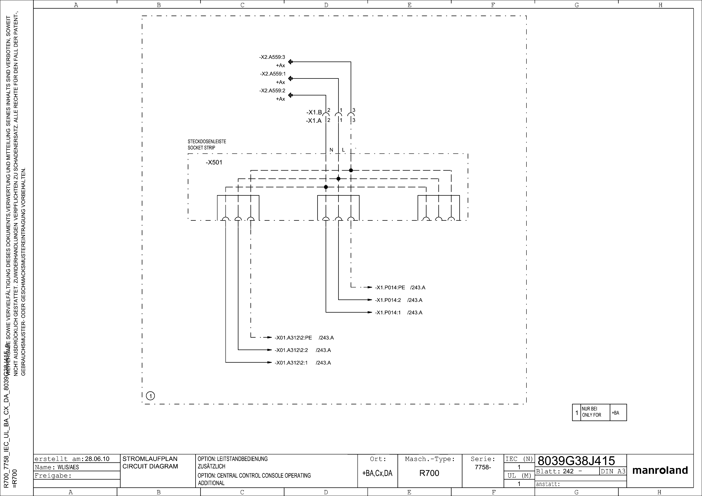

# +BA_Cx_DA — Sheet 242 of 247 — OPTION: LEITSTANDBEDIENUNG

**ZUSÄTZLICH**

> Part of the manroland **R700** printing press IEC/UL circuit diagrams.
> Drawing class: **Stromlaufplan / Circuit diagram** (DIN A3).
> Document `+BA_Cx_DA` covers the **Printing units / main switch cabinet** machine section.

## At a glance

| Field | Value |
|---|---|
| Document | `+BA_Cx_DA`  (8039G38J415) |
| Sheet | **242** of 247 |
| Section (DE) | OPTION: LEITSTANDBEDIENUNG |
| Section (EN) | ZUSÄTZLICH |
| Section type | CIRCUIT — Circuit diagram |
| Machine type | `R700` |
| Series | `7758` |
| Created | 28.06.10 |
| Replaces | — |
| Columns used | B, C, D, E, G |
| Path numbers | — |
| Labels on sheet | 37 |
| Cross-refs out | 6 |
| Cross-refs in | 12 |

**Previous:** [+BA_Cx_DA sheet 241](SHEET_0241.md) · **Next:** [+BA_Cx_DA sheet 243](SHEET_0243.md) · **Document TOC:** [_TOC.md](_TOC.md)  (+BA_Cx_DA) · **Master TOC:** [all sheets](../_MASTER_TOC.md)

## Sheet image (300 DPI, exact vector render)



_Rendered directly from the PDF vector layer at 300 DPI (1-bit), no OCR and no resampling. Use it to confirm anything ambiguous in the text below._

## Cross-references on this sheet

Each entry is a wire leaving this sheet. The printed token is `/sheet.column`; the link resolves to that sheet inside the same document.

| Ref | Target sheet | Col | Path | Destination on target | Target section | From col |
|---|---|---|---|---|---|---|
| `/243.A` | [+BA_Cx_DA sheet 243](SHEET_0243.md) | A | — | X1.P014:PE | OPTION: LEITSTANDBEDIENUNG | E |
| `/243.A` | [+BA_Cx_DA sheet 243](SHEET_0243.md) | A | — | X1.P014:2 | OPTION: LEITSTANDBEDIENUNG | E |
| `/243.A` | [+BA_Cx_DA sheet 243](SHEET_0243.md) | A | — | X1.P014:1 | OPTION: LEITSTANDBEDIENUNG | E |
| `/243.A` | [+BA_Cx_DA sheet 243](SHEET_0243.md) | A | — | X01.A312\2:PE | OPTION: LEITSTANDBEDIENUNG | D |
| `/243.A` | [+BA_Cx_DA sheet 243](SHEET_0243.md) | A | — | X01.A312\2:2 | OPTION: LEITSTANDBEDIENUNG | D |
| `/243.A` | [+BA_Cx_DA sheet 243](SHEET_0243.md) | A | — | X01.A312\2:1 | OPTION: LEITSTANDBEDIENUNG | D |

### Incoming references (sheets that point here)

Every other sheet that sends a wire to this one. `Back-ref` is the token printed on *that* sheet; `Path` is its line number.

| From sheet | Cols | Back-ref | Path | Refs | What continues there |
|---|---|---|---|---|---|
| [+BA_Cx_DA#138](SHEET_0138.md) | A | `/138.A` | — | 6 | — |
| [+BA_Cx_DA#243](SHEET_0243.md) | A | `/243.A` | — | 6 | X01.A312\2:1; X01.A312\2:2; X01.A312\2:PE; X1.P014:1; X1.P014:2; X1.P014:PE |


## Devices on this sheet

| Tag | Class | Class meaning (IEC) | Col | Sub | Terminal | Sign |
|---|---|---|---|---|---|---|
| `X501` | X | Klemme / terminal, plug connector | C | — | — | — |
| `X1.A` | — | cross-device reference | D | — | — | — |
| `X1.B` | — | cross-device reference | D | — | — | — |
| `X2.A559:3` | — | cross-device reference | C | — | 3 | — |
| `X2.A559:1` | — | cross-device reference | C | — | 1 | — |
| `X2.A559:2` | — | cross-device reference | C | — | 2 | — |
| `X1.P014:PE` | — | cross-device reference | E | — | PE | — |
| `X1.P014:2` | — | cross-device reference | E | — | 2 | — |
| `X01.A312\2:1` | — | cross-device reference | D | — | 1 | — |
| `X01.A312\2:2` | — | cross-device reference | D | — | 2 | — |
| `X01.A312\2:PE` | — | cross-device reference | D | — | PE | — |
| `X1.P014:1` | — | cross-device reference | E | — | 1 | — |

## Potentials / nets

| Potential | Count | Columns | Attached devices | Terminals |
|---|---|---|---|---|
| `N` | 1 | D | — | — |


A potential such as `L24+/4` or `M24+` is a named supply/return rail; every place it appears on this sheet is electrically common.

## Wire-end annotations (grouped as printed)

A wire that continues elsewhere is annotated with a small cluster: the destination description, the path/line number `#NN`, and the `/sheet.column` cross reference. Each row below is one such cluster exactly as it is grouped on the drawing.

| Col | Y | Path | Cross-ref | Text on the wire |
|---|---|---|---|---|
| C | 93.1 | — | — | `X2.A559:3` |
| C | 107.4 | — | — | `+Ax` |
| C | 121.5 | — | — | `X2.A559:1` |
| C | 135.7 | — | — | `+Ax` |
| C | 149.8 | — | — | `X2.A559:2` |
| C | 164.1 | — | — | `+Ax` |
| D | 183.2 | — | — | `X1.B 2 1 3` |
| D | 200.2 | — | — | `X1.A 2 1 3` |
| C | 237.3 | — | — | `STECKDOSENLEISTE SOCKET STRIP N L '` |
| C | 271.0 | — | — | `X501` |
| E | 484.3 | — | `/243.A` | `X1.P014:PE` |
| E | 505.5 | — | `/243.A` | `X1.P014:2` |
| E | 526.8 | — | `/243.A` | `X1.P014:1` |
| D | 569.3 | — | `/243.A` | `X01.A312\2:PE` |
| D | 590.6 | — | `/243.A` | `X01.A312\2:2` |
| D | 611.8 | — | `/243.A` | `X01.A312\2:1` |
| B | 668.8 | — | — | `1` |
| G | 690.8 | — | — | `1 NUR BEI` |
| G | 697.9 | — | — | `ONLY FOR +BA` |


## Reconstructed tables

This sheet carries tabular content (pin map / terminal assignment / index). The grid below was rebuilt from the drawing's own rule lines, so each row is exactly one physical row of the table.

### Table 1 — 4 data rows × 6 columns (at x=439.4, y=104.9) — **+Ax X2.A559:1 +Ax X2.A559:2**

| +Ax X1.B X1.A |  | 2 2 N | 1 1 L | 3 3 ` |  |
|---|---|---|---|---|---|
|  |  |  |  |  | `X1.P014:PE /243.A` |
|  |  |  |  |  | `/243.A X1.P014:2` |
| `X01.A312\2:PE` |  | `/243.A` |  |  | `/243.A X1.P014:1` |
| `X01.A312\2:2` | `/243.A` |  |  |  |  |


## Notes and free text on this sheet

| Text | Col | Y (pt) |
|---|---|---|
| `STECKDOSENLEISTE` | C | 237.31 |
| `SOCKET STRIP` | C | 247.94 |
| `L` | D | 250.48 |
| `+Ax` | C | 107.37 |
| `NUR BEI` | G | 690.82 |
| `ONLY FOR` | G | 701.5 |
| `+BA` | G | 697.92 |

## Complete label inventory (exact text from the drawing)

Every text object inside the drawing area of this sheet, in DIN reading order (column A→H, then top→bottom). This is the authoritative list: if a string is not here it is not printed on this sheet.

| Col | Y | X | Dir | Type | Text |
|---|---|---|---|---|---|
| B | 668.8 | 253.4 | → | number | `1` |
| C | 93.1 | 439.7 | → | device ref | `X2.A559:3` |
| C | 107.4 | 468.3 | → | text | `+Ax` |
| C | 121.5 | 441.1 | → | device ref | `X2.A559:1` |
| C | 135.7 | 468.3 | → | text | `+Ax` |
| C | 149.8 | 439.9 | → | device ref | `X2.A559:2` |
| C | 164.1 | 468.3 | → | text | `+Ax` |
| C | 237.3 | 318.6 | → | text | `STECKDOSENLEISTE` |
| C | 247.9 | 318.6 | → | text | `SOCKET STRIP` |
| C | 271.0 | 349.2 | → | device tag | `X501` |
| D | 183.2 | 555.3 | → | number | `2` |
| D | 183.2 | 576.0 | → | number | `1` |
| D | 183.2 | 597.8 | → | number | `3` |
| D | 186.0 | 519.9 | → | device ref | `X1.B` |
| D | 200.2 | 519.0 | → | device ref | `X1.A` |
| D | 200.2 | 555.3 | → | number | `2` |
| D | 200.2 | 576.0 | → | number | `1` |
| D | 200.2 | 597.8 | → | number | `3` |
| D | 250.5 | 559.0 | → | potential | `N` |
| D | 250.5 | 580.3 | → | text | `L` |
| D | 250.5 | 602.1 | → | other | `'` |
| D | 569.3 | 466.0 | → | device ref | `X01.A312\2:PE` |
| D | 569.3 | 540.7 | → | cross-reference | `/243.A` |
| D | 590.6 | 466.0 | → | device ref | `X01.A312\2:2` |
| D | 590.6 | 535.7 | → | cross-reference | `/243.A` |
| D | 611.8 | 535.7 | → | cross-reference | `/243.A` |
| D | 611.9 | 466.0 | → | device ref | `X01.A312\2:1` |
| E | 484.3 | 636.1 | → | device ref | `X1.P014:PE` |
| E | 484.3 | 695.9 | → | cross-reference | `/243.A` |
| E | 505.5 | 690.9 | → | cross-reference | `/243.A` |
| E | 505.6 | 636.1 | → | device ref | `X1.P014:2` |
| E | 526.8 | 636.1 | → | device ref | `X1.P014:1` |
| E | 526.8 | 690.9 | → | cross-reference | `/243.A` |
| G | 690.8 | 987.0 | → | text | `NUR BEI` |
| G | 696.2 | 975.4 | → | number | `1` |
| G | 697.9 | 1037.9 | → | text | `+BA` |
| G | 701.5 | 987.6 | → | text | `ONLY FOR` |

## Reading-order text block

The same content as a plain block, grouped by DIN column — convenient to paste or to match against a visual description.

```text
=== Column B ===
 668.8  253.4  numeric      1
=== Column C ===
  93.1  439.7  devref       X2.A559:3
 107.4  468.3  text         +Ax
 121.5  441.1  devref       X2.A559:1
 135.7  468.3  text         +Ax
 149.8  439.9  devref       X2.A559:2
 164.1  468.3  text         +Ax
 237.3  318.6  text         STECKDOSENLEISTE
 247.9  318.6  text         SOCKET STRIP
 271.0  349.2  devtag       X501
=== Column D ===
 183.2  555.3  numeric      2
 183.2  576.0  numeric      1
 183.2  597.8  numeric      3
 186.0  519.9  devref       X1.B
 200.2  519.0  devref       X1.A
 200.2  555.3  numeric      2
 200.2  576.0  numeric      1
 200.2  597.8  numeric      3
 250.5  559.0  net          N
 250.5  580.3  text         L
 250.5  602.1  other        `
 569.3  466.0  devref       X01.A312\2:PE
 569.3  540.7  xref         /243.A
 590.6  466.0  devref       X01.A312\2:2
 590.6  535.7  xref         /243.A
 611.8  535.7  xref         /243.A
 611.9  466.0  devref       X01.A312\2:1
=== Column E ===
 484.3  636.1  devref       X1.P014:PE
 484.3  695.9  xref         /243.A
 505.5  690.9  xref         /243.A
 505.6  636.1  devref       X1.P014:2
 526.8  636.1  devref       X1.P014:1
 526.8  690.9  xref         /243.A
=== Column G ===
 690.8  987.0  text         NUR BEI
 696.2  975.4  numeric      1
 697.9 1037.9  text         +BA
 701.5  987.6  text         ONLY FOR
```

---
_Generated from the PDF vector text layer; no OCR. Source: `R700_7758_IEC_UL_BA_CX_DA_8039G38J415_p`, sheet 242._
